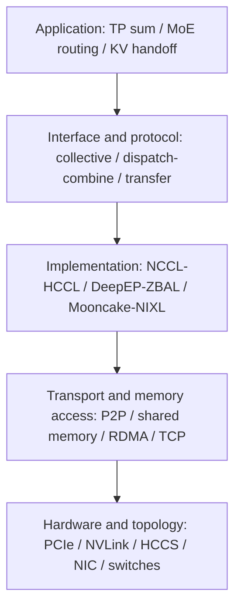

# 02. Links, RDMA, Registered Memory, and Completion Semantics

**English** | [简体中文](../../../zh/ai-infra-basic/Communication/02-links-rdma-and-memory.md)

## 1. Libraries, Transports, and Physical Links Occupy Different Layers



This is a reading model, not a claim that every library uses the same software stack.

| Name | Meaning | What It Does Not Imply |
|---|---|---|
| PCIe | interconnect between CPUs, accelerators, NICs, and other devices | devices in one machine always have an optimal P2P path |
| NVLink / NVSwitch | NVIDIA GPU interconnect and switching capabilities | every GPU pair has equal bandwidth or all cluster boundaries match |
| HCCS | Ascend high-speed interconnect; domains depend on hardware | HCCL is a physical link or all NPU generations share one topology |
| InfiniBand (IB) | a network architecture supporting RDMA | every application automatically uses RDMA |
| RoCE | RDMA over Ethernet | TCP sockets are equivalent to RoCE or any Ethernet configuration suffices |
| RDMA | remote memory access, including read/write operations | no CPU initialization, synchronization, congestion, or copying |
| TCP | reliable byte-stream transport | configuring an RDMA NIC eliminates TCP usage |

Draw topology as “device → PCIe/interconnect domain → NIC → switch → NIC → device,” including NUMA affinity. Crossing CPU sockets can change performance even with identical NICs. Scale-up and scale-out describe topology levels, not necessarily chassis boundaries.

## 2. What RDMA Can Avoid

Compare two illustrative paths:

```text
staged path:
device A -> host A -> NIC A -> network -> NIC B -> host B -> device B

device-direct path, when supported:
device A <-> NIC A -> network -> NIC B <-> device B
```

The second path can reduce host staging, subject to device, driver, memory-type, topology, and backend support. NVIDIA GPUDirect RDMA is one device-direct technology, not the universal name for RDMA on every platform. [Official GPUDirect RDMA documentation](https://docs.nvidia.com/cuda/gpudirect-rdma/)

RDMA Send/Recv differs from RDMA Read/Write: the former requires a receive-buffer protocol, whereas one-sided read/write lets an initiator address authorized remote memory. “One-sided” does not eliminate remote participation in setup, permissions, memory lifetime, or notification.

## 3. Memory Registration Is More Than Sending a Python Address

Use this lifecycle as a conceptual model, not executable library API:

```text
allocate buffer
  -> register / map memory with the transport
  -> exchange endpoint + region descriptors
  -> submit transfer
  -> observe completion and establish consumer ordering
  -> retire outstanding accesses
  -> deregister / free or return to pool
```

Registration lets the communication device/runtime locate and authorize access to memory. Verbs exposes concepts such as MR, lkey/rkey, QP, and CQ; higher-level transfer engines usually encapsulate them. A remote process cannot simply dereference another process's Python pointer.

Registration and connection setup may be expensive, motivating reuse of pools, registered regions, and connections. Before reuse, outstanding transfers must retire. Without coordination, cancellation and KV-slot reuse can allow a late write for an old request to overwrite a new request.

## 4. Distinguish Three Kinds of Completion

| Point | Usual Meaning | What Still Needs Checking |
|---|---|---|
| submission API returns | work is submitted or queued; synchronous APIs have their own contract | whether data movement finished |
| transfer completes | the specific API's completion contract is satisfied | consumer-stream visibility, dependencies, and notification |
| application becomes ready | payload and metadata are usable by the consumer | request validity and committed cache layout/state |

Read/write, completion, fence, quiet, and event guarantees differ. An ordinary CPU flag is not a device-wide memory barrier, and a global barrier does not repair arbitrary stream dependencies.

## 5. Device-Initiated Communication and Zero Copy Address Different Issues

- **Device-initiated communication** concerns who triggers an operation: a GPU/NPU kernel can initiate access after producing data, avoiding some host round trips while retaining runtime and memory protocols.
- **Zero copy / zero intermediate buffer** concerns which staging copies disappear: bytes still cross links, and outputs, indices, and synchronization structures still require memory.
- **Symmetric memory / global address mapping** provides structured remote addressing, not automatic cache coherence equivalent to ordinary shared memory.

[NVSHMEM](https://docs.nvidia.com/nvshmem/api/latest/) provides OpenSHMEM-based GPU one-sided communication; [UCX](https://openucx.org/) abstracts multiple transports; [MSCCL++](https://github.com/microsoft/mscclpp) provides GPU-oriented communication building blocks. Upper layers can use these tools, but not every DeepEP or KV-transfer version necessarily depends on them.

## 6. Initial Diagnostic Questions

1. Is the current transfer device-direct or host-staged, and what proves it?
2. Is registration paid at startup or repeated for every token?
3. Who keeps buffers alive until asynchronous operations complete?
4. Is this rank's NIC in the appropriate NUMA/interconnect domain?

Continue with [Gloo, NCCL, HCCL, and ProcessGroup](./03-collective-libraries-gloo-nccl-hccl.md).
