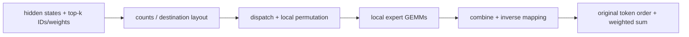

# 04. MoE Token Communication: DeepEP and ZBAL in SGLang NPU

**English** | [简体中文](../../../zh/ai-infra-basic/Communication/04-moe-deepep-and-zbal.md)

## 1. Turn Expert Selection into Data Movement

Assume two EP ranks with two experts each:

```text
rank 0 owns experts 0,1
rank 1 owns experts 2,3

token A starts on rank 0: experts [0,2], weights [0.25,0.75]
token B starts on rank 1: experts [2,3], weights [0.50,0.50]
```

One expert path for A stays on rank 0; the other goes to rank 1. Both paths for B stay on rank 1. There are four logical token-expert assignments, but only A→expert 2 requires cross-rank dispatch. `tokens * top_k` is not the number of tokens crossing the network.



## 2. What Dispatch/Combine Add Beyond AllToAll

| Step | Required Information / Contract |
|---|---|
| routing statistics | token-to-expert/rank mapping, destination counts, capacity |
| dispatch | hidden vectors, necessary scales/indices, expert-ready receive layout |
| expert compute | row ownership by local expert and padding identification |
| combine | original token/rank, inverse indices, location of top-k weight application |
| completion and reuse | when communication/GEMM finish reading buffers and handles can retire |

The mathematical target is `y_t = sum_j weight[t,j] * expert_j(x_t)`. Weights may be applied in the expert path or combine; follow the implementation contract exactly once. A dispatch handle often retains restoration metadata rather than merely representing a network connection.

When several target experts for one token reside on the same remote rank/node, optimized implementations may share a transfer and expand locally. Actual bytes depend on deduplication, padding, quantization, and topology. Skew also matters: balanced average token counts do not guarantee a short wait for the busiest expert.

## 3. DeepEP: Specialized Paths and Version Boundaries

[DeepEP](https://github.com/deepseek-ai/DeepEP/blob/93eb6eb238127e96c6d7a4a625a6dad158348509/README.md) provides optimized communication around MoE EP. For this repository, follow `Buffer/Config` and normal/low-latency branches in [token_dispatcher/deepep.py](../../../../python/sglang/srt/layers/moe/token_dispatcher/deepep.py):

| Workload | Common Optimization Target | Costs to Account For |
|---|---|---|
| training / larger prefill batches | throughput, batched movement, amortized layout processing | buffers, SM/core occupancy, packing/unpacking |
| decode / smaller token batches | lower startup/synchronization latency and earlier consumption | capacity bounds, reserved resources, different layouts or API contracts |

These are design goals, not rules that prefill must always use normal mode or decode must always use low-latency mode. Neither mode is universally faster across topologies.

**Version check, 2026-10-13**: the upstream main README uses newer interfaces such as `EPBuffer` and states that V1/NVSHMEM dependencies were removed in favor of the NCCL Gin path. Claims that DeepEP always requires NVSHMEM, always bypasses NCCL, or always provides zero-SM low-latency communication are therefore not version-independent facts. This repository's older interface cannot be paired with arbitrary latest upstream packages; check API, hardware, and runtime compatibility.

Likewise, NVIDIA DeepEP, upstream DeepEP-Ascend, and the `sgl-kernel-npu` DeepEP-Ascend implementation in this repository's walkthroughs are not interchangeable packages merely because of naming. Continue with the [DeepEP/HCCL walkthrough](../../ascend-kernel-infra/sgl-kernel-npu/05-deepep-hccl-and-moe-kernel-path.md) for that NPU implementation.

## 4. What ZBAL Is

This is the **ZBAL used by SGLang NPU**: **Zero Buffer Acceleration Library**, under `app/zbal` in Ascend MemFabric. Its official overview lists a secondary memory allocator, dispatch/combine, and several collectives. The README distinguishes A3 single-node and SuperPod support; this does not establish support for every Ascend model. [Official README](https://github.com/Ascend/memfabric_hybrid/blob/004d9317289fe99bd6bf13def0500b3fa3795ccc/app/zbal/README.md)

Its motivation can be understood as jointly designing memory allocation/layout and communication operators to reduce intermediate buffering and copying. It is more than renaming HCCL. **Zero Buffer does not mean no memory or no synchronization**: model tensors, outputs, registered regions, and auxiliary data still have lifetimes.

## 5. Three ZBAL Integration Points in SGLang

| Entry | Current Code Behavior | Why It Matters |
|---|---|---|
| [parallel_state.py](../../../../python/sglang/srt/distributed/parallel_state.py) | selects `zbal` for NPU when `SGLANG_ZBAL_LOCAL_MEM_SIZE > 0`, otherwise `hccl` | changes the default device communication backend |
| [npu/utils.py](../../../../python/sglang/srt/hardware_backend/npu/utils.py) | `init_zbal()`, `switch_to_allocator()`, `lazy_init_zbal_gva_mem()` | allocator, mixed allocation, and global-address memory setup are execution prerequisites |
| [deepep.py](../../../../python/sglang/srt/layers/moe/token_dispatcher/deepep.py) | imports `Config/Buffer` from `zbal` under the NPU+ZBAL condition, otherwise from `deep_ep` | one dispatcher entry can use different implementations |

The key backend selection is:

```python
"npu": "hccl" if not envs.SGLANG_ZBAL_LOCAL_MEM_SIZE.get() > 0 else "zbal"
```

The DeepEP adaptation entry is:

```python
if _is_npu and envs.SGLANG_ZBAL_LOCAL_MEM_SIZE.get() > 0:
    from zbal.zbal.deepep_adaptor import Config
    from zbal.zbal_buffer import Buffer
else:
    from deep_ep import Buffer, Config
```

`Scheduler.init_zbal_on_npu()` runs early. Mixed-allocation mode first switches the allocator; ModelRunner initializes the related memory later, before graph capture. The code multiplies `SGLANG_ZBAL_LOCAL_MEM_SIZE` by `1024**2` to obtain bytes; `SGLANG_ZBAL_BOOTSTRAP_URL` optionally supplies a bootstrap address. Setting a variable without compatible packages and correct initialization order is insufficient.

## 6. ZBAL and HCCL Are Not Simply Exclusive Alternatives

The ZBAL guide documents per-operator fallback to HCCL. A `zbal` backend name therefore does not establish that every operation excludes HCCL; check the version, operator, and configuration. [ZBAL user guide](https://github.com/Ascend/memfabric_hybrid/blob/004d9317289fe99bd6bf13def0500b3fa3795ccc/app/zbal/doc/user_guide/get_started.md)

Separately, [AscendTransferEngine](../../../../python/sglang/srt/disaggregation/ascend/transfer_engine.py) imports `memfabric_hybrid.TransferEngine` for PD data movement. It belongs to a related ecosystem but is not the same call chain as the `zbal` ProcessGroup or DeepEP adapter.

## 7. Practice and Checks

The [semantics demo](./communication_semantics_demo.py) implements the A/B routes, evaluates simple expert functions, restores and weights outputs, and compares them with direct computation.

1. Why do four expert assignments require only one cross-rank dispatch in this example?
2. Why does the class name `Buffer` not identify the communication implementation?
3. Which time belongs to dispatch transfer, and which belongs to routing, permutation, waiting, or expert GEMM?

Continue with [KV transfer, Mooncake, and NIXL](./05-kv-transfer-mooncake-and-nixl.md).
