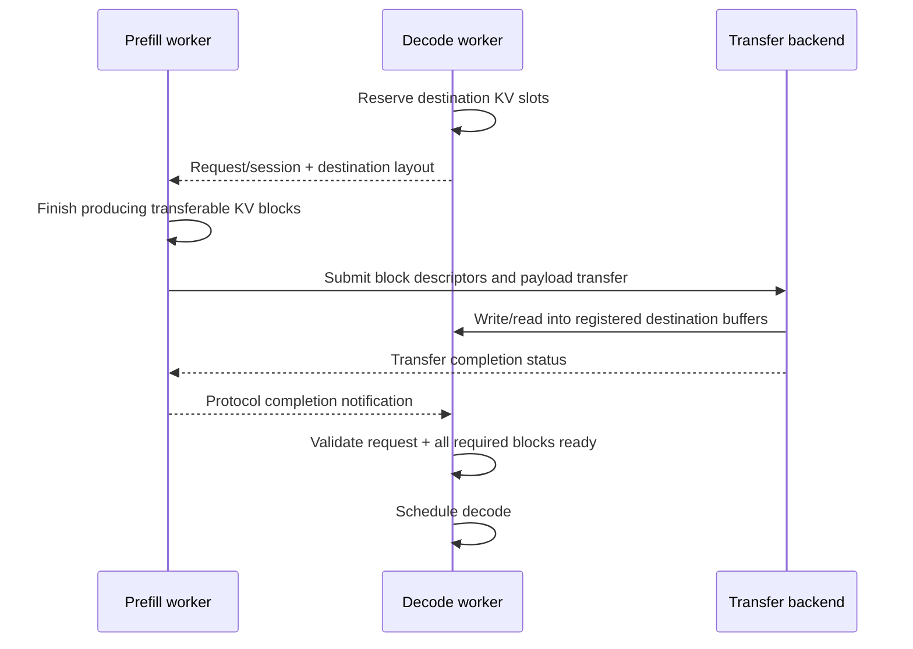

# 05. PD/KV Transfer: Mooncake, NIXL, and Ascend TransferEngine

**English** | [简体中文](../../../zh/ai-infra-basic/Communication/05-kv-transfer-mooncake-and-nixl.md)

## 1. KV Handoff Is Different from MoE Dispatch

MoE routes activations within a layer and combines outputs back to their tokens. PD disaggregation lets another instance continue the request, requiring historical KV, layout, and request-state handoff. It does not require every TP/EP rank to execute one AllReduce for every request.



This is a logical protocol: implementations may use push/pull, chunks, multiple sender ranks, and different notifications. The important dependencies connect destination reservation, producer completion, transfer completion, consumer visibility, and scheduler readiness.

## 2. Distinguish Mooncake Components

| Component | Question It Addresses | Repository Connection |
|---|---|---|
| Transfer Engine (TE) | how do batches of memory blocks move between endpoints? | `MooncakeTransferEngine`, PD sender/receiver |
| Mooncake Store | where are KV/objects stored, discovered, and reused? | HiCache remote storage backend |
| Mooncake EP | how are MoE tokens dispatched and returned? | separate `token_dispatcher/mooncake.py` |
| Mooncake PG | how does elastic process-group communication integrate? | elastic branch in `GroupCoordinator` |

TE typically registers local memory, locates a remote segment, submits batches, and checks completion. Store adds object/cache management above data movement. Mooncake also includes EP/PG, so describing the project as KV-only is inaccurate. [TE design](https://kvcache-ai.github.io/Mooncake/design/transfer-engine/index.html), [official Mooncake project](https://github.com/kvcache-ai/Mooncake)

This chapter focuses on TE and Store. When logs say “Mooncake,” identify the object being called: KV transfer, remote-cache access, or EP/PG? For example, the repository's [Mooncake EP dispatcher](../../../../python/sglang/srt/layers/moe/token_dispatcher/mooncake.py) explicitly raises `NotImplementedError` for normal mode. Project-wide capabilities do not establish support in a specific integration.

## 3. Control Messages and Payloads Can Take Different Paths

Control information includes request/session IDs, destination block addresses, shapes, dtypes, shard mappings, and completion status. The payload is KV content. Control may use TCP/ZMQ/RPC while payloads use RDMA or another transport.

[SGLang's Mooncake connection](../../../../python/sglang/srt/disaggregation/mooncake/conn.py) contains both transfer workers and notifications such as `sync_status_to_decode_endpoint()`. TCP connections therefore do not prove KV payloads avoid RDMA; conversely, an RDMA log does not prove every byte travels device-direct.

The transfer layer understands regions and byte counts, but typically cannot verify that a region contains the correct request's layer L, block B, and KV dtype. That belongs to the serving protocol and cache manager.

## 4. How Large Is a KV Transfer?

For ordinary MHA/GQA, assume equal K/V head dimensions across layers and no quantization, padding, replication, or prefix hits:

```math
\mathrm{KV}_{\mathrm{bytes}}=2\cdot L\cdot T\cdot H_{\mathrm{kv}}\cdot D\cdot \mathrm{bytes\_per\_element}
```

```math
L=32, T=8192, H_{\mathrm{kv}}=8, D=128, \mathrm{BF16}=2 \mathrm{bytes}
```

```math
\mathrm{KV}_{\mathrm{bytes}} = 1,073,741,824 \mathrm{bytes} = 1 \mathrm{GiB}
```

At aggregate effective bandwidth `50 GB/s`, the ideal payload-only transfer time is **21.47 ms**. GB is decimal; GiB is binary. This lower bound excludes queuing, registration, layout conversion, protocol, and synchronization. It is not TTFT: whether prefill already returns the first token and whether KV is pipelined in chunks affect user-visible latency.

With uniform TP sharding and no replication, each sender may hold roughly `1/P` of the bytes. Shared NICs or switches limit aggregate bandwidth, so total time cannot automatically be divided by `P` again. Different P/D TP degrees also require shard remapping.

Recompute from the actual storage format for compressed MLA caches, quantized KV, prefix hits, and GDN/Mamba recurrent state. The ordinary GQA equation is not universal. See [KV Cache Memory](../KV_Cache_Memory/README.md) and [GDN state](../Gated_Delta_Network/02-gdn-layer-dataflow-and-shapes.md).

## 5. Are NIXL and Mooncake Alternatives or Layers?

[NIXL, NVIDIA Inference Xfer Library](https://github.com/ai-dynamo/nixl), provides transfer interfaces with pluggable backends, including UCX and Mooncake. Direct Mooncake TE integration differs from using a Mooncake plugin through NIXL. Depending on the integration, they can be alternatives at one interface or layers in a stack.

NIXL still requires registered regions, peer metadata, request/transfer handles, and completion management. It does not automatically decide prefix eviction, KV-block request ownership, or decode scheduling. See this repository's PD integration in [disaggregation/nixl/conn.py](../../../../python/sglang/srt/disaggregation/nixl/conn.py); inspect other call sites for other NIXL uses.

## 6. Ascend: Reusing a Class Interface Does Not Reuse Its Implementation

[AscendTransferEngine](../../../../python/sglang/srt/disaggregation/ascend/transfer_engine.py) inherits the local `MooncakeTransferEngine` wrapper but instantiates `memfabric_hybrid.TransferEngine`. Current code accepts `sdma` / `device_rdma` through `ASCEND_MF_TRANSFER_PROTOCOL` and uses initialization settings including `ASCEND_MF_STORE_URL`.

Interface reuse does not imply a CUDA Mooncake package runs this NPU path or that the ZBAL ProcessGroup performs its KV transfer. Follow imports, constructors, and calls. SDMA/device-RDMA availability depends on hardware and MemFabric versions; a protocol name alone does not establish cross-node reachability.

## 7. Failure Handling Is Part of Transfer Correctness

| Failure Point | State Requiring Coordination |
|---|---|
| decode reserved space but prefill failed | request failure, reserved slots, and queued send work |
| cancellation during transfer | outstanding operations and protection against early target-address reuse |
| only some ranks/blocks completed | completion counts/ranges; prevent premature readiness |
| peer restart or endpoint change | invalid connections/registration descriptors and stale session metadata |
| prefix eviction | lifetime protection for data being used or transferred |

Cancellation and failure APIs vary by engine. These are protocol obligations, not a claim that every backend provides identical automatic recovery.

## 8. Checks

1. Why can successful byte transfer still produce incorrect tokens?
2. Does Mooncake TE require Mooncake Store? (No; it depends on which components are used.)
3. Why can immediately reassigning a timed-out request's destination KV slot be unsafe?

Next: [SGLang paths and performance diagnosis](./06-sglang-paths-and-performance.md).
