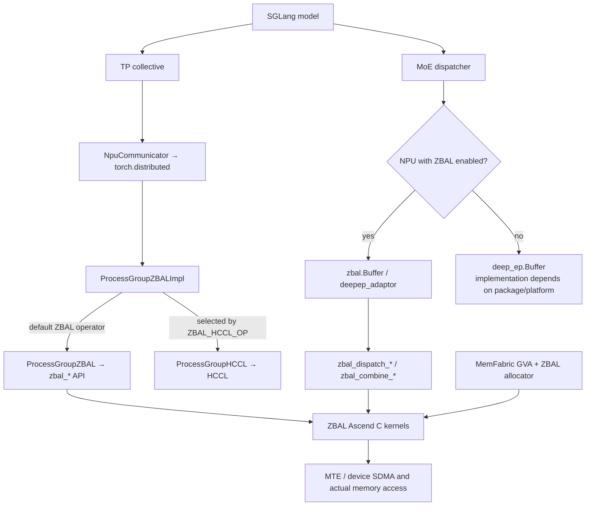
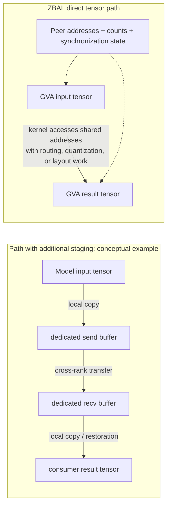
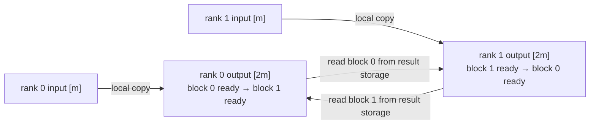
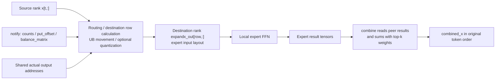
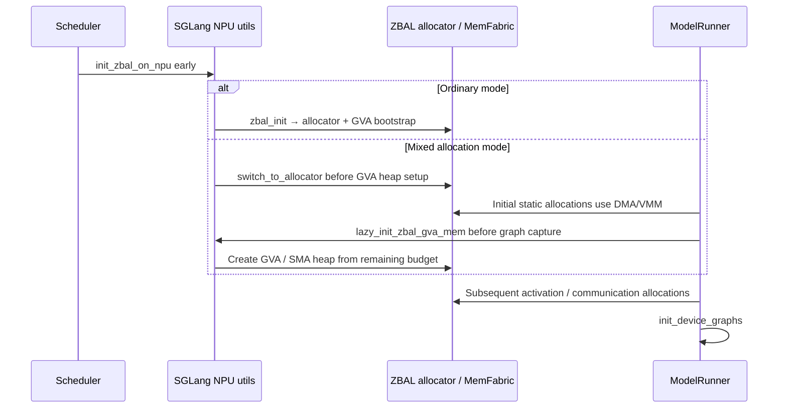

# 07. ZBAL Zero Buffer: Allocators, Remote Addresses, and MoE Dataflow

**English** | [简体中文](../../../zh/ai-infra-basic/Communication/07-zbal-zero-buffer-source-dataflow.md)

After [04: MoE, DeepEP, and ZBAL](./04-moe-deepep-and-zbal.md), this chapter explains why model tensors can participate directly in communication, which buffers are avoided, and where HCCL and DeepEP fit in the call chain.

Sources checked: **2026-10-14**. The SGLang baseline is this repository's `0a15320`; external source is pinned to [Ascend/memfabric_hybrid@004d931](https://github.com/Ascend/memfabric_hybrid/tree/004d9317289fe99bd6bf13def0500b3fa3795ccc/app/zbal). Conclusions are source-derived for these versions; no multi-NPU performance measurements were made. Upstream `doc/architecture.md` is still a TODO at this revision, so implementation details come from the allocator, adapters, and kernels themselves.

## 1. Three Core Questions

| Question | Mechanism |
|---|---|
| How does zero buffer work? | MemFabric creates cross-rank-accessible GVA space; the ZBAL allocator places participating tensors in suitable memory; kernels exchange actual tensor addresses and write results directly or read peer tensors. |
| How does it relate to HCCL? | Standard collectives can select ZBAL's ProcessGroup implementation. Its wrapper can explicitly delegate individual operators to ProcessGroupHCCL. ZBAL's own kernels can use MemFabric/GVA/MTE/SDMA data paths. |
| How does it relate to DeepEP? | SGLang reuses DeepEP-style `Buffer/Config` and dispatch/combine interfaces. The enabled NPU branch imports ZBAL's adapter and executes ZBAL C++/Ascend C implementations. |



The HCCL branch is **explicit delegation in the collective wrapper**, not a claim that every ZBAL kernel ultimately calls HCCL. Likewise, an interface named `Buffer` does not establish execution of a particular NVIDIA DeepEP kernel.

## 2. Make Model Memory Communicable Before Removing Staging

### 2.1 What GVA Means

GVA, Global Virtual Address, is the global virtual-address mapping provided by MemFabric. It lets device kernels locate peer memory within supported communication domains. It does not increase HBM capacity or provide automatic cache coherence.

[MemFabricBoostrap::CreateSHMSpace()](https://github.com/Ascend/memfabric_hybrid/blob/004d9317289fe99bd6bf13def0500b3fa3795ccc/app/zbal/src/csrc/bootstrap/memory/memfabric/zbal_mem_mf_bootstrap.cpp#L85) calls `SmemShmInit()`, `SmemShmCreate()`, and `SmemShmGetSymmetricSize()` to obtain the GVA base and symmetric address stride per rank. Its calculation can be summarized as:

```text
A = deviceGva
S = symmetric address-space stride per world rank
local_base(world_rank) = A + world_rank * S
```

`S` is the queried address-space stride, not a tensor length or a configured number of used bytes.

### 2.2 Why the Allocator Is Part of Communication Design

[switch_to_allocator()](https://github.com/Ascend/memfabric_hybrid/blob/004d9317289fe99bd6bf13def0500b3fa3795ccc/app/zbal/src/python/zbal/zbal_module.py) installs an `NPUPluggableAllocator`, connecting `zbal_pluggable_malloc/free` to PyTorch NPU. It also registers lifecycle callbacks such as `record_stream`.

[zbal_sma_init() / zbal_pluggable_malloc()](https://github.com/Ascend/memfabric_hybrid/blob/004d9317289fe99bd6bf13def0500b3fa3795ccc/app/zbal/src/csrc/zbal_mem_allocator.cpp#L26) initialize a heap from the local GVA region obtained during bootstrap and allocate tensors through the selected allocator. Inputs and receive results can therefore already reside in memory accessible to communication kernels, avoiding repeated migration from arbitrary ordinary allocations into a fixed communication region.

The mechanism combines **addressable memory, tensor allocation, and a kernel address protocol**. Changing the backend name on an existing ordinary tensor does not automatically turn it into a ZBAL GVA tensor.

### 2.3 Symmetric Metadata Does Not Require Equal Offsets for All Tensors

The core translation in [zbal_ptr()](https://github.com/Ascend/memfabric_hybrid/blob/004d9317289fe99bd6bf13def0500b3fa3795ccc/app/zbal/src/csrc/operators/npu/device/common/zbal_kernel_utils.h#L88) is:

```text
remote_meta = local_meta + (world_dst - world_src) * S
world_src = peerRanks[group_src]
world_dst = peerRanks[group_dst]
```

This applies to protocol regions placed at matching offsets, such as metadata. For a subgroup containing world ranks `[1,3]`, going from group rank 0 to group rank 1 crosses `2*S`, not `1*S`.

**Application tensors can be allocated asymmetrically.** Normal dispatch publishes and reads actual addresses for `x`, `expandx_out`, and other tensors through `PutShareAddr()/GetShareAddr()`. It does not assume the peer's output tensor has the same offset as the local one. Symmetric metadata locates the address tables; those tables locate each rank's payload.

## 3. Which Buffers Does Zero Buffer Avoid?

The comparison below illustrates a staging-based design and ZBAL's intended tensor data path. It is not a universal description of every HCCL/DeepEP version.



The main savings target is **additional communication staging that duplicates input/output payloads, together with copies into and out of it**. Inputs, outputs, routing indices, address tables, state flags, and on-chip UB remain. Some operators also retain scratch space.

An extra local copy of an `M`-byte payload creates at least approximately `M` bytes of reads and `M` bytes of writes. Removing it can reduce HBM pressure and latency. Information still must traverse links, and protocol, synchronization, and compute contention remain. This is mechanism analysis, not a measured speedup percentage.

## 4. Verify the Direct Result Tensor in the Actual AllGather Path

### 4.1 Host Code Passes Tensor data_ptr Values to the Operator

The contiguous-output [ProcessGroupZBAL::_allgather_base()](https://github.com/Ascend/memfabric_hybrid/blob/004d9317289fe99bd6bf13def0500b3fa3795ccc/app/zbal/src/csrc/adaptor/pytorch_npu/zbal_pytorch_process_group.cpp#L468) checks `output.numel = P * input.numel`, obtains input/output `data_ptr()` values, and calls `zbal_all_gather()`. Its post callback is empty.

### 4.2 Device Code Uses the Result Tensor for Ring Propagation

At this revision, [ZBALAllGatherInner](https://github.com/Ascend/memfabric_hybrid/blob/004d9317289fe99bd6bf13def0500b3fa3795ccc/app/zbal/src/csrc/operators/npu/device/classic/zbal_kernel_allgather.cpp#L41) has an `if (false)` selecting the small kernel, so execution enters `ZBALAllGatherBigKernel`. The existence of a SmallKernel definition does not identify the active implementation.

The dataflow in [BigKernel::Process()](https://github.com/Ascend/memfabric_hybrid/blob/004d9317289fe99bd6bf13def0500b3fa3795ccc/app/zbal/src/csrc/operators/npu/device/classic/zbal_kernel_allgather.h#L392) is:

```text
1. ClearExchangeMeta + BarrierAll
2. CopyLocal2Output: input_r -> output_r[r-th segment]
3. ExchangeOutputAddr: publish actual output address + ready state
4. Wait flag/stat for each ring slice
5. CpGM2GM: peer output slice -> local output same slice
6. WriteStat: notify next hop that this slice is ready
7. BarrierAll before completion
```

For example, with two ranks, each input is `[m]` and each output is `[2*m]`:



The result storage participates in ring propagation, avoiding a separate ring staging allocation duplicating the payload for this kernel path. **Local input→output copies and multi-hop ring propagation still occur.**

### 4.3 GM→GM May Still Pass Through UB

[ZBALBaseKernel::CpGM2GM()](https://github.com/Ascend/memfabric_hybrid/blob/004d9317289fe99bd6bf13def0500b3fa3795ccc/app/zbal/src/csrc/operators/npu/device/classic/zbal_kernel_base.h#L38) selects MTE or device SDMA using `dataOpType`. MTE copies chunks through `GM → UB queue → GM`; SDMA calls `zbal_sdma_get_nbi()` followed by `zbal_sdma_quiet()`. Reducing extra payload staging does not require the hardware copy mechanism to contain no buffering.

## 5. Normal MoE Dispatch/Combine: Target the Expert Input Layout Directly

This section follows the pinned **normal mode**. Low-latency mode has separate kernels and output-capacity policies; do not assume the same layout.

### 5.1 SGLang Reuses the Interface; ZBAL Supplies the Implementation

[SGLang deepep.py](../../../../python/sglang/srt/layers/moe/token_dispatcher/deepep.py) imports `Buffer` from `zbal.zbal_buffer` under the NPU+ZBAL condition, while retaining calls to `get_dispatch_layout()`, `dispatch()`, and `combine()`.

[ZBAL Buffer.__init__()](https://github.com/Ascend/memfabric_hybrid/blob/004d9317289fe99bd6bf13def0500b3fa3795ccc/app/zbal/src/python/zbal/zbal_buffer.py#L29) clones the supplied group to isolate MoE metadata, obtains `get_zbal_comm_name()` from the NPU backend, initializes communication metadata, and constructs C++ `deepep_adaptor.Buffer`. This adapter path therefore requires a ZBAL backend providing these methods.

Fields such as `num_nvl_bytes` and `num_rdma_bytes` retain DeepEP-style names. At this revision, the C++ constructor stores them and looks up a ZBAL communicator; it does not allocate NVIDIA-style NVLink/RDMA payload regions of those sizes in the constructor. Parameter names alone do not establish the transport or allocation.

### 5.2 Counts → Offsets → Final Output Addresses

[C++ Buffer::intranode_dispatch()](https://github.com/Ascend/memfabric_hybrid/blob/004d9317289fe99bd6bf13def0500b3fa3795ccc/app/zbal/src/csrc/adaptor/deepep/zbal_deepep.cpp#L208) proceeds as follows:

1. Allocate counts, `put_offset`, `balance_matrix`, and other metadata tensors.
2. Run `zbal_dispatch_normal_notify()` to determine receive counts and placement.
3. Read `total_recv_token.item<int>()`, then allocate actual `expandx_out` and scale outputs. This exposes a host/device synchronization point in this path.
4. Pass actual input/output tensor addresses to `zbal_dispatch_normal()`.

Kernel [PutShareAddr/GetShareAddr](https://github.com/Ascend/memfabric_hybrid/blob/004d9317289fe99bd6bf13def0500b3fa3795ccc/app/zbal/src/csrc/operators/npu/device/dispatch_combine_normal/zbal_kernel_dispatch_normal.h#L292) exchange each rank's input, routing, offset, output, and scale addresses. In the direct-send `InputToDstOutput()` branch, the destination row calculation is:

```text
dst_rank = expert_id // experts_per_rank
base_row = put_offset_flat[expert_id * P + src_rank]
row = base_row + send_token_idx[token_assignment]
dst_addr = shared_expandx_out_addr[dst_rank] + aligned_row_bytes * row
```

This deliberately uses the kernel's **flat indexing**; do not infer different indexing from a host-allocated two-dimensional shape. `aligned_row_bytes` corresponds to `hUBAlignSize` in the implementation, so alignment must be preserved.



[DispatchNormal::Process()](https://github.com/Ascend/memfabric_hybrid/blob/004d9317289fe99bd6bf13def0500b3fa3795ccc/app/zbal/src/csrc/operators/npu/device/dispatch_combine_normal/zbal_kernel_dispatch_normal.h#L692) can also select `HandleAllRankToken()` through `isEnableBalance_`. The direct-send branch illustrates the address mechanism, not a rule that every token is moved by the same rank/core.

[CombineNormal::ReadTokenAndWeightedSum()](https://github.com/Ascend/memfabric_hybrid/blob/004d9317289fe99bd6bf13def0500b3fa3795ccc/app/zbal/src/csrc/operators/npu/device/dispatch_combine_normal/zbal_kernel_combine_normal.h#L412) reads expert results through `shareRecvXAddrs` and reverse offsets, converts to float in UB, applies weights, accumulates, and writes the result. Direct addressing avoids separate staging payloads; the required top-k aggregation and result storage remain.

## 6. HCCL: Where Replacement or Coexistence Happens

[NpuCommunicator.all_reduce()](../../../../python/sglang/srt/distributed/device_communicators/npu_communicator.py) calls `dist.all_reduce(..., group=self.group)`; the group determines its implementation. [parallel_state.py](../../../../python/sglang/srt/distributed/parallel_state.py) defaults to `hccl` for NPU and selects `zbal` when the environment condition holds.

Importing ZBAL registers the `zbal` backend. [ProcessGroupZBALImpl](https://github.com/Ascend/memfabric_hybrid/blob/004d9317289fe99bd6bf13def0500b3fa3795ccc/app/zbal/src/csrc/adaptor/pytorch_npu/zbal_pytorch_process_group_impl.cpp#L23) maintains a ZBAL group and creates an HCCL group when its configuration is nonempty. For example:

```bash
export ZBAL_HCCL_OP="allgather,allreduce"
```

At this revision, those collectives are explicitly forwarded to the HCCL group. This is selected operator routing, not automatic fallback after arbitrary ZBAL failures. The variable is read during C++ static-set initialization, so configure it before starting processes.

HCCL is a general collective library with its own evolving memory/communication optimizations. The earlier staging diagram does not establish that HCCL always performs two extra copies. Fair comparison fixes the operator, API form, tensor layout, hardware, and mode, and verifies the selected branch.

## 7. Initialization and Mixed Allocation: Why Switching Late Is Insufficient



SGLang's [init_zbal()/lazy_init_zbal_gva_mem()](../../../../python/sglang/srt/hardware_backend/npu/utils.py) and [ModelRunner](../../../../python/sglang/srt/model_executor/model_runner.py) determine the sequence. In mixed mode, ZBAL's `zbal_pluggable_malloc()` calls `dma_malloc()` and records pointers before GVA initialization; afterward it calls `sma_malloc()`. Freeing uses those records to select the corresponding allocator.

Thus “weights/KV use DMA/VMM while activations use GVA” is an intended usage **implemented through allocation timing**, not semantic tensor-label recognition. Other tensors created after initialization also follow the active allocation path.

The current SGLang helper contains a `total_memory = 61.2` estimate, budget subtraction, and 128 MiB alignment. These are baseline platform assumptions, not universal NPU capacity settings. `SGLANG_ZBAL_LOCAL_MEM_SIZE` is a memory budget, not a requirement to reserve an additional send/receive staging allocation of the same size.

## 8. Memory, Copies, and Synchronization That Remain in the Source

| Evidence | Meaning |
|---|---|
| `_allgather_base()` output tensor and ring `CopyLocal2Output()` | output storage and local copying remain; result storage participates in propagation |
| list `allgather()` uses `FlattenForScatterGather()` and post `copy_()` | some framework API wrappers still flatten and copy back; the contiguous-output path does not describe every API |
| `bufferTensor` in `ProcessGroupZBAL::allreduce()` | AllReduce still allocates roughly a rank-local shard of scratch, according to actual `bufferElems` |
| dispatch `expandx_out`, scales, counts, offsets, and low-latency capacity allocation | application outputs, routing metadata, and capacity overhead still occupy memory |
| `ZBALWaitFlag/WriteStat/BarrierAll` and UB queues | shared addresses still require completion and on-chip dependency protocols |

The first three rows map directly to `allreduce`, `_allgather_base`, and `allgather` in the [ProcessGroupZBAL source](https://github.com/Ascend/memfabric_hybrid/blob/004d9317289fe99bd6bf13def0500b3fa3795ccc/app/zbal/src/csrc/adaptor/pytorch_npu/zbal_pytorch_process_group.cpp).

Check the DeepEP compatibility contract separately: [zbal_deep_event.h](https://github.com/Ascend/memfabric_hybrid/blob/004d9317289fe99bd6bf13def0500b3fa3795ccc/app/zbal/src/csrc/adaptor/deepep/zbal_deep_event.h) implements an empty `current_stream_wait()` at this revision. The [C++ adapter](https://github.com/Ascend/memfabric_hybrid/blob/004d9317289fe99bd6bf13def0500b3fa3795ccc/app/zbal/src/csrc/adaptor/deepep/zbal_deepep.cpp) ignores several `async/previous_event/return_recv_hook` arguments, returns an empty-function low-latency hook, and ignores the `zero_copy` argument. Correctness relies on actual streams, operators, and kernel protocols; compatible parameter names do not establish NVIDIA DeepEP-equivalent asynchronous overlap.

## 9. Questions to Take Back to the Trace

1. **Verify the path**: did tensors use the appropriate allocator? Is the collective group `hccl` or `zbal`? Does `ZBAL_HCCL_OP` delegate this operation? Where does the actual MoE `Buffer` come from?
2. **Verify addresses/layouts**: check shapes, contiguity, dtype, row alignment, group→world rank mapping, and source/destination offsets.
3. **Locate savings**: did separate staging decrease? How many `copy_` calls, UB movements, scratch allocations, and synchronizations remain? Measure initialization, notify host synchronization, communication, and expert GEMM separately.
4. **Verify service benefit**: fix routing and valid tokens; compare peak HBM usage, communication time, ITL, and throughput. Use the [measurement chapter](./06-sglang-paths-and-performance.md) to investigate contention and tail latency.

Checks: why do two ranks' `expandx_out` tensors not need to share an offset? Why does `Buffer(num_rdma_bytes=...)` not prove a separate region of that size was allocated? Why can multiple copies remain visible when AllGather propagates directly through its output storage?
