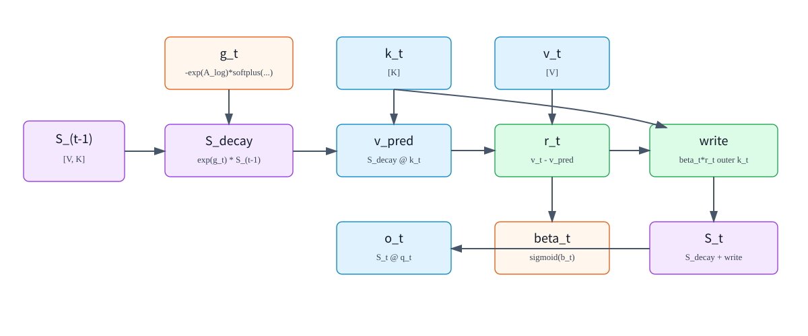
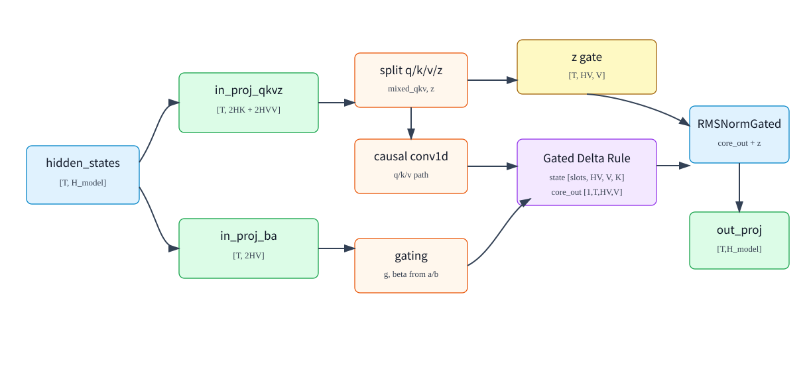
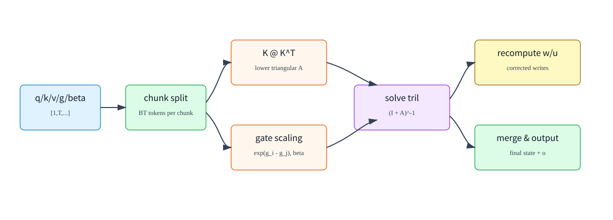

# Gated DeltaNet (GDN): From Matrix Memory to Training Principles and SGLang Inference

[简体中文](../../../zh/ai-infra-basic/Gated_Delta_Network/01-gated-deltanet.md) | **English**

This chapter brings the former math, layer-shape, and training/serving chapters into one learning path. Understand one memory update first, place it inside the layer, then follow prefill, decode, and request state. The explanations of `z`, convolution ablations, and grouped heads remain in their corresponding sections.

- [1. Why Matrix Memory Replaces KV History](#gdn-memory)
- [2. One State Update: Decay, Predict, Correct, and Read](#gdn-update)
- [3. Control Signals: Forgetting, Writing, and Normalization](#gdn-gates)
- [4. From Hidden States to Six Activations: Layer Dataflow](#gdn-layer)
- [5. Short Causal Convolution: Computation, Purpose, and Evidence](#gdn-conv)
- [6. Heads, State Shapes, and Memory: Why No Extra Q/K Head Factor](#gdn-state)
- [7. From State Readout to Layer Output: Output Gate and Shape Ledger](#gdn-output)
- [8. Training: Learned Parameters Versus Runtime State](#gdn-training)
- [9. Prefill: From Sequential Recurrence to Chunk Computation](#gdn-prefill)
- [10. Decode: Fused Updates and the Packed Fast Path](#gdn-decode)
- [11. Serving: Slots, Prefix Reuse, Speculative Verification, and Migration](#gdn-serving)
- [12. Source Reading and Next Steps](#gdn-source)

Implementation details refer to the SGLang source snapshot in this repository (introduced in commit `c6de33fcaa2027826f89f375d1e805ab3305f8cb`). A general recurrence does not establish that every backend implements every serving feature.

<a id="gdn-memory"></a>

## 1. Why Matrix Memory Replaces KV History

### The Problem GDN Tries to Solve

Standard causal attention stores historical K/V tensors for every layer:

```math
\mathrm{shape}\left(K_{\mathrm{cache}}\right)=\left[\mathrm{context\_len},\mathrm{num\_kv\_heads},\mathrm{head\_dim}\right]
```

```math
\mathrm{shape}\left(V_{\mathrm{cache}}\right)=\left[\mathrm{context\_len},\mathrm{num\_kv\_heads},\mathrm{head\_dim}\right]
```

The longer the context, the larger the KV Cache. GDN takes a different route: instead of storing K/V for every historical token, it maintains a per-head state matrix.

```text
S_t[h] : [V, K]
```

where:

| Symbol | Meaning |
|---|---|
| `t` | current token position |
| `h` | value head id |
| `K` | key/query head dimension |
| `V` | value head dimension |
| `S_t[h]` | recurrent state of value head `h` after token `t` has been processed |

For every new token, GDN does three things:

```text
1. Decay the old state through a gate
2. Use the key to predict the current value from the state
3. Write the prediction error back into the state, then read the output with the query
```



### GDN vs Standard Attention

Standard attention:

```math
\mathrm{score\_tj}=\left\langle q_{t},k_{j}\right\rangle
```

```math
\alpha_{\mathrm{tj}}=\mathrm{softmax}\left(\mathrm{score\_tj}\right)
```

```math
o_{t} = \sum_{j} \alpha_{\mathrm{tj}} \cdot  v_{j}
```

GDN:

```math
S_{t}=\mathrm{recurrent\_update}\left({S}_{t-1},k_{t},v_{t},g_{t},\beta_{t}\right)
```

```math
o_{t}=S_{t}\,q_{t}
```

| Dimension | Standard Attention | GDN |
|---|---|---|
| History storage | stores K/V for every historical token | stores a fixed-size state matrix |
| How history is read | softmax weighting over all historical tokens | query reads from the state matrix |
| State size | grows linearly with context length | independent of context length |
| Strength | exact token-to-token retrieval | compressed memory and linear recurrence |
| Serving focus | KV Cache management and attention kernels | recurrent state, convolution state, chunk/recurrent kernels |

<a id="gdn-update"></a>

## 2. One State Update: Decay, Predict, Correct, and Read

### Core Equations for One Token and One Head

First consider one value head and omit batch/head indices. For the current token:

```math
\mathrm{shape}\left(q_{t}\right)=\left[K\right]
```

```math
\mathrm{shape}\left(k_{t}\right)=\left[K\right]
```

```math
\mathrm{shape}\left(v_{t}\right)=\left[V\right]
```

```math
\mathrm{shape}(S_{t-1})=[V,K]
```

```math
g_t\in\mathbb{R},\quad g_t\le0
```

```math
\beta_t\in(0,1)
```

The recurrent GDN update can be written as:

Decay the old state:

```math
S_{\mathrm{decay}}=\mathrm{exp}\left(g_{t}\right)\cdot {S}_{t-1}
```

Predict the current value:

```math
v_{\mathrm{pred}}=S_{\mathrm{decay}}\,k_{t}
```

Compute the residual:

```math
r_{t}=v_{t}-v_{\mathrm{pred}}
```

Control write strength:

```math
u_{t}=\beta_{t}\cdot r_{t}
```

Write into the state:

```math
S_{t}=S_{\mathrm{decay}}+u_{t}\,{k_{t}}^{\mathsf T}
```

Read the output:

```math
o_{t}=S_{t}\,q_{t}\cdot \mathrm{scale}
```

Variable meanings:

| Variable | Shape | Meaning |
|---|---:|---|
| `q_t` | $`\left[K\right]`$ | query vector of the current token; used to read from the state |
| `k_t` | $`\left[K\right]`$ | key vector of the current token; selects the direction to write into |
| `v_t` | $`\left[V\right]`$ | value information of the current token |
| `S_(t-1)` | $`\left[V,K\right]`$ | state before processing the current token |
| `g_t` | scalar | forget gate; the more negative it is, the stronger the old-state decay |
| `beta_t` | scalar | write gate; the closer to 1, the more strongly the residual is written |
| `v_pred` | $`\left[V\right]`$ | value predicted by the old state along direction `k_t` |
| `r_t` | $`\left[V\right]`$ | difference between current value and the old state's prediction |
| `u_t` | $`\left[V\right]`$ | residual write vector after modulation by `beta_t` |
| `o_t` | $`\left[V\right]`$ | output of the current head |

The outer product has shape:

```math
u_tk_t^{\mathsf T}\in\mathbb{R}^{V\times K},\quad u_t\in\mathbb{R}^{V},\quad k_t\in\mathbb{R}^{K}
```

so it can be added back to `S_decay [V,K]`.

### Why It Is Called a Delta Rule

The delta-rule intuition is: do not write `v_t` into the state directly; write only the part that the old state failed to explain.

```math
r_{t}=v_{t}-S_{\mathrm{decay}}\,k_{t}
```

Read it as:

```text
If the old state can already predict v_t from k_t,
the residual is small, so this token writes very little.

If the old state predicts poorly,
the residual is large, so the state is corrected along direction k_t.
```

This differs from ordinary linear attention accumulation. A simple linear attention state update looks like:

```math
S_{t}={S}_{t-1}+v_{t}\,{k_{t}}^{\mathsf T}
```

GDN instead uses:

```math
S_{t}=\mathrm{exp}\left(g_{t}\right)\cdot {S}_{t-1}+\beta_{t}\cdot \left(v_{t}-\mathrm{exp}\left(g_{t}\right)\cdot {S}_{t-1}\,k_{t}\right)\,{k_{t}}^{\mathsf T}
```

It adds two important mechanisms:

| Mechanism | Role |
|---|---|
| $`\mathrm{exp}\left(g_{t}\right)`$ | adaptively forgets old state |
| $`v_{t}-S_{\mathrm{decay}}\,k_{t}`$ | writes only prediction error instead of repeatedly writing already represented information |

### A Single-Head Shape Walkthrough

Assume:

```math
K=2
```

```math
V=3
```

```math
\mathrm{shape}(S_{t-1})=[3,2]
```

```math
\mathrm{shape}\left(k_{t}\right)=\left[2\right]
```

```math
\mathrm{shape}\left(v_{t}\right)=\left[3\right]
```

```math
\mathrm{shape}\left(q_{t}\right)=\left[2\right]
```

The computation is:

```math
S_{\mathrm{decay}}=\mathrm{exp}\left(g_{t}\right)\cdot {S}_{t-1}\qquad\text{[3,2]}
```

```math
v_{\mathrm{pred}}=S_{\mathrm{decay}}\,k_{t}\qquad\text{[3]}
```

```math
r_{t}=v_{t}-v_{\mathrm{pred}}\qquad\text{[3]}
```

```math
u_{t}=\beta_{t}\cdot r_{t}\qquad\text{[3]}
```

```text
u_t outer k_t                      # [3,2]
```

```math
S_{t}=S_{\mathrm{decay}}+u_{t}\,{k_{t}}^{\mathsf T}\qquad\text{[3,2]}
```

```math
o_{t}=S_{t}\,q_{t}\qquad\text{[3]}
```

This head outputs $`\left[3\right]`$. With multiple heads, all value-head outputs are concatenated:

```math
\mathrm{shape}\left(O_{t}\right)=\left[\mathrm{HV},V\right]
```

```text
flatten(O_t): [HV * V]
```

Then the result enters output gate/norm and the output projection.

<a id="gdn-gates"></a>

## 3. Control Signals: Forgetting, Writing, and Normalization

### Where `g_t` Comes From

In SGLang's GDN implementation, `g_t` is computed from `A_log`, `a_t`, and `dt_bias`:

```math
g_{t}=-\mathrm{exp}\left(A_{\mathrm{log}}\right)\cdot \mathrm{softplus}\left(a_{t}+\mathrm{dt\_bias}\right)
```

| Variable | Shape | Trainable | Meaning |
|---|---:|---:|---|
| `A_log` | $`\left[\mathrm{HV}\right]`$ | yes | one log-space decay parameter per value head |
| `a_t` | $`\left[\mathrm{HV}\right]`$ | no | token-level gate activation produced by the `in_proj_a` projection |
| `dt_bias` | $`\left[\mathrm{HV}\right]`$ | yes | one time-step/decay bias per value head |
| `softplus(a_t + dt_bias)` | $`\left[\mathrm{HV}\right]`$ | no | positive time-step or decay strength |
| `g_t` | $`\left[\mathrm{HV}\right]`$ | no | non-positive gate that controls old-state decay |

Why this parameterization?

```math
\mathrm{exp}\left(A_{\mathrm{log}}\right) \gt 0
```

```math
\mathrm{softplus}\left(a_{t}+\mathrm{dt\_bias}\right) \gt 0
```

```math
g_{t} \le 0
```

```math
0 \lt \mathrm{exp}\left(g_{t}\right) \le 1
```

This guarantees the state decay factor is never larger than 1, preventing unconstrained amplification of old state.

The softplus function is:

```math
\mathrm{softplus}\left(x\right)=\mathrm{log}\left(1+\mathrm{exp}\left(x\right)\right)
```

When `x` is large, `softplus(x) ~= x`; when `x` is very negative, it still remains positive.

### Where `beta_t` Comes From

`beta_t` is produced from another projection activation `b_t`:

```math
\beta_{t}=\mathrm{sigmoid}\left(b_{t}\right)
```

| Variable | Shape | Trainable | Meaning |
|---|---:|---:|---|
| `b_t` | $`\left[\mathrm{HV}\right]`$ | no | current token's write-gate activation produced by the `in_proj_b` projection |
| `beta_t` | $`\left[\mathrm{HV}\right]`$ | no | write strength, in `(0,1)` |

`b_t` itself is not a parameter. The projection matrix that produces `b_t` is trainable.

### Why Q/K L2 Normalization Is Used

SGLang GDN kernels often enable:

```text
use_qk_l2norm_in_kernel=True
```

which means:

```math
q_{t}=\frac{q_{t}}{\sqrt{\mathrm{sum}\left({q_{t}}^{2}\right)+\epsilon}}
```

```math
k_{t}=\frac{k_{t}}{\sqrt{\mathrm{sum}\left({k_{t}}^{2}\right)+\epsilon}}
```

then:

```math
q_{t}=q_{t}\cdot \frac{1}{\sqrt{K}}
```

This helps in several ways:

| Purpose | Explanation |
|---|---|
| Stable state reads/writes | $`S\,k`$ and $`S\,q`$ do not explode because q/k norms are too large |
| More controllable beta | residual writes are governed mainly by direction and gate strength |
| Attention-like scale | $`\frac{1}{\sqrt{K}}`$ follows the same intuition as the scale factor in dot-product attention |

Section 4 shows the projections producing `a/b`. Prefill can compute `g/beta` explicitly; packed decode fuses gate computation with state updates, as covered in Section 10.

<a id="gdn-layer"></a>

## 4. From Hidden States to Six Activations: Layer Dataflow

### Notation

This lecture uses the following symbols to describe a GDN layer. They correspond to fields used by Qwen3-Next and the SGLang implementation.

| Symbol | Code Field | Meaning |
|---|---|---|
| `T` | `seq_len` or packed token count | total number of real tokens in the current forward |
| `B` | `batch_size` | number of active requests during decode |
| `H_model` | `hidden_size` | model hidden width |
| `H` | `num_k_heads` | number of GDN key/query heads |
| `HV` | `num_v_heads` | number of GDN value heads |
| `K` | `head_k_dim` | dimension of each q/k head |
| `V` | `head_v_dim` | dimension of each value head |
| `C` | `conv_kernel_size` | causal conv1d window size |
| `R` | $`\frac{\mathrm{HV}}{H}`$ | number of value heads mapped to each key head |

Unless stated otherwise, shapes are logical shapes before tensor parallel (TP) sharding. This grouping requires `HV` to be an integer multiple of `H`; tensors on a device use that TP rank's local head counts.

A common Qwen3-Next-style configuration is:

```math
H_{\mathrm{model}}=2048
```

```math
H=16
```

```math
\mathrm{HV}=32
```

```math
K=128
```

```math
V=128
```

```math
C=4
```

```math
R=2
```

Therefore:

```math
\mathrm{key\_dim}=H\cdot K=16\cdot 128=2048
```

```math
\mathrm{value\_dim}=\mathrm{HV}\cdot V=32\cdot 128=4096
```

### Layer Overview



A GDN layer starts from backbone hidden states:

```math
\mathrm{shape}\left(\mathrm{hidden\_states}\right)=\left[T,H_{\mathrm{model}}\right]
```

Then the computation splits into several paths:

```text
hidden_states
  -> in_proj_qkvz -> q, k, v, z
  -> in_proj_ba   -> b, a

q/k/v -> causal conv1d -> GDN recurrent/chunk kernel -> core_attn_out
z     -> output gate / RMSNormGated
RMSNormGated(core_attn_out, z) -> out_proj -> layer output
```

### Input Projection: `in_proj_qkvz`

In SGLang, `Qwen3GatedDeltaNet` creates:

in_proj_qkvz:

```math
\mathrm{input\_size}=\mathrm{hidden\_size}
```

```math
\text{output part}= \left[\mathrm{key\_dim}, \mathrm{key\_dim}, \mathrm{value\_dim}, \mathrm{value\_dim}\right]
```

So:

```math
\mathrm{shape}\left(\mathrm{projected\_states\_qkvz}\right)=\left[T,2\cdot \mathrm{key\_dim}+2\cdot \mathrm{value\_dim}\right]
```

Substituting the common configuration:

```math
2\cdot \mathrm{key\_dim}+2\cdot \mathrm{value\_dim}=2\cdot 2048+2\cdot 4096=12288
```

The four projected segments mean:

| Segment | Logical Shape | Meaning |
|---|---:|---|
| `q` | $`\left[T,H,K\right]`$ | query |
| `k` | $`\left[T,H,K\right]`$ | key |
| `v` | $`\left[T,\mathrm{HV},V\right]`$ | value |
| `z` | $`\left[T,\mathrm{HV},V\right]`$ | gate input for output gate/norm |

`z` does not enter the recurrent state update. It modulates the GDN output at the output stage.

#### What Is `z`, and How Does It Differ from `g/beta`?

`z` is an **output-gate activation** projected from the current layer input `x_t`. Logically, `z_t = W_z x_t`; the implementation fuses `W_z` with the q/k/v projections in `in_proj_qkvz`. `W_z` is a trained parameter, whereas `z_t` is a token-dependent intermediate tensor, not another KV cache or the recurrent state.

For the default Qwen3-Next SiLU/Swish output gate described here, the code sets `norm_before_gate=True`. For each token and value head, RMSNorm operates along `V`, followed by elementwise multiplication:

```math
o={\mathrm{core\_attn\_out}}_{t,h,:}\qquad\text{[V]}
```

```math
z={z}_{t,h,:}\qquad\text{[V]}
```

```math
\mathrm{rms}=\sqrt{\mathrm{mean}\left(o\cdot o\right)+\epsilon}\qquad\text{scalar}
```

```math
{\mathrm{normed}}_{t,h,:}=\frac{\mathrm{weight}\odot o}{\mathrm{rms}}\odot \mathrm{silu}\left(z\right)\qquad\text{[V]}
```

```math
\mathrm{silu}\left(z\right)=z\odot \mathrm{sigmoid}\left(z\right)
```

Here `weight` is a trainable norm weight of length `V`, and `*` means elementwise multiplication. Thus `z` has the same shape as the output: $`\left[T,\mathrm{HV},V\right]`$. A SiLU gate is not a probability in $`\left[0,1\right]`$: it can exceed 1 or be negative, so it is neither a sigmoid gate nor a binary switch. If a model explicitly configures another `output_gate_type`, follow that configuration.

| Control Signal | Shape per Token | What It Controls | Directly Updates This Layer's Recurrent State? |
|---|---|---|---|
| $`\mathrm{exp}\left(g\right)`$ | $`\left[\mathrm{HV}\right]`$ | how much old state survives | yes |
| `beta` | $`\left[\mathrm{HV}\right]`$ | how much prediction residual is written | yes |
| `silu(z)` | $`\left[\mathrm{HV},V\right]`$ | how much of each retrieved value channel reaches subsequent computation | no |

This separates retaining information from exposing it for the current token. For example, $`z=0`$ zeros that output channel without clearing the corresponding memory in this layer's state; later tokens can still retrieve it. The operation is not `core_attn_out + z`: it is **multiplicative gating after normalization**, followed by `out_proj`.

### Input Projection: `in_proj_ba`

`in_proj_ba` produces two sets of gate activations:

in_proj_ba:

```math
\mathrm{input\_size}=\mathrm{hidden\_size}
```

```math
\text{output part}= \left[\mathrm{HV}, \mathrm{HV}\right]
```

Therefore:

```math
\mathrm{shape}\left(\mathrm{projected\_states\_ba}\right)=\left[T,2\cdot \mathrm{HV}\right]
```

```math
\mathrm{shape}\left(b\right)=\left[T,\mathrm{HV}\right]
```

```math
\mathrm{shape}\left(a\right)=\left[T,\mathrm{HV}\right]
```

| Activation | Later Computation | Meaning |
|---|---|---|
| `a` | $`g=-\mathrm{exp}\left(A_{\mathrm{log}}\right)\cdot \mathrm{softplus}\left(a+\mathrm{dt\_bias}\right)`$ | controls state forgetting |
| `b` | $`\beta=\mathrm{sigmoid}\left(b\right)`$ | controls residual write strength |

`a` and `b` are token activations, not parameters. `in_proj_ba.weight` is the parameter.

### Packed Checkpoint and Split/Reshape

For efficient loading and execution, checkpoint weights for GDN projection can be packed. SGLang's `load_weights()` maps:

```text
in_proj_qkv -> first three segments of in_proj_qkvz
in_proj_z   -> fourth segment of in_proj_qkvz
in_proj_b   -> first segment of in_proj_ba
in_proj_a   -> second segment of in_proj_ba
```

After projection, split, and reshape, the layer gets:

```math
\mathrm{shape}\left(\mathrm{mixed\_qkv}\right)=\left[T,2\cdot \mathrm{key\_dim}+\mathrm{value\_dim}\right]
```

```math
\mathrm{shape}\left(z\right)=\left[T,\mathrm{HV},V\right]
```

```math
\mathrm{shape}\left(b\right)=\left[T,\mathrm{HV}\right]
```

```math
\mathrm{shape}\left(a\right)=\left[T,\mathrm{HV}\right]
```

With the common configuration:

```math
\mathrm{shape}\left(\mathrm{mixed\_qkv}\right)=\left[T,8192\right]
```

```math
\mathrm{shape}\left(z\right)=\left[T,32,128\right]
```

```text
b/a:       [T, 32]
```

`mixed_qkv` is the flat concatenation of q/k/v:

```math
\mathrm{mixed\_qkv}=\mathrm{concat}\left(\mathrm{flatten}\left(q\right),\mathrm{flatten}\left(k\right),\mathrm{flatten}\left(v\right)\right)
```

<a id="gdn-conv"></a>

## 5. Short Causal Convolution: Computation, Purpose, and Evidence

### Causal Conv1d

GDN applies a short causal convolution on the q/k/v path:

```math
\mathrm{conv\_dim}=2\cdot \mathrm{key\_dim}+\mathrm{value\_dim}
```

```math
\mathrm{conv\_kernel\_size}=C
```

For packed q/k/v:

```math
\mathrm{shape}\left(\mathrm{mixed\_qkv\_before\_conv}\right)=\left[T,\mathrm{conv\_dim}\right]
```

```math
\mathrm{shape}\left(\mathrm{mixed\_qkv\_after\_conv}\right)=\left[T,\mathrm{conv\_dim}\right]
```

During decode, each request usually provides only one new token, so convolution needs a window state:

```text
conv_states: [num_slots, conv_dim, C-1] or an equivalent backend-specific layout
```

During prefill, causal conv can be applied over the whole sequence. During decode, `causal_conv1d_update` updates each request's conv state incrementally.

#### What Does It Compute, and Why Is It Causal?

This is a **depthwise short convolution** along the token axis: each q/k/v channel has its own length-`C` kernel, with no cross-channel mixing in this operation. The preceding linear projection already mixes hidden channels. Let `u` denote `mixed_qkv` before convolution and `c` denote one channel, with convolution weights indexed by lag:

```text
y[t,c] = silu(sum(w[c,j] * u[t-j,c] for j in range(C)))

C = 4:
y[t,c] = silu(w[c,0]*u[t,c]   + w[c,1]*u[t-1,c]
            + w[c,2]*u[t-2,c] + w[c,3]*u[t-3,c])
```

This describes the default SiLU path without bias used here; the kernel determines the stored weight order. Only the current position and the previous `C-1` positions are accessed, never future tokens, preserving autoregressive causality. Missing history at the start of a new request is zero; a continuing request reads its own conv state. Packed batches must respect request boundaries: the end of one request cannot become the history of the next.

Convolution and SiLU preserve $`\left[T,\mathrm{conv\_dim}\right]`$ while changing the features at each position. q/k also undergo L2 normalization afterward, potentially fused into the GDN kernel; this is distinct from output RMSNorm. `z/a/b` do not pass through this short convolution.

#### Why Add It: Local Order Features and Long-Term Associative Memory

Without convolution, this layer's input projection operates independently at each token. With convolution, the q/k/v used for state reads and writes explicitly depend on several recent positions of this layer's input. The two operations provide complementary capabilities:

- **Local positional modeling**: separate weights for different lags can distinguish the preceding token from one three positions back. For example, when the window covers “not good,” the features at “good” can include the preceding negation. This illustrates representational capability, not a claim that a particular learned kernel implements this rule.
- **Long-term content association**: GDN stores and updates key→value associations in a fixed-size matrix. Short convolution first builds queries, write addresses, and content with local context, reducing the burden on that matrix memory to model local patterns on its own.
- **Modest additional cost**: for fixed `C`, convolution costs $`O\left(T\cdot \mathrm{conv\_dim}\cdot C\right)`$, and decode retains only the previous `C-1` inputs per channel, independent of context length. This is additional work; modeling quality is the main reason to include it.

This introduces an inductive bias for locality and relative order. Even without short convolution, GDN's sequential recurrence is order-sensitive, and `hidden_states` may already contain context from preceding layers. It is incorrect to claim that removing convolution removes all awareness of token order. Convolution is also distinct from RoPE and is not mathematically required for the delta rule to work.

#### Scientific Evidence: Component Ablations Beyond the Mechanism

[Gated Delta Networks, §3.3 and Appendix A.2, Table S.1](https://arxiv.org/html/2412.06464v1#A1.SS2), describes the architecture and tests component removal. These models have 400M parameters and were trained for 15B tokens on the same FineWeb-Edu subset:

| Setting | Avg-PPL ↓ | Avg-Acc ↑ |
|---|---:|---:|
| Full Gated DeltaNet (head dim 128) | 27.35 | 47.26 |
| Without short convolution | 28.95 | 46.16 |
| Without output gate | 29.12 | 45.46 |

This supports a quality benefit from short convolution and the output gate in that experimental setting. It does not prove a universal benefit across all scales and datasets, and it is not a Qwen3-Next ablation. The preceding section explains plausible mechanisms from the computation; these ablations do not independently establish every proposed explanation.

### Split into q/k/v After Convolution

After convolution, `mixed_qkv` is split again:

```math
\mathrm{shape}\left(\mathrm{query}\right)=\left[1,T,H,K\right]
```

```math
\mathrm{shape}\left(\mathrm{key}\right)=\left[1,T,H,K\right]
```

```math
\mathrm{shape}\left(\mathrm{value}\right)=\left[1,T,\mathrm{HV},V\right]
```

Why is the first dimension `1`? In online serving, requests with different lengths are often packed into one token dimension:

```math
\mathrm{shape}\left(\mathrm{query\_start\_loc}\right)=\left[N+1\right]
```

This array records the start/end offsets of each request inside the packed token sequence. In this representation, the batch dimension is often written as `1`; the real request boundaries are described by `cu_seqlens` or `query_start_loc`.

<a id="gdn-state"></a>

## 6. Heads, State Shapes, and Memory: Why No Extra Q/K Head Factor

### Recurrent State Shape

In serving, GDN state is stored in the same kind of runtime state pool as Mamba state. Logically:

```math
\mathrm{shape}\left(\mathrm{ssm\_states}\right)=\left[\mathrm{num\_slots},\mathrm{HV},V,K\right]
```

| Dimension | Meaning |
|---|---|
| `num_slots` | number of request state slots, managed by the request pool |
| `HV` | number of value heads |
| `V` | value head dimension |
| `K` | key/query head dimension |

For one request and one layer, state size is:

```math
\mathrm{HV}\cdot V\cdot K
```

With the common configuration:

```math
32 \cdot  128 \cdot  128 = 524288 \mathrm{elements}
```

If stored in BF16:

```math
524288 \cdot  2 \mathrm{bytes} = 1 \mathrm{MiB} \mathrm{per} \mathrm{linear}-\mathrm{attention} \mathrm{layer} \mathrm{per} \mathrm{request} \mathrm{slot}
```

This is a calculation for a specified dtype. In this repository, `mamba2_state_dtype()` defaults the recurrent state to FP32, giving **2 MiB**; configuration or an environment variable can override it. These numbers cover recurrent state only, excluding conv state, extra cache slots, and temporary buffers. This is not tiny, but it does not grow with the number of historical tokens.

#### Why Not Multiply by the q/k Head Count `H` Again?

Each value head maps to **one** q/k head, rather than pairing with all `H` q/k heads. For value head `h_v`, its q/k head is:

```math
R=\left\lfloor\frac{\mathrm{HV}}{H}\right\rfloor
```

```math
h_{k}=\left\lfloor\frac{h_{v}}{R}\right\rfloor
```

```text
H = 16, HV = 32, R = 2:
q/k head 0  -> value heads 0, 1   -> S[0], S[1]
q/k head 1  -> value heads 2, 3   -> S[2], S[3]
...
q/k head 15 -> value heads 30, 31 -> S[30], S[31]
```

Value heads in a group share q/k vectors but have separate `v`, `g`, `beta`, and state matrices. For example, both `S[0]` and `S[1]` use head 0's k for writes and q for reads, but their states need not match. This grouping is commonly called grouped-value attention; do not directly reuse the head relationships of softmax GQA, where multiple query heads share K/V heads.

Adding head indices to the single-head equations from Section 2 makes the shapes explicit. Here q/k are already normalized, and the read scale is shown separately:

```math
q={\mathrm{query}}_{t,h_{k},:}\qquad\text{[K]}
```

```math
k={\mathrm{key}}_{t,h_{k},:}\qquad\text{[K]}
```

```math
v={\mathrm{value}}_{t,h_{v},:}\qquad\text{[V]}
```

```math
S_{\mathrm{decay}}=\mathrm{exp}\left({g}_{t,h_{v}}\right)\cdot {S_{\mathrm{prev}}}_{h_{v}}\qquad\text{[V,K]}
```

```math
r=v-S_{\mathrm{decay}}\,k\qquad\text{[V]}
```

```text
S_new[h_v] = S_decay + beta[t,h_v] * r[:,None] * k[None,:]
```

```math
{o}_{t,h_{v},:}={S_{\mathrm{new}}}_{h_{v}}\,q\cdot \mathrm{scale}\qquad\text{[V]}
```

One state matrix maps the `K`-dimensional key/query space to the `V`-dimensional value space, giving $`\left[V,K\right]`$. There are `HV` such matrices, giving $`\left[\mathrm{HV},V,K\right]`$ overall. `q` only reads the state, so no separate query state is needed. The q/k feature dimension is represented by `K`, while the q/k head count is represented through grouping:

```text
[HV,V,K] == reshape([H,R,V,K])
```

```math
\mathrm{HV}\cdot V\cdot K=H\cdot R\cdot V\cdot K
```

Thus `H` is not missing: it is already counted through $`\mathrm{HV}=H\cdot R`$. Multiplying by `H` again would allocate state for nonexistent all-to-all q/k-head × value-head pairs. Even when $`H=\mathrm{HV}`$, there are only `H` state matrices, not `H*H`.

#### Checking the Kernel and Memory Under TP

The repository's [packed recurrent decode kernel](../../../../python/sglang/srt/layers/attention/fla/fused_recurrent.py) directly uses:

```python
i_h = i_hv // (HV // H)
```

It addresses q/k using `i_h` and v/state using `i_hv`; the state offset for a head is $`i_{\mathrm{hv}}\cdot V\cdot K`$. This implements the grouping above without requiring q/k to be physically replicated first.

With conventional attention TP sharding and divisible head counts, TP degree `P` gives each rank a state of $`\left[\mathrm{num\_slots},\frac{\mathrm{HV}}{P},V,K\right]`$. Per-request, per-layer bytes on each device are `(HV/P)*V*K*state_element_bytes`; the sum across ranks remains `HV*V*K*state_element_bytes`. Head padding or special backend layouts require inspecting the actual allocation.

Also, **convolution state still includes `H` directly**: its logical element count is $`\left(2\cdot H\cdot K+\mathrm{HV}\cdot V\right)\cdot \left(C-1\right)`$. It retains a short window of q/k/v projections, whereas recurrent state retains key→value matrix memory. These are different caches.

<a id="gdn-output"></a>

## 7. From State Readout to Layer Output: Output Gate and Shape Ledger

### GDN Kernel Output

The GDN recurrent/chunk kernel returns:

```math
\mathrm{shape}\left(\mathrm{core\_attn\_out}\right)=\left[1,T,\mathrm{HV},V\right]
```

Then it is reshaped:

```math
\mathrm{shape}\left(\mathrm{core\_attn\_out}\right)=\left[T,\mathrm{HV},V\right]
```

```math
\mathrm{shape}\left(z\right)=\left[T,\mathrm{HV},V\right]
```

The two tensors enter gated normalization:

```math
\mathrm{normed}=\mathrm{RMSNormGated}\left(\mathrm{core\_attn\_out},z\right)
```

```math
\mathrm{shape}\left(\mathrm{normed}\right)=\left[T,\mathrm{HV},V\right]
```

Then flatten:

```math
\mathrm{normed\_flat}: \left[T, \mathrm{HV}\cdot V\right] = \left[T, \mathrm{value\_dim}\right]
```

Finally the output projection maps it back to model hidden size:

```text
out_proj: [value_dim -> hidden_size]
```

```math
\mathrm{shape}\left(\mathrm{output}\right)=\left[T,H_{\mathrm{model}}\right]
```

This output returns to the decoder layer's residual path and then to the MLP/MoE path.

### Shape Summary

| Stage | Tensor | Shape |
|---|---|---:|
| input | `hidden_states` | $`\left[T,H_{\mathrm{model}}\right]`$ |
| qkvz projection | `projected_states_qkvz` | $`\left[T,2\cdot H\cdot K+2\cdot \mathrm{HV}\cdot V\right]`$ |
| ba projection | `projected_states_ba` | $`\left[T,2\cdot \mathrm{HV}\right]`$ |
| after split | `mixed_qkv` | $`\left[T,2\cdot H\cdot K+\mathrm{HV}\cdot V\right]`$ |
| after split | `z` | $`\left[T,\mathrm{HV},V\right]`$ |
| after split | `a,b` | $`\left[T,\mathrm{HV}\right]`$ |
| after conv | `mixed_qkv` | $`\left[T,2\cdot H\cdot K+\mathrm{HV}\cdot V\right]`$ |
| recurrent input | `q,k` | $`\left[1,T,H,K\right]`$ |
| recurrent input | `v` | $`\left[1,T,\mathrm{HV},V\right]`$ |
| gating | `g,beta` | $`\left[1,T,\mathrm{HV}\right]`$ |
| state pool | `ssm_states` | $`\left[\mathrm{num\_slots},\mathrm{HV},V,K\right]`$ |
| recurrent output | `core_attn_out` | $`\left[1,T,\mathrm{HV},V\right]`$ |
| after gate/norm | `normed` | $`\left[T,\mathrm{HV},V\right]`$ |
| flatten | `normed_flat` | $`\left[T,\mathrm{HV}\cdot V\right]`$ |
| output projection | `output` | $`\left[T,H_{\mathrm{model}}\right]`$ |

<a id="gdn-training"></a>

## 8. Training: Learned Parameters Versus Runtime State

### Which Objects Are Trainable Parameters

Using SGLang's `Qwen3GatedDeltaNet` as the concrete example, trainable parameters inside a GDN layer include:

| Parameter | Code Module / Field | Shape Intuition | Role |
|---|---|---:|---|
| `in_proj_qkvz.weight` | `MergedColumnParallelLinear` | $`\left[2\cdot H\cdot K+2\cdot \mathrm{HV}\cdot V,H_{\mathrm{model}}\right]`$ | projects hidden states into q/k/v/z |
| `in_proj_ba.weight` | `MergedColumnParallelLinear` | $`\left[2\cdot \mathrm{HV},H_{\mathrm{model}}\right]`$ | projects hidden states into b/a gate activations |
| `conv1d.weight` | `ColumnParallelLinear` then reshape | equivalent to $`\left[2\cdot H\cdot K+\mathrm{HV}\cdot V,C\right]`$ | short causal convolution on the q/k/v path |
| `A_log` | `nn.Parameter` | $`\left[\mathrm{HV}\right]`$ | log-space decay parameter |
| `dt_bias` | `nn.Parameter` | $`\left[\mathrm{HV}\right]`$ | decay/time-step bias |
| `norm.weight` | `RMSNormGated` | $`\left[V\right]`$ or implementation-specific | scale parameter for output gate/norm |
| `out_proj.weight` | `RowParallelLinear` | $`\left[H_{\mathrm{model}},\mathrm{HV}\cdot V\right]`$ | projects multi-head GDN output back to hidden size |

Objects that are not trainable parameters:

| Object | Reason |
|---|---|
| `q/k/v/z/a/b` | activations of the current token, computed by projections |
| `g/beta` | control signals computed from `A_log/dt_bias/a/b` |
| `S_t` / `ssm_states` | per-request runtime state cache; not held by the optimizer |
| `conv_states` | runtime causal-conv window cache; not held by the optimizer |
| `cache_indices` | indices that map requests to state slots; not model numeric parameters |

### What the Training Objective Is

The following explains how the GDN architecture participates in training. SGLang provides the inference implementation here; this section does not imply its serving backend can directly run training.

GDN does not have a standalone loss. It is part of a decoder layer and participates in causal language modeling.

Training sample:

```math
\mathrm{shape}\left(\mathrm{input\_ids}\right)=\left[B,S\right]
```

```math
\mathrm{shape}\left(\mathrm{labels}\right)=\left[B,S\right]
```

Model output:

```math
\mathrm{shape}\left(\mathrm{logits}\right)=\left[B,S,\mathrm{Vocab}\right]
```

Loss:

```math
\mathrm{loss} = \mathrm{CrossEntropy}\left(\mathrm{logits}\left[:, :-1, :\right], \mathrm{labels}\left[:, 1:\right]\right)
```

Backpropagation updates GDN layer parameters through the normal model graph:

```text
loss
  -> lm_head
  -> decoder layers
  -> GDN out_proj / norm / projections / conv / A_log / dt_bias
```

But runtime state is not updated by the optimizer:

```text
S_t is an intermediate state created during forward;
it participates in gradient computation, but it is not an optimizer-owned Parameter.
```

### How State Is Handled During Training

Training usually uses teacher forcing and feeds a sequence segment at once. For each training sample, the initial state is usually zero or passed in from a previous segment:

```math
S_{0}=\mathrm{zeros}\left(\left[B,\mathrm{HV},V,K\right]\right)
```

Then the sequence is recurrently processed:

```text
for t in 1..S:
    S_t, o_t = GDNStep(S_(t-1), q_t, k_t, v_t, g_t, beta_t)
```

If implemented as a naive sequential loop, long-sequence training would be slow. Efficient training uses chunk/chunkwise parallel algorithms.

<a id="gdn-prefill"></a>

## 9. Prefill: From Sequential Recurrence to Chunk Computation

### Why Training Needs Chunk Parallelism

The GDN recurrence is sequentially defined:

```text
S_t depends on S_(t-1)
```

This is natural for decode, because decode already processes one token at a time. But training and prefill need to process long sequences:

```text
T = 4096, 32768, ...
```

Launching one kernel per token would expose poor GPU parallelism. GDN therefore uses a chunk algorithm:

```text
split the sequence into chunks
solve lower-triangular dependencies inside each chunk in parallel
pass summary state between chunks
```



### Intuition Behind Chunk Gated Delta Rule

The one-step recurrence contains:

```math
S_{t}=\mathrm{exp}\left(g_{t}\right)\cdot {S}_{t-1}+\beta_{t}\cdot \left(v_{t}-\mathrm{exp}\left(g_{t}\right)\cdot {S}_{t-1}\,k_{t}\right)\,{k_{t}}^{\mathsf T}
```

Tokens inside the same chunk influence one another. The write from token `i` affects the prediction for token $`j \gt i`$. Therefore, the chunk algorithm must handle a causal lower-triangular dependency.

In SGLang's `chunk_fwd.py`, the core stages are:

```text
1. Compute a lower-triangular beta * K @ K^T matrix
2. Apply gate scaling exp(g_i - g_j)
3. Solve a lower-triangular system to obtain (I + A)^-1
4. Recompute write vectors w/u
5. Merge chunk state and compute output
```

Why does $`K\,{K}^{\mathsf T}`$ appear?

```text
Each write direction is k_i.
When a later token reads that write with k_j, the interaction contains k_j dot k_i.
```

So the within-chunk token-to-token interaction can be organized as a lower-triangular Gram-like matrix.

For the complete triangular derivation, see [KDA Section 8](../Model_Architecture/09-kimi-delta-attention.md#8-prefill-deriving-chunk-parallelism-from-token-recurrence). Equal retention across channels gives GDN; the [CPU reference](../Model_Architecture/delta_attention_reference.py) covers both.

### Inference Prefill Flow

Prefill processes the prompt or an extended segment of tokens:

```math
\mathrm{shape}\left(\mathrm{hidden\_states}\right)=\left[T,H_{\mathrm{model}}\right]
```

```math
\mathrm{shape}\left(\mathrm{query\_start\_loc}\right)=\left[N+1\right]
```

End-to-end flow:

```text
1. Projection:
       hidden -> mixed_qkv, z, a, b

2. Causal convolution:
       mixed_qkv -> conv(mixed_qkv)
       store the last C-1 conv-window entries for each request

3. Split:
       q [1,T,H,K]
       k [1,T,H,K]
       v [1,T,HV,V]

4. Gating:
       g [1,T,HV]
       beta [1,T,HV]

5. chunk_gated_delta_rule:
       read initial_state
       compute outputs for all tokens in parallel
       produce final_state

6. State tracking:
       write each request's final_state back to ssm_states[cache_indices]

7. Output:
       core_attn_out + z -> RMSNormGated -> out_proj
```

Prefill produces two categories of results:

| Output | Lifetime |
|---|---|
| current tokens' hidden output | flows to later layers and logits |
| each request's final GDN state | saved in the request state pool for later decode |

<a id="gdn-decode"></a>

## 10. Decode: Fused Updates and the Packed Fast Path

### End-to-End Decode Flow

During decode, each active request usually contributes one new token:

```math
\mathrm{shape}\left(\mathrm{hidden\_states}\right)=\left[B,H_{\mathrm{model}}\right]
```

Flow:

```text
1. in_proj_qkvz:
[B,H_model] -> [B,2*key_dim+2*value_dim]
2. in_proj_ba:
[B,H_model] -> [B,2*HV]
3. split:
```

```math
\mathrm{shape}\left(\mathrm{mixed\_qkv}\right)=\left[B,2\cdot \mathrm{key\_dim}+\mathrm{value\_dim}\right]
```

```math
\mathrm{shape}\left(z\right)=\left[B,\mathrm{HV},V\right]
```

```text
a,b:       [B,HV]
4. causal_conv1d_update:
mixed_qkv + conv_states -> mixed_qkv_after_conv [B,conv_dim]
conv_states is updated in place
5. packed recurrent kernel:
read ssm_states[cache_indices]
compute q/k/v/g/beta
update ssm_states[cache_indices]
output core_attn_out [1,B,HV,V]
6. RMSNormGated(core_attn_out, z):
```

```math
\left[B,\mathrm{HV},V\right]
```

```text
7. out_proj:
[B,HV*V] -> [B,H_model]
```

### Packed Decode Fast Path

SGLang's Triton GDN backend supports packed decode:

```math
\mathrm{shape}\left(\mathrm{mixed\_qkv}\right)=\left[B,2\cdot H\cdot K+\mathrm{HV}\cdot V\right]
```

```math
\mathrm{shape}\left(a\right)=\left[B,\mathrm{HV}\right]
```

```math
\mathrm{shape}\left(b\right)=\left[B,\mathrm{HV}\right]
```

```math
\mathrm{shape}\left(\mathrm{ssm\_states}\right)=\left[\mathrm{num\_slots},\mathrm{HV},V,K\right]
```

The packed kernel does all of the following inside one kernel:

```text
1. Load q/k/v from mixed_qkv
2. Apply L2 norm to q/k
3. Compute g and beta
4. Read old state
5. Execute delta-rule update
6. Write state back
7. Output [B,1,HV,V]
```

This avoids several intermediate tensors and kernel launches:

```text
split q/k/v
gating kernel
recurrent update kernel
```

They become one tighter decode fast path.

<a id="gdn-serving"></a>

## 11. Serving: Slots, Prefix Reuse, Speculative Verification, and Migration

### Target Verify and Temporary State

During speculative decoding target verify, one request may verify multiple draft tokens at once. GDN must advance state along candidate paths, but it must not pollute the official state before accept/reject is resolved.

The implementation must distinguish:

| State | Purpose |
|---|---|
| `ssm_states` | official state after committed tokens |
| `intermediate_states_buffer` | temporary state for draft tokens or tree verification |
| `intermediate_conv_window` | temporary advancement of the convolution window for draft tokens |

Verify kernels often use:

```text
disable_state_update=True
```

Meaning:

```text
compute target outputs for candidate tokens;
cache necessary intermediate states;
commit only the accepted path after accept/reject finishes.
```

This is the same management idea as temporary KV in speculative decoding, but the managed object is recurrent state.

### State Management in Serving

GDN serving has at least two types of state:

```text
conv_states:
    short convolution window, storing the most recent C-1 q/k/v projection inputs

ssm_states:
    GDN recurrent state, storing compressed historical memory
```

They are managed by the request pool and cache indices:

```text
request_id -> state slot -> conv_states[slot], ssm_states[slot]
```

When a request finishes:

```text
release its state slot
```

When a prefix cache hits:

```text
restore not only the token prefix;
also restore the conv state and ssm state corresponding to that prefix.
```

When state migration or PD disaggregation is used:

```text
GDN state must be treated as request runtime state, similar to KV Cache.
```

### Memory Comparison: GDN vs KV Cache

The main memory term of standard attention KV Cache is:

```text
KV bytes proportional to context_len * num_layers * num_kv_heads * head_dim
```

The main memory term of GDN state is:

```text
GDN bytes proportional to num_linear_layers * HV * V * K
```

It does not grow linearly with `context_len`.

However:

```text
Hybrid models usually do not make every layer a GDN layer.
Full-attention layers still need KV Cache.
GDN layers also need conv state and ssm state.
```

So practical runtime cache memory is:

```math
\mathrm{total\_runtime\_cache} = \mathrm{full\_attention\_KV\_cache} + \mathrm{GDN\_ssm\_states} + \mathrm{GDN\_conv\_states} + \mathrm{allocator}/\mathrm{prefix}/\mathrm{spec} \mathrm{metadata}
```

### Training vs Serving

| Dimension | Training | Serving |
|---|---|---|
| Input | long-sequence teacher forcing | multi-token prefill, one-token decode |
| State | intermediate activations participate in backprop; usually not permanently saved across samples | persistent conv/ssm state per request |
| Kernel | forward + backward required | mostly forward only |
| Parallel strategy | chunk parallelism, sequence parallelism, activation checkpointing | chunk prefill, packed decode, CUDA graph, state pool |
| Correctness focus | gradients, loss, numerical stability | state commit, prefix cache, target verify, batch scheduling |

Some GDN kernels in SGLang are explicitly inference/serving paths and do not implement backward. Training GDN models requires a training framework or FLA kernels that support backpropagation.

### Common Debugging Points

| Symptom | Possible Cause |
|---|---|
| prefill works but decode is wrong | conv state or ssm state was not written back correctly |
| single request works but continuous batching fails | `cache_indices` is misaligned with request state slots |
| output drifts after target verify | temporary state was committed along the wrong path |
| long-context quality degrades | gate decay is too strong/weak, state compression is insufficient, or full-attention layer spacing is unsuitable |
| shape mismatch on multiple GPUs | `H/HV/K/V` after TP partitioning does not match packed projection layout |
| failure only on some GPU backends | GDN backend support differs across prefill/decode/verify paths |

<a id="gdn-source"></a>

## 12. Source Reading and Next Steps

### Source and Paper References

- [Qwen3GatedDeltaNet](../../../../python/sglang/srt/models/qwen3_next.py): projections, convolution weights, `norm_before_gate=True`, and the output path.
- [Gated RMSNorm](../../../../python/sglang/srt/layers/attention/fla/layernorm_gated.py): the ordering of RMSNorm and the SiLU/Swish output gate.
- [GDN backend](../../../../python/sglang/srt/layers/attention/linear/gdn_backend.py): causal convolution per request and prefill/decode dispatch.
- [Fused recurrent kernel](../../../../python/sglang/srt/layers/attention/fla/fused_recurrent.py): q/k head mapping, L2 normalization, and state reads/writes.
- [Mamba state configuration](../../../../python/sglang/srt/configs/mamba_utils.py): state dtype and TP shapes for convolution and recurrent state.
- [Gated Delta Networks paper](https://arxiv.org/html/2412.06464v1): §3.3 for the architecture; Appendix A.2, Table S.1 for component ablations. Paper results motivate the design; exact shapes and execution paths follow this repository's implementation.

Continue with [KDA in depth](../Model_Architecture/09-kimi-delta-attention.md): compare scalar and channel-wise forgetting on identical inputs, then derive a chunk triangular system from token-wise updates.
