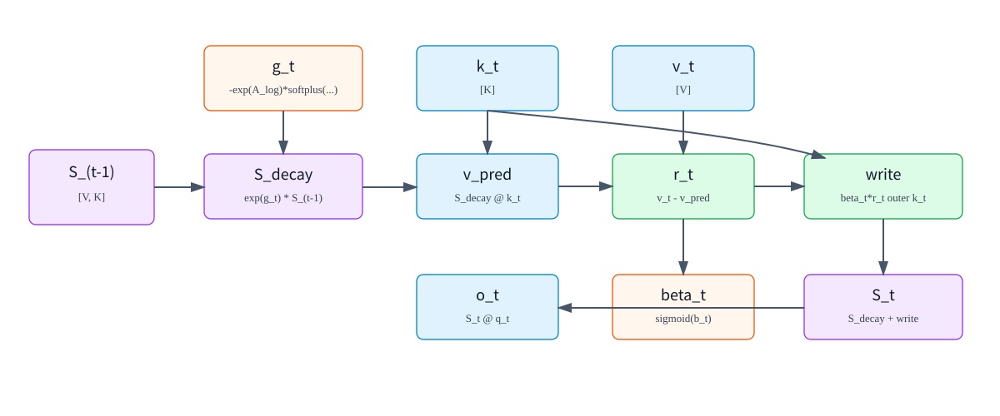

# 01. GDN Math: Gated Delta Rule and the State Matrix

## 1. The Problem GDN Tries to Solve

Standard causal attention stores historical K/V tensors for every layer:

```math
\mathrm{shape}\left(K_{\mathrm{cache}}\right)=\left[\mathrm{context\_len},\mathrm{num\_kv\_heads},\mathrm{head\_dim}\right]
```

```math
\mathrm{shape}\left(V_{\mathrm{cache}}\right)=\left[\mathrm{context\_len},\mathrm{num\_kv\_heads},\mathrm{head\_dim}\right]
```

The longer the context, the larger the KV Cache. GDN takes a different route: instead of storing K/V for every historical token, it maintains a per-head state matrix.

```text
S_t[h] : [V, K]
```

where:

| Symbol | Meaning |
|---|---|
| `t` | current token position |
| `h` | value head id |
| `K` | key/query head dimension |
| `V` | value head dimension |
| `S_t[h]` | recurrent state of value head `h` after token `t` has been processed |

For every new token, GDN does three things:

```text
1. Decay the old state through a gate
2. Use the key to predict the current value from the state
3. Write the prediction error back into the state, then read the output with the query
```



## 2. Core Equations for One Token and One Head

First consider one value head and omit batch/head indices. For the current token:

```math
\mathrm{shape}\left(q_{t}\right)=\left[K\right]
```

```math
\mathrm{shape}\left(k_{t}\right)=\left[K\right]
```

```math
\mathrm{shape}\left(v_{t}\right)=\left[V\right]
```

```math
\mathrm{shape}(S_{t-1})=[V,K]
```

```math
g_t\in\mathbb{R},\quad g_t\le0
```

```math
\beta_t\in(0,1)
```

The recurrent GDN update can be written as:

Decay the old state:

```math
S_{\mathrm{decay}}=\mathrm{exp}\left(g_{t}\right)\cdot {S}_{t-1}
```

Predict the current value:

```math
v_{\mathrm{pred}}=S_{\mathrm{decay}}\,k_{t}
```

Compute the residual:

```math
r_{t}=v_{t}-v_{\mathrm{pred}}
```

Control write strength:

```math
u_{t}=\beta_{t}\cdot r_{t}
```

Write into the state:

```math
S_{t}=S_{\mathrm{decay}}+u_{t}\,{k_{t}}^{\mathsf T}
```

Read the output:

```math
o_{t}=S_{t}\,q_{t}\cdot \mathrm{scale}
```

Variable meanings:

| Variable | Shape | Meaning |
|---|---:|---|
| `q_t` | $`\left[K\right]`$ | query vector of the current token; used to read from the state |
| `k_t` | $`\left[K\right]`$ | key vector of the current token; selects the direction to write into |
| `v_t` | $`\left[V\right]`$ | value information of the current token |
| `S_(t-1)` | $`\left[V,K\right]`$ | state before processing the current token |
| `g_t` | scalar | forget gate; the more negative it is, the stronger the old-state decay |
| `beta_t` | scalar | write gate; the closer to 1, the more strongly the residual is written |
| `v_pred` | $`\left[V\right]`$ | value predicted by the old state along direction `k_t` |
| `r_t` | $`\left[V\right]`$ | difference between current value and the old state's prediction |
| `u_t` | $`\left[V\right]`$ | residual write vector after modulation by `beta_t` |
| `o_t` | $`\left[V\right]`$ | output of the current head |

The outer product has shape:

```math
u_tk_t^{\mathsf T}\in\mathbb{R}^{V\times K},\quad u_t\in\mathbb{R}^{V},\quad k_t\in\mathbb{R}^{K}
```

so it can be added back to `S_decay [V,K]`.

## 3. Why It Is Called a Delta Rule

The delta-rule intuition is: do not write `v_t` into the state directly; write only the part that the old state failed to explain.

```math
r_{t}=v_{t}-S_{\mathrm{decay}}\,k_{t}
```

Read it as:

```text
If the old state can already predict v_t from k_t,
the residual is small, so this token writes very little.

If the old state predicts poorly,
the residual is large, so the state is corrected along direction k_t.
```

This differs from ordinary linear attention accumulation. A simple linear attention state update looks like:

```math
S_{t}={S}_{t-1}+v_{t}\,{k_{t}}^{\mathsf T}
```

GDN instead uses:

```math
S_{t}=\mathrm{exp}\left(g_{t}\right)\cdot {S}_{t-1}+\beta_{t}\cdot \left(v_{t}-\mathrm{exp}\left(g_{t}\right)\cdot {S}_{t-1}\,k_{t}\right)\,{k_{t}}^{\mathsf T}
```

It adds two important mechanisms:

| Mechanism | Role |
|---|---|
| $`\mathrm{exp}\left(g_{t}\right)`$ | adaptively forgets old state |
| $`v_{t}-S_{\mathrm{decay}}\,k_{t}`$ | writes only prediction error instead of repeatedly writing already represented information |

## 4. Where `g_t` Comes From

In SGLang's GDN implementation, `g_t` is computed from `A_log`, `a_t`, and `dt_bias`:

```math
g_{t}=-\mathrm{exp}\left(A_{\mathrm{log}}\right)\cdot \mathrm{softplus}\left(a_{t}+\mathrm{dt\_bias}\right)
```

| Variable | Shape | Trainable | Meaning |
|---|---:|---:|---|
| `A_log` | $`\left[\mathrm{HV}\right]`$ | yes | one log-space decay parameter per value head |
| `a_t` | $`\left[\mathrm{HV}\right]`$ | no | token-level gate activation produced by the `in_proj_a` projection |
| `dt_bias` | $`\left[\mathrm{HV}\right]`$ | yes | one time-step/decay bias per value head |
| `softplus(a_t + dt_bias)` | $`\left[\mathrm{HV}\right]`$ | no | positive time-step or decay strength |
| `g_t` | $`\left[\mathrm{HV}\right]`$ | no | non-positive gate that controls old-state decay |

Why this parameterization?

```math
\mathrm{exp}\left(A_{\mathrm{log}}\right) \gt 0
```

```math
\mathrm{softplus}\left(a_{t}+\mathrm{dt\_bias}\right) \gt 0
```

```math
g_{t} \le 0
```

```math
0 \lt \mathrm{exp}\left(g_{t}\right) \le 1
```

This guarantees the state decay factor is never larger than 1, preventing unconstrained amplification of old state.

The softplus function is:

```math
\mathrm{softplus}\left(x\right)=\mathrm{log}\left(1+\mathrm{exp}\left(x\right)\right)
```

When `x` is large, `softplus(x) ~= x`; when `x` is very negative, it still remains positive.

## 5. Where `beta_t` Comes From

`beta_t` is produced from another projection activation `b_t`:

```math
\beta_{t}=\mathrm{sigmoid}\left(b_{t}\right)
```

| Variable | Shape | Trainable | Meaning |
|---|---:|---:|---|
| `b_t` | $`\left[\mathrm{HV}\right]`$ | no | current token's write-gate activation produced by the `in_proj_b` projection |
| `beta_t` | $`\left[\mathrm{HV}\right]`$ | no | write strength, in `(0,1)` |

`b_t` itself is not a parameter. The projection matrix that produces `b_t` is trainable.

## 6. Multi-Head Mapping and GQA-Style Sharing

In common GDN configurations, the number of key heads and value heads can differ. Let:

```math
H=\mathrm{num\_key\_heads}
```

```math
\mathrm{HV}=\mathrm{num\_value\_heads}
```

```math
R=\frac{\mathrm{HV}}{H}
```

If $`\mathrm{HV} \gt H`$, multiple value heads share the same key head:

```math
\mathrm{key\_head\_id}=\left\lfloor\frac{\mathrm{value\_head\_id}}{R}\right\rfloor
```

SGLang's recurrent kernel uses the same mapping:

```math
i_{h}=\left\lfloor\frac{i_{\mathrm{hv}}}{\left\lfloor\frac{\mathrm{HV}}{H}\right\rfloor}\right\rfloor
```

Each value head has its own state `S[h_v]`, but the `q/k` vectors it reads with may come from the corresponding key-head group.

## 7. Why Q/K L2 Normalization Is Used

SGLang GDN kernels often enable:

```text
use_qk_l2norm_in_kernel=True
```

which means:

```math
q_{t}=\frac{q_{t}}{\sqrt{\mathrm{sum}\left({q_{t}}^{2}\right)+\epsilon}}
```

```math
k_{t}=\frac{k_{t}}{\sqrt{\mathrm{sum}\left({k_{t}}^{2}\right)+\epsilon}}
```

then:

```math
q_{t}=q_{t}\cdot \frac{1}{\sqrt{K}}
```

This helps in several ways:

| Purpose | Explanation |
|---|---|
| Stable state reads/writes | $`S\,k`$ and $`S\,q`$ do not explode because q/k norms are too large |
| More controllable beta | residual writes are governed mainly by direction and gate strength |
| Attention-like scale | $`\frac{1}{\sqrt{K}}`$ follows the same intuition as the scale factor in dot-product attention |

## 8. GDN vs Standard Attention

Standard attention:

```math
\mathrm{score\_tj}=\left\langle q_{t},k_{j}\right\rangle
```

```math
\alpha_{\mathrm{tj}}=\mathrm{softmax}\left(\mathrm{score\_tj}\right)
```

```math
o_{t} = \sum_{j} \alpha_{\mathrm{tj}} \cdot  v_{j}
```

GDN:

```math
S_{t}=\mathrm{recurrent\_update}\left({S}_{t-1},k_{t},v_{t},g_{t},\beta_{t}\right)
```

```math
o_{t}=S_{t}\,q_{t}
```

| Dimension | Standard Attention | GDN |
|---|---|---|
| History storage | stores K/V for every historical token | stores a fixed-size state matrix |
| How history is read | softmax weighting over all historical tokens | query reads from the state matrix |
| State size | grows linearly with context length | independent of context length |
| Strength | exact token-to-token retrieval | compressed memory and linear recurrence |
| Serving focus | KV Cache management and attention kernels | recurrent state, convolution state, chunk/recurrent kernels |

## 9. A Minimal Numeric Example

Assume:

```math
K=2
```

```math
V=3
```

```math
\mathrm{shape}(S_{t-1})=[3,2]
```

```math
\mathrm{shape}\left(k_{t}\right)=\left[2\right]
```

```math
\mathrm{shape}\left(v_{t}\right)=\left[3\right]
```

```math
\mathrm{shape}\left(q_{t}\right)=\left[2\right]
```

The computation is:

```math
S_{\mathrm{decay}}=\mathrm{exp}\left(g_{t}\right)\cdot {S}_{t-1}\qquad\text{[3,2]}
```

```math
v_{\mathrm{pred}}=S_{\mathrm{decay}}\,k_{t}\qquad\text{[3]}
```

```math
r_{t}=v_{t}-v_{\mathrm{pred}}\qquad\text{[3]}
```

```math
u_{t}=\beta_{t}\cdot r_{t}\qquad\text{[3]}
```

```text
u_t outer k_t                      # [3,2]
```

```math
S_{t}=S_{\mathrm{decay}}+u_{t}\,{k_{t}}^{\mathsf T}\qquad\text{[3,2]}
```

```math
o_{t}=S_{t}\,q_{t}\qquad\text{[3]}
```

This head outputs $`\left[3\right]`$. With multiple heads, all value-head outputs are concatenated:

```math
\mathrm{shape}\left(O_{t}\right)=\left[\mathrm{HV},V\right]
```

```text
flatten(O_t): [HV * V]
```

Then the result enters output gate/norm and the output projection.

## 10. Summary

1. GDN's core state is `S_t [V,K]`; it is per-request runtime state, not a model parameter.
2. `g_t` controls forgetting and `beta_t` controls writing. Both are computed from token activations and trainable parameters.
3. The delta rule writes $`v_{t}-S_{\mathrm{decay}}\,k_{t}`$, the residual not already explained by the old state.
4. GDN memory does not grow with context length, but it compresses history into a state matrix and therefore trades off exact KV retrieval for compact recurrent memory.
5. Multiple value heads can share a key head; SGLang kernels implement this through $`i_{h}=\left\lfloor\frac{i_{\mathrm{hv}}}{\left\lfloor\frac{\mathrm{HV}}{H}\right\rfloor}\right\rfloor`$.
