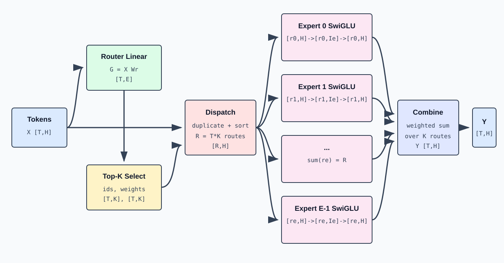

# Sparse MoE: Router, Top-K, Expert & Data Rearrangement

## 1. What MoE Replaces

A Dense Transformer's FFN uses the same MLP weights for every token:

```math
Y = \mathrm{FFN}\left(X\right), X,Y: \left[T,H\right]
```

Sparse Mixture-of-Experts prepares `E` expert MLP groups, but each token only selects `K`:

```math
Y_{t} = \sum_{e \in \mathrm{TopK}\left(t\right)} p_{t,e} \cdot  \mathrm{Expert\_e}\left(X_{t}\right)
```

When `K << E`, the model can have larger total parameter count while each token only executes a few experts.



## 2. MoE Main Path Shapes

```text
input X: [T,H]
router logits: [T,E]
topk ids: [T,K]
topk weights: [T,K]
```

```math
\text{dispatched rows}: \left[R,H\right], R = T\cdot K
```

```text
expert outputs: [R,H]
combined output Y: [T,H]
```

Main path input and output are the same, but internally each token is replicated into `K` routes. This replication is logical routing; high-performance implementations may avoid explicit replication through indexing, sorting, and fused kernels.

## 3. Router Linear

The Router is a linear layer from hidden space to expert space:

```math
\mathrm{shape}\left(\mathrm{Wr}\right)=\left[H,E\right]
```

```math
G=X\,\mathrm{Wr}
```

```math
\mathrm{shape}\left(G\right)=\left[T,E\right]
```

`G[t,e]` is the raw score of token `t` assigned to expert `e`:

```math
\mathrm{router\_logits}=\mathrm{hidden\_states}\,\mathrm{router\_weight}
```

Router parameters are typically small relative to all expert parameters; replicating across ranks avoids needing split-communication for routing scores first.

## 4. Top-K Selection & Normalization

Independently select the top `K` experts per token:

```math
\mathrm{topk\_ids}\left[t,:\right] = \mathrm{indices\_of\_top\_k}\left(G\left[t,:\right]\right)
```

Selected scores converted to weights. Common form:

```math
{p}_{t,e}={\mathrm{softmax}\left({G}_{t,:}\right)}_{e}
```

Or normalized only over the selected K items:

```math
w\left[t,j\right] = \mathrm{exp}\left(g\left[t,j\right]\right) / \sum_{u \in \mathrm{TopK}\left(t\right)} \mathrm{exp}\left(g\left[t,u\right]\right)
```

Results:

```text
topk_ids: [T,K], integer
topk_weights: [T,K], floating point
```

## 5. Dispatch: From Token Order to Expert Order

Input is token-ordered. Expert kernels prefer expert-grouped ordering. Dispatch creates one route per `(token, selected_expert)`:

```math
\text{route count R}= T\cdot K
```

Typical metadata for expert `e`:

```math
r_{e}={\mathrm{expert\_offsets}}_{e+1}-{\mathrm{expert\_offsets}}_{e}
```

```math
\mathrm{shape}\left(X_{e}\right)=\left[r_{e},H\right]
```

```math
\text{sum\_e r\_e}= R
```

## 6. Concrete Routing Example

$`T=4,\qquad E=4,\qquad K=2`$:

| token | Top-2 expert ids | weights |
|---|---|---|
| `x0` | $`\left[1,3\right]`$ | `[0.7,0.3]` |
| `x1` | $`\left[0,1\right]`$ | `[0.6,0.4]` |
| `x2` | $`\left[3,1\right]`$ | `[0.8,0.2]` |
| `x3` | $`\left[0,2\right]`$ | `[0.55,0.45]` |

After sorting by expert:

```text
expert 0 <- x1, x3       r_0=2
expert 1 <- x0, x1, x2   r_1=3
expert 2 <- x3           r_2=1
expert 3 <- x0, x2       r_3=2
```

After expert computation, combine restores token order:

```math
\mathrm{y0}=0.7\cdot \mathrm{E1}\left(\mathrm{x0}\right)+0.3\cdot \mathrm{E3}\left(\mathrm{x0}\right)
```

```math
\mathrm{y1}=0.6\cdot \mathrm{E0}\left(\mathrm{x1}\right)+0.4\cdot \mathrm{E1}\left(\mathrm{x1}\right)
```

```math
\mathrm{y2}=0.8\cdot \mathrm{E3}\left(\mathrm{x2}\right)+0.2\cdot \mathrm{E1}\left(\mathrm{x2}\right)
```

```math
\mathrm{y3}=0.55\cdot \mathrm{E0}\left(\mathrm{x3}\right)+0.45\cdot \mathrm{E2}\left(\mathrm{x3}\right)
```

Final $`Y=\left[\mathrm{y0},\mathrm{y1},\mathrm{y2},\mathrm{y3}\right]`$, shape restored to $`\left[4,H\right]`$.

## 7. Single Expert SwiGLU

Modern MoE typically uses gated SwiGLU experts. For `X_e [r_e,H]`:

```math
\mathrm{gate}=X_{e}\,W_{\mathrm{gate}}\qquad\mathrm{shape}:\left[r_{e},\mathrm{Ie}\right]
```

```math
\mathrm{up}=X_{e}\,W_{\mathrm{up}}\qquad\mathrm{shape}:\left[r_{e},\mathrm{Ie}\right]
```

```math
\mathrm{mid}=\mathrm{SiLU}\left(\mathrm{gate}\right)\odot \mathrm{up}\qquad\mathrm{shape}:\left[r_{e},\mathrm{Ie}\right]
```

```math
\mathrm{out}=\mathrm{mid}\,W_{\mathrm{down}}\qquad\mathrm{shape}:\left[r_{e},H\right]
```

Weight shapes:

```math
\mathrm{shape}\left(W_{\mathrm{gate}}\right)=\left[H,\mathrm{Ie}\right]
```

```math
\mathrm{shape}\left(W_{\mathrm{up}}\right)=\left[H,\mathrm{Ie}\right]
```

```math
\mathrm{shape}\left(W_{\mathrm{down}}\right)=\left[\mathrm{Ie},H\right]
```

Production implementations often pack `gate_proj` and `up_proj`:

```math
\mathrm{gate\_up}=X_{e}\,\mathrm{W\_gate\_up}\qquad\mathrm{shape}:\left[r_{e},2\cdot \mathrm{Ie}\right]
```

```math
\text{gate, up}= \mathrm{split}\left(\mathrm{gate\_up}, 2\right) \left[r_{e},\mathrm{Ie}\right], \left[r_{e},\mathrm{Ie}\right]
```

One expert's dataflow: `[r_e,H] -> [r_e,2*Ie] -> [r_e,Ie] -> [r_e,H]`

## 8. Combine

Expert output is expert/route-ordered. Combine uses `route_token_id` to restore token order and `route_weight` for weighted accumulation:

```math
Y\left[t,:\right] = \sum_{r: \mathrm{token}\left(r\right)=t} \mathrm{route\_weight}\left[r\right] \cdot  \mathrm{expert\_output}\left[r,:\right]
```

```math
\mathrm{shape}\left(Y\right)=\left[T,H\right]
```

Combine simultaneously performs inverse permutation and reduction. Each token has exactly `K` valid routes, so each output row merges `K` expert results.

## 9. Expert Parallel

When expert parameters can't fit on a single GPU, distribute experts across `Pep` ranks:

```math
E_{\mathrm{local}}=\frac{E}{\mathrm{Pep}}
```

After routing, each rank's tokens may select remote experts. Dataflow becomes:

```text
local tokens [T_local,H]
  -> local router/top-k
  -> dispatch + all-to-all
  -> received expert rows [R_local,H]
  -> local experts
  -> combine + all-to-all
  -> local token outputs [T_local,H]
```

### 9.1 Send Volume Depends on Routing

Rows sent from rank `i` to rank `j` are not fixed — they depend on which tokens select which experts. Hot experts cause load imbalance.

## 10. TP vs EP

| Parallelism | What's Split | Token Cross-Rank Movement | Main Communication |
|---|---|---|---|
| Tensor Parallel | Dimensions of same weight matrix | Usually no ownership change by routing | all-reduce / reduce-scatter |
| Expert Parallel | Different experts | Yes, redistributed by Top-K target | all-to-all dispatch/combine |

## 11. Parameters vs Activation Compute

Single SwiGLU expert parameter count (ignoring bias):

```math
\mathrm{params\_per\_expert}=3\cdot H\cdot \mathrm{Ie}
```

All experts:

```math
\mathrm{expert\_params}=E\cdot 3\cdot H\cdot \mathrm{Ie}
```

Single token activates `K` experts; its expert matmul compute scales with $`K\cdot 3\cdot H\cdot \mathrm{Ie}`$, not $`E\cdot 3\cdot H\cdot \mathrm{Ie}`$. But model weight memory still scales with `E`.

## 12. MoE in Prefill vs Decode

**Prefill**: Large `T`, each expert gets many rows — good GEMM utilization but larger all-to-all volume.

**Decode**: Small $`T\approx \mathrm{active\_requests}`$. With small batches, $`R=T\cdot K`$ may be tiny and spread across many experts. Router, dispatch, communication, and kernel launch fixed overhead becomes proportionally significant.

## 13. Reference MoE Implementation Order

```math
\mathrm{router\_logits}=X\,W_{\mathrm{router}}\qquad\text{[T,E]}
```

```math
\left[\mathrm{topk\_scores},\mathrm{topk\_ids}\right]=\mathrm{topk}\left(\mathrm{router\_logits}\right)\qquad\text{[T,K], [T,K]}
```

```math
\mathrm{topk\_weights} = \mathrm{normalize}\left(\mathrm{topk\_scores}\right) \qquad\text{[T,K]}
```

```math
\text{permuted\_X, route\_meta}= \mathrm{dispatch}\left(X, \mathrm{topk\_ids}\right) \qquad\text{[R,H], R=T*K}
```

```math
\mathrm{permuted\_Y} = \mathrm{grouped\_expert\_swiglu}\left(\mathrm{permuted\_X}, \mathrm{route\_meta}\right) \qquad\text{[R,H]}
```

```math
Y = \mathrm{combine}\left(\mathrm{permuted\_Y}, \mathrm{route\_meta}, \mathrm{topk\_weights}\right) \qquad\text{[T,H]}
```

## 14. Parallelizable Stage Decomposition

```text
Gate -> Select Experts -> Count Routes per Destination -> Dispatch All-to-All
  -> Grouped Expert GEMM -> Combine All-to-All -> Weighted Reduction
```

## 15. Three Quantities Not to Confuse

```text
E = total routed experts
K = experts activated per token
```

```math
R = \mathrm{total} \mathrm{expert} \mathrm{routes} \mathrm{this} \mathrm{round}, \mathrm{typically} T\cdot K
```

`E` determines total expert parameter scale, `K` determines per-token activation compute, `R` determines dispatch buffer and expert input row count.
