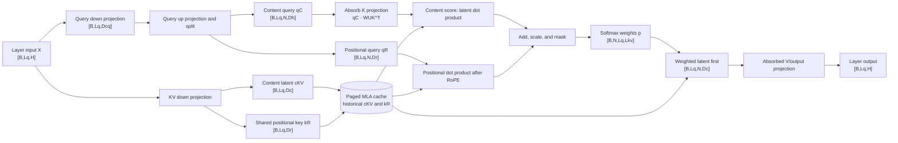

# Multi-head Latent Attention: Low-Rank Compression & Decoupled RoPE

> 中文版：[Multi-head Latent Attention](../../../zh/ai-infra-basic/Model_Architecture/04-multi-head-latent-attention.md)

## Reading Map: Build the Whole Mental Model First

MLA is easy to lose inside a forest of projection matrices. Start with only two ideas:

1. **Compress on cache write**: instead of writing `N` complete K/V pairs for every historical token, write one shared content latent `c^{KV}` and one shared RoPE key;
2. **Change coordinates on cache read**: during decode, do not expand every historical latent back to complete K/V. Transform the current query and output projection into latent coordinates and read the compressed cache directly.



The diagram contains two timelines. `X -> CKV/KR -> Cache` **writes the current token**; `Cache -> Score/LatOut` **reads historical tokens**. In prefill, `Lq=Lkv=S`; in decode, usually `Lq=1` and `Lkv=S_past+1`.

### Running Shape Example

The rest of the chapter uses this teaching configuration. It is chosen to make shapes concrete, not to prescribe every model:

```text
B=2, S=4096, H=4096
N=32, Dc=512, Dcq=1536
Dh=128, Dr=64, Dv=128
dtype=BF16/FP16 (2 bytes per element)
```

Axes are fixed throughout: `B` batch size, `S/Lkv` history length, `Lq` query length of this call, `N` query heads, and `H` hidden size. `[B,S,N,D]` in the exposition and `[B,N,S,D]` in many kernels differ only by layout; their mathematical meaning is identical.

Standard MHA caches per token per layer:

```text
N × (Dh + Dv) = 32 × (128 + 128) = 8192 elements
8192 × 2 bytes = 16384 bytes = 16 KiB
```

MLA caches per token per layer:

```text
Dc + Dr = 512 + 64 = 576 elements
576 × 2 bytes = 1152 bytes = 1.125 KiB
```

The **logical KV payload** is therefore about `8192 / 576 = 14.22×` smaller in this example. Real allocations also contain page alignment, block tables, quantization scales, and allocator metadata.

### One Decode Step, End to End

Assume `4095` tokens already exist and token `4096` is appended:

| Stage | Input shape | Operation | Output shape | Persistent? |
|---|---:|---|---:|---|
| Layer input | `[2,1,4096]` | Previous sublayer/RMSNorm | `[2,1,4096]` | No |
| KV write | `[2,1,4096]` | `W_DKV_R` | `Ckv [2,1,512]`, `Krope [2,1,64]` | Yes |
| Q compression | `[2,1,4096]` | `W_DQ` | `Cq [2,1,1536]` | No |
| Q expansion | `[2,1,1536]` | `W_UQ` + split | `Qc [2,1,32,128]`, `Qr [2,1,32,64]` | No |
| History view | Block table | gather/page view | `Ckv_hist [2,4096,512]`, `Kr_hist [2,4096,64]` | Already cached |
| Content score | `Qc,Ckv_hist` | absorbed latent dot product | `[2,32,1,4096]` | No |
| Position score | `RoPE(Qr),RoPE(Kr)` | dot product after head broadcast | `[2,32,1,4096]` | No |
| Probabilities | both score terms | scale + causal mask + softmax | `[2,32,1,4096]` | No |
| Latent reduction | probabilities, `Ckv_hist` | weighted sum over history | `[2,1,32,512]` | No |
| Output | latent reduction | absorbed V/O transform and head merge | `[2,1,4096]` | No |

This table is the ledger behind every later equation. If an implementation step cannot be found as an explicit operation, a layout transform, matrix absorption, or fused kernel has usually hidden it—the mathematical step has not vanished.

## 1. The Problem MLA Solves

Standard Multi-Head Attention stores complete K and V for every historical token, every layer:

```text
K_cache: [B,S,N,Dk]
V_cache: [B,S,N,Dv]
```

Cache elements per token: `N * (Dk + Dv)`. For long-context generation, KV Cache becomes the primary bottleneck for memory capacity and read bandwidth.

MLA's core idea: **Don't directly cache each head's expanded K/V. Instead, cache a shared low-dimensional latent vector; when attention is needed, up-project it to recover per-head content information.**


## 2. Unified Notation

| Symbol | Meaning |
|---|---|
| `X` | Input hidden states, `[B,S,H]` |
| `N` | Number of attention heads |
| `Dc` | KV latent compression dimension |
| `Dcq` | Query latent compression dimension |
| `Dh` | Content key/query dimension per head |
| `Dr` | RoPE dimension per head |
| `Dv` | Value dimension per head |
| `Ckv` | Compressed KV latent, `[B,S,Dc]` |
| `Cq` | Compressed Query latent, `[B,S,Dcq]` |

MLA typically satisfies:

```text
Dc << N * (Dh + Dv)
```

Thus caching `Ckv` is more compact than caching all heads' K/V.

## 3. KV Down-Projection: Compressing Hidden State to Latent

For each token's hidden vector `x in R^H`, content latent and position key can be produced by a single joint projection:

```text
[c_kv, k_rope_raw] = x @ W_DKV_R
```

Batch shapes:

```text
X:          [B,S,H]
W_DKV_R:    [H,Dc+Dr]
projected:  [B,S,Dc+Dr]
Ckv:        [B,S,Dc]
K_rope_raw: [B,S,Dr]
```

Two independent but equivalent logical projections can also separately produce `Ckv` and `K_rope_raw`. Content compression from `H` to `Dc` is not lossless copy — it's a learned low-rank representation.

## 4. KV Up-Projection: Recovering Content K and V from Latent

Two logically independent up-projections:

```text
K_content = Ckv @ W_UK
V         = Ckv @ W_UV
```

Shapes:

```text
W_UK: [Dc,N*Dh]
W_UV: [Dc,N*Dv]

K_content_flat: [B,S,N*Dh]
V_flat:         [B,S,N*Dv]

K_content: [B,S,N,Dh]
V:         [B,S,N,Dv]
```

Each head's K/V is no longer independently projected from `X` directly, but shares the same `Ckv`, then recovers using different up-projection parameters.

## 5. Query Low-Rank Projection

Query can also use low-rank decomposition:

```text
Cq = X @ W_DQ
Q_full = RMSNorm(Cq) @ W_UQ
```

Shapes:

```text
W_DQ: [H,Dcq]
Cq:   [B,S,Dcq]
W_UQ: [Dcq,N*(Dh+Dr)]
Q_full: [B,S,N*(Dh+Dr)]
```

Split:

```text
Q_content: [B,S,N,Dh]
Q_rope:    [B,S,N,Dr]
```

Query doesn't need caching across generation steps, so Query compression mainly reduces parameter structure or changes projection computation — it doesn't directly determine KV Cache capacity.

## 6. Why RoPE Must Be Decoupled

If RoPE were directly applied to the complete K recovered from `Ckv @ W_UK`, the position-dependent rotation would block matrix absorption: the rotation matrix depends on token position and cannot be simply merged into fixed `W_UK`.

MLA therefore splits each Q/K head into two parts:

```text
Q_head = concat(Q_content, Q_rope)
K_head = concat(K_content, K_rope)
```

Where:
- `Q_content` and `K_content` have no RoPE — they handle semantic content matching
- `Q_rope` and `K_rope` have RoPE — they handle relative position
- `K_rope` can be shared across heads, then broadcast to `N` heads

Shapes:

```text
Q_content: [B,S,N,Dh]
Q_rope:    [B,S,N,Dr]
K_content: [B,S,N,Dh]
K_rope:    [B,S,1,Dr] -> broadcast [B,S,N,Dr]
```

Final per-head Query/Key dimension:

```text
Dqk = Dh + Dr
```

## 7. MLA Attention Scores

For head `n`, query position `i`, key position `j`:

```text
score[n,i,j] = Q_content[n,i] · K_content[n,j] + Q_rope[n,i] · K_rope[j]
```

Scaled: `score = score / sqrt(Dh + Dr)`. After causal mask and softmax:

```text
O[n,i,:] = sum_j alpha[n,i,j] * V[n,j,:]
O: [B,S,N,Dv]
```

Merge heads then restore `[B,S,H]` via output projection.

## 8. Naive Implementation: Recover K/V First, Then Attention

Most direct:

```text
Ckv = X @ W_DKV                         [B,S,Dc]
Kc = reshape(Ckv @ W_UK)                [B,S,N,Dh]
V  = reshape(Ckv @ W_UV)                [B,S,N,Dv]
Q  = build_query(X)                     [B,S,N,Dh+Dr]
K  = concat(Kc, broadcast(K_rope))      [B,S,N,Dh+Dr]
O = softmax(Q @ K^T + mask) @ V
```

Clear mathematically, but losing the bandwidth advantage of compressed cache during decode if full K/V is recovered every round.

## 9. Matrix Absorption: Don't Explicitly Recover Content K

For a single head, content score:

```text
q_c · k_c = q_c · (c_kv @ W_UK) = (q_c @ W_UK^T) · c_kv
```

Define latent query:

```text
q_latent = q_c @ W_UK^T
q_latent: [B,Lq,N,Dc]
```

Content scores can directly dot-product with cached `Ckv [B,Lkv,Dc]`:

```text
content_score: [B,N,Lq,Lkv]
```

No need to materialize `K_content [B,Lkv,N,Dh]` for historical tokens.

## 10. Matrix Absorption: Don't Explicitly Recover Historical V

Naive value aggregation:

```text
o = sum_j alpha_j * v_j = sum_j alpha_j * (c_j @ W_UV)
  = (sum_j alpha_j * c_j) @ W_UV
```

So we can first aggregate in latent space:

```text
o_latent = alpha @ Ckv       [B,Lq,N,Dc]
o_head = o_latent @ W_UV     [B,Lq,N,Dv]
```

Historical Value heads need no full expansion.

## 11. What Compressed KV Cache Stores

After decoupled RoPE, each historical token needs:

```text
Ckv:    [Dc]
K_rope: [Dr]
```

Single token, single layer cache elements:

```text
MLA cache elements = Dc + Dr
```

Standard MHA: `N * (Dk + Dv)`. GQA: `Nkv * (Dk + Dv)`. MLA compression ratio ≈ `(Dc + Dr) / (N * (Dk + Dv))`.

## 12. Decode Dataflow

Current round, one new token per sequence:

```text
X_new: [B,1,H]
Ckv_new:    [B,1,Dc]
K_rope_new: [B,1,Dr]
```

Cache grows:

```text
Ckv_cache:    [B,Sctx,Dc]
K_rope_cache: [B,Sctx,Dr]
```

Absorbed content path: `Q_content -> latent query [B,1,N,Dc] -> dot with Ckv_cache -> content scores [B,N,1,Sctx]`. Position path: `Q_rope × K_rope_cache -> position scores [B,N,1,Sctx]`. Sum, softmax, aggregate in latent space, map to head outputs.

## 13. Prefill Dataflow

Prefill computes `S` tokens in parallel. Higher compute density. Can choose:
1. Expand K/V then use standard matrix Attention
2. Compute directly in latent space
3. Hybrid based on shape and hardware

All must satisfy identical causal mask and mathematical mapping.

## 14. Parameter Meaning of Low-Rank Structure

KV projection decomposed as:

```text
X [H] -> Ckv [Dc] -> K/V heads [N*(Dh+Dv)]
```

Equivalent weight matrix has factored form `W_KV_effective = W_DKV @ W_UKV`, with rank upper bound ≤ `Dc`. This imposes structural low-rank constraint.

## 15. MLA, MHA, GQA Structural Comparison

| Structure | Query Heads | Cached State | Inter-Head Sharing |
|---|---:|---|---|
| MHA | `N` | Full `N` K/V groups | None |
| MQA | `N` | 1 K/V group | All Q heads share same K/V |
| GQA | `N` | `Nkv` K/V groups | Each Q-head group shares K/V head |
| MLA | `N` | Shared latent + position key | Each head interprets same latent via up-projection |

GQA compresses cache by reducing KV head count; MLA compresses cache via low-rank latent representation. Sharing mechanisms differ.

## 16. Key Correctness Conditions for MLA

1. `W_DKV` and `W_UK/W_UV` must be jointly trained; latent is not post-hoc lossless compression.
2. RoPE content and position subspaces must be split as designed, otherwise matrix absorption doesn't hold.
3. Causal mask still acts on token position dimension; latent compression doesn't change autoregressive visibility.
4. Cache must simultaneously store content latent and position key that cannot be absorbed by fixed matrices.
5. Absorbed and expanded implementations should produce equivalent results within numerical error.

## 17. What MLA Solves—and What It Does Not

MLA primarily compresses the **feature dimension** of each historical KV entry. It does not remove the sequence dimension:

```text
cache entries: O(L)
dense prefill attention: O(L^2)
dense decode attention per token: O(L)
```

This distinction matters when reading newer architectures. DSA sparsifies which MLA entries enter the main core; CSA first compresses the sequence dimension and then selects compressed entries; KDA replaces token-addressable history with a fixed recurrent state.

## 18. Expanded and Absorbed Execution Modes

Production backends can expose the same MLA checkpoint through different kernel shapes:

- **expanded mode** reconstructs head-wise K/V and uses an MHA-like kernel;
- **absorbed mode** folds up-projection matrices into query/output paths and consumes the latent cache in an MQA-like kernel;
- **hybrid dispatch** chooses a path based on prefill/decode phase, sequence length, hardware, and supported dtypes.

The modes are mathematically related but have different intermediate memory, bandwidth, and kernel requirements. DeepSeek Sparse Attention uses the absorbed/MQA-form latent representation for its selected entries. An implementation must make the cache layout and backend mode explicit rather than inferring them from the model name.

## 19. SGLang Source Map

In the source snapshot used by this tutorial:

- MLA model wiring and absorbed weights: [`deepseek_v2.py`](../../../../python/sglang/srt/models/deepseek_v2.py);
- generic KV/latent memory pools: [`memory_pool.py`](../../../../python/sglang/srt/mem_cache/memory_pool.py);
- NPU-specific MLA module: [`deepseek_v2_attention_mla_npu.py`](../../../../python/sglang/srt/hardware_backend/npu/modules/deepseek_v2_attention_mla_npu.py);
- FlashMLA Python entry point: [`flash_mla.py`](../../../../sgl-kernel/python/sgl_kernel/flash_mla.py);
- HIP path: [`hip_flash_mla.py`](../../../../python/sglang/srt/layers/attention/hip_flash_mla.py).

When debugging shape or performance issues, trace `model projection -> cache write -> backend dispatch -> kernel layout` and check prefill and decode independently.

## 20. Serving and Ascend Checklist

1. Record whether each phase uses expanded or absorbed execution.
2. Include both content latent and decoupled-RoPE key in cache-byte calculations.
3. Confirm paged-cache stride, block table, dtype, quantization scale, and alignment.
4. On Ascend, verify the selected path against the pinned SGLang, `torch_npu`, CANN, and custom-kernel versions.
5. Profile projections, RoPE, cache write, attention core, and output projection separately before fusing.
6. Use the same latent layout when composing MLA with DSA; do not gather expanded head-wise K/V by accident.

## 21. Continue Reading

- [Efficient-attention landscape](./06-efficient-attention-landscape.md)
- [DeepSeek Sparse Attention](./07-deepseek-sparse-attention.md)
- [Compressed Sparse Attention and HCA](./08-compressed-sparse-attention.md)
- [Kimi Delta Attention](./09-kimi-delta-attention.md)

## 22. References

- [DeepSeek-V2: A Strong, Economical, and Efficient Mixture-of-Experts Language Model](https://arxiv.org/abs/2405.04434)
- [DeepSeek-V3 Technical Report](https://arxiv.org/abs/2412.19437)
