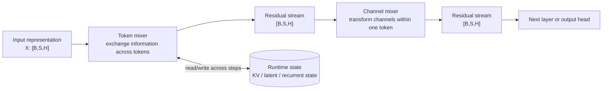
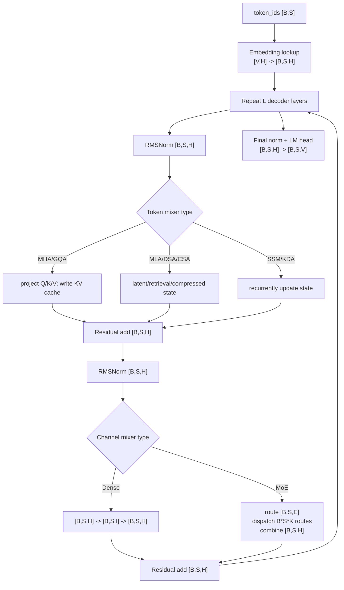
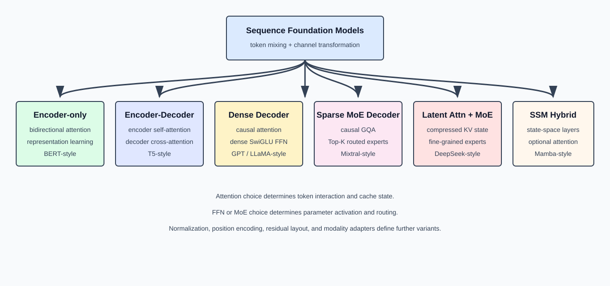

# LLM Architecture Families: Which Modules Changed

> 中文版：[主流大模型架构谱系](../../../zh/ai-infra-basic/Model_Architecture/05-architecture-families.md)

## Reading Map: Do Not Memorize Architectures by Model Name

Model names change, but one layer can always be decomposed into four questions:



1. **Input/output contract**: why does the residual stream usually remain $`\left[B,S,H\right]`$?
2. **Token mixer**: which tokens may a token read, and by what operation?
3. **Channel mixer**: how do Dense FFN, SwiGLU, and MoE transform the last dimension?
4. **Runtime state**: what exactly survives into the next decode step?

This chapter is not a list of model names. It is a method for reconstructing an architecture. Once these four boxes are filled, cache design, parallelism, kernels, and serving requirements follow.

### Universal Layer Equations and Shape Invariants

For the common serial Pre-Norm residual layout:

```math
U=\mathrm{RMSNorm}\left(X\right)\qquad\mathrm{shape}:\left[B,S,H\right]
```

```math
\text{A, state'}= \mathrm{TokenMixer}\left(U,\mathrm{state}\right) \left[B,S,H\right]
```

```math
R=X+A\qquad\mathrm{shape}:\left[B,S,H\right]
```

```math
V=\mathrm{RMSNorm}\left(R\right)\qquad\mathrm{shape}:\left[B,S,H\right]
```

```math
F = \mathrm{ChannelMixer}\left(V\right) \left[B,S,H\right]
```

```math
Y=R+F\qquad\mathrm{shape}:\left[B,S,H\right]
```

The **intermediates** and **persistent state** change; the residual stream shape does not. SwiGLU temporarily expands to $`\left[B,S,I\right]`$; MoE temporarily expands each token into `K` routes; attention logically creates $`\left[B,N,\mathrm{Lq},\mathrm{Lkv}\right]`$ scores; SSM/KDA reads and writes fixed-shape matrices. Every branch must project back to `H` before residual addition.

### One Teaching Configuration Across Families

```math
B=2,\qquad S=1024,\qquad H=4096,\qquad L=32
```

```math
\mathrm{Nq}=32,\qquad \mathrm{Nkv}=8,\qquad D=128
```

```math
\text{FFN I}=11008
```

```math
\text{MoE E}=64, \mathrm{top}-K=2, \mathrm{expert} \mathrm{width} \mathrm{Ie}=1408
```

| Family | Largest logical temporary | Per-layer persistent decode state | Grows with context? |
|---|---|---|---|
| Encoder-only | attention score $`\left[2,32,1024,1024\right]`$ | usually none | No |
| Encoder-Decoder | self score + cross score $`\left[2,32,\mathrm{Stgt},\mathrm{Ssrc}\right]`$ | decoder KV + encoder memory/KV | Decoder part does |
| Dense/MoE Decoder | causal score $`\left[2,32,1024,1024\right]`$ | KV `[B,S,Nkv,D] × 2` | Yes |
| MLA Decoder | latent-attention score $`\left[2,32,1024,1024\right]`$ | `Ckv [B,S,Dc] + Krope [B,S,Dr]` | Yes, but narrower per token |
| SSM/KDA | scan/chunk temporaries | fixed recurrent state + convolution tail | No |
| Hybrid | depends on the current layer type | union of KV and recurrent states | Only some layers |

The score tensor above is a logical training/naive shape. FlashAttention-style kernels tile the online softmax and do not write the full $`\left[S,S\right]`$ matrix to HBM.

### Decoder-Only End-to-End Main Path



Prefill sends all `S` positions through this graph; decode sends only $`\left[B,1,H\right]`$, while the token mixer reads the previously persisted history. That distinction is why the same model has radically different performance profiles in the two phases.

## 1. Unified Analysis Framework

Many model names exist, but the main structure can be analyzed along three dimensions:

1. **Token mixer**: How tokens exchange information — bidirectional Attention, causal Attention, Cross Attention, SSM.
2. **Channel mixer**: How a single token's hidden vector is nonlinearly transformed — Dense FFN, SwiGLU, Sparse MoE.
3. **State representation**: What is saved when processing history — full K/V, grouped K/V, latent KV, fixed-size SSM state.



## 2. Encoder-only Transformer

Encoder-only models use bidirectional self-attention. Every position can read all positions:

```text
visibility(i,j) = true, for all valid i,j
```

Single layer:

```text
X [B,S,H]
  -> Norm -> Bidirectional Self-Attention [B,S,H] -> Residual Add
  -> Norm -> Dense FFN [B,S,H] -> Residual Add
```

Characteristics:
- All token representations simultaneously fuse left and right context
- Suitable for encoding, classification, retrieval, token-level understanding
- Not naturally suited for left-to-right autoregressive generation
- Typically uses full-segment input, no autoregressive decode KV Cache needed

BERT-style models belong to this family.

## 3. Encoder-Decoder Transformer

Contains two layer stacks:

**Encoder**: `source_ids -> embedding -> bidirectional encoder layers -> memory [B,Ssrc,H]`

**Decoder**: `target_ids -> embedding -> causal self-attention -> cross-attention over encoder memory -> FFN -> target logits [B,Stgt,V]`

Cross Attention shapes:

```text
Q from decoder: [B,Stgt,N,D]
K,V from encoder memory: [B,Ssrc,Nkv,D]
```

```math
\mathrm{shape}\left(\mathrm{scores}\right)=\left[B,N,\mathrm{Stgt},\mathrm{Ssrc}\right]
```

Characteristics:
- Input sequence first encoded into fixed memory
- Output sequence autoregressively generated
- Decoder each layer needs both self-attention state and encoder cross-attention K/V
- Suitable for conditional generation: translation, structured transformation

T5-style models belong to this family.

## 4. Dense Decoder-only Transformer

Most common generative LLM backbone:

```text
Token Embedding
  -> L x [Causal Attention + Dense FFN]
  -> Final Norm -> LM Head
```

Per layer:

```math
r = x + \mathrm{Attention}\left(\mathrm{Norm}\left(x\right)\right)
```

```math
y = r + \mathrm{FFN}\left(\mathrm{Norm}\left(r\right)\right)
```

Dense SwiGLU FFN:

```math
\mathrm{gate}=X\,W_{\mathrm{gate}}\qquad\mathrm{shape}:\left[B,S,I\right]
```

```math
\mathrm{up}=X\,W_{\mathrm{up}}\qquad\mathrm{shape}:\left[B,S,I\right]
```

```math
\mathrm{mid}=\mathrm{SiLU}\left(\mathrm{gate}\right)\odot \mathrm{up}\qquad\mathrm{shape}:\left[B,S,I\right]
```

```math
Y=\mathrm{mid}\,W_{\mathrm{down}}\qquad\mathrm{shape}:\left[B,S,H\right]
```

Parameter count and per-token compute both grow with FFN intermediate size `I`. All tokens pass through the same FFN weights.

GPT-style, LLaMA-style, and many dense Qwen-style models belong to this family.

## 5. Sparse MoE Decoder

Retains causal Attention, replaces Dense FFN with routed experts:

```math
r = x + \mathrm{Attention}\left(\mathrm{Norm}\left(x\right)\right)
```

```math
y = r + \mathrm{SparseMoE}\left(\mathrm{Norm}\left(r\right)\right)
```

MoE layer:

```text
router logits: [B,S,E]
top-k ids/weights: [B,S,K]
logical expert routes: B*S*K
```

```math
\mathrm{shape}\left(\mathrm{output}\right)=\left[B,S,H\right]
```

Total expert parameter count ≈ proportional to `E`; per-token activation compute ≈ proportional to `K`. Key structural characteristics:
- Parameter capacity decoupled from activation compute
- Token selects different parameter subnetworks based on content
- Must handle expert load imbalance and token dispatch
- Small batches cause expert GEMM fragmentation

Mixtral-style and various MoE Qwen-style models belong to this family.

## 6. Shared Expert & Routed Expert

Some MoE architectures use both shared and routed experts:

```math
Y = \mathrm{SharedExpert}\left(X\right) + \sum_{e \in \mathrm{TopK}\left(X\right)} p_{e} \cdot  \mathrm{RoutedExpert\_e}\left(X\right)
```

Where:
- Shared expert activates for all tokens, learning general capabilities
- Routed experts activate only for selected tokens, learning conditional features
- Shared path provides stable common transformation; routed path adds parameter capacity

Shapes:

```math
\mathrm{shape}\left(\mathrm{shared\_output}\right)=\left[B,S,H\right]
```

```math
\mathrm{shape}\left(\mathrm{routed\_output}\right)=\left[B,S,H\right]
```

```math
\mathrm{shape}\left(\mathrm{final\_output}\right)=\left[B,S,H\right]
```

## 7. Fine-Grained MoE

Fine-grained MoE uses more, smaller experts. If an expert with intermediate width `I_big` is split into `m` small experts,

```math
\mathrm{Ie}=\frac{I_{\mathrm{big}}}{m}
```

```math
\mathrm{active\_width}=K\cdot \mathrm{Ie}
```

the model may increase top-`K` so that the total active width per token remains near a target. The computation for flattened tokens $`T=B\cdot S`$ is:

```text
X_flat:       [T,H]
router_logits:[T,E]
topk_id:      [T,K]
topk_weight:  [T,K]
dispatch:     T*K logical token-expert routes
expert input: [Te,H] for expert e
expert output:[Te,H]
combine:      [T,K,H] -> weighted sum -> [T,H]
```

Finer routing offers more combinations of experts, but increases routing metadata, dispatch complexity, communication, and the risk of tiny GEMMs.

## 8. MLA + MoE Decoder

This family changes both attention state and parameter activation:

```text
X [B,S,H]
  -> Norm
  -> Multi-head Latent Attention
     persists Ckv [B,S,Dc] + K_rope [B,S,Dr]
  -> Residual
  -> Norm
  -> shared + routed sparse experts
  -> Residual
```

MLA attacks long-context state cost; MoE increases parameter capacity without activating all expert parameters for every token. They solve different axes and can therefore be composed. DeepSeek-style decoders are representative of this combination.

## 9. State Space Model

An SSM does not dot the current query against every historical K. It recurrently updates a fixed-shape state:

```math
h_{t}=A_{t}\,{h}_{t-1}+B_{t}\,x_{t}
```

```math
y_{t}=C_{t}\,h_{t}+D\,x_{t}
```

Logical dataflow:

```text
x_t [B,H] + state_(t-1) [B,...]
  -> state update
  -> y_t [B,H] + state_t [B,...]
```

| Property | Attention | SSM |
|---|---|---|
| Historical state | K/V grows with context | fixed-shape recurrent state |
| Token mixing | current Q dots historical K | state recurrence/selective scan |
| Parallel prefill | matrix attention | scan or chunked scan |
| Decode | read historical KV | update one fixed state |

The state being fixed-size does not mean information is losslessly preserved. History is compressed into a learned dynamical system. Mamba-style models belong to this family.

## 10. Attention-SSM Hybrid

Hybrid architectures assign different token mixers to different layer IDs:

```text
Layer 0: SSM
Layer 1: SSM
Layer 2: Attention
Layer 3: SSM
...
```

SSM layers propagate compressed history efficiently; occasional attention layers provide direct content-addressed lookup. If attention-layer IDs are `A` and recurrent-layer IDs are `M`, the serving state is

```text
runtime state = {KV cache for l in A} union {recurrent state for l in M}
```

Schedulers must therefore route each layer to a compatible backend and manage two different state lifecycles.

## 11. Multimodal Backbone Composition

Multimodal models commonly keep a language-model backbone and add an encoder and projector on the input side:

```text
image -> vision encoder -> [B,Nimg,Hvision]
      -> projector      -> visual tokens [B,Nimg,H]

text_ids -> embedding  -> text tokens [B,Ntxt,H]

concat/interleave -> [B,Nimg+Ntxt,H] -> language backbone
```

The projector establishes the critical width contract `Hvision -> H`. Fusion may use projected visual tokens inside decoder self-attention, separate cross-attention over visual memory, or modality adapters in selected layers. Every design must define position IDs, attention masks, and which token positions contribute to the output loss.

## 12. Architecture Component Matrix

| Family | Token mixer | Channel mixer | Historical state | Typical output |
|---|---|---|---|---|
| Encoder-only | bidirectional self-attention | Dense FFN | usually no autoregressive state | pooled/token representations |
| Encoder-Decoder | encoder self + decoder causal/cross attention | Dense FFN or MoE | decoder KV + encoder memory | autoregressive logits |
| Dense Decoder | causal MHA/GQA | Dense SwiGLU | per-layer KV cache | autoregressive logits |
| Sparse MoE Decoder | causal MHA/GQA | top-K MoE | per-layer KV cache | autoregressive logits |
| MLA + MoE | latent causal attention | shared/routed MoE | latent KV + position key | autoregressive logits |
| SSM | selective state update | gated projection/FFN | fixed-size state | autoregressive logits |
| Attention-SSM Hybrid | alternating attention and SSM | Dense FFN or MoE | mixed KV + recurrent state | autoregressive logits |

## 13. Position-Encoding Differences

| Method | Applied to | Changes tensor shape? | Main property |
|---|---|---|---|
| Learned absolute | added to token embedding | No | learned row per position |
| Sinusoidal | added to token embedding | No | fixed frequency functions |
| RoPE | rotates Q/K | No | dot product carries relative position |
| Relative bias | added to attention score | score shape unchanged | directly modifies pair score |
| ALiBi | linear distance bias on score | score shape unchanged | no position-embedding table |
| Decoupled RoPE | rotates only positional Q/K subspace | splits last dimension | permits MLA content-projection absorption |

Position encoding affects long-context extrapolation, cache content, and attention kernels, although the residual path usually remains $`\left[B,S,H\right]`$.

## 14. Normalization and Residual Layout

```math
\mathrm{Post}-\mathrm{Norm}: y = \mathrm{Norm}\left(x + \mathrm{Sublayer}\left(x\right)\right)
```

```math
\mathrm{Pre}-\mathrm{Norm}: y = x + \mathrm{Sublayer}\left(\mathrm{Norm}\left(x\right)\right)
```

```math
\text{Parallel Residual}: y = x + \mathrm{Attention}\left(\mathrm{Norm}\left(x\right)\right) + \mathrm{FFN}\left(\mathrm{Norm}\left(x\right)\right)
```

Deep models commonly use Pre-Norm or a variant for optimization stability. LayerNorm centers and scales, while RMSNorm only rescales by the root-mean-square magnitude. Both preserve $`\left[B,S,H\right]`$.

## 15. Reconstruct an Architecture from Configuration

Read a model configuration in this order:

1. `vocab_size`, `hidden_size`, `num_hidden_layers`: embedding, residual width, and depth.
2. `num_attention_heads`, `num_key_value_heads`, `head_dim`: MHA/MQA/GQA and KV shape.
3. `intermediate_size`: Dense FFN width.
4. `num_experts`, `num_experts_per_tok`, `moe_intermediate_size`: routing and active expert width.
5. Latent rank and qk content/RoPE dimensions: whether the model uses MLA.
6. State size, convolution size, and SSM layer pattern: whether recurrent layers exist.
7. Norm, activation, and RoPE parameters: numerical and positional details.
8. Tied embeddings/output-head settings: whether input embedding and LM head share weights.

## 16. Decide Whether Two Models Are Structurally Different

- Changing only `H`, `L`, `N`, or `I` usually scales one architecture.
- MHA to GQA changes historical-state structure.
- Dense FFN to MoE changes parameter activation and token dispatch.
- GQA to MLA changes K/V representation and factorizes attention computation.
- Attention to SSM changes token mixing and cross-step state.
- Adding a vision encoder changes input representation and modality fusion.

The question is not whether model names differ, but whether token mixing, channel mixing, or persistent state changes.

## 17. Modern Efficient-Attention Families

| Family | Token mixer | Historical state | Main serving implication |
|---|---|---|---|
| MLA dense/sparse hybrid | MLA or DSA | token-level latent KV + position/indexer keys | compact cache; DSA adds irregular top-k gather |
| Compressed hierarchy | SWA + CSA or HCA | local KV + compressed entries + compressor tail | cache granularities advance at different rates |
| Delta-recurrent hybrid | GDN/KDA interleaved with softmax attention | recurrent matrix + convolution tail + occasional KV cache | mutable recurrent state requires rollback and routing rules |

For any unfamiliar model, answer four final questions:

1. Which layer IDs use dense, sparse, compressed, local, or recurrent mixing?
2. What does each layer persist after one token?
3. Which state is token-addressable, and which is only a compressed summary?
4. Which backend handles prefill, decode, graph replay, and speculative verification?

Continue with the [efficient-attention landscape](./06-efficient-attention-landscape.md), [DSA](./07-deepseek-sparse-attention.md), [CSA/HCA](./08-compressed-sparse-attention.md), and [KDA](./09-kimi-delta-attention.md) chapters.
