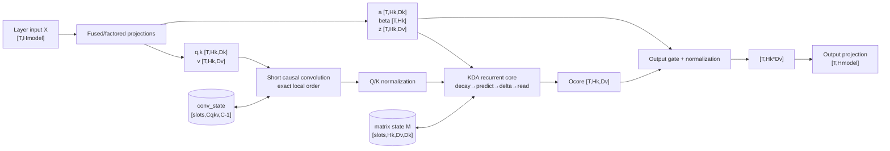
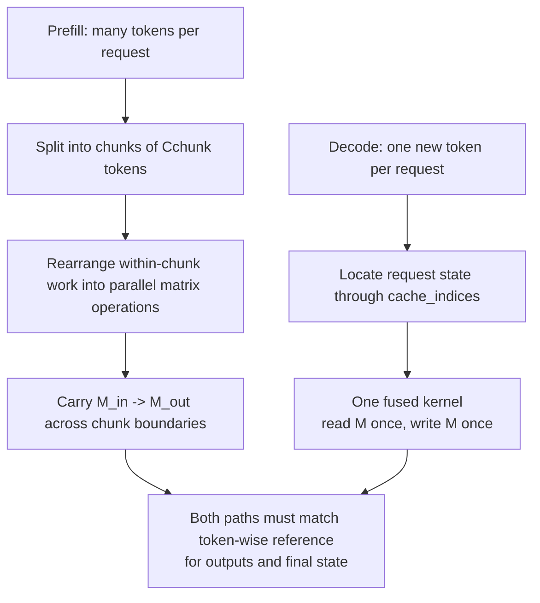
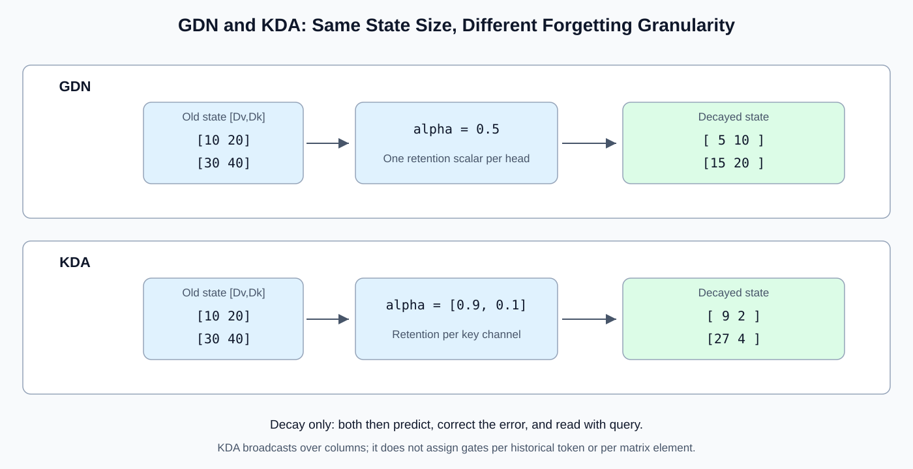
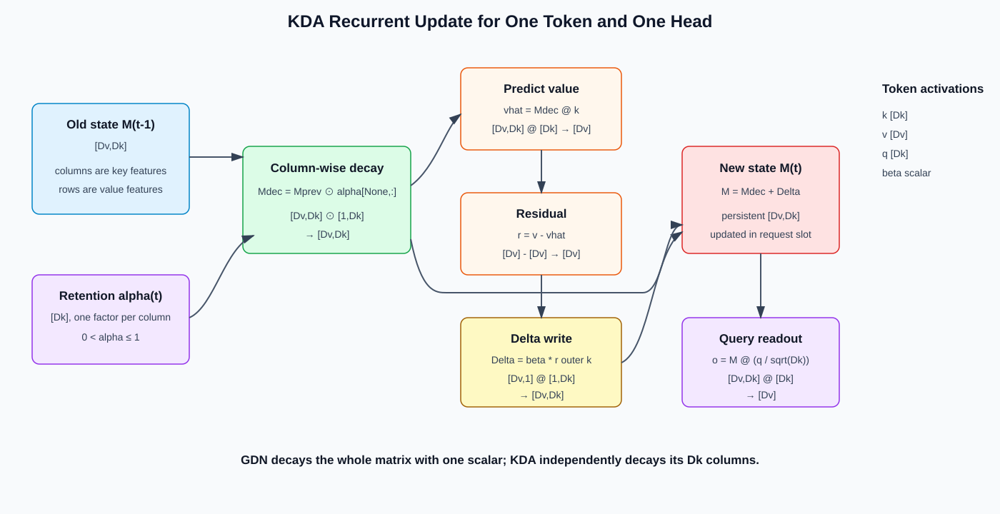
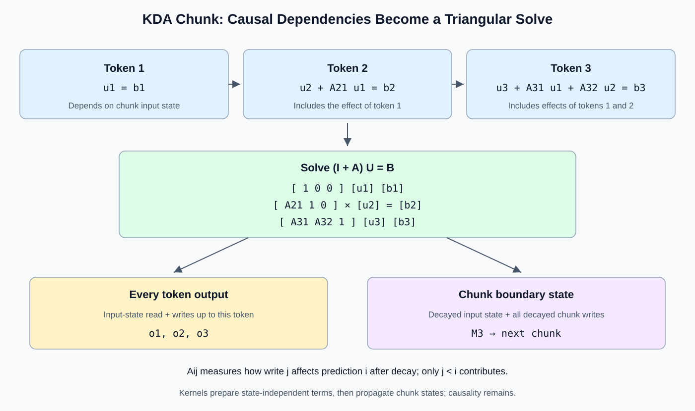
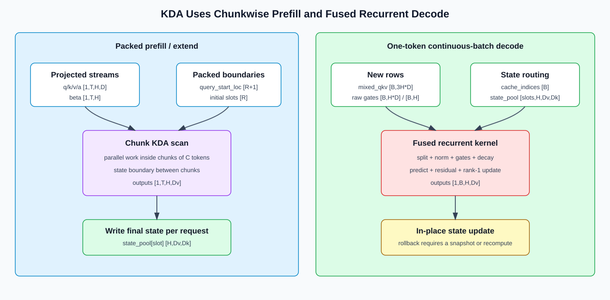

# Kimi Delta Attention (KDA): Fine-Grained Gating for Linear Attention

> 中文版：[Kimi Delta Attention](../../../zh/ai-infra-basic/Model_Architecture/09-kimi-delta-attention.md)

Read the [complete GDN tutorial](../Gated_Delta_Network/01-gated-deltanet.md) first, then use this map. Implementation details refer to the repository's fixed source snapshot; Section 13 follows its actual call chain.

| Question | Reading location |
|---|---|
| What changes from GDN to KDA? | [Section 3: gates, timescales, and reduction to GDN](#3-gdn-versus-kda) |
| Why subtract the old prediction? | [Section 5: recurrence and online learning](#5-the-kda-recurrence) |
| Where does each layer tensor come from? | [Section 6: projections, convolution, and three gates](#6-projection-short-convolution-and-output-gate) |
| How does prefill preserve causality while using matrix units? | [Section 8: complete chunk derivation](#8-prefill-deriving-chunk-parallelism-from-token-recurrence) |
| Where does SGLang execute the formulas? | [Section 13: model → backend → kernel](#13-sglang-source-from-projections-to-state-writeback) |
| How can I check the numbers myself? | [Section 19: CPU checks](#19-run-the-cpu-reference-check-recurrence-against-chunks) and [Section 20: numerical comparison](#20-identical-inputs-a-complete-gdnkda-numerical-comparison) |

## Reading Map: Treat the State Matrix as Rewritable Key-Value Memory

Softmax attention retains every historical `(k_s,v_s)` and compares them at query time. KDA instead writes history into a matrix `M`. For one head:

```math
\mathrm{shape}\left(M\right)=\left[\mathrm{Dv},\mathrm{Dk}\right]
```

```text
write: v outer k -> [Dv,1] @ [1,Dk] = [Dv,Dk]
read:  M @ q     -> [Dv,Dk] @ [Dk]   = [Dv]
```

The outer product `v k^T` intuitively says, “when a query points near `k`, retrieve `v`.” Key directions from different tokens overlap, so naive addition accumulates conflicts. The delta rule first reads the old prediction $`v_{\mathrm{hat}}=\mathrm{Mk}`$ and writes only the error `v-v_hat`. KDA additionally lets each key channel forget at its own `alpha[c]` rate before the write.



### Four Operations on the Same State

For every request, layer, and head, the order is exact:

1. Forget

```math
M_{\mathrm{decay}}=M_{\mathrm{prev}}\mathrm{Diag}(\alpha)
```

2. Predict

```math
\widehat v=M_{\mathrm{decay}}k
```

3. Correct

```math
M_{\mathrm{new}}=M_{\mathrm{decay}}+\beta(v-\widehat v)k^{\mathsf T}
```

4. Read

```math
o=M_{\mathrm{new}}\frac{q}{\sqrt{D_k}}
```

Changing the order changes the function. For example, predicting with $`M_{\mathrm{prev}}\,k`$ instead of $`M_{\mathrm{decay}}\,k`$ uses memory before forgetting to determine the correction; that is not an equivalent optimization.

### Running Shape Example

```math
B=8, \mathrm{and} T=B=8 \mathrm{during} \mathrm{decode}
```

```math
\mathrm{Hmodel}=4096,\qquad \mathrm{Hk}=16,\qquad \mathrm{Dk}=128,\qquad \mathrm{Dv}=128
```

```math
\mathrm{short}-\mathrm{convolution} \mathrm{width} C=4
```

| Stage | Tensor | Shape | Persists across steps? |
|---|---|---:|---|
| Input | `X` | $`\left[8,4096\right]`$ | No |
| Q/K | `q,k` | $`\left[8,16,128\right]`$ | No |
| V/output gate | `v,z` | $`\left[8,16,128\right]`$ | No |
| Forget gate | `alpha` | $`\left[8,16,128\right]`$ | No |
| Write gate | `beta` | $`\left[8,16\right]`$ | No |
| Convolution tail | `conv_state` | $`\left[\mathrm{slots},16\cdot \left(128+128+128\right),3\right]`$ | **Yes** |
| Recurrent matrix | `M` | $`\left[\mathrm{slots},16,128,128\right]`$ | **Yes** |
| Core output | `Ocore` | $`\left[8,16,128\right]`$ | No |
| Layer output | `O` | $`\left[8,4096\right]`$ | No |

`slots` is state-pool capacity, not batch size. `cache_indices [8]` maps row `b` of this decode step to a request slot. Batch rows change under continuous batching, while slot identity must remain stable.

### Why Prefill and Decode Need Different Programs



Prefill avoids one tiny kernel per token without breaking causal recurrence; decode avoids repeatedly reading and writing the full `M`. Output comparison alone is insufficient: final `M` and `conv_state` must also match because they determine the next token.

Kimi Delta Attention (KDA) is the recurrent linear-attention component of Kimi Linear. It extends Gated DeltaNet (GDN) with a **per-key-channel forget gate**.

That one change is operationally important:

- dense and sparse softmax attention store history as a sequence cache;
- GDN and KDA fold history into a fixed-size recurrent state;
- KDA can forget different key-space features at different rates.

This chapter derives the recurrence, maps it to SGLang, and explains why prefill and decode need different kernels.

## 1. From Attention Over Tokens to a Recurrent State

Ordinary causal attention stores past keys and values:

```math
o_t=\mathrm{softmax}\left(q_tK_{\le t}^{\mathsf T}\right)V_{\le t}
```

Its cache grows with sequence length. Linear attention instead summarizes the past in a matrix. Using an implementation-friendly orientation:

```math
M_t\in\mathbb{R}^{d_v\times d_k},\qquad o_t=M_tq_t
```

The state size depends on head dimensions, not on the number of processed tokens.

## 2. Why a Delta Rule?

A naive additive state keeps writing outer products:

```math
M_{t}={M}_{t-1}+v_{t}\,{k_{t}}^{\mathsf T}
```

This can overwrite poorly because a new key may collide with content already stored at a similar direction. The delta rule first asks what the state currently predicts for `k_t`, then writes only the residual:

```math
\mathrm{v\_hat\_t} = M_{t-1} k_{t}
```

```math
r_{t}=v_{t}-\mathrm{v\_hat\_t}
```

```math
M_{t}={M}_{t-1}+\beta_{t}\cdot r_{t}\,{k_{t}}^{\mathsf T}
```

`beta_t` controls the write strength.

## 3. GDN Versus KDA

Start with the [complete GDN tutorial](../Gated_Delta_Network/01-gated-deltanet.md#gdn-update), then make one change: **keep the delta rule and replace one forget coefficient per head with one per key channel.** For one head of the current token, both use:

```math
M_t=\widetilde M_t+\beta_t\left(v_t-\widetilde M_tk_t\right)k_t^{\mathsf T}
```

They differ in how they obtain $`\widetilde M_t`$:

| Item | GDN | KDA |
|---|---|---|
| Retention coefficient | Scalar $`\alpha_t`$ | Vector $`\boldsymbol\alpha_t\in\mathbb R^{d_k}`$ |
| Decayed state | $`\widetilde M_t=\alpha_tM_{t-1}`$ | $`\widetilde M_t=M_{t-1}\mathrm{Diag}(\boldsymbol\alpha_t)`$ |
| Retention of state columns | Equal within a head | Can differ by key channel |
| Write gate | Scalar $`\beta_t`$ per token/head | The same scalar $`\beta_t`$ |
| State capacity with identical head configurations | $`H d_vd_k`$ | $`H d_vd_k`$ |

Here $`\alpha_t`$ is retention; the code variable `a` later is a raw signal before activation. Implementations commonly express retention as `alpha = exp(g)`.

### 3.1 What Does Channel-Wise Mean?

In $`M\in\mathbb R^{d_v\times d_k}`$, column $`c`$ corresponds to a key-feature direction. KDA applies:

```math
\widetilde M_{r,c}=M_{r,c}\alpha_c
```

The gate broadcasts along the key axis: every value row in a column uses the same coefficient. This is **neither a gate per historical token nor an independently generated gate per matrix element**.



The figure shows forgetting only; both still perform the delta update afterward. For example, take old state $`\left[\left[10,20\right],\left[30,40\right]\right]`$, GDN retention $`0.5`$, and KDA retention $`[0.9,0.1]`$. GDN halves both columns; KDA retains 90% of the first and 10% of the second.

### 3.2 Why Does This Matter?

If a head needs to retain some features while quickly refreshing others, GDN's **forgetting step** must choose one multiplier for them. KDA can choose separately. Training learns these feature directions; there is no prescribed meaning such as “column one stores names, column two stores places.”

GDN already uses $`(v-\widetilde Mk)k^{\mathsf T}`$ to correct memory in the directions involved in the current key. It can make selective updates; KDA refines **forgetting granularity**. More heads also provide more independent gates, but change the head decomposition and projections rather than adding channel gates inside one head.

If all KDA channels happen to use the same retention:

```math
\boldsymbol\alpha_t=[\alpha_t,\ldots,\alpha_t],\qquad
\mathrm{Diag}(\boldsymbol\alpha_t)=\alpha_tI
```

the recurrence reduces to GDN. This inclusion applies to recurrence rules; it does not make different models' checkpoints, convolutions, or output gates interchangeable.

### 3.3 How Does Memory Lifetime Change?

Ignore delta writes temporarily and track only the coefficient of an old state component after repeated forgetting:

```math
M_{t,c}=M_{0,c}\prod_{s=1}^{t}\alpha_{s,c}
```

For temporarily constant retention with $`0\lt\alpha_c\lt1`$, its decay half-life is:

```math
n_{1/2,c}=\frac{\log(1/2)}{\log\alpha_c}
```

Retention $`\alpha_c=0.99`$ gives about 69 steps; $`\alpha_c=0.5`$ gives one step. KDA can create different forgetting timescales inside a head; GDN can also create different timescales across heads. The actual recurrence includes key-dependent corrections and new writes, so this half-life describes the **decay-only path**, not a guarantee about how long a semantic fact survives.

This follows the scalar-to-diagonal gate extension in [Kimi Linear §2–3](https://arxiv.org/html/2510.26692v1#S3). Next we put the gates back into the full recurrence; Section 20 compares both on identical inputs.

## 4. Shape Ledger

For one token and one head, let:

- $`q_t,k_t\in\mathbb R^{d_k}`$;
- $`v_t\in\mathbb R^{d_v}`$;
- $`a_t\in\mathbb R^{d_k}`$: raw forget-gate activation;
- $`\boldsymbol\alpha_t\in(0,1]^{d_k}`$: per-channel retention;
- $`\beta_t\in(0,1)`$: scalar delta write strength;
- $`M_t\in\mathbb R^{d_v\times d_k}`$: recurrent state;
- $`o_t\in\mathbb R^{d_v}`$: output before normalization and output gating.

For a batch of tokens, the implementation normally lays tensors out as $`\left[T,H,D\right]`$; recurrent state is per request, layer, and KV head.

## 5. The KDA Recurrence

SGLang's storage-friendly state orientation yields the following steps:

```math
g_{t}=-\mathrm{exp}\left(A_{\mathrm{log}}\right)\cdot \mathrm{softplus}\left(a_{t}+\mathrm{dt\_bias}\right)
```

```math
\alpha_{t}=\mathrm{exp}\left(g_{t}\right)
```

```math
M_{\mathrm{decay}}=M_{t-1}\mathrm{Diag}(\alpha_t)
```

```math
\widehat{v}_t=M_{\mathrm{decay}}k_t
```

```math
r_{t}=v_{t}-\mathrm{v\_hat\_t}
```

```math
M_{t}=M_{\mathrm{decay}}+\beta_{t}\cdot r_{t}\,{k_{t}}^{\mathsf T}
```

```math
o_{t}=M_{t}\left(\frac{q_{t}}{\sqrt{d_{k}}}\right)
```

Because $`g_{t} \le 0`$, `alpha_t` is in `(0, 1]`. Each column of `M` receives a different retention factor.

The KDA report writes the transpose orientation $`S_t\in\mathbb R^{d_k\times d_v}`$:

```math
S_{t} = \left(I - \beta_{t} k_{t} k_{t}^{\mathsf T}\right) \mathrm{Diag}\left(\alpha_{t}\right) S_{t-1} + \beta_{t} k_{t} v_{t}^{\mathsf T}
```

```math
o_{t} = S_{t}^{\mathsf T} q_{t}
```

The two forms are equivalent after transposing. Always establish the state orientation before comparing code and equations.



### 5.1 Deriving the Implementation Form from the Paper Form

Start from the report's `S[d_k,d_v]` equation:

```math
S_{t} = \left(I - \beta k k^{\mathsf T}\right) \mathrm{Diag}\left(\alpha\right) S_{\mathrm{prev}} + \beta k v^{\mathsf T}
```

Transpose every factor and reverse multiplication order:

```math
M_{t} = S_{t}^{\mathsf T} = M_{\mathrm{prev}} \mathrm{Diag}\left(\alpha\right) \left(I - \beta k k^{\mathsf T}\right) + \beta v k^{\mathsf T}
```

Define the column-decayed state:

```math
M_{\mathrm{decay}} = M_{\mathrm{prev}} \mathrm{Diag}\left(\alpha\right)
```

Then expand:

```math
M_{t} = M_{\mathrm{decay}} - \beta \left(M_{\mathrm{decay}} k\right) k^{\mathsf T} + \beta v k^{\mathsf T} = M_{\mathrm{decay}} + \beta \left(v - M_{\mathrm{decay}} k\right) k^{\mathsf T}
```

This is exactly the storage-friendly sequence “decay → predict → residual → outer-product update.” No approximation was introduced by changing orientation.

### 5.2 Element-Wise Interpretation

For value row `r` and key column `c`:

```math
{M_{\mathrm{decay}}}_{r,c}={M_{\mathrm{prev}}}_{r,c}\cdot {\alpha}_{c}
```

```math
{M_{t}}_{r,c}={M_{\mathrm{decay}}}_{r,c}+\beta\cdot {\mathrm{residual}}_{r}\cdot {k}_{c}
```

KDA therefore has two independent axes of control:

- `alpha[c]` decides how much of historical key feature `c` survives;
- $`{\mathrm{residual}}_{r}\cdot {k}_{c}`$ decides how the current token changes matrix cell `(r,c)`.

GDN's scalar `alpha` cannot choose different lifetimes for different columns.

### 5.3 Understand Correction as One Online Learning Step

Temporarily treat the decayed matrix $`\widetilde M`$ as an updatable linear map, and define a reconstruction error for the current key/value:

```math
\mathcal L(M)=\frac12\lVert Mk-v\rVert_2^2,\qquad
\nabla_M\mathcal L=(Mk-v)k^{\mathsf T}
```

Take one gradient step from $`\widetilde M`$ with learning rate $`\beta`$:

```math
M_{\mathrm{new}}=\widetilde M-\beta\nabla_M\mathcal L(\widetilde M)
=\widetilde M+\beta(v-\widetilde Mk)k^{\mathsf T}
```

This explains subtracting the prediction: the goal is to correct the mapping $`k\mapsto v`$, rather than unconditionally accumulating value. The online update is **forward computation on activation state**, not optimizer training of model weights during inference. Language-model training still learns model weights offline.

For $`\lVert k\rVert_2=1`$, reading the same key after the update gives:

```math
M_{\mathrm{new}}k=(1-\beta)\widetilde Mk+\beta v
```

Thus $`\beta=0.5`$ moves the prediction halfway toward v; $`\beta=1`$ matches it exactly under exact normalization and real arithmetic. A different query direction $`q`$ changes by:

```math
(M_{\mathrm{new}}-\widetilde M)q=\beta(v-\widetilde Mk)(k^{\mathsf T}q)
```

If q and k are orthogonal, this write leaves that readout direction unchanged; overlapping directions are affected. This explains both targeted updates and interference. Actual L2 normalization includes epsilon and floating-point error; exact unit norm is an explanatory idealization.

KDA applies diagonal decay followed by this rank-one correction. Its transformation $`D(I-\beta kk^{\mathsf T})`$ expands to $`D-\beta(Dk)k^{\mathsf T}`$: a particular diagonal-plus-rank-one (DPLR) structure. A kernel can execute it with elementwise multiplication, reductions, and an outer product without constructing a full $`d_k\times d_k`$ transition matrix. Diagonal decay and key correction generally do not commute; changing their order changes the function.

## 6. Projection, Short Convolution, and Output Gate

KDA is more than the recurrence alone. A typical layer performs:

```text
hidden states
  -> Q/K/V projections
  -> short causal convolution on projected streams
  -> Q/K normalization
  -> forget gate alpha and write gate beta
  -> recurrent KDA core
  -> normalization
  -> learned output gate
  -> output projection
```

The short convolution supplies precise local order information before recurrent compression. Consequently, serving state includes both the KDA matrix and the convolution tail.

### 6.1 Projection Shapes in SGLang

Let `Hk` be the number of KDA heads, `Dk` the q/k head width, `Dv` the value width, and `C` the short-convolution kernel size. Starting from packed hidden states:

```math
\mathrm{shape}\left(X\right)=\left[T,\mathrm{Hmodel}\right]
```

The logical projection outputs are:

```text
q_flat:       [T,Hk*Dk]  -> q [T,Hk,Dk]
k_flat:       [T,Hk*Dk]  -> k [T,Hk,Dk]
v_flat:       [T,Hk*Dv]  -> v [T,Hk,Dv]
beta_raw:     [T,Hk]     -> beta [T,Hk]
forget_raw:   [T,Hk*Dk]  -> a [T,Hk,Dk]
output_gate:  [T,Hk*Dv]  -> z [T,Hk,Dv]
```

In the source, forget and output gates use factored projections. For the forget path:

```math
f_{a} = X \, \mathrm{Wfa}^{\mathsf T}: \left[T,\mathrm{Dk}\right]
```

```math
a_{\mathrm{flat}} = f_{a} \, \mathrm{Wfb}^{\mathsf T}: \left[T,\mathrm{Hk}\cdot \mathrm{Dk}\right]
```

```math
a = \mathrm{reshape}\left(a_{\mathrm{flat}}\right): \left[T,\mathrm{Hk},\mathrm{Dk}\right]
```

This reduces projection cost while still producing one forget activation for every token, head, and key channel. A fused projection can produce q/k/v, `beta`, and the low-rank gate intermediates in one call; the logical tensors do not change.

### 6.2 Short Convolution Shapes

Concatenate projected q/k/v before convolution:

```text
mixed_qkv: [T,Hk*(2*Dk + Dv)]
```

For kernel width `C`, each request slot retains:

```text
conv_state: [Hk*(2*Dk + Dv), C-1]
```

Prefill applies a causal convolution over each packed sequence. Decode uses the old `C-1` columns plus the new projected row, returns one filtered row with the same flattened width, and shifts the convolution state.

### 6.3 Core-to-Output Shapes

After convolution and reshape:

```text
q/k:       [1,T,Hk,Dk]
```

```math
\mathrm{shape}\left(v\right)=\left[1,T,\mathrm{Hk},\mathrm{Dv}\right]
```

```math
\mathrm{shape}\left(a\right)=\left[1,T,\mathrm{Hk},\mathrm{Dk}\right]
```

```math
\mathrm{shape}\left(\beta\right)=\left[1,T,\mathrm{Hk}\right]
```

```text
state pool:[slots,Hk,Dv,Dk]
core out:  [1,T,Hk,Dv]
```

The output gate and normalization preserve $`\left[T,\mathrm{Hk},\mathrm{Dv}\right]`$. Flatten and project:

```math
\mathrm{shape}\left(\mathrm{gated}\right)=\left[T,\mathrm{Hk},\mathrm{Dv}\right]
```

```math
\mathrm{shape}\left(\mathrm{flat}\right)=\left[T,\mathrm{Hk}\cdot \mathrm{Dv}\right]
```

```math
\mathrm{shape}\left(\mathrm{Wout}\right)=\left[\mathrm{Hmodel},\mathrm{Hk}\cdot \mathrm{Dv}\right]
```

```math
\mathrm{shape}\left(\mathrm{out}\right)=\left[T,\mathrm{Hmodel}\right]
```

### 6.4 Separate Parameters, Activations, and State

| Object | Logical shape on one rank | Kind |
|---|---|---|
| `A_log` | $`[H_{\mathrm{local}}]`$, with extra broadcast axes in source | Trainable base rate per head |
| `dt_bias` | $`[H_{\mathrm{local}}d_k]`$ | Trainable bias per key channel |
| Raw `a` and activated `g/alpha` | $`[T,H_{\mathrm{local}},d_k]`$ | Token-dependent control signals |
| `beta_raw/beta` | $`[T,H_{\mathrm{local}}]`$ | Token-dependent scalar write signals |
| Output gate `z` | $`[T,H_{\mathrm{local}},d_v]`$ | Modulates readout without changing recurrent state |
| State matrix and convolution tail | Fixed shapes indexed by request slots | Runtime cache, not optimizer parameters |

`A_log` remains one parameter per head; the final gate is still channel-wise because `a` and `dt_bias` already have a channel axis. A channel-wise output gate does not establish KDA forgetting: check whether the gate acts on **old state**.

The local `KimiDeltaAttention` fused projection, norm, and state configuration use equal key/value head widths. The general recurrence permits $`d_k\ne d_v`$, but this does not prove arbitrary rectangular configurations work in that model class. Section 19's CPU program deliberately checks rectangular states to reveal transpose/broadcast mistakes that square examples can hide.

Short convolution likewise extracts local order features independently per projected channel. For channel $`c`$, index weights by lag:

```math
\widehat x_{t,c}=\mathrm{SiLU}\left(\sum_{j=0}^{C-1}w_{c,j}x_{t-j,c}\right)
```

Missing history at a sequence start is zero; continuation reads the existing window. Packed requests cannot borrow each other's tails. Convolution happens before matrix writing and therefore shapes the content entering long-term memory. See [GDN convolution mechanisms and ablation evidence](../Gated_Delta_Network/01-gated-deltanet.md#gdn-conv).

## 7. Memory and Compute Complexity

For each layer and request, the persistent state is approximately:

```text
KDA state: H_kv * d_v * d_k elements
conv state: projected_channels * (kernel_size - 1) elements
```

It is independent of sequence length. Per-token recurrence work is $`O\left(H_{\mathrm{kv}}\cdot d_{v}\cdot d_{k}\right)`$ rather than a scan over all prior tokens.

This does not mean KDA is automatically fast. The state matrix can be large, and performance depends on keeping it on chip long enough, fusing elementwise gates with matrix/vector operations, and avoiding tiny launches.

## 8. Prefill: Deriving Chunk Parallelism from Token Recurrence

Recurrence fits single-token decode. During prefill, however, thousands of tiny dependent updates would underuse matrix units if launched separately. A chunk algorithm **rewrites the same recurrence as matrix work inside a block**, retaining state dependencies between blocks. It is not CP and does not independently process arbitrary pieces of one sequence on different devices.

Consider one head. Let chunk length be $`C_b`$, distinct from short-convolution width $`C`$, and let $`M_0`$ be the input state of this chunk. Absorb readout scaling into $`\bar q_i=q_i/\sqrt{d_k}`$; q/k normalization has already happened before these equations.

### 8.1 Name Each Write Explicitly

Define:

```math
D_i=\mathrm{Diag}(\boldsymbol\alpha_i),\qquad
u_i=\beta_i(v_i-M_{i-1}D_ik_i),\qquad
M_i=M_{i-1}D_i+u_ik_i^{\mathsf T}
```

Here $`u_i`$ is the actual write vector for this token. Expand three steps before introducing a large formula:

```math
M_1=M_0D_1+u_1k_1^{\mathsf T}
```

```math
M_2=M_0D_1D_2+u_1k_1^{\mathsf T}D_2+u_2k_2^{\mathsf T}
```

```math
M_3=M_0D_1D_2D_3+u_1k_1^{\mathsf T}D_2D_3
+u_2k_2^{\mathsf T}D_3+u_3k_3^{\mathsf T}
```

Later gates continue decaying each old write. This expands the addition only; $`u_i`$ still depends on earlier state and is not yet an independently known input.

### 8.2 Why Does a Lower-Triangular System Appear?

Define an interval decay product:

```math
D_{a:b}=D_aD_{a+1}\cdots D_b,\qquad D_{a:b}=I\quad(a\gt b)
```

An empty product is the identity: a new write at the current token has not experienced any subsequent forgetting. Substitute the expansion into the write vector:

```math
u_i=\beta_i\left(v_i-M_0D_{1:i}k_i\right)
-\sum_{j\lt i}\beta_i\left(k_j^{\mathsf T}D_{j+1:i}k_i\right)u_j
```

The inner product is a scalar measuring how much token $`j`$'s write direction, after later decay, overlaps token $`i`$'s read direction. It describes interference between token writes. Define:

```math
b_i=\beta_i\left(v_i-M_0D_{1:i}k_i\right),\qquad
A_{ij}=\begin{cases}
\beta_i k_j^{\mathsf T}D_{j+1:i}k_i,&j\lt i,\\
0,&j\ge i.
\end{cases}
```

The first three tokens satisfy:

```math
u_1=b_1,\qquad
u_2+A_{21}u_1=b_2,\qquad
u_3+A_{31}u_1+A_{32}u_2=b_3
```

Stack $`u_i^{\mathsf T}`$ as rows of $`U\in\mathbb R^{C_b\times d_v}`$, and $`b_i^{\mathsf T}`$ as rows of $`B`$:

```math
(I+A)U=B
```

$`A`$ is strictly lower triangular, and $`I+A`$ has a unit diagonal, so forward substitution solves it. Kernels organize the work with blocked solves and matrix multiplication. Dependencies remain, and an explicit dense matrix inverse is not required.



### 8.3 How Do We Obtain the Boundary State and All Outputs?

Once $`U`$ is known, the final state is:

```math
M_{C_b}=M_0D_{1:C_b}+\sum_{j=1}^{C_b}u_jk_j^{\mathsf T}D_{j+1:C_b}
```

Output $`i`$ inside the chunk is:

```math
o_i=M_0D_{1:i}\bar q_i
+\sum_{j\le i}u_j\left(k_j^{\mathsf T}D_{j+1:i}\bar q_i\right)
```

The first term reads the chunk input state; the second includes writes in the current chunk up to this position. It includes $`j=i`$ because the output reads the **state after the current token's write**. Matrix multiplication and causal triangular multiplication implement the two terms.

The implementation does not sequentially compute all $`u_i`$ before preparing intra-chunk work. Write:

```math
B=B_\beta V-B_\beta\widetilde K M_0^{\mathsf T},\qquad
B_\beta=\mathrm{Diag}(\beta_1,\ldots,\beta_{C_b}),\qquad
\widetilde K_{i,:}=(D_{1:i}k_i)^{\mathsf T}
```

Then define:

```math
U_v=(I+A)^{-1}B_\beta V,\qquad
W=(I+A)^{-1}B_\beta\widetilde K,\qquad
U=U_v-WM_0^{\mathsf T}
```

$`U_v,W`$ are independent of the chunk input state and can be prepared across chunks before the state scan computes actual writes. This explains why the source first computes `w/u`, then computes `v_new = u - w @ state.T` in `chunk_gated_delta_rule_fwd_h`. **Source `u` corresponds to $`U_v`$ here, while source `v_new` corresponds to $`U`$. Match equations by semantics rather than variable names.**

### 8.4 What Extra Work Does KDA Require Compared with GDN?

If every $`D_i=\alpha_i I`$, the interference term reduces to:

```math
A_{ij}=\beta_i\left(\prod_{s=j+1}^{i}\alpha_s\right)k_j^{\mathsf T}k_i
```

GDN can compute a key Gram matrix and apply scalar decay. KDA instead requires:

```math
k_j^{\mathsf T}D_{j+1:i}k_i
=\sum_{c=1}^{d_k}k_{j,c}k_{i,c}
\exp\left(\sum_{s=j+1}^{i}g_{s,c}\right)
```

Decay is **inside** the channel sum and generally cannot be factored out. The source keeps chunk-local, channel-wise log-gate prefix sums $`G_{i,c}=\sum_{s=1}^{i}g_{s,c}`$ and evaluates interval decay as $`\exp(G_{i,c}-G_{j,c})`$. It need not materialize dense diagonal matrices or three-dimensional token-pair/channel weights.

For fixed head dimensions and fixed $`C_b`$, intermediates are allocated per chunk and sequence work scales linearly with length, rather than constructing a full-sequence square attention matrix. This is equivalent to recurrence in real arithmetic; floating-point reordering introduces error, so check both every output and the final state. The basis is [KDA §3.1 and Appendix B](https://arxiv.org/html/2510.26692v1#S3.SS1); this residual-write derivation prioritizes step-by-step understanding. Section 13 maps it to the implementation.

## 9. Decode: What Does One Fused Update Actually Fuse?

In normal decode, each request contributes one new token to the current batch. Inputs are the new projections and the request's two existing state types, rather than the entire history:

```text
new hidden -> Q/K/V projection -> conv update -> filtered Q/K/V
                                     ↕
                              conv_state[slot]

filtered Q/K/V + raw a/b -> fused recurrence -> head output
                                     ↕
                                M_pool[slot]
```

Fusion preserves the formula order: L2-normalize q/k, compute gates, decay state, predict value, correct memory, read output, and save state. Output gating and output projection remain in the model layer; the packed recurrence is not the entire KDA layer.

### 9.1 State Tiles and the Broadcast Axis

In this repository's `fused_recurrent_kda_packed_decode_kernel`, one program handles a request, a value head, and several value rows. The state tile is $`[B_V,B_K]`$; separate value tiles cover different state rows of the same head.

These are the five core lines. q already includes readout scaling, `b_v` initially holds the current value, and `beta_val` has passed through sigmoid:

```python
b_h *= exp(b_g)[None, :]
b_v -= tl.sum(b_h * b_k[None, :], 1)
b_v *= beta_val
b_h += b_v[:, None] * b_k[None, :]
b_o = tl.sum(b_h * b_q[None, :], 1)
```

| Code | Mathematics | Shape effect |
|---|---|---|
| Line 1 | Forget per key channel | $`[B_V,B_K]\odot[1,B_K]`$ |
| Line 2 | Subtract the decayed state's prediction from v | Reduce over keys, yielding $`[B_V]`$ |
| Line 3 | Scale the correction with beta | Broadcast a scalar over value rows |
| Line 4 | Write an outer product | $`[B_V,1]\,[1,B_K]`$ |
| Line 5 | Read the updated state with query | Reduce over keys again |

After lines 2–3, `b_v` holds the write residual, not the original value. One source comment calls the decay axis a “K-row”; storage and addressing here are $`[V,K]`$, so `[None,:]` actually broadcasts over **columns**. Follow addresses and operations.

The tile can reuse loaded state during computation, avoiding separate HBM round trips for prediction, writing, and reading. Spills, cache behavior, and tiling can still add traffic; “one read/write” describes the intended fused dataflow, not a guarantee about hardware transaction counts.

### 9.2 A Batch Row Is Not a State Slot

Suppose the current order is requests C, A, B with `cache_indices = [7,2,9]`. Row 0 updates `M_pool[7]`, not `M_pool[0]`. The kernel reads `ssm_state_indices` before forming addresses. In the packed path, a negative slot returns zero output and skips state access.

The [backend](../../../../python/sglang/srt/layers/attention/linear/kda_backend.py) updates convolution first, then selects packed or explicit-split recurrence. The [Triton wrapper](../../../../python/sglang/srt/layers/attention/linear/kernels/kda_triton.py) declares packed support only outside CPU/NPU and the backend checks exactly one token per request. Multi-token verification cannot directly use this single-step contract.



## 10. Kimi Linear Is a Hybrid Architecture

Kimi Linear does not replace every attention layer with KDA. The published architecture uses a `3:1` pattern of KDA layers to Multi-Head Latent Attention (MLA) layers.

The two paths serve different purposes:

- KDA provides constant-size long-history state and linear-time scanning;
- occasional MLA layers retain an exact content-addressable path over cached sequence entries.

Therefore, end-to-end memory still grows with context length at MLA layers, but much more slowly than if every layer used softmax attention.

## 11. Serving-State Semantics

Paged KV cache intuition is insufficient for recurrent layers. A KDA request owns mutable state:

```text
per-layer matrix state M
per-layer convolution tail
sequence position and optional cache dtype metadata
```

This changes several serving features:

- **prefix caching** must snapshot or share a state produced at an exact token boundary;
- **speculative decoding** must checkpoint or recompute state when draft tokens are rejected;
- **request migration** transfers recurrent and convolution states, not KV pages alone;
- **beam search** duplicates state on branching and prevents accidental aliasing;
- **CUDA/NPU graph replay** requires stable state-buffer addresses and bounded batch shapes.

In-place updates improve performance but make rollback semantics explicit and unavoidable.

## 12. Tensor Parallelism

KDA heads can be partitioned across tensor-parallel ranks. Each rank owns its local Q/K/V projections and recurrent states. The output projection then follows the model's row/column-parallel contract.

The critical rules are:

1. state head count and gate head count use the same partition;
2. no request state is accidentally shared between ranks;
3. checkpoint head layout matches runtime sharding;
4. output reductions occur exactly once.

Because the recurrent update is head-local, its core normally needs no token-by-token all-reduce.

## 13. SGLang Source: From Projections to State Writeback

This section describes the **source snapshot in this repository**, introduced by commit [`c6de33f`](https://github.com/cl-vv-h/SGLang_Tutor/tree/c6de33fcaa2027826f89f375d1e805ab3305f8cb/python/sglang), rather than current upstream in general. Open files in this order to separate responsibilities:

| Order | File and function | Question to answer |
|---|---|---|
| 1 | [`KimiLinearConfig.is_kda_layer`](../../../../python/sglang/srt/configs/kimi_linear.py) | Does this layer select KDA or MLA, and how are configuration layers numbered? |
| 2 | [`KimiDeltaAttention`](../../../../python/sglang/srt/models/kimi_linear.py) | How are Q/K/V, forgetting, beta, and output gates projected? |
| 3 | [`RadixLinearAttention.forward`](../../../../python/sglang/srt/layers/radix_linear_attention.py) | How does the model hand tensors to the attention backend? |
| 4 | [`KDAAttnBackend.forward_decode/forward_extend`](../../../../python/sglang/srt/layers/attention/linear/kda_backend.py) | How are state lookup, convolution, and mode dispatch performed? |
| 5 | [`TritonKDAKernel`](../../../../python/sglang/srt/layers/attention/linear/kernels/kda_triton.py) | How are packed, generic decode, and chunk paths chosen? |
| 6 | [`chunk_kda_fwd`](../../../../python/sglang/srt/layers/attention/fla/kda.py) | How do gate activation, intra-chunk preparation, state scan, and output connect? |
| 7 | [`chunk_kda_fwd_intra`](../../../../python/sglang/srt/layers/attention/fla/chunk_intra.py) | Where do triangular solving and w/u recomputation happen? |
| 8 | [`chunk_gated_delta_rule_fwd_h`](../../../../python/sglang/srt/layers/attention/fla/chunk_delta_h.py) | How is the chunk input state incorporated and final state stored in place? |
| 9 | [`fused_recurrent_kda_packed_decode_kernel`](../../../../python/sglang/srt/layers/attention/fla/fused_recurrent.py) | How are the five recurrence operations fused for one token? |
| 10 | [`KimiLinearStateShape.create`](../../../../python/sglang/srt/configs/mamba_utils.py) | Which shapes and dtypes are allocated per TP rank? |

### 13.1 Model: Two Factorized Gates and One QKV Path

The logic of `forward_qkvbfg` is:

```python
qkv = self.qkv_proj(hidden_states)[0]
beta_raw = self.b_proj(hidden_states)[0]
forget_raw = self.f_b_proj(self.f_a_proj(hidden_states)[0])[0]
output_gate = self.g_b_proj(self.g_a_proj(hidden_states)[0])[0]
```

Teaching names distinguish raw and activated values; the source return value named `beta` is still a logit at this point. The non-quantized `forward_qkvbfg_fused` combines some projections: one projection produces QKV, beta, and two low-rank intermediates, then a batched projection produces both gates. Fusion reorganizes computation without introducing another kind of gate.

**`g_proj_states` is the output gate, not recurrent log-retention `g`.** This implementation's `o_norm` uses sigmoid gating; do not transplant the SiLU output gate from the Qwen3-Next GDN example. The gated tensor is flattened and passed through row-parallel `o_proj` to restore hidden width.

The model's `forward` also distinguishes modes:

| Mode | Forget activation passed to backend | Beta passed to backend |
|---|---|---|
| Prefill/extend | Raw gate arranged as $`[1,T,H,d_k]`$ | Already passed through sigmoid once |
| Decode | Raw gate | Raw logit; sigmoid runs inside the recurrent kernel |

Do not add another common sigmoid at the call boundary. One packed-wrapper parameter description calls `b` post-sigmoid, but the actual model caller and `tl.sigmoid(b_val)` in the kernel establish that decode passes a raw logit. Follow the actual call chain.

### 13.2 Prefill: Mapping Four Stages to Section 8

`forward_extend` applies causal convolution to Q/K/V separately within request boundaries, reshapes them, and calls `TritonKDAKernel.extend → chunk_kda`. In this snapshot, `chunk_kda_fwd` uses chunk length 64:

```text
raw gate + A_log + dt_bias
  -> kda_gate_chunk_cumsum          # G: channel-wise cumulative log-retention
q, k, v, beta, G
  -> chunk_kda_fwd_intra            # lower-triangular interactions + solve
  -> w, u, kg, Aqk
  -> chunk_gated_delta_rule_fwd_h   # actual writes and chunk boundary states
  -> h, v_new                      # also updates indexed final state in place
  -> chunk_gla_fwd_o_gk             # combine input-state and within-chunk readouts
  -> token outputs
```

- `w/u` are preparations independent of the chunk input state: $`W,U_v`$ in Section 8.3.
- `v_new` incorporates the actual input state and corresponds to $`U`$.
- `kg` absorbs key-channel decay to the chunk end for state updates; `Aqk` holds within-chunk causal read weights including scaling.
- `h` holds chunk input states for computing outputs, rather than permanently caching a matrix per historical token.
- `initial_state_indices` identifies request slots. The `chunk_delta_h.py` epilogue stores final state back into the indexed slot; `chunk_kda` need not return the entire state pool.

Intra-chunk functions select diagonal/inter-solve/recompute fusion based on grid size. The number of teaching stages is not a fixed kernel-launch count in a profiler.

### 13.3 Decode: Packed and Explicit-Split Paths

`forward_decode` first performs `causal_conv1d_update`, then:

```text
supports_packed_decode?
  yes -> conv output directly into fused_recurrent_kda_packed_decode
  no  -> split/reshape Q/K/V -> fused_sigmoid_gating_delta_rule_update(is_kda=True)
```

Both paths need channel-wise forgetting. The generic kernel may hold an on-chip tile as $`[B_K,B_V]`$, while the packed kernel uses $`[B_V,B_K]`$; both address persistent storage as $`[\mathrm{slots},H,d_v,d_k]`$. Check strides, addresses, and reduction axes rather than only local tile shapes.

### 13.4 How Does This Relate to GLM-5.3-Flash KDA?

This chapter explains the KDA algorithm and local `KimiDeltaAttention`. The [GLM-5.3-Flash end-to-end tutorial](../../sglang-ascend-npu/source-code-walkthrough/examples/03-glm-5.3-flash-end-to-end.md) uses `Glm5NextKDA` at a different pinned revision. They share channel-wise delta recurrence, but projection names, gate parameterization, model connections, and hardware paths must be checked separately.

In particular, `chunk_kda`'s `lower_bound` branch uses a safe log-gate:

```math
g_c=\ell\,\mathrm{sigmoid}\left(\exp(A_{\log})(a_c+b_c)\right),\qquad \ell\lt0
```

Here $`b_c`$ is the channel's `dt_bias`. Thus $`g_c\in(\ell,0)`$. The local Kimi model does not set this field and defaults to the negative-softplus gate in Section 5. The existence of `lower_bound` in a signature does not establish packed-decode support for it: this snapshot's packed kernel specifically computes softplus gating. Algorithm, checkpoint parameterization, and backend capabilities require separate checks.

## 14. Ascend NPU Optimization View

The SGLang snapshot has an NPU-specific causal-convolution call, while the KDA core is routed through the available linear-attention kernel path. Backend support evolves, so validate the exact SGLang, `torch_npu`, CANN, and `sgl_kernel_npu` combination instead of inferring support from a class name.

For Ascend profiling, separate:

1. Q/K/V and gate projections;
2. causal convolution update;
3. normalization and gate activation;
4. KDA prefill or recurrent core;
5. output normalization, gate, and projection;
6. state gather/scatter under continuous batching.

High-value fusion targets are gate activation+decay, decay+delta update+readout, and convolution update+state writeback. Track state bytes read/written per generated token; kernel duration alone can hide a bandwidth-bound design.

## 15. KDA Versus Sparse and Compressed Attention

| Property | DSA | CSA | KDA |
|---|---|---|---|
| Historical representation | token-level latent cache | compressed sequence cache | fixed recurrent matrix |
| Access | content-selected top-k | compressed top-k | state read/update |
| Persistent size vs length | linear | reduced linear | constant |
| Exact retrieval of a past entry | selected latent entry | selected compressed entry | no explicit entry |
| Central systems problem | irregular gather | compression + heterogeneous caches | mutable state routing |

These mechanisms solve different bottlenecks and can coexist in hybrid model families.

## 16. Common Misconceptions

1. **“KDA is softmax attention with a smaller KV cache.”** It is a recurrent linear-attention update with no token-addressable KV history in KDA layers.
2. **“GDN and KDA use the same gate.”** GDN uses a head-wise scalar decay; KDA uses a per-key-channel vector.
3. **“Constant memory means constant compute for an entire prompt.”** Work is constant per token, so total prefill work remains linear in prompt length.
4. **“The state matrix is enough to resume a request.”** The short-convolution tail and position metadata are also required.
5. **“Speculative rejection can just decrement sequence length.”** In-place recurrent state must be rolled back or recomputed.
6. **“All layers in Kimi Linear are KDA.”** The architecture interleaves KDA with MLA.

## 17. Correctness and Performance Checklist

1. `alpha` is per key channel and is applied along the correct state axis.
2. Code and derivation use consistent `M[d_v, d_k]` or `S[d_k, d_v]` orientation.
3. Chunkwise prefill matches recurrent reference outputs and final state.
4. Decode state routing remains correct after request admission, eviction, and compaction.
5. Prefix reuse and speculative rollback include convolution state.
6. Accumulator precision is validated over very long sequences.
7. TP sharding matches head and gate layouts from the checkpoint.
8. Profiling reports state bandwidth, fusion boundaries, and graph replay coverage.

## 18. Full Tensor Ledger

| Stage | Tensor | Logical shape | Persistent? |
|---|---|---:|---|
| Layer input | `X` | $`\left[T,\mathrm{Hmodel}\right]`$ | no |
| Q/K projection | `q/k` | $`\left[T,\mathrm{Hk},\mathrm{Dk}\right]`$ | no |
| V projection | `v` | $`\left[T,\mathrm{Hk},\mathrm{Dv}\right]`$ | no |
| Write gate activation | `beta_raw` | $`\left[T,\mathrm{Hk}\right]`$ | no |
| Forget activation | `a` | $`\left[T,\mathrm{Hk},\mathrm{Dk}\right]`$ | no |
| Output-gate activation | `z` | $`\left[T,\mathrm{Hk},\mathrm{Dv}\right]`$ | no |
| Packed conv input | `mixed_qkv` | $`[T,\mathrm{Hk}(2\mathrm{Dk}+\mathrm{Dv})]`$ | no |
| Convolution cache | `conv_state` | $`[\mathrm{slots},\mathrm{Hk}(2\mathrm{Dk}+\mathrm{Dv}),C-1]`$ | yes |
| Retention log | `g` | $`\left[1,T,\mathrm{Hk},\mathrm{Dk}\right]`$ | no; may be fused |
| Retention | $`\alpha=\mathrm{exp}\left(g\right)`$ | $`\left[1,T,\mathrm{Hk},\mathrm{Dk}\right]`$ | no; may be fused |
| Delta gate | `beta` | $`\left[1,T,\mathrm{Hk}\right]`$ | no; may be fused |
| Recurrent cache | `M` | $`\left[\mathrm{slots},\mathrm{Hk},\mathrm{Dv},\mathrm{Dk}\right]`$ | yes |
| Core output | `Ocore` | $`\left[1,T,\mathrm{Hk},\mathrm{Dv}\right]`$ | no |
| Gated/norm output | `Onorm` | $`\left[T,\mathrm{Hk},\mathrm{Dv}\right]`$ | no |
| Layer output | `O` | $`\left[T,\mathrm{Hmodel}\right]`$ | no |

During decode, $`T=B`$ and `cache_indices [B]` maps row `b` to its persistent slot. During packed prefill, `query_start_loc [R+1]` identifies the token interval belonging to each of `R` requests.

## 19. Run the CPU Reference: Check Recurrence Against Chunks

[delta_attention_reference.py](./delta_attention_reference.py) needs only the Python standard library: no GPU, NPU, PyTorch, or NumPy. Run from the repository root:

```bash
python3 learning/en/ai-infra-basic/Model_Architecture/delta_attention_reference.py
python3 learning/en/ai-infra-basic/Model_Architecture/delta_attention_reference.py --self-test
```

The default command prints the GDN/KDA values from Section 20. `--self-test` runs 12 checks. `recurrent` applies the state update token by token; `chunk` **does not call the recurrent function**, independently forming triangular couplings, solving by forward substitution, and constructing outputs and the boundary state. The comparison is not the same loop executed twice.

Checks cover uniform-channel gates reducing to GDN, multiple independent heads, nonzero initial states, rectangular states, different chunk lengths and partial tails, zero/tiny retention, zero beta, no forgetting, read-after-current-write semantics, and one decode step after prefill. Random examples use fixed seeds and compare every output plus the final state.

Python floating-point arithmetic provides an algebra reference, not a simulation of low-precision storage, convolution, request scheduling, or actual parallel kernel execution. These checks do not replace GPU/NPU model-accuracy tests or profiling. Multiple heads are checked through separate single-head calls; this does not implement actual TP.

## 20. Identical Inputs: A Complete GDN/KDA Numerical Comparison

To isolate forgetting granularity, use the same old state, unit-norm q/k, value, and write gate. Change only retention:

```math
M_0=\begin{pmatrix}1&0.5\\-0.5&1\end{pmatrix},\quad
k=\begin{pmatrix}0.6\\0.8\end{pmatrix},\quad
v=\begin{pmatrix}1\\-0.5\end{pmatrix},\quad
q=\begin{pmatrix}0.8\\0.6\end{pmatrix},\quad\beta=0.5
```

GDN uses scalar $`0.8`$; KDA uses vector $`[0.8,0.25]`$. These are teaching inputs, not claims about particular learned coefficients.

| Step | GDN | KDA |
|---|---|---|
| Forget | $`\widetilde M=\left[\left[0.8,0.4\right],\left[-0.4,0.8\right]\right]`$ | $`\widetilde M=\left[\left[0.8,0.125\right],\left[-0.4,0.25\right]\right]`$ |
| Predict $`\widetilde Mk`$ | $`[0.8,0.4]`$ | $`[0.58,-0.04]`$ |
| Residual $`v-\widetilde Mk`$ | $`[0.2,-0.9]`$ | $`[0.42,-0.46]`$ |
| Write $`\beta r k^{\mathsf T}`$ | $`\left[\left[0.06,0.08\right],\left[-0.27,-0.36\right]\right]`$ | $`\left[\left[0.126,0.168\right],\left[-0.138,-0.184\right]\right]`$ |
| New state | $`\left[\left[0.86,0.48\right],\left[-0.67,0.44\right]\right]`$ | $`\left[\left[0.926,0.293\right],\left[-0.538,0.066\right]\right]`$ |
| Read $`M q/\sqrt2`$ | $`[0.6901,-0.1923]`$ | $`[0.6481,-0.2763]`$ |

The change is more than a smaller second state column: decay changes the prediction, which changes the residual, which changes **every column involved in the current key**. A channel gate applied after a complete GDN step cannot reproduce KDA.

If KDA retention becomes $`[0.8,0.8]`$, its prediction, residual, new state, and output all match the GDN column. Setting $`\beta=0`$ leaves only forgetting and reading; setting all retention coefficients to one reduces both to DeltaNet without explicit forgetting. These endpoints check the algebra; actual sigmoid/exp parameterizations may only approach them.

The [CPU arithmetic program](./delta_attention_reference.py) prints the key values and checks recurrent/chunk equivalence across multiple tokens, heads, chunk lengths, and rectangular states.

## 21. Memory and Bandwidth Example

For $`\mathrm{Hk}=32`$, $`\mathrm{Dk}=\mathrm{Dv}=128`$:

```math
\text{state elements per request/layer}= 32 \cdot  128 \cdot  128 = 524,288
```

```math
\text{BF16 state capacity}= 1 \mathrm{MiB} \mathrm{per} \mathrm{request}/\mathrm{layer}
```

The BF16 figure is a capacity example. Local `mamba2_state_dtype()` defaults recurrent state to FP32, giving 2 MiB per request/layer. Use the configured dtype and account for convolution and temporary states separately.

With $`B=64`$, one layer owns 64 MiB of active state capacity. A naive decode that separately reads/writes the full matrix for decay, prediction, update, and output can multiply traffic several times. A fused recurrent kernel aims to read a state tile, perform all operations, and write it once.

The state is constant with sequence length, not necessarily small. Compare it with a KV layer by solving the crossover length:

```math
L_{\mathrm{cross}}\cdot \mathrm{Nkv}\cdot \left(\mathrm{Dk}+\mathrm{Dv}\right)=\mathrm{Hk}\cdot \mathrm{Dv}\cdot \mathrm{Dk}
```

For $`\mathrm{Nkv}=\mathrm{Hk}`$ and $`\mathrm{Dk}=\mathrm{Dv}=128`$, $`L_{\mathrm{cross}}=64`$ tokens in element count. The advantage at long context comes from avoiding continued linear growth; actual bytes depend on KV/state dtype and hybrid layer count.

## 22. Reference Recurrent Pseudocode

This tensor pseudocode assumes L2-normalized q/k, `A_log` broadcast as one column per head, and `Dk` taken from the key width. Section 19 provides the executable standard-library version.

```python
def kda_step(M, q, k, v, a, beta_raw, A_log, dt_bias):
    # M:       [Hk,Dv,Dk]
    # q/k:     [Hk,Dk]
    # v:       [Hk,Dv]
    # a:       [Hk,Dk]
    # beta_raw:[Hk]
    g = -exp(A_log) * softplus(a + dt_bias)       # [Hk,Dk]
    alpha = exp(g)                                # [Hk,Dk]
    beta = sigmoid(beta_raw)                      # [Hk]

    Mdec = M * alpha[:, None, :]                  # [Hk,Dv,Dk]
    pred = einsum("hvk,hk->hv", Mdec, k)         # [Hk,Dv]
    residual = v - pred                           # [Hk,Dv]
    delta = beta[:, None, None] * einsum(
        "hv,hk->hvk", residual, k
    )                                             # [Hk,Dv,Dk]
    Mnew = Mdec + delta
    out = einsum("hvk,hk->hv", Mnew, q/sqrt(Dk)) # [Hk,Dv]
    return out, Mnew
```

Use FP32 accumulation in the reference. Compare lower-precision kernels over long random sequences, checking both outputs and states at multiple checkpoints.

## 23. Debugging and Exercises

| Symptom | First boundary to inspect |
|---|---|
| Output correct for token 1, drifts later | state orientation, gate axis, accumulator precision |
| Prefill output correct, first decode wrong | final prefill state or convolution tail not committed |
| Single request works, continuous batch fails | `cache_indices`, slot reuse, compaction mapping |
| Failure only after speculative rejection | in-place state/conv rollback |
| GDN kernel reused but KDA quality collapses | scalar gate was broadcast instead of per-key gate |
| Performance insensitive to context length but still slow | state bandwidth, launch count, missing fusion |
| TP output scaled incorrectly | duplicated reduction or mismatched local head ownership |

Exercises:

1. Starting from the report's `S[d_k,d_v]` form, reproduce every transpose step to obtain `M[d_v,d_k]`.
2. For $`\mathrm{Hk}=16`$, $`\mathrm{Dk}=128`$, $`\mathrm{Dv}=128`$, compute state bytes in BF16 and FP32.
3. Unroll two KDA steps and identify exactly where token 1 influences token 2's output.
4. Explain why saving `M` but not the convolution tail cannot reproduce the next token.
5. Design speculative-state checkpoints for a draft length of four without copying the entire pool for unrelated requests.

## 24. References

- [Kimi Linear: An Expressive, Efficient Attention Architecture](https://arxiv.org/abs/2510.26692)
- [Official MoonshotAI/Kimi-Linear repository](https://github.com/MoonshotAI/Kimi-Linear)
- [Gated DeltaNet tutorial in this repository](../Gated_Delta_Network/01-gated-deltanet.md)
- [MLA tutorial in this repository](./04-multi-head-latent-attention.md)
