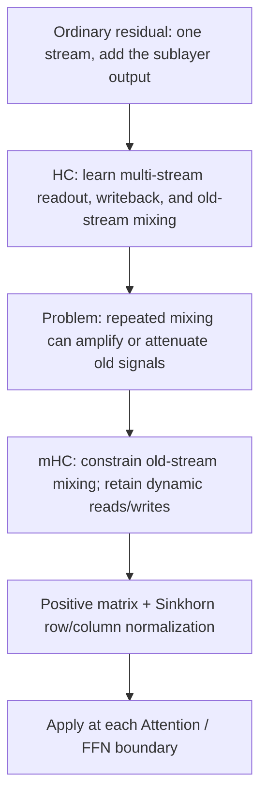
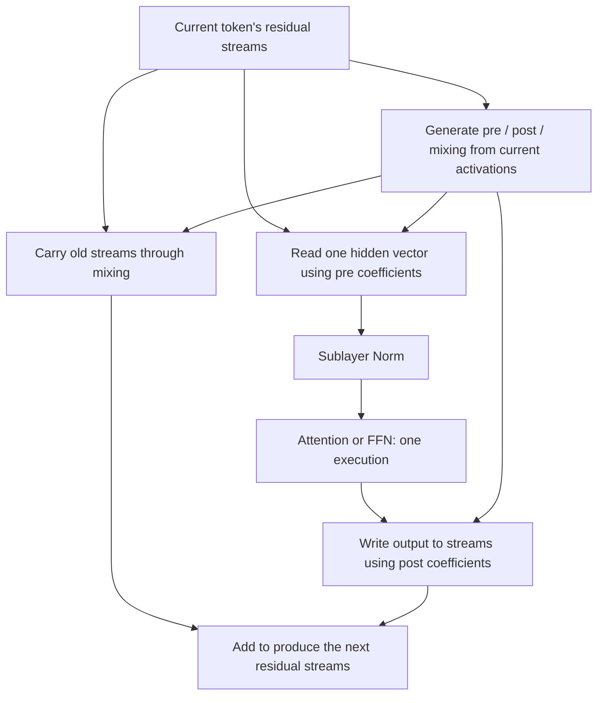
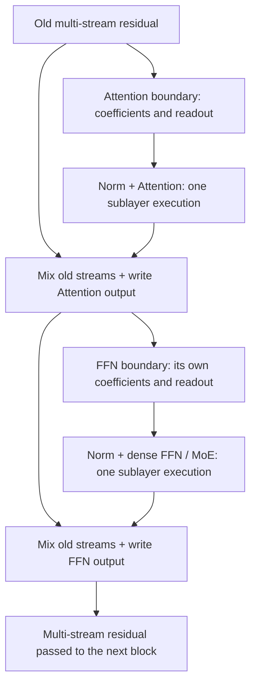

# mHC Principles: From Ordinary Residual Connections to Constrained Multi-Stream Dataflow

[简体中文](../../../zh/ai-infra-basic/Model_Architecture/10-manifold-constrained-hyper-connections.md) | **English**

mHC stands for **Manifold-Constrained Hyper-Connections**. It changes the **residual connections around Attention / FFN**, rather than introducing another Attention mechanism, MoE router, or cross-device communication algorithm.

This chapter belongs in `Model_Architecture/` because it explains how model sublayers connect. Start with [Decoder-only Transformer residual structure](./01-decoder-only-transformer.md); MLA, DSA, and KDA are not prerequisites. Afterwards, revisit [Section 5 of the GLM-5.3-Flash end-to-end example](../../sglang-ascend-npu/source-code-walkthrough/examples/03-glm-5.3-flash-end-to-end.md) for concrete configuration and execution boundaries.

## Reading Map: Separate Three Questions

| Mechanism | What does it determine? | What is outside its responsibility? |
|---|---|---|
| Attention / KDA | How a token interacts with history or updates state | How multiple residual streams mix |
| FFN / MoE | How a sublayer transforms channels or selects experts | Selecting residual streams is not expert routing |
| HC / mHC | Which streams supply the sublayer input, receive its output, and carry old features | Does not replace internal Attention or FFN computation |

Follow “single-stream addition → multi-stream reads/writes → unconstrained mixing problems → doubly stochastic constraints → Sinkhorn → complete forward.” Shapes accompany the equations. Numerical examples use constructed teaching data, not checkpoint weights.



## 1. What Does an Ordinary Residual Already Provide?

Consider one Pre-Norm sublayer, not an entire Decoder block as a single operation:

```math
x_{l+1}=x_l+F_l(\mathrm{Norm}(x_l)),\qquad x_l\in\mathbb{R}^{D}.
```

The old representation follows a direct path, while the sublayer adds new information. Attention and FFN typically each perform this update, giving two residual boundaries per block.

Expanding the recurrence gives:

```math
x_L=x_0+\sum_{l=0}^{L-1}F_l(\mathrm{Norm}(x_l)).
```

There is a direct term without a product of learned mixing matrices. A sublayer's Jacobian contains an identity term:

```math
\frac{\partial x_{l+1}}{\partial x_l}=I+J_{F_l}J_{\mathrm{Norm}}.
```

This explains the direct path, but **does not guarantee that every gradient in an ordinary residual network is always stable**. The other branch still affects the full Jacobian.

Fixed single-stream addition also limits connection design: sublayers repeatedly write into one stream, with relatively fixed ways of retaining old information and combining features from different depths. HC makes these connections learnable. This is an architectural direction, not a statement that ordinary residual connections are obsolete.

## 2. HC: Multiple Residual Streams, Yet One Sublayer Execution

### 2.1 Which axis expands?

The following notation is local to this chapter, not interchangeable with another chapter's head count or compression stride:

| Symbol | Meaning |
|---|---|
| $`N`$ | Current-forward token rows; packed batches can contain multiple requests |
| $`D`$ | Sublayer hidden width, not a single Attention head's width |
| $`m`$ | Residual-stream count, not token count, TP degree, or sequence-compression ratio |
| $`R`$ | Multi-stream residual activation, not parameters or historical KV |
| $`p^{\mathrm{pre}},p^{\mathrm{post}}`$ | Input-dependent readout/writeback coefficients for a token |
| $`C`$ | Input-dependent old-stream mixing matrix for a token |

Ordinary and multi-stream residual batches differ as follows:

```math
X\in\mathbb{R}^{N\times D},\qquad R\in\mathbb{R}^{N\times m\times D}.
```

For five current tokens, four streams, and hidden width 4096:

```math
N=5,\quad m=4,\quad D=4096,\qquad \mathrm{shape}(R)=[5,4,4096].
```

Five tokens do not become twenty tokens, nor are four Attention heads added. Each token has four parallel residual representations. They can initially be copies of the embedding; subsequent unequal writes and mixing can differentiate them. No contract assigns a particular stream to “syntax” or “semantics.”

### 2.2 Read, compute, and write back

Fix one token, with $`R\in\mathbb{R}^{m\times D}`$ and one stream per row. Our convention is: **matrix row $`i`$ identifies a source stream; column $`j`$ identifies a destination stream**.

Readout:

```math
u=R^{\mathsf T}p^{\mathrm{pre}}\in\mathbb{R}^{D},\qquad p^{\mathrm{pre}}\in\mathbb{R}^{m}.
```

Sublayer computation:

```math
y=F(\mathrm{Norm}(u))\in\mathbb{R}^{D}.
```

Old-stream mixing and new-information writeback:

```math
R'=C^{\mathsf T}R+p^{\mathrm{post}}y^{\mathsf T},\qquad C\in\mathbb{R}^{m\times m},\quad p^{\mathrm{post}}\in\mathbb{R}^{m}.
```

Elementwise:

```math
R'_{j,d}=\sum_{i=0}^{m-1}C_{i,j}R_{i,d}+p^{\mathrm{post}}_j y_d.
```

The first term selects old-stream contributions; the second writes the sublayer output into each destination. **Attention/FFN input and output remain $`D`$-wide, and the sublayer runs once.** Extra work comes from coefficient generation, wider residual storage/access, and mixing.



Original HC includes static/dynamic connections and specific initialization schemes. The three mappings here abstract the common dataflow, not a claim that every HC variant shares one parameterization. See the [Hyper-Connections paper](https://arxiv.org/html/2409.19606v3).

## 3. Why Not Leave Old-Stream Mixing Unconstrained?

To analyze only the direct path, temporarily set the new sublayer output to zero:

```math
R_{l+1}=C_l^{\mathsf T}R_l.
```

Old signals now pass through multiple matrices. A simple counterexample uses the same diagonal mapping at every layer:

```math
C_l=1.2I,\qquad R_L=1.2^L R_0.
```

```math
1.2^{20}\approx38.34,\qquad 0.8^{20}\approx0.01153.
```

Small per-layer changes can compound into substantial amplification or attenuation. Real HC is not this diagonal matrix; the example merely shows that arbitrary learned mixing does not automatically preserve a stable direct path.

One row-wise softmax is insufficient too. Under our source/destination convention, consider:

```math
C=\begin{bmatrix}0.9&0.1\\0.9&0.1\end{bmatrix},\qquad
R=\begin{bmatrix}1\\1\end{bmatrix},\qquad C^{\mathsf T}R=\begin{bmatrix}1.8\\0.2\end{bmatrix}.
```

Every row sums to one, but the first destination receives ninety percent from both sources, growing from one to 1.8. The total is preserved, but energy and distribution can change. Constraining only the other axis can instead allow a source to be duplicated.

Thus “nonnegative coefficients” or “a softmax was applied” is not the complete constraint needed here.

## 4. What Exactly Does mHC Constrain?

### 4.1 Doubly stochastic does not mean random sampling

One central mHC constraint makes old-stream mixing doubly stochastic. **It does not mean sampling a random matrix at every forward.**

```math
C_{i,j}\geq0,\qquad \sum_j C_{i,j}=1,\qquad \sum_i C_{i,j}=1.
```

With our convention:

- Each source row sums to one: its total outgoing coefficient is one.
- Each destination column sums to one: incoming old streams form a convex combination, not arbitrary amplification.

A valid example is:

```math
C=\begin{bmatrix}0.75&0.25\\0.25&0.75\end{bmatrix}.
```

Nonnegativity constrains **coefficients**, not hidden features or sublayer outputs, which can still be negative.

### 4.2 Why Manifold-Constrained?

Instead of ranging over all real matrices, mixing is restricted to a permitted set: the **Birkhoff polytope**. The paper uses the manifold-constraint terminology, but the complete polytope including its boundary should not simply be treated as an everywhere-smooth manifold.

Geometrically, a doubly stochastic matrix is a convex combination of permutation matrices. It can retain, exchange, or mix streams while controlling the direct mapping's scale. Orthogonality is not required, nor must the matrix equal identity.

See [Section 4 of the mHC paper](https://arxiv.org/html/2512.24880v2#S4) for this design and parameterization. The following properties and counterexamples independently derive consequences of the matrix conditions.

## 5. Why Does the Constraint Help, and What Does It Not Guarantee?

First analyze only the old-stream branch $`\overline R=C^{\mathsf T}R`$, separately from new sublayer writes.

### 5.1 Preserve the old streams' sum and mean

```math
\sum_j\overline R_{j,d}=\sum_i R_{i,d}\left(\sum_j C_{i,j}\right)=\sum_i R_{i,d}.
```

The old streams' channel-wise mean is therefore unchanged. If all old streams are identical, the column constraint also ensures that mixing alone does not change them.

### 5.2 Keep each mixed channel within the old streams' range

A destination receives nonnegative coefficients summing to one:

```math
\min_i R_{i,d}\leq\overline R_{j,d}\leq\max_i R_{i,d}.
```

As a convex combination, old-stream mixing alone cannot create a channel value larger than every input value.

### 5.3 The old-stream linear mapping does not amplify the two-norm

The induced one-norm is the maximum absolute column sum, and the infinity-norm is the maximum absolute row sum. Both equal one for a nonnegative doubly stochastic matrix:

```math
\lVert C\rVert_2\leq\sqrt{\lVert C\rVert_1\lVert C\rVert_\infty}=1,\qquad
\lVert C^{\mathsf T}R\rVert_F\leq\lVert R\rVert_F.
```

Products of doubly stochastic matrices remain nonnegative with unit row/column sums. Direct old-stream propagation across layers therefore retains the corresponding constraint. This does not mean the Frobenius norm is always unchanged: mixing can reduce it.

### 5.4 Neither exact identity nor unconditional whole-network stability

A uniform averaging matrix can erase differences between streams:

```math
C=\frac12\begin{bmatrix}1&1\\1&1\end{bmatrix},\qquad
R=\begin{bmatrix}1\\-1\end{bmatrix},\qquad C^{\mathsf T}R=\begin{bmatrix}0\\0\end{bmatrix}.
```

The constraint does not preserve information in every direction or require $`C=I`$. It provides a controlled old-stream path, not elementwise identity for every stream. Likewise, $`m=1`$ only forces $`C=[1]`$; recovering the complete ordinary residual function also requires matching readout/writeback settings.

The full update also writes sublayer outputs, and input-dependent coefficients have derivatives. Its differential includes:

```math
\mathrm{d}R'=C^{\mathsf T}\mathrm{d}R+(\mathrm{d}C)^{\mathsf T}R
+(\mathrm{d}p^{\mathrm{post}})y^{\mathsf T}+p^{\mathrm{post}}(\mathrm{d}y)^{\mathsf T}.
```

The old-stream norm bound does not automatically cover the additional terms. **mHC has a structural basis for controlling old-stream mixing, not an unconditional theorem that all activations/gradients in the complete network remain stable.**

## 6. Sinkhorn: Turning Free Coefficients into an Approximately Doubly Stochastic Matrix

### 6.1 Make entries positive, then alternate row/column rescaling

Let predicted raw matrix $`A\in\mathbb{R}^{m\times m}`$ contain arbitrary real values. First make it positive, then alternate normalizations:

```math
M^{(0)}=\exp(A).
```

```math
\mathcal R(M)_{i,j}=\frac{M_{i,j}}{\sum_vM_{i,v}},\qquad
\mathcal C(M)_{i,j}=\frac{M_{i,j}}{\sum_uM_{u,j}}.
```

```math
M^{(t+1)}=\mathcal C(\mathcal R(M^{(t)})).
```

Fixing row sums need not fix column sums. Fixing columns can disturb rows again, requiring iteration. This is ideal mathematics without epsilon. Positive matrices satisfy the relevant convergence conditions; finite iterations deliver finite accuracy.

Projection here refers to constrained rescaling, not a claim to compute the nearest matrix in an arbitrary Euclidean metric. Implementations stabilize the calculation rather than directly exponentiating very large logits.

### 6.2 One worked iteration: why continue?

Start with an already-positive matrix for easy arithmetic:

```math
M^{(0)}=\begin{bmatrix}1&2\\3&4\end{bmatrix}.
```

Row normalization gives:

```math
\mathcal R(M^{(0)})=\begin{bmatrix}1/3&2/3\\3/7&4/7\end{bmatrix}.
```

Column sums are not yet one. Normalize columns:

```math
M^{(1)}=\begin{bmatrix}7/16&7/13\\9/16&6/13\end{bmatrix}.
```

```math
\mathrm{row\ sums}(M^{(1)})\approx[0.97596,1.02404],\qquad
\mathrm{column\ sums}(M^{(1)})=[1,1].
```

Further iterations approach:

```math
C\approx\begin{bmatrix}0.44949&0.55051\\0.55051&0.44949\end{bmatrix}.
```

Check row/column-sum errors and NaN/Inf, not merely whether a fixed iteration count ran. Epsilon-stabilized implementations should not be declared exactly doubly stochastic just because many iterations completed.

## 7. Who Computes the Coefficients? Parameters versus Runtime Activations

### 7.1 How many coefficients does a token predict?

One vector reads, another writes, and one square matrix mixes old streams:

```math
k_{\mathrm{coef}}=m+m+m^2=m^2+2m.
```

Four streams therefore require 24 coefficients, not 24 residual streams:

```math
m=4,\qquad k_{\mathrm{coef}}=4+4+16=24.
```

Flatten the token's streams, normalize, and project. Using PyTorch output/input weight ordering:

```math
x=\mathrm{vec}(R)\in\mathbb{R}^{mD},\qquad
W_{\mathrm{hc}}\in\mathbb{R}^{(m^2+2m)\times mD}.
```

```math
z=\frac{W_{\mathrm{hc}}x}{\sqrt{\mathrm{mean}(x^2)+\epsilon_{\mathrm{norm}}}},\qquad
z=(z_{\mathrm{pre}},z_{\mathrm{post}},Z_{\mathrm{res}}).
```

Moving scalar normalization after GEMM is algebraically equivalent when the gain is handled or absorbed into projection weights according to the implementation. Bias is added after normalization and scaling; moving it arbitrarily changes the function.

Three learned scales and static biases combine with the prediction:

```math
p^{\mathrm{pre}}=\sigma(s_0z_{\mathrm{pre}}+b_{\mathrm{pre}}),\qquad
p^{\mathrm{post}}=2\sigma(s_1z_{\mathrm{post}}+b_{\mathrm{post}}).
```

```math
A=s_2Z_{\mathrm{res}}+B_{\mathrm{res}},\qquad C=\mathrm{Sinkhorn}(A).
```

This is a common mHC parameterization, with model-specific stabilization possible. **Pre uses elementwise sigmoid, not a softmax over streams, so its sum need not be one. Post need not sum to one either.** Doubly stochastic constraints govern old-stream mixing, not every coefficient.

### 7.2 Which objects does the optimizer update?

| Object | Type | Trainable parameter? |
|---|---|---|
| Coefficient-projection weights, static biases, three scales | Boundary-owned weights | Yes |
| Sublayer Norm and Attention/FFN weights | Sublayer parameters | Yes |
| Current residual, pre/post coefficients, mixing matrix | Activations computed from inputs and weights | No, although gradients flow through them during training |
| Historical KV or KDA recurrent state | Token-mixer runtime state | Not the mHC coefficient parameters |

Tokens share a boundary's projection weights, but **their dynamic coefficients can differ**. Different layers and Attention/FFN boundaries need not share projections.

## 8. Complete Numerical Example: Two Old Streams to Two New Streams

Use $`m=2,D=2,N=1`$, omit Norm epsilon, and set Norm gain to one. Suppose the coefficient network has already produced:

```math
R=\begin{bmatrix}1&0\\0&1\end{bmatrix},\quad
p^{\mathrm{pre}}=\begin{bmatrix}0.5\\0.5\end{bmatrix},\quad
p^{\mathrm{post}}=\begin{bmatrix}1\\0.5\end{bmatrix},\quad
C=\begin{bmatrix}0.75&0.25\\0.25&0.75\end{bmatrix}.
```

These illustrate reads/writes, not actual checkpoint coefficients. Replace real Attention/FFN with a simple linear sublayer:

```math
F(a)=\begin{bmatrix}2&0\\0&-1\end{bmatrix}a.
```

**Step one: read out.**

```math
u=R^{\mathsf T}p^{\mathrm{pre}}=\begin{bmatrix}0.5\\0.5\end{bmatrix}.
```

**Step two: normalize and compute the sublayer.**

```math
\mathrm{RMS}(u)=\sqrt{(0.5^2+0.5^2)/2}=0.5,\qquad
\mathrm{Norm}(u)=\begin{bmatrix}1\\1\end{bmatrix},\qquad y=\begin{bmatrix}2\\-1\end{bmatrix}.
```

**Step three: mix only the old streams.**

```math
C^{\mathsf T}R=\begin{bmatrix}0.75&0.25\\0.25&0.75\end{bmatrix}.
```

The old streams' channel-wise total remains $`[1,1]`$.

**Step four: write the sublayer output into each stream.**

```math
p^{\mathrm{post}}y^{\mathsf T}=\begin{bmatrix}2&-1\\1&-0.5\end{bmatrix}.
```

```math
R'=\begin{bmatrix}2.75&-0.75\\1.25&0.25\end{bmatrix}.
```

The new total is $`[4,-0.5]`$, different from the old total. No constraint was violated: conservation applied to old-stream mixing, and we also added new information.

Test a non-symmetric permutation too. Symmetric matrices cannot expose confusing $`C^{\mathsf T}R`$ with $`CR`$. The CPU demo explicitly checks orientation.

## 9. Scale the Example to a Batch: Every Tensor Shape

Continue with $`N=5,m=4,D=4096`$:

| Stage | Logical shape | Meaning |
|---|---|---|
| Residual | $`[5,4,4096]`$ | Four streams per token |
| Flattened residual | $`[5,16384]`$ | A different view, not more tokens |
| Coefficient-projection weight | $`[24,16384]`$ | PyTorch output/input ordering |
| Projection output, static bias, scales | $`[5,24]`$, $`[24]`$, $`[3]`$ | Bias/scales broadcast across tokens |
| Pre / post | Each $`[5,4]`$ | One coefficient set per token |
| Mixing | $`[5,4,4]`$ | One old-stream matrix per token |
| Readout, Norm, sublayer output | Each $`[5,4096]`$ | Sublayer width did not become 16384 |
| Old mix / new write / updated residual | Each $`[5,4,4096]`$ | Shapes align for addition |

Coefficient prediction and old-stream mixing are **token-wise**. They do not mix request A's residual with request B's. Cross-token interaction, when present, occurs inside Attention or another relevant sublayer.

Teaching pseudocode with matching dimensions, omitting dtype handling and fusion:

```python
pre, post, mixing = coefficient_network(residual)
layer_input = (pre[..., None] * residual).sum(dim=1)
layer_output = sublayer(norm(layer_input))
old_path = mixing.transpose(-1, -2) @ residual
new_path = post[..., None] * layer_output[:, None, :]
next_residual = old_path + new_path
```

Do not retain only `layer_output` and overwrite old residuals prematurely: writeback still needs them. A flattened view's final dimension also does not determine model `hidden_size`.

## 10. Connecting Two mHC Boundaries in a Decoder Block



Each boundary owns its coefficient generator. Attention's dynamic mixing must not silently be reused at FFN. Treating a two-sublayer Decoder block as one coefficient update omits part of the architecture.

Model entry commonly expands embeddings into streams, and model exit contracts to the hidden width required by the LM head. Sum, mean, or learned readout is model-specific, not determined by the term mHC alone.

For example, the pinned GLM-5.3-Flash implementation uses a stream mean:

```math
h_{n,d}=\frac1m\sum_{i=0}^{m-1}R^{\mathrm{final}}_{n,i,d},\qquad \mathrm{shape}(h)=[N,D].
```

The original HC paper also describes summation. Do not freely interchange sum and mean in a trained model. Final Norm / LM head then follow the model's contract.

## 11. Training, Prefill, and Decode: What Persists?

| Scenario | What mHC does | Important distinction |
|---|---|---|
| Training | Dynamic coefficients and multi-stream updates; backpropagate through projections, gates, Sinkhorn, and sublayers | Not merely training a final readout |
| Prefill | Apply these operations to current new-token residuals | Row count depends on packed/chunk size, not just request count |
| Decode | The same residual orchestration for current new-token rows | Historical information still comes from KV / recurrent state |
| PP / row-layout transformations | Transfer multi-stream residuals and coefficient sidecars still needed downstream | Sending only the sublayer input does not preserve the whole residual |

mHC streams are normally current-forward activations. They do not permanently add four copies of KV per historical token, nor form a KDA-like recurrent matrix carried between generation steps. Training saves or recomputes activations with another lifetime.

Inference still computes dynamic coefficients; it simply does not update weights with an optimizer. An ordinary checkpoint cannot automatically gain trained mHC by toggling a flag: changed connections and new parameters alter the function, generally requiring corresponding training/adaptation.

## 12. Cost Accounting: One Sublayer Execution Does Not Mean Zero Overhead

### 12.1 Residual activations

For one BF16 buffer at two bytes per element, not whole-model peak memory:

```math
M_{\mathrm{single}}=ND\times2=40960\ \mathrm{bytes}=40\ \mathrm{KiB}.
```

```math
M_{\mathrm{multi}}=NmD\times2=163840\ \mathrm{bytes}=160\ \mathrm{KiB}.
```

One expanded buffer adds 120 KiB in this example. Temporary buffers, training saves, recomputation, and parallel transfer need separate accounting. This does not imply total model memory grows fourfold.

### 12.2 Coefficient generation and matrix mixing

Logical parameters for one boundary's control projection, bias, and three scales total:

```math
(m^2+2m)mD+(m^2+2m)+3=393243.
```

This excludes sublayer Norm and Attention/FFN parameters. General costs separate as:

```math
\mathrm{projection}:\ O(NmD(m^2+2m)),\qquad
\mathrm{mixing}:\ O(Nm^2D),\qquad
\text{Sinkhorn}:\ O(NI_{\mathrm{SK}}m^2).
```

The terms respectively denote coefficient projection, old-stream mixing, and Sinkhorn iterations. Stream counts cannot grow without cost. At fixed small stream count, HBM access to wide activations and launching small operations can matter substantially; GEMM FLOPs alone miss this overhead.

Fusion can reuse residual reads and combine portions of Norm, coefficient processing, Sinkhorn, and writeback, while preserving numerical semantics and required old streams. This chapter does not generalize one paper/device's overhead percentage to every serving scenario and performs no whole-model acceleration benchmark.

## 13. Alignment with Pinned Upstream: Principles versus Model Constants

Verified on 2026-10-28 against SGLang commit `92580581da6fc8542a997a00c1a8b71b03497680`, matching the GLM-5.3-Flash example. New implementations link upstream rather than pretending the older local runtime contains those files.

| Mechanism | Pinned source entry / difference |
|---|---|
| Stream expansion/contraction | [mhc.py](https://github.com/sgl-project/sglang/blob/92580581da6fc8542a997a00c1a8b71b03497680/python/sglang/kernels/ops/layernorm/mhc.py): `hc_broadcast` / `hc_expand` / `hc_contract` |
| Coefficients, Sinkhorn, readout | Same file, `_mhc_pre_torch`; pre adds stabilization and post uses twice sigmoid |
| Residual-update orientation | Same file, `_mhc_post_torch`; matches our source-row/destination-column convention |
| Stage/communication boundaries | [layer_boundary/residual/mhc.py](https://github.com/sgl-project/sglang/blob/92580581da6fc8542a997a00c1a8b71b03497680/python/sglang/srt/layers/layer_boundary/residual/mhc.py): `MHCState` |
| Model-specific boundary configuration | [models/glm5_next.py](https://github.com/sgl-project/sglang/blob/92580581da6fc8542a997a00c1a8b71b03497680/python/sglang/srt/models/glm5_next.py); separate Attention/FFN configuration |

The pinned torch reference starts residual logits with row softmax plus epsilon, normalizes columns, and alternates row/column normalization. This stabilized program should not be compared bit-for-bit with Section 6's ideal epsilon-free version.

The original paper commonly writes old-stream mapping as left multiplication. Our sample-aligned convention uses $`C^{\mathsf T}R`$ with source rows/destination columns; align the other notation using $`H^{\mathrm{res}}=C^{\mathsf T}`$. Double stochasticity survives transposition, but implementation orientation still matters.

## 14. Common Misunderstandings

1. **mHC means Multi-Head Attention.** No: residual streams and Attention heads are separate axes.
2. **Four residual streams require four FFN executions.** No: read one input, then execute the sublayer once.
3. **Stochastic means random sampling is required.** No: it is terminology for row/column-sum conditions.
4. **Pre/post must also softmax to unit sum.** No: do not transfer the old-stream mixing constraint to every coefficient.
5. **One Sinkhorn iteration fixes both axes exactly.** Usually not, as the worked iteration shows.
6. **Doubly stochastic means exact identity and no information loss.** No: averaging can erase stream differences.
7. **Controlled old mixing means no activation/gradient ever grows.** No: new writes and coefficient derivatives remain.
8. **mHC residuals are four persistent KV caches.** No: current activations and historical state differ.

## 15. CPU Self-Checks, Exercises, and Next Reading

[mhc_principles_demo.py](./mhc_principles_demo.py) uses only Python's standard library, with no weights or PyTorch. It checks the full worked example, row/column normalization, mean conservation, old-path non-expansion, non-symmetric transpose orientation, token isolation, and growth from new writes.

```bash
python3 learning/en/ai-infra-basic/Model_Architecture/mhc_principles_demo.py
```

These are mathematics/index teaching checks, not official GPU/NPU kernel accuracy or whole-model quality validation.

Check your understanding:

1. Why does a $`[N,mD]`$ view not mean the sublayer hidden width grew by $`m`$?
2. Why can row-softmax-only mixing still amplify one destination stream?
3. Why is Section 8's old-stream total unchanged while its final residual total changes?
4. If mixing depends on the residual, why does the full gradient include more than the mixing matrix?
5. Which errors should be checked after finite Sinkhorn iterations with epsilon instead of asserting exact double stochasticity?

Continue with the [GLM-5.3-Flash example](../../sglang-ascend-npu/source-code-walkthrough/examples/03-glm-5.3-flash-end-to-end.md) for concrete execution, and [architecture families](./05-architecture-families.md) to separate Token Mixer, Channel Mixer, residual orchestration, and runtime state.

## 16. Primary Sources and Version Boundaries

- [Hyper-Connections, pinned paper v3](https://arxiv.org/html/2409.19606v3): multi-stream background, static/dynamic connections, and original parameterization.
- [mHC: Manifold-Constrained Hyper-Connections, pinned paper v2](https://arxiv.org/html/2512.24880v2): constraint design and Sinkhorn parameterization.
- [Pinned SGLang mHC implementation](https://github.com/sgl-project/sglang/blob/92580581da6fc8542a997a00c1a8b71b03497680/python/sglang/kernels/ops/layernorm/mhc.py): implementation differences and orientation conventions.

General matrix properties, teaching counterexamples, paper design, and model-specific implementation are stated separately. None establishes hardware qualification of every platform backend, parallel combination, or training configuration.
