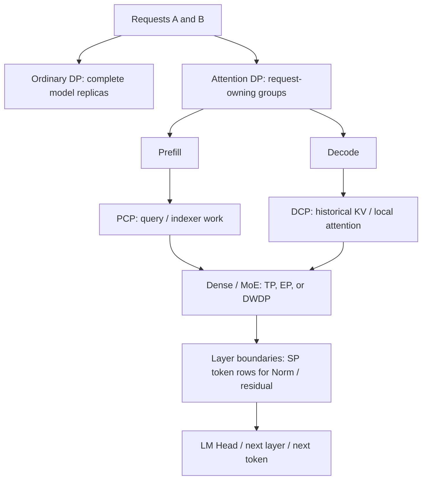

# 00. A Parallelism Map: Partitioned Objects and Execution Phases

**English** | [简体中文](../../../zh/ai-infra-basic/Parallel_Strategy/00-parallelism-map-and-version-boundaries.md)

Think of model serving as a restaurant: DP opens complete branches, TP assigns several cooks to one dish, PP divides the production stages, and EP sends orders to specialist cooks. SP, PCP, and DCP may all partition a token dimension, but their phase, intermediate tensors, and history ownership define different execution protocols.

## 1. Ask the Same Questions of Every Strategy

| Strategy | Partitioned Object | What Remains / Is Replicated | Main Goal | Detail |
|---|---|---|---|---|
| ordinary DP | independent requests | complete model per replica, possibly with TP/PP | request throughput | [foundation tutorial](./tutorial.md) |
| TP | layer weights, features/heads | some activations or KV may remain replicated | weight capacity and layer computation | [foundation tutorial](./tutorial.md) |
| PP | layers and stages | stage-local layers | model capacity and pipelining | [foundation tutorial](./tutorial.md) |
| attention DP / DPA | request ownership | FFN/MoE may share a larger group | less duplicated request history and useful batching | [01](./01-dp-attention-principles.md) |
| SP | token rows around Norm/residual | original TP weight layout | lower activation memory and redundant row work | [02](./02-sp-versus-context-parallelism.md) |
| PCP | prefill query tokens and related work | required K/V may be gathered and replicated | distribute long-prompt computation | [03](./03-prefill-context-parallelism.md) |
| DCP | decode historical KV positions and reads | queries must cover participating shards | lower per-device KV storage/reads | [04](./04-decode-context-parallelism.md) |
| EP | expert weight ownership | router/non-expert layers follow other layouts | expert capacity | [foundation tutorial](./tutorial.md), [communication](../Communication/04-moe-deepep-and-zbal.md) |
| DWDP | resident expert weights and prefetch | local requests and active-layer remote-weight cache | replace some token traffic with weight movement | [05](./05-dwdp-weight-parallelism.md) |
| encoder DP / elastic EP | encoding work / dynamic resources and replicas | module/runtime-specific | module throughput / elasticity and load | [07](./07-encoder-dp-and-elastic-ep.md) |

“Partition tokens” is insufficient: DPA partitions **requests**, PCP partitions **new query rows within requests**, DCP partitions **historical KV**, and SP partitions **activations around row-local operations**.

This locates responsibilities; it **does not promise simultaneous compatibility**. See [06: composition](./06-parallel-topology-and-pd-composition.md) for groups and constraints.

## 2. Three Different Meanings of “Same”

1. **Same mathematical result**: sharded computation reconstructs the original, as with DCP LSE merging.
2. **Same tensor shape**: two tensors of shape $`[T,H]`$ might be replicas or partial values that still require summation.
3. **Same parameter name**: `dp_size` may pass through compatibility conversion across SGLang versions. Read argument resolution first.

For example, with attention head parallel degree $`H_{\mathrm{TP}}`$ and PCP degree $`C`$, query can have logical shape $`[T/C,N_h/H_{\mathrm{TP}},d]`$. This says neither whether KV is persistently sharded nor whether FFN uses the same layout.

## 3. Two Explicit Source Baselines

**Checked: 2026-10-15.** Local source references use repository `09804e1`; newer features use pinned upstream [sgl-project/sglang@f2b73d4](https://github.com/sgl-project/sglang/tree/f2b73d4f9b4e64415b8d775b0f811c7801f1728b). This change restructures teaching material without replacing local runtime code.

| Feature | Local Reading Entry | Pinned Upstream Entry |
|---|---|---|
| DP Attention | `dp_size` with `enable_dp_attention` | separate `attn_dp_size`, with old-spelling compatibility conversion |
| prefill CP | `enable_prefill_context_parallel` / DSA flag and `prefill_cp_mode` | `enable_prefill_cp`, `cp_strategy`, shared strategy interface |
| DCP | no complete matching entry in the local snapshot | `dcp_size`, `layers/dcp/` |
| LayerNorm SP | old `sp_inference_demo.py` is not this implementation | `layers/layernorm_sp.py` and a validation hook |
| DWDP | absent from the local snapshot | `layers/moe/dwdp/` |
| encoder DP / elastic EP | some fields/modules already exist | implementation continues evolving; inspect the specific source |

These are **field/interface descriptions**, not a launch command assembled from mixed versions. Check upstream [parallel fields](https://github.com/sgl-project/sglang/blob/f2b73d4f9b4e64415b8d775b0f811c7801f1728b/python/sglang/srt/arg_groups/fields/parallel.py) and [parallel hook](https://github.com/sgl-project/sglang/blob/f2b73d4f9b4e64415b8d775b0f811c7801f1728b/python/sglang/srt/arg_groups/parallel_hook.py). A working GPU path does not establish NPU support.

## 4. How to Study

Start with basic DP/TP/PP/EP, then follow **DPA → SP → PCP → DCP → DWDP → topology and phase handoff**. Each chapter explains purpose, mathematical equivalence, source responsibilities, costs, diagrams, and checks.

[parallelism_math_demo.py](./parallelism_math_demo.py) uses only Python's standard library to demonstrate row-local Norm, PCP request boundaries, exact DCP merging, EP/weight-prefetch equivalence, and rank groups. It verifies teaching mathematics rather than network performance or actual CUDA/NPU kernels.

Study CFG/Ulysses/Ring separately in [08: diffusion parallelism](./08-diffusion-parallelism.md). ZeRO/FSDP belong to training extensions; this course does not present them as existing SGLang inference modes.
