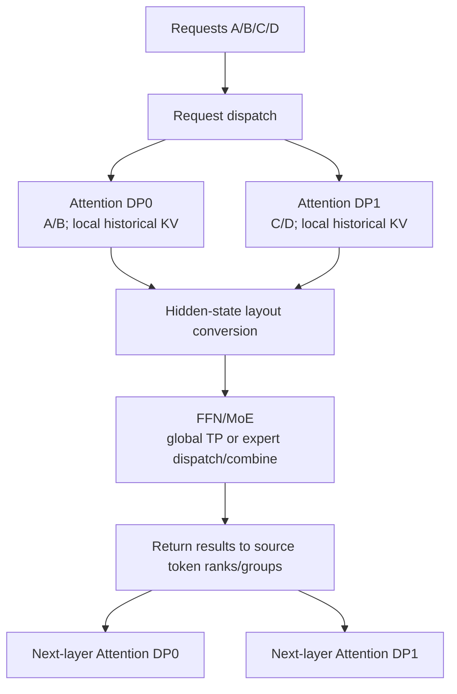
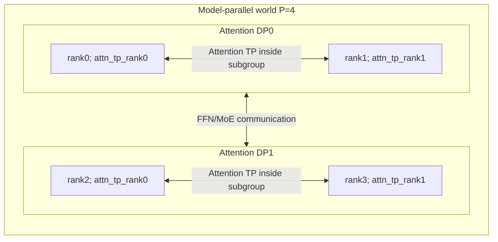
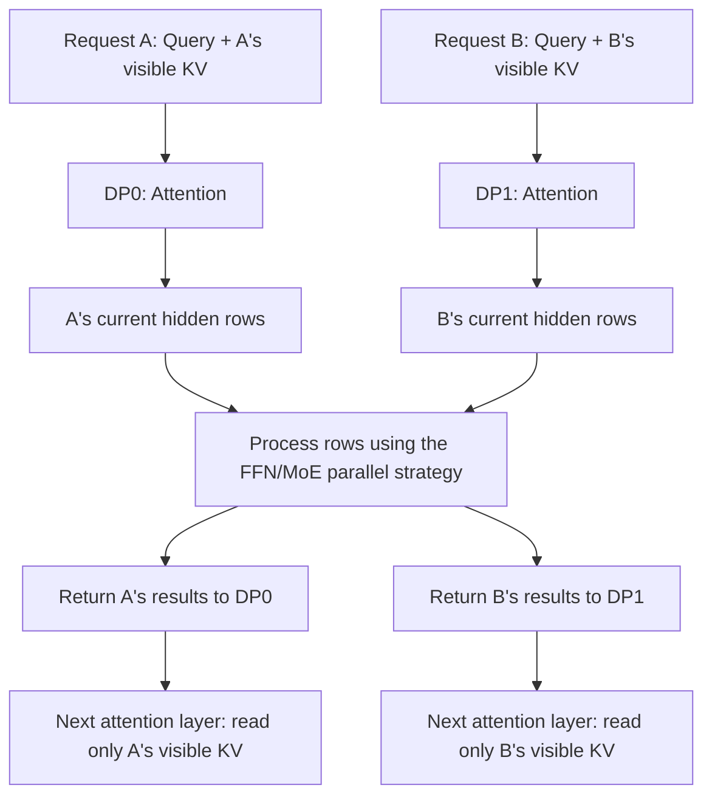
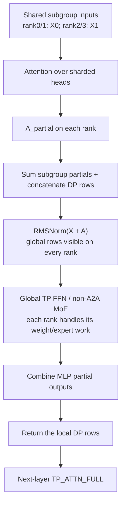
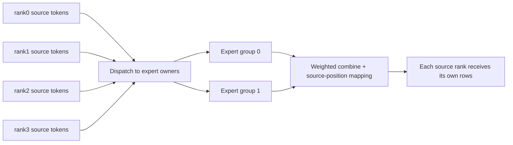
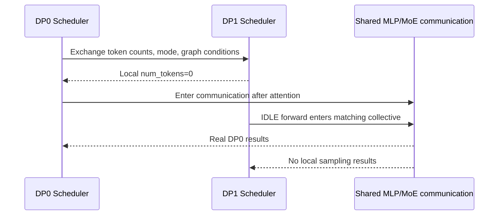

# DP Attention: Request Parallelism, Attention Subgroups, and FFN/MoE Layout Changes

[简体中文](../../../zh/ai-infra-basic/Parallel_Strategy/01-dp-attention-principles.md) | **English**

This chapter develops the mathematics and system principles of DP Attention. Follow it with the [SGLang source walkthrough](../../sglang-source-reading/05-layer-communication/03-dp-attention-code-walkthrough.md). Prerequisites: [DP/TP/EP](./tutorial.md), [GQA](../Model_Architecture/02-gqa-attention-shapes.md), and [MLA](../Model_Architecture/04-multi-head-latent-attention.md).

The source baseline is repository snapshot `587eb0b3a56cd2f014daf3b0fc8ba333da88df36`. Teaching configurations expose shapes and semantics; they do not assert that every model/backend supports every combination.

## 1. The Conflict It Resolves

Attention and FFN/MoE have different parallelism needs:

- A request's attention depends on its own historical KV. There is no mathematical attention dependency between separate requests. Decode is often sensitive to KV bandwidth and communication at small batch sizes.
- Dense FFN weights may require sharding across many devices; a larger token batch can also help GEMM utilization.
- MoE expert parameters may greatly exceed attention parameters, requiring distributed expert storage and token dispatch.

Using one large TP group throughout forces attention into that large group even if smaller TP would suffice. Replicating the entire model to increase attention concurrency also replicates large FFN/expert weights.

DP Attention lets **different submodules use different partitions inside one model-parallel world**. Requests are assigned to attention-DP subgroups, with optional attention TP inside each group. FFN/MoE handles their token rows using its own TP/EP topology.



Cross-group transfers normally carry **current hidden states or expert-routing data**. Historical KV remains within the attention subgroup that owns the request. Additional CP, KV-transfer, or other features supply their own history partition/transfer mechanisms.

## 2. Regular DP and DP Attention Use Different Process Counts

Fix `pp_size=1` and compare two configurations both written as `tp_size=4, dp_size=2`:

| Property | Regular DP, DP Attention disabled | DP Attention enabled |
|---|---|---|
| Compute devices | `4 × 2 = 8` | `4` |
| Model-parallel worlds | two independent 4-rank worlds | one 4-rank world |
| Attention TP | 4 in each replica | 2 in each attention-DP subgroup |
| Request dispatch | complete model replicas | attention-DP subgroups |
| FFN/experts | a full distributed weight set per replica | weights assigned within the same world by TP/EP |
| Inference communication between replicas | normally absent | layout conversion or expert communication |

With this feature enabled, `tp_size` also identifies the rank count of the model world. The actual sharding degree of an attention matrix is `attn_tp_size`.

## 3. Decode a Rank into DP, CP, and TP Coordinates

Define:

```text
P = tp_size                   ranks in the model-parallel world
D = attention_dp_size         enable_dp_attention ? dp_size : 1
C = attn_cp_size              attention context parallelism
T = attention_tp_size = P / (D*C)
```

These sizes must divide evenly. The source orders ranks as `(DP, CP, TP)`, with TP changing fastest:

```math
p=(dC+c)T+a
```

```math
a=p\bmod T,\qquad c=\lfloor p/T\rfloor\bmod C,\qquad d=\lfloor p/(TC)\rfloor
```

The running example is `P=4,D=2,C=1,T=2`:

| Model-world rank `p` | Attention DP `d` | Attention TP `a` | Attention TP group | Requests |
|---:|---:|---:|---|---|
| 0 | 0 | 0 | `[0,1]` | A/B |
| 1 | 0 | 1 | `[0,1]` | A/B |
| 2 | 1 | 0 | `[2,3]` | C/D |
| 3 | 1 | 1 | `[2,3]` | C/D |



For `P=8,D=2,C=2,T=2`, attention TP groups are `[0,1], [2,3], [4,5], [6,7]`; attention CP groups are `[0,2], [1,3], [4,6], [5,7]`. DP assigns separate requests; CP partitions one request's context. They act on different dimensions.

## 4. Why Requests Can Run Attention Separately

The point of this section is simple: **attention for one request does not need another request's history, so different requests can run in different attention-DP groups.** This does not split one request's history, nor does it mean that tokens within a request are independent.

### 4.1 Imagine Two People Using the Same Model

User A asks about “the weather in Beijing,” while user B asks the model to “write a poem.” They use the same model weights, but have separate conversation histories:

- A's Query compares only against A's historical Keys and takes a weighted sum of A's Values.
- B's Query compares only against B's historical Keys and takes a weighted sum of B's Values.
- B mentioning poetry must not make those tokens part of A's context.

Think of model weights as a shared rulebook, and KV caches as each user's conversation notes. **Sharing the rulebook does not mean sharing the notes.** Requests with a common prefix may reuse physical cache pages, but each request's logically visible context is still determined by its own metadata.

### 4.2 Follow the Tensors: Why Does A Not Need B?

Consider a decode step with one Query per request. Omit the batch/head axes and follow one Query head and its corresponding KV head. Suppose A's Query sees 3 tokens and B's sees 2. These are illustrative visible lengths, **not the actual tokenization of the sentences above**. Causal attention may see the current position and earlier positions.

Here `Dk` is the Query/Key width, and `Dv` is the Value width:

```text
Request A:
Q_A [1,Dk] @ K_A.T [Dk,3] -> scores_A [1,3]
scores_A / sqrt(Dk)       -> scaled_scores_A [1,3]
softmax (over 3 positions)-> weights_A [1,3]
weights_A @ V_A [3,Dv]    -> O_A [1,Dv]

Request B:
Q_B [1,Dk] @ K_B.T [Dk,2] -> scores_B [1,2]
scores_B / sqrt(Dk)       -> scaled_scores_B [1,2]
softmax (over 2 positions)-> weights_B [1,2]
weights_B @ V_B [2,Dv]    -> O_B [1,Dv]
```

For example, if A's three scores become `[0.2,0.5,0.3]` after softmax, A's output is `0.2*v_A1 + 0.5*v_A2 + 0.3*v_A3`. B's Values do not participate in this sum, and B's scores do not participate in A's softmax denominator.

Consequently, placing A in DP0 and B in DP1 preserves the mathematical outputs as long as their inputs, weights, and visible KV remain unchanged (floating-point execution may introduce rounding differences). If a DP group also uses TP, its ranks still collaborate to compute attention. Independent requests do not mean every device can perform the entire computation alone.



The hidden rows in this diagram are the current token representations entering FFN/MoE after attention. Output projection, residual connections, and normalization are omitted to emphasize request ownership.

### 4.3 Computing Together Does Not Mean Seeing Each Other

Even when A's and B's token rows are packed into one tensor, attention must preserve request boundaries. A's Query may access only A's visible KV, and B's Query only B's visible KV. Implementations can enforce this through masks, sequence lengths, page tables, and related metadata; they do not necessarily materialize a giant mask matrix.

If A's Query incorrectly applies softmax over all 5 Keys from A and B, the denominator changes and B's Values may enter the result. This is no longer the original model computation for A. That is why packed attention requires request boundaries.

Remember: **different requests are independent; positions within one request are not.** A's current token still depends on A's history. Splitting A's long context across devices is the dimension handled by CP, not a consequence of request independence.

### 4.4 Why Can an FFN Batch A and B Together?

Attention takes weighted sums across visible positions within a request. An ordinary FFN transforms each current token's features without reading other token rows. At the FFN input, each token has a hidden vector of width `H`; the earlier single-head width `Dv` must not be confused with `H`.

Suppose A and B each contribute one row:

```text
X_A [1,H] --+
            +-- concatenate rows -> X [2,H] -> FFN -> Y [2,H]
X_B [1,H] --+                                       +-- row 0 -> A
                                                    +-- row 1 -> B
```

Using row-vector notation, the complete shape flow through a SwiGLU FFN is:

```text
X [2,H] @ W_gate [H,I] -> G [2,I]
X [2,H] @ W_up   [H,I] -> U [2,I]
SiLU(G) * U            -> Z [2,I]   # elementwise; no mixing of rows
Z [2,I] @ W_down [I,H] -> Y [2,H]
```

`I` is the FFN intermediate width. Each matrix multiplication applies the same weights to each input row. A's output depends only on A's row. Combining two rows into a larger GEMM batches the computation; it does not exchange context between the requests.

Thus, **separating attention by request and batching FFN computation by token row are compatible.** Whether hidden rows are collected across DP groups depends on the FFN/MoE parallel strategy: not every path begins with a global all-gather. MoE additionally dispatches tokens to their experts and returns results to the original token positions. Later sections distinguish these communication paths.

### 4.5 Now Revisit the Original Equation

For request $`r`$, head $`h`$, and query position $`i`$, use column vectors for Q/K/V:

```math
o_{r,h,i}=\sum_{j\in\mathcal{V}_r(i)}
\mathrm{softmax}_{j}\left(q_{r,h,i}^{\mathsf T}k_{r,g(h),j}/\sqrt{D_k}\right)v_{r,g(h),j}
```

This is simply the general form of the computation in Section 4.2:

- $`q_{r,h,i}`$: request r's Query at position i and head h, with shape `[Dk]`.
- $`g(h)`$: the KV head associated with this Query head in GQA.
- $`\mathcal{V}_r(i)`$: the set of token positions visible to request r at position i; it excludes other requests' positions.
- $`k_{r,g(h),j}`$ and $`v_{r,g(h),j}`$: this request's Key/Value at visible position j, with shapes `[Dk]` and `[Dv]`.
- The inner product produces a scalar score for each position. Softmax normalizes only over this request's visible positions, and the weighted sum produces a `[Dv]` output.

The key observation for request partitioning is that **every Query, Key, and Value in this equation belongs to request r. No other request's K/V appears.**

## 5. Attention TP Shards Weights; DP Assigns Requests

Use row-vector notation for GQA with `H=4096,Nq=32,Nkv=8,Dk=Dv=128`. DP0 has $`n_0=4`$ tokens this step and DP1 has $`n_1=2`$; `T=2`:

```text
Input within attention-DP subgroup: X_d [n_d,4096]
Ranks share X_d but hold different Q/K/V weight shards

Q_local: [n_d,16,128]        # 32/2 query heads
K_local: [n_d,4,128]         # 8/2 KV heads
V_local: [n_d,4,128]
O_heads: [n_d,16,128]
O_flat:  [n_d,2048]
W_O_local: [2048,4096]
A_partial = O_flat @ W_O_local: [n_d,4096]
```

Output projection on the two subgroup ranks produces **partial sums** over different input channels:

```math
A_d=A_{d,0}^{\mathrm{partial}}+A_{d,1}^{\mathrm{partial}}
```

Shapes match, but values are incomplete. Communication must sum contributions before the appropriate residual/RMSNorm operation.

With MLA, shared content latents and positional-key cache widths do not directly grow with query-head count. Query/up/output projections can still be attention-TP sharded; see [MLA](../Model_Architecture/04-multi-head-latent-attention.md).

## 6. Equal Shapes Can Have Different Ownership

SGLang's `ScatterMode` describes the distribution of **token rows**, independently of weight sharding on the last dimension:

| Mode | rank0 | rank1 | rank2 | rank3 |
|---|---|---|---|---|
| `TP_ATTN_FULL` | A/B | A/B | C/D | C/D |
| `FULL` | A/B/C/D | A/B/C/D | A/B/C/D | A/B/C/D |
| `SCATTERED` | A | B | C | D |

Letters represent equal-size token blocks for illustration. Real requests can have different lengths; the partition operates on packed rows and need not give each rank one whole request.

A separate property is whether values are **partial** or **replicated**:

- partial: tensors from multiple ranks must be summed for the complete output;
- replicated: ranks already hold identical complete values, so gathering must retain one copy.

`TP_ATTN_FULL` describes complete token rows within the subgroup. It does not tell you whether output projection has already been all-reduced.

## 7. Path A: Gather Tokens for Global TP FFN/MoE

For the initial example, use no dedicated MoE A2A backend, `moe_dense_tp_size=None`, and no CP/TBO/communication fusion. The MLP layout is `FULL`.



Mathematically, the MLP input is:

```math
U=\mathrm{concat}_{d}\mathrm{RMSNorm}(X_d+A_d)
```

Gathering must perform both partial-value reduction and DP-row concatenation. Padding mode determines how collectives accomplish those operations.

### 7.1 SUM_LEN: Zero-Filled All-Reduce Implements Concatenation

Assign non-overlapping global intervals from communication lengths $`n_d`$:

```math
N=\sum_dn_d,\qquad s_d=\sum_{j=0}^{d-1}n_j
```

Each rank creates a zero `[N,H]` buffer and writes only its subgroup interval `[s_d:s_d+n_d]`. A world all-reduce sums these buffers:

```text
DP0 -> rows [0:n0]
DP1 -> rows [n0:n0+n1]
all other rows zero
all_reduce(sum) -> both intervals appear on every rank
```

For partial data, every attention-TP rank writes its own contribution. For replicated data, only subgroup rank0 writes; otherwise identical copies are incorrectly summed.

Minimal example with `H=1` and two rows per DP:

```text
rank0 partial: [1,2]; rank1 partial: [9,18]       -> DP0 [10,20]
rank2 partial: [3,4]; rank3 partial: [27,36]      -> DP1 [30,40]

World all-reduce after writing separate intervals:
[10,20,30,40]
```

If rank0/1 already both hold `[10,20]` and both contribute, the result incorrectly becomes `[20,40,...]`.

### 7.2 MAX_LEN: Subgroup Reduce-Scatter, Then World All-Gather

Pad every DP subgroup to the same length:

```math
m=\max_dn_d,\qquad N=Dm
```

When $`T\gt 1`$, first reduce-scatter within attention TP: sum partial values and assign $`m/T`$ rows to each rank. Then all-gather over the entire world:

```text
Subgroup reduce-scatter:
rank0 -> first m/2 rows of DP0
rank1 -> last m/2 rows of DP0
rank2 -> first m/2 rows of DP1
rank3 -> last m/2 rows of DP1

World all-gather:
every rank gets [DP0 m rows, DP1 m rows], shape [D*m,H]
```

For replicated inputs, non-leader subgroup copies are zeroed first so the same reduce-scatter remains correct.

### 7.3 Residual Is Added Once; Norm Follows Reduction

For attention partials $`A_0`$ and $`A_1`$, the complete residual is:

```math
R=X+A_0+A_1
```

Adding $`X`$ on both ranks before reduction produces $`2X+A_0+A_1`$. The source therefore adds the replicated residual only on subgroup rank0.

Also:

```math
\mathrm{RMSNorm}(A_0+A_1+X)
\ne\mathrm{RMSNorm}(A_0+X)+\mathrm{RMSNorm}(A_1)
```

When $`T=1`$, local attention output is already complete: normalization may run on smaller local data before gathering. With $`T\gt 1`$, contributions must be combined first.

## 8. Path B: Sharded Source Tokens and Expert Dispatch/Combine

With a dedicated MoE A2A backend, `LayerScatterModes` normally selects `SCATTERED`. For $`T\gt 1`$, attention-subgroup reduce-scatter produces complete values for only a slice of token rows:

```text
Attention output [n_d,H], partial values
  -> attention-TP reduce-scatter
  -> each rank [n_d/T,H], complete token values
  -> local router/top-k
  -> expert dispatch
  -> expert FFN on destination ranks
  -> combine back to source-token ranks
```



With `P=4,ep_size=4,moe_dp_size=1`:

```math
T_{\mathrm{MoE}}=\frac{P}{D_{\mathrm{MoE}}\,E_{\mathrm{MoE}}}=1
```

Here $`T_{\mathrm{MoE}}`$, $`D_{\mathrm{MoE}}`$, and $`E_{\mathrm{MoE}}`$ correspond to `moe_tp_size`, `moe_dp_size`, and `ep_size` in the source.

Ranks own different experts. Source-token ownership and expert ownership are independent; a rank with no local requests can still own experts needed by other ranks.

Dispatch/combine moves data but normally does not require every rank to hold all tokens before MoE. The backend may use all-to-all, RDMA, or fused communication; inspect the selected dispatcher.

When the next attention layer needs all subgroup rows, `prepare_attn()` performs attention-TP all-gather. A `SCATTERED` output may therefore defer that communication to the next layer's entrance.

## 9. Why an Idle Rank Still Runs Forward

Suppose DP0 has eight decode tokens and DP1 has no requests. If rank2/3 skip forward, DP0 waits for missing participants at global gathering, expert dispatch, or output reduction.

Schedulers exchange token counts and execution conditions first. If another DP has work, the idle subgroup may create a `ForwardMode.IDLE` batch: no real local tokens, but participation in the required collectives.



Request ownership is separate, but execution rounds remain coordinated. Throughput and tail latency depend on the slowest DP subgroup, prefill/decode imbalance, expert load, and communication.

## 10. Three Different Lengths in Padding

1. **Real length** $`n_d`$: valid tokens in this step. Decode usually has one per request; prefill counts new tokens; speculative verification may have several per request.
2. **Aligned communication length** $`a_d`$: padded for operations such as reduce-scatter.
3. **Graph length** $`b`$: selected capture bucket, potentially larger than real length.

In this snapshot, `ForwardBatch.prepare_mlp_sync_batch()` aligns first to `attn_tp_size`, then to `attn_cp_size*2`. For `T=2,C=1`, real `[3,1]` becomes `[4,2]`. Real token count is not automatically the collective buffer length.

`DpPaddingMode` selects from aligned counts:

```text
Any extend in this round and D>1: SUM_LEN
Otherwise, if 2*sum(a_d) >= D*max(a_d): MAX_LEN
Otherwise: SUM_LEN
```

| Aligned counts | `2*sum` | `D*max` | Eager mode |
|---|---:|---:|---|
| `[4,2,6,0]` | 24 | 24 | MAX_LEN, preferred on a tie |
| `[12,2,0,0]` | 28 | 48 | SUM_LEN |

This is a source heuristic weighing different collectives, not an exact network-byte formula. Graph execution normally defaults to `MAX_LEN`, with a ROCm exception in the source. Graph eligibility must agree across DP participants.

## 11. KV Cache: Who Owns a Request's History?

Without CP, a request's KV lives in its attention-DP subgroup and follows attention-TP KV-head sharding. Ideally for ordinary GQA:

```text
Per-rank historical K/V: [L_request,Nkv/T,D]
```

With too few KV heads, an implementation may replicate heads; do not apply $`N_{\mathrm{kv}}/T`$ mechanically to every configuration.

An MLA latent entry may be replicated across subgroup TP ranks. Lower attention TP can reduce those copies while increasing local query heads and attention-weight share. Memory benefits require accounting for real cache pools and weights.

Cross-DP prefix reuse is not automatic: prefix lookup and physical pages belong to the relevant runtime instance. Routing to another DP subgroup does not guarantee a hit on the original subgroup's prefix.

## 12. A Performance Ledger

Let full attention weights be $`W_A`$ and FFN/expert weights $`W_F`$, for an order-of-magnitude estimate:

```text
Attention weights per rank ≈ W_A/T       # account separately for replicated projections
FFN weights per rank ≈ W_F/P             # global TP path
Expert share depends on EP/expert TP

FULL-mode global hidden buffer:
SUM_LEN: sum(a_d)*H*element_bytes
MAX_LEN: D*max(a_d)*H*element_bytes
```

With `H=4096,BF16`, one hidden row occupies `8 KiB`. For `a=[12,2,0,0]`, one SUM_LEN global buffer is `112 KiB`, versus `384 KiB` for MAX_LEN. Norm outputs, MLP intermediates, and collective workspace also consume memory; these are not total peak allocation or link traffic.

Benefits come from more suitable attention TP, KV distribution, and FFN/expert utilization. Costs include cross-group communication, padding, scheduler waits, and replicated attention parameters. Compare the same model, total devices, input/output lengths, and request load using TTFT, ITL, throughput, and per-stage timings.

## 13. Observe Partial and Replicated Values on CPU

The companion [dp_attention_layout_demo.py](./dp_attention_layout_demo.py) uses only the Python standard library to simulate SUM_LEN/MAX_LEN data movement and reduction. It neither loads a model nor starts distributed collectives:

```bash
python3 learning/en/ai-infra-basic/Parallel_Strategy/dp_attention_layout_demo.py
```

It shows rank topology, equivalent gather results, replica deduplication, real-to-padded lengths, and equivalence between all-reduce plus slicing and reduce-scatter returns. It verifies numerical/ownership principles; real backend behavior and performance require device execution.

## 14. Reading Tasks and Exercises

1. For `P=8,D=4,C=1`, enumerate coordinates and attention TP groups.
2. For `P=8,D=2,C=2`, enumerate TP/CP groups and identify which requests they handle.
3. Remove replicated-input deduplication in the demo and observe the erroneous factor $`T`$.
4. For real counts `[7,1,0,2]`, apply this snapshot's `T=2,C=1` alignment before selecting eager padding mode.
5. Explain why `dp_scatter()` can be a local copy while `dp_reduce_scatter_tensor()` requires a collective.

Continue with the [full source walkthrough](../../sglang-source-reading/05-layer-communication/03-dp-attention-code-walkthrough.md), mapping these principles to startup, Scheduler, ForwardBatch, LayerCommunicator, MoE, Graph, and LogitsProcessor.

## 15. Source Basis

- [Pinned dp_attention.py](https://github.com/cl-vv-h/SGLang_Tutor/blob/587eb0b3a56cd2f014daf3b0fc8ba333da88df36/python/sglang/srt/layers/dp_attention.py): rank calculation, padding mode, partial/replicated gather, scatter.
- [Pinned communicator.py](https://github.com/cl-vv-h/SGLang_Tutor/blob/587eb0b3a56cd2f014daf3b0fc8ba333da88df36/python/sglang/srt/layers/communicator.py): layouts, residual/Norm, communication ordering.
- [Pinned scheduler_components/dp_attn.py](https://github.com/cl-vv-h/SGLang_Tutor/blob/587eb0b3a56cd2f014daf3b0fc8ba333da88df36/python/sglang/srt/managers/scheduler_components/dp_attn.py): DP metadata and IDLE batches.
