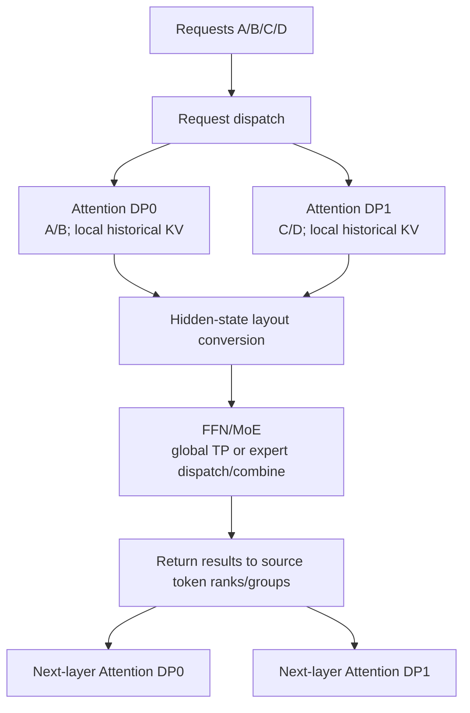
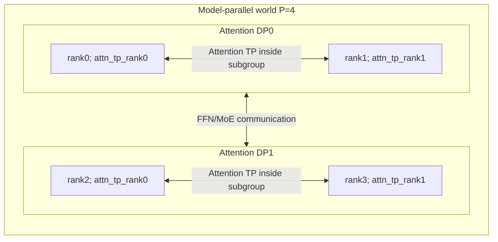
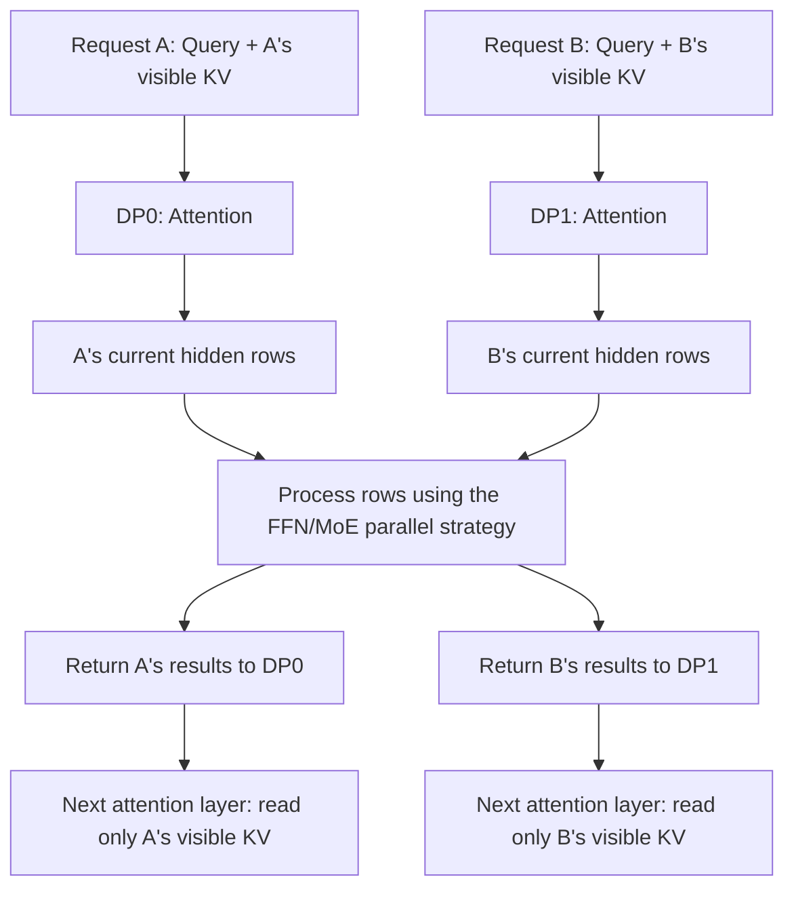
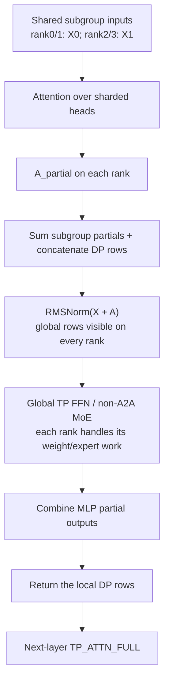
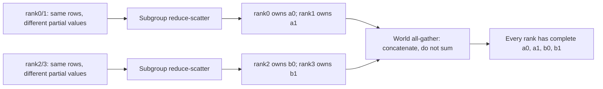
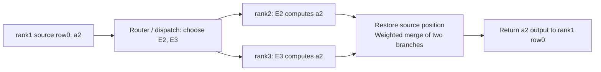
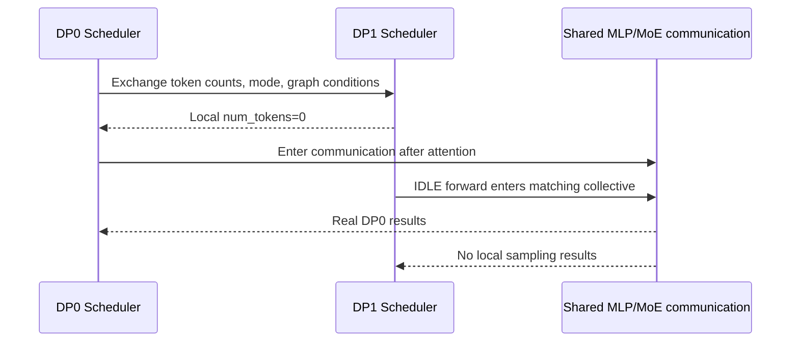

# DP Attention: Request Parallelism, Attention Subgroups, and FFN/MoE Layout Changes

[简体中文](../../../zh/ai-infra-basic/Parallel_Strategy/01-dp-attention-principles.md) | **English**

This chapter develops the mathematics and system principles of DP Attention. Follow it with the [SGLang source walkthrough](../../sglang-source-reading/05-layer-communication/03-dp-attention-code-walkthrough.md). Prerequisites: [DP/TP/EP](./tutorial.md), [GQA](../Model_Architecture/02-gqa-attention-shapes.md), and [MLA](../Model_Architecture/04-multi-head-latent-attention.md).

The source baseline is repository snapshot `587eb0b3a56cd2f014daf3b0fc8ba333da88df36`. Teaching configurations expose shapes and semantics; they do not assert that every model/backend supports every combination.

## 1. The Conflict It Resolves

Attention and FFN/MoE have different parallelism needs:

- A request's attention depends on its own historical KV. There is no mathematical attention dependency between separate requests. Decode is often sensitive to KV bandwidth and communication at small batch sizes.
- Dense FFN weights may require sharding across many devices; a larger token batch can also help GEMM utilization.
- MoE expert parameters may greatly exceed attention parameters, requiring distributed expert storage and token dispatch.

Using one large TP group throughout forces attention into that large group even if smaller TP would suffice. Replicating the entire model to increase attention concurrency also replicates large FFN/expert weights.

DP Attention lets **different submodules use different partitions inside one model-parallel world**. Requests are assigned to attention-DP subgroups, with optional attention TP inside each group. FFN/MoE handles their token rows using its own TP/EP topology.



Cross-group transfers normally carry **current hidden states or expert-routing data**. Historical KV remains within the attention subgroup that owns the request. Additional CP, KV-transfer, or other features supply their own history partition/transfer mechanisms.

## 2. Regular DP and DP Attention Use Different Process Counts

Fix $`\mathrm{pp\_size}=1`$ and compare two configurations both written as $`\mathrm{tp\_size}=4,\qquad \mathrm{dp\_size}=2`$:

| Property | Regular DP, DP Attention disabled | DP Attention enabled |
|---|---|---|
| Compute devices | $`4\cdot 2=8`$ | `4` |
| Model-parallel worlds | two independent 4-rank worlds | one 4-rank world |
| Attention TP | 4 in each replica | 2 in each attention-DP subgroup |
| Request dispatch | complete model replicas | attention-DP subgroups |
| FFN/experts | a full distributed weight set per replica | weights assigned within the same world by TP/EP |
| Inference communication between replicas | normally absent | layout conversion or expert communication |

With this feature enabled, `tp_size` also identifies the rank count of the model world. The actual sharding degree of an attention matrix is `attn_tp_size`.

## 3. Decode a Rank into DP, CP, and TP Coordinates

Define:

```text
P = tp_size                   ranks in the model-parallel world
D = attention_dp_size         enable_dp_attention ? dp_size : 1
C = attn_cp_size              attention context parallelism
```

```math
T=\mathrm{attention\_tp\_size}=\frac{P}{D\cdot C}
```

These sizes must divide evenly. The source orders ranks as `(DP, CP, TP)`, with TP changing fastest:

```math
p=(dC+c)T+a
```

```math
a=p\bmod T,\qquad c=\lfloor p/T\rfloor\bmod C,\qquad d=\lfloor p/(TC)\rfloor
```

The running example is $`P=4,\qquad D=2,\qquad C=1,\qquad T=2`$:

| Model-world rank `p` | Attention DP `d` | Attention TP `a` | Attention TP group | Requests |
|---:|---:|---:|---|---|
| 0 | 0 | 0 | $`\left[0,1\right]`$ | A/B |
| 1 | 0 | 1 | $`\left[0,1\right]`$ | A/B |
| 2 | 1 | 0 | $`\left[2,3\right]`$ | C/D |
| 3 | 1 | 1 | $`\left[2,3\right]`$ | C/D |



For $`P=8,\qquad D=2,\qquad C=2,\qquad T=2`$, attention TP groups are `[0,1], [2,3], [4,5], [6,7]`; attention CP groups are `[0,2], [1,3], [4,6], [5,7]`. DP assigns separate requests; CP partitions one request's context. They act on different dimensions.

## 4. Why Requests Can Run Attention Separately

The point of this section is simple: **attention for one request does not need another request's history, so different requests can run in different attention-DP groups.** This does not split one request's history, nor does it mean that tokens within a request are independent.

### 4.1 Imagine Two People Using the Same Model

User A asks about “the weather in Beijing,” while user B asks the model to “write a poem.” They use the same model weights, but have separate conversation histories:

- A's Query compares only against A's historical Keys and takes a weighted sum of A's Values.
- B's Query compares only against B's historical Keys and takes a weighted sum of B's Values.
- B mentioning poetry must not make those tokens part of A's context.

Think of model weights as a shared rulebook, and KV caches as each user's conversation notes. **Sharing the rulebook does not mean sharing the notes.** Requests with a common prefix may reuse physical cache pages, but each request's logically visible context is still determined by its own metadata.

### 4.2 Follow the Tensors: Why Does A Not Need B?

Consider a decode step with one Query per request. Omit the batch/head axes and follow one Query head and its corresponding KV head. Suppose A's Query sees 3 tokens and B's sees 2. These are illustrative visible lengths, **not the actual tokenization of the sentences above**. Causal attention may see the current position and earlier positions.

Here `Dk` is the Query/Key width, and `Dv` is the Value width:

Request A:

```math
Q_A\in\mathbb{R}^{1\times D_k},\quad K_A\in\mathbb{R}^{3\times D_k},\quad V_A\in\mathbb{R}^{3\times D_v}
```

```math
S_A=Q_AK_A^{\mathsf T}\in\mathbb{R}^{1\times 3}
```

```math
\widetilde{S}_A=\frac{S_A}{\sqrt{D_k}}\in\mathbb{R}^{1\times 3}
```

```math
P_A=\mathrm{softmax}_{\mathrm{positions}}(\widetilde{S}_A)\in\mathbb{R}^{1\times 3}
```

```math
O_A=P_AV_A\in\mathbb{R}^{1\times D_v}
```

Request B:

```math
Q_B\in\mathbb{R}^{1\times D_k},\quad K_B\in\mathbb{R}^{2\times D_k},\quad V_B\in\mathbb{R}^{2\times D_v}
```

```math
S_B=Q_BK_B^{\mathsf T}\in\mathbb{R}^{1\times 2}
```

```math
\widetilde{S}_B=\frac{S_B}{\sqrt{D_k}}\in\mathbb{R}^{1\times 2}
```

```math
P_B=\mathrm{softmax}_{\mathrm{positions}}(\widetilde{S}_B)\in\mathbb{R}^{1\times 2}
```

```math
O_B=P_BV_B\in\mathbb{R}^{1\times D_v}
```

For example, if A's three scores become `[0.2,0.5,0.3]` after softmax, A's output is $`0.2\cdot v_{\mathrm{A1}}+0.5\cdot v_{\mathrm{A2}}+0.3\cdot v_{\mathrm{A3}}`$. B's Values do not participate in this sum, and B's scores do not participate in A's softmax denominator.

Consequently, placing A in DP0 and B in DP1 preserves the mathematical outputs as long as their inputs, weights, and visible KV remain unchanged (floating-point execution may introduce rounding differences). If a DP group also uses TP, its ranks still collaborate to compute attention. Independent requests do not mean every device can perform the entire computation alone.



The hidden rows in this diagram are the current token representations entering FFN/MoE after attention. Output projection, residual connections, and normalization are omitted to emphasize request ownership.

### 4.3 Computing Together Does Not Mean Seeing Each Other

Even when A's and B's token rows are packed into one tensor, attention must preserve request boundaries. A's Query may access only A's visible KV, and B's Query only B's visible KV. Implementations can enforce this through masks, sequence lengths, page tables, and related metadata; they do not necessarily materialize a giant mask matrix.

If A's Query incorrectly applies softmax over all 5 Keys from A and B, the denominator changes and B's Values may enter the result. This is no longer the original model computation for A. That is why packed attention requires request boundaries.

Remember: **different requests are independent; positions within one request are not.** A's current token still depends on A's history. Splitting A's long context across devices is the dimension handled by CP, not a consequence of request independence.

### 4.4 Why Can an FFN Batch A and B Together?

Attention takes weighted sums across visible positions within a request. An ordinary FFN transforms each current token's features without reading other token rows. At the FFN input, each token has a hidden vector of width `H`; the earlier single-head width `Dv` must not be confused with `H`.

Suppose A and B each contribute one row:

```text
X_A [1,H] --+
            +-- concatenate rows -> X [2,H] -> FFN -> Y [2,H]
X_B [1,H] --+                                       +-- row 0 -> A
                                                    +-- row 1 -> B
```

Using row-vector notation, the complete shape flow through a SwiGLU FFN is:

```math
X\in\mathbb{R}^{2\times H},\quad W_{\mathrm{gate}},W_{\mathrm{up}}\in\mathbb{R}^{H\times I},\quad W_{\mathrm{down}}\in\mathbb{R}^{I\times H}
```

```math
G=XW_{\mathrm{gate}}\in\mathbb{R}^{2\times I}
```

```math
U=XW_{\mathrm{up}}\in\mathbb{R}^{2\times I}
```

```math
Z=\mathrm{SiLU}(G)\odot U\in\mathbb{R}^{2\times I}
```

```math
Y=ZW_{\mathrm{down}}\in\mathbb{R}^{2\times H}
```

`I` is the FFN intermediate width. Each matrix multiplication applies the same weights to each input row. A's output depends only on A's row. Combining two rows into a larger GEMM batches the computation; it does not exchange context between the requests.

Thus, **separating attention by request and batching FFN computation by token row are compatible.** Whether hidden rows are collected across DP groups depends on the FFN/MoE parallel strategy: not every path begins with a global all-gather. MoE additionally dispatches tokens to their experts and returns results to the original token positions. Later sections distinguish these communication paths.

### 4.5 Now Revisit the Original Equation

For request $`r`$, head $`h`$, and query position $`i`$, use column vectors for Q/K/V:

```math
o_{r,h,i}=\sum_{j\in\mathcal{V}_r(i)}
\mathrm{softmax}_{j}\left(q_{r,h,i}^{\mathsf T}k_{r,g(h),j}/\sqrt{D_k}\right)v_{r,g(h),j}
```

This is simply the general form of the computation in Section 4.2:

- $`q_{r,h,i}`$: request r's Query at position i and head h, with shape $`\left[\mathrm{Dk}\right]`$.
- $`g(h)`$: the KV head associated with this Query head in GQA.
- $`\mathcal{V}_r(i)`$: the set of token positions visible to request r at position i; it excludes other requests' positions.
- $`k_{r,g(h),j}`$ and $`v_{r,g(h),j}`$: this request's Key/Value at visible position j, with shapes $`\left[\mathrm{Dk}\right]`$ and $`\left[\mathrm{Dv}\right]`$.
- The inner product produces a scalar score for each position. Softmax normalizes only over this request's visible positions, and the weighted sum produces a $`\left[\mathrm{Dv}\right]`$ output.

The key observation for request partitioning is that **every Query, Key, and Value in this equation belongs to request r. No other request's K/V appears.**

## 5. Attention TP Shards Weights; DP Assigns Requests

Use row-vector notation for GQA with $`H=4096,\qquad \mathrm{Nq}=32,\qquad \mathrm{Nkv}=8,\qquad \mathrm{Dk}=\mathrm{Dv}=128`$. DP0 has $`n_0=4`$ tokens this step and DP1 has $`n_1=2`$; $`T=2`$:

```text
Input within attention-DP subgroup: X_d [n_d,4096]
Ranks share X_d but hold different Q/K/V weight shards
Q_local: [n_d,16,128]        # 32/2 query heads
K_local: [n_d,4,128]         # 8/2 KV heads
```

```math
\mathrm{shape}\left(V_{\mathrm{local}}\right)=\left[n_{d},4,128\right]
```

```math
\mathrm{shape}\left(O_{\mathrm{heads}}\right)=\left[n_{d},16,128\right]
```

```math
\mathrm{shape}\left(O_{\mathrm{flat}}\right)=\left[n_{d},2048\right]
```

```math
\mathrm{shape}\left(\mathrm{W\_O\_local}\right)=\left[2048,4096\right]
```

```math
A_{\mathrm{partial}} = O_{\mathrm{flat}} \, \mathrm{W\_O\_local}: \left[n_{d},4096\right]
```

Output projection on the two subgroup ranks produces **partial sums** over different input channels:

```math
A_d=A_{d,0}^{\mathrm{partial}}+A_{d,1}^{\mathrm{partial}}
```

Shapes match, but values are incomplete. Communication must sum contributions before the appropriate residual/RMSNorm operation.

With MLA, shared content latents and positional-key cache widths do not directly grow with query-head count. Query/up/output projections can still be attention-TP sharded; see [MLA](../Model_Architecture/04-multi-head-latent-attention.md).

## 6. Equal Shapes Can Have Different Ownership

SGLang's `ScatterMode` describes the distribution of **token rows**, independently of weight sharding on the last dimension:

| Mode | rank0 | rank1 | rank2 | rank3 |
|---|---|---|---|---|
| `TP_ATTN_FULL` | A/B | A/B | C/D | C/D |
| `FULL` | A/B/C/D | A/B/C/D | A/B/C/D | A/B/C/D |
| `SCATTERED` | A | B | C | D |

Letters represent equal-size token blocks for illustration. Real requests can have different lengths; the partition operates on packed rows and need not give each rank one whole request.

A separate property is whether values are **partial** or **replicated**:

- partial: tensors from multiple ranks must be summed for the complete output;
- replicated: ranks already hold identical complete values, so gathering must retain one copy.

`TP_ATTN_FULL` describes complete token rows within the subgroup. It does not tell you whether output projection has already been all-reduced.

## 7. Path A: Gather Tokens for Global TP FFN/MoE

For the initial example, use no dedicated MoE A2A backend, `moe_dense_tp_size=None`, and no CP/TBO/communication fusion. The MLP layout is `FULL`.

Why gather across DP groups? Attention cooperates within each two-rank subgroup, while this FFN/non-A2A MoE path uses the entire four-rank TP world. Each rank must perform its assigned weight/expert work for tokens from all DP groups, so those rows are collected first. **This prepares a shared batch for the next computation; it does not merge different requests' attention histories.**



Mathematically, the MLP input is:

```math
U=\mathrm{concat}_{d}\mathrm{RMSNorm}(X_d+A_d)
```

Gathering must perform both partial-value reduction and DP-row concatenation. Padding mode determines how collectives accomplish those operations.

### 7.1 SUM_LEN: Zero-Filled All-Reduce Implements Concatenation

**This subsection asks: can one world-wide sum both combine attention-TP partials and concatenate different DP groups' rows? Yes, provided each DP group first writes into a separate row interval.**

Use four ranks: rank0/1 belong to DP0, rank2/3 to DP1, with attention TP of 2. To isolate communication, temporarily omit the residual and normalization; Section 7.3 restores them. Set hidden width to 1, with two rows per DP:

| Rank | Tokens represented by the rows | Partial attention values |
|---|---|---|
| rank0 | a0, a1 | $`[1,2]`$ |
| rank1 | a0, a1 | $`[9,18]`$ |
| rank2 | b0, b1 | $`[3,4]`$ |
| rank3 | b0, b1 | $`[27,36]`$ |

Row 0 on rank0 and rank1 represents the same token a0, so these contributions can be added. Row 0 on rank0 and rank2 represents different tokens, a0 and b0, so those rows must not be added. The desired result is:

```math
A_{\mathrm{DP0}}=[1,2]+[9,18]=[10,20],\qquad A_{\mathrm{DP1}}=[3,4]+[27,36]=[30,40]
```

```math
A_{\mathrm{global}}=\mathrm{concat}_{\mathrm{rows}}(A_{\mathrm{DP0}},A_{\mathrm{DP1}})=[10,20,30,40]
```

**Step 1: create a four-row zero buffer on every rank.** Reserve the first two rows for DP0 and the last two for DP1. Each rank writes its partial values only into its own DP interval:

| Rank | Buffer after writing; columns represent a0, a1, b0, b1 |
|---|---|
| rank0 | $`[1,2,0,0]`$ |
| rank1 | $`[9,18,0,0]`$ |
| rank2 | $`[0,0,3,4]`$ |
| rank3 | $`[0,0,27,36]`$ |

**Step 2: all-reduce(sum) these buffers across all four ranks.** Every column contains contributions for only one token:

```math
[1,2,0,0]+[9,18,0,0]+[0,0,3,4]+[0,0,27,36]=[10,20,30,40]
```

After communication, **all four ranks hold the same four complete rows**. Values within each interval have undergone TP reduction; separate intervals retain their positions, producing DP concatenation. This is not a direct all-reduce on the original two-row tensors, which would incorrectly add different tokens together.

Generalize to hidden width $`H`$, $`D`$ DP groups, and $`a_d`$ **aligned communication rows** per DP, rather than the unpadded real token count:

```math
N=\sum_{d=0}^{D-1}a_d,\qquad s_d=\sum_{j=0}^{d-1}a_j
```

```math
\mathrm{shape}(B_r)=[N,H],\qquad B_r[s_d:s_d+a_d,:]=A_r^{\mathrm{partial}}
```

Here rank r belongs to DP d; all other intervals remain zero. See [`_dp_gather_via_all_reduce()` in dp_attention.py](../../../../python/sglang/srt/layers/dp_attention.py).

One input distinction is essential:

- **Partial input:** ranks hold different numerical contributions, so each contributes its own values.
- **Replicated input:** subgroup ranks already hold identical complete results, so only subgroup rank0 contributes. If both rank0/1 write the complete $`[10,20]`$, reduction incorrectly produces $`[20,40]`$.

### 7.2 MAX_LEN: Subgroup Reduce-Scatter, Then World All-Gather

**This subsection performs the same mathematical task as 7.1, but uses two collectives: first make the values complete, then collect all rows.** These are not different attention algorithms.

Keep the four ranks and partial values from 7.1. We compare the algorithms on the same values for clarity, not to imply an arbitrary per-batch choice: actual `DpPaddingMode` selection is explained in Section 10.

**Step 1: reduce-scatter only within each two-rank attention-TP subgroup.** This is not plain slicing: it sums partial values for the same tokens, then assigns consecutive intervals of the complete result to subgroup ranks:

| Subgroup collective | Complete values after summation | Ownership after reduce-scatter |
|---|---|---|
| rank0 and rank1 | a0, a1 have values $`[10,20]`$ | rank0 keeps a0, value $`[10]`$; rank1 keeps a1, value $`[20]`$ |
| rank2 and rank3 | b0, b1 have values $`[30,40]`$ | rank2 keeps b0, value $`[30]`$; rank3 keeps b1, value $`[40]`$ |

Each rank now owns only a slice of rows, but every row's value is complete. Rank0 does not simply retain its original $`[1]`$, nor rank1 its original $`[18]`$.

**Step 2: all-gather across all four ranks.** Collect their one-row tensors in rank order:

```math
\mathrm{concat}_{\mathrm{rows}}([10],[20],[30],[40])=[10,20,30,40]
```

All four ranks again hold identical four-row results, matching 7.1. **All-gather only collects rows; it does not add them again**, because the subgroup partials were already combined in Step 1.



Why `MAX_LEN`? Different DP groups can have different row counts. This ordinary equal-sized collective path first pads them to the largest communication length so every rank supplies an equally sized slice:

```math
m=\max_d a_d,\qquad N=Dm,\qquad \mathrm{shape}(X_{\mathrm{local}})=[m,H]
```

```math
[m,H]\xrightarrow{\mathrm{attn\ TP\ reduce\ scatter}}[m/T,H]\xrightarrow{\mathrm{world\ all\ gather}}[Dm,H]
```

For aligned DP lengths of $`4`$ and $`2`$, the `SUM_LEN` global buffer has $`6`$ rows; `MAX_LEN` pads both groups to $`4`$ rows, giving $`8`$ global rows. Extra rows are padding, not additional requests.

Replicated inputs can use this path too, but non-leader subgroup copies are zeroed before reduce-scatter to prevent double counting. If $`T=1`$, there are no subgroup partials to combine, so a direct world all-gather suffices. See [`_dp_gather_via_all_gather()` in dp_attention.py](../../../../python/sglang/srt/layers/dp_attention.py).

### 7.3 Residual Is Added Once; Norm Follows Reduction

**Sections 7.1/7.2 tracked attention output alone. A real Transformer also adds the original input to that output, then applies RMSNorm before the FFN.**

Within a DP group, both ranks hold the same original input $`X`$, but compute different attention partials $`A_0`$ and $`A_1`$. The desired result is:

```math
R=X+A_0+A_1
```

**Why not add the residual on every rank?** Take one feature of one token: $`X=100`$, $`A_0=1`$, and $`A_1=9`$:

```math
R_{\mathrm{correct}}=(100+1)+9=110
```

```math
R_{\mathrm{wrong}}=(100+1)+(100+9)=210
```

The original input is a replicated complete value, not a partial contribution. Adding every copy counts it twice. In this source path, only subgroup rank0 adds the residual to its attention partial before the communication from 7.1 or 7.2.

**Why wait for partial reduction before Norm?** RMSNorm needs a token's complete hidden vector. Its denominator depends on the mean square of all features in that vector. Normalizing partials separately and adding them is not equivalent to normalizing the complete result.

For illustration only, set the learned scale to 1, ignore epsilon, and use a two-feature hidden vector:

```math
X=[1,0],\quad A_0=[0,1],\quad A_1=[2,0],\quad R=[3,1]
```

```math
\mathrm{RMSNorm}(R)=\frac{[3,1]}{\sqrt{(3^2+1^2)/2}}=[3/\sqrt5,1/\sqrt5]
```

```math
\mathrm{RMSNorm}(X+A_0)+\mathrm{RMSNorm}(A_1)=[1,1]+[\sqrt2,0]=[1+\sqrt2,1]
```

The results differ. The correct dependency is therefore: **combine attention partials for the same token, include the residual once, and normalize the complete hidden vector.**

Distinguish subgroup reduction from cross-DP concatenation: Norm acts independently on token rows, so concatenating complete rows can happen before or after Norm. **What cannot move earlier is Norm while the values are still partial.** When $`T=1`$, local attention output is complete, so the source can apply residual + Norm to the smaller local tensor before gathering.

Path A can also keep different ownership for MLP input and residual: the MLP hidden tensor contains normalized rows from all DP groups, whereas the residual can retain only this DP's unnormalized complete rows for the later residual connection. This is intentional, not missing concatenation. See [`_gather_hidden_states_and_residual()` in communicator.py](../../../../python/sglang/srt/layers/communicator.py).

## 8. Path B: Sharded Source Tokens and Expert Dispatch/Combine

**Unlike Path A, Path B does not first give every rank all token rows. Each token's source rank sends its hidden vector to the selected experts and receives its results back.**

Use a concrete teaching configuration: four ranks, attention DP of 2, attention TP of 2, no CP/TBO/communication fusion, and a dedicated MoE A2A backend on the sparse layer. Four routed experts, EP of 4, and MoE DP of 1 give one expert per rank and MoE TP of 1:

```math
P=4,\quad D=2,\quad T=2,\quad E_{\mathrm{MoE}}=4,\quad D_{\mathrm{MoE}}=1,\quad T_{\mathrm{MoE}}=\frac{4}{1\times4}=1
```

Ignore shared experts, quantization, and capacity limits; follow routed experts only. Use router top-k of 2. Real models need not have this expert count or top-k.

### 8.1 First Row Partition: Establish Each Token's Source Rank

DP0 processes three current tokens from request R0 and one from R1. DP1 processes one from R2 and three from R3. Each group has four rows, without additional padding:

| Attention DP group | Packed row order | Ranks holding partial values after attention |
|---|---|---|
| DP0 | a0, a1, a2, b0 | rank0, rank1 |
| DP1 | c0, d0, d1, d2 | rank2, rank3 |

a0/a1/a2 belong to R0, b0 to R1, c0 to R2, and d0/d1/d2 to R3. These names identify tokens, not feature values.

After attention, reduce-scatter within each two-rank group combines partial values and divides consecutive rows along dimension 0. The corresponding residual uses the same intervals. After residual + Norm, each row entering the router has complete values.

| Source rank | Interval within its DP group | Owned token rows | Router input shape |
|---|---|---|---|
| rank0 | DP0 first two rows | a0, a1 | $`[2,H]`$ |
| rank1 | DP0 last two rows | a2, b0 | $`[2,H]`$ |
| rank2 | DP1 first two rows | c0, d0 | $`[2,H]`$ |
| rank3 | DP1 last two rows | d1, d2 | $`[2,H]`$ |

This is `SCATTERED`. Request R0 spans rank0/1; rank1's block contains two requests. **This partition follows consecutive row positions, not expert assignments.**

The key source lines are below; `tensor_split()` defaults to dimension 0:

```python
input_hidden_states = hidden_states
hidden_states = hidden_states.tensor_split(context.attn_tp_size)[context.attn_tp_rank]
attn_tp_reduce_scatter_tensor(hidden_states, input_hidden_states)
```

`tensor_split()` selects an output interval. Reduce-scatter then writes the **summed, complete values** into it; it does not send an unsummed attention partial to expert computation.

### 8.2 Second Distribution: The Router Selects Experts per Token

Place E0/E1/E2/E3 on rank0/1/2/3 respectively. Each source rank runs the router on its two rows, producing two expert IDs and weights per row. The following is one assumed routing outcome, not a fixed request-to-expert mapping:

| Token | Source rank / local row | Selected experts and effective combine weights |
|---|---|---|
| a0 | rank0 / 0 | E1: $`0.7`$, E3: $`0.3`$ |
| a1 | rank0 / 1 | E0: $`0.6`$, E3: $`0.4`$ |
| a2 | rank1 / 0 | E2: $`0.8`$, E3: $`0.2`$ |
| b0 | rank1 / 1 | E0: $`0.4`$, E1: $`0.6`$ |
| c0 | rank2 / 0 | E1: $`0.9`$, E2: $`0.1`$ |
| d0 | rank2 / 1 | E0: $`0.3`$, E2: $`0.7`$ |
| d1 | rank3 / 0 | E2: $`0.5`$, E3: $`0.5`$ |
| d2 | rank3 / 1 | E0: $`0.2`$, E1: $`0.8`$ |

Each rank's router logits have shape $`[2,4]`$; top-k IDs and weights both have shape $`[2,2]`$. Source ownership and expert placement differ: a2 comes from rank1 but needs experts on rank2 and rank3.

### 8.3 Dispatch: Do Not Send an Entire Source Block to One Destination

The dispatcher **splits source blocks according to routes and regroups rows by destination expert**, retaining metadata for the return path. For rank1:

- Send a2's hidden vector to E2 on rank2 and E3 on rank3.
- Send b0's hidden vector to E0 on rank0 and E1 on the same rank.
- a2 and b0 share a consecutive source block but have different destinations. A local expert can use a local path rather than cross-device network transfer.

Destination experts logically receive the rows below. Receive order is illustrative; real backends can bucket, reorder, and pad differently:

| Expert-compute rank | Local expert | Received token rows |
|---|---|---|
| rank0 | E0 | a1, b0, d0, d2 |
| rank1 | E1 | a0, b0, c0, d2 |
| rank2 | E2 | a2, c0, d0, d1 |
| rank3 | E3 | a0, a1, a2, d1 |

Four rows per expert is an outcome of this example, not a load-balancing guarantee. Rank0 owns a0/a1 as a **source rank**, but computes a1/b0/d0/d2 as an **expert owner**.

Eight tokens with two expert routes each produce:

```math
R_{\mathrm{routes}}=8\times2=16
```

These are 16 logical token-expert computations, not 16 new tokens or necessarily 16 independent network sends. Implementations can coalesce transfers and reuse a hidden vector at the same destination. Physical buffers may additionally contain padding, quantization scales, and metadata.

### 8.4 Expert Compute Changes Features, Not Source Ownership

Each expert runs its own FFN on received rows. Here each expert's input and output have shape $`[4,H]`$; a SwiGLU intermediate has shape $`[4,I_e]`$ for intermediate width $`I_e`$. Experts have different weights, but rows from different requests do not exchange context merely because they share an expert batch.

For token a2, E2 and E3 produce two output vectors:

```math
z_{\mathrm{a2},2}=E_2(u_{\mathrm{a2}})\in\mathbb{R}^{H},\qquad z_{\mathrm{a2},3}=E_3(u_{\mathrm{a2}})\in\mathbb{R}^{H}
```

$`u_{\mathrm{a2}}`$ is the normalized hidden vector entering MoE, not the token ID. **These are two weighted MoE branches, not the earlier attention-TP head partials.**

### 8.5 Combine: Return to the Source and Merge by Original Token Row

a2's source identity is `(rank1, local_row=0)`. Dispatcher indices/handles must map both E2 and E3 results back to that position, rather than concatenate them arbitrarily in receive order:

```math
y_{\mathrm{a2}}=0.8\,z_{\mathrm{a2},2}+0.2\,z_{\mathrm{a2},3}\in\mathbb{R}^{H}
```

Similarly, b0's two expert results return to `(rank1, local_row=1)`:

```math
y_{\mathrm{b0}}=0.4\,E_0(u_{\mathrm{b0}})+0.6\,E_1(u_{\mathrm{b0}})
```

After combine, source ranks recover:

| Source rank | MoE outputs in original local row order | Shape |
|---|---|---|
| rank0 | outputs for a0, a1 | $`[2,H]`$ |
| rank1 | outputs for a2, b0 | $`[2,H]`$ |
| rank2 | outputs for c0, d0 | $`[2,H]`$ |
| rank3 | outputs for d1, d2 | $`[2,H]`$ |

Depending on the backend, weights may be applied along the expert-compute path or during combine. Mathematically, each branch must be weighted exactly once. The formula does not require sending unweighted outputs and applying weights only on the source device.



### 8.6 How Does the Next Attention Layer Recover All Local-DP Rows?

Combine restores **source-rank blocks**, not global `FULL`. When `TP_ATTN_FULL` is next required, all-gather within each corresponding attention-TP subgroup:

| Gather group | Source blocks | Row order restored on every subgroup rank |
|---|---|---|
| rank0/1 | a0, a1 and a2, b0 | a0, a1, a2, b0 |
| rank2/3 | c0, d0 and d1, d2 | c0, d0, d1, d2 |

Hidden states and residual must preserve the same row mapping. Residual addition and gathering can occur at a layer boundary, be deferred to the next layer entrance, or use a fused path; this teaching sequence is not the only call order for every configuration. Compare [`_scatter_hidden_states_and_residual()` and `_scattered_to_tp_attn_full()` in communicator.py](../../../../python/sglang/srt/layers/communicator.py) and the [MoE dispatcher source directory](../../../../python/sglang/srt/layers/moe/token_dispatcher).

None of this sends R0's historical KV to R1. The moving tensors are current hidden rows and expert outputs. KV-cache request ownership remains as described in Section 11.

Keep the distributions separate: **reduce-scatter assigns source ranks by consecutive row position; expert dispatch chooses compute destinations from router results; combine returns by source identity; attention all-gather restores the subgroup layout.** Backends can implement these steps using all-to-all, RDMA, or fused operators; one backend's physical packing order is not universal.

## 9. Why an Idle Rank Still Runs Forward

Suppose DP0 has eight decode tokens and DP1 has no requests. If rank2/3 skip forward, DP0 waits for missing participants at global gathering, expert dispatch, or output reduction.

Schedulers exchange token counts and execution conditions first. If another DP has work, the idle subgroup may create a `ForwardMode.IDLE` batch: no real local tokens, but participation in the required collectives.



Request ownership is separate, but execution rounds remain coordinated. Throughput and tail latency depend on the slowest DP subgroup, prefill/decode imbalance, expert load, and communication.

## 10. Three Different Lengths in Padding

1. **Real length** $`n_d`$: valid tokens in this step. Decode usually has one per request; prefill counts new tokens; speculative verification may have several per request.
2. **Aligned communication length** $`a_d`$: padded for operations such as reduce-scatter.
3. **Graph length** $`b`$: selected capture bucket, potentially larger than real length.

In this snapshot, `ForwardBatch.prepare_mlp_sync_batch()` aligns first to `attn_tp_size`, then to `attn_cp_size*2`. For $`T=2,\qquad C=1`$, real $`\left[3,1\right]`$ becomes $`\left[4,2\right]`$. Real token count is not automatically the collective buffer length.

`DpPaddingMode` selects from aligned counts:

```text
Any extend in this round and D>1: SUM_LEN
Otherwise, if 2*sum(a_d) >= D*max(a_d): MAX_LEN
Otherwise: SUM_LEN
```

| Aligned counts | $`2\cdot \mathrm{sum}`$ | `D*max` | Eager mode |
|---|---:|---:|---|
| $`\left[4,2,6,0\right]`$ | 24 | 24 | MAX_LEN, preferred on a tie |
| $`\left[12,2,0,0\right]`$ | 28 | 48 | SUM_LEN |

This is a source heuristic weighing different collectives, not an exact network-byte formula. Graph execution normally defaults to `MAX_LEN`, with a ROCm exception in the source. Graph eligibility must agree across DP participants.

## 11. KV Cache: Who Owns a Request's History?

Without CP, a request's KV lives in its attention-DP subgroup and follows attention-TP KV-head sharding. Ideally for ordinary GQA:

```text
Per-rank historical K/V: [L_request,Nkv/T,D]
```

With too few KV heads, an implementation may replicate heads; do not apply $`N_{\mathrm{kv}}/T`$ mechanically to every configuration.

An MLA latent entry may be replicated across subgroup TP ranks. Lower attention TP can reduce those copies while increasing local query heads and attention-weight share. Memory benefits require accounting for real cache pools and weights.

Cross-DP prefix reuse is not automatic: prefix lookup and physical pages belong to the relevant runtime instance. Routing to another DP subgroup does not guarantee a hit on the original subgroup's prefix.

## 12. A Performance Ledger

Let full attention weights be $`W_A`$ and FFN/expert weights $`W_F`$, for an order-of-magnitude estimate:

```text
Attention weights per rank ≈ W_A/T       # account separately for replicated projections
FFN weights per rank ≈ W_F/P             # global TP path
Expert share depends on EP/expert TP

FULL-mode global hidden buffer:
SUM_LEN: sum(a_d)*H*element_bytes
MAX_LEN: D*max(a_d)*H*element_bytes
```

With $`H=\left[4096,\mathrm{BF16}\right]`$, one hidden row occupies `8 KiB`. For $`a=\left[12,2,0,0\right]`$, one SUM_LEN global buffer is `112 KiB`, versus `384 KiB` for MAX_LEN. Norm outputs, MLP intermediates, and collective workspace also consume memory; these are not total peak allocation or link traffic.

Benefits come from more suitable attention TP, KV distribution, and FFN/expert utilization. Costs include cross-group communication, padding, scheduler waits, and replicated attention parameters. Compare the same model, total devices, input/output lengths, and request load using TTFT, ITL, throughput, and per-stage timings.

## 13. Observe Partial and Replicated Values on CPU

The companion [dp_attention_layout_demo.py](./dp_attention_layout_demo.py) uses only the Python standard library to simulate SUM_LEN/MAX_LEN data movement and reduction. It neither loads a model nor starts distributed collectives:

```bash
python3 learning/en/ai-infra-basic/Parallel_Strategy/dp_attention_layout_demo.py
```

It shows rank topology, equivalent gather results, replica deduplication, real-to-padded lengths, and equivalence between all-reduce plus slicing and reduce-scatter returns. It verifies numerical/ownership principles; real backend behavior and performance require device execution.

## 14. Reading Tasks and Exercises

1. For $`P=8,\qquad D=4,\qquad C=1`$, enumerate coordinates and attention TP groups.
2. For $`P=8,\qquad D=2,\qquad C=2`$, enumerate TP/CP groups and identify which requests they handle.
3. Remove replicated-input deduplication in the demo and observe the erroneous factor $`T`$.
4. For real counts $`\left[7,1,0,2\right]`$, apply this snapshot's $`T=2,\qquad C=1`$ alignment before selecting eager padding mode.
5. Explain why `dp_scatter()` can be a local copy while `dp_reduce_scatter_tensor()` requires a collective.

Continue with the [full source walkthrough](../../sglang-source-reading/05-layer-communication/03-dp-attention-code-walkthrough.md), mapping these principles to startup, Scheduler, ForwardBatch, LayerCommunicator, MoE, Graph, and LogitsProcessor.

## 15. Source Basis

- [Pinned dp_attention.py](https://github.com/cl-vv-h/SGLang_Tutor/blob/587eb0b3a56cd2f014daf3b0fc8ba333da88df36/python/sglang/srt/layers/dp_attention.py): rank calculation, padding mode, partial/replicated gather, scatter.
- [Pinned communicator.py](https://github.com/cl-vv-h/SGLang_Tutor/blob/587eb0b3a56cd2f014daf3b0fc8ba333da88df36/python/sglang/srt/layers/communicator.py): layouts, residual/Norm, communication ordering.
- [Pinned scheduler_components/dp_attn.py](https://github.com/cl-vv-h/SGLang_Tutor/blob/587eb0b3a56cd2f014daf3b0fc8ba333da88df36/python/sglang/srt/managers/scheduler_components/dp_attn.py): DP metadata and IDLE batches.
