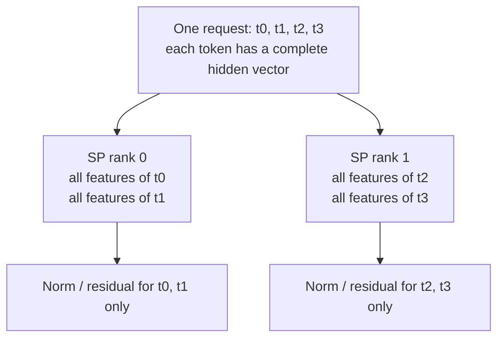
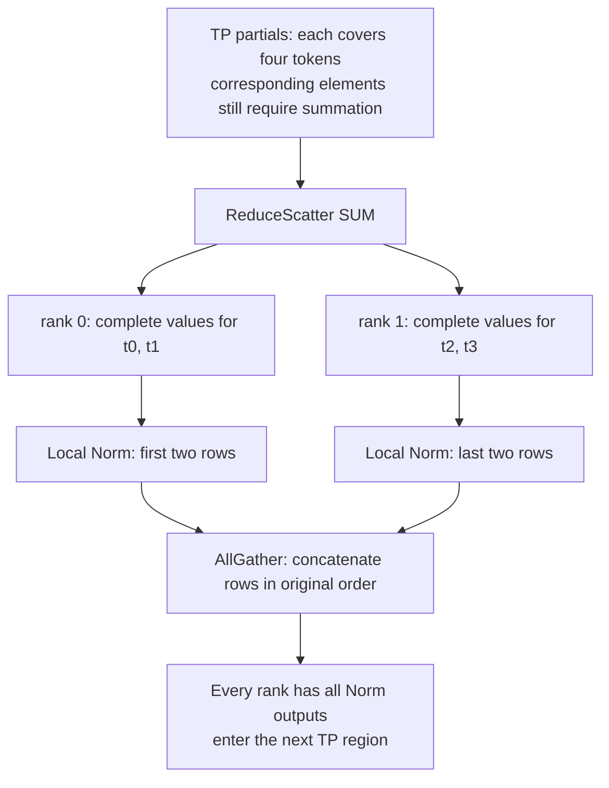
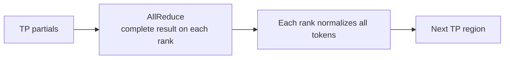
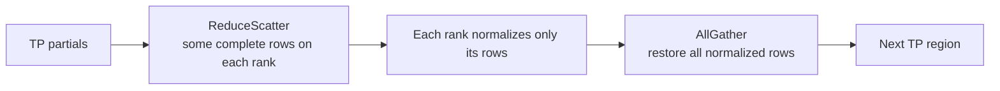
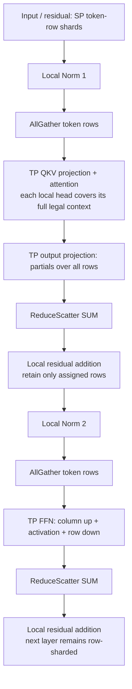
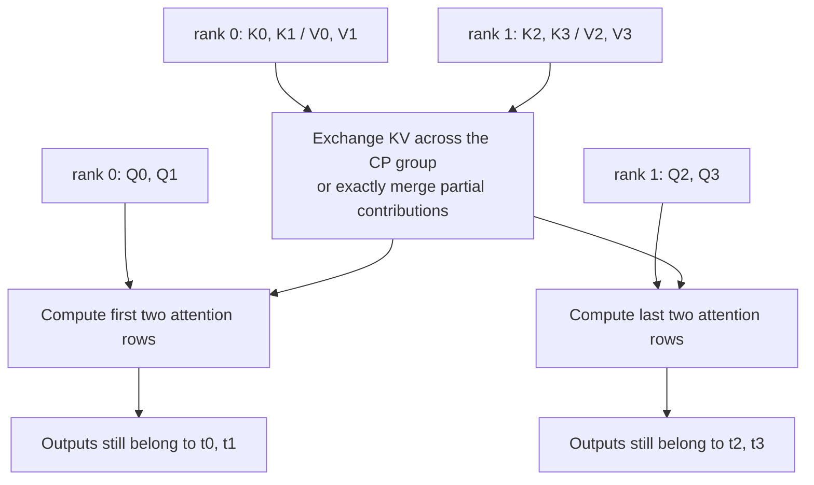

# 02. SP from first principles: data layout, computation, and comparison with CP

[简体中文](../../../zh/ai-infra-basic/Parallel_Strategy/02-sp-versus-context-parallelism.md) | **English**

Begin with a concrete question: **if TP already divides matrices among devices, why do we need SP?**

TP primarily partitions large matrices. At some boundaries, however, every device receives the same complete activation and repeats Norm and residual work. SP assigns different token rows to devices in those regions, then restores the input layout required by the next TP region.

Here an “activation” is intermediate data such as hidden states. Norm means normalization; a residual is an input retained along a bypass and added back later. An activation tensor is different from the FFN activation function.

Keep three different actions separate:

- **TP:** devices compute different features, heads, or matrix contributions for a token.
- **SP:** in suitable operator regions, devices process different tokens, each with its complete hidden vector.
- **CP:** attention itself retains a context partition, so it must solve how local queries see history on other devices.

Here SP specifically means **Megatron-style Sequence Parallelism**, corresponding to `--enable-layernorm-sp` in the pinned SGLang revision. Some projects also call Ulysses or Ring sequence parallelism, so the name alone does not identify an algorithm. We focus on inference forward computation; training notes appear at the end. On a first pass, read sections 1–8 alongside the experiment in section 12. Sections 9–11 then cover composition, costs, and source code.

## 1. Start with the data: is a token a row or a column?

Assume one request, four tokens, and four numbers representing each token. Write the hidden states as a matrix:

```math
X=
\begin{bmatrix}
3&4&0&0\\
0&0&0&2\\
1&1&1&1\\
2&0&0&0
\end{bmatrix}
\in\mathbb R^{4\times4}.
```

- A row is one token's hidden vector.
- A column is one feature across all tokens.
- Generally, $`T`$ denotes token rows, $`H`$ hidden width, and $`P`$ devices. Here these are 4, 4, and 2.
- Initially think of a **rank** as the number identifying a participating device: rank 0 or rank 1.

Serving can flatten new tokens from multiple requests into a matrix. Then $`T`$ is this forward's total row count, with request boundaries retained separately. We use one request first to remove that complication.

Inside an SP region, the two devices hold:

```math
X^{\mathrm{SP}}_0=X[0:2,:]
=\begin{bmatrix}3&4&0&0\\0&0&0&2\end{bmatrix},
\qquad
X^{\mathrm{SP}}_1=X[2:4,:]
=\begin{bmatrix}1&1&1&1\\2&0&0&0\end{bmatrix}.
```

Each holds two tokens, with all four features per token. **SP partitions rows; it does not give the first two features of a row to one device and the last two to another.**



The devices still cooperate on one request. This differs from ordinary DP assigning request A to rank 0 and request B to rank 1.

## 2. Why SP is useful even with TP

### 2.1 TP does not keep half an activation at every point

An FFN is a token-local feed-forward network. Its simplest form is “expand with a matrix → activation function → project back with another matrix.” Consider this two-layer FFN without bias, with elementwise activation $`\phi`$:

```math
Y=\phi(XA)B,\qquad
A=[A_0\;A_1],\qquad
B=\begin{bmatrix}B_0\\B_1\end{bmatrix}.
```

Here $`A\in\mathbb R^{H\times F}`$ and $`B\in\mathbb R^{F\times H}`$ are learned weights, and $`F`$ is the intermediate expanded width. The first matrix expands each token from hidden width; the second projects it back.

Partition the first projection by output columns and the second by matching input rows:

```math
U_0=\phi(XA_0),\qquad U_1=\phi(XA_1).
```

```math
Y_0=U_0B_0,\qquad Y_1=U_1B_1.
```

```math
Y=Y_0+Y_1.
```

Both $`Y_0`$ and $`Y_1`$ cover every token's output positions, but each contains only a **partial numerical contribution** at those positions. They are **partials**, not complete outputs for different tokens.

Ordinary TP often sums them using AllReduce: afterwards, **each device has the same complete $`Y`$**, a **replica**.

### 2.2 This is where duplication appears

Suppose residual and Norm follow, with complete $`Y`$ on both devices:

| Stage | Rank 0 | Rank 1 |
|---|---|---|
| Large FFN matrices | Compute one weight partition | Compute the other weight partition |
| After AllReduce | Complete output for all four tokens | The same complete output |
| Residual / Norm | Process t0, t1, t2, t3 | Repeat the same t0, t1, t2, t3 work |

The large matrices are distributed, but this Norm region is still duplicated. SP changes the last row to:

| Stage | Rank 0 | Rank 1 |
|---|---|---|
| Residual / Norm | Process only t0, t1 | Process only t2, t3 |

**SP primarily reduces replicated activation storage, while also reducing repeated execution of these row-local operators.** It does not shard already TP-sharded weights again or guarantee that the whole model becomes twice as fast.

## 3. First establish the intuitive SP/CP distinction

Imagine the four tokens as four pages.

- Norm is like organizing the numbers already on one page: page 3 needs no information from page 1.
- Attention is like writing a summary of page 3 using earlier pages: page 3 alone may be insufficient.

**SP can compute independently inside row-local regions; this SP path gathers rows before TP attention. CP distributes attention itself and must supply remote information or merge remote contributions.**

| Question | This chapter's SP | CP attention partitioning |
|---|---|---|
| Can each rank initially hold only some tokens? | Yes | Yes |
| Can it compute Norm from its local tokens? | Yes, because each hidden vector is complete | Yes; Norm is not the difficult part |
| Can it compute full attention from only those tokens? | No; this SP path restores complete rows required by TP | No; CP explicitly implements cross-context attention |
| Does persistent KV become history-sharded? | SP does not guarantee this | Depends on the path; PCP does not guarantee it, whereas DCP targets this class of problem |

Keep that distinction in mind while deriving why the computation works.

## 4. The mathematics: which dimension does Norm average over?

### 4.1 RMSNorm computes a scale separately for each row

For one token vector $`x=[x_0,\ldots,x_{H-1}]`$:

```math
r(x)=\sqrt{\frac1H\sum_{j=0}^{H-1}x_j^2+\epsilon},\qquad
\mathrm{RMSNorm}(x)_j=\gamma_j\frac{x_j}{r(x)}.
```

Here $`\epsilon`$ is a small constant preventing division by zero, and $`\gamma_j`$ is a learned scale. The central point is that **the sum visits hidden features of this token, not other tokens**.

For hand calculation, set $`\gamma_j=1`$ and $`\epsilon=0`$. The first row gives:

```math
x_0=[3,4,0,0],\qquad
r(x_0)=\sqrt{\frac{9+16+0+0}{4}}=2.5.
```

```math
\mathrm{RMSNorm}(x_0)=[1.2,1.6,0,0].
```

This calculation never reads t1, t2, or t3. Wherever t0 resides, its local result is identical. Computing all rows yields:

```math
\mathrm{RMSNorm}(X)=
\begin{bmatrix}
1.2&1.6&0&0\\
0&0&0&2\\
1&1&1&1\\
2&0&0&0
\end{bmatrix}.
```

Rank 0 computes the first two rows and rank 1 the last two; concatenation gives the same matrix. Real implementations retain nonzero $`\epsilon`$; it is disabled here only for hand calculation.

### 4.2 LayerNorm also needs no other tokens

LayerNorm subtracts a mean, still calculated within one row:

```math
\mu_t=\frac1H\sum_jX_{t,j},\qquad
\sigma_t^2=\frac1H\sum_j(X_{t,j}-\mu_t)^2.
```

```math
\mathrm{LayerNorm}(X)_{t,j}
=\gamma_j\frac{X_{t,j}-\mu_t}{\sqrt{\sigma_t^2+\epsilon}}+\beta_j.
```

SP participants retain identical Norm parameters $`\gamma`$ and $`\beta`$, applying them to different tokens. SP does not repartition these parameters by token.

Thus, if $`I_r`$ contains the token-row indices owned by rank $`r`$:

```math
\mathrm{Norm}(X[I_r,:])=\mathrm{Norm}(X)[I_r,:].
```

“Select rows, then normalize” equals “normalize the whole matrix, then select rows.” This is the mathematical reason SP can partition here.

### 4.3 Splitting hidden features changes the problem

If the first row is split into $`[3,4]`$ and $`[0,0]`$, neither device can derive the full-row sum of squares from local data alone. Even knowing the global hidden width, it must combine statistics across devices; normalizing each local two-dimensional vector directly changes the operation.

Halving the number of elements is insufficient. **Whether each row retains its complete hidden width** determines whether Norm is local.

Residual addition is also row-local:

```math
(Y+R)[I_r,:]=Y[I_r,:]+R[I_r,:].
```

But $`Y`$ must already be a complete numerical result, with residual rows aligned to it. Next we explain why summation must happen first.

## 5. Understand three collectives before moving their boundaries

“All” means all participating ranks **in the communication group**, not necessarily the whole machine or cluster. To isolate collective semantics, choose these two preceding TP partials:

```math
Y_0=
\begin{bmatrix}
1&1&1&1\\1&1&1&1\\1&1&1&1\\1&1&1&1
\end{bmatrix}.
```

```math
Y_1=
\begin{bmatrix}
2&3&-1&-1\\-1&-1&-1&1\\0&0&0&0\\1&-1&-1&-1
\end{bmatrix}.
```

```math
Y_0+Y_1=X.
```

These are valid illustrative partials; we are not claiming they came from a specific set of weights in section 2.

### 5.1 AllReduce: sum, then give every rank the complete result

Sum corresponding elements. Both devices receive $`X`$:

| Output location | Rank 0 | Rank 1 |
|---|---|---|
| After AllReduce | Complete vectors for t0, t1, t2, t3 | The same complete vectors |

### 5.2 ReduceScatter: sum, but give each rank only some result rows

Reduce means sum corresponding elements across ranks; Scatter distributes the summed result:

```math
S_0=(Y_0+Y_1)[0:2,:],\qquad
S_1=(Y_0+Y_1)[2:4,:].
```

Rank 0 receives **complete answers** for t0 and t1; rank 1 receives **complete answers** for t2 and t3. It does not merely keep half of each device's own partial. The sum has not disappeared.

Each device can now compute $`\mathrm{Norm}(S_r)`$ without exchanging hidden-feature statistics.

### 5.3 AllGather: concatenate the different complete result rows

After Norm, the devices exchange their assigned rows:

```math
Z=\mathrm{concat}_{\mathrm{rows}}
\bigl(\mathrm{Norm}(S_0),\mathrm{Norm}(S_1)\bigr).
```

Both receive complete $`Z`$ for the next TP region that requires all token rows. **This concatenates rows; it does not sum the two Norm outputs.**



## 6. Why AllReduce can be separated with Norm in between

With the same group, sum semantics, and consistent row order, AllReduce results can be reconstructed in two steps:

```math
\mathrm{AllReduce}(Y_0,\ldots,Y_{P-1})
=
\mathrm{AllGather}\bigl(\mathrm{ReduceScatter}(Y_0,\ldots,Y_{P-1})\bigr).
```

This decomposes result semantics; it does not require every backend's AllReduce to use these two kernels internally.

The original boundary is:



SP changes it to:



Because Norm acts independently on rows:

```math
S_c=\left(\sum_rY_r\right)[I_c,:].
```

```math
\mathrm{Norm}\left(\sum_rY_r\right)
=\mathrm{AllGather}\left(\{\mathrm{Norm}(S_c)\}_{c=0}^{P-1}\right).
```

First sum numerical contributions, then normalize row partitions, then concatenate. SP changes **when complete values are replicated to all devices**, delaying replication until the next TP region needs it.

### 6.1 Norm cannot move before the sum

Norm is nonlinear, so the following equality generally does not hold:

```math
\mathrm{Norm}(Y_0+Y_1)
=\mathrm{Norm}(Y_0)+\mathrm{Norm}(Y_1).
```

For two-dimensional RMSNorm without epsilon or scale:

```math
a=[1,0],\qquad b=[0,1].
```

```math
\mathrm{RMSNorm}(a+b)=[1,1].
```

```math
\mathrm{RMSNorm}(a)+\mathrm{RMSNorm}(b)=[\sqrt2,\sqrt2].
```

The correct order is **ReduceScatter SUM → local residual/Norm → AllGather when needed**, not “normalize each partial, then add.”

Do not add a complete residual to every partial and then reduce: that duplicates the residual. Add it once to the complete local rows, or follow a strictly equivalent production convention.

## 7. Follow layouts through a Transformer block

First write an ordinary Pre-Norm block:

```math
H_1=R+\mathrm{Attention}(\mathrm{Norm}_1(R)).
```

```math
H_2=H_1+\mathrm{FFN}(\mathrm{Norm}_2(H_1)).
```

For this chapter's TP+SP path:



Legal context still follows the model's causal mask and request boundaries. “Full” does not make future tokens visible.

### 7.1 Follow the FFN shapes explicitly

Set $`T=4,H=4,F=8,P=2`$, with $`F`$ the expanded FFN width. We use one up projection for clarity; SwiGLU gate/up partitions follow the corresponding principle.

| Step | Per-rank shape | Numerical meaning |
|---|---|---|
| SP residual input | $`[2,4]`$ | Assigned tokens, complete hidden vectors |
| Local Norm | $`[2,4]`$ | Same row indices, complete hidden |
| AllGather | $`[4,4]`$ | All tokens' normalized outputs |
| Column-parallel up | $`[4,4]`$ | All tokens, this rank's FFN features |
| Activation | $`[4,4]`$ | Same FFN feature partition |
| Row-parallel down | $`[4,4]`$ | All tokens, partial output-hidden contributions |
| ReduceScatter SUM | $`[2,4]`$ | Assigned tokens' complete FFN outputs |
| Local residual add | $`[2,4]`$ | Complete rows for the next region |

Several shapes are identical but meanings differ. In particular, the two $`[4,4]`$ layouts mean **different features** after up, versus **different contributions to the same result** after down.

### 7.2 Why not keep local tokens and directly run the next TP projection?

The weights are still TP-sharded. Suppose rank 0 owns only $`A_0`$ and rank 1 only $`A_1`$:

- t0 resides on rank 0, which can calculate $`x_0A_0`$.
- t0 also needs $`x_0A_1`$, whose weights reside on rank 1.
- If rank 1 never sees t0, that contribution is never computed.

This SP scheme AllGathers token rows to all TP weight partitions. Replicating complete weights would let each rank project its own tokens independently, but changes weight placement and the parallel scheme. Attention still requires cross-token information.

### 7.3 How can gathering still save memory?

Gather temporarily restores the input needed by the next computation. It does not require every region to keep all rows continuously. Savings occur in eligible Norm/residual regions, not because the whole forward avoids every full-sequence tensor.

The entry may slice locally once; the exit may require another gather. Between layers, the row-sharded layout can persist without unconditionally restoring all tensors at every layer's external interface.

## 8. Use the same four tokens to see why CP needs a different computation

Still use t0, t1, t2, t3. For easy arithmetic, simplify one head's values to scalars:

```math
[v_0,v_1,v_2,v_3]=[2,4,8,10].
```

Here Q is the query (what to look for), K is the key (used to score matches), and V is the value (information to aggregate). Softmax turns scores into weights summing to one.

Set CP degree to 2: rank 0 owns the first two rows and rank 1 the last two. First omit TP: each CP rank has complete weights for this layer.

### 8.1 Norm is independent; attention is not

For query $`i`$, causal attention is:

```math
o_i=\sum_{j=0}^{i}
\frac{\exp(s_{ij})}{\sum_{u=0}^{i}\exp(s_{iu})}v_j,\qquad
s_{ij}=\frac{q_i k_j^{\mathsf T}}{\sqrt d}.
```

Here $`d`$ is head width. Unlike Norm, the sum visits **other token positions**.

First let t3's scores against every historical position be zero, giving equal quarter weights:

```math
o_3=(2+4+8+10)/4=6.
```

Rank 1's local KV contains only t2 and t3. Normalizing only over those two entries gives:

```math
o_3^{\mathrm{wrong}}=(8+10)/2=9.
```

Both value contributions and the softmax denominator change. **Concatenating local attention outputs by token row does not repair this error.**

### 8.2 How CP gives a local query a complete answer



Common mechanisms:

1. **Gather KV:** collect required KV so local queries see their full legal history.
2. **Ring:** keep queries stationary, pass KV blocks around, and update accumulated attention results.
3. **Exchange partial outputs and LSE:** evaluate one query against separate KV shards, then merge using their softmax probability masses.

The last two do not simply add separately normalized outputs. If t3's first two scores are 0 and its last two scores are $`\log3`$, the two local outputs remain 3 and 9, but their probability masses are 2 and 6:

```math
o_3=\frac{2\cdot3+6\cdot9}{2+6}=7.5.
```

Averaging the local outputs gives 6 and is wrong. See [04: DCP](./04-decode-context-parallelism.md) for LSE-based weights.

### 8.3 The direct comparison

| Attention question | TP+SP only, this path | CP attention partitioning |
|---|---|---|
| Token rows during Norm | Different | Can be different |
| Entering QKV / attention | Restore all rows required by TP and compute local heads | Queries remain context-partitioned |
| Who handles cross-token dependencies? | Existing TP attention; SP introduces no KV-sharding protocol | CP KV exchange or remote-contribution merging |
| Weights | Keep TP shards | Complete replicas in this CP-only example; TP can also be combined |
| Original causal relationships | Preserve the original mask | Preserve original positions through cross-shard protocols |
| Are these different requests? | No | No |

This does not require every CP scheme to retain sharded KV or use one collective. In SGLang, separate execution phases:

- **PCP:** primarily splits prefill query/indexer work; some paths gather required KV, so query-work partitioning does not automatically reduce persistent KV storage. See [03](./03-prefill-context-parallelism.md).
- **DCP:** splits decode historical KV and reads, merging local attention exactly; it is not this chapter's Norm activation partitioning. See [04](./04-decode-context-parallelism.md).

## 9. Can SP and CP combine, and how do devices count?

In a system supporting composition, CP can partition context first, then TP+SP operate inside each CP partition.

Teaching example: CP=2 and TP=2 use four physical ranks. Retain four tokens:

| Rank | CP membership | TP membership | Tokens processed in the SP Norm region |
|---|---|---|---|
| 0 | CP0: t0, t1 | TP0 | t0 |
| 1 | CP0: t0, t1 | TP1 | t1 |
| 2 | CP1: t2, t3 | TP0 | t2 |
| 3 | CP1: t2, t3 | TP1 | t3 |

- TP/SP groups are 0/1 and 2/3. Their gathers restore rows **within that CP partition**.
- Illustrative CP groups are 0/2 and 1/3: participants with matching TP head layouts exchange context information.
- SP reuses TP ranks; enabling it does not double the device count again.

For this independent grid:

```math
N_{\mathrm{devices}}=C_{\mathrm{CP}}P_{\mathrm{TP}},\qquad
\mathrm{Norm\ local\ rows}=T/(C_{\mathrm{CP}}P_{\mathrm{TP}}).
```

This explains conceptual composition, not guaranteed support in pinned SGLang. See [06: topology](./06-parallel-topology-and-pd-composition.md) for actual groups, validation, and model constraints. Do not substitute this teaching grid for the runtime's mapping.

## 10. What SP saves and what it costs

### 10.1 Calculate one activation before making whole-model claims

For an eligible activation region:

```math
M_{\mathrm{replica}}=THs,\qquad
M_{\mathrm{SP,local}}\approx THs/P.
```

Here $`s`$ is bytes per element; assume divisible rows. With $`T=8192,H=4096,s=2,P=4`$, **one such buffer** changes from 64 MiB per rank to approximately 16 MiB.

This is not a fourfold reduction in total memory: weights already follow TP, and attention intermediates, KV, and communication workspaces do not all follow this formula. In particular, fallback paths may materialize complete partials before ReduceScatter; fused paths can improve some temporary peaks.

Training retains activations for backward, so savings can be more pronounced. Inference focuses on transient peaks and repeated work; actual gains require measurement.

### 10.2 Why is communication volume often called unchanged?

For one internal boundary, let the complete activation occupy $`M=THs`$ bytes. With an ideal ring algorithm, the same group, and no padding, **payload sent per rank** is approximately:

```math
V_{\mathrm{AllReduce}}\approx2\frac{P-1}{P}M,\qquad
V_{\mathrm{ReduceScatter}}\approx\frac{P-1}{P}M,\qquad
V_{\mathrm{AllGather}}\approx\frac{P-1}{P}M.
```

A pair of RS+AG can therefore match one AR in byte volume. These estimates do not count received bytes again or include extra entry/exit operations, padding, or different backend protocols.

Equal bytes do not imply equal time. Separate launches, synchronization, fusion, bandwidth, and communication/computation overlap affect latency. SP does not aim to eliminate all existing attention computation.

### 10.3 Too few or nondivisible tokens

If $`T`$ is not divisible by $`P`$, the pinned implementation aligns to:

```math
T_{\mathrm{pad}}=P\left\lceil T/P\right\rceil.
```

For five rows and two ranks, pad to six rows, process three rows per rank, then trim to five at the exit. Padding rows must not become real KV entries or attention tokens. The source column helper restores the real token count.

With very few new tokens per forward, padding, gather, and scheduling overhead can exceed the savings. Long-prefill usefulness does not establish usefulness for single-token decode. Pinned upstream LayerNorm SP itself runs only in EXTEND/prefill.

## 11. Map the mathematics to SGLang source

This repository's older runtime snapshot does not contain the complete implementation below. This section pins [sglang@f2b73d4](https://github.com/sgl-project/sglang/tree/f2b73d4f9b4e64415b8d775b0f811c7801f1728b), separating it from moving upstream main. See [00](./00-parallelism-map-and-version-boundaries.md) for version boundaries.

### 11.1 Read layouts before fused kernels

Functions in [layernorm_sp.py](https://github.com/sgl-project/sglang/blob/f2b73d4f9b4e64415b8d775b0f811c7801f1728b/python/sglang/srt/layers/layernorm_sp.py) correspond directly to the steps above:

| Function/state | Principle | Concrete behavior |
|---|---|---|
| `runs_sp()` | Select this forward's SP path | True only when enabled and the mode is exactly EXTEND |
| `sp_entry_scatter()` | Enter row partitioning | Record real rows, pad, and slice locally; already-replicated input needs no network scatter |
| `get_forward().sp_active` | Tell participant linears the layout | Prevent local token rows from being interpreted as ordinary complete input |
| `column_parallel_g_matmul()` | AG → column GEMM | Gather token rows, apply local weights, trim output to real token count |
| `row_parallel_gbar_matmul()` | Row GEMM → RS SUM | ReduceScatter partial numerical contributions along token rows |
| `sp_exit_gather()` | Leave the row-partitioned region | Gather rows and trim padding |
| `maybe_exit_gather()` | Restore the LM-head interface | Gather auxiliary hidden states when needed and exit SP state |

Entry “scatter” and internal ReduceScatter are different: the former slices existing replicas; the latter must combine TP partials.

### 11.2 Why linears choose different communication

In the same revision's [linear.py](https://github.com/sgl-project/sglang/blob/f2b73d4f9b4e64415b8d775b0f811c7801f1728b/python/sglang/srt/layers/linear.py):

- `ColumnParallelLinear.forward()` checks SP state and TP degree, then calls the column helper. QKV and gate/up participants thereby receive the token rows required by their weight partition.
- `RowParallelLinear.forward()` calls the row helper under its eligibility conditions, using ReduceScatter instead of letting a boundary perform the ordinary TP AllReduce again.
- Do not reduce a second time after the row helper has already summed contributions. Bias must also follow the add-once convention.

The mathematics uses $`XW`$ with weights written as input-by-output. PyTorch Linear usually stores output-by-input weights and transposes during computation. Splitting output dimension 0 in stored source weights therefore matches column splitting in the equations.

The teaching pseudocode below shows only layouts, omitting production quantization, bias, masking, and fused-residual protocols:

```python
# Teaching pseudocode: collectives run across the TP group.
normalized_local = rms_norm(residual_local)
normalized_full = all_gather_rows(normalized_local)
up_local_features = activation(normalized_full @ up_weight_shard)
down_partial = up_local_features @ down_weight_shard
ffn_local_rows = reduce_scatter_sum_rows(down_partial)
output_local = residual_local + ffn_local_rows
```

### 11.3 Fusion preserves the mathematical order

When eligible, the source calls `fused_all_gather_matmul` or `fused_matmul_reduce_scatter` to pipeline tiles and reduce some waiting. Otherwise it uses ordinary gather+matmul or matmul+RS.

This revision's fused path checks operator availability, bias-free unquantized linears, BF16/FP16, and related conditions, using CUDA symmetric memory. It does not establish support for every GPU/NPU or quantization scheme. Understand layouts and sums first, then evaluate fusion's effects on temporary storage and waiting.

### 11.4 Separate support restrictions from mathematical possibility

At this revision, [layernorm_sp_hook.py](https://github.com/sgl-project/sglang/blob/f2b73d4f9b4e64415b8d775b0f811c7801f1728b/python/sglang/srt/arg_groups/layernorm_sp_hook.py) permits the validated `Qwen3ForCausalLM` architecture, requires multiple TP ranks, and rejects Attention DP, PP, and speculative configurations.

Drawing a TP+CP+SP grid in section 9 does not guarantee admission by this hook. For Ascend, check the target version's APIs, collectives, and kernels. We do not treat the CUDA fused path as an NPU measurement.

## 12. Run an experiment that prints every step

The new [sp_step_by_step_demo.py](./sp_step_by_step_demo.py) uses only Python's standard library:

```bash
python3 learning/en/ai-infra-basic/Parallel_Strategy/sp_step_by_step_demo.py
```

Follow the printed values alongside sections 4–8:

1. Print the four-token matrix and two partials; compare AR and RS outputs.
2. Normalize complete local rows on both devices, gather, and compare with full RMSNorm.
3. Observe the counterexample to normalizing partials before summation.
4. Compute a real small FFN using full matrices, ordinary TP, and TP+SP; compare elementwise, including padding.
5. Observe attention on the same tokens: missing remote KV gives 9, the full result is 6, and unequal softmax masses require 7.5.

The old [sp_inference_demo.py](./sp_inference_demo.py) demonstrates CP distributed softmax, not this SP scheme. [parallelism_math_demo.py](./parallelism_math_demo.py) remains the course-wide mathematical overview.

Check understanding:

- Why are ReduceScatter output rows complete values rather than partials?
- Why does RMSNorm need no remote tokens yet require complete hidden features?
- Why does SP need AllGather, and why does gathering not erase all memory savings?
- Why does making Q2/Q3 see only K2/K3 change the model under CP?
- Why cannot single-buffer SP savings be reported as KV-cache savings?

## 13. Optional: what training SP additionally requires

An important original SP use is reducing activations retained during training; see the [original paper](https://arxiv.org/abs/2205.05198). The forward equivalence above is not a complete training implementation.

Training needs matching backward collective operations and correct gradient accumulation for Norm parameters shared across token partitions. Dropout is elementwise, but elementwise comparison with an unsharded execution also requires matching random-number semantics for global token/feature positions. Slicing tensors alone does not complete the training procedure.

Compare traditional SP with broader CP in the [official Megatron Core CP guide](https://docs.nvidia.com/megatron-core/developer-guide/latest/user-guide/features/context_parallel.html). The matrices, Norm calculations, collectives, and attention examples here provide independent derivations, without projecting training performance results onto SGLang inference.
