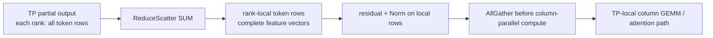

# 02. SP versus CP: Partitioning Tokens Can Mean Different Things

**English** | [简体中文](../../../zh/ai-infra-basic/Parallel_Strategy/02-sp-versus-context-parallelism.md)

## 1. Which TP Redundancy Does SP Address?

After combining RowParallelLinear partials, ordinary TP may replicate every token row on each rank. All ranks then repeat residual and RMSNorm/LayerNorm work. SP partitions these **row-independent** regions along token rows, reducing activation storage and duplicate computation.

Here SP means Megatron-style sequence parallelism, corresponding to upstream SGLang's `--enable-layernorm-sp`. Other projects may use SP more broadly; establish the terminology first.

## 2. Mathematics: Norm Does Not Need Other Tokens

Let $`X\in\mathbb{R}^{T\times H}`$. For row $`t`$:

```math
\mathrm{RMSNorm}(X)_{t,j}
=\gamma_j\frac{X_{t,j}}
{\sqrt{\frac{1}{H}\sum_{k=0}^{H-1}X_{t,k}^{2}+\epsilon}}.
```

The denominator reduces over **hidden features**, not tokens. If $`I_r`$ is rank $`r`$'s token-row set:

```math
\mathrm{RMSNorm}(X[I_r,:])=\mathrm{RMSNorm}(X)[I_r,:].
```

For four tokens on two devices, each device can hold two rows with complete hidden width. Splitting one token's hidden features is different: the sum of squares then requires cross-device reduction.

Residual addition is also row-local, but the corresponding TP partials must first be combined correctly. Applying a nonlinear Norm to partials and then summing is not equivalent.

## 3. Separate AllReduce and Insert Row-Local Computation

For aligned sums and consistent shard ordering:

```math
\mathrm{AllReduce}=\mathrm{AllGather}\circ\mathrm{ReduceScatter}.
```



With divisible token counts, local activation changes from $`[T,H]`$ to $`[T/P,H]`$. Otherwise pad to $`T'=P\lceil T/P\rceil`$ and trim back to $`T`$ at the boundary. Padding has a cost.

The original AllReduce's communication stages can be reused. Comparable byte volume does not guarantee identical time: boundaries, launches, padding, and fusion opportunities determine actual benefit.

## 4. Reading the Upstream Implementation

Pinned [layernorm_sp.py](https://github.com/sgl-project/sglang/blob/f2b73d4f9b4e64415b8d775b0f811c7801f1728b/python/sglang/srt/layers/layernorm_sp.py) centralizes:

| Function | Input/Output Semantics | Responsibility |
|---|---|---|
| `runs_sp()` | forward mode | active only when enabled and running EXTEND/prefill at this revision |
| `sp_entry_scatter()` | replicated input → local rows | local slice because input is already replicated; retain original token count |
| `sp_exit_gather()` | row shards → complete rows, trimmed | restore the external token layout |
| `column_parallel_g_matmul()` | row shard → gathered TP GEMM | optionally fuse all-gather and matmul |
| `row_parallel_gbar_matmul()` | TP GEMM partial → row shard | optionally fuse matmul and reduce-scatter |

[layernorm_sp_hook.py](https://github.com/sgl-project/sglang/blob/f2b73d4f9b4e64415b8d775b0f811c7801f1728b/python/sglang/srt/arg_groups/layernorm_sp_hook.py) validates the model allowlist and TP degree. At this revision it rejects attention DP, PP, and specified speculative configurations. Mathematical partitionability does not establish production support for every model.

## 5. Why This Is Different from PCP and DCP

| Question | SP | PCP | DCP |
|---|---|---|---|
| what needs cross-token information? | this chapter's Norm/residual does not | queries need causal history | one query needs all historical shards |
| main partitioned object | boundary activation rows | prefill query work | historical KV ownership and attention contributions |
| required mathematics | reduce partials, row-local work, gather as needed | query assignment, KV visibility, causal mask | exact global softmax reconstruction |
| guarantees smaller persistent KV? | no | not automatically | a primary goal |

The legacy [sp_inference_demo.py](./sp_inference_demo.py) partitions KV by context and merges attention with distributed softmax. It is a **CP mathematics example**, not this LayerNorm SP implementation. Its filename remains for link compatibility, with its role clarified in navigation and comments.

## 6. Observe and Practice

Run the SP section of the [math demo](./parallelism_math_demo.py): full-row RMSNorm must match concatenated shard-local RMSNorm. Why does replacing Norm with cross-token attention invalidate local computation followed only by concatenation?

When debugging, check complete hidden width, reduced residual inputs, and restored token ordering, not merely total tensor size. Continue with [03: PCP](./03-prefill-context-parallelism.md).
