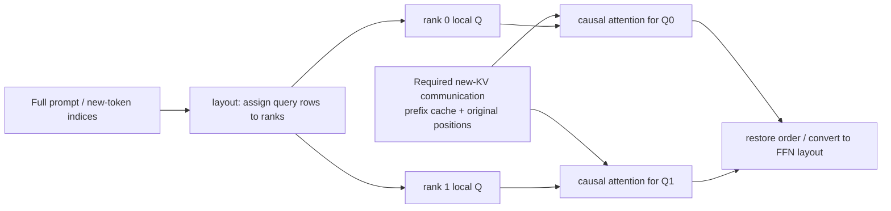
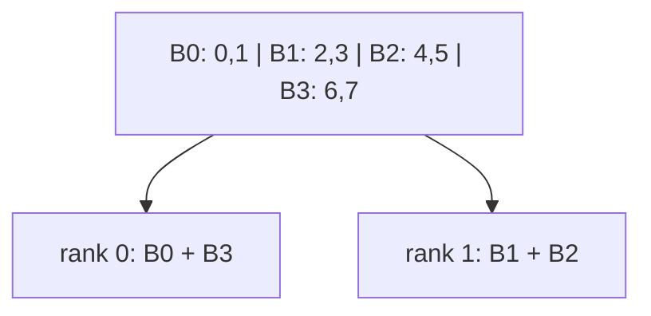

# 03. PCP: Share Long-Prompt Query Work Across Devices

**English** | [简体中文](../../../zh/ai-infra-basic/Parallel_Strategy/03-prefill-context-parallelism.md)

## 1. Purpose: Several Readers for One Long Input

Prefill computes many new-token queries and may execute DSA indexer work. PCP, Prefill Context Parallelism, distributes those query rows across an attention CP group. Each rank owns fewer rows, but every row still needs the correct causal history.

PCP distributes **computation within one request**; DPA distributes **different requests**. Chunked prefill is another distinction: chunking divides work over time, whereas PCP distributes a round spatially across devices. Compatibility depends on the implementation.

## 2. Mathematics: Partition Query Rows Without Dropping History Columns

Consider one request and one head, with $`T`$ new tokens, cached prefix length $`L`$, and head dimension $`d`$:

```math
Q\in\mathbb{R}^{T\times d},\qquad
K\in\mathbb{R}^{(L+T)\times d},\qquad
V\in\mathbb{R}^{(L+T)\times d_v}.
```

For new token at original position $`i`$:

```math
O_i=\sum_{j=0}^{L+i}
\frac{\exp(q_i k_j^{\mathsf T}/\sqrt d)}
{\sum_{u=0}^{L+i}\exp(q_i k_u^{\mathsf T}/\sqrt d)}v_j.
```

Query rows can be assigned independently. For disjoint sets $`I_r`$ covering all new rows:

```math
O[I_r,:]=\mathrm{Attention}(Q[I_r,:],K,V;\text{original causal positions}).
```

Restoring original token indices recovers the unsharded result. Letting local queries see only the rank's new K/V is incorrect: it removes history on other ranks and changes the model.



This chapter illustrates a path gathering required KV; backends can use other protocols. **PCP computation sharding does not automatically shard persistent historical KV storage.**

## 3. Equal Token Counts Can Still Produce Unequal Work

Without a prefix, query $`i`$ sees $`i+1`$ positions; a prefix adds $`L`$. The dense causal score count is:

```math
\sum_{i=0}^{T-1}(L+i+1)=TL+\frac{T(T+1)}2.
```

For 8 tokens and 2 ranks, assigning the first four and last four rows gives $`1+2+3+4=10`$ versus $`5+6+7+8=26`$. Equal tokens do not imply equal attention work.

### 3.1 Zigzag: Pair Early and Late Blocks

With equal blocks, split each request's new tokens into $`2C`$ blocks; rank $`r`$ gets blocks $`r`$ and $`2C-1-r`$:

| Rank | Blocks | Original Positions | Score Count |
|---|---|---|---|
| 0 | earliest + latest | 0, 1, 6, 7 | $`1+2+7+8=18`$ |
| 1 | middle pair | 2, 3, 4, 5 | $`3+4+5+6=18`$ |



Ragged lengths require remainder assignment and padding; this course's demo assigns remainder tokens to earlier blocks. Do not assume divisibility or construct causal masks from local row numbers alone.

Pinned `ZigzagCPStrategy.can_apply()` also requires at least twice the CP degree in new tokens for every request. Shorter inputs do not take this strategy. The demo deliberately includes shorter lengths and empty blocks to explain mathematical boundaries; those cases do not assert production-path admission.

### 3.2 Interleave: Assign Alternating Rows

Pinned upstream interleave assigns **flattened new-token indices across the batch** modulo CP size; it does not reset at request boundaries:

```math
\mathrm{owner}(f)=f\bmod C.
```

For request lengths 5 and 3 with CP=2:

| Rank | Flattened Indices | Request-Local Positions |
|---|---|---|
| 0 | 0, 2, 4, 6 | A0, A2, A4, B1 |
| 1 | 1, 3, 5, 7 | A1, A3, B0, B2 |

Request B's first row belongs to rank 1 but sees only valid B history, never A. Metadata must retain request boundaries, original positions, prefix lengths, and output restoration maps.

## 4. SGLang: From Layout to Backend

See [00](./00-parallelism-map-and-version-boundaries.md) for versions. The upstream [prefill CP guide](https://github.com/sgl-project/sglang/blob/f2b73d4f9b4e64415b8d775b0f811c7801f1728b/docs/docs/advanced_features/prefill_cp.mdx) maps to:

| File / Object | Responsibility |
|---|---|
| [parallel_hook.py](https://github.com/sgl-project/sglang/blob/f2b73d4f9b4e64415b8d775b0f811c7801f1728b/python/sglang/srt/arg_groups/parallel_hook.py) | resolve `enable_prefill_cp`, `cp_strategy`, degrees, and compatibility |
| [ContextParallelStrategy](https://github.com/sgl-project/sglang/blob/f2b73d4f9b4e64415b8d775b0f811c7801f1728b/python/sglang/srt/layers/cp/base.py) | decouple layout policy from models/attention |
| [zigzag.py](https://github.com/sgl-project/sglang/blob/f2b73d4f9b4e64415b8d775b0f811c7801f1728b/python/sglang/srt/layers/cp/zigzag.py) / [interleave.py](https://github.com/sgl-project/sglang/blob/f2b73d4f9b4e64415b8d775b0f811c7801f1728b/python/sglang/srt/layers/cp/interleave.py) | split, metadata, restoration, and model/backend integration |
| `ForwardBatch.attn_cp_metadata` | per-forward query/KV lengths and layout |
| attention backend | consume local queries and required KV with correct causality |
| layer boundary | convert CP-local rows to downstream TP/EP layouts |

Local older entries are [server_args.py](../../../../python/sglang/srt/server_args.py) and [communicator_dsa_cp.py](../../../../python/sglang/srt/layers/communicator_dsa_cp.py). `in-seq-split` and `round-robin-split` are older names; renaming strings alone is not a complete version migration.

## 5. Cache Capacity, Hybrid Models, and NPU Boundaries

Query sharding, token-wise KV sharding, and layer-wise cache ownership are distinct decisions. Upstream also provides DSA cache LayerSplit and at-rest KV sharding with separate flags and PD/backend constraints. PCP does not enable them automatically.

Softmax attention, indexers, linear attention, and MoE in hybrid models can use different layouts. Linear layers also have prefix recurrent state, so this chapter's stateless query assignment cannot be copied unchanged.

For a local Ascend example, read [GLM-5.2 §10.4](../../sglang-ascend-npu/source-code-walkthrough/examples/02-glm-5.2-end-to-end.md). A shared PCP name does not establish identical strategy support across CUDA, NPU, or models.

## 6. Cost and Validation

PCP reduces per-device query work while adding necessary KV traffic, layout restoration, and padding. Short prompts, small batches, or insufficient bandwidth can make it unattractive. Zigzag's balance example approximates dense attention; sparse indexers, GEMMs, and kernels alter actual load.

Run the [math demo](./parallelism_math_demo.py): compare contiguous and zigzag work, then restore sharded-query outputs for ragged lengths and multiple interleaved requests and compare with direct causal attention.

Checks: why is a local row number insufficient as the original position? Why can PCP help TTFT without reducing decode KV storage? Continue with [04: DCP](./04-decode-context-parallelism.md).
