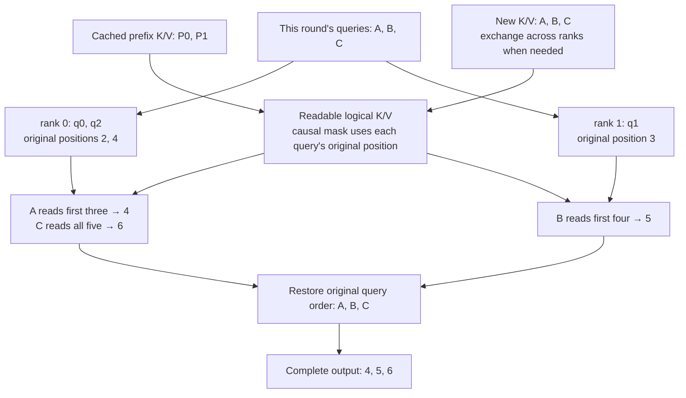
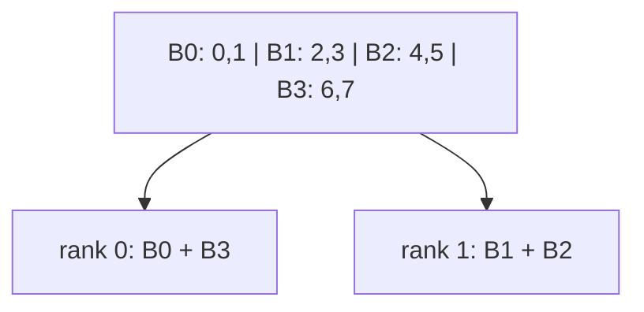

# 03. PCP: Share Long-Prompt Query Work Across Devices

**English** | [简体中文](../../../zh/ai-infra-basic/Parallel_Strategy/03-prefill-context-parallelism.md)

## 1. Purpose: Several Readers for One Long Input

Prefill computes many new-token queries and may execute DSA indexer work. PCP, Prefill Context Parallelism, distributes those query rows across an attention CP group. Each rank owns fewer rows, but every row still needs the correct causal history.

PCP distributes **computation within one request**; DPA distributes **different requests**. Chunked prefill is another distinction: chunking divides work over time, whereas PCP distributes a round spatially across devices. Compatibility depends on the implementation.

## 2. A hand-worked example: what does PCP actually partition?

Set aside zigzag, transports, and kernels for a moment. Answer one question: **why can different devices compute different query rows of one attention operation, while each row's required history cannot simply shrink?**

We start with ordinary dense causal attention; DSA's sparse position selection belongs in the model-specific implementation discussion.

### 2.1 Three objects: Q asks, K matches, V supplies information

For each token, the model produces three types of vectors:

| Object | Intuition | Role in attention |
|---|---|---|
| Query, $`q_i`$ | What this token is looking for | Score its match against each visible key |
| Key, $`k_j`$ | A position's retrieval identifier | Pair with the query to determine this position's weight |
| Value, $`v_j`$ | Information supplied by that position | Contribute to the weighted output |

A match score is not the final output. Attention normalizes scores into weights, then aggregates values using those weights.

**Each Q row represents a token whose output must be computed. Each K/V row represents a position that might be read.** Their row counts can differ.

### 2.2 Why Q has T rows while K/V have L+T rows

Suppose the same request's first two tokens, **P0 and P1**, were already processed and their K/V remain cached. This prefill forward now processes three new input tokens, **A, B, and C**.

“New” means input rows newly processed in this forward, not three unknown decode tokens that must wait to be generated. All row and position indices below start at zero.

- $`L=2`$: the prefix length cached before this round.
- $`T=3`$: the number of tokens newly processed this round.
- Only A/B/C need new queries; P0/P1's old queries need not be recomputed.
- Those new queries can read the cached prefix, so available K/V covers P0, P1, A, B, C: five rows.

| Token | Position in original request | New-token index $`i`$ | This round's Q row | Corresponding K/V row |
|---|---|---|---|---|
| P0 | 0 | — | Not recomputed | $`k_0,v_0`$, read from cache |
| P1 | 1 | — | Not recomputed | $`k_1,v_1`$, read from cache |
| A | 2 | 0 | $`q_0`$ | $`k_2,v_2`$ |
| B | 3 | 1 | $`q_1`$ | $`k_3,v_3`$ |
| C | 4 | 2 | $`q_2`$ | $`k_4,v_4`$ |

**There are two index systems: $`i=0`$ means this round's first new token A, but its original-request position is 2.** Generally:

```math
p_i=L+i.
```

These positions are logical order within the request, not physical addresses in a paged KV cache.

Ignore batch and multiple heads, considering one request and one head. With q/k width $`d`$ and value width $`d_v`$:

```math
Q\in\mathbb R^{T\times d}.
```

```math
K\in\mathbb R^{(L+T)\times d},\qquad
V\in\mathbb R^{(L+T)\times d_v}.
```

A shape specifies row count and row width. Here Q has 3 rows; K/V each have 5. Queries and keys need matching widths for dot products; value width can differ. Output O has 3 rows of width $`d_v`$.

For a first prefill without a cached prefix, simply use $`L=0`$. Not every prefill has old prefix tokens.

### 2.3 Five K/V rows do not mean every query sees five rows

Causality permits a token to read itself and earlier positions only.

| Query | Original position | Visible tokens | Invisible tokens |
|---|---|---|---|
| $`q_0`$ for A | 2 | P0, P1, A | B, C |
| $`q_1`$ for B | 3 | P0, P1, A, B | C |
| $`q_2`$ for C | 4 | P0, P1, A, B, C | None |

The visibility table is:

| Query row / K/V column | P0 | P1 | A | B | C |
|---|---|---|---|---|---|
| A's query | ✓ | ✓ | ✓ | ✗ | ✗ |
| B's query | ✓ | ✓ | ✓ | ✓ | ✗ |
| C's query | ✓ | ✓ | ✓ | ✓ | ✓ |

Now the original summation limit has a concrete meaning: **new-query index $`i`$ corresponds to original position $`L+i`$, so history index $`j`$ runs from 0 through $`L+i`$, including the token itself.**

This means neither “look only at earlier new tokens” nor “include all five K/V rows unconditionally in softmax.”

### 2.4 First make attention an average and calculate three outputs

To isolate history visibility, simplify each value to one number and set every query-key match score to zero:

```math
[v_0,v_1,v_2,v_3,v_4]=[2,4,6,8,10].
```

Equal scores produce equal softmax weights **within legal history**; masked future positions get zero weight. Therefore:

```math
O_0=(2+4+6)/3=4.
```

```math
O_1=(2+4+6+8)/4=5.
```

```math
O_2=(2+4+6+8+10)/5=6.
```

The complete output, in A/B/C order, is:

```math
O=[4,5,6]^{\mathsf T}.
```

This attention is an average only because we deliberately chose equal scores. **Real attention generally uses unequal weights; the next subsection unpacks that calculation.**

Notice that computing $`O_1`$ uses B's query and the relevant K/V, **not the previously computed $`O_0`$**. Similarly, $`O_2`$ does not wait for $`O_1`$. That is why query rows within one attention layer can run concurrently. History dependencies are preserved by visibility, not by serially computing output rows.

### 2.5 Break the long formula into four small steps

For new token index $`i`$, visit only history positions $`0\leq j\leq L+i`$.

**Step 1: calculate a match score.**

```math
s_{ij}=\frac{q_i k_j^{\mathsf T}}{\sqrt d}.
```

$`q_i k_j^{\mathsf T}`$ is the query-key dot product, producing a scalar. Dividing by $`\sqrt d`$ scales attention scores. Values have not been used yet.

**Step 2: exponentiate scores at all legal positions and sum them.**

```math
Z_i=\sum_{u=0}^{L+i}\exp(s_{iu}).
```

$`u`$ is simply another counter over all legal history, visiting the same positions as $`j`$. It is not another data copy or request.

**Step 3: normalize using that total to get each position's weight.**

```math
a_{ij}=\frac{\exp(s_{ij})}{Z_i},\qquad
\sum_{j=0}^{L+i}a_{ij}=1.
```

**Step 4: aggregate values using those weights.**

```math
O_i=\sum_{j=0}^{L+i}a_{ij}v_j.
```

Combining the steps gives the original long equation:

```math
O_i=\sum_{j=0}^{L+i}
\frac{\exp(q_i k_j^{\mathsf T}/\sqrt d)}
{\sum_{u=0}^{L+i}\exp(q_i k_u^{\mathsf T}/\sqrt d)}v_j.
```

If a value is a vector, its weight remains a scalar and multiplies every component. The output is then a vector rather than the scalar in our hand-worked example.

For an example that is **not a simple average**, retain values 2, 4, 6 but change A's three legal scores to:

```math
[s_{00},s_{01},s_{02}]=[0,0,\log2].
```

Exponentiation gives 1, 1, 2, summing to 4. The weights become:

```math
[a_{00},a_{01},a_{02}]=[1/4,1/4,1/2].
```

A's output is now:

```math
O_0=\frac14\cdot2+\frac14\cdot4+\frac12\cdot6=4.5.
```

A puts more weight on its own value but still reads P0/P1, and its normalization domain remains the same three legal positions.

### 2.6 The matrix view: rows are work, columns supply information

Mathematically, form the score matrix:

```math
S=QK^{\mathsf T}/\sqrt d,\qquad
S\in\mathbb R^{3\times5}.
```

Its three rows are A/B/C queries; its five columns are P0/P1/A/B/C keys. The causal mask is:

```math
M=
\begin{bmatrix}
0&0&0&-\infty&-\infty\\
0&0&0&0&-\infty\\
0&0&0&0&0
\end{bmatrix}.
```

Add the mask, apply softmax separately along each row, then multiply by V:

```math
A_{\mathrm{weights}}=\mathrm{softmax}_{\mathrm{row}}(S+M),\qquad
O=A_{\mathrm{weights}}V.
```

Positions marked $`-\infty`$ receive zero softmax weight. For the equal-score example in section 2.4, the weight matrix is:

```math
A_{\mathrm{weights}}=
\begin{bmatrix}
1/3&1/3&1/3&0&0\\
1/4&1/4&1/4&1/4&0\\
1/5&1/5&1/5&1/5&1/5
\end{bmatrix}.
```

**PCP can assign different query rows of this table, but cannot arbitrarily remove legal-history columns required by a row.** Different rows do not share a softmax denominator; all legal columns within one row jointly determine that row's denominator.

These matrices explain the mathematics. FlashAttention and other kernels can compute in tiles without storing the complete S in device memory. They still must preserve which history each query may read.

### 2.7 Now introduce two devices: distribute the questions

Assign the three rows manually before introducing zigzag or other strategies:

| Rank | Assigned new tokens | Original query-row indices | Local outputs |
|---|---|---|---|
| 0 | A, C | 0, 2 | $`[O_0,O_2]=[4,6]`$ |
| 1 | B | 1 | $`[O_1]=[5]`$ |

Rank 0 reads P0/P1/A for A, and all five positions for C. Rank 1 reads the first four positions for B. Every result matches the unsharded calculation.



Simply concatenating rank outputs gives A/C/B order, $`[4,6,5]`$. Restore original token order to recover A/B/C, $`[4,5,6]`$. Some downstream layouts can instead retain an index mapping, but token/result correspondence cannot be lost.

The formerly abstract set $`I_r`$ means “which **original query rows** belong to rank $`r`$”:

```math
I_0=\{0,2\},\qquad I_1=\{1\}.
```

Here each original query row is assigned to exactly one rank: no missing rows and no overlapping sets. Together these two index sets cover all three rows.

$`Q[I_r,:]`$ selects these query rows and retains every feature; the colon means “keep this entire dimension.” Passing the original-request positions as well gives:

```math
O[I_r,:]=\mathrm{Attention}
\left(Q[I_r,:],K,V;\{p_i:i\in I_r\}\right).
```

This introduces no new algorithm: **the same query, reading the same legal K/V, produces the same output. Moving it to another device must preserve the meaning of its inputs.**

### 2.8 Two easy implementation mistakes

**Mistake 1: partition queries and let each read only that rank's new K/V.**

Rank 0 owns A/C, but C must also read B, owned by rank 1. If rank 0 has the prefix but keeps only its own new K/V, it drops B:

```math
O_2^{\mathrm{wrong}}=(2+4+6+10)/4=5.5\neq6.
```

Dropping a column removes a value contribution and changes the softmax denominator. Exchange the necessary KV or use a mathematically equivalent cross-shard protocol.

**Mistake 2: treat the local row number as the original query index.**

| Token | Original query row $`i`$ | Original position $`p_i`$ | Rank-local row number |
|---|---|---|---|
| A | 0 | 2 | Rank 0 local row 0 |
| B | 1 | 3 | Rank 1 local row 0 |
| C | 2 | 4 | Rank 0 local row 1 |

C is rank 0's local row 1, but its original query-row index is 2 and original-request position is 4. Incorrectly masking using $`L+1=3`$ reads only P0/P1/A/B, even excluding C itself, yielding 5 rather than 6.

**Moving queries can change local storage order, but must not change their original causal positions.** Multiple requests additionally need request boundaries so one cannot read another's KV.

### 2.9 Connecting to implementation and a runnable check

For clarity, this section treats each rank as able to read logical complete K/V and apply original-position masking. A real backend can exchange only needed fragments or combine block transfers with partial-result merging instead of materializing all KV simultaneously.

Thus:

- PCP partitions query work this round; it does not turn a request into unrelated smaller requests.
- History dependencies remain; only the device assigned to calculate each query row changes.
- **PCP computation sharding does not automatically shard persistent historical KV storage.**
- This manual assignment introduces the mathematics. See later sections for production zigzag/interleave admission, padding, and metadata.

Run [pcp_query_rows_demo.py](./pcp_query_rows_demo.py) to print legal positions, softmax weights, per-rank results, restored order, and the two mistakes above:

```bash
python3 learning/en/ai-infra-basic/Parallel_Strategy/pcp_query_rows_demo.py
```

On a first reading, remember the numbers in sections 2.4 and 2.7 before revisiting the equation: **one query produces one output. PCP distributes that output's computation without removing information it originally required.**

## 3. Equal Token Counts Can Still Produce Unequal Work

Without a prefix, query $`i`$ sees $`i+1`$ positions; a prefix adds $`L`$. The dense causal score count is:

```math
\sum_{i=0}^{T-1}(L+i+1)=TL+\frac{T(T+1)}2.
```

For 8 tokens and 2 ranks, assigning the first four and last four rows gives $`1+2+3+4=10`$ versus $`5+6+7+8=26`$. Equal tokens do not imply equal attention work.

### 3.1 Zigzag: Pair Early and Late Blocks

With equal blocks, split each request's new tokens into $`2C`$ blocks; rank $`r`$ gets blocks $`r`$ and $`2C-1-r`$:

| Rank | Blocks | Original Positions | Score Count |
|---|---|---|---|
| 0 | earliest + latest | 0, 1, 6, 7 | $`1+2+7+8=18`$ |
| 1 | middle pair | 2, 3, 4, 5 | $`3+4+5+6=18`$ |



Ragged lengths require remainder assignment and padding; this course's demo assigns remainder tokens to earlier blocks. Do not assume divisibility or construct causal masks from local row numbers alone.

Pinned `ZigzagCPStrategy.can_apply()` also requires at least twice the CP degree in new tokens for every request. Shorter inputs do not take this strategy. The demo deliberately includes shorter lengths and empty blocks to explain mathematical boundaries; those cases do not assert production-path admission.

### 3.2 Interleave: Assign Alternating Rows

Pinned upstream interleave assigns **flattened new-token indices across the batch** modulo CP size; it does not reset at request boundaries:

```math
\mathrm{owner}(f)=f\bmod C.
```

For request lengths 5 and 3 with CP=2:

| Rank | Flattened Indices | Request-Local Positions |
|---|---|---|
| 0 | 0, 2, 4, 6 | A0, A2, A4, B1 |
| 1 | 1, 3, 5, 7 | A1, A3, B0, B2 |

Request B's first row belongs to rank 1 but sees only valid B history, never A. Metadata must retain request boundaries, original positions, prefix lengths, and output restoration maps.

## 4. SGLang: From Layout to Backend

See [00](./00-parallelism-map-and-version-boundaries.md) for versions. The upstream [prefill CP guide](https://github.com/sgl-project/sglang/blob/f2b73d4f9b4e64415b8d775b0f811c7801f1728b/docs/docs/advanced_features/prefill_cp.mdx) maps to:

| File / Object | Responsibility |
|---|---|
| [parallel_hook.py](https://github.com/sgl-project/sglang/blob/f2b73d4f9b4e64415b8d775b0f811c7801f1728b/python/sglang/srt/arg_groups/parallel_hook.py) | resolve `enable_prefill_cp`, `cp_strategy`, degrees, and compatibility |
| [ContextParallelStrategy](https://github.com/sgl-project/sglang/blob/f2b73d4f9b4e64415b8d775b0f811c7801f1728b/python/sglang/srt/layers/cp/base.py) | decouple layout policy from models/attention |
| [zigzag.py](https://github.com/sgl-project/sglang/blob/f2b73d4f9b4e64415b8d775b0f811c7801f1728b/python/sglang/srt/layers/cp/zigzag.py) / [interleave.py](https://github.com/sgl-project/sglang/blob/f2b73d4f9b4e64415b8d775b0f811c7801f1728b/python/sglang/srt/layers/cp/interleave.py) | split, metadata, restoration, and model/backend integration |
| `ForwardBatch.attn_cp_metadata` | per-forward query/KV lengths and layout |
| attention backend | consume local queries and required KV with correct causality |
| layer boundary | convert CP-local rows to downstream TP/EP layouts |

Local older entries are [server_args.py](../../../../python/sglang/srt/server_args.py) and [communicator_dsa_cp.py](../../../../python/sglang/srt/layers/communicator_dsa_cp.py). `in-seq-split` and `round-robin-split` are older names; renaming strings alone is not a complete version migration.

## 5. Cache Capacity, Hybrid Models, and NPU Boundaries

Query sharding, token-wise KV sharding, and layer-wise cache ownership are distinct decisions. Upstream also provides DSA cache LayerSplit and at-rest KV sharding with separate flags and PD/backend constraints. PCP does not enable them automatically.

Softmax attention, indexers, linear attention, and MoE in hybrid models can use different layouts. Linear layers also have prefix recurrent state, so this chapter's stateless query assignment cannot be copied unchanged.

For a local Ascend example, read [GLM-5.2 §10.4](../../sglang-ascend-npu/source-code-walkthrough/examples/02-glm-5.2-end-to-end.md). A shared PCP name does not establish identical strategy support across CUDA, NPU, or models.

## 6. Cost and Validation

PCP reduces per-device query work while adding necessary KV traffic, layout restoration, and padding. Short prompts, small batches, or insufficient bandwidth can make it unattractive. Zigzag's balance example approximates dense attention; sparse indexers, GEMMs, and kernels alter actual load.

Run the [math demo](./parallelism_math_demo.py): compare contiguous and zigzag work, then restore sharded-query outputs for ragged lengths and multiple interleaved requests and compare with direct causal attention.

Checks: why is a local row number insufficient as the original position? Why can PCP help TTFT without reducing decode KV storage? Continue with [04: DCP](./04-decode-context-parallelism.md).
