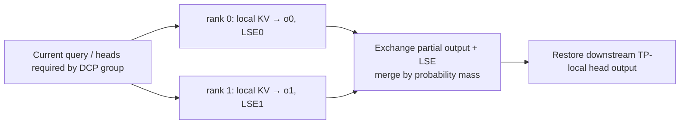

# 04. DCP: Partition Historical KV and Merge Attention Correctly

**English** | [简体中文](../../../zh/ai-infra-basic/Parallel_Strategy/04-decode-context-parallelism.md)

## 1. Purpose: Several Devices Can Read History for One New Query

Decode has few new query rows but potentially long history. DCP, Decode Context Parallelism, assigns historical KV to different ranks and computes each shard's contribution to the same query. In absorbed MLA, TP can partition query heads while latent KV remains duplicated; DCP adds history-axis partitioning.



This does not replicate independent requests or simply average local attention outputs. Derive the distinction for one query first.

## 2. Derivation One: Combine Unnormalized Numerators and Denominators

Partition historical indices into disjoint $`J_r`$, with scores $`s_j=qk_j^{\mathsf T}/\sqrt d`$. Full attention is:

```math
o=\frac{\sum_j\exp(s_j)v_j}{\sum_j\exp(s_j)}.
```

Use global maximum $`m=\max_j s_j`$ for stability:

```math
z_r=\sum_{j\in J_r}\exp(s_j-m),\qquad
u_r=\sum_{j\in J_r}\exp(s_j-m)v_j,\qquad
o=\frac{\sum_r u_r}{\sum_r z_r}.
```

The legacy [sp_inference_demo.py](./sp_inference_demo.py) verifies CP with analogous global-max, sum, and numerator reductions. Actual DCP additionally needs cache addressing, query/head layouts, and suitable kernels.

## 3. Derivation Two: Kernels Already Return Normalized Local Outputs

Efficient attention kernels often return local normalized output $`o_r`$ and log-sum-exp $`\ell_r`$:

```math
\ell_r=\log\sum_{j\in J_r}\exp(s_j),\qquad
o_r=\frac{\sum_{j\in J_r}\exp(s_j)v_j}{\exp(\ell_r)}.
```

The correct global merge is therefore:

```math
\ell=\log\sum_r\exp(\ell_r),\qquad
o=\sum_r\exp(\ell_r-\ell)o_r.
```

Each local result is weighted by its share of global **probability mass**.

Example: two ranks each hold one historical value, $`2`$ and $`10`$, with scores $`0`$ and $`\log 3`$. Local softmax has one entry, so local outputs are $`2`$ and $`10`$, but:

```math
o=\frac{1\cdot2+3\cdot10}{1+3}=8.
```

Summation gives $`12`$ and averaging gives $`6`$; both are wrong. Verify whether the kernel's LSE uses natural or base-2 logarithms. Fully masked local shards have zero mass and must not inject NaNs from empty-shard outputs.

## 4. Cache Addressing: Logical Slots versus Local Physical Rows

Use a teaching model with token interleaving, DCP degree $`C`$, and shared virtual slot $`v`$:

```math
\mathrm{owner}(v)=v\bmod C,\qquad
\mathrm{local}(v)=\lfloor v/C\rfloor.
```

| Virtual Slots | Rank 0 Physical Rows | Rank 1 Physical Rows |
|---|---|---|
| 0, 1, 2, 3, 4, 5 | 0, 1, 2 correspond to 0, 2, 4 | 0, 1, 2 correspond to 1, 3, 5 |

Ranks share a consistent request→virtual-slot map but write only their owned slots. With $`P`$ physical tokens per page, a virtual page can represent $`PC`$ slots. Physical memory per device has not increased by $`C`$.

Upstream [layout.py](https://github.com/sgl-project/sglang/blob/f2b73d4f9b4e64415b8d775b0f811c7801f1728b/python/sglang/srt/layers/dcp/layout.py) implements slot filtering through `maybe_dcp_kernel_indices()`; `localize_dcp_indices()` also accepts block-interleave parameters. The equation is the minimal model; real page granularity, padding, and sparse indices follow backend contracts.

## 5. SGLang Communication Paths

The absorbed-MLA path in the pinned [DCP guide](https://github.com/sgl-project/sglang/blob/f2b73d4f9b4e64415b8d775b0f811c7801f1728b/docs/docs/advanced_features/dcp.mdx) can be read as:

1. Resolve DCP groups/degrees within the owning attention TP/DPA domain.
2. Write owner-local KV and construct local metadata/page tables.
3. Provide each rank the query heads required for its history contribution.
4. Run attention to obtain normalized partial outputs and LSE.
5. Exchange and merge into the ordinary TP-local head layout.

| Implementation | Difference |
|---|---|
| `ag_rs` | gather query and LSE, reduce-scatter outputs |
| `a2a` | exchange packed output+LSE, then merge locally |
| `fi_a2a` | specific FlashInfer MNNVL all-to-all path with hardware-domain constraints |
| replicated Q projection | replicate supported query weights at startup to remove a per-layer query gather, trading extra weights/compute |

Read [comm.py](https://github.com/sgl-project/sglang/blob/f2b73d4f9b4e64415b8d775b0f811c7801f1728b/python/sglang/srt/layers/dcp/comm.py), [metadata.py](https://github.com/sgl-project/sglang/blob/f2b73d4f9b4e64415b8d775b0f811c7801f1728b/python/sglang/srt/layers/dcp/metadata.py), and [planner.py](https://github.com/sgl-project/sglang/blob/f2b73d4f9b4e64415b8d775b0f811c7801f1728b/python/sglang/srt/layers/dcp/planner.py). This all-to-all primarily exchanges partial answers and normalization information, not a full replication of raw KV on every device.

## 6. Memory Savings and Costs

For one ordinary GQA request, KV payload is approximately $`M=2L_{\mathrm{layers}}TH_{\mathrm{KV}}ds`$ bytes. Uniform DCP ideally stores about $`M/C`$ per device; MLA requires its actual latent-cache width instead.

Here $`L_{\mathrm{layers}}`$ is the layer count, $`T`$ history length, $`H_{\mathrm{KV}}`$ KV heads, $`d`$ head width, and $`s`$ bytes per element. The following separates cost terms; computation and memory access may overlap, so it is not an exact latency predictor.

```math
t_{\mathrm{decode}}\approx
t_{\mathrm{query}}+
\frac{\mathrm{local\ KV\ bytes}}{B_{\mathrm{HBM}}}
+t_{\mathrm{attention}}+t_{\mathrm{merge}}.
```

Longer histories can make reduced KV reads more valuable. For short histories, added collectives and query-layout work may dominate. Page metadata, replicated query weights, draft KV, and temporary outputs also consume memory.

DCP does not automatically shrink GDN/KDA request-indexed recurrent states. One validated MLA kernel does not establish support in all MHA/DSA/NPU kernels. The local snapshot lacks a complete DCP implementation; every concrete DCP API here links to pinned upstream rather than a fictitious local entry.

## 7. Practice and Correctness Checks

The [math demo](./parallelism_math_demo.py) checks one-token cases, long histories, large scores, and empty local shards against direct full-history attention. It also verifies invertible owner/local mapping and exactly one owner per slot.

Investigate LSE base, global causal positions, virtual/physical page mapping, partial-head order, cancellation, and slot reuse first. Continue with [05: DWDP](./05-dwdp-weight-parallelism.md).
