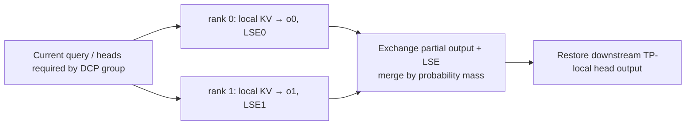
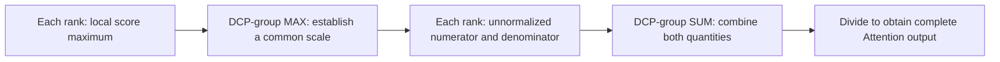
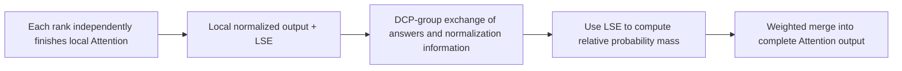
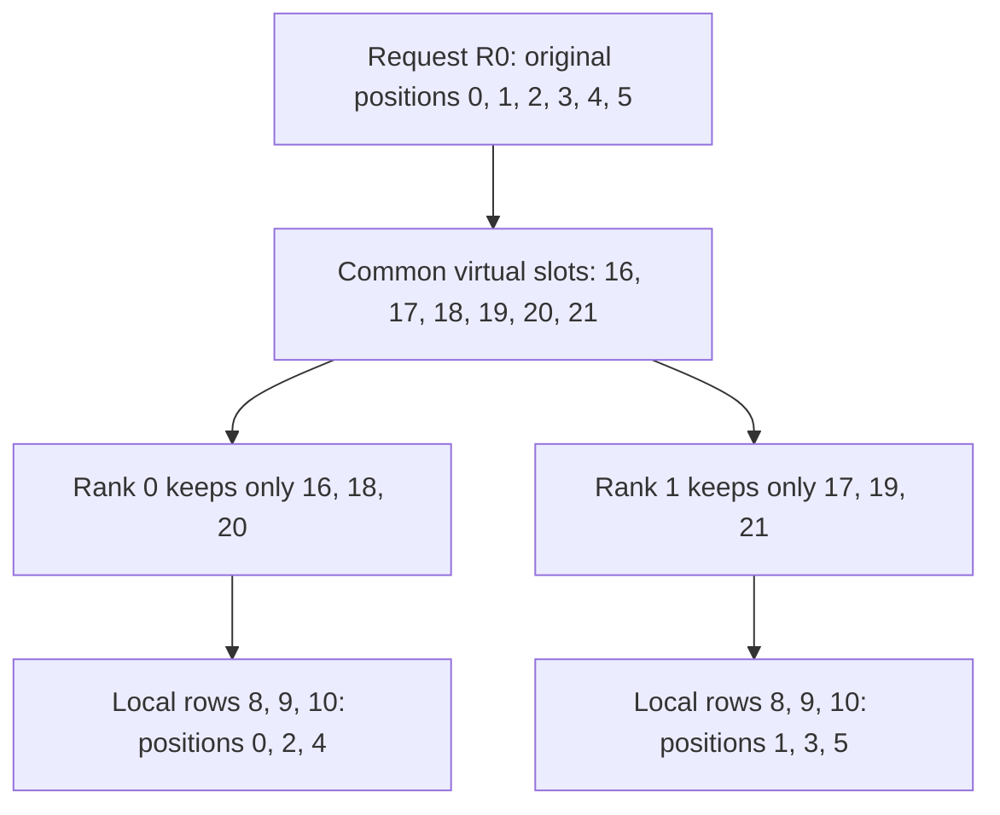
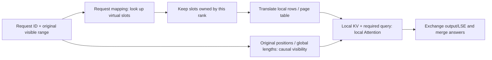

# 04. DCP: Partition Historical KV and Merge Attention Correctly

**English** | [简体中文](../../../zh/ai-infra-basic/Parallel_Strategy/04-decode-context-parallelism.md)

## 1. Purpose: Several Devices Can Read History for One New Query

Decode has few new query rows but potentially long history. DCP, Decode Context Parallelism, assigns historical KV to different ranks and computes each shard's contribution to the same query. In absorbed MLA, TP can partition query heads while latent KV remains duplicated; DCP adds history-axis partitioning.



This does not replicate independent requests or simply average local attention outputs. Derive the distinction for one query first.

## 2. Derivation One: Combine Unnormalized Numerators and Denominators

### 2.1 Each device owns only part of the numerator and denominator

First fix **one request, one query, and one head**. Partition historical indices into disjoint $`J_r`$: rank $`r`$ holds one KV shard, with scores $`s_j=qk_j^{\mathsf T}/\sqrt d`$. Full attention is a weighted sum divided by the total weight:

```math
o=\frac{\sum_j\exp(s_j)v_j}{\sum_j\exp(s_j)}.
```

The numerator is an unnormalized weighted sum of values; the denominator turns it into a weighted average. Each rank can compute only part of each, so both need combining. Simply adding already normalized local outputs is incorrect.

### 2.2 Where does communication occur in a direct implementation?

First, compute local score maxima, then use `AllReduce(MAX)` within the DCP group to obtain a shared maximum:

```math
m_r=\max_{j\in J_r}s_j,\qquad m=\max_r m_r.
```

Second, each rank uses **the same** maximum to compute local numerator and denominator:

```math
z_r=\sum_{j\in J_r}\exp(s_j-m),\qquad
u_r=\sum_{j\in J_r}\exp(s_j-m)v_j.
```

Subtracting a common maximum improves stability without changing the result: it multiplies all exponential weights by the same factor. For one query/head, denominator $`z_r`$ is a scalar and numerator $`u_r`$ is a value vector of width $`d_v`$.

Third, SUM-reduce both quantities within the group, then divide:

```math
Z=\sum_r z_r,\qquad U=\sum_r u_r,\qquad o=\frac{U}{Z}.
```

A straightforward implementation is `AllReduce(MAX)`, local computation, then `AllReduce(SUM)`. Numerator and denominator can be packed for the SUM; they need not require separate collectives. This is a direct implementation of the derivation, not a requirement that every DCP backend use identical collective counts or output layouts.



### 2.3 Global does not mean the whole cluster

The reduction combines **history shards for the same Attention computation**, within its DCP group. It does not indiscriminately include every TP, DP, and EP rank.

Raw KV also need not be gathered onto one device. Historical KV stays with its owners; communication carries summaries such as maxima, numerators, and denominators. Our example fixes one query/head; a real batch maintains separate quantities for its queries/heads rather than sharing one softmax denominator across requests.

The legacy [sp_inference_demo.py](./sp_inference_demo.py) verifies CP with analogous global-max, sum, and numerator reductions. Actual DCP additionally needs cache addressing, query/head layouts, and suitable kernels.

## 3. Derivation Two: Kernels Already Return Normalized Local Outputs

### 3.1 Local averages are ready, but how much should each part contribute?

The second formulation lets each rank finish its local Attention independently. Efficient kernels often return two objects:

- Local output $`o_r`$: a weighted average over that rank's history, represented by a value vector.
- Local LSE $`\ell_r`$: the logarithm of that shard's softmax denominator, a scalar retaining how much weight this part of history carries.

```math
\ell_r=\log\sum_{j\in J_r}\exp(s_j),\qquad
o_r=\frac{\sum_{j\in J_r}\exp(s_j)v_j}{\exp(\ell_r)}.
```

The kernel need not construct an overflowing raw exponential sum before taking its logarithm. It can compute LSE stably using its local maximum:

```math
\ell_r=m_r+\log\sum_{j\in J_r}\exp(s_j-m_r).
```

Consequently, ranks **need not obtain the global score maximum before finishing local Attention**. However, no rank yet knows the other shards' contributions to the complete softmax. Its local output alone cannot determine the complete answer.

### 3.2 Exchange local answers and LSE, then merge by probability mass

The mathematical full LSE and correct output are:

```math
\ell=\log\sum_r\exp(\ell_r),\qquad
o=\sum_r\exp(\ell_r-\ell)o_r.
```

Each local answer is weighted by its share of the complete softmax's **probability mass**. This is not determined directly by token counts, nor are all ranks assumed equally important.

Merging also needs numerical stability. Once LSEs reach the merge location, choose a common reference and compute relative weights:

```math
a=\max_r\ell_r,\qquad w_r=\exp(\ell_r-a),\qquad o=\frac{\sum_r w_r o_r}{\sum_r w_r}.
```

This reference is the **maximum local LSE**; it need not equal derivation one's global score maximum. The common scaling cancels between numerator and denominator. Relative weights are not yet normalized: dividing by their sum produces the correct weighted average.



**Derivation two still requires cross-device communication.** The change is that ranks can finish local summaries before exchanging and combining them. Independently finishing a local Attention computation does not produce a full-history answer without communication. Implementations can exchange packed output/LSE or combine gather and reduce-scatter; see Section 5. The formula alone does not prove a lower collective count.

### 3.3 A two-rank worked example

Temporarily use one-dimensional values. Each rank holds one historical token:

| Object | Rank 0 | Rank 1 |
|---|---|---|
| Score | $`0`$ | $`\log 3`$ |
| Value | $`2`$ | $`10`$ |
| Local normalized output | $`o_0=2`$ | $`o_1=10`$ |
| Local LSE | $`\ell_0=0`$ | $`\ell_1=\log 3`$ |
| Unnormalized probability mass | $`e^{\ell_0}=1`$ | $`e^{\ell_1}=3`$ |

Each local softmax has a single entry with probability one. The two outputs alone therefore cannot reveal that the second token deserves more weight across the whole history. LSE restores this information, giving:

```math
o=\frac{1\cdot2+3\cdot10}{1+3}=8.
```

Summation gives $`12`$ and averaging gives $`6`$; both are wrong. The stable formulation gives relative weights $`1/3`$ and $`1`$, which normalize to $`1/4`$ and $`3/4`$. The answer remains unchanged.

Check whether LSE uses natural or base-2 logarithms. The exponential equations above assume natural logarithms; base-2 LSE requires matching exponentiation. Fully masked shards or shards without valid history have zero mass and must not inject NaNs from empty-shard outputs. If every shard lacks valid positions, use the backend's special-case handling rather than directly dividing.

### 3.4 The actual difference between the derivations

| Comparison | Direct implementation of derivation one | Derivation two |
|---|---|---|
| Establish a shared score scale before local sums? | Obtain the global score maximum before local numerator/denominator computation | Local Attention can use its own scale independently |
| Merge summaries | Unnormalized numerators/denominators on a common scale | Locally normalized outputs and LSE |
| DCP-group communication required? | Yes | Still yes |
| Must raw KV be gathered? | No | No |
| Final target | Attention over the complete history | The same Attention, organized differently |

Remember: **derivation one establishes a common scale, then combines numerators and denominators; derivation two computes local answers first, then merges by probability mass.** They are mathematically equivalent; floating-point differences and performance depend on kernels, reduction order, and communication implementation.

## 4. Cache Addressing: Logical Slots versus Local Physical Rows

### 4.1 Which device and which slot actually store this token's KV?

Sections 2–3 explain how to merge answers. Before computing them, another question needs an answer: **where should new KV be written, and where should historical KV be read?**

Fix one DCP group of two devices serving the same request. Start with **token-interleaved** storage: even request positions belong to rank 0, odd positions to rank 1. This is not a contiguous first-half/second-half split.

One storage cell represents a token's KV entry in a layer: it may contain multidimensional K/V or an MLA latent, not just one number. A local physical row is an entry index in that device's cache pool, not a device-pointer byte address. The kernel still uses the real tensor layout/strides to locate data.

### 4.2 Distinguish four identifiers before applying an equation

Token positions, slots, rows, and pages below are zero-based. Rank IDs refer to ranks within the DCP group.

| Name | Question answered | Example |
|---|---|---|
| Request token position $`p`$ | Which token is this within the request? | Positions $`0`$, $`1`$, $`2`$ in R0 |
| Virtual slot $`v`$ | Which common KV identifier did the runtime allocate? | Possibly $`16`$, $`17`$, $`18`$, not necessarily starting at zero |
| Owner rank | Which device owns this identifier? | Rank 0 or rank 1 |
| Local physical row $`\lambda`$ | Which row in that device's own pool should be accessed? | Possibly local row $`8`$ or $`9`$ |

Request position describes **sequence semantics**, whereas virtual slot describes **cache allocation**. R0 and R1 can both have position zero, but without arrangements such as prefix sharing they require different KV storage.

Virtual does not mean another complete copy of KV exists. It is a group-consistent numbering scheme translated into a device plus a row. This section assumes no shared prefix and allocation starting at page boundaries.

### 4.3 Translating one virtual identifier into a rank and row

Let DCP degree be $`C`$. For token-interleaved storage:

```math
\mathrm{owner}(v)=v\bmod C,\qquad
\mathrm{local}(v)=\lfloor v/C\rfloor.
```

The remainder chooses the device, and the quotient chooses its local row. With $`C=2`$, suppose the request's first six tokens receive virtual slots $`16`$ through $`21`$:

| Request position | Virtual slot | Owner: remainder after division by two | Local row: floor division by two |
|---|---|---|---|
| $`0`$ | $`16`$ | Rank 0 | $`8`$ |
| $`1`$ | $`17`$ | Rank 1 | $`8`$ |
| $`2`$ | $`18`$ | Rank 0 | $`9`$ |
| $`3`$ | $`19`$ | Rank 1 | $`9`$ |
| $`4`$ | $`20`$ | Rank 0 | $`10`$ |
| $`5`$ | $`21`$ | Rank 1 | $`10`$ |

Why do virtual slots $`16`$ and $`17`$ both mapping to row eight not overwrite each other? The complete address includes the rank: $`(0,8)`$ and $`(1,8)`$ are **different storage on different devices**.



The inverse checks that no information was lost:

```math
v=C\lambda+r,\qquad r=\mathrm{owner}(v),\quad \lambda=\mathrm{local}(v).
```

### 4.4 Why can a virtual page represent both devices' tokens?

KV cache is normally allocated by pages rather than requesting device memory for each individual token. Let physical page capacity per device be $`P=4`$ with DCP degree $`C=2`$:

```math
P_{\mathrm{virtual}}=PC=8.
```

One eight-slot virtual page corresponds to one four-row physical page on rank 0 and one on rank 1. Neither device's physical page suddenly holds eight rows.

For virtual page ID $`b=2`$, virtual slots run from $`16`$ through $`23`$:

| Virtual-page offset | Virtual slot | Owner | Local physical page ID | Local page offset | Local physical row |
|---|---|---|---|---|---|
| $`0`$ | $`16`$ | Rank 0 | $`2`$ | $`0`$ | $`8`$ |
| $`1`$ | $`17`$ | Rank 1 | $`2`$ | $`0`$ | $`8`$ |
| $`2`$ | $`18`$ | Rank 0 | $`2`$ | $`1`$ | $`9`$ |
| $`3`$ | $`19`$ | Rank 1 | $`2`$ | $`1`$ | $`9`$ |
| $`4`$ | $`20`$ | Rank 0 | $`2`$ | $`2`$ | $`10`$ |
| $`5`$ | $`21`$ | Rank 1 | $`2`$ | $`2`$ | $`10`$ |
| $`6`$ | $`22`$ | Rank 0 | $`2`$ | $`3`$ | $`11`$ |
| $`7`$ | $`23`$ | Rank 1 | $`2`$ | $`3`$ | $`11`$ |

For any virtual slot, first identify its virtual page and offset, then the local row:

```math
b=\left\lfloor\frac{v}{PC}\right\rfloor,\qquad o_v=v\bmod(PC),\qquad
\lambda=bP+\left\lfloor\frac{o_v}{C}\right\rfloor.
```

The corresponding physical page ID and offset are:

```math
\mathrm{page}_{\mathrm{local}}=\left\lfloor\lambda/P\right\rfloor=b,\qquad
\mathrm{offset}_{\mathrm{local}}=\lambda\bmod P.
```

Equal page IDs across devices still refer to separate memory. If each pool has $`M`$ physical rows, the group's virtual numbering ideally covers $`CM`$ distinct entries: **aggregate capacity across devices**, not extra memory created on each one. Reserved pages, padding, and other overhead reduce usable capacity.

### 4.5 Contiguous request history does not imply contiguous allocated page IDs

Let R0 grow to ten tokens. Suppose the allocator assigns virtual page IDs $`2`$ and $`7`$; intervening pages may already belong to other requests.

Denote its logical-request-page to virtual-page-ID map by $`B_{R0}`$:

```math
B_{R0}[0]=2,\qquad B_{R0}[1]=7.
```

Starting from a request token position, addressing becomes:

```math
b_{\mathrm{req}}=\left\lfloor\frac{p}{PC}\right\rfloor,\qquad
v=B_{R0}[b_{\mathrm{req}}]\,PC+(p\bmod PC).
```

Find the logical request page, look up its allocated virtual page ID, then apply Section 4.3 to obtain the owner and row:

| Request positions | Virtual page ID | Virtual slots | Owners | Local physical rows |
|---|---|---|---|---|
| $`0,1`$ | $`2`$ | $`16,17`$ | One each on ranks 0 and 1 | $`8`$ on both devices |
| $`2,3`$ | $`2`$ | $`18,19`$ | One each on ranks 0 and 1 | $`9`$ on both devices |
| $`4,5`$ | $`2`$ | $`20,21`$ | One each on ranks 0 and 1 | $`10`$ on both devices |
| $`6,7`$ | $`2`$ | $`22,23`$ | One each on ranks 0 and 1 | $`11`$ on both devices |
| $`8,9`$ | $`7`$ | $`56,57`$ | One each on ranks 0 and 1 | $`28`$ on both devices |

Position eight therefore does not necessarily follow physical row eleven at row twelve. It jumps to row twenty-eight here.

Equal positions across requests also need not collide: if R1 starts at virtual page ID $`4`$, its position zero maps to slot $`32`$, rank 0 row $`16`$, not R0's position-zero address.

This page table is a teaching representation, not a guarantee that every backend has an identically named array. SGLang can record position-to-token-slot mappings through structures such as `req_to_token`, then build kernel-specific page tables/index lists. **Preserve the mapping from request positions to allocated addresses; do not assume a sequence occupies contiguous memory.**

### 4.6 One Decode write: where does position six's new KV go?

Return to R0 with six cached tokens, about to forward its current token at original position $`p=6`$. It uses offset six in virtual page two:

```math
v=2\times8+6=22,\qquad \mathrm{owner}(22)=0,\qquad \mathrm{local}(22)=11.
```

Split the write into four steps:

1. Allocation/request mapping determines the virtual slot, interpreted consistently across ranks.
2. For the layer's KV to be written, check whether this rank owns that slot.
3. Rank 0 writes local physical row eleven. Rank 1 does not persist a duplicate of this history entry in its DCP KV pool.
4. Update the corresponding metadata. Ranks still need the query heads required for their history contributions; query delivery/projection is the separate strategy in Section 5.

The following is generic teaching pseudocode, not a verbatim upstream function:

```python
for new_kv, virtual_slot in pending_writes:
    if virtual_slot % dcp_size == my_dcp_rank:
        physical_row = virtual_slot // dcp_size
        local_cache[physical_row] = new_kv
```

After writing position six, rank 0 holds request positions $`[0,2,4,6]`$ and rank 1 holds $`[1,3,5]`$. This describes **persistent-cache ownership**, not a restriction that queries run only on the owner, nor a statement about whether temporary projected KV existed on another rank.

### 4.7 One Decode read: local history with original causal positions

The position-six query can see request positions zero through six, including its newly written current entry. Each rank reads:

| Rank | Original request positions | Virtual slots | Local physical rows read | Valid local history count |
|---|---|---|---|---|
| Rank 0 | $`[0,2,4,6]`$ | $`[16,18,20,22]`$ | $`[8,9,10,11]`$ | $`4`$ |
| Rank 1 | $`[1,3,5]`$ | $`[17,19,21]`$ | $`[8,9,10]`$ | $`3`$ |

Rank 0's local history ordinal three corresponds to original position six, but cache-pool row eleven. **Local ordinal, original position, and pool row are three distinct concepts.** A kernel can translate through page tables without gathering a contiguous tensor.

Each rank obtains the required query, reads its valid KV, computes local output/LSE, and participates in the Section 3 merge. Address translation itself does not require all-gathering the entire historical KV.



Physical rows cannot replace original positions. Position eight resides at local row twenty-eight, but **twenty-eight is not its sequence position**. Causal masking or positional encoding needs correct original positions/global lengths and backend DCP metadata, not local read ordinals treated as the original timeline.

Allocated pages also need not be fully valid. Ten tokens occupy two pages per device here, reserving eight rows per device but using only five. Spare page capacity must not participate in softmax merely because memory exists.

### 4.8 Back to source: ownership filtering and address compression are separate

Continue using upstream commit `f2b73d4f9b4e64415b8d775b0f811c7801f1728b`, not a claimed local implementation:

| Question to verify | Pinned source entry | Contract |
|---|---|---|
| Which indices belong here, and how are they compressed? | [layout.py](https://github.com/sgl-project/sglang/blob/f2b73d4f9b4e64415b8d775b0f811c7801f1728b/python/sglang/srt/layers/dcp/layout.py): `localize_dcp_indices()` | Non-local/invalid indices become $`-1`$; the caller still identifies the input index domain |
| Why can one path select rank-strided slices? | Same file, `maybe_dcp_kernel_indices()` | Assumes a page-aligned run start; do not copy it onto arbitrary unaligned sublists |
| Does ownership filtering already collapse IDs? | Same file, `filter_dcp_local_kv_indices()` | Selection alone leaves widened IDs, which still need translation |
| How does Decode metadata obtain local lengths/indices? | [planner.py](https://github.com/sgl-project/sglang/blob/f2b73d4f9b4e64415b8d775b0f811c7801f1728b/python/sglang/srt/layers/dcp/planner.py): `plan_dcp_decode_metadata()` | Updates local lengths/boundaries/valid indices; the valid range is subsequently passed to `translate_dcp_read_ids` |

Do not guess from an integer tensor whether it contains original token positions or physical rows. Compressing request positions yields local history ordinals; compressing virtual slots yields pool rows. The allocation mapping still separates those domains. Also verify whether translation already occurred: do not divide physical rows by the DCP degree a second time.

More general layouts rotate ranks after each run of $`I`$ entries rather than after every token. For a nonnegative identifier $`x`$ in the correct domain:

```math
b_I=\left\lfloor x/I\right\rfloor,\qquad
\mathrm{owner}_I(x)=b_I\bmod C,\qquad
\mathrm{local}_I(x)=\left\lfloor b_I/C\right\rfloor I+(x\bmod I).
```

For example, $`C=2,I=2`$ partitions the first eight original positions as $`[0,1,4,5]`$ / $`[2,3,6,7]`$. Only $`I=1`$ gives the earlier token-interleaved rule. `localize_dcp_indices()` supports such block layouts through `interleave_size`. Check actual page granularity, sparse top-k, padding, and tensor packing together; changing the owner formula alone does not establish backend compatibility.

### 4.9 Three questions and a CPU self-check

1. Why can virtual slots sixteen and seventeen both map to local row eight without overwriting each other?
2. Why need request position eight not reside at local row twelve? Which mapping must be consulted first?
3. Why do compressed local row IDs not eliminate request boundaries and original causal positions?

[dcp_cache_address_demo.py](./dcp_cache_address_demo.py) downloads no weights and needs no PyTorch. It prints the cross-page address table, demonstrates owner-only writes/local-history reads, and checks invariants for separate requests, page boundaries, invalid indices, and block interleaving:

```bash
python3 learning/en/ai-infra-basic/Parallel_Strategy/dcp_cache_address_demo.py
```

These are address/index teaching checks, not full-backend execution, device performance measurements, or validation of arbitrary prefix/speculation combinations.

## 5. SGLang Communication Paths

The absorbed-MLA path in the pinned [DCP guide](https://github.com/sgl-project/sglang/blob/f2b73d4f9b4e64415b8d775b0f811c7801f1728b/docs/docs/advanced_features/dcp.mdx) can be read as:

1. Resolve DCP groups/degrees within the owning attention TP/DPA domain.
2. Write owner-local KV and construct local metadata/page tables.
3. Provide each rank the query heads required for its history contribution.
4. Run attention to obtain normalized partial outputs and LSE.
5. Exchange and merge into the ordinary TP-local head layout.

| Implementation | Difference |
|---|---|
| `ag_rs` | gather query and LSE, reduce-scatter outputs |
| `a2a` | exchange packed output+LSE, then merge locally |
| `fi_a2a` | specific FlashInfer MNNVL all-to-all path with hardware-domain constraints |
| replicated Q projection | replicate supported query weights at startup to remove a per-layer query gather, trading extra weights/compute |

Read [comm.py](https://github.com/sgl-project/sglang/blob/f2b73d4f9b4e64415b8d775b0f811c7801f1728b/python/sglang/srt/layers/dcp/comm.py), [metadata.py](https://github.com/sgl-project/sglang/blob/f2b73d4f9b4e64415b8d775b0f811c7801f1728b/python/sglang/srt/layers/dcp/metadata.py), and [planner.py](https://github.com/sgl-project/sglang/blob/f2b73d4f9b4e64415b8d775b0f811c7801f1728b/python/sglang/srt/layers/dcp/planner.py). This all-to-all primarily exchanges partial answers and normalization information, not a full replication of raw KV on every device.

## 6. Memory Savings and Costs

For one ordinary GQA request, KV payload is approximately $`M=2L_{\mathrm{layers}}TH_{\mathrm{KV}}ds`$ bytes. Uniform DCP ideally stores about $`M/C`$ per device; MLA requires its actual latent-cache width instead.

Here $`L_{\mathrm{layers}}`$ is the layer count, $`T`$ history length, $`H_{\mathrm{KV}}`$ KV heads, $`d`$ head width, and $`s`$ bytes per element. The following separates cost terms; computation and memory access may overlap, so it is not an exact latency predictor.

```math
t_{\mathrm{decode}}\approx
t_{\mathrm{query}}+
\frac{\mathrm{local\ KV\ bytes}}{B_{\mathrm{HBM}}}
+t_{\mathrm{attention}}+t_{\mathrm{merge}}.
```

Longer histories can make reduced KV reads more valuable. For short histories, added collectives and query-layout work may dominate. Page metadata, replicated query weights, draft KV, and temporary outputs also consume memory.

DCP does not automatically shrink GDN/KDA request-indexed recurrent states. One validated MLA kernel does not establish support in all MHA/DSA/NPU kernels. The local snapshot lacks a complete DCP implementation; every concrete DCP API here links to pinned upstream rather than a fictitious local entry.

## 7. Practice and Correctness Checks

The [math demo](./parallelism_math_demo.py) checks one-token cases, long histories, large scores, and empty local shards against direct full-history attention. It also verifies invertible owner/local mapping and exactly one owner per slot.

Investigate LSE base, global causal positions, virtual/physical page mapping, partial-head order, cancellation, and slot reuse first. Continue with [05: DWDP](./05-dwdp-weight-parallelism.md).
