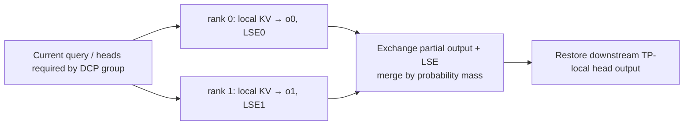
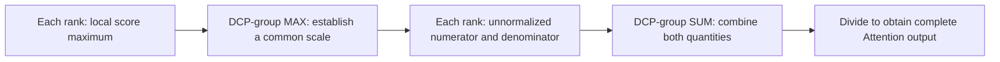
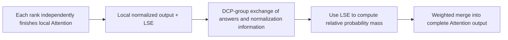

# 04. DCP: Partition Historical KV and Merge Attention Correctly

**English** | [简体中文](../../../zh/ai-infra-basic/Parallel_Strategy/04-decode-context-parallelism.md)

## 1. Purpose: Several Devices Can Read History for One New Query

Decode has few new query rows but potentially long history. DCP, Decode Context Parallelism, assigns historical KV to different ranks and computes each shard's contribution to the same query. In absorbed MLA, TP can partition query heads while latent KV remains duplicated; DCP adds history-axis partitioning.



This does not replicate independent requests or simply average local attention outputs. Derive the distinction for one query first.

## 2. Derivation One: Combine Unnormalized Numerators and Denominators

### 2.1 Each device owns only part of the numerator and denominator

First fix **one request, one query, and one head**. Partition historical indices into disjoint $`J_r`$: rank $`r`$ holds one KV shard, with scores $`s_j=qk_j^{\mathsf T}/\sqrt d`$. Full attention is a weighted sum divided by the total weight:

```math
o=\frac{\sum_j\exp(s_j)v_j}{\sum_j\exp(s_j)}.
```

The numerator is an unnormalized weighted sum of values; the denominator turns it into a weighted average. Each rank can compute only part of each, so both need combining. Simply adding already normalized local outputs is incorrect.

### 2.2 Where does communication occur in a direct implementation?

First, compute local score maxima, then use `AllReduce(MAX)` within the DCP group to obtain a shared maximum:

```math
m_r=\max_{j\in J_r}s_j,\qquad m=\max_r m_r.
```

Second, each rank uses **the same** maximum to compute local numerator and denominator:

```math
z_r=\sum_{j\in J_r}\exp(s_j-m),\qquad
u_r=\sum_{j\in J_r}\exp(s_j-m)v_j.
```

Subtracting a common maximum improves stability without changing the result: it multiplies all exponential weights by the same factor. For one query/head, denominator $`z_r`$ is a scalar and numerator $`u_r`$ is a value vector of width $`d_v`$.

Third, SUM-reduce both quantities within the group, then divide:

```math
Z=\sum_r z_r,\qquad U=\sum_r u_r,\qquad o=\frac{U}{Z}.
```

A straightforward implementation is `AllReduce(MAX)`, local computation, then `AllReduce(SUM)`. Numerator and denominator can be packed for the SUM; they need not require separate collectives. This is a direct implementation of the derivation, not a requirement that every DCP backend use identical collective counts or output layouts.



### 2.3 Global does not mean the whole cluster

The reduction combines **history shards for the same Attention computation**, within its DCP group. It does not indiscriminately include every TP, DP, and EP rank.

Raw KV also need not be gathered onto one device. Historical KV stays with its owners; communication carries summaries such as maxima, numerators, and denominators. Our example fixes one query/head; a real batch maintains separate quantities for its queries/heads rather than sharing one softmax denominator across requests.

The legacy [sp_inference_demo.py](./sp_inference_demo.py) verifies CP with analogous global-max, sum, and numerator reductions. Actual DCP additionally needs cache addressing, query/head layouts, and suitable kernels.

## 3. Derivation Two: Kernels Already Return Normalized Local Outputs

### 3.1 Local averages are ready, but how much should each part contribute?

The second formulation lets each rank finish its local Attention independently. Efficient kernels often return two objects:

- Local output $`o_r`$: a weighted average over that rank's history, represented by a value vector.
- Local LSE $`\ell_r`$: the logarithm of that shard's softmax denominator, a scalar retaining how much weight this part of history carries.

```math
\ell_r=\log\sum_{j\in J_r}\exp(s_j),\qquad
o_r=\frac{\sum_{j\in J_r}\exp(s_j)v_j}{\exp(\ell_r)}.
```

The kernel need not construct an overflowing raw exponential sum before taking its logarithm. It can compute LSE stably using its local maximum:

```math
\ell_r=m_r+\log\sum_{j\in J_r}\exp(s_j-m_r).
```

Consequently, ranks **need not obtain the global score maximum before finishing local Attention**. However, no rank yet knows the other shards' contributions to the complete softmax. Its local output alone cannot determine the complete answer.

### 3.2 Exchange local answers and LSE, then merge by probability mass

The mathematical full LSE and correct output are:

```math
\ell=\log\sum_r\exp(\ell_r),\qquad
o=\sum_r\exp(\ell_r-\ell)o_r.
```

Each local answer is weighted by its share of the complete softmax's **probability mass**. This is not determined directly by token counts, nor are all ranks assumed equally important.

Merging also needs numerical stability. Once LSEs reach the merge location, choose a common reference and compute relative weights:

```math
a=\max_r\ell_r,\qquad w_r=\exp(\ell_r-a),\qquad o=\frac{\sum_r w_r o_r}{\sum_r w_r}.
```

This reference is the **maximum local LSE**; it need not equal derivation one's global score maximum. The common scaling cancels between numerator and denominator. Relative weights are not yet normalized: dividing by their sum produces the correct weighted average.



**Derivation two still requires cross-device communication.** The change is that ranks can finish local summaries before exchanging and combining them. Independently finishing a local Attention computation does not produce a full-history answer without communication. Implementations can exchange packed output/LSE or combine gather and reduce-scatter; see Section 5. The formula alone does not prove a lower collective count.

### 3.3 A two-rank worked example

Temporarily use one-dimensional values. Each rank holds one historical token:

| Object | Rank 0 | Rank 1 |
|---|---|---|
| Score | $`0`$ | $`\log 3`$ |
| Value | $`2`$ | $`10`$ |
| Local normalized output | $`o_0=2`$ | $`o_1=10`$ |
| Local LSE | $`\ell_0=0`$ | $`\ell_1=\log 3`$ |
| Unnormalized probability mass | $`e^{\ell_0}=1`$ | $`e^{\ell_1}=3`$ |

Each local softmax has a single entry with probability one. The two outputs alone therefore cannot reveal that the second token deserves more weight across the whole history. LSE restores this information, giving:

```math
o=\frac{1\cdot2+3\cdot10}{1+3}=8.
```

Summation gives $`12`$ and averaging gives $`6`$; both are wrong. The stable formulation gives relative weights $`1/3`$ and $`1`$, which normalize to $`1/4`$ and $`3/4`$. The answer remains unchanged.

Check whether LSE uses natural or base-2 logarithms. The exponential equations above assume natural logarithms; base-2 LSE requires matching exponentiation. Fully masked shards or shards without valid history have zero mass and must not inject NaNs from empty-shard outputs. If every shard lacks valid positions, use the backend's special-case handling rather than directly dividing.

### 3.4 The actual difference between the derivations

| Comparison | Direct implementation of derivation one | Derivation two |
|---|---|---|
| Establish a shared score scale before local sums? | Obtain the global score maximum before local numerator/denominator computation | Local Attention can use its own scale independently |
| Merge summaries | Unnormalized numerators/denominators on a common scale | Locally normalized outputs and LSE |
| DCP-group communication required? | Yes | Still yes |
| Must raw KV be gathered? | No | No |
| Final target | Attention over the complete history | The same Attention, organized differently |

Remember: **derivation one establishes a common scale, then combines numerators and denominators; derivation two computes local answers first, then merges by probability mass.** They are mathematically equivalent; floating-point differences and performance depend on kernels, reduction order, and communication implementation.

## 4. Cache Addressing: Logical Slots versus Local Physical Rows

Use a teaching model with token interleaving, DCP degree $`C`$, and shared virtual slot $`v`$:

```math
\mathrm{owner}(v)=v\bmod C,\qquad
\mathrm{local}(v)=\lfloor v/C\rfloor.
```

| Virtual Slots | Rank 0 Physical Rows | Rank 1 Physical Rows |
|---|---|---|
| 0, 1, 2, 3, 4, 5 | 0, 1, 2 correspond to 0, 2, 4 | 0, 1, 2 correspond to 1, 3, 5 |

Ranks share a consistent request→virtual-slot map but write only their owned slots. With $`P`$ physical tokens per page, a virtual page can represent $`PC`$ slots. Physical memory per device has not increased by $`C`$.

Upstream [layout.py](https://github.com/sgl-project/sglang/blob/f2b73d4f9b4e64415b8d775b0f811c7801f1728b/python/sglang/srt/layers/dcp/layout.py) implements slot filtering through `maybe_dcp_kernel_indices()`; `localize_dcp_indices()` also accepts block-interleave parameters. The equation is the minimal model; real page granularity, padding, and sparse indices follow backend contracts.

## 5. SGLang Communication Paths

The absorbed-MLA path in the pinned [DCP guide](https://github.com/sgl-project/sglang/blob/f2b73d4f9b4e64415b8d775b0f811c7801f1728b/docs/docs/advanced_features/dcp.mdx) can be read as:

1. Resolve DCP groups/degrees within the owning attention TP/DPA domain.
2. Write owner-local KV and construct local metadata/page tables.
3. Provide each rank the query heads required for its history contribution.
4. Run attention to obtain normalized partial outputs and LSE.
5. Exchange and merge into the ordinary TP-local head layout.

| Implementation | Difference |
|---|---|
| `ag_rs` | gather query and LSE, reduce-scatter outputs |
| `a2a` | exchange packed output+LSE, then merge locally |
| `fi_a2a` | specific FlashInfer MNNVL all-to-all path with hardware-domain constraints |
| replicated Q projection | replicate supported query weights at startup to remove a per-layer query gather, trading extra weights/compute |

Read [comm.py](https://github.com/sgl-project/sglang/blob/f2b73d4f9b4e64415b8d775b0f811c7801f1728b/python/sglang/srt/layers/dcp/comm.py), [metadata.py](https://github.com/sgl-project/sglang/blob/f2b73d4f9b4e64415b8d775b0f811c7801f1728b/python/sglang/srt/layers/dcp/metadata.py), and [planner.py](https://github.com/sgl-project/sglang/blob/f2b73d4f9b4e64415b8d775b0f811c7801f1728b/python/sglang/srt/layers/dcp/planner.py). This all-to-all primarily exchanges partial answers and normalization information, not a full replication of raw KV on every device.

## 6. Memory Savings and Costs

For one ordinary GQA request, KV payload is approximately $`M=2L_{\mathrm{layers}}TH_{\mathrm{KV}}ds`$ bytes. Uniform DCP ideally stores about $`M/C`$ per device; MLA requires its actual latent-cache width instead.

Here $`L_{\mathrm{layers}}`$ is the layer count, $`T`$ history length, $`H_{\mathrm{KV}}`$ KV heads, $`d`$ head width, and $`s`$ bytes per element. The following separates cost terms; computation and memory access may overlap, so it is not an exact latency predictor.

```math
t_{\mathrm{decode}}\approx
t_{\mathrm{query}}+
\frac{\mathrm{local\ KV\ bytes}}{B_{\mathrm{HBM}}}
+t_{\mathrm{attention}}+t_{\mathrm{merge}}.
```

Longer histories can make reduced KV reads more valuable. For short histories, added collectives and query-layout work may dominate. Page metadata, replicated query weights, draft KV, and temporary outputs also consume memory.

DCP does not automatically shrink GDN/KDA request-indexed recurrent states. One validated MLA kernel does not establish support in all MHA/DSA/NPU kernels. The local snapshot lacks a complete DCP implementation; every concrete DCP API here links to pinned upstream rather than a fictitious local entry.

## 7. Practice and Correctness Checks

The [math demo](./parallelism_math_demo.py) checks one-token cases, long histories, large scores, and empty local shards against direct full-history attention. It also verifies invertible owner/local mapping and exactly one owner per slot.

Investigate LSE base, global causal positions, virtual/physical page mapping, partial-head order, cancellation, and slot reuse first. Continue with [05: DWDP](./05-dwdp-weight-parallelism.md).
