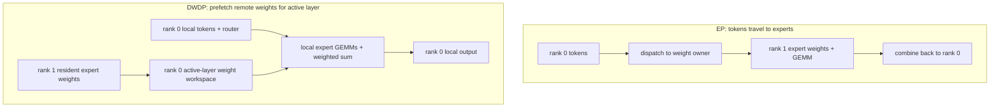
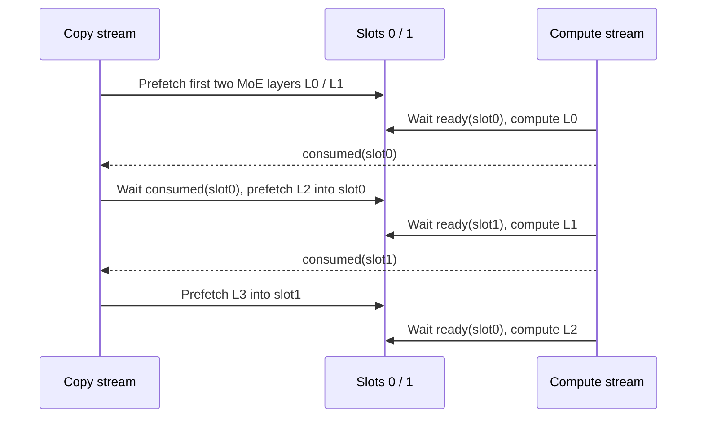

# 05. DWDP: Bring Weights to Tokens Instead of Moving Tokens Every Layer

**English** | [简体中文](../../../zh/ai-infra-basic/Parallel_Strategy/05-dwdp-weight-parallelism.md)

## 1. Purpose: Change What Crosses Devices

EP places expert weights on different ranks and routes tokens to them. DWDP, Distributed Weight Data Parallelism, retains local requests and prefetches remote expert weights into a local active-layer workspace before executing experts locally.

This differs from ordinary DP: a rank need not permanently store every expert of every layer. It also preserves routing rather than restricting selection to local experts. The pinned upstream targets large prefill workloads; see [parallel.py](https://github.com/sgl-project/sglang/blob/f2b73d4f9b4e64415b8d775b0f811c7801f1728b/python/sglang/srt/arg_groups/fields/parallel.py).



## 2. Why the Mathematics Matches

For token $`x_t`$, selected expert set $`\mathcal E_t`$, and routing weights $`a_{t,e}`$:

```math
y_t=\sum_{e\in\mathcal E_t}a_{t,e}F_e(x_t;W_e).
```

With identical weights $`W_e`$, routing, quantization parameters, and computation semantics, executing $`F_e`$ at the token owner or weight owner preserves the target equation. Different reduction orders, kernels, or quantization still require numerical tolerances.

Example: token A on rank 0 has value $`2`$, selects experts 0/2 with weights $`(0.25,0.75)`$, and uses $`F_e(x)=(e+1)x`$. EP sends a branch to rank 1; DWDP brings expert 2's weight to rank 0. Both obtain:

```math
y_A=0.25\cdot2+0.75\cdot6=5.
```

This establishes mathematical equivalence, not equal communication performance.

## 3. When Might Weight Movement Be Attractive?

Let one rank process $`n`$ tokens per layer with top-k $`k`$, hidden width $`H`$, element size $`s`$, and remote-assignment ratio $`\rho`$. Ignoring deduplication, padding, scales, and topology, remote dispatch+combine bytes are approximately:

```math
V_{\mathrm{EP}}\approx 2nk\rho Hs.
```

If remote weights prefetched per rank for that layer total $`W_{\mathrm{remote}}`$:

```math
V_{\mathrm{DWDP}}\approx W_{\mathrm{remote}},\qquad
n_{\mathrm{cross}}\approx\frac{W_{\mathrm{remote}}}{2k\rho Hs}.
```

Teaching parameters of 96 MiB remote weights, $`H=4096`$, $`s=2`$, $`k=8`$, and $`\rho=0.75`$ give a byte crossover at $`n=1024`$. This is a **per-rank, per-layer useful-payload estimate**. EP can deduplicate tokens to one destination; DWDP has alignment, access, and synchronization costs. Bandwidth and overlap differ, so fewer bytes do not establish lower latency.

The pinned implementation fetches planned remote expert ranges rather than precisely fetching only tiny weight fragments touched by the current routing. Few-token decode can still move large weights repeatedly; do not apply the strategy mechanically to decode.

If $`\rho=0`$, EP has no remote token payload in this estimate, so that traffic crossover does not exist.

## 4. Source: Ownership, Mapping, Prefetch, Consumption

DWDP is absent locally; these are pinned upstream entries:

| Source | Responsibility |
|---|---|
| [dwdp_manager.py](https://github.com/sgl-project/sglang/blob/f2b73d4f9b4e64415b8d775b0f811c7801f1728b/python/sglang/srt/layers/moe/dwdp/dwdp_manager.py) | collect MoE layers, build layout/transport/weight managers, manage lifecycle |
| [layout.py](https://github.com/sgl-project/sglang/blob/f2b73d4f9b4e64415b8d775b0f811c7801f1728b/python/sglang/srt/layers/moe/dwdp/layout.py) | expert ownership ranges, page alignment, composite virtual-address layout |
| [transport.py](https://github.com/sgl-project/sglang/blob/f2b73d4f9b4e64415b8d775b0f811c7801f1728b/python/sglang/srt/layers/moe/dwdp/transport.py) | exchange/import FABRIC or POSIX fd memory handles and build peer views |
| [weight_buffer.py](https://github.com/sgl-project/sglang/blob/f2b73d4f9b4e64415b8d775b0f811c7801f1728b/python/sglang/srt/layers/moe/dwdp/weight_buffer.py) | compose resident and prefetched pages into active-layer tensor views; reuse slots |
| [weight_manager.py](https://github.com/sgl-project/sglang/blob/f2b73d4f9b4e64415b8d775b0f811c7801f1728b/python/sglang/srt/layers/moe/dwdp/weight_manager.py) | copy stream, double buffering, ready/consumed events, remote-slice prefetch |

Virtual mapping gives GEMM a contiguous expert-weight view even when physical pages come from resident local storage and remote-copy workspace. It neither eliminates weight transfer nor establishes NPU availability for this CUDA/VMM implementation.

## 5. Why Double Buffering Needs Two Events



L0/L1 denote consecutive **MoE-layer order**, not necessarily consecutive model layer IDs. `prefetch_first_layers()` prepares two layers; `wait_prefetch()` orders computation after transfer; `record_compute_and_prefetch_next()` schedules the second following MoE layer after consuming the current slot because it reuses that slot.

Ready prevents reading unfinished weights; consumed prevents overwriting weights still used by GEMM. Two streams without these dependencies can produce intermittent errors.

## 6. Memory and Compatibility Accounting

Assume balanced resident expert sharding and two work slots sized for remote weights of the largest layer:

```math
M_{\mathrm{rank}}\approx M_{\mathrm{nonexpert}}
+\frac{W_{\mathrm{expert,all}}}{P}
+2\left(1-\frac1P\right)W_{\mathrm{expert,maxlayer}}
+M_{\mathrm{activation}}+M_{\mathrm{metadata}}.
```

This is not an exact allocation formula: alignment, scratch, and model differences remain. It explains why avoiding token A2A still requires workspace and weight bandwidth.

Upstream [handle_dwdp()](https://github.com/sgl-project/sglang/blob/f2b73d4f9b4e64415b8d775b0f811c7801f1728b/python/sglang/srt/arg_groups/parallel_hook.py) requires DWDP degree equal to the TP world and resolves DPA/EP/LM Head layouts. This revision rejects EPLB migration, PP, speculative decoding, and two-batch overlap, among other combinations. Null/prefill serving modes are allowed, with an explicit performance warning about refetching remote weights on every decode step in null mode.

## 7. Practice

The [math demo](./parallelism_math_demo.py) uses identical tokens/routes to simulate activation dispatch and local computation after weight fetch, checks matching outputs, and computes the byte crossover.

Why does a larger prefill batch better amortize approximately fixed weight-fetch cost? Why can slow weight fetch on one rank increase service tail latency? Continue with [06: composition](./06-parallel-topology-and-pd-composition.md).
