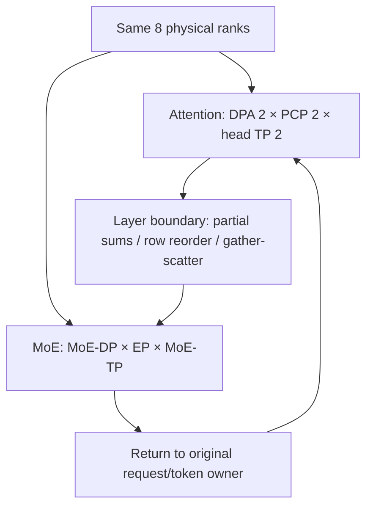
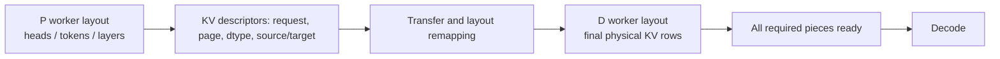

# 06. Composition: Rank Grids, Phase Handoff, and Layout Changes

**English** | [简体中文](../../../zh/ai-infra-basic/Parallel_Strategy/06-parallel-topology-and-pd-composition.md)

## 1. Count Physical Ranks Before Assigning Logical Identities

A rank can belong to attention TP, CP, DPA, MoE TP, EP, MoE DP, and PP groups simultaneously. These need not be independent hardware dimensions, so multiplying all parameters is incorrect.

For a teaching model world without external DP/PP, let $`T_w`$ be existing ranks and $`D,C,A`$ be DPA, PCP, and attention TP degrees. Explicitly choose this numbering:

```math
T_w=DCA,\qquad p=(dC+c)A+a.
```

This defines the example, while a program's `initialize_model_parallel()` determines its actual mapping. For $`T_w=8,D=2,C=2,A=2`$:

| World Ranks | DPA | PCP | Attention TP | Attention TP Group |
|---|---|---|---|---|
| 0, 1 | 0 | 0 | 0, 1 | 0, 1 |
| 2, 3 | 0 | 1 | 0, 1 | 2, 3 |
| 4, 5 | 1 | 0 | 0, 1 | 4, 5 |
| 6, 7 | 1 | 1 | 0, 1 | 6, 7 |

In this numbering, CP groups are 0/2, 1/3, 4/6, and 5/7. DPA0 and DPA1 own separate requests. MoE can interpret the same eight devices using a different expert layout.



See local concrete groups in the [TP/DP/EP walkthrough](../../sglang-source-reading/05-layer-communication/02-tp-dp-ep-sharding-and-ascend-npu.md); do not overwrite its explicitly different examples with this numbering.

## 2. DCP Usually Reuses Existing Attention TP Ranks

Take a different example: 8 existing ranks, DPA=2, attention TP=4 per group, and DCP=2. DCP subgroups can fit inside each four-rank attention group:

| DPA Owner | Existing Attention Ranks | Illustrative DCP Subgroups |
|---|---|---|
| 0 | 0, 1, 2, 3 | 0/1 and 2/3 |
| 1 | 4, 5, 6, 7 | 4/5 and 6/7 |

The total remains 8. Exact head organization follows the implementation, but DCP must remain within request-ownership domains. A necessary containment condition is:

```math
A=T_w/D,\qquad A\bmod C_{\mathrm{DCP}}=0.
```

DCP does not multiply the device count again. Different execution phases also do not guarantee arbitrary PCP/DCP co-enablement: pinned [parallel_hook.py](https://github.com/sgl-project/sglang/blob/f2b73d4f9b4e64415b8d775b0f811c7801f1728b/python/sglang/srt/arg_groups/parallel_hook.py) explicitly rejects prefill CP together with DCP greater than 1 in one instance.

## 3. Three MoE Dimensions Answer Different Questions

For divisible degrees under this topology decomposition:

```math
T_w=D_{\mathrm{MoE}}E_{\mathrm{EP}}A_{\mathrm{MoE\,TP}}.
```

- EP determines which rank group owns an expert.
- MoE TP partitions matrices inside one expert.
- MoE DP replicates an expert distribution for different data.

If one expert is too large for a device, increasing EP alone does not split its matrix; inspect MoE TP. Hot-expert replication/EPLB changes logical-to-physical mapping, so a static contiguous expert range may no longer determine destinations.

## 4. KV Handoff Across Different P/D Degrees

PD hands a request between instances rather than adding one intra-instance tensor axis. Start with a GQA example without DCP: 8 KV heads, P-TP=2, D-TP=4.

| P Source | KV Heads | D Destination |
|---|---|---|
| P0 | 0, 1, 2, 3 | D0 gets 0/1, D1 gets 2/3 |
| P1 | 4, 5, 6, 7 | D2 gets 4/5, D3 gets 6/7 |

Transfer must remap head shards, dtype, pages, and request slots. DCP at decode adds token-ownership remapping. MLA latent KV does not follow this GQA head table unchanged.



A correct mapping supplies every required destination element from the correct source. One replicated source copy may suffice; sharded sources require complete coverage. Equal buffer byte counts alone do not establish correctness.

Read local [disaggregation/mooncake/conn.py](../../../../python/sglang/srt/disaggregation/mooncake/conn.py) and upstream [DCP pack](https://github.com/sgl-project/sglang/blob/f2b73d4f9b4e64415b8d775b0f811c7801f1728b/python/sglang/srt/disaggregation/common/dcp_pack.py). The latter supports specific configurations, not arbitrary P/D degrees and formats. See [KV Transfer](../KV_Transfer/README.md) for the full protocol.

## 5. PP Adds a Time Pipeline, Not Just Layer Placement

Inference PP assigns layers to stages. For $`M`$ independent microbatches and $`S`$ equally timed stages, ideal forward-pipeline utilization is approximately:

```math
\eta\approx\frac{M}{M+S-1}.
```

This ignores communication and imbalance and is not a single-request autoregressive latency formula. The next decode token depends on the final output of the previous iteration; prefill chunks with different history lengths also take different time. The upstream [PP guide](https://github.com/sgl-project/sglang/blob/f2b73d4f9b4e64415b8d775b0f811c7801f1728b/docs/docs/advanced_features/pipeline_parallelism.mdx) covers asynchronous microbatches and dynamic chunking. Training's 1F1B is not automatically an inference protocol.

## 6. A Composition Experiment Record

| Record | Reason |
|---|---|
| physical rank/device/node/NIC mapping | identical logical groups can cross different slow links |
| DPA, PCP, DCP, attention TP groups | preserve request/history boundaries |
| MoE DP/EP/TP and expert locations | align routes, weight shards, and return owners |
| boundary shape, partial/replica status, token ID | matching shapes can still have different reduction semantics |
| P/D cache formats and completion protocol | prevent incorrect remapping and premature scheduling |
| model/backend/version and actual validation constraints | mathematical composition is not implementation support |

Run topology and P/D head-remap sections in the [math demo](./parallelism_math_demo.py). Draw DCP subgroups within two DPA groups and check whether any cross a request domain. Continue with [07](./07-encoder-dp-and-elastic-ep.md).
