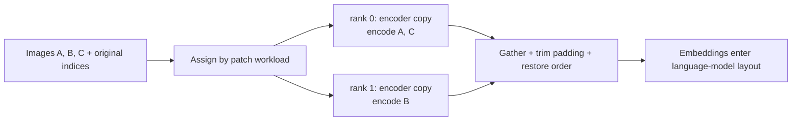
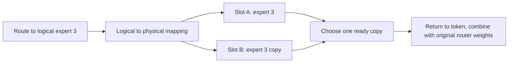
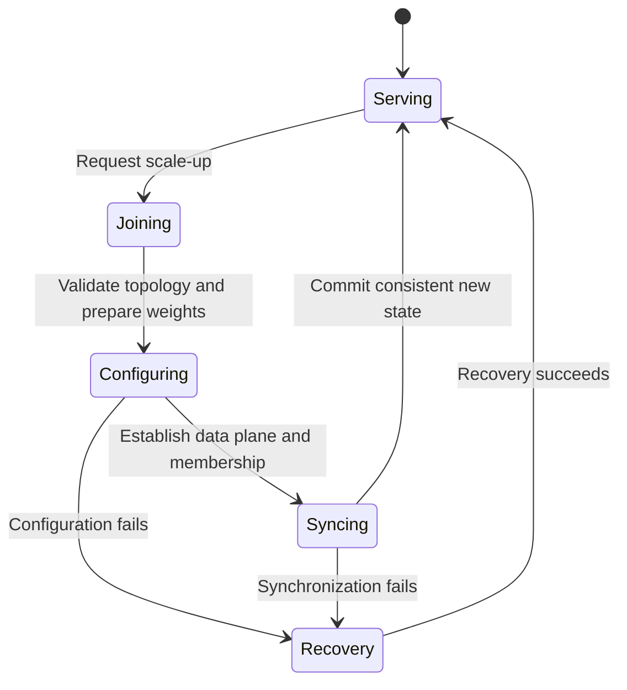

# 07. Encoder DP and elastic EP: modules and runtime reconfiguration

[简体中文](../../../zh/ai-infra-basic/Parallel_Strategy/07-encoder-dp-and-elastic-ep.md) | **English**

## 1. What encoder DP solves

Images/videos pass through a vision encoder before their embeddings enter the language model. If every language-model TP rank encodes every image, it repeats work. Encoder TP can instead introduce frequent communication around small matrices.

Encoder DP gives ranks encoder copies, distributes **independent images or video segments**, then collects embeddings. The language model may still use TP.



## 2. Mathematics and workload

Let $`E`$ be the encoder and $`I_i`$ an image. When samples do not interact:

```math
E([I_0,I_1,\ldots])=[E(I_0),E(I_1),\ldots].
```

Assign sample indices, encode independently, and restore order. This does not permit arbitrary splitting of one image's patches: ViT self-attention generally needs interactions within an image. Video positions and window rules must survive too.

With task costs $`w_i`$ and rank task sets $`\mathcal I_r`$:

```math
t_{\mathrm{encode}}\approx\max_r\sum_{i\in\mathcal I_r}w_i
+t_{\mathrm{gather}}+t_{\mathrm{reorder}}.
```

Costs $`[9,8,1,1]`$ split in input order give $`17,2`$; separating large images can give $`10,9`$. These are teaching units, not source-level latency predictions; patch count also misses attention-cost differences.

## 3. Source and data flow

In local [qwen3_vl.py](../../../../python/sglang/srt/models/qwen3_vl.py), `mm_enable_dp_encoder` affects vision TP settings; `get_image_feature()` / `get_video_feature()` select encoding paths.

Pinned upstream [mm_utils.py](https://github.com/sgl-project/sglang/blob/f2b73d4f9b4e64415b8d775b0f811c7801f1728b/python/sglang/srt/multimodal/mm_utils.py):

| Entry | Data transformation |
|---|---|
| `run_dp_sharded_vision_model` | Split regular chunks by rank, pad, encode, gather, and trim |
| `run_dp_sharded_mrope_vision_model` | Assign variable-size inputs using grid/position metadata and retain reorder information |
| Output `all_gather` and reorder | Collect padded embeddings, then recover order using lengths and indices |
| `run_dp_presharded_mrope_vision_model` | Handle inputs already sharded upstream; do not shard twice |

Check image indices, patches/grids, positions, output lengths, padding, and order together. Equal total row counts will not catch image A's embedding entering image B's placeholder. The call site determines each model's path.

## 4. EPLB: locations change, the function does not

EP places experts; EPLB adjusts placement or redundant copies using load. A logical expert's physical slots should implement the same function:

```math
y_t=\sum_{e\in\mathcal E_t}g_{t,e}f_e(x_t).
```

After routing to expert 3, choose one ready copy. **Two copies do not mean adding the same routed contribution twice.**



Every expert that may still be called needs at least one ready copy:

```math
\forall e,\qquad
\sum_p\mathbf{1}[\text{slot }p\text{ is a ready copy of }e]\geq 1.
```

This is a teaching correctness condition, not the full EPLB objective. Equal expert counts do not imply balanced hot-expert loads. See local [eplb](../../../../python/sglang/srt/eplb/) and [EP communication](../Communication/04-moe-deepep-and-zbal.md).

## 5. Elastic EP: more than increasing a number

Joining ranks need consistent weights, expert mapping, communication membership, Attention DP metadata, and executable state. Mixing old groups or mappings with new routes can stall collectives or corrupt results.



This is a responsibility diagram, not every source state name. In pinned [elastic_ep.py](https://github.com/sgl-project/sglang/blob/f2b73d4f9b4e64415b8d775b0f811c7801f1728b/python/sglang/srt/elastic_ep/elastic_ep.py), follow `validate_scale_cohort_topology`, `update_dp_attention_for_elastic_ep`, `try_admit_scale_ranks`, then commit/recovery.

[topology.py](https://github.com/sgl-project/sglang/blob/f2b73d4f9b4e64415b8d775b0f811c7801f1728b/python/sglang/srt/elastic_ep/topology.py) fixes Attention replica width and maps EP ranks to DPA:

```math
R_{\mathrm{attn}}=A_{\mathrm{TP}}C_{\mathrm{CP}},\qquad
D_{\mathrm{attn}}=E_{\mathrm{physical}}/R_{\mathrm{attn}}.
```

Divisibility is required; a joining cohort must match the primary Attention TP/CP topology. A replica is healthy only when **all members** are healthy. These are this implementation's constraints, not universal equations for elastic systems.

## 6. Check understanding

- Encoder DP: do embeddings reach the right image placeholders? Does an idle rank join required gathers?
- EPLB: why does adding a copy leave the token's top-k expression unchanged?
- Elastic EP: when may a joining rank receive tokens? Which mapping survives a failed expansion?

The [math demo](./parallelism_math_demo.py) includes encoder loads and expert copies; continue to [08](./08-diffusion-parallelism.md) for image/video generation.
