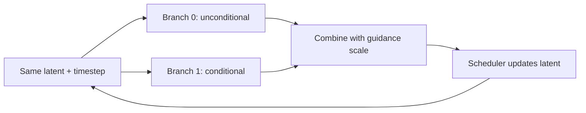
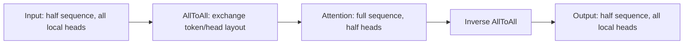
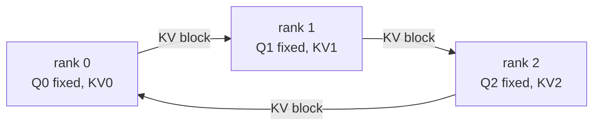

# 08. Diffusion parallelism: CFG, Ulysses, Ring, and KV-gather

[简体中文](../../../zh/ai-infra-basic/Parallel_Strategy/08-diffusion-parallelism.md) | **English**

This chapter extends the course to image/video generation. SGLang Diffusion lives in `multimodal_gen` and uses different execution and configuration paths from autoregressive SRT PCP/DCP. They share tensor sharding and exact softmax; the name “SP” does not identify the same implementation.

## 1. CFG: run conditional branches concurrently

Conventional two-branch classifier-free guidance needs conditional and unconditional predictions:

```math
\epsilon_{\mathrm{guided}}
=\epsilon_{\mathrm{uncond}}
+g(\epsilon_{\mathrm{cond}}-\epsilon_{\mathrm{uncond}}).
```

Both branches use the same latent and timestep with different conditioning, so their DiT forwards can run independently before combination. Unconditional 2, conditional 5, and guidance scale 3 give 11. Splitting denoising steps between devices is different: the next latent depends on this step's combined result.



Ideally two branch forwards become one forward plus communication. Models without two actual branches cannot obtain that gain merely by enabling CFG parallelism. See pinned [cfg_parallel_utils.py](https://github.com/sgl-project/sglang/blob/f2b73d4f9b4e64415b8d775b0f811c7801f1728b/python/sglang/multimodal_gen/runtime/distributed/cfg_parallel_utils.py).

## 2. Ulysses: temporarily exchange token sharding for head sharding

Assume ordinary MHA, independent attention heads, and divisible sequence/head counts. Initially two ranks each hold half the tokens and all local heads. AllToAll sends some heads from each token shard to the other rank, giving each rank the full sequence and fewer heads. After attention, an inverse AllToAll restores the layout.



Let TP, Ulysses, and Ring degrees be $`T,U,R`$, with batch/sequence/heads/head dimension $`B,S,H,d`$. One attention's logical shapes are:

```math
[B,S/(UR),H/T,d]
\xrightarrow{\mathrm{AllToAll}}
[B,S/R,H/(TU),d]
\xrightarrow{\mathrm{RingAttention}}
[B,S/R,H/(TU),d]
\xrightarrow{\mathrm{AllToAll}}
[B,S/(UR),H/T,d].
```

Ulysses permutes layouts without changing the attention equation; TP shards projection weights. Both touch heads at different levels. GQA, replicated text prefixes, and uneven inputs need specialized paths beyond this simple MHA shape.

## 3. Ring: keep queries stationary and circulate KV

Each rank keeps its query rows while KV blocks circulate. Every incoming block updates the local attention output and normalization metadata; visiting all relevant KV yields the full result.



Do not add independently normalized block outputs. For two blocks with outputs and natural-log LSE $`(o_a,\ell_a),(o_b,\ell_b)`$:

```math
\ell=\log(e^{\ell_a}+e^{\ell_b}),\qquad
o=e^{\ell_a-\ell}o_a+e^{\ell_b-\ell}o_b.
```

Repeated exact merging supports overlapped reception and computation; stable implementations first subtract the maximum LSE. This shares the [DCP softmax derivation](./04-decode-context-parallelism.md), but here handles DiT query rows rather than SRT decode-cache protocols.

A Ring group needs **the same heads over different token rows**. Ring adds no head-divisibility constraint, but requires a kernel exposing LSE and correct masking. Image/video attention generally does not use the language model's triangular causal mask, so PCP zigzag load formulas do not transfer directly.

## 4. KV-gather: materialize full KV for simpler local computation

Alternatively, AllGather KV each layer, then attend local Q against full KV. This answers the same “how to see remote KV” question as Ring; they are **alternatives** for that slot in a layer's layout.

| Path | Core per-rank behavior | Main cost |
|---|---|---|
| Ulysses | Exchange sequence/head layouts | Two logical AllToAll operations; heads must split |
| Ring | Stationary Q, rotating KV, online merge | Neighbor transfers and LSE merges, potentially overlapped |
| KV-gather | Collect KV before local-Q attention | Temporary full KV and a large communication burst |
| TP | Shard projection/output matrices | Weight savings and layer collectives |
| DP | Full engine copies serve separate requests | Request throughput; no attention collectives between copies |

## 5. Implementation and composition constraints

Pinned upstream entries:

| Source | What to follow |
|---|---|
| [attention/layer.py](https://github.com/sgl-project/sglang/blob/f2b73d4f9b4e64415b8d775b0f811c7801f1728b/python/sglang/multimodal_gen/runtime/layers/attention/layer.py) | `USPAttention` selects Ulysses, Ring, or KV-gather; checks `supports_ring_rotation()` |
| [distributed/parallel_state.py](https://github.com/sgl-project/sglang/blob/f2b73d4f9b4e64415b8d775b0f811c7801f1728b/python/sglang/multimodal_gen/runtime/distributed/parallel_state.py) | Construct groups from physical ranks |
| [Official parallelism documentation](https://github.com/sgl-project/sglang/blob/f2b73d4f9b4e64415b8d775b0f811c7801f1728b/docs/docs/sglang-diffusion/parallelism.mdx) | Configuration, model, and backend constraints |
| [Encoder parallelism documentation](https://github.com/sgl-project/sglang/blob/f2b73d4f9b4e64415b8d775b0f811c7801f1728b/docs/docs/sglang-diffusion/encoder_parallel.mdx) | Diffusion encoder fold/dp/replicate, distinct from SRT vision settings |

For the Ring path with independent group axes, a single replica illustrates:

```math
N_{\mathrm{replica}}=F_{\mathrm{CFG}}TUR,\qquad
C_{\mathrm{SP}}=UR,\qquad
H\bmod T=0,\qquad (H/T)\bmod U=0.
```

External DP replicates the engine; the launcher's validation is authoritative. With $`H=56,T=4,U=4`$, total heads divide by the Ulysses degree, but TP leaves only 14 heads per rank, which cannot split evenly across four Ulysses ranks.

Ring also needs sequence/packing alignment. Pinned generic varlen `USPAttention` and legacy stacked-QKV `UlyssesAttention` have Ring limitations; support in other paths does not imply every model works. On NPU, check the actual backend; CUDA transport behavior does not prove HCCL support.

## 6. Exercises and verification

The [math demo](./parallelism_math_demo.py) simulates Ulysses token/head exchange and restoration, compares against full attention, and checks the CFG example. It executes no actual communication.

Draw two ranks, four tokens, and two heads. Check that each exchanged head sees every legal token, then explain why the output exchange must invert the input exchange. Measure communication, peak memory, step latency, and throughput in real deployments; degree alone cannot predict performance.
