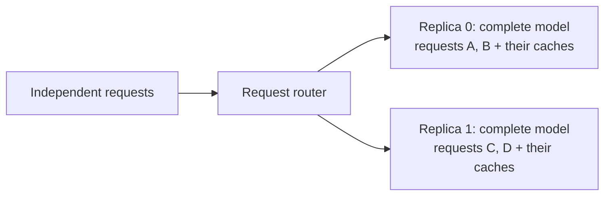
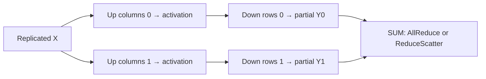
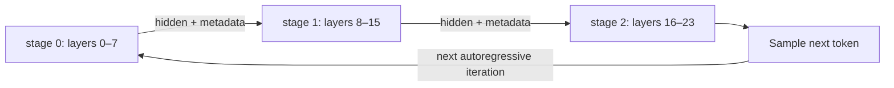
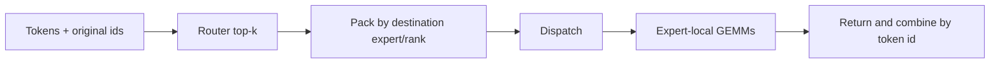

# Parallel strategy foundations: DP / TP / PP / EP

[简体中文](../../../zh/ai-infra-basic/Parallel_Strategy/tutorial.md) | **English**

Start with the [strategy map](./00-parallelism-map-and-version-boundaries.md). This chapter develops the foundational partitions. Here DP means complete-model replicas; [DP Attention](./01-dp-attention-principles.md) shares a model world across differently partitioned modules.

| Strategy | Partition | Main purpose | Communication in inference |
|---|---|---|---|
| DP | Independent requests | Aggregate throughput | Usually little communication between complete replicas |
| TP | Matrices/features/heads | Weight capacity and layer computation | AllReduce, AllGather, ReduceScatter as required by layout |
| PP | Layer ranges | Distribute model capacity and pipeline work | Activation send/receive |
| SP | Row-local activations | Reduce replicated Norm/residual work | ReduceScatter and AllGather boundaries |
| PCP | Prefill query work | Distribute long-prompt computation | Required KV exchange and layout restoration |
| DCP | Historical KV and local contributions | Distribute decode KV capacity/reads | Queries and exact output/LSE merging |
| EP | Expert ownership | Distribute expert capacity | Token dispatch/combine, often AllToAll(V) |

## 1. DP: separate requests across complete-model replicas

Suppose requests A/B/C/D are independent. One replica handles A/B and another C/D. A replica can itself span TP or PP ranks; “complete model” does not imply “one device.”



For a batch-independent model function:

```math
F([X_A,X_B])=[F(X_A),F(X_B)].
```

This equality means separate requests do not need to exchange attention history. It does not permit splitting one request's tokens without additional protocols. Serving still needs routing, administration, and possibly shared external services.

If a replica sustains throughput $`q`$, an ideal $`D`$ replicas approach $`Dq`$. Shared ingress, unequal request lengths, and memory limits prevent guaranteed linear scaling. Weight memory is replicated; adding DP does not make an oversized replica fit.

**Implementation:** follow `DataParallelController` for request dispatch, then each replica's Scheduler/worker. Distinguish ordinary DP from the historical `enable_dp_attention` compatibility path using the [version table](./00-parallelism-map-and-version-boundaries.md). The latter does not simply clone every FFN/expert weight.

## 2. TP: column pieces concatenate; row pieces sum

Let $`X\in\mathbb R^{N\times H}`$ and $`W\in\mathbb R^{H\times F}`$:

```math
Y=XW.
```

### 2.1 Column-parallel linear

Split output columns:

```math
W=[W_0\;W_1],\qquad Y_r=XW_r,\qquad Y=[Y_0\;Y_1].
```

Each rank computes different output features. Concatenation or AllGather reconstructs full output if needed. **Summing these parts is wrong**: they are different columns, not contributions to the same columns. A following layer may consume them directly without gathering.

### 2.2 Row-parallel linear

Split input features and matching weight rows:

```math
X=[X_0\;X_1],\qquad
W=\begin{bmatrix}W_0\\W_1\end{bmatrix},\qquad
Y=X_0W_0+X_1W_1.
```

Each rank produces a contribution to the same output features, so those contributions must sum. AllReduce gives a replicated result; ReduceScatter gives complete results for assigned output rows. Bias must be added once after summing, or handled through an equivalent distributed convention.

A tiny example:

```math
[2\;3]\begin{bmatrix}5\\7\end{bmatrix}
=2\cdot5+3\cdot7=31.
```

Partial outputs are 10 and 21. Neither is a full replica. Shape equality alone cannot distinguish a partial from a replicated result.

### 2.3 Why FFN often pairs the two

For a simple FFN with an elementwise activation:

```math
Y=\phi(XW_{\mathrm{up}})W_{\mathrm{down}}
=\sum_r\phi(XW_{\mathrm{up},r})W_{\mathrm{down},r}.
```

Column-parallel up projection creates feature shards; row-parallel down projection consumes them. Since the activation acts independently on features, no full intermediate gather is mathematically required.



Attention TP similarly splits projection/head work, then sums output-projection contributions. GQA/MQA may replicate KV heads if there are fewer KV heads than ranks. Absorbed MLA can also retain replicated latent KV; this motivates [DCP](./04-decode-context-parallelism.md).

**Implementation:** local [linear.py](../../../../python/sglang/srt/layers/linear.py) contains `ColumnParallelLinear`, `MergedColumnParallelLinear`, `QKVParallelLinear`, and `RowParallelLinear`. Read weight loading, shard boundaries, `gather_output`/`reduce_results`, and quantization layouts together. There is no universal AllReduce after every GEMM.

## 3. PP: split layers, then schedule a pipeline

For layer groups $`F_0,F_1,F_2`$:

```math
h_1=F_0(x),\qquad h_2=F_1(h_1),\qquad y=F_2(h_2).
```

Each stage owns its layer weights and local layer caches. It sends hidden states, and any required residual/metadata, to the next stage. It does not move all historical KV each layer.



Independent microbatches can occupy different stages concurrently. For $`M`$ microbatches and $`S`$ equal-time stages, ignoring communication and imbalance:

```math
\eta\approx\frac{M}{M+S-1}.
```

A single request's next token waits for its current token to traverse the stages and be sampled. More PP does not automatically reduce per-token latency. Chunked prefill, unequal layer costs, and cache pressure change the schedule.

**Implementation:** follow `pp_rank`, model `start_layer`/`end_layer`, `PPProxyTensors`, and last-stage sampling. The [PP demo](./pp_inference_demo.py) illustrates stage handoffs; [06](./06-parallel-topology-and-pd-composition.md) discusses composition and inference scheduling limits.

## 4. CP foundations and the precise SP/PCP/DCP split

Legacy material sometimes uses “SP/CP” for all token/context sharding. In this course:

- [SP](./02-sp-versus-context-parallelism.md) shards row-local Norm/residual activations.
- [PCP](./03-prefill-context-parallelism.md) distributes prefill query work while preserving each query's complete legal history.
- [DCP](./04-decode-context-parallelism.md) distributes historical KV and merges partial attention exactly.

The old [sp_inference_demo.py](./sp_inference_demo.py) is a **CP distributed-softmax demonstration**, not the LayerNorm SP implementation. It stores local KV, calculates local score contributions, obtains a global maximum and denominator, then combines weighted-value numerators.

For disjoint historical sets $`J_r`$:

```math
m=\max_j s_j,\qquad
z_r=\sum_{j\in J_r}e^{s_j-m},\qquad
u_r=\sum_{j\in J_r}e^{s_j-m}v_j,\qquad
o=\frac{\sum_r u_r}{\sum_r z_r}.
```

AllGather KV, moving queries, Ring KV exchange, and output/LSE exchange are different implementation choices. CP does not mandate one AllToAll protocol. See 02–04 for complete derivations, layouts, and pinned SGLang implementations.

## 5. EP: route tokens to distributed experts

For token $`x_t`$, router-selected experts $`\mathcal E_t`$, and gate weights $`g_{t,e}`$:

```math
y_t=\sum_{e\in\mathcal E_t}g_{t,e}F_e(x_t).
```

Experts reside on different ranks. Router decisions determine which token contributions travel to which owners; expert outputs must return to their original token and combine with the correct gate weights.



One token can visit several experts. Multiple experts on the same destination may permit packing/deduplication, depending on the dispatcher. AllToAllV accommodates unequal counts; implementations can also use padded collectives or dedicated transports.

EP saves total expert storage per owner, but does not automatically split one expert's matrix; MoE TP does that. Hot experts create imbalance even when expert counts are equal.

**Implementation:** follow local [moe](../../../../python/sglang/srt/layers/moe/) and [EP demo](./ep_moe_demo.py). [Communication](../Communication/04-moe-deepep-and-zbal.md) explains DeepEP/ZBAL and dispatch/combine. [DWDP](./05-dwdp-weight-parallelism.md) changes which object moves: weights visit local tokens instead.

## 6. Compose layouts, not just abbreviations

A physical rank can belong to attention, FFN/MoE, and pipeline groups simultaneously. EP, DPA, DCP, and TP degrees may reuse the same ranks. An independent Cartesian grid permits multiplying dimensions; SGLang's actual groups must be read from initialization and validation.

Read [06: topology and PD](./06-parallel-topology-and-pd-composition.md) before counting devices. Continue to [07](./07-encoder-dp-and-elastic-ep.md) for module/elastic behavior and [08](./08-diffusion-parallelism.md) for diffusion.

For every boundary, write down: shape, original token indices, partial or replica semantics, communicator, and next consumer. These explain correctness more reliably than strategy names alone.

Run the [standard-library math lab](./parallelism_math_demo.py) before trying distributed deployments. It verifies small mathematical decompositions, not accelerator performance.
