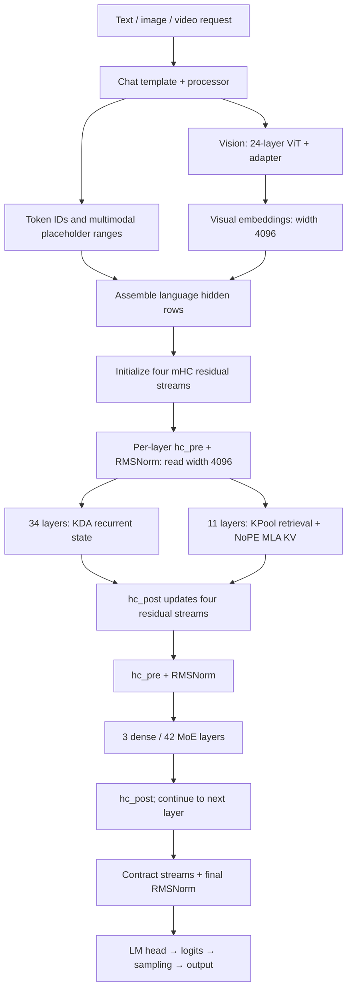
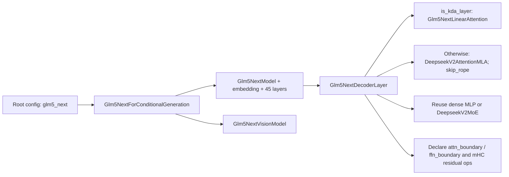
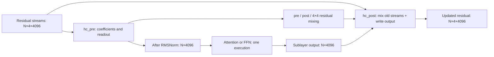
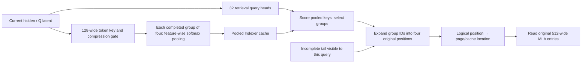

# End-to-End Example: GLM-5.3-Flash Hybrid KDA, NoPE Sparse MLA, mHC, and Multimodal Execution

[简体中文](../../../../zh/sglang-ascend-npu/source-code-walkthrough/examples/03-glm-5.3-flash-end-to-end.md) | **English**

This walkthrough follows the same “configuration → objects → weights → tensors → caches → a generation step” method as [GLM-4.7-Flash](./00-glm-4.7-flash-end-to-end.md) and [GLM-5.2](./02-glm-5.2-end-to-end.md). **GLM-5.3-Flash is neither a smaller GLM-5.2 nor a model in which every layer uses linear attention.** Three changes need to be understood together:

1. Its 45-layer text backbone interleaves 34 KDA layers with 11 DSA/MLA layers. Attention type and dense/MoE type are independent choices.
2. Four-stream mHC changes residual organization, but each Attention/FFN sublayer still receives width 4096.
3. A vision encoder converts images/videos into language hidden rows. Generation maintains MLA KV, KPool retrieval caches, and KDA recurrent states together.

> **Version and platform boundary:** the SGLang source snapshot in this repository does not contain `models/glm5_next.py`. New model symbols below link to a pinned upstream revision, not nonexistent local files. This tutorial does not update the runtime snapshot. Upstream model support, the existence of an Ascend operator, and a validated end-to-end NPU configuration are different kinds of evidence. We validate configuration, source semantics, and CPU arithmetic here; we do not claim a full-model GPU/NPU run.

---

## 1. Reading Baseline and Primary Sources

### 1.1 What this walkthrough fixes

| Item | Pinned baseline |
|---|---|
| Model configuration | `zai-org/GLM-5.3-Flash`, revision `46a050bec13002ad29ee795c16e61cf4fa3c4a9c` |
| Upstream source | `sgl-project/sglang`, commit `92580581da6fc8542a997a00c1a8b71b03497680` |
| Local common-flow reference | Repository commit `936bdf37c900d7854c57521d832e39df633a5fcb` at the start of this walkthrough |
| Verification date | 2026-10-16 |
| Tensor teaching baseline | TP=8, PP=1, EP=1; Attention DP, CP, speculation, and graphs disabled |
| Dtype baseline | Native mixed-FP8 checkpoint weights; BF16 activations from the configuration; initially explain MLA KV as BF16 |
| Inputs | Text without prefix hits first; images, prefix reuse, and MTP afterwards |

TP=8 makes matrix arithmetic concrete; it is not a hardware-tuning recommendation. The FP8 checkpoint has BF16/FP32 exceptions, so not every weight consumes one byte. FP8 weights and FP8 KV cache are also separate choices.

Primary sources:

- [Official model card](https://huggingface.co/zai-org/GLM-5.3-Flash/blob/46a050bec13002ad29ee795c16e61cf4fa3c4a9c/README.md) and [pinned config.json](https://huggingface.co/zai-org/GLM-5.3-Flash/blob/46a050bec13002ad29ee795c16e61cf4fa3c4a9c/config.json): model identity, dimensions, and layer lists.
- [Pinned SGLang cookbook](https://github.com/sgl-project/sglang/blob/92580581da6fc8542a997a00c1a8b71b03497680/docs/cookbook/autoregressive/GLM/GLM-5.3-Flash.mdx): device/backend combinations, cache dtypes, and deployment restrictions. Its support statements are revision-specific, not universal.
- [Pinned model implementation](https://github.com/sgl-project/sglang/blob/92580581da6fc8542a997a00c1a8b71b03497680/python/sglang/srt/models/glm5_next.py) and [configuration adapter](https://github.com/sgl-project/sglang/blob/92580581da6fc8542a997a00c1a8b71b03497680/python/sglang/srt/configs/glm5_next.py): the main sources for the execution path.
- [GLM-5.3-Flash support PR](https://github.com/sgl-project/sglang/pull/36507): why the entry point is absent from an older snapshot. The GLM-5 paper is not a substitute for evidence about every Flash-specific addition.

### 1.2 Prerequisites already explained elsewhere

| Concept | Existing tutorial | What this walkthrough adds |
|---|---|---|
| MLA | [Low-rank compression and matrix absorption](../../../ai-infra-basic/Model_Architecture/04-multi-head-latent-attention.md) | NoPE, 512-wide cache entries, and TP=8 projection shapes |
| DSA | [Sparse attention](../../../ai-infra-basic/Model_Architecture/07-deepseek-sparse-attention.md) | Four-token KPool keys, tails, and group-ID expansion |
| KDA | [Kimi Delta Attention](../../../ai-infra-basic/Model_Architecture/09-kimi-delta-attention.md) | 64 heads, width 128, safe gates, and GLM's output gate |
| GDN | [Value prediction and state updates](../../../ai-infra-basic/Gated_Delta_Network/01-gdn-math-and-state.md) | Why scalar GDN decay/output-gate assumptions cannot simply be copied |
| mHC | [Residual connections, doubly stochastic constraints, and Sinkhorn](../../../ai-infra-basic/Model_Architecture/10-manifold-constrained-hyper-connections.md) | This model's four-stream configuration, read/write coefficients, and stage boundaries |
| MoE | [Routing and expert execution](../../../ai-infra-basic/Model_Architecture/03-sparse-moe-routing.md) | 288-select-8, shared experts, and clamped SwiGLU |
| DP Attention | [Row ownership and communication](../../../ai-infra-basic/Parallel_Strategy/01-dp-attention-principles.md) | mHC streams/sidecars must follow the same token-row mapping |
| Speculation | [Speculative decoding](../../../ai-infra-basic/Speculative_Decoding/README.md) | MTP and hybrid-state commit/rollback |

---

## 2. Configuration Fingerprint: Flash Is Not GLM-5.3

### 2.1 Read the root and text_config separately

| Field location | Pinned value | Meaning |
|---|---|---|
| Root `architectures` | `Glm5NextForConditionalGeneration` | Multimodal wrapper, not `GlmMoeDsaForCausalLM` |
| Root `model_type` | `glm5_next` | Identification for Transformers/config/processor |
| Model-card scale | Approximately 320B total / 18B active | Total and per-token active parameters differ; active count alone does not determine resident weight memory |
| `text_config.hidden_size` | 4096 | Logical Attention/FFN input width |
| `num_hidden_layers` | 45 | Target layers, excluding the additional MTP block |
| `vocab_size` | 154880 | Embedding and LM-head vocabulary |
| `linear_attn_config` | 64 heads, head dim 128, conv kernel 4 | KDA dimensions; top-level `head_dim=0` is not the KDA width |
| `q_lora_rank` / `kv_lora_rank` | 1536 / 512 | MLA Q/KV latent dimensions |
| `num_attention_heads` | 64 | MLA query heads; numerically equal to KDA's count, but with a different width |
| `qk_nope_head_dim` / `qk_rope_head_dim` | 256 / 0 | No RoPE subvector in text MLA |
| `v_head_dim` | 256 | Per-head width when V is explicitly reconstructed |
| `index_n_heads` / `index_head_dim` | 32 / 128 | Replicated Indexer query heads and width |
| `index_kpool` / `index_topk` | 4 / 2048 | Four tokens per group; the historical main-token budget, not 2048 pooled groups |
| `index_kpool_compress` / `index_kpool_always_select_tail` | true / true | Learned retrieval-key compression and retention of the incomplete tail |
| `mhc` / `hc_mult` | true / 4 | Four residual streams |
| `hc_sinkhorn_iters` / `hc_eps` | 20 / $`10^{-6}`$ | Residual-mixing constraint and stabilization |
| `first_k_dense_replace` / `intermediate_size` | 3 / 12288 | The first three layers use dense MLPs |
| `n_routed_experts` / `num_experts_per_tok` | 288 / 8 | Expert bank and per-token selection in each sparse layer |
| `n_shared_experts` / `moe_intermediate_size` | 1 / 2048 | Always-active shared expert and single-expert intermediate width |
| `routed_scaling_factor` / `swiglu_limit` | 2.5 / 10.0 | Routed-output scaling and pre-activation clamping |
| `num_nextn_predict_layers` | 1 | Checkpoint MTP blocks, not the maximum number of draft tokens per round |
| `max_position_embeddings` | 1048576 | Configured limit, not a device/backend capacity guarantee |

The root `quantization_config` specifies FP8 E4M3, dynamic activations, weight blocks of shape $`[128,128]`$, and many conversion exceptions. `dtype=bfloat16` is not inconsistent with FP8 quantization: it does not assert that every serialized tensor is BF16.

### 2.2 Two independent layer-type axes

| Target layer ID, zero-based | Attention | FFN |
|---|---|---|
| 0, 1, 2 | KDA | Dense SwiGLU |
| 3 | DSA + NoPE MLA | Sparse MoE |
| 4, 5, 6 | KDA | Sparse MoE |
| 7 | DSA + NoPE MLA | Sparse MoE |
| Repeat through 43 | Three KDA layers followed by one DSA layer | Sparse MoE |
| 44 | KDA | Sparse MoE |

This gives 34 KDA and 11 DSA layers, alongside 3 dense and 42 MoE layers. The DSA IDs are:

```math
\mathcal{L}_{\mathrm{DSA}}=\{3,7,11,15,19,23,27,31,35,39,43\}
```

The backend name `full_attn_layers` does not mean these layers necessarily attend densely to all history. In the hybrid wrapper it identifies the **non-recurrent side**; for this model that side is still DSA sparse MLA.

### 2.3 Whole-model dataflow



### 2.4 What problem does each component address?

| Component | Intended cost reduction / problem addressed | Cost or limitation |
|---|---|---|
| KDA | Avoid re-reading historical KV in every layer/decode step by writing history into fixed-size state | Finite state is not random-access storage of all original history; temporal dependencies and state carry matter |
| Sparse MLA | Retain explicit historical-token reads while compressing per-token KV and limiting main-Attention reads | Retrieval has overhead; unselected positions do not enter that main Attention computation |
| KPool | Avoid a separate full retrieval entry for every historical token | A group shares a coarse retrieval decision; selection still reads four original MLA entries |
| mHC | Provide constrained dynamic information paths between residual streams | Adds residual activations, coefficient projections, and mixing; not free widening of every sublayer |
| MoE | Increase expert capacity with many total parameters while executing only selected routed experts per token | Weights still need storage, with routing, load-balancing, and possibly cross-rank dispatch costs |

The hybrid therefore combines complementary history-access mechanisms; KDA and sparse MLA are not identical operations. Sinkhorn constrains the mixing of old residuals, not a guarantee that the entire network including every gate/sublayer never amplifies signals. These are mechanism explanations derived from the computation, not training ablations performed in this task.

---

## 3. Source Map and Initialization: From Configuration to Objects

### 3.1 The entry point is not a simple GLM-5.2 subclass

| Question | Pinned upstream file / symbol |
|---|---|
| Config adaptation and KDA layer list | [configs/glm5_next.py](https://github.com/sgl-project/sglang/blob/92580581da6fc8542a997a00c1a8b71b03497680/python/sglang/srt/configs/glm5_next.py); `Glm5NextTextConfig.is_kda_layer()` |
| Multimodal wrapper, backbone, decoder, KDA projections, vision modules | [models/glm5_next.py](https://github.com/sgl-project/sglang/blob/92580581da6fc8542a997a00c1a8b71b03497680/python/sglang/srt/models/glm5_next.py) |
| Layer-wise KDA/DSA dispatch | [hybrid_linear_attn_backend.py](https://github.com/sgl-project/sglang/blob/92580581da6fc8542a997a00c1a8b71b03497680/python/sglang/srt/layers/attention/hybrid_linear_attn_backend.py); `HybridLinearAttnBackend` |
| MLA projection/absorption and reused FFN/MoE | [models/deepseek_v2.py](https://github.com/sgl-project/sglang/blob/92580581da6fc8542a997a00c1a8b71b03497680/python/sglang/srt/models/deepseek_v2.py) |
| KDA extend/decode/verify | [linear/kda_backend.py](https://github.com/sgl-project/sglang/blob/92580581da6fc8542a997a00c1a8b71b03497680/python/sglang/srt/layers/attention/linear/kda_backend.py); `KDAAttnBackend` |
| Pooled Indexer | [dsa_indexer_kpool.py](https://github.com/sgl-project/sglang/blob/92580581da6fc8542a997a00c1a8b71b03497680/python/sglang/srt/layers/attention/dsa/dsa_indexer_kpool.py); `IndexerKPool` |
| Pooling, FP8 index writes, group expansion | [kpool_fp8_index.py](https://github.com/sgl-project/sglang/blob/92580581da6fc8542a997a00c1a8b71b03497680/python/sglang/srt/layers/attention/dsa/kpool_fp8_index.py) |
| mHC pre/post, Sinkhorn, contraction | [kernels/ops/layernorm/mhc.py](https://github.com/sgl-project/sglang/blob/92580581da6fc8542a997a00c1a8b71b03497680/python/sglang/kernels/ops/layernorm/mhc.py) |
| mHC and communication boundaries | [layer_boundary/residual/mhc.py](https://github.com/sgl-project/sglang/blob/92580581da6fc8542a997a00c1a8b71b03497680/python/sglang/srt/layers/layer_boundary/residual/mhc.py); `MHCState` |
| State shapes and default dtypes | [configs/mamba_utils.py](https://github.com/sgl-project/sglang/blob/92580581da6fc8542a997a00c1a8b71b03497680/python/sglang/srt/configs/mamba_utils.py); `KimiLinearStateShape` |
| MTP entry point and weight filtering | [models/glm5_next_nextn.py](https://github.com/sgl-project/sglang/blob/92580581da6fc8542a997a00c1a8b71b03497680/python/sglang/srt/models/glm5_next_nextn.py) |

Two similarly named wrappers dispatch along different axes: `HybridLinearAttnBackend` selects DSA/KDA by **layer type**, while `HybridAttnBackend` can select backends by **prefill/decode mode**. The former's DSA side can itself contain the latter.

### 3.2 Initialization order



The runtime must also create paged KV pools, KDA state pools, request indices, and matching backends. Starting with an ordinary MLA pool and treating KDA layers as “no-KV no-ops” is incorrect.

### 3.3 Loading: name mapping, fusion, and quantization are separate

The wrapper normalizes text/vision checkpoint prefixes and loads logical projections into packed parameters. This table describes mappings, not a verbatim loader listing:

| Logical checkpoint weights | Possible runtime destination | Why the math is unchanged |
|---|---|---|
| `model.language_model.*` | `model.*` | Text-wrapper naming adaptation |
| `model.visual.*` | `visual.*` | Vision-wrapper naming adaptation |
| `q_a_proj`, `kv_a_proj_with_mqa` | `fused_qkv_a_proj_with_mqa` | One GEMM produces two independent latents, then splits them |
| KDA Q/K/V, beta, and first low-rank f/g projections | `fused_qkvbfg_a_proj` or separate paths | Availability depends on quantization format, skip lists, LoRA, and other guards |
| `gate_proj`, `up_proj` | `gate_up_proj` | Concatenate output channels, then apply their separate gating operations |
| Q/K/V short convolutions | `qkv_conv1d` | Pack channels without convolving the three streams into each other |
| Layer-45 NextN weights | Separate draft model | Not part of the target's 45 decoder iterations |

**A parameter named `fused` does not prove that it uses an FP8 GEMM.** Some KDA fusion paths specifically require unquantized logical projections. Successful loading alone is not enough: check skipped/unexpected keys, shard shapes, quantization scales, and weight postprocessing.

---

## 4. Running Tensor Example: Two-Request Prefill, Then One Decode

Start with two text requests, extending by 3 and 2 tokens without prefix hits:

```math
B=2,\quad N=3+2=5,\quad D=4096,\quad T_{\mathrm{attn}}=T_{\mathrm{linear}}=8
```

| Object | Logical shape / value | Meaning |
|---|---|---|
| `input_ids` | $`[5]`$ | Two requests packed together, not five requests |
| `positions` | $`[0,1,2,0,1]`$ | Positions restart per request; NoPE does not eliminate position metadata |
| Query boundaries | $`[0,3,5]`$ | First three rows belong to R0, last two to R1 |
| Embedding | $`[5,4096]`$ | One row per current token |
| mHC residual | $`[5,4,4096]`$ | Four residual streams per token |
| mHC transport/storage view | $`[5,16384]`$ | Flattened streams, not a sublayer hidden width of 16384 |
| Normalized sublayer input | $`[5,4096]`$ | Starting width for Attention, router, and FFN |
| Final target hidden | $`[5,4096]`$ | Streams have been contracted |
| Last-token rows for ordinary generation | $`[2,4096]`$ | Projecting every prefill row is not always necessary |
| Full-vocabulary logits for two requests | $`[2,154880]`$ | Physical sharding/gathering depends on the LM-head and sampling path |

The next ordinary decode consumes one newly sampled token per request, so current rows become $`N=B=2`$. Histories grow, but the whole history is not fed back as current hidden rows.

---

## 5. mHC: Four Residual Streams, Yet a Width-4096 Sublayer Input

For a first encounter, read the [standalone principles tutorial](../../../ai-infra-basic/Model_Architecture/10-manifold-constrained-hyper-connections.md): ordinary residuals, unconstrained HC mixing, doubly stochastic constraints, Sinkhorn, complete numerical examples, and stability limits. This section retains GLM-5.3-Flash-specific shapes, source orientation, and configuration differences.

### 5.1 How this differs from an ordinary residual

An ordinary residual adds a sublayer output back into one hidden vector. mHC maintains $`m=4`$ streams per token:

```math
R\in\mathbb{R}^{N\times m\times D},\qquad m=4,\quad D=4096
```

Attention/FFN does not run four times. `hc_pre` reads one width-$`D`$ vector from the streams; the sublayer runs once; `hc_post` writes its output into the streams while mixing the old residuals. At model entry the embedding is copied into four streams. At exit a stream mean contracts them, followed by final Norm.



### 5.2 Coefficient shapes and mathematics

For one token, flatten the four streams and project to 24 coefficients:

```math
x_{\mathrm{flat}}\in\mathbb{R}^{16384},\qquad W_{\mathrm{hc}}\in\mathbb{R}^{24\times16384},\qquad 24=4+4+4\times4
```

```math
z=\frac{W_{\mathrm{hc}}x_{\mathrm{flat}}}{\sqrt{\mathrm{mean}(x_{\mathrm{flat}}^2)+\epsilon}},\qquad z=(z_{\mathrm{pre}},z_{\mathrm{post}},Z_{\mathrm{res}})
```

Each Attention/FFN boundary has its own `hc_*_fn`, `hc_*_base`, and `hc_*_scale`. These dynamic coefficients are not four independent copies of the model.

```math
p_{\mathrm{pre}}=\sigma(s_0z_{\mathrm{pre}}+b_{\mathrm{pre}})+\epsilon_{\mathrm{hc}},\qquad p_{\mathrm{post}}=2\sigma(s_1z_{\mathrm{post}}+b_{\mathrm{post}})
```

```math
C=\mathrm{Sinkhorn}_{20}(s_2Z_{\mathrm{res}}+B_{\mathrm{res}})\in\mathbb{R}^{4\times4}
```

The source starts with softmax along one axis, then alternates row/column normalizations with stabilization terms. Finite iterations produce an approximately doubly stochastic matrix, not exact unit sums under floating-point arithmetic. **The pre weights use sigmoid plus epsilon, not a softmax over streams.**

Readout and writeback are:

```math
u_d=\sum_{i=0}^{3}p_{\mathrm{pre},i}R_{i,d},\qquad y=F(\mathrm{RMSNorm}(u))
```

```math
R'_{j,d}=\sum_{i=0}^{3}C_{i,j}R_{i,d}+p_{\mathrm{post},j}y_d
```

The index order matches the pinned torch reference. In matrix notation the old-stream contribution is $`C^{\mathsf T}R`$, not an unchecked assumption of $`CR`$.

### 5.3 A two-dimensional worked example

For arithmetic only, use streams $`[1,0]`$, $`[0,1]`$, $`[1,1]`$, and $`[2,0]`$, with pre weights $`[0.1,0.2,0.3,0.4]`$:

```math
u=0.1[1,0]+0.2[0,1]+0.3[1,1]+0.4[2,0]=[1.2,0.5]
```

Suppose the sublayer has already produced $`y=[2,1]`$. With $`C=I`$ and post weights $`[1,0.5,1.5,0.25]`$, the updated streams are $`[3,1]`$, $`[1,1.5]`$, $`[4,2.5]`$, and $`[2.5,0.25]`$. These are hand-picked coefficients, not checkpoint initialization values; this small example does not actually compute Attention.

---

## 6. KDA Layers: How Each Token Reads and Writes State

### 6.1 Projections and exact logical shapes at TP=8

KDA has 64 heads of width 128. Each TP rank owns 8 heads and 1024 local channels per Q/K/V projection:

| Operation / tensor | Global logical shape | Per linear-TP rank |
|---|---|---|
| Input U | $`[N,4096]`$ | $`[N,4096]`$ |
| Q, K, V weights, each | $`[8192,4096]`$ | $`[1024,4096]`$ |
| Packed QKV output | $`[N,24576]`$ | $`[N,3072]`$ |
| Reshaped Q/K/V, each | $`[N,64,128]`$ | $`[N,8,128]`$ |
| `b_proj`, beta raw | $`[64,4096]`$ | $`[8,4096]`$ |
| `f_a_proj`, `g_a_proj`, each | $`[128,4096]`$ | Replicated $`[128,4096]`$ |
| `f_b_proj`, `g_b_proj`, each | $`[8192,128]`$ | $`[1024,128]`$ |
| Forget raw / output-gate raw, each | $`[N,64,128]`$ | $`[N,8,128]`$ |
| `dt_bias` / `A_log` | $`[8192]`$ / $`[1,1,64,1]`$ | $`[1024]`$ / $`[1,1,8,1]`$, both FP32 parameters |
| Q/K/V conv weight | $`[24576,1,4]`$ | $`[3072,1,4]`$ |
| Output projection weight | $`[4096,8192]`$ | $`[4096,1024]`$ |

Column-parallel projections produce head channels. The row-parallel output projection produces a $`[N,4096]`$ partial; the stage boundary performs the required TP combination. An output already having hidden width does not mean its values are complete on that rank.

Q/K/V first receive separate short causal convolutions and activations. Q/K are then L2-normalized within each head. Kernels can fuse splitting, convolution, gating, and normalization, but these remain the logical operations. Convolution uses only the same request's current/past tokens: packed-request boundaries must not turn the previous request's tail into history.

For Q, omit batch/head axes and denote the pre-convolution projection by $`q_t^0`$:

```math
\overline q_t=\mathrm{SiLU}\left(\sum_{j=0}^{3}\theta_j^q\odot q_{t-j}^0\right),\qquad q_t=\frac{\overline q_t}{\sqrt{\lVert\overline q_t\rVert_2^2+\epsilon_{\mathrm{L2}}}}
```

This is a channel-wise short convolution, not four-token Attention. Missing history depends on the request's initial/cached window. K follows the same convolution/normalization process; V receives convolution and activation without Q/K's L2 normalization. The stabilization follows pinned [l2norm.py](https://github.com/sgl-project/sglang/blob/92580581da6fc8542a997a00c1a8b71b03497680/python/sglang/kernels/ops/attention/fla/l2norm.py); do not substitute RMSNorm's mean-square denominator. The low-rank gate projections do not add an unmentioned intermediate nonlinearity:

```math
F=(UW_{fA}^{\mathsf T})W_{fB}^{\mathsf T},\qquad Z=(UW_{gA}^{\mathsf T})W_{gB}^{\mathsf T},\qquad B_{\mathrm{raw}}=UW_b^{\mathsf T}
```

### 6.2 Three different gates

| Control | Width per token/head | Role |
|---|---:|---|
| Beta raw through sigmoid | 1 | Strength of the current prediction-error write |
| Forget raw through safe gate | 128 | Retention along 128 separate key directions |
| Output-gate raw through sigmoid | 128 | Channel-wise gating after output normalization |

Let the low-rank forget projection output be $`f_{t,h,c}`$, with trainable bias $`b^{\mathrm{dt}}_{h,c}`$. The pinned configuration enables a safe gate with lower bound -5:

```math
g_{t,h,c}=-5\,\sigma\left(e^{A_h}(f_{t,h,c}+b^{\mathrm{dt}}_{h,c})\right),\qquad \alpha_{t,h,c}=e^{g_{t,h,c}},\qquad \beta_{t,h}=\sigma(b_{t,h})
```

Log-decay lies in $`(-5,0)`$ and retention in $`(e^{-5},1)`$. This is not the unbounded negative-softplus formula often used in GDN explanations. Removing the lower bound changes the model function, not just kernel speed.

### 6.3 Single-head recurrence and v_pred

Use a value-row, key-column state convention:

```math
M_{t-1}\in\mathbb{R}^{128\times128},\qquad q_t,k_t,v_t\in\mathbb{R}^{128}
```

```math
M_{\mathrm{decay}}=M_{t-1}\mathrm{Diag}(\alpha_t)
```

```math
\widehat v_t=M_{\mathrm{decay}}k_t,\qquad r_t=v_t-\widehat v_t
```

```math
M_t=M_{\mathrm{decay}}+\beta_t r_t k_t^{\mathsf T},\qquad o_t=M_t\frac{q_t}{\sqrt{128}}
```

The current input projection produces `v_t`; **the old state read along the current key direction** produces the prediction. They have different sources. This is not next-token prediction: it measures how much of the information about to be written the state already explains. Writing only the residual reduces repeated accumulation. Unlike scalar-forgetting GDN, KDA's right-side diagonal matrix gives different key columns different retention factors.

There is another output gate:

```math
\widetilde o_{t,h}=\mathrm{RMSNorm}(o_{t,h})\odot\sigma(z_{t,h}),\qquad \mathrm{shape}(\widetilde O_{\mathrm{local}})=[N,8,128]
```

The source sets `o_norm` to `activation="sigmoid"`. Do not replace it with SiLU just because another GDN implementation uses that activation. Flattening gives $`[N,1024]`$, and the local output projection returns a $`[N,4096]`$ partial.

The primary safe-gate/packed-decode reference is [fused_recurrent.py](https://github.com/sgl-project/sglang/blob/92580581da6fc8542a997a00c1a8b71b03497680/python/sglang/kernels/ops/attention/fla/fused_recurrent.py). Not every platform selects this packed kernel.

### 6.4 Prefill need not launch one kernel per token

The recurrence defines dependencies, not a mandatory token-by-token launch schedule. Chunk KDA prefill uses block matrix computation, intra-block dependency solving, and inter-block state propagation. Decode appends a few tokens per request and updates existing state. Both paths implement the same state function, with different workspace and floating-point behavior.

For one rank and one KDA layer, persistent logical state for **one request slot** has shapes:

```math
\mathrm{shape}(M)=[8,128,128],\qquad \mathrm{shape}(C_{\mathrm{conv}})=[3,3072]
```

The first does not grow with context length. The second retains the previous three input positions for the three projected streams. This axis order follows `KimiLinearStateShape`, not a transposed layout borrowed from another GDN pool. Physical pools add slot, layer, speculative-scratch, and possibly other dimensions.

The call chain is `Glm5NextLinearAttention.forward()` → `RadixLinearAttention` → the layer-selected KDA backend → `forward_extend()` / `forward_decode()`. A backend can use a packed $`[1,N,8,128]`$ Q/K/V view; the leading 1 does not mean there is only one request. Query boundaries, separate state indices, and real lengths still isolate the two requests. The N packed rows are not one continuous sequence.

---

## 7. Main Attention in DSA Layers: NoPE MLA, Not Pooled V

### 7.1 Main projection shapes

Let $`U\in\mathbb{R}^{N\times4096}`$ be the normalized mHC readout. Weights use PyTorch's output/input ordering:

| Step | Resulting tensor | Per-rank shape |
|---|---|---|
| Q latent | $`C_Q=\mathrm{RMSNorm}(UW_{QA}^{\mathsf T})`$ | Replicated $`[N,1536]`$ |
| KV latent | $`C=\mathrm{RMSNorm}(UW_{KVA}^{\mathsf T})`$ | $`[N,512]`$, the cache entry |
| Expand Q | $`Q=C_QW_{QB}^{\mathsf T}`$ | $`[N,8,256]`$ |
| Logical K/V reconstruction | $`K_h=CW_{K,h}^{\mathsf T},\quad V_h=CW_{V,h}^{\mathsf T}`$ | Each $`[N,8,256]`$ |
| Output projection | Flatten heads, then project | Input $`[N,2048]`$, output $`[N,4096]`$ partial |

Q/KV down-projections can fuse into a global $`[2048,4096]`$ weight because $`1536+512=2048`$. Local weights are $`[2048,1536]`$ for `q_b_proj`, $`[4096,512]`$ for `kv_b_proj`, and $`[4096,2048]`$ for `o_proj`.

Unlike GLM-5.2, this model does not append another 64-wide RoPE key to its cache. `qk_rope_head_dim=0`, and MLA construction explicitly passes `skip_rope=True`. Query positions still determine **causal visibility, KPool tails, page tables, and state updates**; they remain necessary runtime metadata.

### 7.2 Absorption keeps history access in a 512-wide latent space

For one query/head, use row vectors. Let selected original-token latents be $`C_{\mathcal S}\in\mathbb{R}^{K_s\times512}`$, with K/V up-projection matrices each shaped $`[256,512]`$:

```math
q_h^{\mathrm{latent}}=q_hW_{K,h}\in\mathbb{R}^{512}
```

```math
\ell_h=\frac{q_h^{\mathrm{latent}}C_{\mathcal S}^{\mathsf T}}{\sqrt{256}},\qquad p_h=\mathrm{softmax}_{\mathrm{positions}}(\ell_h)
```

```math
z_h=p_hC_{\mathcal S}\in\mathbb{R}^{512},\qquad o_h=z_hW_{V,h}^{\mathsf T}\in\mathbb{R}^{256}
```

The cache retains one 512-wide latent per historical token. Decode need not reconstruct 64 full K/V heads for all history. Although the dot product is transformed to width 512, its scale still follows the original logical QK width 256; dividing by $`\sqrt{512}`$ would change the model.

For two-request decode, each rank's main query is $`[2,8,256]`$, or $`[2,8,512]`$ after absorption. Selected-position lists have no main-head axis: heads compute separate scores on shared positions. Kernels can fuse gathering, dot products, softmax, and latent aggregation; these logical matrices need not all be materialized.

---

## 8. KPool Indexer: Pool Four Retrieval Keys, Then Expand Back to Tokens

### 8.1 Distinguish the two spaces first

**The compressed object is the 128-wide retrieval key, not four main MLA latents merged into one.** Main-token and pooled-index caches are distinct:

| Object | Entry content | What an entry represents |
|---|---|---|
| Main MLA cache | 512-wide latent | One original token |
| Pooled Indexer cache | 128-wide retrieval key and quantization scale | A completed four-token group |
| Indexer tail state | Keys/gates not yet forming a full group | The request's most recent incomplete group |
| Final main-Attention indices | Expanded token/page indices | Original MLA entries to read |



### 8.2 Projections, pooling, and scoring

Indexer projections use `ReplicatedLinear`: its 32 retrieval heads are not divided by Attention TP.

| Tensor / parameter | Shape |
|---|---|
| Low-rank Q latent | $`[N,1536]`$ |
| `wq_b` weight / QI | $`[4096,1536]`$ / $`[N,32,128]`$ |
| `wk` weight / LayerNorm token KI | $`[128,4096]`$ / $`[N,128]`$ |
| `weights_proj` weight / head weights | $`[32,4096]`$ / $`[N,32]`$ |
| Compression-gate weight / activation | $`[128,4096]`$ / $`[N,128]`$ |
| Learned APE | $`[4,128]`$ |

For group g, in-group position r, and feature c:

```math
G_{g,r,c}=(W_{\mathrm{compress}}u_{4g+r})_c+\mathrm{APE}_{r,c},\qquad r\in\{0,1,2,3\}
```

```math
\pi_{g,r,c}=\frac{e^{G_{g,r,c}}}{\sum_{v=0}^{3}e^{G_{g,v,c}}},\qquad \overline k_{g,c}=\sum_{r=0}^{3}\pi_{g,r,c}k_{4g+r,c}
```

Each feature normalizes independently across four positions. This is neither an unweighted mean nor one scalar gate per token. The source subsequently applies a Hadamard transform and FP8 quantization to the pooled key, with a corresponding query transform. **`rotate_activation` here does not reintroduce RoPE into text attention.** Ignoring quantization error, a shared orthogonal transform preserves dot products.

The following logical score explains retrieval. Head weights include the relevant scaling; actual kernels also handle FP8 scales:

```math
I_{t,g}=\sum_{h=0}^{31}w_{t,h}\,\mathrm{ReLU}\left(\langle q^I_{t,h},\overline k_g\rangle\right)
```

This score chooses locations; it is not the main MLA softmax probability. See [kpool_fp8_index.py](https://github.com/sgl-project/sglang/blob/92580581da6fc8542a997a00c1a8b71b03497680/python/sglang/srt/layers/attention/dsa/kpool_fp8_index.py) for the exact pooling/Hadamard/FP8-write sequence.

### 8.3 2048 is a token budget: select only 512 complete groups

For a query seeing $`S_t`$ tokens including itself, completed-group count and tail length are:

```math
G_t=\left\lfloor S_t/4\right\rfloor,\qquad r_t=S_t\bmod4
```

Select at most this many complete groups:

```math
K_g=\min(512,G_t),\qquad 512=2048/4
```

Expand each selected group into four token IDs, then append the query-visible incomplete tail:

```math
\mathcal S_t=\bigcup_{g\in\mathrm{TopK}(I_t,K_g)}\{4g,4g+1,4g+2,4g+3\}\ \cup\ \{4G_t,\ldots,S_t-1\}
```

The last set is empty when there is no tail. Valid positions can total $`2048+3=2051`$. The pinned expansion/append path reserves tail columns and pads invalid indices, so do not hardcode every physical top-k buffer to exactly 2048 columns. Short-sequence shortcuts and backend packing also affect physical layout; the semantics remain “select completed groups, expand original entries, retain the visible tail.” See [kpool_topk_transform.py](https://github.com/sgl-project/sglang/blob/92580581da6fc8542a997a00c1a8b71b03497680/python/sglang/kernels/ops/attention/dsa/kpool_topk_transform.py).

### 8.4 An 11-token causal example

Temporarily reduce the historical token budget to 4 for arithmetic, rather than the real model's 2048. Visible positions are 0–10:

| Range | Status |
|---|---|
| 0, 1, 2, 3 | Completed group G0 |
| 4, 5, 6, 7 | Completed group G1 |
| 8, 9, 10 | Incomplete tail; these cannot wait for future position 11 to become visible |

If G1 scores higher, select that one completed group. The main MLA reads:

```math
\mathcal S=\{4,5,6,7\}\cup\{8,9,10\}=\{4,5,6,7,8,9,10\}
```

Earlier query position 5 sees only positions 0–5: G0 is complete, while 4/5 are the tail. It must not use a later pooled key containing positions 4/5/6/7. Prefill pooled lengths and tails must respect **each query's** visibility; broadcasting the chunk's final length to every query would leak future information.

A pooled group ID is also not a main-KV page ID. Expand logical token positions first, then translate through the request's block table/cache mapping.

---

## 9. Dense/MoE: 288-Select-8 and Clamped SwiGLU

### 9.1 Dense MLPs in the first three layers

Input is $`[N,4096]`$. Global gate/up outputs each have width 12288; at TP=8 each has local width 1536. The combined local gate-up output is $`[N,3072]`$, and the local down-projection weight is $`[4096,1536]`$.

The model enables `swiglu_limit=10`. For linear outputs a and b:

```math
\widehat a=\min(a,10),\qquad \widehat b=\mathrm{clip}(b,-10,10),\qquad z=\mathrm{SiLU}(\widehat a)\odot\widehat b
```

The gate is **upper-clamped only**, while up is clamped on both sides. This is not symmetric clipping of both branches, nor clipping after SiLU. Fused implementations can differ, but must preserve the checkpoint's function.

### 9.2 Logical routing in sparse layers

Each MoE layer has its own router and expert weights. A token's width-4096 hidden produces 288 logits. With correction bias c:

```math
s_e=\sigma(\ell_e),\qquad \mathcal E_t=\mathrm{TopK}(s+c,8)
```

Selection uses correction-biased scores. Combination uses the selected original sigmoid scores, normalized without adding correction bias:

```math
w_e=\frac{s_e}{\sum_{j\in\mathcal E_t}s_j},\qquad y_t=E_{\mathrm{shared}}(u_t)+2.5\sum_{e\in\mathcal E_t}w_eE_e(u_t)
```

With `n_group=1`, no additional group elimination occurs in this example; correction-bias logic still applies. The shared expert does not participate in 288-select-8. Physically fusing it does not introduce another routed selection.

### 9.3 TP and EP partition weights differently

Compare logical expert weights, ignoring redundancy, quantization packing, and shared-expert fusion:

| Configuration | Routed experts per rank | Local intermediate width per expert | Packed local gate/up weights |
|---|---:|---:|---|
| TP=8, EP=1 | 288 | $`2048/8=256`$ | $`[288,512,4096]`$ |
| TP=8, EP=8, MoE DP=1 | 36 | 2048 | $`[36,4096,4096]`$ |

The first configuration keeps different channel slices of every expert on every rank. The second keeps different complete experts per rank, with no remaining MoE TP within an expert. Attention TP and MoE TP need not be equal. Dedicated dispatch/combine execution also depends on the A2A backend and stage plan: **an EP setting alone does not prove a particular all-to-all runs**.

For token-row blocks, summation, and expert dispatch, revisit [DP Attention Sections 7–8](../../../ai-infra-basic/Parallel_Strategy/01-dp-attention-principles.md). The pinned upstream now declares and executes `layer_boundary` stages; the old snapshot's `LayerCommunicator` function names are not a line-for-line current call graph.

---

## 10. One Prefill: From HTTP to Runtime States

The common HTTP/TokenizerManager/Scheduler chain is covered by the older end-to-end examples. This model additionally needs consistent processor output, two Attention metadata families, and mHC state:

| Step | Main operation | Shape / state change in this example |
|---|---|---|
| Request parsing | Chat template; image/video processing if needed | Token IDs agree with visual placeholder ranges |
| Scheduler | Select the two requests' 3/2 new tokens; allocate KV and state slots | Five current rows and each request's historical length are tracked separately |
| ForwardBatch | Positions, query boundaries, cache locations, state indices | Request boundaries $`[0,3,5]`$ |
| Wrapper | `general_mm_embed_routine()`; embedding lookup for text | $`[5,4096]`$ |
| mHC entry | Initialize four residual streams | $`[5,4,4096]`$ or flattened view |
| KDA layer | Short convolution + chunk KDA; request-specific state reads/writes | Recurrent state $`[8,128,128]`$ per request/rank |
| DSA layer | Write MLA latents; maintain pooled keys/tails; select original entries | Current latents $`[5,512]`$; causal metadata per query |
| FFN | First three layers dense, remaining layers MoE; communication resolves values/row layouts | Sublayer input/output width 4096 |
| mHC exit | Contract streams after the final writeback, then final RMSNorm | $`[5,4096]`$ |
| Logits | Select final rows as needed; LM head and sampling | Two full-vocabulary rows for ordinary generation |

The decoder's semantic order is useful for breakpoints. **This is teaching pseudocode, not a verbatim upstream excerpt:**

```python
for layer in target_layers:
    attn_input = layer.attn_boundary.prepare(stream_state, batch)
    attn_delta = layer.self_attn(attn_input, batch)
    stream_state = layer.attn_boundary.finish(attn_delta, batch)
    ffn_input = layer.ffn_boundary.prepare(stream_state, batch)
    ffn_delta = layer.mlp(ffn_input, batch)
    stream_state = layer.ffn_boundary.finish(ffn_delta, batch)
```

`prepare/finish` does more than slice tensors: these boundaries implement the relevant residual read/update, Norm, partial combination, and row-layout transformations. mHC coefficients must move with the token rows that produced them; moving hidden rows while losing `h_res` / `h_post` alignment is incorrect.

After the backbone reaches `LogitsProcessor`, ordinary prefill only needs the final position's logits per request. Prompt logprobs and verification can require different row selection. The sampler applies temperature, top-k/top-p, or a greedy policy to obtain the next token ID. The common scheduler/output path then checks stopping conditions, detokenizes, and streams results. `reasoning-parser` / `tool-call-parser` organizes thinking, answers, or tool-call fields; these parsers are not additional neural layers. `tie_word_embeddings=false` also means the LM head must not be assumed to share the input embedding weights.

---

## 11. One Decode: Two New Tokens, Not the Whole History

After prefill sampling, the two new tokens become the next model input. Suppose the processed lengths were 3 and 2:

| Object | Next ordinary decode |
|---|---|
| Current IDs / positions | $`[2]`$ / $`[3,2]`$ |
| Sublayer input | $`[2,4096]`$ |
| KDA | Read each request/layer's old state, process one token, write state back |
| MLA | Append one 512-wide latent per request; visible lengths become 4 and 3 |
| KPool | First request can close its first four-token group; second retains a three-token tail |
| mHC | Create/update streams for the two current rows, without persistently storing historical mHC activations |
| Final output | One logits row per request, then another sampled token |

“Sampled a token” and “forwarded that token and wrote its KV/state” are one step apart: a sampled token normally becomes model input next round. Cache length therefore cannot simply equal the API's emitted-token count.

---

## 12. Multimodal Input: The Text Tokenizer Does Not Understand Image Pixels

### 12.1 An image processed as one 448×448 grid

This example assumes the processor has chosen a single-grid resolution. Real inputs may be resized dynamically, contain multiple images, or produce different grids. Read `image_grid_thw`; do not assume every image yields exactly 256 visual tokens.

```math
448/14=32,\qquad N_{\mathrm{patch}}=32\times32=1024,\qquad N_{\mathrm{visual}}=1024/2^2=256
```

| Stage | Logical shape | Explanation |
|---|---|---|
| Processor patch rows | $`[1024,3\times2\times14\times14]=[1024,1176]`$ | `temporal_patch_size=2`; the processor determines temporal organization for a still image |
| Patch embedding | $`[1024,1024]`$ | RGB/spatiotemporal patches become ViT hidden rows |
| 24 vision blocks | $`[1024,1024]`$ | 16 vision heads of width 64, distinct from text KDA/MLA heads |
| Internal Attention view | $`[1,1024,16,64]`$ | One-grid example; the implementation also uses packed `cu_seqlens` |
| Spatial downsample | $`[256,4096]`$ | Aggregate each 2×2 neighborhood using convolutional downsampling |
| Merger / adapter | $`[256,4096]`$ | Projection, Norm/activation, and clamped SwiGLU with intermediate width 10240 |
| Placeholder replacement | 256 language rows of width 4096 | Insert visual hidden features; ordinary lookup of an image-token ID is not sufficient |

Text MLA's NoPE does not remove spatial/temporal position handling from vision. `Glm5NextVisionModel` reuses OCR/GLM4V vision execution and constructs its own rotary position embeddings.

### 12.2 Joining the same language backbone

The chat template/processor reserves the correct number of visual placeholder positions. `get_image_feature()` / `get_video_feature()` produce width-4096 features, and `general_mm_embed_routine()` inserts them into those rows. Both text and visual rows then pass through the same 45-layer text backbone.

Video adds frame sampling, temporal grouping, and grid expansion. The pinned processor determines frame counts and visual-token budgets. Language decode uses the established cache/state rather than normally re-running the entire vision encoder for every generated token. Encoder disaggregation can change where features are produced, not their injection width or row correspondence.

---

## 13. Hybrid Cache: MLA KV Is Only Part of the Memory Budget

### 13.1 Cached objects and lifetimes

| Object | Growth factor | What must agree at a prefix hit |
|---|---|---|
| Main MLA latents in 11 layers | Historical token count | Original latent entries and position mapping |
| Pooled Indexer cache in 11 layers | Completed groups, roughly one quarter of history | Pooled keys, scales, and group-to-token mapping |
| KPool tail | Request slots / bounded tail state | Incomplete keys/gates and logical tail positions |
| Recurrent state in 34 KDA layers | Active requests/cached snapshots, not directly history length | State matrices at the prefix boundary |
| KDA conv state | Active requests/cached snapshots | Short-convolution window at that boundary |
| mHC activations | Current forward's token rows | Normally not persistent historical KV; distinct from KDA state |

A prefix hit must restore matching objects at **the same prefix boundary**. Restoring MLA KV but forgetting KDA state or pooled-index/tail data can produce “cache hit, worse output.” Forked requests must not freely share one recurrent slot that they update in place.

### 13.2 Separate the capacity calculations

For main MLA latents alone, assume BF16, request length S, and 512 elements per token/layer:

```math
M_{\mathrm{MLA}}=11\times S\times512\times2\ \mathrm{bytes}
```

This excludes Indexer data, tails, page alignment, allocator metadata, quantization scales, MTP, and actual TP replication. Latents can be replicated across TP ranks; do not divide by 8 without inspecting the pool implementation.

The pinned common state configuration defaults to FP32 temporal state and BF16 convolution state, subject to configuration/environment overrides. With those defaults, main KDA recurrent state for one request is:

```math
M_{\mathrm{KDA,logical}}=34\times64\times128\times128\times4=142606336\ \mathrm{bytes}=136\ \mathrm{MiB}
```

At linear TP=8 with evenly partitioned heads and no extra replication, that is $`17\ \mathrm{MiB}`$ per rank. Add convolution state, checkpoint/rollback storage, allocator reservations, and other slots separately. At high concurrency and short contexts, the KDA state pool can limit request count first; paged MLA/Indexer pools still grow with long contexts.

Neither “linear hybrid means KV no longer grows” nor “1M context must fit” follows. Lowering weight bit width also does not automatically shrink FP32 recurrent state.

---

## 14. MTP / NextN: One Draft Layer Does Not Mean One Draft Token

The pinned upstream has a separate `Glm5NextForConditionalGenerationNextN`. Target layers are 0–44; the extra checkpoint NextN block uses the subsequent layer ID. The loader filters its weights with a specific prefix mapping, rather than loading target weights into the draft by mistake.

A single MTP block can be executed repeatedly for multiple draft steps. One low-latency cookbook recipe hosts native MTP in the EAGLE runtime. That integration name does not mean GLM's target architecture is replaced by a separate external EAGLE model. Verify speculative flags, backends, and Attention-DP combinations for the pinned version.

### 14.1 Verification also produces candidate states

```mermaid
sequenceDiagram
    participant D as Draft / MTP
    participant T as Target 45 layers
    participant C as Hybrid cache / state
    D->>T: Candidate chain and anchor/position metadata
    T->>C: Stage main KV, KPool updates, KDA intermediate states
    T-->>D: Target logits / hidden per position
    D->>C: Commit the accepted boundary
    C-->>D: Retain accepted prefix; discard rejected branch
```

Abstract rollback example: start from a prefix state, verify a/b/c, and accept only a/b. Retain the state after b, not the final state after c. This diagram shows only the dependency; actual SGLang verification input may also include an anchor:

```math
M_p\xrightarrow{a}M_{p+1}\xrightarrow{b}M_{p+2}\xrightarrow{c}M_{p+3},\qquad M_{\mathrm{committed}}=M_{p+2}
```

The valid MLA boundary, KDA matrix, convolution window, and KPool tail/completed groups must agree with that commit. A bonus/correction token that has not been forwarded does not magically have computed state; a later step must process it.

### 14.2 Do not inherit GLM-5.2 IndexShare assumptions

Flash uses full `indexer_types`, and the pinned adapter defaults `index_topk_freq` to 1. Do not copy GLM-5.2's every-four-layer index reuse. Flash separately enables `index_share_for_mtp_iteration=true`, an MTP-iteration reuse condition, not “all 11 DSA layers share every state.” Read target/draft metadata and the selected backend to establish what is shared and when it refreshes; selected token sets are not the same object as the selected tokens' KV.

---

## 15. Parallelism, Graphs, and Ascend: What Transfers?

### 15.1 One shape cannot determine the entire communication strategy

Both KDA/MLA head counts divide evenly by TP=8 in our baseline. The Indexer is replicated, while mHC streams are a residual axis, not an additional TP axis. With Attention DP, CP, or expert dispatch enabled, check separately:

1. Which request/source rank owns each current hidden row?
2. How are head/expert weights partitioned, and are values still partial?
3. Do mHC mixing sidecars follow the identical row mapping?
4. Do request-to-KDA-slot bindings remain correct? Must CP-interleaved rows be restored to temporal order before recurrence?
5. Are KPool group IDs, logical token positions, and physical KV addresses translated correctly?

### 15.2 Graphs fix addresses, not historical content

Even a two-row decode graph must refresh positions, real lengths, KV locations, state indices, pooled lengths/tails, and other metadata. Candidate verification also refreshes accepted lengths and intermediate-state indices. Updating only input IDs while retaining old state/page metadata can yield a replayable but incorrect graph.

KDA prefill workspace, Indexer logits, first-time vision compilation, and temporary activations can consume memory outside pools. Free paged-KV capacity is not a complete peak-memory model. Validate eager execution before adding graphs, fusion, speculation, and long contexts one at a time.

### 15.3 The honest boundary of an Ascend-topic example

| Evidence level | What this walkthrough establishes | What does not follow |
|---|---|---|
| Model mathematics | Logical KDA, NoPE MLA, KPool, mHC, and MoE functions/shapes | Any NPU kernel automatically has identical semantics |
| Older local snapshot | Common concepts from MLA/DSA/GDN/NPU Graph tutorials | Registration of `Glm5NextForConditionalGeneration` |
| Pinned upstream | New model, platform branches, non-packed KDA fallback, mHC NPU helper, etc. | A helper alone proves selection and accuracy validation of the full Flash NPU path |
| Vendor/other-framework deployment docs | Support for their named framework/checkpoint/device combination | vLLM-Ascend support proves support in this SGLang version |

Ascend validation needs individual checks for registration/processor, FP8 or ModelSlim weights, NoPE sparse MLA, KPool pooling/tails/addressing, safe-gate KDA, mHC, MoE communication, graphs, and MTP rollback. We cannot combine these into an “NPU command tested successfully” claim on the available evidence.

---

## 16. Reproduction Skeleton, Breakpoints, and Debugging Order

### 16.1 Check versions before loading hundreds of GB of weights

Confirm the installed SGLang model registry and Transformers config/processor recognize `glm5_next`, with the required backends included. The upstream cookbook supplies device-specific recipes. Running this in the older repository snapshot and getting a missing class does not imply corrupt weights.

The following is **an untested text-eager teaching skeleton for an updated environment with the corresponding CUDA backends, not an Ascend recipe**. TP=8 and EP=1 match the walkthrough; memory, dependencies, and kernel compatibility still require device-specific checks:

```bash
sglang serve \
  --model-path zai-org/GLM-5.3-Flash \
  --revision 46a050bec13002ad29ee795c16e61cf4fa3c4a9c \
  --tp-size 8 \
  --attention-backend dsa \
  --dsa-prefill-backend tilelang \
  --dsa-decode-backend tilelang \
  --linear-attn-backend triton \
  --kv-cache-dtype bfloat16 \
  --context-length 8192 \
  --max-running-requests 2 \
  --cuda-graph-backend-decode disabled \
  --cuda-graph-backend-prefill disabled \
  --reasoning-parser auto \
  --tool-call-parser auto \
  --host 127.0.0.1 \
  --port 30000
```

The loader reads checkpoint quantization configuration. TileLang, FP8 KV, and sparse-MLA compatibility differs by GPU. This skeleton does not default to EP, DP Attention, MTP, or the full 1M context.

### 16.2 Minimum correctness matrix

| Test | Main problems it can expose |
|---|---|
| Short single-request prefill + multiple decode steps | Registry, basic weights, both Attention families, LM head |
| Two unequal-length requests versus separate runs | Request boundaries, KDA slots, pooled lengths, padding |
| Same prompt with different chunk sizes | KDA conv/state carry, KPool cross-chunk completion and causality |
| Prefix cache off/on; continue forked requests | Hybrid-state restoration and isolation from in-place updates |
| Eager versus graph | Stable addresses, metadata refresh, padding / IDLE |
| Speculation off/on | Draft weights, verification mask, KDA/KPool rollback, acceptance |
| Text, one image, multiple images, image-follow-up conversation | Processor, placeholder count, vision adapter, cache reuse |
| Increase context and concurrency separately | Distinguish KV capacity, KDA slots, Indexer workspace, and vision peaks |

Exact sampled-text equality is not the only accuracy criterion. Start with deterministic inputs, fixed seeds/policies, logits within tolerance or task metrics, then measure TTFT/ITL/throughput. A configured context limit and a validated length on particular hardware are different conclusions.

### 16.3 Included CPU self-check

[glm53_flash_shape_demo.py](./glm53_flash_shape_demo.py) downloads no weights and does not require PyTorch. It checks layer partitioning/TP shapes, safe-gate ranges, KDA residual writes, mHC mixing, causal KPool tails, MoE routing shapes, and cache arithmetic:

```bash
python3 learning/en/sglang-ascend-npu/source-code-walkthrough/examples/glm53_flash_shape_demo.py
```

These are mathematical/index invariants, not official-kernel accuracy, model-quality, or NPU performance tests.

### 16.4 Suggested breakpoint order

Line links refer only to the pinned upstream commit in Section 1. Variable names identify observation points, not instructions to bypass encapsulation and mutate internal state.

| Entry point | What to inspect |
|---|---|
| [Wrapper forward](https://github.com/sgl-project/sglang/blob/92580581da6fc8542a997a00c1a8b71b03497680/python/sglang/srt/models/glm5_next.py#L1640) | `input_ids`, positions, multimodal inputs, and `general_mm_embed_routine` dispatch |
| [Text-model forward](https://github.com/sgl-project/sglang/blob/92580581da6fc8542a997a00c1a8b71b03497680/python/sglang/srt/models/glm5_next.py#L1125) | Embedding, `residual_batch.start`, 45-layer loop, final residual contraction and Norm |
| [Decoder forward](https://github.com/sgl-project/sglang/blob/92580581da6fc8542a997a00c1a8b71b03497680/python/sglang/srt/models/glm5_next.py#L954) | Row counts, residual state, and partial combination around both `prepare/finish` boundaries |
| [KDA forward](https://github.com/sgl-project/sglang/blob/92580581da6fc8542a997a00c1a8b71b03497680/python/sglang/srt/models/glm5_next.py#L639) | `mixed_qkv`, `beta`, `forget_gate`, `g_proj_states`, and `o_norm` |
| [KDA extend](https://github.com/sgl-project/sglang/blob/92580581da6fc8542a997a00c1a8b71b03497680/python/sglang/srt/layers/attention/linear/kda_backend.py#L1023) / [decode](https://github.com/sgl-project/sglang/blob/92580581da6fc8542a997a00c1a8b71b03497680/python/sglang/srt/layers/attention/linear/kda_backend.py#L751) | Request state indices, convolution windows, safe gates, output state; distinguish ordinary decode from verification |
| [Indexer CUDA entry](https://github.com/sgl-project/sglang/blob/92580581da6fc8542a997a00c1a8b71b03497680/python/sglang/srt/layers/attention/dsa/dsa_indexer_kpool.py#L1639) | Raw keys/gates, pooled lengths, short-sequence path, final top-k indices; not an NPU support claim |
| [Group-budget/expansion helpers](https://github.com/sgl-project/sglang/blob/92580581da6fc8542a997a00c1a8b71b03497680/python/sglang/srt/layers/attention/dsa/kpool_fp8_index.py#L411) | 2048 → 512, pool ID → token ID, tail append, and the physical-mapping boundary |

---

## 17. Check Your Understanding

1. Why can the text backbone's mHC buffer be $`[N,16384]`$ while KDA still receives $`[N,4096]`$?
2. Why does KDA have one beta per head, but 128 forget-gate values per head?
3. Why do `positions`, query boundaries, and causal metadata remain necessary without text MLA RoPE?
4. Why can 512 pooled groups represent 2048 historical tokens, with up to three additional tail columns?
5. Why must a position-5 query not use a pooled key containing positions 6/7?
6. What happens if a prefix hit restores MLA entries but leaves KDA state at an old request's final state?
7. How do per-rank expert counts and intermediate widths differ between TP=8/EP=1 and TP=8/EP=8?
8. Why can accepting two candidates not simply retain the recurrent state from the last verification row?

Match these answers to breakpoint tensors to connect GLM-5.3-Flash's full execution path, rather than just memorizing architecture abbreviations.
