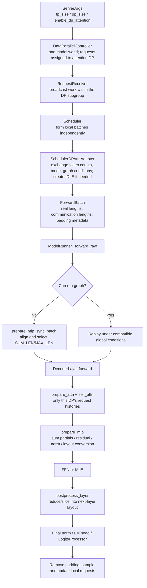

# SGLang DP Attention Walkthrough: From Request Dispatch to the Next Layer and Logits

[简体中文](../../../zh/sglang-source-reading/05-layer-communication/03-dp-attention-code-walkthrough.md) | **English**

This walkthrough uses repository snapshot `587eb0b3a56cd2f014daf3b0fc8ba333da88df36`, following the non-CP `DeepseekV2DecoderLayer` path and distinguishing global gathering from expert dispatch. Excerpts and teaching pseudocode retain only relevant branches; linked complete functions define actual execution.

Read [DP Attention principles](../../ai-infra-basic/Parallel_Strategy/01-dp-attention-principles.md) first. The existing [LayerCommunicator guide](./01-layer-communicator-and-common-layers.md) and [TP/DP/EP sharding and Ascend](./02-tp-dp-ep-sharding-and-ascend-npu.md) cover common operators and weight sharding. This chapter follows the DP Attention contracts across those components.

## 1. The Complete Forward Route



There are two kinds of communication. Scheduler synchronization exchanges small **execution metadata**; layer communication moves or reduces `[tokens,H]` activations and expert data. The former makes ranks enter compatible execution rounds; the latter gives submodules the correct tensors.

## 2. Source Map and Reading Order

Links below target files in this repository. On GitHub, replace `main` with the baseline commit for a fixed version. Function names are more durable reading anchors than changing line numbers.

| Component | Source | Read first |
|---|---|---|
| Arguments | [server_args.py](../../../../python/sglang/srt/server_args.py) | `_handle_data_parallelism()`, `_handle_context_parallelism()` |
| Startup/routing | [data_parallel_controller.py](../../../../python/sglang/srt/managers/data_parallel_controller.py) | `launch_dp_attention_schedulers()`, `launch_tensor_parallel_group()`, `round_robin_scheduler()` and other dispatchers |
| Request broadcast | [request_receiver.py](../../../../python/sglang/srt/managers/scheduler_components/request_receiver.py) | `_broadcast_reqs_across_ranks()` |
| Process groups | [parallel_state.py](../../../../python/sglang/srt/distributed/parallel_state.py) | `initialize_model_parallel()`, `_ATTN_TP`, `_ATTN_CP`, `_MOE_EP` |
| DP helpers | [dp_attention.py](../../../../python/sglang/srt/layers/dp_attention.py) | `compute_dp_attention_world_info()`, `DpPaddingMode`, `dp_gather_*()`, `dp_scatter()` |
| Scheduling rounds | [scheduler.py](../../../../python/sglang/srt/managers/scheduler.py) / [dp_attn.py](../../../../python/sglang/srt/managers/scheduler_components/dp_attn.py) | `maybe_prepare_mlp_sync_batch()`, `MLPSyncBatchInfo.all_gather()`, `get_idle_batch()` |
| Runtime batch | [forward_batch_info.py](../../../../python/sglang/srt/model_executor/forward_batch_info.py) | `prepare_mlp_sync_batch()`, `post_forward_mlp_sync_batch()` |
| Model entrance | [model_runner.py](../../../../python/sglang/srt/model_executor/model_runner.py) | `init_torch_distributed()`, `_forward_raw()` |
| Model layers | [deepseek_v2.py](../../../../python/sglang/srt/models/deepseek_v2.py) | `DeepseekV2AttentionMLA.__init__()`, `DeepseekV2DecoderLayer.forward()`, `DeepseekV2MoE.forward()` |
| Layout conversion | [communicator.py](../../../../python/sglang/srt/layers/communicator.py) | `LayerScatterModes`, `LayerCommunicator`, the three `Communicate*Fn` classes |
| Graph | [cuda_graph_runner.py](../../../../python/sglang/srt/model_executor/cuda_graph_runner.py) | `can_run()`, `capture_one_batch_size()`, `replay_prepare()` |
| Output head | [logits_processor.py](../../../../python/sglang/srt/layers/logits_processor.py) | `compute_dp_attention_metadata()`, `_gather_dp_attn_hidden_states()`, `_scatter_dp_attn_logits()` |
| Sync predicates | [utils/common.py](../../../../python/sglang/srt/utils/common.py) | `require_mlp_tp_gather()`, `require_attn_tp_gather()`, `require_mlp_sync()` |

## 3. From Arguments to a Rank Grid

Running configuration:

```text
tp_size=4, dp_size=2, enable_dp_attention=True
pp_size=1, attn_cp_size=1
No dedicated MoE A2A backend; moe_dense_tp_size=None
No CP, TBO, or communication fusion in the baseline example
```

This uses **four compute ranks**, split into two attention-DP subgroups, each with attention TP of two. Regular DP with the flag disabled and the same `tp_size=4,dp_size=2` instead uses two complete TP replicas and eight compute ranks.

Excerpt from `ServerArgs._handle_data_parallelism()`:

```python
if self.dp_size == 1:
    self.enable_dp_attention = False
    self.enable_dp_lm_head = False

if self.enable_dp_attention:
    self.schedule_conservativeness = self.schedule_conservativeness * 0.3
    assert self.tp_size % self.dp_size == 0
    self.chunked_prefill_size = self.chunked_prefill_size // self.dp_size
```

Input settings need not equal final effective settings: this snapshot adjusts the chunked-prefill budget. CP combinations also require checks such as `tp_size % (dp_size*attn_cp_size)==0`; the first divisibility check alone is insufficient.

Core of `compute_dp_attention_world_info()`:

```python
attn_dp_size = dp_size if enable_dp_attention else 1
attn_tp_size = tp_size // attn_dp_size // attn_cp_size
attn_tp_rank = tp_rank % attn_tp_size
# enable_dp_attention=True branch
attn_dp_rank = tp_rank // (attn_tp_size * attn_cp_size)
```

For our example:

```text
Global TP/model ranks: 0  1  2  3
Attention DP ranks:   0  0  1  1
Attention TP ranks:   0  1  0  1
ATTN_TP groups: [0,1] and [2,3]
Global TP group: [0,1,2,3]
```

## 4. Startup and Dispatch: Separate DP Entrances, One Compute World

`DataParallelController.launch_dp_attention_schedulers()` allocates a work entrance per DP, then calls `launch_tensor_parallel_group()` once. The latter iterates the model world's TP/PP ranks and computes each rank's attention-DP identity.

Excerpt:

```python
_, _, dp_rank, _ = compute_dp_attention_world_info(
    server_args.enable_dp_attention,
    tp_rank,
    server_args.tp_size,
    server_args.dp_size,
    server_args.attn_cp_size,
)
rank_port_args = PortArgs.init_new(server_args, dp_rank, worker_ports)
# DP Attention reuses one model world's distributed initialization port.
rank_port_args.nccl_port = port_args.nccl_port
```

The name `nccl_port` does not require CUDA hardware; the device backend is selected later.

The controller chooses an attention-DP entrance by round-robin, load policy, or an explicit request `routed_dp_rank`. Once local scheduling/KV state exists, subsequent decode normally continues in that subgroup. Switching subgroup every token needs state migration, not merely a dispatcher change.

`RequestReceiver._broadcast_reqs_across_ranks()` separates work and control messages:

```text
Work: subgroup leader receives -> ATTN_TP broadcast -> ATTN_CP broadcast if needed
Control: global TP broadcast by default
         local subgroup broadcast with enable_dp_attention_local_control_broadcast
```

Requests A/B agree across rank0/1 schedulers; C/D agree across rank2/3. Waiting/running batches may differ across DP groups, but subgroup ranks must follow matching request order for attention TP.

## 5. ModelRunner Initializes Groups and DP Buffer Metadata

Excerpt from `ModelRunner.init_torch_distributed()`:

```python
init_distributed_environment(
    backend=backend,
    world_size=self.tp_size * self.pp_size,
    rank=self.tp_size * self.pp_rank + self.tp_rank,
    # ...
)
initialize_model_parallel(
    tensor_model_parallel_size=self.tp_size,
    attention_data_parallel_size=self.dp_size,
    attention_context_model_parallel_size=self.attn_cp_size,
    expert_model_parallel_size=self.moe_ep_size,
    moe_data_model_parallel_size=self.moe_dp_size,
    # ...
)
initialize_dp_attention(server_args=self.server_args, model_config=self.model_config)
```

`parallel_state.py` constructs global TP, attention TP/CP, and MoE DP/EP/TP groups. `initialize_dp_attention()` stores attention-DP rank/size and initializes `_DpGatheredBufferWrapper` allocation metadata from model hidden size, dtype, and device.

Separate these operations:

- **Group initialization** selects the participants of a collective.
- **Buffer-length updates** decide token-row capacity for each round.
- **Numerical reduction** executes collectives during forward.

`moe_dense_tp_size` also changes local DP calculations. Do not unconditionally substitute `get_local_attention_dp_rank()` for the global attention-DP rank. `get_dp_local_info()` explicitly uses global DP rank for global gathering/scattering.

## 6. Scheduler: Independent Batches, Coordinated Execution Rounds

The Scheduler selects a local prefill/decode batch, then calls `dp_attn_adapter.maybe_prepare_mlp_sync_batch()`. `require_mlp_sync()` returns:

```python
return server_args.enable_dp_attention or require_gathered_buffer(server_args)
```

Even when a dedicated MoE backend removes global hidden gathering, execution-metadata synchronization can remain necessary. `require_mlp_tp_gather=False` does not disable every cross-DP synchronization.

### 6.1 Token Counts by Forward Mode

In `prepare_mlp_sync_batch_raw()`:

| Local mode | `num_tokens` | Meaning |
|---|---:|---|
| No batch / PREBUILT / IDLE | 0 | no real model tokens this round |
| DECODE | `batch_size()` | one token per request in ordinary autoregressive decode |
| EXTEND and related modes | `extend_num_tokens` | newly processed prefill tokens |

`num_tokens_for_logprob` is recorded separately. Prefill need not run the output head on every hidden row; the requested prompt-logprob range also affects output-row count. LM-head metadata can differ from the MLP's full token count.

### 6.2 Six Metadata Fields and One All-Gather

`MLPSyncBatchInfo._get_local_tensor()` returns:

```python
[
    self.num_tokens,
    self.num_tokens_for_logprob,
    int(self.can_cuda_graph),
    int(self.is_extend_in_batch),
    int(self.local_can_run_tbo),
    self.local_forward_mode,
]
```

Logical shapes of `all_gather()`:

```text
local_info: [6]
global_info: [DP, ATTN_TP*ATTN_CP, 6]
tp0_info = global_info[:,0,:]: [DP,6]
```

Subgroup ranks represent the same DP workload, so the first entry is selected per subgroup. Inactive ranks also receive fallback values. Aggregation includes:

```text
global_num_tokens = token count per DP
can_cuda_graph = min across DPs: all participants agree
is_extend_in_batch = max across DPs: any subgroup has extend
```

The source can use CPU or device groups and minimizes D2H copies. This communicates a few integers and is separate from later hidden-state gathering.

### 6.3 Why No Local Requests Can Produce an IDLE Batch

Excerpt:

```python
need_idle_batch = max(mlp_sync_info.global_num_tokens) > 0
if need_idle_batch:
    if local_batch is None:
        batch_to_gather = local_batch = get_idle_batch()
```

This is the default branch without `SGLANG_SCHEDULER_SKIP_ALL_GATHER`. The complete source also handles PREBUILT inner idle batches. `get_idle_batch()` constructs an empty request list and calls `prepare_for_idle()`.

Ranks participating in shared collectives must enter compatible communication order. An IDLE subgroup has no local sampling work but cannot freely skip all model communication. With expert backends, an empty source rank may still execute experts needed by remote tokens.

## 7. ForwardBatch Converts Counts into Communication Lengths

ScheduleBatch metadata enters `ForwardBatch`:

```text
original_global_num_tokens_cpu   original-count reference; beware mutable lists
global_num_tokens_cpu/gpu        current forward communication lengths
global_num_tokens_for_logprob_*  output/logprob row counts
dp_padding_mode                 SUM_LEN / MAX_LEN
dp_local_start_pos/num_tokens    local DP interval in global buffer
global_dp_buffer_len             global hidden-buffer row count
```

Some lists are aligned in place. Inspect assignment and mutation sites before treating an “original” field as an immutable snapshot. Diagnostics can save true counts separately.

`ModelRunner._forward_raw()` checks graph replay first. If graph replay is unavailable, eager execution does:

```python
if forward_batch.global_num_tokens_cpu is not None:
    forward_batch.prepare_mlp_sync_batch(self)
else:
    forward_batch.prepare_attn_tp_scatter_input(self)
```

### 7.1 Alignment, Padding, and Buffer Order

Excerpt from `ForwardBatch.prepare_mlp_sync_batch()`:

```python
for i in range(sync_group_size):
    global_num_tokens[i] = ceil_align(global_num_tokens[i], attn_tp_size)
for i in range(sync_group_size):
    global_num_tokens[i] = ceil_align(global_num_tokens[i], attn_cp_size * 2)

dp_padding_mode = DpPaddingMode.get_dp_padding_mode(
    self.is_extend_in_batch, global_num_tokens
)
if dp_padding_mode.is_max_len():
    max_num_tokens = max(global_num_tokens)
    global_num_tokens = [max_num_tokens] * sync_group_size
    buffer_len = max_num_tokens * sync_group_size
else:
    buffer_len = sum(global_num_tokens)
```

Real decode counts `[4,2]` already satisfy both alignments for `T=2,C=1`. Eager MAX_LEN uses communication lengths `[4,4]` and a global `[8,H]` buffer. DP1 still has only two real requests; its last two rows are padding.

`_pad_inputs_to_size()` processes `input_ids`, `positions`, `req_pool_indices`, `seq_lens`, `out_cache_loc`, and other fields using backend-specific fill values. Padding hidden tensors alone while retaining old KV-write/request-index lengths breaks the contract.

`get_dp_local_info()` uses prefix sums of communication lengths:

```text
start_d = sum(global_num_tokens_gpu[:d])
length_d = global_num_tokens_gpu[d]
```

For MAX_LEN `[4,4]`, DP1 starts at row 4; for SUM_LEN `[4,2]`, it also starts at 4, while total lengths are 8 and 6. Real `[3,1]` first aligns to `[4,2]`; the unaligned 3 is not the correct DP1 offset.

## 8. Model Projection Uses Attention TP Rank for Attention Weights

`DeepseekV2AttentionMLA.__init__()` explicitly uses:

```python
attn_tp_rank = get_attention_tp_rank()
attn_tp_size = get_attention_tp_size()
self.num_local_heads = num_heads // attn_tp_size
# q_b_proj, kv_b_proj, o_proj receive these rank/size arguments.
```

Rank0 and rank2 own the same numbered attention-head shard but handle different DP requests; likewise rank1 and rank3. Low-rank down projections include `ReplicatedLinear`.

Use teaching dimensions `H=4096,N=32,Dcq=1536,Dc=512,Dh=128,Dr=64,Dv=128`, with `m=4` padded tokens per DP:

| Operation | Per-rank logical shape | Ownership |
|---|---:|---|
| Layer input | `[4,4096]` | same on the two ranks of one DP |
| Query latent | `[4,1536]` | replicated down projection |
| Query up projection | `[4,16*(128+64)] = [4,3072]` | 16 local heads |
| Query reshape | `[4,16,192]` | split into content/RoPE slices |
| Content latent / position key | `[4,512]`, `[4,64]` | written to the local DP's MLA cache |
| Head output | `[4,16,128]` | reads the request's visible history |
| Output projection | `[4,4096]` | `reduce_results=False`: partial values |

Absorbed/expanded MLA paths and backends can hide intermediates; see [MLA mathematics](../../ai-infra-basic/Model_Architecture/04-multi-head-latent-attention.md). DP Attention changes placement of requests and head work, not that attention formula.

## 9. DecoderLayer Has Three Communication Boundaries

Excerpted structure of `DeepseekV2DecoderLayer.forward()`:

```python
hidden_states, residual = self.layer_communicator.prepare_attn(
    hidden_states, residual, forward_batch, ...
)
hidden_states = self.self_attn(...)
hidden_states, residual = self.layer_communicator.prepare_mlp(
    hidden_states, residual, forward_batch
)
use_reduce_scatter = self.layer_communicator.should_use_reduce_scatter(forward_batch)
hidden_states = self.mlp(
    hidden_states, forward_batch, should_allreduce_fusion, use_reduce_scatter, ...
)
if not should_allreduce_fusion:
    hidden_states, residual = self.layer_communicator.postprocess_layer(
        hidden_states, residual, forward_batch
    )
```

`LayerScatterModes` selects layouts at initialization; `LayerCommunicator._post_init_communicate()` preselects functions for those three boundaries.

| Condition | `mlp_mode` | Main path |
|---|---|---|
| Sparse layer without dedicated A2A | `FULL` | gather global rows, run FFN/expert work, return DP rows |
| Sparse layer with dedicated A2A or the designated special all-gather MoE path | `SCATTERED` | dispatcher handles exchange outside the communicator |
| Dense layer, `moe_dense_tp_size=1` | `SCATTERED` | each rank runs its complete dense MLP on local rows |
| Dense layer, ordinary configuration | `FULL` | global TP MLP |
| Specific CP/MoE-DP combinations | `MOE_FULL` | additional CP/MoE layout; see the common guide |

Enabling DP Attention does not imply all-gather in every layer. First establish layer type, A2A backend, dense configuration, and CP, then identify the actual collective.

## 10. FULL Path: Combining Partial Reduction with DP Gathering

Relevant excerpt from `CommunicateWithAllReduceAndLayerNormFn._gather_hidden_states_and_residual()`, omitting other branches:

```python
use_layer_norm_before_gather = context.attn_tp_size == 1
if use_layer_norm_before_gather and hidden_states.shape[0] != 0:
    hidden_states, residual = layernorm(hidden_states, residual)
elif context.attn_tp_rank == 0:
    hidden_states += residual

hidden_states, local_hidden_states = get_global_dp_buffer(get_tp_group()), hidden_states
dp_gather_partial(hidden_states, local_hidden_states, forward_batch)
if not use_layer_norm_before_gather:
    dp_scatter(residual, hidden_states, forward_batch)
    if hidden_states.shape[0] != 0:
        hidden_states = layernorm(hidden_states)
```

For attention TP of two, the two `A_partial` tensors must be summed. Subgroup rank0 adds residual `X` once. Gathering produces global `R=concat_d(X_d+sum_a A_da)`. The local DP portion of `R` is copied into residual, and globally normalized hidden rows enter the MLP.

**Residual remains local `[m,H]`; MLP hidden is global `[D*m,H]`.** They need not have equal shapes at this point: hidden rows return to local layout after MLP.

### 10.1 SUM_LEN All-Reduce

Excerpt from `_dp_gather_via_all_reduce()`:

```python
local_start_pos, local_num_tokens = get_dp_local_info(forward_batch)
global_tokens.fill_(0)
if local_tokens.shape[0] > 0 and (is_partial or get_attention_tp_rank() == 0):
    memcpy_triton(global_tokens, local_tokens, 0,
                  local_start_pos, local_num_tokens, False)
# Normal floating-point hidden-state path.
global_tokens[:] = tensor_model_parallel_all_reduce(global_tokens)
```

SUM_LEN uses zero-filled disjoint DP intervals and all-reduce, rather than variable-length all-gather. Partial contributions sum within intervals; replicated inputs contribute only from the subgroup leader. Integer input IDs have a separate `inplace_all_reduce` case in the source.

### 10.2 MAX_LEN Reduce-Scatter and All-Gather

Excerpt from `_dp_gather_via_all_gather()`:

```python
if get_attention_tp_size() == 1:
    get_tp_group().all_gather_into_tensor(global_tokens, local_tokens)
    return
if not is_partial:
    if get_attention_tp_rank() != 0:
        local_tokens.fill_(0)
scattered_local_tokens = local_tokens.tensor_split(get_attention_tp_size())[
    get_attention_tp_rank()
]
get_attention_tp_group().reduce_scatter_tensor(scattered_local_tokens, local_tokens)
get_tp_group().all_gather_into_tensor(global_tokens, scattered_local_tokens)
```

Our `[4,H]` partial inputs reduce-scatter to `[2,H]` complete token slices per rank, then a four-rank all-gather gives `[8,H]`. Rank order produces DP0's two pieces followed by DP1's two pieces.

`local_tokens.fill_(0)` and reduce-scatter output views can modify input storage. The helpers assume specific buffer lifetimes and non-aliasing constraints; copying their logic into a demo does not justify assuming every input remains intact.

## 11. After MLP: Local Scatter versus Collective Reduce-Scatter

Global TP FFN/non-A2A MoE produces `[N,H]` outputs. Partial values still need reduction. `use_reduce_scatter` tells the MLP whether to skip its normal output all-reduce.

In `CommunicateSummableTensorPairFn._scatter_hidden_states()`:

```python
if should_use_dp_reduce_scatterv():
    get_tp_group().reduce_scatterv(global_hidden_states,
        output=hidden_states, sizes=get_dp_global_num_tokens())
elif allow_reduce_scatter and forward_batch.dp_padding_mode.is_max_len():
    dp_reduce_scatter_tensor(hidden_states, global_hidden_states)
else:
    dp_scatter(hidden_states, global_hidden_states, forward_batch)
```

Two basic cases:

- **MLP already all-reduced**: complete global results are identical across ranks. `dp_scatter()` locally copies the DP interval; no network scatter is required.
- **MLP skipped all-reduce**: values remain partial. `dp_reduce_scatter_tensor()` sums and returns local rows, avoiding replication of the complete global output first.

When `P==D`, attention TP is one and world reduce-scatter is sufficient. For `P>D`, world reduce-scatter first returns a smaller row block per rank, then attention-TP all-gather reconstructs the full local-DP rows on subgroup ranks.

```text
MLP partial: [8,H] per rank
World reduce-scatter: [2,H] per rank, complete values
ATTN_TP all-gather: rank0/1 both DP0 [4,H]
                   rank2/3 both DP1 [4,H]
```

All-reducing inside MLP and then reduce-scattering again would sum `P` copies. Locally copying an unreduced partial would omit other ranks' contributions. **Read communication together with `skip_all_reduce/use_reduce_scatter` flags.**

## 12. Expert Communication: The SCATTERED Token Lifecycle

For dedicated A2A backends, `prepare_mlp()` selects `_scatter_hidden_states_and_residual()`:

```python
input_hidden_states = hidden_states
hidden_states = hidden_states.tensor_split(context.attn_tp_size)[context.attn_tp_rank]
attn_tp_reduce_scatter_tensor(hidden_states, input_hidden_states)
if residual_input_mode == ScatterMode.TP_ATTN_FULL:
    residual = residual.tensor_split(context.attn_tp_size)[context.attn_tp_rank]
if hidden_states.shape[0] != 0:
    hidden_states, residual = layernorm(hidden_states, residual)
```

Each rank now has `[m/T,H]` with complete values. Residual is sliced consistently, and normalization runs on local rows.

`DeepseekV2MoE.forward()` selects `forward_normal()` or the dedicated-communication path named `forward_deepep()` through `_enable_a2a_moe`. That name does not imply the backend must be DeepEP; this snapshot supports other configured A2A backends through the path.

```text
SCATTERED hidden [n_source,H]
  -> router logits [n_source,E]
  -> top-k expert IDs/weights [n_source,K]
  -> self.experts / dispatcher
  -> destination expert input [n_e,H]
  -> expert output [n_e,H]
  -> combine / weighted aggregation
  -> source-rank result [n_source,H]
```

Source-token positions and expert-owner ranks are different mappings. Combine returns each token's weighted expert results to its source row; attention KV need not migrate to the expert owner.

Output may remain local if the next layer accepts `SCATTERED`. At an attention entrance needing `TP_ATTN_FULL`, `CommunicateSimpleFn._scattered_to_tp_attn_full()` all-gathers within attention TP. The final layer also restores the required model-output layout.

For empty input, `forward_deepep()` builds an empty top-k output and still enters the required expert calls. An external early return based solely on `n_source=0` can skip required communication.

## 13. LM Head: DP Attention and DP LM Head Are Separate Flags

Final hidden rows have returned to attention-DP layout, but the output head may still shard vocabulary across global TP.

`LogitsProcessor.__init__()`:

```python
self.use_attn_tp_group = get_global_server_args().enable_dp_lm_head
if self.use_attn_tp_group:
    self.attn_tp_size = get_attention_tp_size()
    self.do_tensor_parallel_all_gather_dp_attn = False
else:
    self.do_tensor_parallel_all_gather = (
        not skip_all_gather and get_tensor_model_parallel_world_size() > 1
    )
    self.do_tensor_parallel_all_gather_dp_attn = (
        self.do_tensor_parallel_all_gather and get_attention_dp_size() != 1
    )
```

Default global vocabulary TP requires every vocabulary shard to process the same output rows:

```text
Local output rows [R_d,H]
  -> dp_gather_replicate over output/logprob rows
  -> vocabulary-shard GEMM [sum(R_d),V/P]
  -> gather vocabulary logits
  -> dp_scatter to local DP [R_d,V]
```

This is **replicated gathering**: final hidden values are already complete within the subgroup. `LogitsMetadata.compute_dp_attention_metadata()` derives offsets separately from `global_num_tokens_for_logprob` and allocates a smaller gathered buffer with its own SUM_LEN metadata.

With `enable_dp_lm_head`, the model must align LM-head weight sharding and logits gathering with the attention-TP group. Changing only LogitsProcessor without checking `ParallelLMHead` construction is incomplete. Argument validation also requires DP Attention to be enabled.

## 14. Graph: Compatible Captured Shapes and Collectives Across Participants

Graph execution differs from eager padding. When MLP TP gathering is required, `CudaGraphRunner.can_run()` derives graph batch from the maximum token count across DPs; speculative decoding also accounts for tokens per request.

```python
# Ordinary decode excerpt.
cuda_graph_bs = max(forward_batch.global_num_tokens_cpu)
if self.require_mlp_sync:
    is_bs_supported = is_bs_supported and forward_batch.can_run_dp_cuda_graph
```

`replay_prepare()` selects a capture bucket and copies current input IDs, sequence lengths, cache slots, and other metadata into static buffers. `capture_one_batch_size()` uses the same bucket token count for each DP on the gathering path, yielding a global buffer of `D*bucket_tokens` rows.

```text
Real counts [3,1]
Assume selected bucket=4
Fixed graph communication layout [4,4], global hidden [8,H]
Final results: 3 real rows for DP0, 1 for DP1
```

The graph default is normally MAX_LEN, with a ROCm exception in the source. Ranks must use compatible collective buffers and order. Extend in one DP affects global graph conditions. Fully local dense/dedicated A2A paths must be read separately under predicates such as `require_mlp_tp_gather`; the formula above is not universal.

Eager execution uses `post_forward_mlp_sync_batch()` to restore original batch/mode and trim real outputs; graph replay trims through its own path. Padding must not become sampled tokens or pollute real request KV/recurrent state.

## 15. Ascend NPU: Shared Topology, Device-Specific Execution

Relevant files in this snapshot:

- [parallel_state.py](../../../../python/sglang/srt/distributed/parallel_state.py): `npu` normally selects `hccl`, with additional configuration-dependent backend branches.
- [ascend_backend.py](../../../../python/sglang/srt/hardware_backend/npu/attention/ascend_backend.py): consumes attention-TP sizes and backend metadata.
- [npu_graph_runner.py](../../../../python/sglang/srt/hardware_backend/npu/graph_runner/npu_graph_runner.py): `NPUGraphRunner(CudaGraphRunner)` replaces graph creation/capture and other device operations while reusing several batch/padding/eligibility mechanisms.
- [fuseep.py](../../../../python/sglang/srt/hardware_backend/npu/moe/fuseep.py): Ascend FuseEP dispatch, expert computation, and combine.

Rank formulas and token ownership do not change between NCCL/HCCL. Actual collectives, copy kernels, dtype, graph capture, and expert-routing support depend on versions. The copy helper in `dp_attention.py` contains a Triton kernel; verify that the target deployment supplies an executable path before asserting that a combination runs on that NPU environment.

This chapter statically verifies source and uses a CPU simulator for layout/mathematical invariants. It does not report multi-device GPU/NPU serving or HCCL performance tests. See [Ascend sharding](./02-tp-dp-ep-sharding-and-ascend-npu.md) for device-specific TP/EP weights and FuseEP details.

## 16. Trace One `[4,2]` Decode Round End to End

The ledger below uses the baseline configuration, MAX_LEN, no dedicated A2A, and no extra fusion, with `H=4096,T=2`. DP0 owns four requests; DP1 owns two; ordinary decode has one token per request.

| Stage | rank0/1 | rank2/3 | Meaning |
|---|---|---|---|
| Local Scheduler | 4 requests | 2 requests | identical within subgroup, independent across DPs |
| Sync metadata | global `[4,2]` | global `[4,2]` | one coordinated round |
| Eager padding | `input_ids [4]` | `input_ids [4]` | last two DP1 rows are padding |
| Embedding/layer input | `[4,4096]` | `[4,4096]` | local DP rows, replicated within subgroup |
| Attention output | `[4,4096]` partial | `[4,4096]` partial | different local-head contributions |
| ATTN_TP reduce-scatter | `[2,4096]` per rank | `[2,4096]` per rank | summed values, half the rows |
| Global all-gather | `[8,4096]` per rank | `[8,4096]` per rank | four DP0 rows + four DP1 rows |
| Post-attention norm | hidden `[8,4096]` | hidden `[8,4096]` | complete MLP inputs |
| Local residual | `[4,4096]` | `[4,4096]` | only the local DP residual stream |
| TP FFN/MoE | `[8,4096]` partial or reduced | same | depends on `use_reduce_scatter` |
| Return to DP layout | `[4,4096]` | `[4,4096]` | collective reduction or local copy |
| Next layer | repeat these boundaries | repeat these boundaries | histories remain local to DP requests |
| Output/logits | real local-DP rows | real local-DP rows | may include a separate LM-head DP gather |
| Sampling after trimming | 4 results | 2 results | no padding tokens generated |

Internal attention-score shape additionally depends on visible history per request. A packed `[4,H]` input does not imply equal KV lengths for all four requests.

## 17. Debugging Symptoms and Invariants

| Symptom | Inspect first |
|---|---|
| Correct at DP=1, outputs multiplied at DP>1 | replicated input passed to partial gather; repeated residual addition |
| Wrong only with attention TP>1 | output-projection reduction; attention weight shard rank |
| Hang when a DP has no requests | IDLE batch, empty MoE source, collective ordering |
| Balanced batches work, uneven batches fail | real/aligned/bucket lengths, SUM/MAX mode, prefix-sum offsets |
| Missing MoE contributions or world-size factor | pairing of `skip_all_reduce`, `use_reduce_scatter`, and postprocess |
| Eager correct, graph wrong | global graph agreement, buckets, refreshed static buffers, padding masks |
| Prompt-logprob-only failure | confusion of MLP token counts with logprob rows; LogitsMetadata offset |
| Failure after enabling DP LM head | LM-head weight group differs from logits-gather group |
| Prefix hit rate drops after DP routing changes | request routing and subgroup prefix ownership |
| NPU failure in a specific combination | HCCL group, copy helper, attention/MoE backend, graph support |

Analyze metadata synchronization waits, attention, norm/layout conversion, expert dispatch/combine, FFN, LM head, and graph padding separately. A fast all-gather alone does not establish an end-to-end improvement.

## 18. Run the Teaching Simulator and Read with Questions

```bash
python3 learning/en/ai-infra-basic/Parallel_Strategy/dp_attention_layout_demo.py
```

The standard-library simulator models SUM_LEN zero-buffer all-reduce, MAX_LEN subgroup reduce-scatter plus world all-gather, replica deduplication, one-time residual addition, and equivalent FFN-output returns.

Reading tasks:

1. Follow `get_next_batch_to_run()` and identify how a None local batch becomes IDLE.
2. Explain through `prepare_mlp_sync_batch()` why real `[3,1]` is not a valid direct MAX_LEN communication size.
3. Find one caller each of `dp_gather_partial()` and `dp_gather_replicate()` and establish whether its input has already been reduced.
4. Explain why norm cannot independently process two attention partials for `T=2`.
5. Find the all-reduce skip condition in `DeepseekV2MoE.forward_normal()` and its matching communicator branch.
6. Draw source-token → expert-owner → source-token mappings for the A2A path.
7. Use LogitsProcessor to demonstrate that DP Attention does not automatically enable DP LM head.

## 19. Pinned Source and Further Reading

- [Pinned dp_attention.py](https://github.com/cl-vv-h/SGLang_Tutor/blob/587eb0b3a56cd2f014daf3b0fc8ba333da88df36/python/sglang/srt/layers/dp_attention.py)
- [Pinned communicator.py](https://github.com/cl-vv-h/SGLang_Tutor/blob/587eb0b3a56cd2f014daf3b0fc8ba333da88df36/python/sglang/srt/layers/communicator.py)
- [Pinned scheduler_components/dp_attn.py](https://github.com/cl-vv-h/SGLang_Tutor/blob/587eb0b3a56cd2f014daf3b0fc8ba333da88df36/python/sglang/srt/managers/scheduler_components/dp_attn.py)
- [Principles and mathematics](../../ai-infra-basic/Parallel_Strategy/01-dp-attention-principles.md)
- [Scheduler core](../02-scheduler-runtime/02-scheduler-core.md)
- [KV and prefix cache](../03-cache-memory/03-kv-cache-radix-cache.md)
- [Execution graph basics](../../ai-infra-basic/Execution_Graph/README.md)
