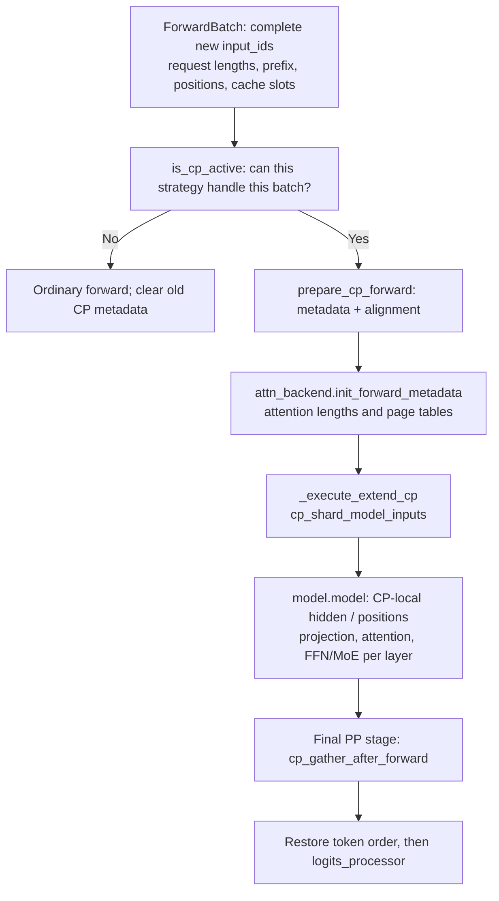
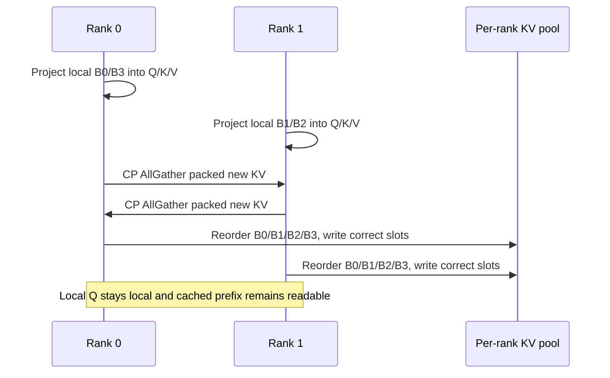
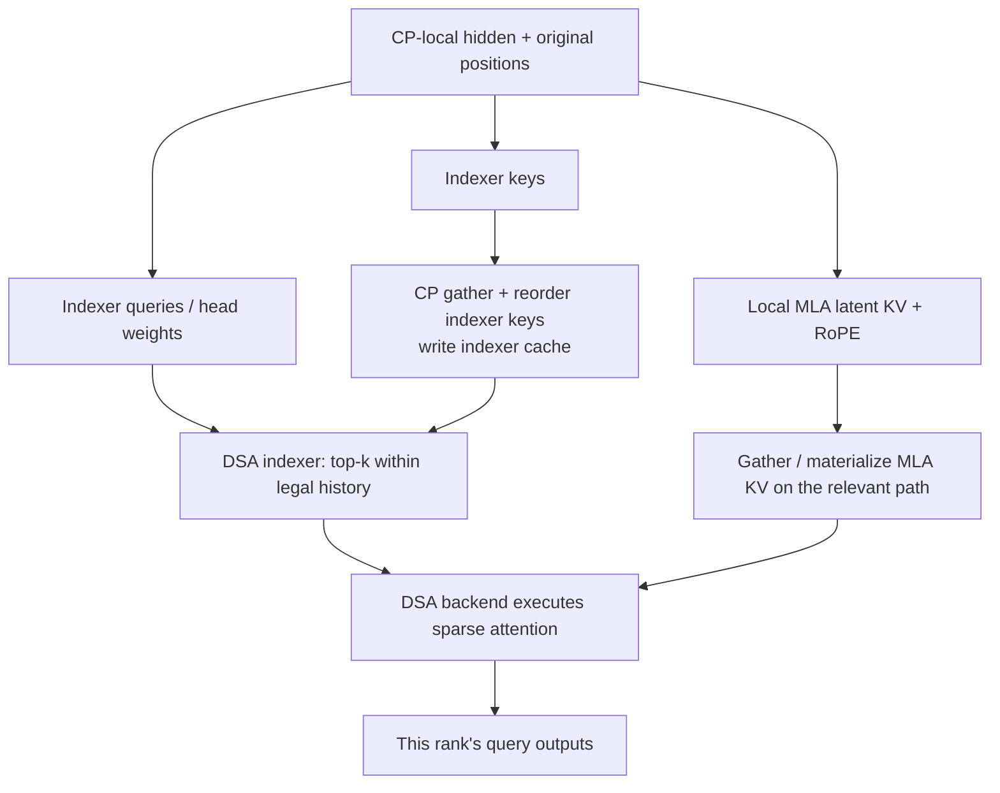

# SGLang PCP source walkthrough: arguments, query sharding, KV exchange, and output restoration

[简体中文](../../../zh/sglang-source-reading/05-layer-communication/04-prefill-context-parallel-code-walkthrough.md) | **English**

Start with [PCP principles](../../ai-infra-basic/Parallel_Strategy/03-prefill-context-parallelism.md), especially section 2's prefix/query indices. This chapter asks: **who shards which tensors, when does communication happen, who invokes attention, and how is original order recovered?**

Previously, [GLM-5.2 section 10.4](../../sglang-ascend-npu/source-code-walkthrough/examples/02-glm-5.2-end-to-end.md) summarized an older NPU branch, and the [NPU communication chapter](../../sglang-ascend-npu/source-code-walkthrough/15-distributed-hccl-and-communication.md) covered parts of the layer boundary. Neither provided a complete PCP call chain. This chapter connects them while separately tracing newer upstream.

## 1. Choose a baseline: three actual paths

**Checked: 2026-10-16.** The unified strategy path is pinned to [SGLang f2b73d4](https://github.com/sgl-project/sglang/tree/f2b73d4f9b4e64415b8d775b0f811c7801f1728b). The older NPU path uses this tutorial repository's runtime at `e4df326`. No upstream runtime replacement is made here.

| Path | Entry organization | Who actually executes attention |
|---|---|---|
| Upstream zigzag + dense FlashAttention | Runner + `ZigzagCPStrategy` | FA backend callback, invoked separately for early/late groups |
| Upstream interleave + DSA | Runner + `InterleaveCPStrategy` | DSA backend executes indexer/sparse attention itself |
| Local older NPU DSA CP | Model-owned metadata/split + old `cp_utils` | NPU indexer and `AscendAttnBackend` early/late branches |

**Do not combine these rows into one call stack.** In particular, older NPU early/late execution is not newer upstream interleave. Do not mix old arguments with new recipes. See the [version map](../../ai-infra-basic/Parallel_Strategy/00-parallelism-map-and-version-boundaries.md).

We trace eager prefill first. Graphs, PP, and speculative execution are later compositions, not prerequisites for following a first PCP forward.

## 2. Startup: arguments become a strategy and communication groups

Start in `handle_context_parallelism()` in [parallel_hook.py](https://github.com/sgl-project/sglang/blob/f2b73d4f9b4e64415b8d775b0f811c7801f1728b/python/sglang/srt/arg_groups/parallel_hook.py#L88):

1. Read the model and resolved parallel configuration; apply model constraints.
2. Require an explicit `cp_strategy` when PCP is enabled and validate Attention DP/CP divisibility.
3. Call `init_cp_strategy(enable_prefill_cp=..., cp_size=..., cp_strategy=...)`.
4. Workers retrieve the process strategy through `get_cp_strategy()`, with lazy initialization in subprocesses.

[base.py](https://github.com/sgl-project/sglang/blob/f2b73d4f9b4e64415b8d775b0f811c7801f1728b/python/sglang/srt/layers/cp/base.py#L250) constructs `ZigzagCPStrategy` or `InterleaveCPStrategy` from the name. The strategy is long-lived; **request lengths, padding, and inverse permutations belong to this forward's `ForwardBatch.attn_cp_metadata`, not reusable batch state inside that strategy.**

For a four-device world without external DP/PP:

```math
T_{\mathrm{world}}=D_{\mathrm{attn}}C_{\mathrm{attn}}A_{\mathrm{attn}}
=1\cdot2\cdot2=4.
```

[initialize_model_parallel()](https://github.com/sgl-project/sglang/blob/f2b73d4f9b4e64415b8d775b0f811c7801f1728b/python/sglang/srt/distributed/parallel_state.py#L2561) builds groups. Under this conventional numbering:

| Ranks | Attention identities |
|---|---|
| 0, 1 | Two Attention TP ranks inside CP0 |
| 2, 3 | Two Attention TP ranks inside CP1 |
| 0, 2 | CP group with matching head partitions |
| 1, 3 | CP group for the other head partition |

CP AllGather exchanges tokens/KV within the **CP group**; TP partitions heads/matrices. Four devices do not become eight by multiplying PCP again.

## 3. Per-forward execution: metadata first, model input sharding second

`EagerRunner._execute_extend()` in [eager_runner.py](https://github.com/sgl-project/sglang/blob/f2b73d4f9b4e64415b8d775b0f811c7801f1728b/python/sglang/srt/model_executor/runner/eager_runner.py#L269) provides the first complete path:



Separate two planning steps:

- `prepare_cp_forward()` determines row ownership and padding.
- `attn_backend.init_forward_metadata()` determines request, history, and page-table access.

In [cp/utils.py](https://github.com/sgl-project/sglang/blob/f2b73d4f9b4e64415b8d775b0f811c7801f1728b/python/sglang/srt/layers/cp/utils.py), `is_cp_active()` checks the forward mode and `strategy.can_apply()`. An enabled configuration does not mean every short batch uses PCP.

The model boundary in `_execute_extend_cp()` can be summarized with **teaching pseudocode**:

```python
prepare_cp_forward(batch)                 # metadata is ready before backend planning
attention_backend.init_forward_metadata(batch)

with cp_shard_model_inputs(embeddings, positions, batch, input_ids) as local_inputs:
    hidden = model.model(*local_inputs)     # body, not the outer logits wrapper

hidden = cp_gather_after_forward(hidden, batch)  # on the final PP stage
logits = model.logits_processor(..., hidden, ...)
```

The real function also handles `prepare_cp_inputs`, PP proxies, auxiliary hidden states, and model-specific return values. Some CP/TP group-sharing models still own layouts inside `forward()`; the runner branch is not every model's sole entry.

## 4. Zigzag: inspect actual metadata beyond “pair early and late”

Fix one example for the following KV and kernel sections:

- One request, prefix length 2, eight new tokens, CP=2.
- New indices 0–7 correspond to original-request positions 2–9.
- Ignore specific head-TP widths and track token rows.

[ZigzagCPStrategy.build_metadata()](https://github.com/sgl-project/sglang/blob/f2b73d4f9b4e64415b8d775b0f811c7801f1728b/python/sglang/srt/layers/cp/zigzag.py#L121) splits the new tokens into four blocks:

| Block | New query indices | Original positions |
|---|---|---|
| B0 | 0, 1 | 2, 3 |
| B1 | 2, 3 | 4, 5 |
| B2 | 4, 5 | 6, 7 |
| B3 | 6, 7 | 8, 9 |

Important **field values for this example**:

```python
# Both ranks, before physical padding:
split_list = [2, 2, 2, 2]
reverse_split_len = [2, 2, 2, 2]
cp_reverse_index = [0, 2, 3, 1]

# rank 0:
zigzag_index = [0, 3]
actual_seq_q_prev_list = [2]
actual_seq_q_next_list = [2]
kv_len_prev_list = [4]       # prefix 2 + end of B0
kv_len_next_list = [10]      # prefix 2 + end of B3

# rank 1:
zigzag_index = [1, 2]
actual_seq_q_prev_list = [2]
actual_seq_q_next_list = [2]
kv_len_prev_list = [6]       # prefix 2 + end of B1
kv_len_next_list = [8]       # prefix 2 + end of B2
```

Each field answers a concrete question:

| Field | Meaning |
|---|---|
| `split_list` | Split complete new tokens into blocks per request |
| `zigzag_index` | Which blocks this rank selects |
| `actual_seq_q_prev/next_list` | Query counts per request in early/late groups |
| `kv_len_prev/next_list` | Early/late KV visibility lengths, including prefix |
| `cu_seqlens_q_prev/next_tensor` | Cumulative query offsets; lengths 2, 3 become offsets 0, 2, 5 |
| `reverse_split_len` | Block lengths in the rank-major gathered result |
| `cp_reverse_index` | Reorder gathered blocks into original sequence order |

For multiple requests, local order is **all requests' early blocks, then all requests' late blocks**, rather than early/late pairs per request. The source splits groups at `total_q_prev_tokens`, not simply at half the tensor length.

For request lengths 9 and 7 with CP2, rank 0 has early counts 3/2 and late counts 2/1: five early rows and three late rows. Splitting eight local rows at the midpoint would assign queries to the wrong history-length group.

## 5. Hidden states and positions must use the same mapping

Core excerpt from `shard_hidden_states()`:

```python
chunks = torch.split(x, metadata.split_list, dim=0)
local_x = torch.cat([chunks[i] for i in metadata.zigzag_index], dim=0)
return pad_local_rows(local_x, metadata, dim=0)
```

Local rows in this example:

| Rank | New tokens represented by hidden rows | Preserved position values |
|---|---|---|
| 0 | 0, 1, 6, 7 | 2, 3, 8, 9 |
| 1 | 2, 3, 4, 5 | 4, 5, 6, 7 |

`shard_position_ids()` applies the same block order along the position axis. Regenerating local positions 0, 1, 2, 3 can corrupt RoPE and causality.

The model projects local rows into local Q/K/V. For local hidden shape $`[4,H]`$, Q logically has shape $`[4,N_{q,\mathrm{local}},d]`$. Computing four query rows does not mean reading only four KV rows.

`cp_shard_model_inputs()` also handles local input IDs and applicable speculative hidden states, restoring shared global auxiliary state through its context manager. Sharding hidden while leaving other row-aligned inputs in their old order is insufficient.

## 6. KV AllGather must restore order before cache writes

This section covers **zigzag + dense MHA/FlashAttention**, not the DSA/MLA storage format below.

The CP branch in [flashattention_backend.py](https://github.com/sgl-project/sglang/blob/f2b73d4f9b4e64415b8d775b0f811c7801f1728b/python/sglang/srt/layers/attention/flashattention_backend.py#L1437) calls:

```python
cp_strategy.materialize_full_kv(
    forward_batch, layer, k, v, swa_loc=swa_loc
)
```

The strategy performs four operations:

1. Pack this round's local K and V along the last dimension.
2. Use `gather_kv_cache()` for CP AllGather, discarding communication padding.
3. Split by `reverse_split_len` and reorder with `cp_reverse_index`.
4. Call `set_kv_buffer()` to write new KV into slots described by `KVWriteLoc.for_layer(...)`.

Rank-major new-KV order is:

```text
rank 0: B0 B3       rank 1: B1 B2
AllGather: B0 B3 B1 B2
inverse block order [0, 2, 3, 1]: B0 B1 B2 B3
```

Reordering aligns values with the complete `out_cache_loc` token order. **Communicating bytes into the wrong slots still produces wrong results.**

The two prefix rows already in cache remain reusable. This gathers newly produced KV, rather than recomputing prefix queries or writing old prefix as new rows.



Each participant can obtain the required complete KV for its head layout on this path. This does not establish persistent token-wise KV-cache partitioning.

## 7. How does the attention kernel recover original query positions?

The [FA backend](https://github.com/sgl-project/sglang/blob/f2b73d4f9b4e64415b8d775b0f811c7801f1728b/python/sglang/srt/layers/attention/flashattention_backend.py#L1615) creates `_fa_cp_attn`. It calls `flash_attn_with_kvcache()` with paged KV, page table, cumulative query lengths, KV lengths, and causal options.

It passes local Q to `strategy.run_attention()`. The zigzag FA path contains this **excerpt**:

```python
result_prev = attn_fn(
    q_prev, meta.cu_seqlens_q_prev_tensor,
    meta.kv_len_prev_tensor, meta.max_seqlen_q_prev,
)
result_next = attn_fn(
    q_next, meta.cu_seqlens_q_next_tensor,
    meta.kv_len_next_tensor, meta.max_seqlen_q_next,
)
result = torch.cat([result_prev, result_next], dim=0)
```

Why do lengths preserve causality? For a contiguous query block, expose KV only through the block's end, then align causal queries to that KV segment's tail. Block-local query row $`a`$ sees keys up to:

```math
j_{\max}(a)=n_{\mathrm{KV}}-n_{\mathrm{Q}}+a.
```

Substituting the example:

| Rank / block | Query count | KV length | Last visible key indices for its two rows |
|---|---|---|---|
| 0 / early B0 | 2 | 4 | 2, 3 |
| 0 / late B3 | 2 | 10 | 8, 9 |
| 1 / early B1 | 2 | 6 | 4, 5 |
| 1 / late B2 | 2 | 8 | 6, 7 |

These equal the original-request positions. Passing four local query rows to an arbitrary four-row causal mask is not sufficient: **the distinct early/late KV lengths are part of correctness.**

Here `torch.cat` concatenates complete outputs for **different query rows**, not partial softmax results for one query against two KV shards. This FA path does not consequently need cross-rank LSE merging.

The same strategy's `TRTLLM_MHA` path differs: combined query metadata and zigzag page tables organize early/late groups into one variable-length call. “Two FA callbacks” is not a universal backend invocation count.

## 8. Padding: field names alone do not identify valid lengths

Key steps in [padding.py](https://github.com/sgl-project/sglang/blob/f2b73d4f9b4e64415b8d775b0f811c7801f1728b/python/sglang/srt/layers/cp/padding.py#L34):

```python
logical_tokens = list(metadata.per_rank_actual_token)
# ... calculate aligned physical_rank_len ...
metadata.per_rank_logical_token = logical_tokens
metadata.per_rank_actual_token = [physical_rank_len] * len(logical_tokens)
metadata.max_rank_len = [physical_rank_len] * len(logical_tokens)
```

At this pinned revision:

| Stage | `per_rank_actual_token` | `per_rank_logical_token` |
|---|---|---|
| Immediately after metadata construction | Valid row counts per rank | Not populated |
| After the padding helper | Aligned physical row counts | Valid row counts before padding |

With nine new tokens and CP2, zigzag block lengths are 3, 2, 2, 2. Valid rank lengths are 5 and 4; zigzag's local physical alignment is 4, so physical lengths can be 8 and 8.

Gather helpers select logical rows, construct equal-length communication inputs, discard padding, and restore order. Kernels compute real queries and may append zero outputs to match physical layouts. Padding must not become real cache entries, MoE top-k work, or request output.

## 9. Interleave DSA is more than replacing zigzag indices

In [interleave.py](https://github.com/sgl-project/sglang/blob/f2b73d4f9b4e64415b8d775b0f811c7801f1728b/python/sglang/srt/layers/cp/interleave.py#L135):

- `shard_hidden_states()` / `shard_position_ids()` select flattened new-token indices modulo CP size.
- `shard_per_request()` derives this rank's query counts and request mapping.
- `gather_kv_cache()` restores rank-major tensors to logical token order.
- `materialize_full_indexer_k_cache()` gathers **indexer keys**.
- `materialize_full_mla_kv()` gathers **MLA latent KV**.
- **`run_attention()` returns `None` here; it is not the DSA kernel entry.**

Distinguish the two key/cache systems:



The [Indexer in dsa_indexer.py](https://github.com/sgl-project/sglang/blob/f2b73d4f9b4e64415b8d775b0f811c7801f1728b/python/sglang/srt/layers/attention/dsa/dsa_indexer.py#L945) CP branch gathers indexer keys through the strategy. An available alternate stream can overlap this with query rotation but must synchronize before consumption. This does not AllGather indexer queries or final top-k results to replicate all work.

[prepare_kv_for_attention()](https://github.com/sgl-project/sglang/blob/f2b73d4f9b4e64415b8d775b0f811c7801f1728b/python/sglang/srt/layers/attention/dsa_backend.py#L114) in the DSA backend calls `strategy.materialize_full_mla_kv()` on its applicable non-deferred path. A specialized FP8 path packs raw bytes for gathering; not every dtype uses one cache-write implementation.

## 10. DSA metadata preserves request boundaries and causal extents

Take requests with new lengths 5 and 3, cached prefixes 2 and 1, and CP=2. Flattened new-token indices are 0–7.

The [DSA backend](https://github.com/sgl-project/sglang/blob/f2b73d4f9b4e64415b8d775b0f811c7801f1728b/python/sglang/srt/layers/attention/dsa_backend.py#L1216) first constructs legal KV lengths `seqlens_expanded`, selects rank-local rows with `shard_local_tokens()`, and selects corresponding requests/page-table rows using `shard_per_request()`:

| Data | Complete order | Rank 0 | Rank 1 |
|---|---|---|---|
| Flattened query index | 0, 1, 2, 3, 4, 5, 6, 7 | 0, 2, 4, 6 | 1, 3, 5, 7 |
| Request | A, A, A, A, A, B, B, B | A, A, A, B | A, A, B, B |
| Legal KV lengths | 3, 4, 5, 6, 7, 2, 3, 4 | 3, 5, 7, 3 | 4, 6, 2, 4 |
| Query counts per request | 5, 3 | 3, 1 | 2, 2 |

B's first new token belongs to rank 1; ownership does not restart at rank 0 for every request. `bs_idx` selects requests with queries on this rank; some rank/request combinations can have zero rows.

Planning such as `_cal_indexer_k_start_end()` also shards `ks`, `ke`, and `token_to_batch_idx` with the same query mapping. Sharding Q alone can preserve plausible shapes while reading another request's history or the wrong causal range.

Interleave gather restoration has its own mapping. For seven rows and CP2:

```text
rank 0: t0 t2 t4 t6
rank 1: t1 t3 t5 PAD
AllGather: t0 t2 t4 t6 t1 t3 t5 PAD
gather indices: [0, 4, 1, 5, 2, 6, 3]
restored: t0 t1 t2 t3 t4 t5 t6
```

## 11. Attention need not immediately gather all hidden states

Distinguish at least three gathers:

| Gathered object | Where | Purpose |
|---|---|---|
| New KV / indexer keys | Before attention/indexer | Supply local queries with required history |
| Hidden rows | Attention → FFN/MoE layout boundary | Match dense TP or expert-routing layout |
| Final hidden / auxiliary hidden | Final model boundary | Restore token correspondence for logits |

`_then_attn_cp_gather()` in upstream [layer_boundary/prepare.py](https://github.com/sgl-project/sglang/blob/f2b73d4f9b4e64415b8d775b0f811c7801f1728b/python/sglang/srt/layers/layer_boundary/prepare.py#L456) completes local Norm/residual semantics before gathering hidden states; residuals can remain row-local.

**An internal FFN boundary's rank-major gather need not already restore original token order.** A row-independent FFN can continue under a consistent permutation, provided output returns to the original owner. Sequence-dependent linear attention needs explicit reordering and cannot be treated as ordinary FFN.

An EP/A2A path can consume local tokens directly, dispatch by expert, and return to the query owner without first replicating every token for PCP. See the [DP Attention source chapter](./03-dp-attention-code-walkthrough.md) for partial/replica and output-return contracts.

Finally, `cp_gather_after_forward()` calls `strategy.gather_hidden_states()` to restore logical sequence order before logits on the final PP stage. Per-layer KV gathering and end-of-forward hidden gathering are separate operations.

## 12. Local Ascend NPU: trace the older early/late-block path explicitly

The following uses only this repository's older runtime, not the upstream `InterleaveCPStrategy` organization. Trace a normal MLA-DSA layer that runs its indexer; IndexShare/skip-topk layers can reuse earlier top-k instead:

| Order | Local function | What happens |
|---|---|---|
| 1 | CP preparation in `DeepseekV2ForCausalLM.forward()`, inherited by V3 and others | Build `attn_cp_metadata` from mode and lengths |
| 2 | `cp_split_and_rebuild_data/position()` | Shard hidden and positions using the old metadata |
| 3 | NPU MLA adapter + `rebuild_cp_kv_cache()` | Gather/reorder latent KV before main attention consumes it |
| 4 | `Indexer.forward_npu()` | Project local indexer queries/keys; gather keys and write cache |
| 5 | `do_npu_cp_balance_indexer()` | Split early/late queries and lengths; call lightning indexer twice |
| 6 | `AscendAttnBackend.forward_sparse()` | Prepare cache/page-table and early/late metadata |
| 7 | `do_cp_balance_attn()` | Call sparse flash attention twice and concatenate query outputs |
| 8 | Model-final `cp_all_gather_rerange_output()` | Restore hidden order before logits |

Local entries: [deepseek_v2.py](../../../../python/sglang/srt/models/deepseek_v2.py), [cp_utils.py](../../../../python/sglang/srt/layers/utils/cp_utils.py), [dsa_indexer.py](../../../../python/sglang/srt/layers/attention/dsa/dsa_indexer.py), [NPU MLA adapter](../../../../python/sglang/srt/hardware_backend/npu/modules/deepseek_v2_attention_mla_npu.py), and [ascend_backend.py](../../../../python/sglang/srt/hardware_backend/npu/attention/ascend_backend.py).

### 12.1 NPU indexing and main attention are separate computations

`forward_npu()` gathers this round's indexer keys using `cp_all_gather_rerange_output()`, then calls `set_index_k_buffer()`. Its CP branch sets tuple-valued query/KV lengths before `do_npu_cp_balance_indexer()`:

```text
q_prev + prefix/previous lengths → npu_lightning_indexer → topk_prev
q_next + prefix/next lengths     → npu_lightning_indexer → topk_next
```

Then `do_cp_balance_attn()` consumes the corresponding top-k arrays:

```text
q_nope_prev + q_rope_prev + topk_prev → npu_sparse_flash_attention
q_nope_next + q_rope_next + topk_next → npu_sparse_flash_attention
cat(outputs, token dimension)
```

These sparse kernels differ from the CUDA FA callback. The two invocations correspond to early/late query blocks with different histories, not arbitrary pieces of one softmax whose outputs can be added.

### 12.2 Where older NPU code adds prefix lengths

Old `prepare_context_parallel_metadata()` supplies block cumulative lengths without prefix under DSA/NSA mode. `forward_npu()` adds `extend_prefix_lens` and writes backend `actual_seq_lengths_kv`.

The upstream zigzag example already includes prefix in `build_metadata()`. **Mixing conventions can double-add or omit prefix.** Identical names such as `kv_len_prev_tensor` do not establish identical semantics.

Older NPU balance functions split tensors near their midpoint; upstream zigzag splits at metadata's `total_q_prev_tokens`. For multi-request/ragged inputs, inspect the target implementation rather than assuming these functions are equivalent or interchangeable.

### 12.3 How communication reaches HCCL

Old CP helpers call AllGather on the attention-CP group. NPU communication proceeds through `GroupCoordinator` and the NPU communicator / ProcessGroup to the selected backend. See the [NPU communication chapter](../../sglang-ascend-npu/source-code-walkthrough/15-distributed-hccl-and-communication.md) for the full chain and HCCL/ZBAL selection.

A kernel named “flash” does not imply the CUDA `flash-attention` package. Attention semantics are shared, but device-specific operators and communication must be traced separately.

## 13. Debug with data evidence rather than flags alone

| Symptom | First data to record |
|---|---|
| Enabled flag, batch does not use CP | Strategy, forward mode, per-request new lengths, `can_apply` result |
| Tokens scrambled after gathering | Original query indices, local order, rank-major gather, inverse map |
| Wrong result after prefix hit | Query lengths, original positions, whether KV lengths already include prefix |
| Failure only for ragged inputs | Logical/physical rows, metadata before/after padding, actual kernel row counts |
| DSA top-k belongs to another request | `bs_idx`, `ks/ke`, `token_to_batch_idx` aligned to query rows |
| Wrong owner after MoE | Hidden/residual order, partial/replica semantics, returning owner |
| NPU code differs from upstream | First identify old utilities versus unified strategies |

Graphs and overlap are more than flags around this flow: static sizes, collective ordering, stream synchronization, and auxiliary outputs must preserve the mappings. Static source inspection is not a multi-device performance measurement.

## 14. Verify field-to-layout mappings on CPU

[pcp_layout_trace_demo.py](./pcp_layout_trace_demo.py) prints zigzag metadata, rank-major KV order, inverse maps, early/late causal lengths, padding fields, and interleave request lengths following this chapter's rules:

```bash
python3 learning/en/sglang-source-reading/05-layer-communication/pcp_layout_trace_demo.py
```

This is a standard-library teaching simulation. **It does not import actual SGLang strategies or execute CUDA/NPU collectives.** It checks the chapter's values and indices, not deployment support.

After reading, trace one token yourself: which original row reaches which rank; whether its position survives; how remote KV becomes available each layer; which causal lengths reach the kernel; and where output returns to original order. If a step can only be described as “CP happens,” open that step's concrete function.
