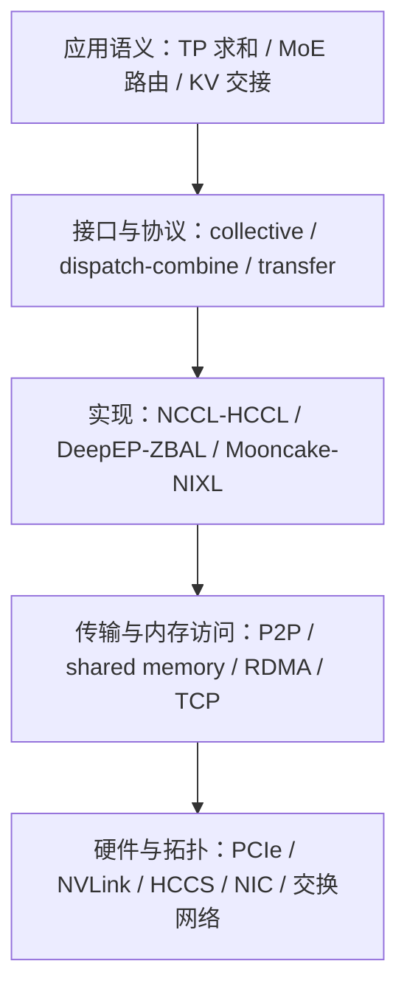

# 02. 链路、RDMA、注册内存与完成语义

**简体中文** | [English](../../../en/ai-infra-basic/Communication/02-links-rdma-and-memory.md)

## 1. 不要把通信库、传输方式和线缆放在同一层



这个图是分层阅读法，不代表所有库都采用同一软件栈。

| 名字 | 是什么 | 不能据此推断什么 |
|---|---|---|
| PCIe | CPU、加速器、NIC 等设备间的互连 | 插在同一机器就一定有最优 P2P 路径 |
| NVLink / NVSwitch | NVIDIA GPU 高速互连及交换能力 | 所有 GPU 对都有相同带宽，或所有集群边界都相同 |
| HCCS | Ascend 高速互连技术，具体域依硬件拓扑 | HCCL 是一根物理链路，或每代 NPU 互连都相同 |
| InfiniBand（IB） | 支持 RDMA 的网络体系 | 所有应用自动走 RDMA |
| RoCE | Ethernet 上的 RDMA 技术 | 普通 TCP socket 等价于 RoCE，或任意以太网配置都足够 |
| RDMA | 远程内存访问机制，可用 read/write 等操作 | 无 CPU 初始化、无同步、无拥塞或必然零复制 |
| TCP | 可靠字节流传输 | 只要配置了 RDMA NIC 就不会再使用 TCP |

拓扑应画成“device → PCIe/互连域 → NIC → switch → NIC → device”，并标注 NUMA 归属。跨 CPU socket 的路径可能让同型号 NIC 表现不同。scale-up/scale-out 是拓扑层次，不应机械等同于机箱内/机箱外。

## 2. RDMA 省掉的是什么

用两个示意路径对比：

```text
staged path:
device A -> host A -> NIC A -> network -> NIC B -> host B -> device B

device-direct path, when supported:
device A <-> NIC A -> network -> NIC B <-> device B
```

第二种路径可以减少 host staging，但是否可用取决于设备、驱动、内存类型、拓扑和后端。NVIDIA 的 GPUDirect RDMA 是其中一种设备直接访问技术，不是所有平台上 RDMA 的通用名字。[GPUDirect RDMA 官方说明](https://docs.nvidia.com/cuda/gpudirect-rdma/)

RDMA Send/Recv 与 RDMA Read/Write 也不同：前者需要接收缓冲协议；单边 read/write 可以由发起方定位远端已授权内存。但“单边”不代表对端没有参与初始化、权限、内存生命周期和完成通知。

## 3. 注册内存不是把一个 Python 地址发过去

可以按下面的生命周期理解，不要把它当成某个库的可执行 API：

```text
allocate buffer
  -> register / map memory with the transport
  -> exchange endpoint + region descriptors
  -> submit transfer
  -> observe completion and establish consumer ordering
  -> retire outstanding accesses
  -> deregister / free or return to pool
```

注册使通信设备/运行时能够定位并授权访问内存。verbs 场景可见 MR、lkey/rkey、QP、CQ；上层 transfer engine 通常封装这些细节。远端进程不能直接解引用本进程的 Python 指针。

注册和连接建立可能很贵，所以常复用内存池、注册区域和连接。复用之前仍要确认旧传输结束：取消请求、释放 KV slot、复用地址若没有协调，会造成“上一条请求的迟到写入覆盖下一条请求”。

## 4. 三种“完成”必须分开

| 时刻 | 通常意味着 | 下一步还需确认 |
|---|---|---|
| 提交 API 返回 | 工作已提交或排队；同步 API 另有契约 | 数据传输是否结束 |
| 传输完成 | 满足该 API 的完成语义 | 消费 stream 的可见性与依赖、通知协议 |
| 应用 ready | 数据和元信息齐备，消费者可以使用 | 请求仍有效、缓存布局和状态已提交 |

具体 read/write、completion、fence、quiet、event 的保证各不相同。不要把一个普通 CPU 标志位当作设备间全局内存屏障，也不要以为一次全局 barrier 可以修补所有 stream 依赖。

## 5. 设备端发起与零复制分别解决什么

- **设备端发起**关注谁触发通信：GPU/NPU kernel 可以在产生数据后发起访问，减少某些 host 往返；仍需运行时和内存协议。
- **零复制 / zero intermediate buffer**关注哪些中转被省略：不代表链路上传输的字节消失，也不代表输出缓冲、索引和同步结构都不占内存。
- **对称内存 / 全局地址映射**使远端寻址有规则可循，但不自动带来普通共享内存那样的缓存一致性。

[NVSHMEM](https://docs.nvidia.com/nvshmem/api/latest/)提供基于 OpenSHMEM 的 GPU 单边通信编程；[UCX](https://openucx.org/)抽象多种通信传输；[MSCCL++](https://github.com/microsoft/mscclpp)提供面向 GPU 的通信构建工具。它们可以服务上层库，但不是每个 DeepEP 或 KV transfer 版本都必然依赖它们。

## 6. 排查问题时先回答

1. 当前传输是 device-direct，还是经过 host staging？证据是什么？
2. 注册成本是在启动时支付，还是每个 token 重复支付？
3. 谁保证 buffer 在异步操作完成之前仍然存活？
4. 当前 rank 的 NIC 是否在合适的 NUMA/互连域？

继续阅读：[Gloo、NCCL、HCCL 与 ProcessGroup](./03-collective-libraries-gloo-nccl-hccl.md)。
