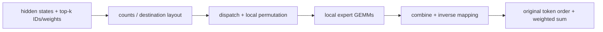

# 04. MoE token 通信：DeepEP 与 SGLang NPU 的 ZBAL

**简体中文** | [English](../../../en/ai-infra-basic/Communication/04-moe-deepep-and-zbal.md)

## 1. 先把 expert 选择变成数据移动

假设两个 EP ranks，每个 rank 放两个 experts：

```text
rank 0 owns experts 0,1
rank 1 owns experts 2,3

token A starts on rank 0: experts [0,2], weights [0.25,0.75]
token B starts on rank 1: experts [2,3], weights [0.50,0.50]
```

A 的一条 expert 路径留在 rank 0，另一条去 rank 1；B 的两条路径都在 rank 1。逻辑上有四条 token-expert assignments，却只有 A→expert 2 需要跨 rank dispatch。不能直接把 `tokens * top_k` 当成跨网 token 数。



## 2. Dispatch/combine 比 AllToAll 多了哪些工作

| 步骤 | 必须保留的信息 / 约束 |
|---|---|
| 路由统计 | token 到 expert/rank 的映射、每目的地数量、容量 |
| dispatch | hidden、必要的 scale 与索引，专家计算需要的接收布局 |
| expert compute | 哪些行属于哪个本地 expert，哪些是 padding |
| combine | 原 token/rank、逆向索引、top-k 权重的应用位置 |
| 完成与复用 | 通信和 GEMM 何时读完 buffer、handle 何时可回收 |

最终数学目标是 `y_t = sum_j weight[t,j] * expert_j(x_t)`。权重可能在 expert 路径或 combine 里施加，必须按实现契约做一次，不能漏乘或乘两次。dispatch handle 通常携带后续回排所需信息，不只是一个网络连接。

同一个 token 的多个目标 expert 若位于同一远端 rank/节点，优化实现可能先共享传输，再本地展开；具体字节数受去重、padding、量化和拓扑影响。负载倾斜也很重要：所有 rank 的平均 token 数相同，不代表最忙 expert 的等待时间小。

## 3. DeepEP：专用通信路径与版本边界

[DeepEP 官方项目](https://github.com/deepseek-ai/DeepEP/blob/93eb6eb238127e96c6d7a4a625a6dad158348509/README.md)围绕 MoE EP 提供优化通信。阅读本仓库时，应以 [token_dispatcher/deepep.py](../../../../python/sglang/srt/layers/moe/token_dispatcher/deepep.py) 的 `Buffer/Config`、normal/low-latency 分支为准：

| 工作负载 | 常见优化目标 | 必须付出的代价 |
|---|---|---|
| 训练 / 较大 prefill 批次 | 吞吐、批量搬运、布局处理摊销 | 通信 buffer、SM/核心占用、pack/unpack |
| decode / 较小 token 批次 | 降低启动与同步延迟、尽早消费结果 | 容量上限、资源预留、不同输出布局或 API 契约 |

这些是优化方向，不是“prefill 永远只能 normal、decode 永远只能 low-latency”的规则，也不意味着某模式在任何拓扑都更快。

**版本核对（2026-10-13）**：上游主线 README 已使用 `EPBuffer` 等新版接口，并说明新版移除了 V1/NVSHMEM 依赖、使用 NCCL Gin 路径。因此，“DeepEP 必须依赖 NVSHMEM”“DeepEP 一定完全绕过 NCCL”“低延迟通信一定零 SM”都不是跨版本成立的结论。本仓库旧接口不能直接配任意上游最新版；安装前必须核对接口、硬件和运行时版本。

同理，NVIDIA DeepEP、上游 DeepEP-Ascend 与本仓库教程里的 `sgl-kernel-npu` DeepEP-Ascend 实现不能仅凭同名当成相同安装包。NPU 细节继续读 [DeepEP/HCCL 源码课](../../ascend-kernel-infra/sgl-kernel-npu/05-deepep-hccl-and-moe-kernel-path.md)。

## 4. ZBAL 是什么

这里就是 **SGLang NPU 使用的 ZBAL**。官方名称是 **Zero Buffer Acceleration Library**，位于 Ascend MemFabric 项目的 `app/zbal`。官方说明列出二级内存分配器，以及 dispatch/combine 和若干 collective；README 的硬件矩阵区分 A3 单节点与 SuperPod，不能据此假设所有 Ascend 型号都支持。[官方 README](https://github.com/Ascend/memfabric_hybrid/blob/004d9317289fe99bd6bf13def0500b3fa3795ccc/app/zbal/README.md)

理解动机时可以把它看作“内存布局/分配与通信算子共同设计”：减少中间通信缓冲和搬运机会，而不只是把 HCCL 的名字替换掉。**Zero Buffer 不代表无需内存，也不代表无需同步**；模型 tensor、输出、注册区域和辅助信息仍有生命周期。

## 5. SGLang 中 ZBAL 的三个接入点

| 入口 | 当前代码行为 | 阅读意义 |
|---|---|---|
| [parallel_state.py](../../../../python/sglang/srt/distributed/parallel_state.py) | NPU 在 `SGLANG_ZBAL_LOCAL_MEM_SIZE > 0` 时选 `zbal`，否则选 `hccl` | 改变默认设备通信 backend |
| [npu/utils.py](../../../../python/sglang/srt/hardware_backend/npu/utils.py) | `init_zbal()`、`switch_to_allocator()`、`lazy_init_zbal_gva_mem()` | allocator、mix mode 与全局地址内存初始化是执行前提 |
| [deepep.py](../../../../python/sglang/srt/layers/moe/token_dispatcher/deepep.py) | NPU + ZBAL 条件下从 `zbal` 导入 `Config/Buffer`，否则导入 `deep_ep` | 同一 dispatcher 入口可以使用不同实现 |

源码中的关键选择是：

```python
"npu": "hccl" if not envs.SGLANG_ZBAL_LOCAL_MEM_SIZE.get() > 0 else "zbal"
```

DeepEP 适配入口则是：

```python
if _is_npu and envs.SGLANG_ZBAL_LOCAL_MEM_SIZE.get() > 0:
    from zbal.zbal.deepep_adaptor import Config
    from zbal.zbal_buffer import Buffer
else:
    from deep_ep import Buffer, Config
```

`Scheduler.init_zbal_on_npu()` 在早期执行；mix alloc 模式先切换分配器，ModelRunner 在后续、graph capture 前延迟初始化相关内存。`SGLANG_ZBAL_LOCAL_MEM_SIZE` 在源码中乘 `1024**2` 转成字节；`SGLANG_ZBAL_BOOTSTRAP_URL` 可提供 bootstrap 地址。只设置变量而不安装兼容包、不满足初始化顺序，并不能保证可用。

## 6. ZBAL 与 HCCL 不是简单二选一

ZBAL 用户指南提供按算子回退到 HCCL 的配置方式。因此 backend 名称为 `zbal` 时，也不能仅凭名称断言每个算子都没有 HCCL 参与；以版本、算子和配置核对。[ZBAL 用户指南](https://github.com/Ascend/memfabric_hybrid/blob/004d9317289fe99bd6bf13def0500b3fa3795ccc/app/zbal/doc/user_guide/get_started.md)

此外，[AscendTransferEngine](../../../../python/sglang/srt/disaggregation/ascend/transfer_engine.py) 导入的是 `memfabric_hybrid.TransferEngine`，用来做 PD 数据搬运。它与 ZBAL 位于相关生态，但不是上面 `zbal` ProcessGroup/DeepEP adapter 的同一条调用链。

## 7. 动手与自检

[语义 demo](./communication_semantics_demo.py) 使用本章 A/B 路由，执行简单的 expert 函数后回排加权，并与直接计算的结果比较。

1. 本例有四个 expert assignments，为什么只有一个需要跨 rank dispatch？
2. 同样的 `Buffer` 类名，为什么不足以确定使用的是哪套通信实现？
3. 哪些时间属于 dispatch 通信，哪些属于路由、重排、等待和 expert GEMM？

继续阅读：[KV 传输、Mooncake 与 NIXL](./05-kv-transfer-mooncake-and-nixl.md)。
