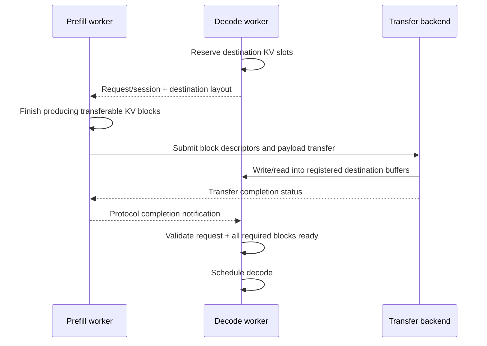

# 05. PD/KV 传输：Mooncake、NIXL 与 Ascend TransferEngine

**简体中文** | [English](../../../en/ai-infra-basic/Communication/05-kv-transfer-mooncake-and-nixl.md)

## 1. KV 交接不是 MoE dispatch

MoE 在层内按 expert 路由激活，随后 combine 回原 token；PD 分离则让另一个实例继续同一请求，需要交接历史 KV、布局和请求状态。后者不要求所有 TP/EP ranks 在每个请求上执行同一个 AllReduce。



这是逻辑协议示意，实际可采用 push/pull、分块传输、多发送 rank 和不同通知方式。关键是目标空间预留、生产者完成、传输完成、消费者可见、调度 ready 之间有明确依赖。

## 2. Mooncake 的几个组件不能混称

| 组件 | 回答的问题 | 本仓库连接点 |
|---|---|---|
| Transfer Engine（TE） | 怎么把一批内存块从这里搬到那里？ | `MooncakeTransferEngine`、PD sender/receiver |
| Mooncake Store | KV/对象放在哪里、怎样查找和复用？ | HiCache 的远端存储 backend |
| Mooncake EP | MoE token 如何分发与回收？ | 独立的 `token_dispatcher/mooncake.py` |
| Mooncake PG | 弹性场景的 process-group 通信如何接入？ | `GroupCoordinator` 的 elastic 分支 |

TE 的典型流程是注册本地内存、定位远端 segment、批量提交、检查完成；Store 在数据搬运上增加对象与缓存管理。当前 Mooncake 项目还包含 EP/PG，因此“Mooncake 只做 KV”也不准确。[TE 设计](https://kvcache-ai.github.io/Mooncake/design/transfer-engine/index.html)、[Mooncake 官方项目](https://github.com/kvcache-ai/Mooncake)

本章重点是 TE 与 Store。判断日志里“用了 Mooncake”是什么意思，必须继续找调用对象：是传 KV、读远端缓存，还是 EP/PG？例如本仓库 [Mooncake EP dispatcher](../../../../python/sglang/srt/layers/moe/token_dispatcher/mooncake.py) 的 normal-mode 分支明确抛出 `NotImplementedError`；项目总体能力不能代替这条集成路径的实际支持范围。

## 3. 控制信息和大块数据走不同路径很正常

控制信息包含请求/session 标识、目标 block 地址、形状、dtype、分片映射和完成状态；大块 payload 是 KV 内容。前者可能使用 TCP/ZMQ/RPC，后者使用 RDMA 或其他 transport。

[SGLang Mooncake conn](../../../../python/sglang/srt/disaggregation/mooncake/conn.py) 同时包含 transfer worker 与 `sync_status_to_decode_endpoint()` 之类的通知逻辑。因此看到 TCP 连接并不能证明 KV payload 没走 RDMA；反过来，日志出现 RDMA 也不能证明所有数据都 device-direct。

传输层知道“哪段地址、多少字节”，但通常不能替应用验证“这是不是正确请求的第 L 层、正确 dtype 的第 B 个 KV block”。这属于 serving 协议和缓存管理器的责任。

## 4. 一次 KV 传输到底多大

对普通 MHA/GQA，假设每层 K/V 的 head dim 相同，没有量化、padding、复制和 prefix 命中：

```math
\mathrm{KV}_{\mathrm{bytes}}=2\cdot L\cdot T\cdot H_{\mathrm{kv}}\cdot D\cdot \mathrm{bytes\_per\_element}
```

```math
L=32, T=8192, H_{\mathrm{kv}}=8, D=128, \mathrm{BF16}=2 \mathrm{bytes}
```

```math
\mathrm{KV}_{\mathrm{bytes}} = 1,073,741,824 \mathrm{bytes} = 1 \mathrm{GiB}
```

若聚合有效带宽为 `50 GB/s`，仅 payload 的理想传输时间约 **21.47 ms**。此处 GB 为十进制，GiB 为二进制。这个下界不含排队、注册、layout 转换、协议和同步开销，也不等于 TTFT：prefill 是否已经返回首 token、KV 是否分块流水，都会影响用户可见延迟。

TP 完全均匀分片且不复制时，每个 sender 的数据可能约为 `1/P`，但共享 NIC 或交换网络会限制聚合带宽，不能再无条件把总时间除以 `P`。P/D 使用不同 TP degree 时，还要重映射分片。

MLA 的压缩 cache、量化 KV、prefix 命中和 GDN/Mamba recurrent state 都需要按真实存储格式重算；不要把普通 GQA 公式套到所有模型。参见 [KV Cache Memory](../KV_Cache_Memory/README.md) 与 [GDN state](../Gated_Delta_Network/02-gdn-layer-dataflow-and-shapes.md)。

## 5. NIXL 与 Mooncake 是竞争关系还是上下层关系

[NIXL（NVIDIA Inference Xfer Library）](https://github.com/ai-dynamo/nixl)提供数据传输接口与插件式 backend，项目列出 UCX、Mooncake 等插件。因此框架直接选择 Mooncake TE，与通过 NIXL 使用 Mooncake plugin，是不同集成方式；它们既可能作为同一接口位置的备选，也可能形成上下层关系。

使用 NIXL 仍需管理注册区域、对端元信息、请求/传输句柄和完成状态。它不自动替 serving 框架决定 prefix eviction、KV block 所属请求或 decode 何时调度。本仓库 PD 接入见 [disaggregation/nixl/conn.py](../../../../python/sglang/srt/disaggregation/nixl/conn.py)；其他 NIXL 集成用途应另查对应调用点。

## 6. Ascend：类名复用不意味着实现相同

[AscendTransferEngine](../../../../python/sglang/srt/disaggregation/ascend/transfer_engine.py) 继承本地 `MooncakeTransferEngine` wrapper，但实际实例化 `memfabric_hybrid.TransferEngine`。当前源码接受 `ASCEND_MF_TRANSFER_PROTOCOL` 的 `sdma` / `device_rdma`，并使用 `ASCEND_MF_STORE_URL` 等初始化信息。

这说明它复用了接口形态，不意味着安装 CUDA Mooncake 包就能运行 NPU 路径，也不意味着 ZBAL ProcessGroup 会负责这次 KV transfer。需要沿 import、构造器和实际调用追踪实现。SDMA/device RDMA 的可用范围依硬件与 MemFabric 版本判断，不应只根据协议名字推断跨节点可达性。

## 7. 故障处理是传输正确性的一部分

| 故障时刻 | 必须协调的状态 |
|---|---|
| decode 已预留，prefill 失败 | 请求失败通知、预留 slot 与发送任务回收 |
| 传输中取消请求 | 阻止过早复用目标地址，处理仍在途的操作 |
| 部分 rank/blocks 完成 | 完成计数/范围核对，不能提前 ready |
| 节点重启或 endpoint 变化 | 失效连接/注册描述符，防止使用旧 session 元信息 |
| prefix 被淘汰 | 正在使用/传输的数据需要生命周期保护 |

不同引擎的失败和取消 API 不同；这里列出需要满足的协议目标，不宣称所有后端都有同样的自动恢复能力。

## 8. 自检

1. 为什么成功传完字节仍可能得到错误 token？
2. 用 Mooncake TE 是否必然要求部署 Mooncake Store？（不必；取决于选用的组件。）
3. 为什么一次超时后立即把目标 KV slot 分给新请求可能不安全？

下一讲：[SGLang 源码路径与性能排查](./06-sglang-paths-and-performance.md)。
