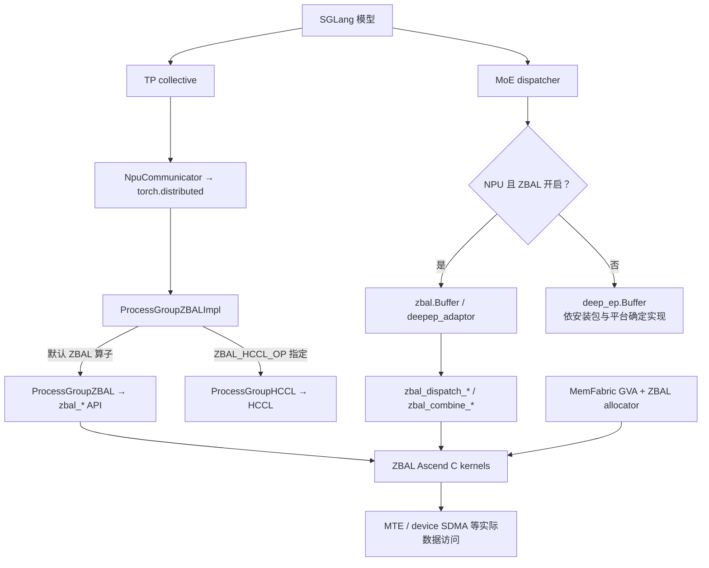
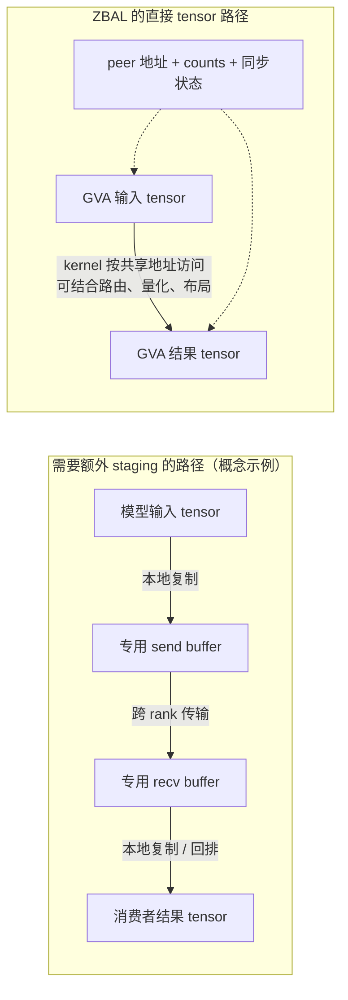
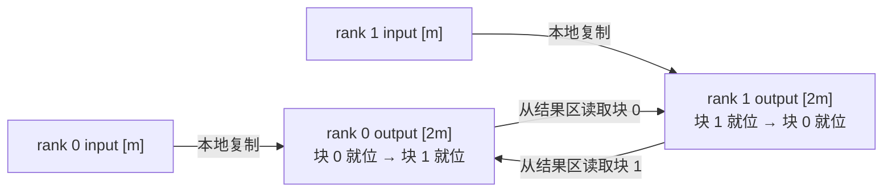
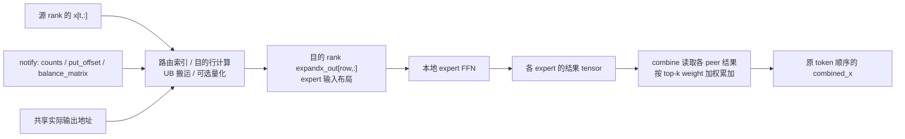
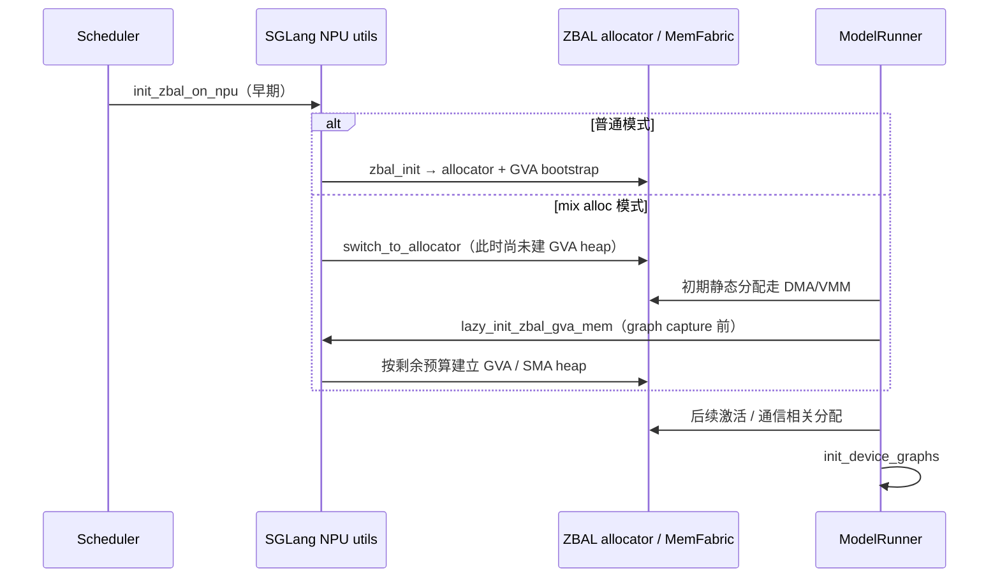

# 07. ZBAL 的 zero buffer：从分配器、远端地址到 MoE 数据流

**简体中文** | [English](../../../en/ai-infra-basic/Communication/07-zbal-zero-buffer-source-dataflow.md)

读完 [04：MoE、DeepEP 与 ZBAL](./04-moe-deepep-and-zbal.md) 后，本讲进一步回答：模型 tensor 为什么能直接参与通信，省掉的是哪一层 buffer，以及 HCCL/DeepEP 在调用链里到底处于什么位置。

源码核对日期：**2026-10-14**。SGLang 基线为本仓库 `0a15320`；外部源码固定为 [Ascend/memfabric_hybrid@004d931](https://github.com/Ascend/memfabric_hybrid/tree/004d9317289fe99bd6bf13def0500b3fa3795ccc/app/zbal)。下文结论针对这组源码，属于源码推导，未做 NPU 多卡性能实测。上游 `doc/architecture.md` 在这个版本仍是 TODO，因此实现细节以实际 allocator、adapter 和 kernel 为依据。

## 1. 先回答三个核心问题

| 问题 | 对应机制 |
|---|---|
| zero buffer 怎么实现 | MemFabric 建立可跨 rank 访问的 GVA 空间；ZBAL 分配器让参与通信的 tensor 位于合适的内存中；kernel 交换实际 tensor 地址，直接把数据放入结果 tensor 或从 peer tensor 读取。 |
| 和 HCCL 什么关系 | 标准 collective 可选择 ZBAL 的 ProcessGroup 实现；其 wrapper 还能按算子显式委托给 ProcessGroupHCCL。ZBAL 自有 kernel 的数据通路可沿 MemFabric/GVA/MTE/SDMA 执行。 |
| 和 DeepEP 什么关系 | SGLang 复用 DeepEP 风格的 `Buffer/Config`、dispatch/combine 接口；启用 ZBAL 的 NPU 分支导入 ZBAL adapter，随后执行 ZBAL 的 C++/Ascend C 实现。 |



图中的 HCCL 分支是 **collective wrapper 的显式委托**，不是“所有 ZBAL kernel 最后都调用 HCCL”。同样，接口叫 `Buffer` 也不能证明执行了某个 NVIDIA DeepEP kernel。

## 2. 先让模型内存可通信，再谈省掉 staging

### 2.1 GVA 是什么

这里的 GVA（Global Virtual Address）是 MemFabric 提供的全局虚拟地址映射。它让设备 kernel 在支持的通信域中定位 peer 内存；它不是 HBM 容量增加，也不是自动缓存一致性。

[MemFabricBoostrap::CreateSHMSpace()](https://github.com/Ascend/memfabric_hybrid/blob/004d9317289fe99bd6bf13def0500b3fa3795ccc/app/zbal/src/csrc/bootstrap/memory/memfabric/zbal_mem_mf_bootstrap.cpp#L85) 依次调用 `SmemShmInit()`、`SmemShmCreate()`、`SmemShmGetSymmetricSize()`，取得 GVA 基址和每个 rank 的对称地址跨度。源码计算可概括为：

```math
A=\mathrm{deviceGva}
```

```text
S = symmetric address-space stride per world rank
```

```math
\mathrm{local\_base}\left(\mathrm{world\_rank}\right) = A + \mathrm{world\_rank} \cdot  S
```

`S` 是查询得到的地址空间跨度，不应直接拿某个 tensor 的长度或用户配置的已用字节量替代。

### 2.2 分配器为什么是通信设计的一部分

[switch_to_allocator()](https://github.com/Ascend/memfabric_hybrid/blob/004d9317289fe99bd6bf13def0500b3fa3795ccc/app/zbal/src/python/zbal/zbal_module.py) 安装 `NPUPluggableAllocator`，把 `zbal_pluggable_malloc/free` 接到 PyTorch NPU；同时注册 `record_stream` 等生命周期回调。

[zbal_sma_init() / zbal_pluggable_malloc()](https://github.com/Ascend/memfabric_hybrid/blob/004d9317289fe99bd6bf13def0500b3fa3795ccc/app/zbal/src/csrc/zbal_mem_allocator.cpp#L26) 用 bootstrap 得到的本地 GVA 区域初始化 heap，再从相应 allocator 分配 tensor。这样，输入激活、接收结果等可以直接位于通信 kernel 能访问的内存中，无须每次把任意普通分配的 tensor 先迁移到一个固定通信大区。

这是一个配合机制：**可寻址内存 + tensor 分配 + kernel 地址协议**。仅在已有普通 tensor 上修改 backend 名称，不会自动把它变成 ZBAL GVA tensor。

### 2.3 对称 metadata 不要求所有业务 tensor 同偏移

[zbal_ptr()](https://github.com/Ascend/memfabric_hybrid/blob/004d9317289fe99bd6bf13def0500b3fa3795ccc/app/zbal/src/csrc/operators/npu/device/common/zbal_kernel_utils.h#L88) 的核心地址换算是：

```math
\mathrm{remote\_meta}=\mathrm{local\_meta}+\left(\mathrm{world\_dst}-\mathrm{world\_src}\right)\cdot S
```

```math
\mathrm{world\_src}={\mathrm{peerRanks}}_{\mathrm{group\_src}}
```

```math
\mathrm{world\_dst}={\mathrm{peerRanks}}_{\mathrm{group\_dst}}
```

这个公式适用于通信协议中按同偏移布置的区域，例如 metadata。若 subgroup 成员是 world ranks $`\left[1,3\right]`$，从 group rank 0 找 group rank 1，应跨 $`2\cdot S`$，不是 $`1\cdot S`$。

**业务 tensor 可以是非对称分配。**Normal dispatch 的 `PutShareAddr()/GetShareAddr()` 会发布和读取 `x`、`expandx_out` 等实际地址，而不是假设“对端结果 tensor 的偏移一定和本地一样”。对称 metadata 帮助找到地址表，地址表再帮助找到不同 rank 的实际 payload。

## 3. zero buffer 具体省掉什么

下面对比的是一种需要 staging 的设计与 ZBAL 的目标数据路径，不是对所有 HCCL/DeepEP 版本的统一描述。



主要节省对象是：与业务输入/输出重复保存 payload 的**额外通信中转区及其进出拷贝**。输入、输出、路由索引、地址表、状态标志和片上 UB 仍然存在；不同算子也可能保留 scratch。

一次额外的 `M` 字节本地 payload copy，至少产生约 `M` 字节读取和 `M` 字节写入的内存流量。省掉这一步可能降低 HBM 压力和延迟，但链路上必须传递的信息不会凭空消失，协议开销、同步和计算资源竞争也仍然存在。这是机制分析，不是性能收益百分比。

## 4. 用实际 AllGather 路径验证“直接结果 tensor”

### 4.1 Host 端直接把 tensor 的 data_ptr 交给算子

连续输出接口的 [ProcessGroupZBAL::_allgather_base()](https://github.com/Ascend/memfabric_hybrid/blob/004d9317289fe99bd6bf13def0500b3fa3795ccc/app/zbal/src/csrc/adaptor/pytorch_npu/zbal_pytorch_process_group.cpp#L468) 检查 $`\mathrm{output}.\mathrm{numel} = P \cdot  \mathrm{input}.\mathrm{numel}`$，取得输入/输出 `data_ptr()`，调用 `zbal_all_gather()`。它的 post 回调为空。

### 4.2 Device 端把结果 tensor 兼作 ring 数据传播区域

该版本 [ZBALAllGatherInner](https://github.com/Ascend/memfabric_hybrid/blob/004d9317289fe99bd6bf13def0500b3fa3795ccc/app/zbal/src/csrc/operators/npu/device/classic/zbal_kernel_allgather.cpp#L41) 的 small-kernel 选择写成 `if (false)`，实际进入 `ZBALAllGatherBigKernel`。不要仅看到 SmallKernel 的定义就按它解释当前执行。

[BigKernel::Process()](https://github.com/Ascend/memfabric_hybrid/blob/004d9317289fe99bd6bf13def0500b3fa3795ccc/app/zbal/src/csrc/operators/npu/device/classic/zbal_kernel_allgather.h#L392) 的数据流是：

```text
1. ClearExchangeMeta + BarrierAll
2. CopyLocal2Output: input_r -> output_r[r-th segment]
3. ExchangeOutputAddr: publish actual output address + ready state
4. Wait flag/stat for each ring slice
5. CpGM2GM: peer output slice -> local output same slice
6. WriteStat: notify next hop that this slice is ready
7. BarrierAll before completion
```

例如两个 rank，输入均为 $`\left[m\right]`$、输出均为 $`\left[2\cdot m\right]`$：



结果区本身参与 ring 转发，因此不必再为这条 kernel 路径设置另一份同样 payload 的独立 ring staging。**本地 input→output copy 和 ring 多跳转发仍然发生。**

### 4.3 GM→GM 也可能经过 UB

[ZBALBaseKernel::CpGM2GM()](https://github.com/Ascend/memfabric_hybrid/blob/004d9317289fe99bd6bf13def0500b3fa3795ccc/app/zbal/src/csrc/operators/npu/device/classic/zbal_kernel_base.h#L38) 按 `dataOpType` 选择 MTE 或 device SDMA。MTE 分支分块执行 `GM → UB queue → GM`；SDMA 分支调用 `zbal_sdma_get_nbi()` 后 `zbal_sdma_quiet()`。zero buffer 指向的是额外 payload staging 的减少，并不要求硬件拷贝引擎内部完全没有缓冲。

## 5. MoE normal dispatch/combine：直接写到 expert 输入布局

本节以固定版本的 **normal 模式** 为例。低延迟模式有独立 kernel 和输出容量策略，不能直接套用这里的布局。

### 5.1 SGLang 沿用接口，ZBAL 提供实现

[SGLang deepep.py](../../../../python/sglang/srt/layers/moe/token_dispatcher/deepep.py) 在 NPU + ZBAL 条件下从 `zbal.zbal_buffer` 导入 `Buffer`。随后仍调用 `get_dispatch_layout()`、`dispatch()`、`combine()`。

[ZBAL Buffer.__init__()](https://github.com/Ascend/memfabric_hybrid/blob/004d9317289fe99bd6bf13def0500b3fa3795ccc/app/zbal/src/python/zbal/zbal_buffer.py#L29) 克隆传入 group，隔离 MoE metadata；从 NPU backend 取得 `get_zbal_comm_name()`，初始化通信 metadata，再创建 C++ `deepep_adaptor.Buffer`。因此这条 adapter 路径需要能提供这些方法的 ZBAL backend。

`num_nvl_bytes`、`num_rdma_bytes` 等字段保留了 DeepEP 风格的命名。在这个版本，C++ 构造器保存这些值并查找 ZBAL communicator；它没有在构造器内按这两个值新建 NVIDIA 风格的 NVLink/RDMA payload 大区。不能根据参数名判断实际 transport 或 buffer 分配。

### 5.2 counts → offset → 最终输出地址

[C++ Buffer::intranode_dispatch()](https://github.com/Ascend/memfabric_hybrid/blob/004d9317289fe99bd6bf13def0500b3fa3795ccc/app/zbal/src/csrc/adaptor/deepep/zbal_deepep.cpp#L208) 的顺序是：

1. 创建计数、`put_offset`、`balance_matrix` 等元信息 tensor。
2. `zbal_dispatch_normal_notify()` 计算接收数量及放置位置。
3. 读取 `total_recv_token.item<int>()`，分配实际 `expandx_out` 和 scale 输出。这是该路径可见的 host/device 同步点。
4. 将输入和输出 tensor 的实际地址交给 `zbal_dispatch_normal()`。

kernel 的 [PutShareAddr/GetShareAddr](https://github.com/Ascend/memfabric_hybrid/blob/004d9317289fe99bd6bf13def0500b3fa3795ccc/app/zbal/src/csrc/operators/npu/device/dispatch_combine_normal/zbal_kernel_dispatch_normal.h#L292) 交换各 rank 的输入、路由、offset、结果和 scale 地址。对直接发送分支 `InputToDstOutput()`，目的行的核心计算是：

```math
\mathrm{dst\_rank}=\left\lfloor\frac{\mathrm{expert\_id}}{\mathrm{experts\_per\_rank}}\right\rfloor
```

```math
\mathrm{base\_row}={\mathrm{put\_offset\_flat}}_{\mathrm{expert\_id}\cdot P+\mathrm{src\_rank}}
```

```math
\mathrm{row}=\mathrm{base\_row}+{\mathrm{send\_token\_idx}}_{\mathrm{token\_assignment}}
```

```math
\mathrm{dst\_addr}={\mathrm{shared\_expandx\_out\_addr}}_{\mathrm{dst\_rank}}+\mathrm{aligned\_row\_bytes}\cdot \mathrm{row}
```

这里明确使用 kernel 的**扁平索引**；不要从 host 分配的二维 shape 自行推断另一套索引顺序。`aligned_row_bytes` 对应实现中的 `hUBAlignSize`，不能忽略对齐。



[DispatchNormal::Process()](https://github.com/Ascend/memfabric_hybrid/blob/004d9317289fe99bd6bf13def0500b3fa3795ccc/app/zbal/src/csrc/operators/npu/device/dispatch_combine_normal/zbal_kernel_dispatch_normal.h#L692) 还可按 `isEnableBalance_` 选择 `HandleAllRankToken()`；上面的直接发送分支用来说明地址机制，不代表所有 token 都由同一个 rank/核心负责搬运。

[CombineNormal::ReadTokenAndWeightedSum()](https://github.com/Ascend/memfabric_hybrid/blob/004d9317289fe99bd6bf13def0500b3fa3795ccc/app/zbal/src/csrc/operators/npu/device/dispatch_combine_normal/zbal_kernel_combine_normal.h#L412) 通过 `shareRecvXAddrs` 和反向 offset 读取 expert 结果，在 UB 中转为 float、乘权重、累加，再写回结果。直接寻址省掉的是独立中转 payload，不会省掉数学上必须的 top-k 聚合和结果存储。

## 6. 和 HCCL 的关系：在哪一层发生替换或共存

SGLang 的 [NpuCommunicator.all_reduce()](../../../../python/sglang/srt/distributed/device_communicators/npu_communicator.py) 调用 `dist.all_reduce(..., group=self.group)`，具体实现由 group 决定。[parallel_state.py](../../../../python/sglang/srt/distributed/parallel_state.py) 为 NPU 默认选择 `hccl`，在 ZBAL 环境条件成立时选择 `zbal`。

ZBAL import 时注册 `zbal` backend；[ProcessGroupZBALImpl](https://github.com/Ascend/memfabric_hybrid/blob/004d9317289fe99bd6bf13def0500b3fa3795ccc/app/zbal/src/csrc/adaptor/pytorch_npu/zbal_pytorch_process_group_impl.cpp#L23) 则在内部维护 ZBAL group，并在配置非空时建立 HCCL group。例如：

```bash
export ZBAL_HCCL_OP="allgather,allreduce"
```

在此固定版本中，对应 collective 被显式转发给 HCCL group。这是用户选择的算子路由，不能解释成“任何 ZBAL 失败都会自动回退 HCCL”。该环境变量在 C++ 静态集合初始化时读取，应在启动进程前设置。

HCCL 是通用集合通信库，本身也有随版本变化的内存与通信优化。前文的 staging 图不能用来断言“HCCL 一定多两次复制”。公平比较应固定同一算子、API 形式、tensor 布局、硬件和模式，并确认到底走了哪个分支。

## 7. 初始化时序与 mix alloc：为什么不能启动后随便切



SGLang 的 [init_zbal()/lazy_init_zbal_gva_mem()](../../../../python/sglang/srt/hardware_backend/npu/utils.py) 与 [ModelRunner](../../../../python/sglang/srt/model_executor/model_runner.py) 决定时序。ZBAL 的 `zbal_pluggable_malloc()` 在 mix 模式下，GVA 初始化前调用 `dma_malloc()` 并记录这些指针，之后调用 `sma_malloc()`；free 时依记录选择对应 allocator。

所以“权重/KV 走 DMA/VMM、激活走 GVA”是**通过分配时机实现的预期用法**，不是分配器识别出 tensor 的语义标签。初始化后再创建的其他 tensor 也受当前分配路径影响。

当前 SGLang helper 还包含 $`\mathrm{total\_memory}=61.2`$ 的估算、预算扣减与 128 MiB 对齐。这是实现基线里的平台假设，不是任意 NPU 都应照抄的容量参数。`SGLANG_ZBAL_LOCAL_MEM_SIZE` 对应内存预算，不是要求另外保留同样大小的 send/recv staging。

## 8. 从源码确认仍然存在的内存、复制与同步

| 证据 | 说明 |
|---|---|
| `_allgather_base()` 的结果 tensor，ring 的 `CopyLocal2Output()` | 输出与本地复制仍存在；结果区承担传播角色。 |
| list 版 `allgather()` 的 `FlattenForScatterGather()` 和 post `copy_()` | 某些框架 API 包装仍会引入 flatten/回拷；不能把连续输出路径推广到所有 API。 |
| `ProcessGroupZBAL::allreduce()` 中的 `bufferTensor` | 同一版本 AllReduce 仍分配约本 rank 分片大小的 scratch，按实际 `bufferElems` 计算。 |
| dispatch 的 `expandx_out`、scales、counts、offsets，low-latency 的容量分配 | 业务输出、路由 metadata、容量开销仍占内存。 |
| `ZBALWaitFlag/WriteStat/BarrierAll`、UB queues | 地址共享以后仍要协调完成和片上数据依赖。 |

上表前三项可直接在 [ProcessGroupZBAL 源码](https://github.com/Ascend/memfabric_hybrid/blob/004d9317289fe99bd6bf13def0500b3fa3795ccc/app/zbal/src/csrc/adaptor/pytorch_npu/zbal_pytorch_process_group.cpp) 中对应到 `allreduce`、`_allgather_base` 和 `allgather` 三个实现。

还要特别检查 DeepEP 兼容契约：[zbal_deep_event.h](https://github.com/Ascend/memfabric_hybrid/blob/004d9317289fe99bd6bf13def0500b3fa3795ccc/app/zbal/src/csrc/adaptor/deepep/zbal_deep_event.h) 的 `current_stream_wait()` 在此版本为空；[C++ adapter](https://github.com/Ascend/memfabric_hybrid/blob/004d9317289fe99bd6bf13def0500b3fa3795ccc/app/zbal/src/csrc/adaptor/deepep/zbal_deepep.cpp) 的多个 `async/previous_event/return_recv_hook` 参数被忽略，low-latency 返回空函数 hook，`zero_copy` 参数也被忽略。正确性依靠实际 stream、算子和 kernel 协议，不能只凭兼容参数名断言获得了 NVIDIA DeepEP 同样的异步重叠能力。

## 9. 带着具体问题回看 trace

1. **验证路径**：tensor 是否来自正确 allocator？collective group 是 `hccl` 还是 `zbal`？`ZBAL_HCCL_OP` 是否委托了该操作？MoE 的实际 `Buffer` 来自哪里？
2. **验证地址与布局**：输入输出 shape、连续性、dtype、row alignment、peer group→world rank 映射，以及源/目的 offset 是否一致？
3. **验证节省发生在哪**：独立 staging 是否减少？仍有几次 `copy_`、UB 搬运、scratch 分配和同步？将初始化、notify 的 host 同步、通信、expert GEMM 分开计量。
4. **验证最终收益**：固定路由分布和有效 token，比较 HBM 峰值、通信耗时、ITL/吞吐；依据 [通信测量课](./06-sglang-paths-and-performance.md) 判断资源竞争和尾延迟。

检查题：为什么两个 rank 的 `expandx_out` 不必同偏移？为什么 `Buffer(num_rdma_bytes=...)` 不能证明分配了那样大小的独立通信区？为什么 AllGather 的输出直接参与 ring 后，仍然可以看到多次数据复制？
