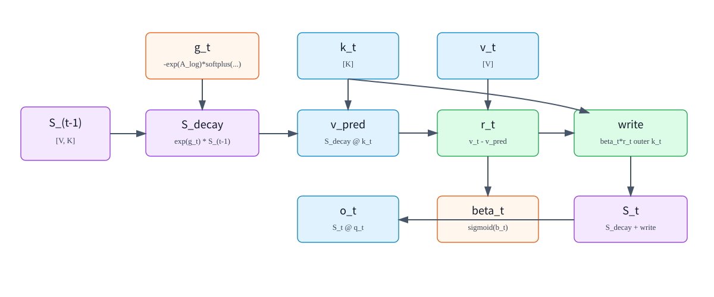
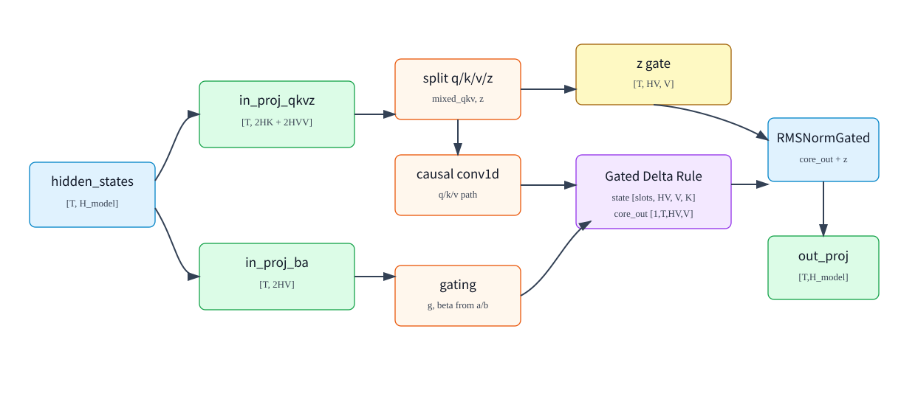
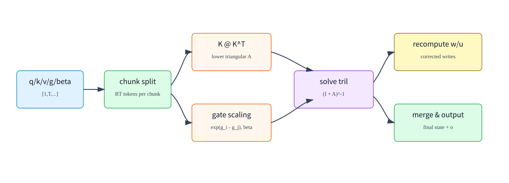

# Gated DeltaNet（GDN）：从矩阵记忆到训练原理与 SGLang 推理

**简体中文** | [English](../../../en/ai-infra-basic/Gated_Delta_Network/01-gated-deltanet.md)

本篇将原来的数学、层内 shape、训练与 serving 三篇合为一条完整学习路径。先理解一次记忆读写，再看它如何嵌入层内计算，最后追踪 prefill、decode 和请求状态。原有 `z`、短卷积消融以及 head 分组解释均保留在对应小节。

- [1. 为什么用矩阵记忆替代 KV 历史](#gdn-memory)
- [2. 一次状态更新：遗忘、预测、纠错与读取](#gdn-update)
- [3. 遗忘门、写入门与归一化](#gdn-gates)
- [4. 从 hidden 到六路激活：完整层内数据流](#gdn-layer)
- [5. 短因果卷积：计算方式、作用与实验证据](#gdn-conv)
- [6. 多 head、状态形状与显存：为什么不再乘 q/k head 数](#gdn-state)
- [7. 从状态读出到层输出：输出门与完整 Shape 表](#gdn-output)
- [8. 训练：哪些参数学习，哪些状态只在运行时存在](#gdn-training)
- [9. Prefill：从顺序递归到分块计算](#gdn-prefill)
- [10. Decode：融合更新与 packed fast path](#gdn-decode)
- [11. Serving：请求槽位、前缀复用、推测验证与迁移](#gdn-serving)
- [12. 源码阅读入口与下一步](#gdn-source)

本文使用本仓库固定的 SGLang 源码快照（引入提交 `c6de33fcaa2027826f89f375d1e805ab3305f8cb`），不把推导中的通用递归公式视为每种后端都已实现的功能。

<a id="gdn-memory"></a>

## 1. 为什么用矩阵记忆替代 KV 历史

### GDN 想解决的问题

标准 causal attention 会为每层保存历史 K/V：

```math
\mathrm{shape}\left(K_{\mathrm{cache}}\right)=\left[\mathrm{context\_len},\mathrm{num\_kv\_heads},\mathrm{head\_dim}\right]
```

```math
\mathrm{shape}\left(V_{\mathrm{cache}}\right)=\left[\mathrm{context\_len},\mathrm{num\_kv\_heads},\mathrm{head\_dim}\right]
```

上下文越长，KV Cache 越大。GDN 换一种思路：不保存每个历史 token 的 K/V，而是维护一个按 head 存储的状态矩阵。

```text
S_t[h] : [V, K]
```

其中：

| 符号 | 含义 |
|---|---|
| `t` | 当前 token 位置 |
| `h` | value head id |
| `K` | key/query head dimension |
| `V` | value head dimension |
| `S_t[h]` | 第 `h` 个 value head 在处理完 token `t` 后的 recurrent state |

每来一个新 token，GDN 做三件事：

```text
1. 用 gate 衰减旧状态
2. 用 key 从状态里读出当前 value 的预测
3. 把预测误差写回状态，再用 query 读出输出
```



### GDN 与标准 attention 的差别

标准 attention：

```math
\mathrm{score\_tj}=\left\langle q_{t},k_{j}\right\rangle
```

```math
\alpha_{\mathrm{tj}}=\mathrm{softmax}\left(\mathrm{score\_tj}\right)
```

```math
o_{t} = \sum_{j} \alpha_{\mathrm{tj}} \cdot  v_{j}
```

GDN：

```math
S_{t}=\mathrm{recurrent\_update}\left({S}_{t-1},k_{t},v_{t},g_{t},\beta_{t}\right)
```

```math
o_{t}=S_{t}\,q_{t}
```

| 维度 | 标准 attention | GDN |
|---|---|---|
| 历史保存 | 保存每个历史 token 的 K/V | 保存固定大小状态矩阵 |
| 读历史方式 | 对所有历史 token 做 softmax 加权 | 用 query 从状态矩阵读 |
| 状态大小 | 随上下文长度线性增长 | 与上下文长度无关 |
| 表达能力 | 精确 token-to-token 检索强 | 更像压缩记忆和线性递推 |
| serving 重点 | KV Cache 管理和 attention kernel | recurrent state、conv state、chunk/recurrent kernel |

<a id="gdn-update"></a>

## 2. 一次状态更新：遗忘、预测、纠错与读取

### 单个 token、单个 head 的核心公式

先只看一个 value head，省略 batch 和 head 下标。当前 token 有：

```math
\mathrm{shape}\left(q_{t}\right)=\left[K\right]
```

```math
\mathrm{shape}\left(k_{t}\right)=\left[K\right]
```

```math
\mathrm{shape}\left(v_{t}\right)=\left[V\right]
```

```math
\mathrm{shape}(S_{t-1})=[V,K]
```

```math
g_t\in\mathbb{R},\quad g_t\le0
```

```math
\beta_t\in(0,1)
```

GDN 的 recurrent update 可以写成：

遗忘旧状态:

```math
S_{\mathrm{decay}}=\mathrm{exp}\left(g_{t}\right)\cdot {S}_{t-1}
```

预测当前 value:

```math
v_{\mathrm{pred}}=S_{\mathrm{decay}}\,k_{t}
```

计算残差:

```math
r_{t}=v_{t}-v_{\mathrm{pred}}
```

控制写入强度:

```math
u_{t}=\beta_{t}\cdot r_{t}
```

写入状态:

```math
S_{t}=S_{\mathrm{decay}}+u_{t}\,{k_{t}}^{\mathsf T}
```

读取输出:

```math
o_{t}=S_{t}\,q_{t}\cdot \mathrm{scale}
```

变量含义：

| 变量 | 形状 | 含义 |
|---|---:|---|
| `q_t` | $`\left[K\right]`$ | 当前 token 的查询向量，用来从状态中读信息 |
| `k_t` | $`\left[K\right]`$ | 当前 token 的键向量，用来定位应该写入状态的方向 |
| `v_t` | $`\left[V\right]`$ | 当前 token 要写入的 value 信息 |
| `S_(t-1)` | $`\left[V,K\right]`$ | 处理当前 token 之前的状态 |
| `g_t` | scalar | 遗忘 gate；越负，旧状态衰减越强 |
| `beta_t` | scalar | 写入 gate；越接近 1，当前 residual 写入越强 |
| `v_pred` | $`\left[V\right]`$ | 旧状态沿 `k_t` 方向预测出来的 value |
| `r_t` | $`\left[V\right]`$ | 当前 value 与旧状态预测的差值 |
| `u_t` | $`\left[V\right]`$ | 被 `beta_t` 调制后的写入向量 |
| `o_t` | $`\left[V\right]`$ | 当前 head 的输出 |

其中：

```math
u_tk_t^{\mathsf T}\in\mathbb{R}^{V\times K},\quad u_t\in\mathbb{R}^{V},\quad k_t\in\mathbb{R}^{K}
```

所以它可以加回 `S_decay [V,K]`。

### 为什么叫 delta rule

Delta rule 的直觉是：不要把 `v_t` 原封不动写入状态，而是只写入“旧状态还没有解释好的部分”。

```math
r_{t}=v_{t}-S_{\mathrm{decay}}\,k_{t}
```

读法：

```text
如果旧状态已经能用 k_t 预测出 v_t，
那么 residual 很小，本次写入就很小。

如果旧状态预测错了，
那么 residual 大，状态会沿 k_t 方向补上这部分差值。
```

这和普通线性 attention 的外积累加不同。普通线性 attention 更像：

```math
S_{t}={S}_{t-1}+v_{t}\,{k_{t}}^{\mathsf T}
```

GDN 则是：

```math
S_{t}=\mathrm{exp}\left(g_{t}\right)\cdot {S}_{t-1}+\beta_{t}\cdot \left(v_{t}-\mathrm{exp}\left(g_{t}\right)\cdot {S}_{t-1}\,k_{t}\right)\,{k_{t}}^{\mathsf T}
```

这里多了两个关键机制：

| 机制 | 作用 |
|---|---|
| $`\mathrm{exp}\left(g_{t}\right)`$ | 自适应遗忘旧状态 |
| $`v_{t}-S_{\mathrm{decay}}\,k_{t}`$ | 只写入预测误差，而不是重复写入已有信息 |

### 单 head 的 Shape 走读

设：

```math
K=2
```

```math
V=3
```

```math
\mathrm{shape}(S_{t-1})=[3,2]
```

```math
\mathrm{shape}\left(k_{t}\right)=\left[2\right]
```

```math
\mathrm{shape}\left(v_{t}\right)=\left[3\right]
```

```math
\mathrm{shape}\left(q_{t}\right)=\left[2\right]
```

计算：

```math
S_{\mathrm{decay}}=\mathrm{exp}\left(g_{t}\right)\cdot {S}_{t-1}\qquad\text{[3,2]}
```

```math
v_{\mathrm{pred}}=S_{\mathrm{decay}}\,k_{t}\qquad\text{[3]}
```

```math
r_{t}=v_{t}-v_{\mathrm{pred}}\qquad\text{[3]}
```

```math
u_{t}=\beta_{t}\cdot r_{t}\qquad\text{[3]}
```

```text
u_t outer k_t                      # [3,2]
```

```math
S_{t}=S_{\mathrm{decay}}+u_{t}\,{k_{t}}^{\mathsf T}\qquad\text{[3,2]}
```

```math
o_{t}=S_{t}\,q_{t}\qquad\text{[3]}
```

这个 head 输出 $`\left[3\right]`$，多 head 情况下把所有 value heads 的输出拼接为：

```math
\mathrm{shape}\left(O_{t}\right)=\left[\mathrm{HV},V\right]
```

```text
flatten(O_t): [HV * V]
```

然后进入 output gate/norm 和 out projection。

<a id="gdn-gates"></a>

## 3. 遗忘门、写入门与归一化

### `g_t` 从哪里来

在 SGLang 的 GDN 实现中，`g_t` 由 `A_log`、`a_t` 和 `dt_bias` 计算：

```math
g_{t}=-\mathrm{exp}\left(A_{\mathrm{log}}\right)\cdot \mathrm{softplus}\left(a_{t}+\mathrm{dt\_bias}\right)
```

| 变量 | 形状 | 是否可训练 | 含义 |
|---|---:|---:|---|
| `A_log` | $`\left[\mathrm{HV}\right]`$ | 是 | 每个 value head 一个 log-space decay 参数 |
| `a_t` | $`\left[\mathrm{HV}\right]`$ | 否 | 当前 token 的 gate 激活，由 `in_proj_a` 投影得到 |
| `dt_bias` | $`\left[\mathrm{HV}\right]`$ | 是 | 每个 value head 一个时间步偏置 |
| `softplus(a_t + dt_bias)` | $`\left[\mathrm{HV}\right]`$ | 否 | 正数时间步/衰减强度 |
| `g_t` | $`\left[\mathrm{HV}\right]`$ | 否 | 非正数 gate，控制旧状态衰减 |

为什么这样参数化？

```math
\mathrm{exp}\left(A_{\mathrm{log}}\right) \gt 0
```

```math
\mathrm{softplus}\left(a_{t}+\mathrm{dt\_bias}\right) \gt 0
```

```math
g_{t} \le 0
```

```math
0 \lt \mathrm{exp}\left(g_{t}\right) \le 1
```

这保证状态衰减因子不会大于 1，避免无约束放大旧状态。

`softplus` 定义为：

```math
\mathrm{softplus}\left(x\right)=\mathrm{log}\left(1+\mathrm{exp}\left(x\right)\right)
```

当 `x` 很大时，$`\mathrm{softplus}\left(x\right)\approx x`$；当 `x` 很小时，它仍然保持正数。

### `beta_t` 从哪里来

`beta_t` 由另一个投影激活 `b_t` 得到：

```math
\beta_{t}=\mathrm{sigmoid}\left(b_{t}\right)
```

| 变量 | 形状 | 是否可训练 | 含义 |
|---|---:|---:|---|
| `b_t` | $`\left[\mathrm{HV}\right]`$ | 否 | 当前 token 的写入 gate 激活，由 `in_proj_b` 投影得到 |
| `beta_t` | $`\left[\mathrm{HV}\right]`$ | 否 | 写入强度，取值在 `(0,1)` |

`b_t` 本身不是参数，但生成它的投影矩阵是可训练参数。

### 为什么需要 Q/K L2 normalization

SGLang GDN kernels 在执行时常打开：

```text
use_qk_l2norm_in_kernel=True
```

即：

```math
q_{t}=\frac{q_{t}}{\sqrt{\mathrm{sum}\left({q_{t}}^{2}\right)+\epsilon}}
```

```math
k_{t}=\frac{k_{t}}{\sqrt{\mathrm{sum}\left({k_{t}}^{2}\right)+\epsilon}}
```

然后：

```math
q_{t}=q_{t}\cdot \frac{1}{\sqrt{K}}
```

这样做的作用：

| 作用 | 说明 |
|---|---|
| 稳定状态读写 | $`S\,k`$ 和 $`S\,q`$ 不会因为向量范数过大而剧烈放大 |
| 让 beta 更可控 | 写入残差主要受方向和 gate 控制 |
| 接近 attention scale 的直觉 | $`\frac{1}{\sqrt{K}}`$ 与普通 attention 中的缩放类似 |

实际输入投影怎样产生 `a/b` 见第 4 节。常规 prefill 可以显式计算 `g/beta`；packed decode 将门控计算与状态更新融合，见第 10 节。

<a id="gdn-layer"></a>

## 4. 从 hidden 到六路激活：完整层内数据流

### 符号约定

本文用下面的符号描述 GDN 层。它们对应 Qwen3-Next/SGLang 实现中的字段。

| 符号 | 代码字段 | 含义 |
|---|---|---|
| `T` | `seq_len` 或 packed token 数 | 当前 forward 中实际 token 总数 |
| `B` | `batch_size` | decode 时活跃请求数 |
| `H_model` | `hidden_size` | 主干 hidden 宽度 |
| `H` | `num_k_heads` | GDN key/query head 数 |
| `HV` | `num_v_heads` | GDN value head 数 |
| `K` | `head_k_dim` | 每个 q/k head 的维度 |
| `V` | `head_v_dim` | 每个 value head 的维度 |
| `C` | `conv_kernel_size` | causal conv1d 的窗口大小 |
| `R` | $`\frac{\mathrm{HV}}{H}`$ | 每个 key head 对应几个 value head |

本文默认描述未做 tensor parallel（TP）切分的逻辑 shape。这里的分组要求 `HV` 是 `H` 的整数倍；实际单卡张量使用该 TP rank 的本地 head 数。

Qwen3-Next 默认配置中常见：

```math
H_{\mathrm{model}}=2048
```

```math
H=16
```

```math
\mathrm{HV}=32
```

```math
K=128
```

```math
V=128
```

```math
C=4
```

```math
R=2
```

因此：

```math
\mathrm{key\_dim}=H\cdot K=16\cdot 128=2048
```

```math
\mathrm{value\_dim}=\mathrm{HV}\cdot V=32\cdot 128=4096
```

### 层内总览



GDN 层从主干 hidden states 开始：

```math
\mathrm{shape}\left(\mathrm{hidden\_states}\right)=\left[T,H_{\mathrm{model}}\right]
```

然后分成几条路径：

```text
hidden_states
  -> in_proj_qkvz -> q, k, v, z
  -> in_proj_ba   -> b, a

q/k/v -> causal conv1d -> GDN recurrent/chunk kernel -> core_attn_out
z     -> output gate / RMSNormGated
RMSNormGated(core_attn_out, z) -> out_proj -> layer output
```

### 输入投影：`in_proj_qkvz`

SGLang 中 `Qwen3GatedDeltaNet` 创建：

in_proj_qkvz:

```math
\mathrm{input\_size}=\mathrm{hidden\_size}
```

```math
\text{output part}= \left[\mathrm{key\_dim}, \mathrm{key\_dim}, \mathrm{value\_dim}, \mathrm{value\_dim}\right]
```

所以：

```math
\mathrm{shape}\left(\mathrm{projected\_states\_qkvz}\right)=\left[T,2\cdot \mathrm{key\_dim}+2\cdot \mathrm{value\_dim}\right]
```

用默认配置代入：

```math
2\cdot \mathrm{key\_dim}+2\cdot \mathrm{value\_dim}=2\cdot 2048+2\cdot 4096=12288
```

投影后的四段含义：

| 段 | 逻辑 shape | 含义 |
|---|---:|---|
| `q` | $`\left[T,H,K\right]`$ | query |
| `k` | $`\left[T,H,K\right]`$ | key |
| `v` | $`\left[T,\mathrm{HV},V\right]`$ | value |
| `z` | $`\left[T,\mathrm{HV},V\right]`$ | output gate/norm 的 gate 输入 |

其中 `z` 不进入 recurrent state update，它用于调制 GDN 输出。

#### `z` 到底是什么？与 `g/beta` 有什么区别？

`z` 是由当前层输入 `x_t` 投影得到的**输出门控激活**。从逻辑上看，`z_t = W_z x_t`；实现把 `W_z` 与 q/k/v 的投影融合进 `in_proj_qkvz`。`W_z` 是训练参数，`z_t` 是随 token 变化的中间张量，不是另一个 KV Cache，也不是 recurrent state。

以本章 Qwen3-Next 默认的 SiLU/Swish 输出门为例，源码设置 `norm_before_gate=True`。对每个 token、每个 value head，先沿 `V` 维做 RMSNorm，再逐元素相乘：

```math
o={\mathrm{core\_attn\_out}}_{t,h,:}\qquad\text{[V]}
```

```math
z={z}_{t,h,:}\qquad\text{[V]}
```

```math
\mathrm{rms}=\sqrt{\mathrm{mean}\left(o\cdot o\right)+\epsilon}\qquad\text{scalar}
```

```math
{\mathrm{normed}}_{t,h,:}=\frac{\mathrm{weight}\odot o}{\mathrm{rms}}\odot \mathrm{silu}\left(z\right)\qquad\text{[V]}
```

```math
\mathrm{silu}\left(z\right)=z\odot \mathrm{sigmoid}\left(z\right)
```

这里 `weight` 是长度为 `V` 的可训练 norm 权重，`*` 是逐元素乘法。`z` 的 shape 因而和输出相同，都是 $`\left[T,\mathrm{HV},V\right]`$。SiLU 门不是 $`\left[0,1\right]`$ 的概率：它可以大于 1，也可以为负，不能把它当成 sigmoid 门或二值开关。若模型配置显式指定其他 `output_gate_type`，应以该配置为准。

| 控制信号 | 每 token 的 shape | 控制什么 | 直接参与当前层 recurrent state 更新？ |
|---|---|---|---|
| $`\mathrm{exp}\left(g\right)`$ | $`\left[\mathrm{HV}\right]`$ | 旧状态保留多少 | 是 |
| `beta` | $`\left[\mathrm{HV}\right]`$ | 当前预测残差写入多少 | 是 |
| `silu(z)` | $`\left[\mathrm{HV},V\right]`$ | 读出的各个 value 通道向后续网络传递多少 | 否 |

因此，“记住一条信息”和“当前 token 是否把它输出”可以分开控制。例如某通道的 $`z=0`$ 时，该通道输出被置零，但这不会清空本层状态中的对应记忆；后续 token 仍可以读取它。它也不是 `core_attn_out + z`：这里是**归一化后的乘法门控**，然后才接 `out_proj`。

### 输入投影：`in_proj_ba`

`in_proj_ba` 输出两组 gate 激活：

in_proj_ba:

```math
\mathrm{input\_size}=\mathrm{hidden\_size}
```

```math
\text{output part}= \left[\mathrm{HV}, \mathrm{HV}\right]
```

所以：

```math
\mathrm{shape}\left(\mathrm{projected\_states\_ba}\right)=\left[T,2\cdot \mathrm{HV}\right]
```

```math
\mathrm{shape}\left(b\right)=\left[T,\mathrm{HV}\right]
```

```math
\mathrm{shape}\left(a\right)=\left[T,\mathrm{HV}\right]
```

| 激活 | 后续计算 | 含义 |
|---|---|---|
| `a` | $`g=-\mathrm{exp}\left(A_{\mathrm{log}}\right)\cdot \mathrm{softplus}\left(a+\mathrm{dt\_bias}\right)`$ | 控制状态遗忘 |
| `b` | $`\beta=\mathrm{sigmoid}\left(b\right)`$ | 控制 residual 写入强度 |

注意：`a` 和 `b` 是 token 激活，不是参数。`in_proj_ba.weight` 是参数。

### packed checkpoint 与 split/reshape

为了加载和运行更高效，checkpoint 中 GDN 投影可能是 packed 格式。SGLang 的 `load_weights()` 会把：

```text
in_proj_qkv -> in_proj_qkvz 的前 3 段
in_proj_z   -> in_proj_qkvz 的第 4 段
in_proj_b   -> in_proj_ba 的第 1 段
in_proj_a   -> in_proj_ba 的第 2 段
```

加载进 fused module。

投影输出经过 split/reshape 后得到：

```math
\mathrm{shape}\left(\mathrm{mixed\_qkv}\right)=\left[T,2\cdot \mathrm{key\_dim}+\mathrm{value\_dim}\right]
```

```math
\mathrm{shape}\left(z\right)=\left[T,\mathrm{HV},V\right]
```

```math
\mathrm{shape}\left(b\right)=\left[T,\mathrm{HV}\right]
```

```math
\mathrm{shape}\left(a\right)=\left[T,\mathrm{HV}\right]
```

默认配置：

```math
\mathrm{shape}\left(\mathrm{mixed\_qkv}\right)=\left[T,8192\right]
```

```math
\mathrm{shape}\left(z\right)=\left[T,32,128\right]
```

```text
b/a:       [T, 32]
```

`mixed_qkv` 是 q/k/v 的扁平拼接：

```math
\mathrm{mixed\_qkv}=\mathrm{concat}\left(\mathrm{flatten}\left(q\right),\mathrm{flatten}\left(k\right),\mathrm{flatten}\left(v\right)\right)
```

<a id="gdn-conv"></a>

## 5. 短因果卷积：计算方式、作用与实验证据

### causal conv1d

GDN 在 q/k/v 路径上加一个短 causal conv：

```math
\mathrm{conv\_dim}=2\cdot \mathrm{key\_dim}+\mathrm{value\_dim}
```

```math
\mathrm{conv\_kernel\_size}=C
```

对 packed q/k/v：

```math
\mathrm{shape}\left(\mathrm{mixed\_qkv\_before\_conv}\right)=\left[T,\mathrm{conv\_dim}\right]
```

```math
\mathrm{shape}\left(\mathrm{mixed\_qkv\_after\_conv}\right)=\left[T,\mathrm{conv\_dim}\right]
```

decode 时每个请求只来一个 token，所以 conv 需要保存窗口状态：

```text
conv_states: [num_slots, conv_dim, C-1] 或 backend 定义的等价布局
```

prefill 时可以对整段序列一次做 causal conv；decode 时用 `causal_conv1d_update` 更新每个请求的 conv state。

#### 它具体算什么？为什么叫 causal？

这里是沿 token 轴的 **depthwise 短卷积**：每个 q/k/v 通道有自己的长度为 `C` 的卷积核，不在卷积这一步混合不同通道。前面的线性投影已负责 hidden 通道之间的混合。令 `u` 表示卷积前的 `mixed_qkv`，`c` 表示其中一个通道，以滞后量编号卷积权重：

```text
y[t,c] = silu(sum(w[c,j] * u[t-j,c] for j in range(C)))

C = 4:
y[t,c] = silu(w[c,0]*u[t,c]   + w[c,1]*u[t-1,c]
            + w[c,2]*u[t-2,c] + w[c,3]*u[t-3,c])
```

该式对应本文默认 SiLU、无 bias 的路径；存储中的卷积权重顺序由 kernel 决定。它只访问当前位置及过去 `C-1` 个位置，不读取未来 token，因此满足自回归因果性。新请求序列开头的缺失历史视作零，继续已有请求则读取该请求的 conv state。packed batch 必须按请求边界分别处理，不能把上一个请求的末尾当成下一个请求的历史。

卷积与 SiLU 不改变 $`\left[T,\mathrm{conv\_dim}\right]`$ 的 shape，但改变每个位置的特征。q/k 随后还会做 L2 normalization（可以融合在 GDN kernel 内）；这与输出端 RMSNorm 是不同步骤。`z/a/b` 不经过这里的短卷积。

#### 为什么引入它：局部顺序特征 + 长期关联记忆

从计算机制看，不加卷积时，本层输入投影在每个 token 上独立计算；加上卷积后，进入状态读写的 q/k/v 显式依赖本层输入的最近几个位置。可以把它理解为两种互补能力：

- **局部位置建模**：不同滞后量有不同权重，模型可以学到“前一个 token”和“前三个 token”的不同作用。例如窗口覆盖“not good”时，`good` 位置的特征可以包含前面的否定信息。这个例子说明可表达的能力，不表示某个卷积核一定学到了该规则。
- **长期内容关联**：GDN 用固定大小的矩阵保存并更新 key→value 关联。短卷积先构造带局部上下文的查询、写入地址和内容，再交给矩阵记忆处理，减少其独自承担局部模式建模的负担。
- **较低的额外成本**：固定 `C` 时，短卷积计算量为 $`O\left(T\cdot \mathrm{conv\_dim}\cdot C\right)`$，decode 只需保留每通道最近 `C-1` 个输入，与上下文长度无关。该成本是额外开销；引入卷积的主要目的在于建模质量。

这是一种局部性与相对顺序的归纳偏置。即使没有短卷积，GDN 的顺序递归本身仍对顺序敏感，`hidden_states` 也可能已经包含前面层的上下文；不能说“不加卷积就完全不知道 token 顺序”。卷积也不等于 RoPE，更不是让 delta rule 数学上成立的必要条件。

#### 科学依据：机制解释之外还要看消融

[Gated Delta Networks 论文 §3.3 与附录 A.2、表 S.1](https://arxiv.org/html/2412.06464v1#A1.SS2)给出了结构说明和移除组件的实验。表中模型为 400M 参数、使用相同 FineWeb-Edu 子集训练 15B tokens：

| 设置 | Avg-PPL ↓ | Avg-Acc ↑ |
|---|---:|---:|
| 完整 Gated DeltaNet（head dim 128） | 27.35 | 47.26 |
| 移除短卷积 | 28.95 | 46.16 |
| 移除输出门 | 29.12 | 45.46 |

这支持“在该实验设置下，短卷积和输出门有助于模型质量”，不构成对所有规模、数据集都必然有效的证明，也不是 Qwen3-Next 的消融结果。上一节是根据计算结构给出的机制解释；它不等于这些消融已单独验证了每一种解释。

### conv 后 split 为 q/k/v

conv 后再 split：

```math
\mathrm{shape}\left(\mathrm{query}\right)=\left[1,T,H,K\right]
```

```math
\mathrm{shape}\left(\mathrm{key}\right)=\left[1,T,H,K\right]
```

```math
\mathrm{shape}\left(\mathrm{value}\right)=\left[1,T,\mathrm{HV},V\right]
```

为什么第一维是 `1`？在线 serving 常把不同长度请求 packed 成一个 token 维度：

```math
\mathrm{shape}\left(\mathrm{query\_start\_loc}\right)=\left[N+1\right]
```

用于描述每条请求在 packed token 序列里的起止位置。此时 batch 维常写成 `1`，真正的请求边界由 `cu_seqlens/query_start_loc` 表示。

<a id="gdn-state"></a>

## 6. 多 head、状态形状与显存：为什么不再乘 q/k head 数

### recurrent state shape

GDN 的状态池在 serving 中和 Mamba state 放在同类 memory pool 中。逻辑上：

```math
\mathrm{shape}\left(\mathrm{ssm\_states}\right)=\left[\mathrm{num\_slots},\mathrm{HV},V,K\right]
```

| 维度 | 含义 |
|---|---|
| `num_slots` | 请求状态槽位数，由请求池管理 |
| `HV` | value head 数 |
| `V` | value head dim |
| `K` | key/query head dim |

单个请求、单层的状态大小：

```math
\mathrm{HV}\cdot V\cdot K
```

默认配置：

```math
32 \cdot  128 \cdot  128 = 524288 \mathrm{elements}
```

如果用 BF16 存储：

```math
524288 \cdot  2 \mathrm{bytes} = 1 \mathrm{MiB} \mathrm{per} \mathrm{linear}-\mathrm{attention} \mathrm{layer} \mathrm{per} \mathrm{request} \mathrm{slot}
```

这只是指定 dtype 的算例。本仓库 `mamba2_state_dtype()` 的 recurrent state 默认是 FP32，此时为 **2 MiB**；配置或环境变量可以覆盖它。以上只计算 recurrent state，不包含 conv state、额外缓存槽位和临时缓冲。它看起来不小，但关键是它不随历史 token 数增长。

#### 为什么没有再乘一个 q/k head 数 `H`？

因为每个 value head **只对应一个** q/k head，不会与全部 `H` 个 q/k heads 两两组合。对 value head `h_v`，对应的 q/k head 是：

```math
R=\left\lfloor\frac{\mathrm{HV}}{H}\right\rfloor
```

```math
h_{k}=\left\lfloor\frac{h_{v}}{R}\right\rfloor
```

```text
H = 16, HV = 32, R = 2:
q/k head 0  -> value heads 0, 1   -> S[0], S[1]
q/k head 1  -> value heads 2, 3   -> S[2], S[3]
...
q/k head 15 -> value heads 30, 31 -> S[30], S[31]
```

同组 value heads 共享 q/k 向量，但各有自己的 `v`、`g`、`beta` 和状态矩阵。比如 `S[0]` 与 `S[1]` 都使用 head 0 的 k 写入、q 读取，却不要求两个状态相同。这种分组通常称为 grouped-value attention；不要直接套用 softmax GQA 中多个 query heads 共享 K/V heads 的维度关系。

把第 2 节的单 head 公式补上 head 下标，就能直接看出 shape（q/k 已归一化，读取缩放单独写出）：

```math
q={\mathrm{query}}_{t,h_{k},:}\qquad\text{[K]}
```

```math
k={\mathrm{key}}_{t,h_{k},:}\qquad\text{[K]}
```

```math
v={\mathrm{value}}_{t,h_{v},:}\qquad\text{[V]}
```

```math
S_{\mathrm{decay}}=\mathrm{exp}\left({g}_{t,h_{v}}\right)\cdot {S_{\mathrm{prev}}}_{h_{v}}\qquad\text{[V,K]}
```

```math
r=v-S_{\mathrm{decay}}\,k\qquad\text{[V]}
```

```text
S_new[h_v] = S_decay + beta[t,h_v] * r[:,None] * k[None,:]
```

```math
{o}_{t,h_{v},:}={S_{\mathrm{new}}}_{h_{v}}\,q\cdot \mathrm{scale}\qquad\text{[V]}
```

一个状态矩阵实现从 `K` 维 key/query 空间到 `V` 维 value 空间的映射，因此是 $`\left[V,K\right]`$；共有 `HV` 个这样的矩阵，所以整体是 $`\left[\mathrm{HV},V,K\right]`$。`q` 只用来读取，无须另存一份 query state。q/k 的维度已体现在 `K` 中，q/k 的 head 数则体现在分组关系里：

```text
[HV,V,K] == reshape([H,R,V,K])
```

```math
\mathrm{HV}\cdot V\cdot K=H\cdot R\cdot V\cdot K
```

所以 `H` 并没有被“漏算”；它已通过 $`\mathrm{HV}=H\cdot R`$ 计入。再乘一次 `H`，相当于为不存在的所有 q/k-head × value-head 配对分配状态。即使 $`H=\mathrm{HV}`$，也只有 `H` 个状态矩阵，而不是 `H*H` 个。

#### 对照 kernel 与 TP 下的显存计算

本仓库的 [packed recurrent decode kernel](../../../../python/sglang/srt/layers/attention/fla/fused_recurrent.py) 直接使用：

```python
i_h = i_hv // (HV // H)
```

q/k 按 `i_h` 寻址，v 与 state 按 `i_hv` 寻址；state 中一个 head 的偏移是 $`i_{\mathrm{hv}}\cdot V\cdot K`$。这就是上面分组推导在代码中的实现，不需要先物理复制 q/k 才能表达共享。

在 head 数可整除的常规 attention TP 切分下，若 TP degree 为 `P`，每个 rank 的状态为 $`\left[\mathrm{num\_slots},\frac{\mathrm{HV}}{P},V,K\right]`$。单请求单层的每卡字节数为 `(HV/P)*V*K*state_element_bytes`，跨 rank 合计仍为 `HV*V*K*state_element_bytes`。有 head padding 或特殊 backend 布局时，应以实际分配为准。

另一个容易混淆的点是：**卷积状态仍直接包含 `H`**，其逻辑元素数为 $`\left(2\cdot H\cdot K+\mathrm{HV}\cdot V\right)\cdot \left(C-1\right)`$。它保存短窗口的 q/k/v 投影；recurrent state 保存 key→value 的矩阵记忆，两者不是同一个缓存。

<a id="gdn-output"></a>

## 7. 从状态读出到层输出：输出门与完整 Shape 表

### GDN kernel 输出

GDN recurrent/chunk kernel 输出：

```math
\mathrm{shape}\left(\mathrm{core\_attn\_out}\right)=\left[1,T,\mathrm{HV},V\right]
```

随后会 reshape：

```math
\mathrm{shape}\left(\mathrm{core\_attn\_out}\right)=\left[T,\mathrm{HV},V\right]
```

```math
\mathrm{shape}\left(z\right)=\left[T,\mathrm{HV},V\right]
```

然后进入 gated norm：

```math
\mathrm{normed}=\mathrm{RMSNormGated}\left(\mathrm{core\_attn\_out},z\right)
```

```math
\mathrm{shape}\left(\mathrm{normed}\right)=\left[T,\mathrm{HV},V\right]
```

再 flatten：

```math
\mathrm{normed\_flat}: \left[T, \mathrm{HV}\cdot V\right] = \left[T, \mathrm{value\_dim}\right]
```

最后 out projection：

```text
out_proj: [value_dim -> hidden_size]
```

```math
\mathrm{shape}\left(\mathrm{output}\right)=\left[T,H_{\mathrm{model}}\right]
```

这个输出再回到 decoder layer 的残差/MLP/MoE 路径。

### shape 总表

| 阶段 | 张量 | shape |
|---|---|---:|
| 输入 | `hidden_states` | $`\left[T,H_{\mathrm{model}}\right]`$ |
| qkvz 投影 | `projected_states_qkvz` | $`\left[T,2\cdot H\cdot K+2\cdot \mathrm{HV}\cdot V\right]`$ |
| ba 投影 | `projected_states_ba` | $`\left[T,2\cdot \mathrm{HV}\right]`$ |
| split 后 | `mixed_qkv` | $`\left[T,2\cdot H\cdot K+\mathrm{HV}\cdot V\right]`$ |
| split 后 | `z` | $`\left[T,\mathrm{HV},V\right]`$ |
| split 后 | `a,b` | $`\left[T,\mathrm{HV}\right]`$ |
| conv 后 | `mixed_qkv` | $`\left[T,2\cdot H\cdot K+\mathrm{HV}\cdot V\right]`$ |
| recurrent 输入 | `q,k` | $`\left[1,T,H,K\right]`$ |
| recurrent 输入 | `v` | $`\left[1,T,\mathrm{HV},V\right]`$ |
| gating | `g,beta` | $`\left[1,T,\mathrm{HV}\right]`$ |
| state pool | `ssm_states` | $`\left[\mathrm{num\_slots},\mathrm{HV},V,K\right]`$ |
| recurrent 输出 | `core_attn_out` | $`\left[1,T,\mathrm{HV},V\right]`$ |
| gate/norm 后 | `normed` | $`\left[T,\mathrm{HV},V\right]`$ |
| flatten | `normed_flat` | $`\left[T,\mathrm{HV}\cdot V\right]`$ |
| out projection | `output` | $`\left[T,H_{\mathrm{model}}\right]`$ |

<a id="gdn-training"></a>

## 8. 训练：哪些参数学习，哪些状态只在运行时存在

### 哪些是可训练参数

以 SGLang 的 `Qwen3GatedDeltaNet` 为例，GDN 层内可训练参数包括：

| 参数 | 代码模块/字段 | 形状直觉 | 作用 |
|---|---|---:|---|
| `in_proj_qkvz.weight` | `MergedColumnParallelLinear` | $`\left[2\cdot H\cdot K+2\cdot \mathrm{HV}\cdot V,H_{\mathrm{model}}\right]`$ | 从 hidden 投影出 q/k/v/z |
| `in_proj_ba.weight` | `MergedColumnParallelLinear` | $`\left[2\cdot \mathrm{HV},H_{\mathrm{model}}\right]`$ | 从 hidden 投影出 b/a gate 激活 |
| `conv1d.weight` | `ColumnParallelLinear` 后 reshape | $`\left[2\cdot H\cdot K+\mathrm{HV}\cdot V,C\right]`$ 的等价布局 | q/k/v 路径的短 causal convolution |
| `A_log` | `nn.Parameter` | $`\left[\mathrm{HV}\right]`$ | log-space decay 参数 |
| `dt_bias` | `nn.Parameter` | $`\left[\mathrm{HV}\right]`$ | decay/time-step 偏置 |
| `norm.weight` | `RMSNormGated` | $`\left[V\right]`$ 或实现相关 | 输出 gate/norm 的缩放参数 |
| `out_proj.weight` | `RowParallelLinear` | $`\left[H_{\mathrm{model}},\mathrm{HV}\cdot V\right]`$ | 把 GDN 多 head 输出投回 hidden size |

不是可训练参数的对象：

| 对象 | 原因 |
|---|---|
| `q/k/v/z/a/b` | 当前 token 的 activation，由投影计算得到 |
| `g/beta` | 由 `A_log/dt_bias/a/b` 计算得到的控制信号 |
| `S_t` / `ssm_states` | 每个请求的运行时状态缓存，不进入 optimizer |
| `conv_states` | causal conv 的运行时窗口缓存，不进入 optimizer |
| `cache_indices` | 请求到状态槽位的索引，不是模型数值参数 |

### 训练目标是什么

下面解释 GDN 架构怎样参与训练。SGLang 这里提供的是推理实现；本节不表示可以用本仓库的 serving backend 直接执行训练。

GDN 本身不是一个单独训练目标。它作为 decoder layer 的一部分参与 causal language modeling。

训练样本：

```math
\mathrm{shape}\left(\mathrm{input\_ids}\right)=\left[B,S\right]
```

```math
\mathrm{shape}\left(\mathrm{labels}\right)=\left[B,S\right]
```

模型输出：

```math
\mathrm{shape}\left(\mathrm{logits}\right)=\left[B,S,\mathrm{Vocab}\right]
```

loss：

```math
\mathrm{loss} = \mathrm{CrossEntropy}\left(\mathrm{logits}\left[:, :-1, :\right], \mathrm{labels}\left[:, 1:\right]\right)
```

反向传播会更新 GDN 层内参数：

```text
loss
  -> lm_head
  -> decoder layers
  -> GDN out_proj / norm / projections / conv / A_log / dt_bias
```

但不会更新运行时 state：

```text
S_t 是 forward 过程中的中间状态；
它参与梯度计算，但不是 optimizer 持有的 Parameter。
```

### 训练时 state 怎么处理

训练通常使用 teacher forcing，一次给一段序列。对每个训练样本，初始状态一般是零或由前一段切块传入：

```math
S_{0}=\mathrm{zeros}\left(\left[B,\mathrm{HV},V,K\right]\right)
```

然后对序列递推：

```text
for t in 1..S:
    S_t, o_t = GDNStep(S_(t-1), q_t, k_t, v_t, g_t, beta_t)
```

如果直接这样顺序跑，训练长序列会很慢。高效训练会用 chunk/chunkwise parallel 算法。

<a id="gdn-prefill"></a>

## 9. Prefill：从顺序递归到分块计算

### 为什么训练需要 chunk 并行

GDN recurrence 是顺序定义的：

```text
S_t depends on S_(t-1)
```

这对 decode 很自然，因为 decode 本来一次一个 token。但训练/prefill 需要一次处理长序列：

```text
T = 4096, 32768, ...
```

如果每个 token 一个 kernel，GPU 并行度会很差。因此 GDN 使用 chunk 算法：

```text
把序列切成 chunk
在 chunk 内利用 lower-triangular 结构并行求解
在 chunk 间传递 summary state
```



### chunk gated delta rule 的直觉

单步递推里有：

```math
S_{t}=\mathrm{exp}\left(g_{t}\right)\cdot {S}_{t-1}+\beta_{t}\cdot \left(v_{t}-\mathrm{exp}\left(g_{t}\right)\cdot {S}_{t-1}\,k_{t}\right)\,{k_{t}}^{\mathsf T}
```

一个 chunk 内的 token 会互相影响。第 `i` 个 token 的写入会影响第 $`j \gt i`$ 个 token 的预测。因此 chunk 内需要处理一个因果的下三角依赖。

SGLang 的 `chunk_fwd.py` 中可以看到核心阶段：

```text
1. compute beta * K @ K^T lower triangular matrix
2. apply gate scaling exp(g_i - g_j)
3. solve lower triangular system, 得到 (I + A)^-1
4. recompute write vectors w/u
5. 合并 chunk state 并计算 output
```

为什么出现 $`K\,{K}^{\mathsf T}`$？

```text
因为每个写入方向是 k_i，
后续 token 用 k_j 读取旧写入时会出现 k_j dot k_i。
```

也就是 chunk 内 token-to-token 的相互作用可以组织成一个下三角 Gram-like 矩阵。

完整下三角推导见 [KDA 第 8 节](../Model_Architecture/09-kimi-delta-attention.md#8-prefill从逐-token-递归推导-chunk-并行)：将每通道衰减设为相同标量，就得到本节的 GDN 形式；[CPU 参考程序](../Model_Architecture/delta_attention_reference.py) 同时覆盖两者。

### 推理 prefill 的流程

prefill 处理 prompt 或新增长段 tokens：

```math
\mathrm{shape}\left(\mathrm{hidden\_states}\right)=\left[T,H_{\mathrm{model}}\right]
```

```math
\mathrm{shape}\left(\mathrm{query\_start\_loc}\right)=\left[N+1\right]
```

端到端流程：

```text
1. 投影:
       hidden -> mixed_qkv, z, a, b

2. causal conv:
       mixed_qkv -> conv(mixed_qkv)
       写入每条请求最后 C-1 个 conv window

3. split:
       q [1,T,H,K]
       k [1,T,H,K]
       v [1,T,HV,V]

4. gating:
       g [1,T,HV]
       beta [1,T,HV]

5. chunk_gated_delta_rule:
       读取 initial_state
       并行计算所有 token 输出
       得到 final_state

6. state tracking:
       把每条请求的 final_state 写回 ssm_states[cache_indices]

7. output:
       core_attn_out + z -> RMSNormGated -> out_proj
```

prefill 的结果包括两类：

| 输出 | 生命周期 |
|---|---|
| 当前 token 的 hidden output | 继续流向后续层和 logits |
| 每条请求的 final GDN state | 保存到请求状态池，供后续 decode 使用 |

<a id="gdn-decode"></a>

## 10. Decode：融合更新与 packed fast path

### decode 的端到端流程

decode 每条请求通常一个新 token：

```math
\mathrm{shape}\left(\mathrm{hidden\_states}\right)=\left[B,H_{\mathrm{model}}\right]
```

流程：

```text
1. in_proj_qkvz:
[B,H_model] -> [B,2*key_dim+2*value_dim]
2. in_proj_ba:
[B,H_model] -> [B,2*HV]
3. split:
```

```math
\mathrm{shape}\left(\mathrm{mixed\_qkv}\right)=\left[B,2\cdot \mathrm{key\_dim}+\mathrm{value\_dim}\right]
```

```math
\mathrm{shape}\left(z\right)=\left[B,\mathrm{HV},V\right]
```

```text
a,b:       [B,HV]
4. causal_conv1d_update:
mixed_qkv + conv_states -> mixed_qkv_after_conv [B,conv_dim]
conv_states 原地更新
5. packed recurrent kernel:
读取 ssm_states[cache_indices]
计算 q/k/v/g/beta
更新 ssm_states[cache_indices]
输出 core_attn_out [1,B,HV,V]
6. RMSNormGated(core_attn_out, z):
```

```math
\left[B,\mathrm{HV},V\right]
```

```text
7. out_proj:
[B,HV*V] -> [B,H_model]
```

### packed decode fast path

SGLang 的 Triton GDN backend 支持 packed decode：

```math
\mathrm{shape}\left(\mathrm{mixed\_qkv}\right)=\left[B,2\cdot H\cdot K+\mathrm{HV}\cdot V\right]
```

```math
\mathrm{shape}\left(a\right)=\left[B,\mathrm{HV}\right]
```

```math
\mathrm{shape}\left(b\right)=\left[B,\mathrm{HV}\right]
```

```math
\mathrm{shape}\left(\mathrm{ssm\_states}\right)=\left[\mathrm{num\_slots},\mathrm{HV},V,K\right]
```

packed kernel 在一个 kernel 中完成：

```text
1. 从 mixed_qkv 取 q/k/v
2. 对 q/k 做 L2 norm
3. 计算 g 和 beta
4. 读取旧 state
5. 执行 delta-rule update
6. 写回 state
7. 输出 [B,1,HV,V]
```

这样避免了多个中间 tensor 和 kernel launch：

```text
split q/k/v
gating kernel
recurrent update kernel
```

合并为一条更紧的 decode fast path。

<a id="gdn-serving"></a>

## 11. Serving：请求槽位、前缀复用、推测验证与迁移

### target verify 与临时状态

投机解码 target verify 中，一条请求可能同时验证多个 draft token。GDN 必须沿候选路径推进状态，但不能提前污染正式状态。

需要区分：

| 状态 | 用途 |
|---|---|
| `ssm_states` | 已提交 token 的正式状态 |
| `intermediate_states_buffer` | draft token 或 tree verify 的临时状态 |
| `intermediate_conv_window` | draft token 对 conv window 的临时推进 |

verify kernel 常使用：

```text
disable_state_update=True
```

含义：

```text
计算每个候选 token 的 target 输出；
缓存必要的中间状态；
等 accept/reject 后再提交正确路径。
```

这与投机解码中临时 KV 的管理思想一致。

### Serving 中的状态管理

GDN serving 至少有两类状态：

```text
conv_states:
    短卷积窗口，保存最近 C-1 个 q/k/v projection 输入

ssm_states:
    GDN recurrent state，保存压缩历史记忆
```

它们由请求池和 cache indices 管理：

```text
request_id -> state slot -> conv_states[slot], ssm_states[slot]
```

当请求结束：

```text
释放 state slot
```

当 prefix cache 命中：

```text
不仅要恢复 token 前缀；
还要恢复该前缀对应的 conv state 和 ssm state。
```

当进行状态迁移或 PD 分离：

```text
GDN state 需要像 KV Cache 一样被视作请求运行时状态。
```

### GDN 与 KV Cache 的显存比较

标准 attention 的 KV Cache 主体：

```math
\mathrm{KV} \mathrm{bytes} \propto  \mathrm{context\_len} \cdot  \mathrm{num\_layers} \cdot  \mathrm{num\_kv\_heads} \cdot  \mathrm{head\_dim}
```

GDN state 主体：

```math
\mathrm{GDN} \mathrm{bytes} \propto  \mathrm{num\_linear\_layers} \cdot  \mathrm{HV} \cdot  V \cdot  K
```

它不随 context_len 线性增长。

但要注意：

```text
混合模型通常不是所有层都是 GDN。
full attention 层仍然需要 KV Cache。
GDN 层还需要 conv state 和 ssm state。
```

所以实际显存是：

```math
\mathrm{total\_runtime\_cache} = \mathrm{full\_attention\_KV\_cache} + \mathrm{GDN\_ssm\_states} + \mathrm{GDN\_conv\_states} + \mathrm{allocator}/\mathrm{prefix}/\mathrm{spec} \mathrm{metadata}
```

### 训练与 serving 的差异

| 维度 | 训练 | Serving |
|---|---|---|
| 输入 | 长序列 teacher forcing | prefill 多 token，decode 单 token |
| 状态 | 中间激活参与反传，通常不跨样本永久保存 | 每个请求持久保存 conv/ssm state |
| kernel | 需要 forward + backward | 多数只需要 forward |
| 并行策略 | chunk parallel、sequence parallel、activation checkpoint | chunk prefill、packed decode、CUDA graph、state pool |
| 正确性重点 | 梯度、loss、数值稳定 | 状态提交、prefix cache、target verify、batch 调度 |

SGLang 中部分 GDN kernels 明确是 inference/serving 路径，并不实现 backward。训练 GDN 模型时需要使用支持反向传播的训练框架或专用 FLA kernels。

### 常见排障点

| 现象 | 可能原因 |
|---|---|
| prefill 正常，decode 异常 | conv state 或 ssm state 没正确写回 |
| 单条请求正常，continuous batching 异常 | `cache_indices` 与请求槽位错位 |
| target verify 后输出漂移 | 临时 state 提交路径错误 |
| 长上下文退化 | gate 衰减过强/过弱，状态压缩能力不足，或 full attention 间隔不合适 |
| 多卡 shape mismatch | `H/HV/K/V` 被 TP 切分后与 packed projection 不一致 |
| 只在某些 GPU 后端失败 | GDN backend 对 prefill/decode/verify 支持程度不同 |

<a id="gdn-source"></a>

## 12. 源码阅读入口与下一步

### 源码与论文核对入口

- [Qwen3GatedDeltaNet](../../../../python/sglang/srt/models/qwen3_next.py)：投影、卷积权重、`norm_before_gate=True` 与输出路径。
- [Gated RMSNorm](../../../../python/sglang/srt/layers/attention/fla/layernorm_gated.py)：RMSNorm 与 SiLU/Swish 输出门的计算顺序。
- [GDN backend](../../../../python/sglang/srt/layers/attention/linear/gdn_backend.py)：按请求处理 causal conv，分发 prefill/decode。
- [Fused recurrent kernel](../../../../python/sglang/srt/layers/attention/fla/fused_recurrent.py)：q/k head 映射、L2 normalization 与 state 读写。
- [Mamba state 配置](../../../../python/sglang/srt/configs/mamba_utils.py)：state dtype、卷积与 recurrent state 的 TP shape。
- [Gated Delta Networks 论文](https://arxiv.org/html/2412.06464v1)：§3.3 模型结构；附录 A.2 表 S.1 组件消融。论文实验用于解释设计动机，具体 shape 与执行路径以本仓库实现为准。

继续阅读 [KDA 详解](../Model_Architecture/09-kimi-delta-attention.md)：用同一组输入比较标量与逐通道遗忘，并从逐 token 更新推导 chunk 下三角系统。
