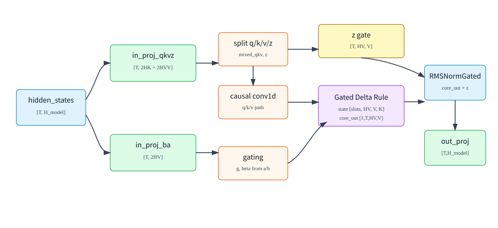

# 02. GDN 层内数据流与 shape

**简体中文** | [English](../../../en/ai-infra-basic/Gated_Delta_Network/02-gdn-layer-dataflow-and-shapes.md)

## 1. 符号约定

这一讲用下面的符号描述 GDN 层。它们对应 Qwen3-Next/SGLang 实现中的字段。

| 符号 | 代码字段 | 含义 |
|---|---|---|
| `T` | `seq_len` 或 packed token 数 | 当前 forward 中实际 token 总数 |
| `B` | `batch_size` | decode 时活跃请求数 |
| `H_model` | `hidden_size` | 主干 hidden 宽度 |
| `H` | `num_k_heads` | GDN key/query head 数 |
| `HV` | `num_v_heads` | GDN value head 数 |
| `K` | `head_k_dim` | 每个 q/k head 的维度 |
| `V` | `head_v_dim` | 每个 value head 的维度 |
| `C` | `conv_kernel_size` | causal conv1d 的窗口大小 |
| `R` | `HV / H` | 每个 key head 对应几个 value head |

本文默认描述未做 tensor parallel（TP）切分的逻辑 shape。这里的分组要求 `HV` 是 `H` 的整数倍；实际单卡张量使用该 TP rank 的本地 head 数。

Qwen3-Next 默认配置中常见：

```text
H_model = 2048
H = 16
HV = 32
K = 128
V = 128
C = 4
R = 2
```

因此：

```text
key_dim   = H * K  = 16 * 128 = 2048
value_dim = HV * V = 32 * 128 = 4096
```

## 2. 层内总览



GDN 层从主干 hidden states 开始：

```text
hidden_states: [T, H_model]
```

然后分成几条路径：

```text
hidden_states
  -> in_proj_qkvz -> q, k, v, z
  -> in_proj_ba   -> b, a

q/k/v -> causal conv1d -> GDN recurrent/chunk kernel -> core_attn_out
z     -> output gate / RMSNormGated
RMSNormGated(core_attn_out, z) -> out_proj -> layer output
```

## 3. 输入投影：`in_proj_qkvz`

SGLang 中 `Qwen3GatedDeltaNet` 创建：

```text
in_proj_qkvz:
    input_size  = hidden_size
    output part = [key_dim, key_dim, value_dim, value_dim]
```

所以：

```text
projected_states_qkvz: [T, 2*key_dim + 2*value_dim]
```

用默认配置代入：

```text
2*key_dim + 2*value_dim
= 2*2048 + 2*4096
= 12288
```

投影后的四段含义：

| 段 | 逻辑 shape | 含义 |
|---|---:|---|
| `q` | `[T,H,K]` | query |
| `k` | `[T,H,K]` | key |
| `v` | `[T,HV,V]` | value |
| `z` | `[T,HV,V]` | output gate/norm 的 gate 输入 |

其中 `z` 不进入 recurrent state update，它用于调制 GDN 输出。

### 3.1 `z` 到底是什么？与 `g/beta` 有什么区别？

`z` 是由当前层输入 `x_t` 投影得到的**输出门控激活**。从逻辑上看，`z_t = W_z x_t`；实现把 `W_z` 与 q/k/v 的投影融合进 `in_proj_qkvz`。`W_z` 是训练参数，`z_t` 是随 token 变化的中间张量，不是另一个 KV Cache，也不是 recurrent state。

以本章 Qwen3-Next 默认的 SiLU/Swish 输出门为例，源码设置 `norm_before_gate=True`。对每个 token、每个 value head，先沿 `V` 维做 RMSNorm，再逐元素相乘：

```text
o = core_attn_out[t,h,:]                         # [V]
z = z[t,h,:]                                    # [V]
rms = sqrt(mean(o * o) + eps)                    # scalar
normed[t,h,:] = (weight * o / rms) * silu(z)      # [V]
silu(z) = z * sigmoid(z)
```

这里 `weight` 是长度为 `V` 的可训练 norm 权重，`*` 是逐元素乘法。`z` 的 shape 因而和输出相同，都是 `[T,HV,V]`。SiLU 门不是 `[0,1]` 的概率：它可以大于 1，也可以为负，不能把它当成 sigmoid 门或二值开关。若模型配置显式指定其他 `output_gate_type`，应以该配置为准。

| 控制信号 | 每 token 的 shape | 控制什么 | 直接参与当前层 recurrent state 更新？ |
|---|---|---|---|
| `exp(g)` | `[HV]` | 旧状态保留多少 | 是 |
| `beta` | `[HV]` | 当前预测残差写入多少 | 是 |
| `silu(z)` | `[HV,V]` | 读出的各个 value 通道向后续网络传递多少 | 否 |

因此，“记住一条信息”和“当前 token 是否把它输出”可以分开控制。例如某通道的 `z=0` 时，该通道输出被置零，但这不会清空本层状态中的对应记忆；后续 token 仍可以读取它。它也不是 `core_attn_out + z`：这里是**归一化后的乘法门控**，然后才接 `out_proj`。

## 4. 输入投影：`in_proj_ba`

`in_proj_ba` 输出两组 gate 激活：

```text
in_proj_ba:
    input_size  = hidden_size
    output part = [HV, HV]
```

所以：

```text
projected_states_ba: [T, 2*HV]
b: [T,HV]
a: [T,HV]
```

| 激活 | 后续计算 | 含义 |
|---|---|---|
| `a` | `g = -exp(A_log) * softplus(a + dt_bias)` | 控制状态遗忘 |
| `b` | `beta = sigmoid(b)` | 控制 residual 写入强度 |

注意：`a` 和 `b` 是 token 激活，不是参数。`in_proj_ba.weight` 是参数。

## 5. packed checkpoint 与 split/reshape

为了加载和运行更高效，checkpoint 中 GDN 投影可能是 packed 格式。SGLang 的 `load_weights()` 会把：

```text
in_proj_qkv -> in_proj_qkvz 的前 3 段
in_proj_z   -> in_proj_qkvz 的第 4 段
in_proj_b   -> in_proj_ba 的第 1 段
in_proj_a   -> in_proj_ba 的第 2 段
```

加载进 fused module。

投影输出经过 split/reshape 后得到：

```text
mixed_qkv: [T, 2*key_dim + value_dim]
z:         [T, HV, V]
b:         [T, HV]
a:         [T, HV]
```

默认配置：

```text
mixed_qkv: [T, 8192]
z:         [T, 32, 128]
b/a:       [T, 32]
```

`mixed_qkv` 是 q/k/v 的扁平拼接：

```text
mixed_qkv = concat(flatten(q), flatten(k), flatten(v))
```

## 6. causal conv1d

GDN 在 q/k/v 路径上加一个短 causal conv：

```text
conv_dim = 2*key_dim + value_dim
conv_kernel_size = C
```

对 packed q/k/v：

```text
mixed_qkv_before_conv: [T, conv_dim]
mixed_qkv_after_conv:  [T, conv_dim]
```

decode 时每个请求只来一个 token，所以 conv 需要保存窗口状态：

```text
conv_states: [num_slots, conv_dim, C-1] 或 backend 定义的等价布局
```

prefill 时可以对整段序列一次做 causal conv；decode 时用 `causal_conv1d_update` 更新每个请求的 conv state。

### 6.1 它具体算什么？为什么叫 causal？

这里是沿 token 轴的 **depthwise 短卷积**：每个 q/k/v 通道有自己的长度为 `C` 的卷积核，不在卷积这一步混合不同通道。前面的线性投影已负责 hidden 通道之间的混合。令 `u` 表示卷积前的 `mixed_qkv`，`c` 表示其中一个通道，以滞后量编号卷积权重：

```text
y[t,c] = silu(sum(w[c,j] * u[t-j,c] for j in range(C)))

C = 4:
y[t,c] = silu(w[c,0]*u[t,c]   + w[c,1]*u[t-1,c]
            + w[c,2]*u[t-2,c] + w[c,3]*u[t-3,c])
```

该式对应本章默认 SiLU、无 bias 的路径；存储中的卷积权重顺序由 kernel 决定。它只访问当前位置及过去 `C-1` 个位置，不读取未来 token，因此满足自回归因果性。新请求序列开头的缺失历史视作零，继续已有请求则读取该请求的 conv state。packed batch 必须按请求边界分别处理，不能把上一个请求的末尾当成下一个请求的历史。

卷积与 SiLU 不改变 `[T,conv_dim]` 的 shape，但改变每个位置的特征。q/k 随后还会做 L2 normalization（可以融合在 GDN kernel 内）；这与输出端 RMSNorm 是不同步骤。`z/a/b` 不经过这里的短卷积。

### 6.2 为什么引入它：局部顺序特征 + 长期关联记忆

从计算机制看，不加卷积时，本层输入投影在每个 token 上独立计算；加上卷积后，进入状态读写的 q/k/v 显式依赖本层输入的最近几个位置。可以把它理解为两种互补能力：

- **局部位置建模**：不同滞后量有不同权重，模型可以学到“前一个 token”和“前三个 token”的不同作用。例如窗口覆盖“not good”时，`good` 位置的特征可以包含前面的否定信息。这个例子说明可表达的能力，不表示某个卷积核一定学到了该规则。
- **长期内容关联**：GDN 用固定大小的矩阵保存并更新 key→value 关联。短卷积先构造带局部上下文的查询、写入地址和内容，再交给矩阵记忆处理，减少其独自承担局部模式建模的负担。
- **较低的额外成本**：固定 `C` 时，短卷积计算量为 `O(T * conv_dim * C)`，decode 只需保留每通道最近 `C-1` 个输入，与上下文长度无关。该成本是额外开销；引入卷积的主要目的在于建模质量。

这是一种局部性与相对顺序的归纳偏置。即使没有短卷积，GDN 的顺序递归本身仍对顺序敏感，`hidden_states` 也可能已经包含前面层的上下文；不能说“不加卷积就完全不知道 token 顺序”。卷积也不等于 RoPE，更不是让 delta rule 数学上成立的必要条件。

### 6.3 科学依据：机制解释之外还要看消融

[Gated Delta Networks 论文 §3.3 与附录 A.2、表 S.1](https://arxiv.org/html/2412.06464v1#A1.SS2)给出了结构说明和移除组件的实验。表中模型为 400M 参数、使用相同 FineWeb-Edu 子集训练 15B tokens：

| 设置 | Avg-PPL ↓ | Avg-Acc ↑ |
|---|---:|---:|
| 完整 Gated DeltaNet（head dim 128） | 27.35 | 47.26 |
| 移除短卷积 | 28.95 | 46.16 |
| 移除输出门 | 29.12 | 45.46 |

这支持“在该实验设置下，短卷积和输出门有助于模型质量”，不构成对所有规模、数据集都必然有效的证明，也不是 Qwen3-Next 的消融结果。上一节是根据计算结构给出的机制解释；它不等于这些消融已单独验证了每一种解释。

## 7. conv 后 split 为 q/k/v

conv 后再 split：

```text
query: [1,T,H,K]
key:   [1,T,H,K]
value: [1,T,HV,V]
```

为什么第一维是 `1`？在线 serving 常把不同长度请求 packed 成一个 token 维度：

```text
query_start_loc: [N+1]
```

用于描述每条请求在 packed token 序列里的起止位置。此时 batch 维常写成 `1`，真正的请求边界由 `cu_seqlens/query_start_loc` 表示。

## 8. 计算 `g` 和 `beta`

对于 prefill/extend，SGLang 会调用 fused gating：

```text
g, beta = fused_gdn_gating(A_log, a, b, dt_bias)
```

逻辑 shape：

```text
a:     [T,HV]
b:     [T,HV]
A_log: [HV]
dt_bias:[HV]

g:     [1,T,HV]
beta:  [1,T,HV]
```

公式：

```text
g[t,h] = -exp(A_log[h]) * softplus(a[t,h] + dt_bias[h])
beta[t,h] = sigmoid(b[t,h])
```

decode packed fast path 会把这个计算融合进 recurrent kernel，避免单独 materialize `q/k/v/g/beta`。

## 9. recurrent state shape

GDN 的状态池在 serving 中和 Mamba state 放在同类 memory pool 中。逻辑上：

```text
ssm_states: [num_slots, HV, V, K]
```

| 维度 | 含义 |
|---|---|
| `num_slots` | 请求状态槽位数，由请求池管理 |
| `HV` | value head 数 |
| `V` | value head dim |
| `K` | key/query head dim |

单个请求、单层的状态大小：

```text
HV * V * K
```

默认配置：

```text
32 * 128 * 128 = 524288 elements
```

如果用 BF16 存储：

```text
524288 * 2 bytes = 1 MiB per linear-attention layer per request slot
```

这只是指定 dtype 的算例。本仓库 `mamba2_state_dtype()` 的 recurrent state 默认是 FP32，此时为 **2 MiB**；配置或环境变量可以覆盖它。以上只计算 recurrent state，不包含 conv state、额外缓存槽位和临时缓冲。它看起来不小，但关键是它不随历史 token 数增长。

### 9.1 为什么没有再乘一个 q/k head 数 `H`？

因为每个 value head **只对应一个** q/k head，不会与全部 `H` 个 q/k heads 两两组合。对 value head `h_v`，对应的 q/k head 是：

```text
R = HV // H
h_k = h_v // R

H = 16, HV = 32, R = 2:
q/k head 0  -> value heads 0, 1   -> S[0], S[1]
q/k head 1  -> value heads 2, 3   -> S[2], S[3]
...
q/k head 15 -> value heads 30, 31 -> S[30], S[31]
```

同组 value heads 共享 q/k 向量，但各有自己的 `v`、`g`、`beta` 和状态矩阵。比如 `S[0]` 与 `S[1]` 都使用 head 0 的 k 写入、q 读取，却不要求两个状态相同。这种分组通常称为 grouped-value attention；不要直接套用 softmax GQA 中多个 query heads 共享 K/V heads 的维度关系。

把第 01 讲的单 head 公式补上 head 下标，就能直接看出 shape（q/k 已归一化，读取缩放单独写出）：

```text
q = query[t,h_k,:]                         # [K]
k = key[t,h_k,:]                           # [K]
v = value[t,h_v,:]                         # [V]
S_decay = exp(g[t,h_v]) * S_prev[h_v]       # [V,K]
r = v - S_decay @ k                        # [V]
S_new[h_v] = S_decay + beta[t,h_v] * r[:,None] * k[None,:]
o[t,h_v,:] = S_new[h_v] @ (q * scale)       # [V]
```

一个状态矩阵实现从 `K` 维 key/query 空间到 `V` 维 value 空间的映射，因此是 `[V,K]`；共有 `HV` 个这样的矩阵，所以整体是 `[HV,V,K]`。`q` 只用来读取，无须另存一份 query state。q/k 的维度已体现在 `K` 中，q/k 的 head 数则体现在分组关系里：

```text
[HV,V,K] == reshape([H,R,V,K])
HV * V * K = H * R * V * K
```

所以 `H` 并没有被“漏算”；它已通过 `HV = H * R` 计入。再乘一次 `H`，相当于为不存在的所有 q/k-head × value-head 配对分配状态。即使 `H=HV`，也只有 `H` 个状态矩阵，而不是 `H*H` 个。

### 9.2 对照 kernel 与 TP 下的显存计算

本仓库的 [packed recurrent decode kernel](../../../../python/sglang/srt/layers/attention/fla/fused_recurrent.py) 直接使用：

```python
i_h = i_hv // (HV // H)
```

q/k 按 `i_h` 寻址，v 与 state 按 `i_hv` 寻址；state 中一个 head 的偏移是 `i_hv * V * K`。这就是上面分组推导在代码中的实现，不需要先物理复制 q/k 才能表达共享。

在 head 数可整除的常规 attention TP 切分下，若 TP degree 为 `P`，每个 rank 的状态为 `[num_slots,HV/P,V,K]`。单请求单层的每卡字节数为 `(HV/P)*V*K*state_element_bytes`，跨 rank 合计仍为 `HV*V*K*state_element_bytes`。有 head padding 或特殊 backend 布局时，应以实际分配为准。

另一个容易混淆的点是：**卷积状态仍直接包含 `H`**，其逻辑元素数为 `(2*H*K + HV*V)*(C-1)`。它保存短窗口的 q/k/v 投影；recurrent state 保存 key→value 的矩阵记忆，两者不是同一个缓存。

## 10. GDN kernel 输出

GDN recurrent/chunk kernel 输出：

```text
core_attn_out: [1,T,HV,V]
```

随后会 reshape：

```text
core_attn_out: [T, HV, V]
z:             [T, HV, V]
```

然后进入 gated norm：

```text
normed = RMSNormGated(core_attn_out, z)
normed: [T, HV, V]
```

再 flatten：

```text
normed_flat: [T, HV*V] = [T, value_dim]
```

最后 out projection：

```text
out_proj: [value_dim -> hidden_size]
output:   [T, H_model]
```

这个输出再回到 decoder layer 的残差/MLP/MoE 路径。

## 11. decode 的端到端流程

decode 每条请求通常一个新 token：

```text
hidden_states: [B,H_model]
```

流程：

```text
1. in_proj_qkvz:
       [B,H_model] -> [B,2*key_dim+2*value_dim]

2. in_proj_ba:
       [B,H_model] -> [B,2*HV]

3. split:
       mixed_qkv: [B,2*key_dim+value_dim]
       z:         [B,HV,V]
       a,b:       [B,HV]

4. causal_conv1d_update:
       mixed_qkv + conv_states -> mixed_qkv_after_conv [B,conv_dim]
       conv_states 原地更新

5. packed recurrent kernel:
       读取 ssm_states[cache_indices]
       计算 q/k/v/g/beta
       更新 ssm_states[cache_indices]
       输出 core_attn_out [1,B,HV,V]

6. RMSNormGated(core_attn_out, z):
       [B,HV,V]

7. out_proj:
       [B,HV*V] -> [B,H_model]
```

## 12. prefill/extend 的端到端流程

prefill/extend 一次处理多 token：

```text
hidden_states: [T,H_model]
query_start_loc: [N+1]
```

流程：

```text
1. 投影得到 mixed_qkv/z/a/b
2. 对 packed q/k/v 做 causal conv1d
3. split 为 q [1,T,H,K], k [1,T,H,K], v [1,T,HV,V]
4. 计算 g [1,T,HV], beta [1,T,HV]
5. chunk_gated_delta_rule 并行处理长序列
6. 写回每条请求的 final recurrent state
7. 输出 [1,T,HV,V]
8. gated norm + out projection -> [T,H_model]
```

prefill 不能像 decode 那样每 token 一个 kernel 顺序跑，否则长 prompt 会很慢。因此使用 chunk 并行算法，把序列切成块，在块内用三角结构求解，在块间合并状态。

## 13. target verify 的特殊点

投机解码 target verify 中，一条请求会带多个 draft token。GDN 需要临时推进状态，但不能把所有 draft token 都直接写入正式状态。

SGLang 的思路是：

```text
正式 ssm_states:
    保存已经提交 token 的状态

intermediate_states_buffer:
    保存 draft tree/verify 过程中的临时状态

disable_state_update=True:
    verify 时不直接提交最终状态
```

等 token 接受/拒绝结果确定后，再按 accepted path 提交正确状态。这一点和 KV Cache 的“临时 KV”管理类似，只是对象从 K/V page 变成 recurrent state。

## 14. shape 总表

| 阶段 | 张量 | shape |
|---|---|---:|
| 输入 | `hidden_states` | `[T,H_model]` |
| qkvz 投影 | `projected_states_qkvz` | `[T,2*H*K+2*HV*V]` |
| ba 投影 | `projected_states_ba` | `[T,2*HV]` |
| split 后 | `mixed_qkv` | `[T,2*H*K+HV*V]` |
| split 后 | `z` | `[T,HV,V]` |
| split 后 | `a,b` | `[T,HV]` |
| conv 后 | `mixed_qkv` | `[T,2*H*K+HV*V]` |
| recurrent 输入 | `q,k` | `[1,T,H,K]` |
| recurrent 输入 | `v` | `[1,T,HV,V]` |
| gating | `g,beta` | `[1,T,HV]` |
| state pool | `ssm_states` | `[num_slots,HV,V,K]` |
| recurrent 输出 | `core_attn_out` | `[1,T,HV,V]` |
| gate/norm 后 | `normed` | `[T,HV,V]` |
| flatten | `normed_flat` | `[T,HV*V]` |
| out projection | `output` | `[T,H_model]` |

## 15. 小结

1. GDN 层从 hidden states 投影出六类激活：`q/k/v/z/a/b`。
2. `q/k/v` 经过短 causal conv 后进入 recurrent/chunk kernel。
3. `a/b` 生成 `g/beta`，控制状态遗忘和写入。
4. `z` 不写入状态，而是在输出阶段调制 `core_attn_out`。
5. GDN 状态是 `[num_slots,HV,V,K]`，按请求槽位保存，不随 token 数增长。

## 16. 源码与论文核对入口

- [Qwen3GatedDeltaNet](../../../../python/sglang/srt/models/qwen3_next.py)：投影、卷积权重、`norm_before_gate=True` 与输出路径。
- [Gated RMSNorm](../../../../python/sglang/srt/layers/attention/fla/layernorm_gated.py)：RMSNorm 与 SiLU/Swish 输出门的计算顺序。
- [GDN backend](../../../../python/sglang/srt/layers/attention/linear/gdn_backend.py)：按请求处理 causal conv，分发 prefill/decode。
- [Fused recurrent kernel](../../../../python/sglang/srt/layers/attention/fla/fused_recurrent.py)：q/k head 映射、L2 normalization 与 state 读写。
- [Mamba state 配置](../../../../python/sglang/srt/configs/mamba_utils.py)：state dtype、卷积与 recurrent state 的 TP shape。
- [Gated Delta Networks 论文](https://arxiv.org/html/2412.06464v1)：§3.3 模型结构；附录 A.2 表 S.1 组件消融。论文实验用于解释设计动机，具体 shape 与执行路径以本仓库实现为准。
