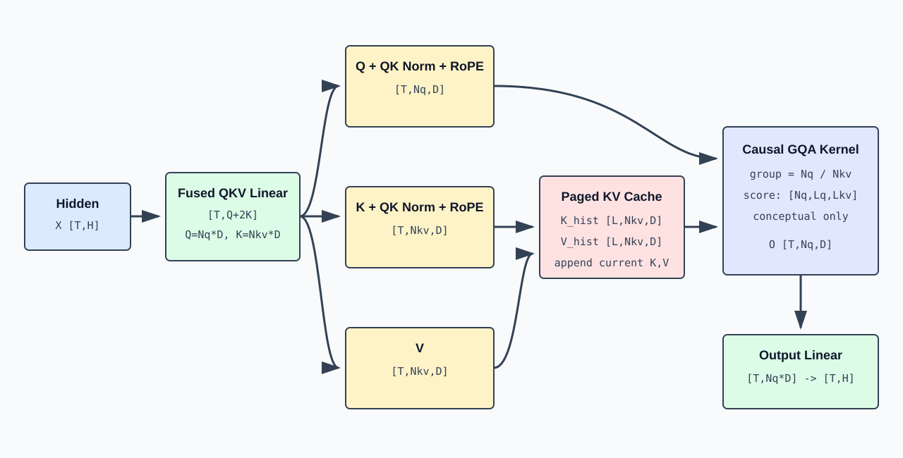

# Grouped-Query Attention：QKV、RoPE 与 KV Cache 的形状流

## 1. Attention 子层的输入输出

Attention 子层接收归一化后的 hidden states：

```math
\mathrm{shape}\left(X\right)=\left[T,H\right]
```

并返回同形状结果：

```math
\mathrm{shape}\left(O\right)=\left[T,H\right]
```

内部需要经历 QKV 投影、head 拆分、QK Norm、RoPE、因果 Attention、head 合并和输出投影。



## 2. QKV 投影

定义：

```text
Nq  = number of query heads
```

```math
\mathrm{Nkv} = \mathrm{number} \mathrm{of} \mathrm{key}/\mathrm{value} \mathrm{heads}
```

```text
D   = head dimension
```

```math
\mathrm{Qdim}=\mathrm{Nq}\cdot D
```

```math
\mathrm{KVdim}=\mathrm{Nkv}\cdot D
```

三个线性投影的数学形式是：

```math
Q_{\mathrm{flat}}=X\,\mathrm{Wq}
```

```math
K_{\mathrm{flat}}=X\,\mathrm{Wk}
```

```math
V_{\mathrm{flat}}=X\,\mathrm{Wv}
```

权重和输出形状：

| 变量 | 形状 |
|---|---:|
| `X` | $`\left[T,H\right]`$ |
| `Wq` | $`\left[H,\mathrm{Qdim}\right]`$ |
| `Wk` | $`\left[H,\mathrm{KVdim}\right]`$ |
| `Wv` | $`\left[H,\mathrm{KVdim}\right]`$ |
| `Q_flat` | $`\left[T,\mathrm{Qdim}\right]`$ |
| `K_flat`, `V_flat` | $`\left[T,\mathrm{KVdim}\right]`$ |

高性能实现通常把三个权重拼接为一次融合 QKV 投影：

```math
\mathrm{qkv} = \mathrm{qkv\_proj}\left(X\right)
```

```math
\mathrm{shape}\left(\mathrm{qkv}\right)=\left[T,\mathrm{Qdim}+2\cdot \mathrm{KVdim}\right]
```

```math
\text{q, k, v}= \mathrm{split}\left(\mathrm{qkv}, \left[\mathrm{Qdim}, \mathrm{KVdim}, \mathrm{KVdim}\right]\right)
```

打包减少 kernel launch 和中间访存，不改变数学结果。

## 3. 从扁平维度恢复 head

```text
Q_flat [T,Nq*D]   -> Q [T,Nq,D]
K_flat [T,Nkv*D]  -> K [T,Nkv,D]
V_flat [T,Nkv*D]  -> V [T,Nkv,D]
```

`T` 是 packed token 数，不是序列长度。每个 token 有 `Nq` 个 Query heads，但只有 `Nkv` 个 Key/Value heads。

## 4. MHA、MQA 与 GQA

| 类型 | 关系 | 每个 Query head 如何使用 K/V |
|---|---|---|
| MHA | $`\mathrm{Nq}=\mathrm{Nkv}`$ | 每个 Query head 有独立 K/V head |
| MQA | $`\mathrm{Nkv}=1`$ | 所有 Query heads 共享一个 K/V head |
| GQA | $`1 \lt \mathrm{Nkv} \lt \mathrm{Nq}`$ | 一组 Query heads 共享一个 K/V head |

GQA 的 group size：

```math
G=\frac{\mathrm{Nq}}{\mathrm{Nkv}}
```

Query head `h` 对应的 KV head：

```math
\mathrm{kv\_head}\left(h\right) = \mathrm{floor}\left(h / G\right)
```

示例：$`\mathrm{Nq}=8,\qquad \mathrm{Nkv}=2,\qquad G=4`$。

```text
Q heads 0,1,2,3 -> KV head 0
Q heads 4,5,6,7 -> KV head 1
```

GQA 的主要推理价值是缩小 KV Cache。相同 `D` 和上下文长度下，其 KV Cache 大小约为 MHA 的 `Nkv/Nq`。

## 5. QK Norm

Qwen3-MoE 对每个 Q/K head 的 `D` 维向量执行 RMSNorm：

```text
Q: [T,Nq,D]   -> Q_norm: [T,Nq,D]
K: [T,Nkv,D]  -> K_norm: [T,Nkv,D]
```

归一化发生在最后一维：

```math
{Q_{\mathrm{norm}}}_{t,h,:}=\mathrm{RMSNorm}\left({Q}_{t,h,:}\right)
```

```math
{K_{\mathrm{norm}}}_{t,h,:}=\mathrm{RMSNorm}\left({K}_{t,h,:}\right)
```

形状不变。QK Norm 控制点积前的向量尺度，避免不同 head 或层产生过大的 attention logits。

## 6. RoPE

RoPE 把位置 `p` 编码成二维子空间中的旋转。对一个偶数维向量中的一对分量：

```math
x'_{2i}=\cos(\theta_{p,i})x_{2i}-\sin(\theta_{p,i})x_{2i+1}
```

```math
x'_{2i+1}=\sin(\theta_{p,i})x_{2i}+\cos(\theta_{p,i})x_{2i+1}
```

它作用于 Q 和 K，不作用于 V：

```math
\mathrm{shape}\left(\mathrm{positions}\right)=\left[T\right]
```

```text
Q_norm: [T,Nq,D]   -> Q_rope: [T,Nq,D]
K_norm: [T,Nkv,D]  -> K_rope: [T,Nkv,D]
V:      [T,Nkv,D]  -> unchanged
```

同一 token 的所有 heads 使用同一位置 id，但不同频率维度使用不同旋转角。点积 `Q_rope(p) dot K_rope(q)` 因而携带相对位置 `p-q` 的信息。

## 7. 因果 Attention 的数学形状

先考虑单请求、单 Query head。当前 Query 长度为 `Lq`，可见 KV 长度为 `Lkv`：

```math
\mathrm{shape}\left(Q_{h}\right)=\left[\mathrm{Lq},D\right]
```

```math
\mathrm{shape}\left(K_{h}\right)=\left[\mathrm{Lkv},D\right]
```

```math
\mathrm{shape}\left(V_{h}\right)=\left[\mathrm{Lkv},D\right]
```

分数：

```math
S_{h}=\frac{Q_{h}\,{K_{h}}^{\mathsf T}}{\sqrt{D}}
```

```math
\mathrm{shape}\left(S_{h}\right)=\left[\mathrm{Lq},\mathrm{Lkv}\right]
```

加因果 mask 后：

```text
S_h[i,j] = -infinity, if key position j is later than query position i
```

概率和输出：

```math
A_{h} = \mathrm{softmax}\left(S_{h}, \mathrm{dim}=-1\right) \left[\mathrm{Lq},\mathrm{Lkv}\right]
```

```math
O_{h}=A_{h}\,V_{h}\qquad\mathrm{shape}:\left[\mathrm{Lq},D\right]
```

合并所有 Query heads：

```math
\mathrm{shape}\left(O_{\mathrm{heads}}\right)=\left[T,\mathrm{Nq},D\right]
```

```math
\mathrm{shape}\left(O_{\mathrm{flat}}\right)=\left[T,\mathrm{Nq}\cdot D\right]
```

生产级 FlashAttention 或 decode attention kernel 不会完整物化 $`\left[\mathrm{Nq},\mathrm{Lq},\mathrm{Lkv}\right]`$ 分数矩阵，而是分块计算 softmax 和加权和。该形状仍然是理解数学依赖的正确逻辑视图。

## 8. Packed Batch 中的序列边界

设两条请求的当前 token 被打包：

```text
request A: 3 tokens
request B: 2 tokens
Q packed: [5,Nq,D]
```

不能直接把它视为长度 5 的单序列。attention metadata 描述：

```text
request A rows: [0,3)
request B rows: [3,5)
sequence lengths: [3,2]
prefix lengths: [prefix_A,prefix_B]
KV cache locations: per-request page/index mapping
```

Kernel 根据 metadata 为每条请求构造独立可见区间。A 的 Query 不会读 B 的 K/V，B 也不会读 A。

## 9. KV Cache 写入

每个 Decoder Layer 都有独立 K/V Cache。当前层生成：

```math
\mathrm{shape}\left(K_{\mathrm{new}}\right)=\left[T,\mathrm{Nkv},D\right]
```

```math
\mathrm{shape}\left(V_{\mathrm{new}}\right)=\left[T,\mathrm{Nkv},D\right]
```

逻辑上，对请求 `r` 的 token 位置 `p`：

```math
{K_{\mathrm{cache}}}_{\mathrm{layer},r,p,:,:}={K_{\mathrm{new}}}_{\mathrm{token\_row},:,:}
```

```math
{V_{\mathrm{cache}}}_{\mathrm{layer},r,p,:,:}={V_{\mathrm{new}}}_{\mathrm{token\_row},:,:}
```

Serving 系统通常不分配连续 $`\left[B,\mathrm{Lmax},\mathrm{Nkv},D\right]`$。Paged KV Cache 把 token 位置映射到物理 slot：

```text
request token position
  -> req_to_token mapping
  -> physical token slot
  -> layer K/V storage
```

物理布局由 backend 决定，逻辑上每个历史 token 仍拥有 $`\left[\mathrm{Nkv},D\right]`$ 的 K 和 V。

## 10. Prefill Attention

对一条无缓存、长度 `S` 的 prompt：

```math
\mathrm{shape}\left(Q\right)=\left[S,\mathrm{Nq},D\right]
```

```math
\mathrm{shape}\left(K\right)=\left[S,\mathrm{Nkv},D\right]
```

```math
\mathrm{shape}\left(V\right)=\left[S,\mathrm{Nkv},D\right]
```

```text
logical scores: [Nq,S,S]
```

因果可见范围是下三角。第 `i` 行只能读取 $`\left[0,i\right]`$。

若已有 prefix cache，prefix 长度为 `P`，本轮 extend 长度为 `E`：

```math
\mathrm{shape}\left(Q_{\mathrm{new}}\right)=\left[E,\mathrm{Nq},D\right]
```

```text
K_new,V_new: [E,Nkv,D]
K_visible,V_visible: [P+E,Nkv,D]
logical scores: [Nq,E,P+E]
```

只为新 token 计算 Query；历史 prefix 的 K/V 直接从 cache 读取。

## 11. Decode Attention

普通 decode 对每条请求只有一个新 token：

```math
\mathrm{Lq}=1
```

```math
\mathrm{shape}\left(Q_{\mathrm{new}}\right)=\left[1,\mathrm{Nq},D\right]
```

```text
K_new,V_new: [1,Nkv,D]
K_visible,V_visible: [Lctx,Nkv,D]
logical scores: [Nq,1,Lctx]
```

Batch 中 `B` 条请求打包后：

```math
\mathrm{shape}\left(Q_{\mathrm{new}}\right)=\left[B,\mathrm{Nq},D\right]
```

```text
K_new,V_new: [B,Nkv,D]
```

每条请求的 `Lctx` 可以不同。decode kernel 根据请求到 KV slot 的映射读取各自历史。

## 12. 输出投影

Attention 各 head 输出合并：

```math
\mathrm{shape}\left(O_{\mathrm{heads}}\right)=\left[T,\mathrm{Nq},D\right]
```

```math
\mathrm{shape}\left(O_{\mathrm{flat}}\right)=\left[T,\mathrm{Nq}\cdot D\right]
```

输出权重：

```math
\mathrm{shape}\left(\mathrm{Wo}\right)=\left[\mathrm{Nq}\cdot D,H\right]
```

```math
O=O_{\mathrm{flat}}\,\mathrm{Wo}
```

```math
\mathrm{shape}\left(O\right)=\left[T,H\right]
```

若 $`\mathrm{Nq}\cdot D=H`$，输入输出宽度相同，但 `Wo` 仍负责跨 head 混合。

## 13. Tensor Parallel 下的局部形状

设 attention TP size 为 `Ptp`，并假设 `Nq` 可整除：

```math
\mathrm{Nq\_local}=\frac{\mathrm{Nq}}{\mathrm{Ptp}}
```

```math
\mathrm{Qdim\_local}=\mathrm{Nq\_local}\cdot D
```

若 $`\mathrm{Nkv} \ge \mathrm{Ptp}`$ 且可整除：

```math
\mathrm{Nkv\_local}=\frac{\mathrm{Nkv}}{\mathrm{Ptp}}
```

若 $`\mathrm{Nkv} \lt \mathrm{Ptp}`$，一种常见策略是在部分 TP ranks 上复制 KV heads，使：

```math
\mathrm{Nkv\_local}=\mathrm{max}\left(1,\frac{\mathrm{Nkv}}{\mathrm{Ptp}}\right)
```

单 rank 的典型形状：

```math
\mathrm{shape}\left(q\right)=\left[T,\mathrm{Nq\_local},D\right]
```

```math
\mathrm{shape}\left(k\right)=\left[T,\mathrm{Nkv\_local},D\right]
```

```math
\mathrm{shape}\left(v\right)=\left[T,\mathrm{Nkv\_local},D\right]
```

```text
attn output local: [T,Nq_local*D]
```

`RowParallelLinear` 把局部 attention 输出投影回 hidden 分片/完整 hidden，并由层通信逻辑决定何时执行 all-reduce 或与后续通信融合。

## 14. Attention 的参考实现顺序

不考虑特定框架时，GQA 的实现顺序可以表示为：

```math
\mathrm{qkv} = \mathrm{linear}\left(\mathrm{hidden\_states}, \mathrm{Wqkv}\right)
```

```math
\text{q, k, v}= \mathrm{split}\left(\mathrm{qkv}\right)
```

```math
q=\mathrm{reshape}\left(q,\left[B,S,\mathrm{Nq},D\right]\right)
```

```math
k=\mathrm{reshape}\left(k,\left[B,S,\mathrm{Nkv},D\right]\right)
```

```math
v=\mathrm{reshape}\left(v,\left[B,S,\mathrm{Nkv},D\right]\right)
```

```math
q = \mathrm{rms\_norm\_per\_head}\left(q\right)
```

```math
k = \mathrm{rms\_norm\_per\_head}\left(k\right)
```

```math
\text{q, k}= \mathrm{apply\_rope}\left(q, k, \mathrm{positions}\right)
```

```math
\text{k\_cache, v\_cache}= \mathrm{append\_cache}\left(k, v\right)
```

```math
\mathrm{attn\_output} = \mathrm{causal\_gqa}\left(q, k_{\mathrm{cache}}, v_{\mathrm{cache}}\right)
```

```math
\mathrm{output} = \mathrm{linear}\left(\mathrm{merge\_heads}\left(\mathrm{attn\_output}\right), \mathrm{Wo}\right)
```

关键变量：

| 变量 | 逻辑形状 |
|---|---:|
| `hidden_states` | $`\left[T,H\right]`$ |
| `qkv` | $`\left[T,q_{\mathrm{size}}+2\cdot \mathrm{kv\_size}\right]`$ |
| `q` | $`\left[T,q_{\mathrm{size}}\right]`$，或恢复为 $`\left[T,\mathrm{Nq\_local},D\right]`$ |
| `k`, `v` | $`\left[T,\mathrm{kv\_size}\right]`$，或恢复为 $`\left[T,\mathrm{Nkv\_local},D\right]`$ |
| `attn_output` | $`\left[T,q_{\mathrm{size}}\right]`$ |
| `output` | $`\left[T,H\right]`$ 或通信前的等价局部表示 |

工程实现可以把 split、QK Norm、RoPE 和 KV 写入融合到一个 kernel。融合改变的是 kernel 边界和中间访存，不改变上述逻辑形状和数据依赖。

## 15. KV Cache 容量公式

不考虑对齐、量化和 allocator metadata，单请求的 KV Cache 字节数近似为：

```math
\mathrm{bytes}=L\cdot \mathrm{Sctx}\cdot 2\cdot \mathrm{Nkv}\cdot D\cdot \mathrm{bytes\_per\_element}
```

其中 `2` 对应 K 和 V。对 `B` 条请求：

```math
\mathrm{total\_bytes} = \sum_{r} L \cdot  \mathrm{Sctx\_r} \cdot  2 \cdot  \mathrm{Nkv} \cdot  D \cdot  \mathrm{bytes\_per\_element}
```

GQA 减小的是 `Nkv`，因此直接降低跨所有层、所有 token 的持久 KV 状态。
