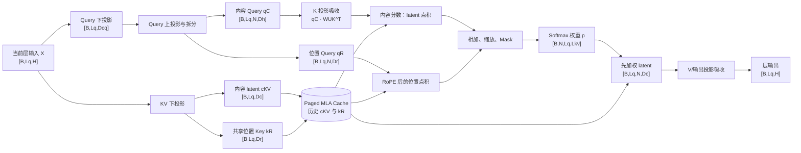
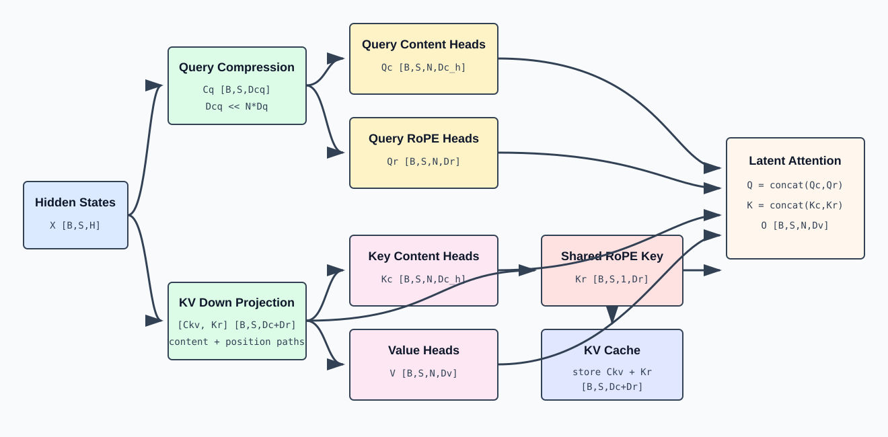

# Multi-head Latent Attention：低秩压缩与解耦位置编码

> English version: [Multi-head Latent Attention](../../../en/ai-infra-basic/Model_Architecture/04-multi-head-latent-attention.md)

## 阅读地图：先建立完整心智模型

读 MLA 最容易迷失在一串投影矩阵里。先只记住两件事：

1. **写入缓存时压缩**：每个历史 token 不再写入 `N` 组完整 K/V，而只写入一个共享的内容 latent `c^{KV}` 和一个共享的 RoPE key；
2. **读取缓存时换坐标系**：decode 不应把全部历史 latent 展开回完整 K/V，而应把当前 query 和输出投影变换到 latent 空间，直接读取压缩缓存。



上图同时包含两条时间线：`X -> CKV/KR -> Cache` 是**写入当前 token**；`Cache -> Score/LatOut` 是**读取历史 token**。Prefill 时 $`\mathrm{Lq}=\mathrm{Lkv}=S`$，decode 时通常 $`\mathrm{Lq}=1`$、$`\mathrm{Lkv}=S_{\mathrm{past}}+1`$。

### 贯穿全文的 Shape 例子

后文默认使用下面这组“教学尺寸”；它们用于算清 shape，不代表所有模型配置：

```math
B=2,\qquad S=4096,\qquad H=4096
```

```math
N=32,\qquad \mathrm{Dc}=512,\qquad \mathrm{Dcq}=1536
```

```math
\mathrm{Dh}=128,\qquad \mathrm{Dr}=64,\qquad \mathrm{Dv}=128
```

```text
dtype=BF16/FP16（每元素 2 bytes）
```

轴的含义固定为：`B` 批大小，`S/Lkv` 历史长度，`Lq` 本次查询长度，`N` query head 数，`H` hidden size。文中 $`\left[B,S,N,D\right]`$ 和内核常见的 $`\left[B,N,S,D\right]`$ 只是转置，数学语义相同。

标准 MHA 每 token、每层缓存：

```math
N \times  \left(\mathrm{Dh} + \mathrm{Dv}\right) = 32 \times  \left(128 + 128\right) = 8192 \mathrm{elements}
```

```math
\text{8192 × 2 bytes}= 16384 \mathrm{bytes} = 16 \mathrm{KiB}
```

MLA 每 token、每层缓存：

```math
\mathrm{Dc} + \mathrm{Dr} = 512 + 64 = 576 \mathrm{elements}
```

```math
\text{576 × 2 bytes}= 1152 \mathrm{bytes} = 1.125 \mathrm{KiB}
```

因此这个例子的**逻辑 KV 容量**缩小约 $`\text{8192 / 576}= 14.22\times`$。这只是单层单 token 的载荷；真实显存还包括 page 对齐、block table、量化尺度和 allocator 元数据。

### 一次 decode 的全张量旅程

设已有 `4095` 个 token，当前追加第 `4096` 个 token：

| 阶段 | 输入 shape | 运算 | 输出 shape | 是否持久化 |
|---|---:|---|---:|---|
| 层输入 | $`\left[2,1,4096\right]`$ | 上一子层输出/RMSNorm | $`\left[2,1,4096\right]`$ | 否 |
| KV 写入 | $`\left[2,1,4096\right]`$ | `W_DKV_R` | `Ckv [2,1,512]`、`Krope [2,1,64]` | 是 |
| Q 压缩 | $`\left[2,1,4096\right]`$ | `W_DQ` | `Cq [2,1,1536]` | 否 |
| Q 展开 | $`\left[2,1,1536\right]`$ | `W_UQ` + split | `Qc [2,1,32,128]`、`Qr [2,1,32,64]` | 否 |
| 历史视图 | block table | gather/page view | `Ckv_hist [2,4096,512]`、`Kr_hist [2,4096,64]` | 已缓存 |
| 内容打分 | `Qc,Ckv_hist` | 吸收式 latent 点积 | $`\left[2,32,1,4096\right]`$ | 否 |
| 位置打分 | `RoPE(Qr),RoPE(Kr)` | 广播到 heads 后点积 | $`\left[2,32,1,4096\right]`$ | 否 |
| 概率 | 两部分 score | scale + causal mask + softmax | $`\left[2,32,1,4096\right]`$ | 否 |
| latent 聚合 | 概率、`Ckv_hist` | 对历史轴加权求和 | $`\left[2,1,32,512\right]`$ | 否 |
| 输出 | latent 聚合 | 吸收后的 V/O 变换并合并 heads | $`\left[2,1,4096\right]`$ | 否 |

这个表是后文所有公式的“总账”。如果实现里的某一步无法映射到其中一行，通常意味着 layout 转换、矩阵吸收或融合 kernel 隐藏了该逻辑步骤，而不是数学步骤消失了。

## 1. MLA 要解决的问题

标准 Multi-Head Attention 为每个历史 token、每一层保存完整 K 和 V：

```math
\mathrm{shape}\left(K_{\mathrm{cache}}\right)=\left[B,S,N,\mathrm{Dk}\right]
```

```math
\mathrm{shape}\left(V_{\mathrm{cache}}\right)=\left[B,S,N,\mathrm{Dv}\right]
```

每个 token 的缓存元素数为：

```math
N\cdot \left(\mathrm{Dk}+\mathrm{Dv}\right)
```

长上下文生成时，KV Cache 会成为显存容量和读取带宽的主要开销。Multi-head Latent Attention（MLA）的核心思想是：

> 不直接缓存每个 head 展开后的 K/V，而是缓存一个共享的低维 latent vector；需要 Attention 时再通过投影解释成各 head 的内容信息。



## 2. 统一符号

| 符号 | 含义 |
|---|---|
| `X` | 输入 hidden states，$`\left[B,S,H\right]`$ |
| `N` | Attention head 数量 |
| `Dc` | KV latent compression dimension |
| `Dcq` | Query latent compression dimension |
| `Dh` | 每个 head 的 content key/query dimension |
| `Dr` | 每个 head 的 RoPE dimension |
| `Dv` | 每个 head 的 value dimension |
| `Ckv` | 压缩后的 KV latent，$`\left[B,S,\mathrm{Dc}\right]`$ |
| `Cq` | 压缩后的 Query latent，$`\left[B,S,\mathrm{Dcq}\right]`$ |

MLA 通常满足：

```text
Dc << N * (Dh + Dv)
```

因此缓存 `Ckv` 比缓存所有 head 的 K/V 更紧凑。

## 3. KV 下投影：把 hidden state 压缩为 latent

对每个 token 的 hidden vector `x in R^H`，内容 latent 与位置 key 可以由一次联合投影产生：

```math
\left[c_{\mathrm{kv}},\mathrm{k\_rope\_raw}\right]=x\,\mathrm{W\_DKV\_R}
```

批量形状：

```math
\mathrm{shape}\left(X\right)=\left[B,S,H\right]
```

```math
\mathrm{shape}\left(\mathrm{W\_DKV\_R}\right)=\left[H,\mathrm{Dc}+\mathrm{Dr}\right]
```

```math
\mathrm{shape}\left(\mathrm{projected}\right)=\left[B,S,\mathrm{Dc}+\mathrm{Dr}\right]
```

```math
\mathrm{shape}\left(\mathrm{Ckv}\right)=\left[B,S,\mathrm{Dc}\right]
```

```math
\mathrm{shape}\left(\mathrm{K\_rope\_raw}\right)=\left[B,S,\mathrm{Dr}\right]
```

也可以使用两个独立但等价的逻辑投影分别生成 `Ckv` 和 `K_rope_raw`。`Ckv` 是从 `H` 维压缩到 `Dc` 维的内容表示；`K_rope_raw` 保留给位置编码路径。内容压缩不是无损复制，而是训练得到的低秩表示。

## 4. KV 上投影：从 latent 恢复内容 K 和 V

使用两个逻辑上独立的 up projection：

```math
K_{\mathrm{content}}=\mathrm{Ckv}\,W_{\mathrm{UK}}
```

```math
V=\mathrm{Ckv}\,W_{\mathrm{UV}}
```

形状：

```math
\mathrm{shape}\left(W_{\mathrm{UK}}\right)=\left[\mathrm{Dc},N\cdot \mathrm{Dh}\right]
```

```math
\mathrm{shape}\left(W_{\mathrm{UV}}\right)=\left[\mathrm{Dc},N\cdot \mathrm{Dv}\right]
```

```math
\mathrm{shape}\left(\mathrm{K\_content\_flat}\right)=\left[B,S,N\cdot \mathrm{Dh}\right]
```

```math
\mathrm{shape}\left(V_{\mathrm{flat}}\right)=\left[B,S,N\cdot \mathrm{Dv}\right]
```

```math
\mathrm{shape}\left(K_{\mathrm{content}}\right)=\left[B,S,N,\mathrm{Dh}\right]
```

```math
\mathrm{shape}\left(V\right)=\left[B,S,N,\mathrm{Dv}\right]
```

各 head 的 K/V 不再由 `X` 直接独立投影，而是共享同一个 `Ckv`，再用不同的 up-projection 参数恢复。

## 5. Query 的低秩投影

Query 也可以采用低秩分解：

```math
\mathrm{Cq}=X\,W_{\mathrm{DQ}}
```

```math
Q_{\mathrm{full}}=\mathrm{RMSNorm}\left(\mathrm{Cq}\right)\,W_{\mathrm{UQ}}
```

形状：

```math
\mathrm{shape}\left(W_{\mathrm{DQ}}\right)=\left[H,\mathrm{Dcq}\right]
```

```math
\mathrm{shape}\left(\mathrm{Cq}\right)=\left[B,S,\mathrm{Dcq}\right]
```

```text
W_UQ: [Dcq,N*(Dh+Dr)]
Q_full: [B,S,N*(Dh+Dr)]
```

拆分：

```math
\mathrm{shape}\left(Q_{\mathrm{content}}\right)=\left[B,S,N,\mathrm{Dh}\right]
```

```math
\mathrm{shape}\left(Q_{\mathrm{rope}}\right)=\left[B,S,N,\mathrm{Dr}\right]
```

Query 不需要跨生成步缓存，因此 Query 压缩主要用于减少参数结构或改变投影计算，并不直接决定 KV Cache 容量。

## 6. 为什么 RoPE 需要解耦

若把 RoPE 直接施加到由 $`\mathrm{Ckv}\,W_{\mathrm{UK}}`$ 恢复出的完整 K 上，位置相关旋转会阻碍矩阵吸收：旋转矩阵依赖 token position，不能简单并入固定的 `W_UK`。

MLA 因此把每个 Q/K head 分为两部分：

```math
Q_{\mathrm{head}}=\mathrm{concat}\left(Q_{\mathrm{content}},Q_{\mathrm{rope}}\right)
```

```math
K_{\mathrm{head}}=\mathrm{concat}\left(K_{\mathrm{content}},K_{\mathrm{rope}}\right)
```

其中：

- `Q_content` 与 `K_content` 不执行 RoPE，负责语义内容匹配；
- `Q_rope` 与 `K_rope` 执行 RoPE，负责相对位置信息；
- `K_rope` 可以在各 heads 间共享，再广播到 `N` 个 heads。

形状：

```math
\mathrm{shape}\left(Q_{\mathrm{content}}\right)=\left[B,S,N,\mathrm{Dh}\right]
```

```math
\mathrm{shape}\left(Q_{\mathrm{rope}}\right)=\left[B,S,N,\mathrm{Dr}\right]
```

```math
\mathrm{shape}\left(K_{\mathrm{content}}\right)=\left[B,S,N,\mathrm{Dh}\right]
```

```text
K_rope:    [B,S,1,Dr] -> broadcast [B,S,N,Dr]
```

最终每个 head 的 Query/Key dimension 为：

```math
\mathrm{Dqk}=\mathrm{Dh}+\mathrm{Dr}
```

## 7. MLA Attention 分数

对 head `n`、query position `i`、key position `j`：

```math
\mathrm{score}\left[n,i,j\right] = Q_{\mathrm{content}}\left[n,i\right] \cdot K_{\mathrm{content}}\left[n,j\right] + Q_{\mathrm{rope}}\left[n,i\right] \cdot K_{\mathrm{rope}}\left[j\right]
```

缩放后：

```math
\mathrm{score}=\frac{\mathrm{score}}{\sqrt{\mathrm{Dh}+\mathrm{Dr}}}
```

再加因果 mask 并执行 softmax：

```math
{\alpha}_{n,i,:}=\mathrm{softmax}\left({\mathrm{masked\_score}}_{n,i,:}\right)
```

输出：

```math
O\left[n,i,:\right] = \sum_{j} \alpha\left[n,i,j\right] \cdot  V\left[n,j,:\right]
```

```math
\mathrm{shape}\left(O\right)=\left[B,S,N,\mathrm{Dv}\right]
```

合并 heads 后通过输出投影恢复 $`\left[B,S,H\right]`$。

## 8. 朴素实现：先恢复 K/V 再做 Attention

最直接的实现：

```math
\mathrm{Ckv}=X\,W_{\mathrm{DKV}}\qquad\mathrm{shape}:\left[B,S,\mathrm{Dc}\right]
```

```math
\mathrm{Kc}=\mathrm{reshape}\left(\mathrm{Ckv}\,W_{\mathrm{UK}}\right)\qquad\mathrm{shape}:\left[B,S,N,\mathrm{Dh}\right]
```

```math
V=\mathrm{reshape}\left(\mathrm{Ckv}\,W_{\mathrm{UV}}\right)\qquad\mathrm{shape}:\left[B,S,N,\mathrm{Dv}\right]
```

```math
Q = \mathrm{build\_query}\left(X\right) \left[B,S,N,\mathrm{Dh}+\mathrm{Dr}\right]
```

```math
K = \mathrm{concat}\left(\mathrm{Kc}, \mathrm{broadcast}\left(K_{\mathrm{rope}}\right)\right) \left[B,S,N,\mathrm{Dh}+\mathrm{Dr}\right]
```

```math
O=\mathrm{softmax}\left(Q\,{K}^{\mathsf T}+\mathrm{mask}\right)\,V
```

该实现数学清晰，但 decode 时如果每轮都为全部历史 latent 恢复完整 K/V，就会失去压缩缓存带来的带宽优势。

## 9. 矩阵吸收：不显式恢复内容 K

对单个 head，内容分数为：

```math
q_{c} \cdot k_{c} = q_{c} \cdot \left(c_{\mathrm{kv}} \, W_{\mathrm{UK}}\right)
```

利用结合律：

```math
q_{c} \cdot \left(c_{\mathrm{kv}} \, W_{\mathrm{UK}}\right) = \left(q_{c} \, W_{\mathrm{UK}}^{\mathsf T}\right) \cdot c_{\mathrm{kv}}
```

定义 latent query：

```math
q_{\mathrm{latent}}=q_{c}\,{W_{\mathrm{UK}}}^{\mathsf T}
```

```math
\mathrm{shape}\left(q_{\mathrm{latent}}\right)=\left[B,\mathrm{Lq},N,\mathrm{Dc}\right]
```

内容分数可以直接与缓存的 `Ckv [B,Lkv,Dc]` 点积：

```math
\mathrm{shape}\left(\mathrm{content\_score}\right)=\left[B,N,\mathrm{Lq},\mathrm{Lkv}\right]
```

这样无需为历史 token 物化 `K_content [B,Lkv,N,Dh]`。

## 10. 矩阵吸收：不显式恢复历史 V

朴素 value 聚合：

```math
o = \sum_{j} \alpha_{j} \cdot  v_{j}
```

```math
v_{j}=c_{j}\,W_{\mathrm{UV}}
```

利用线性性：

```math
o = \sum_{j} \alpha_{j} \cdot  \left(c_{j} \, W_{\mathrm{UV}}\right) = \left(\sum_{j} \alpha_{j} \cdot  c_{j}\right) \, W_{\mathrm{UV}}
```

因此可先在 latent space 聚合：

```math
o_{\mathrm{latent}}=\alpha\,\mathrm{Ckv}\qquad\mathrm{shape}:\left[B,\mathrm{Lq},N,\mathrm{Dc}\right]
```

```math
o_{\mathrm{head}}=o_{\mathrm{latent}}\,W_{\mathrm{UV}}\qquad\mathrm{shape}:\left[B,\mathrm{Lq},N,\mathrm{Dv}\right]
```

历史 Value heads 无需完整展开。实际实现还可以把 `W_UV` 与后续输出投影进一步组合，以减少中间张量。

## 11. 压缩 KV Cache 保存什么

解耦 RoPE 后，每个历史 token 需要保留：

```math
\mathrm{shape}\left(\mathrm{Ckv}\right)=\left[\mathrm{Dc}\right]
```

```math
\mathrm{shape}\left(K_{\mathrm{rope}}\right)=\left[\mathrm{Dr}\right]
```

单 token、单层缓存元素数：

```math
\text{MLA cache elements}= \mathrm{Dc} + \mathrm{Dr}
```

而标准 MHA 为：

```math
\text{MHA cache elements}= N \cdot  \left(\mathrm{Dk} + \mathrm{Dv}\right)
```

GQA 为：

```math
\text{GQA cache elements}= \mathrm{Nkv} \cdot  \left(\mathrm{Dk} + \mathrm{Dv}\right)
```

MLA 的压缩比例近似为：

```math
\frac{\mathrm{Dc}+\mathrm{Dr}}{N\cdot \left(\mathrm{Dk}+\mathrm{Dv}\right)}
```

具体收益由 latent dimension、RoPE dimension、dtype、内存对齐和实现策略共同决定。

## 12. Decode 时的数据流

设本轮每条序列只有一个新 token：

```math
\mathrm{shape}\left(X_{\mathrm{new}}\right)=\left[B,1,H\right]
```

生成并写入新状态：

```math
\mathrm{shape}\left(\mathrm{Ckv\_new}\right)=\left[B,1,\mathrm{Dc}\right]
```

```math
\mathrm{shape}\left(\mathrm{K\_rope\_new}\right)=\left[B,1,\mathrm{Dr}\right]
```

缓存增长为：

```math
\mathrm{shape}\left(\mathrm{Ckv\_cache}\right)=\left[B,\mathrm{Sctx},\mathrm{Dc}\right]
```

```math
\mathrm{shape}\left(\mathrm{K\_rope\_cache}\right)=\left[B,\mathrm{Sctx},\mathrm{Dr}\right]
```

当前 Query：

```math
\mathrm{shape}\left(Q_{\mathrm{content}}\right)=\left[B,1,N,\mathrm{Dh}\right]
```

```math
\mathrm{shape}\left(Q_{\mathrm{rope}}\right)=\left[B,1,N,\mathrm{Dr}\right]
```

吸收后的内容路径：

```text
Q_content -> latent query [B,1,N,Dc]
latent query x Ckv_cache -> content scores [B,N,1,Sctx]
```

位置路径：

```text
Q_rope x K_rope_cache -> position scores [B,N,1,Sctx]
```

两项相加后 softmax，再在 latent space 聚合 `Ckv_cache`，最后映射为各 head 输出。

## 13. Prefill 时的数据流

prefill 对 `S` 个 token 并行计算：

```math
\mathrm{shape}\left(\mathrm{Ckv}\right)=\left[B,S,\mathrm{Dc}\right]
```

```math
\mathrm{shape}\left(Q_{\mathrm{content}}\right)=\left[B,S,N,\mathrm{Dh}\right]
```

```math
\mathrm{shape}\left(Q_{\mathrm{rope}}\right)=\left[B,S,N,\mathrm{Dr}\right]
```

```math
\mathrm{shape}\left(K_{\mathrm{rope}}\right)=\left[B,S,\mathrm{Dr}\right]
```

prefill 的计算密度较高，可以选择：

1. 展开 K/V 后使用标准矩阵 Attention；
2. 在 latent space 直接计算；
3. 根据 shape 和硬件采用混合实现。

三种实现必须满足相同的因果 mask 和数学映射，但中间张量、算子形态和内存流量不同。

## 14. 低秩结构的参数含义

KV 投影被分解为：

```text
X [H] -> Ckv [Dc] -> K/V heads [N*(Dh+Dv)]
```

等价权重矩阵具有分解形式：

```math
\mathrm{W\_KV\_effective}=W_{\mathrm{DKV}}\,W_{\mathrm{UKV}}
```

其秩上界不超过 `Dc`。这给模型加入了结构性低秩约束。`Dc` 越小，缓存和计算越省，但表达瓶颈越强；`Dc` 越大，表达能力更接近完整投影，但压缩收益下降。

## 15. MLA、MHA、GQA 的结构对比

| 结构 | Query heads | 缓存状态 | head 间共享方式 |
|---|---:|---|---|
| MHA | `N` | 完整 `N` 组 K/V | 不共享 |
| MQA | `N` | 1 组 K/V | 所有 Q heads 共享同一 K/V |
| GQA | `N` | `Nkv` 组 K/V | 每组 Q heads 共享 K/V head |
| MLA | `N` | 共享 latent + position key | 各 head 通过 up projection 解释同一 latent |

GQA 通过减少 KV head 数量压缩缓存；MLA 通过低秩 latent 表示压缩缓存。两者的共享机制不同。

## 16. MLA 的关键正确性条件

1. `W_DKV` 与 `W_UK/W_UV` 必须共同训练，latent 不是事后无损压缩。
2. RoPE content 与 position 子空间必须按设计拆分，否则矩阵吸收不成立。
3. 因果 mask 仍作用在 token 位置维，latent 压缩不会改变自回归可见性。
4. 缓存必须同时保存内容 latent 和无法被固定矩阵吸收的位置 key。
5. 吸收式与展开式实现应在数值误差范围内产生等价结果。

## 17. MLA 解决了什么，又没有解决什么？

MLA 主要压缩每个历史 KV 条目的**特征维度**，但没有消除序列维：

```text
缓存条目数：O(L)
稠密 prefill attention：O(L^2)
每 token 的稠密 decode attention：O(L)
```

理解这一区别，才能继续阅读更新的架构。DSA 稀疏选择进入主核的 MLA 条目；CSA 先压缩序列维，再选择压缩条目；KDA 则用固定递归状态替代可按 token 寻址的历史。

## 18. 展开式与吸收式执行模式

生产 backend 可以用不同 kernel shape 执行同一个 MLA checkpoint：

- **展开式模式**恢复逐 head K/V，并使用类似 MHA 的 kernel；
- **吸收式模式**把 up-projection 矩阵吸收到 query/output 路径，并用类似 MQA 的 kernel 消费 latent cache；
- **混合调度**根据 prefill/decode 阶段、序列长度、硬件与 dtype 支持选择路径。

这些模式在数学上相关，但中间内存、带宽与 kernel 要求不同。DeepSeek Sparse Attention 会以吸收式/MQA 形式消费选中的 latent 条目。实现必须显式说明缓存布局与 backend 模式，不能只根据模型名称猜测。

## 19. SGLang 源码地图

在本教程对应的源码快照中：

- MLA 模型编排与吸收权重：[`deepseek_v2.py`](../../../../python/sglang/srt/models/deepseek_v2.py)；
- 通用 KV/latent 内存池：[`memory_pool.py`](../../../../python/sglang/srt/mem_cache/memory_pool.py)；
- NPU 专用 MLA 模块：[`deepseek_v2_attention_mla_npu.py`](../../../../python/sglang/srt/hardware_backend/npu/modules/deepseek_v2_attention_mla_npu.py)；
- FlashMLA Python 入口：[`flash_mla.py`](../../../../sgl-kernel/python/sgl_kernel/flash_mla.py)；
- HIP 路径：[`hip_flash_mla.py`](../../../../python/sglang/srt/layers/attention/hip_flash_mla.py)。

排查 shape 或性能问题时，建议沿 `模型投影 -> 缓存写入 -> backend 调度 -> kernel 布局` 追踪，并分别检查 prefill 与 decode。

## 20. Serving 与 Ascend 检查清单

1. 记录每个阶段使用展开式还是吸收式执行。
2. 计算缓存字节数时，同时包含内容 latent 与解耦 RoPE key。
3. 核对分页缓存 stride、block table、dtype、量化 scale 与对齐。
4. 在 Ascend 上，根据固定版本的 SGLang、`torch_npu`、CANN 与自定义 kernel 验证实际选中路径。
5. 融合之前，分别 profile 投影、RoPE、缓存写入、注意力主核与输出投影。
6. MLA 与 DSA 组合时使用一致的 latent 布局，避免意外 gather 展开后的逐 head K/V。

## 21. 继续阅读

- [高效注意力技术地图](./06-efficient-attention-landscape.md)
- [DeepSeek Sparse Attention](./07-deepseek-sparse-attention.md)
- [Compressed Sparse Attention 与 HCA](./08-compressed-sparse-attention.md)
- [Kimi Delta Attention](./09-kimi-delta-attention.md)

## 22. 参考资料

- [DeepSeek-V2: A Strong, Economical, and Efficient Mixture-of-Experts Language Model](https://arxiv.org/abs/2405.04434)
- [DeepSeek-V3 Technical Report](https://arxiv.org/abs/2412.19437)
