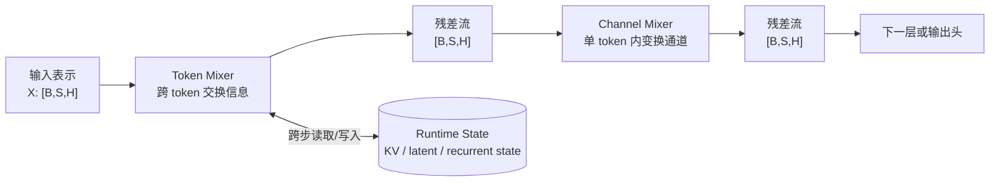
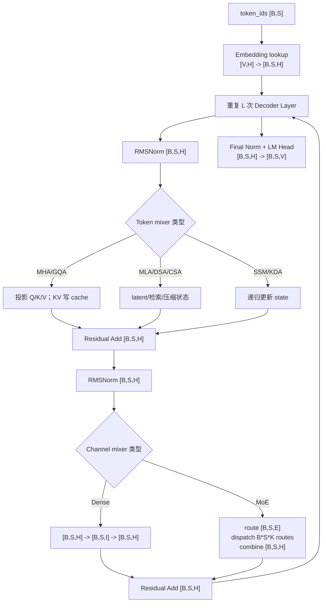

# 主流大模型架构谱系：哪些模块发生了变化

> English version: [LLM Architecture Families](../../../en/ai-infra-basic/Model_Architecture/05-architecture-families.md)

## 阅读地图：不要从模型名字背架构

模型名字会变，单层计算可以稳定地拆成四个问题：



1. **输入/输出契约**：主残差流为什么通常始终是 $`\left[B,S,H\right]`$？
2. **Token mixer**：一个 token 能读取哪些 token，又用什么运算读取？
3. **Channel mixer**：Dense FFN、SwiGLU、MoE 如何改变最后一维？
4. **Runtime state**：decode 到下一个 token 时，上一轮究竟留下了什么？

本章不是模型名词表，而是一套还原架构的方法。遇到新模型时，只要能填写这四格，就能进一步判断缓存、并行、kernel 和 serving 调度需求。

### 通用单层方程与 Shape 不变量

以最常见的 Pre-Norm 串行残差为例：

```math
U=\mathrm{RMSNorm}\left(X\right)\qquad\mathrm{shape}:\left[B,S,H\right]
```

```math
\text{A, state'}= \mathrm{TokenMixer}\left(U,\mathrm{state}\right) \left[B,S,H\right]
```

```math
R=X+A\qquad\mathrm{shape}:\left[B,S,H\right]
```

```math
V=\mathrm{RMSNorm}\left(R\right)\qquad\mathrm{shape}:\left[B,S,H\right]
```

```math
F = \mathrm{ChannelMixer}\left(V\right) \left[B,S,H\right]
```

```math
Y=R+F\qquad\mathrm{shape}:\left[B,S,H\right]
```

这里真正变化的是**中间张量**和**持久状态**，而不是残差流的外形。例如 SwiGLU 会暂时扩张到 $`\left[B,S,I\right]`$；MoE 会暂时把 token 展开成 `B×S×K` 条路由；Attention 会产生 $`\left[B,N,\mathrm{Lq},\mathrm{Lkv}\right]`$ 分数；SSM/KDA 会读写固定形状矩阵。所有分支最终必须投影回 `H`，才能和残差相加。

### 用同一个教学配置观察不同家族

```math
B=2,\qquad S=1024,\qquad H=4096,\qquad L=32
```

```math
\mathrm{Nq}=32,\qquad \mathrm{Nkv}=8,\qquad D=128
```

```math
\text{FFN I}=11008
```

```math
\text{MoE E}=64, \mathrm{top}-K=2, \mathrm{expert} \mathrm{width} \mathrm{Ie}=1408
```

| 家族 | 最大的临时张量（逻辑形状） | 每层 decode 持久状态 | 状态是否随上下文增长 |
|---|---|---|---|
| Encoder-only | attention score $`\left[2,32,1024,1024\right]`$ | 通常无 | 否 |
| Encoder-Decoder | self score + cross score $`\left[2,32,\mathrm{Stgt},\mathrm{Ssrc}\right]`$ | decoder KV + encoder memory/KV | decoder 部分是 |
| Dense/MoE Decoder | causal score $`\left[2,32,1024,1024\right]`$ | KV `[B,S,Nkv,D] × 2` | 是 |
| MLA Decoder | latent attention score $`\left[2,32,1024,1024\right]`$ | `Ckv [B,S,Dc] + Krope [B,S,Dr]` | 是，但每 token 更窄 |
| SSM/KDA | scan/chunk 临时量 | 固定形状 recurrent state + conv tail | 否 |
| Hybrid | 取决于当前 layer 类型 | KV 与 recurrent state 的并集 | 部分层是 |

注意：score 矩阵在训练/朴素实现里可按上述逻辑理解；FlashAttention 类 kernel 会分块计算 softmax，不会把完整 $`\left[S,S\right]`$ 矩阵写回 HBM。

### Decoder-only 的端到端主路径



Prefill 把 `S` 个位置一起送入该图；decode 只送 $`\left[B,1,H\right]`$，但 token mixer 会读取之前持久化的历史状态。这正是同一个模型在两个阶段性能特征完全不同的原因。

## 1. 统一分析框架

大模型名称很多，但主体结构可以沿三个维度分析：

1. **Token mixer**：不同 token 如何交换信息，如双向 Attention、因果 Attention、Cross Attention、SSM。
2. **Channel mixer**：单个 token 的 hidden vector 如何非线性变换，如 Dense FFN、SwiGLU、Sparse MoE。
3. **State representation**：处理历史时保存什么，如完整 K/V、分组 K/V、latent KV、固定大小 SSM state。


## 2. Encoder-only Transformer

Encoder-only 模型使用双向 self-attention。每个位置都可读取序列中所有位置：

```text
visibility(i,j) = true, for all valid i,j
```

单层结构：

```text
X [B,S,H]
  -> Norm
  -> Bidirectional Self-Attention [B,S,H]
  -> Residual Add
  -> Norm
  -> Dense FFN [B,S,H]
  -> Residual Add
```

特点：

- 所有 token 的表示同时融合左右上下文；
- 适合编码、分类、检索和 token-level understanding；
- 不天然满足从左到右的自回归生成约束；
- 通常使用整段输入，不需要自回归 decode KV Cache。

BERT-style 模型属于该家族。

## 3. Encoder-Decoder Transformer

Encoder-Decoder 模型包含两套 layer stack。

Encoder：

```text
source_ids [B,Ssrc]
  -> source embedding
  -> bidirectional encoder layers
  -> memory [B,Ssrc,H]
```

Decoder：

```text
target_ids [B,Stgt]
  -> target embedding
  -> causal self-attention
  -> cross-attention over encoder memory
  -> FFN
  -> target logits [B,Stgt,V]
```

Cross Attention 形状：

```text
Q from decoder: [B,Stgt,N,D]
K,V from encoder memory: [B,Ssrc,Nkv,D]
```

```math
\mathrm{shape}\left(\mathrm{scores}\right)=\left[B,N,\mathrm{Stgt},\mathrm{Ssrc}\right]
```

特点：

- 输入序列先编码成固定 memory；
- 输出序列自回归生成；
- decoder 每层同时需要 self-attention state 和 encoder cross-attention K/V；
- 适合输入到输出的条件生成，如翻译和结构化转换。

T5-style 模型属于该家族。

## 4. Dense Decoder-only Transformer

Dense Decoder 是生成式大模型最常见主干：

```text
Token Embedding
  -> L x [Causal Attention + Dense FFN]
  -> Final Norm
  -> LM Head
```

每层：

```math
r = x + \mathrm{Attention}\left(\mathrm{Norm}\left(x\right)\right)
```

```math
y = r + \mathrm{FFN}\left(\mathrm{Norm}\left(r\right)\right)
```

Dense SwiGLU FFN：

```math
\mathrm{gate}=X\,W_{\mathrm{gate}}\qquad\mathrm{shape}:\left[B,S,I\right]
```

```math
\mathrm{up}=X\,W_{\mathrm{up}}\qquad\mathrm{shape}:\left[B,S,I\right]
```

```math
\mathrm{mid}=\mathrm{SiLU}\left(\mathrm{gate}\right)\odot \mathrm{up}\qquad\mathrm{shape}:\left[B,S,I\right]
```

```math
Y=\mathrm{mid}\,W_{\mathrm{down}}\qquad\mathrm{shape}:\left[B,S,H\right]
```

参数量和每 token 计算量都随 FFN intermediate size `I` 增长。所有 token 经过同一组 FFN 权重。

GPT-style、LLaMA-style 以及许多 dense Qwen-style 模型属于该家族。具体模型可能在 LayerNorm/RMSNorm、绝对位置/RoPE、MHA/GQA、GELU/SwiGLU 和 bias 设置上不同。

## 5. Sparse MoE Decoder

Sparse MoE Decoder 保留 causal Attention，把 Dense FFN 替换为路由 experts：

```math
r = x + \mathrm{Attention}\left(\mathrm{Norm}\left(x\right)\right)
```

```math
y = r + \mathrm{SparseMoE}\left(\mathrm{Norm}\left(r\right)\right)
```

MoE 层：

```text
router logits: [B,S,E]
top-k ids/weights: [B,S,K]
logical expert routes: B*S*K
```

```math
\mathrm{shape}\left(\mathrm{output}\right)=\left[B,S,H\right]
```

模型总 expert 参数量约与 `E` 成正比，单 token 激活计算约与 `K` 成正比。其主要结构特征是：

- 参数容量与激活计算解耦；
- token 根据内容选择不同参数子网络；
- 需要处理 expert 负载不均和 token dispatch；
- 小 batch 时 expert GEMM 容易碎片化。

Mixtral-style 和多种 MoE Qwen-style 模型属于该家族。

## 6. Shared Expert 与 Routed Expert

部分 MoE 架构同时使用 shared experts 和 routed experts：

```math
Y = \mathrm{SharedExpert}\left(X\right) + \sum_{e \in \mathrm{TopK}\left(X\right)} p_{e} \cdot  \mathrm{RoutedExpert\_e}\left(X\right)
```

其中：

- shared expert 对所有 token 激活，学习通用能力；
- routed experts 只对选中的 token 激活，学习条件化特征；
- shared 路径提供稳定公共变换，routed 路径增加参数容量。

形状：

```math
\mathrm{shape}\left(\mathrm{shared\_output}\right)=\left[B,S,H\right]
```

```math
\mathrm{shape}\left(\mathrm{routed\_output}\right)=\left[B,S,H\right]
```

```math
\mathrm{shape}\left(\mathrm{final\_output}\right)=\left[B,S,H\right]
```

两条路径输出可直接相加。

## 7. Fine-grained MoE

Fine-grained MoE 使用更多、尺寸更小的 experts。若把原本 intermediate size 为 `I_big` 的 expert 拆成 `m` 个小 expert：

```math
\mathrm{Ie}=\frac{I_{\mathrm{big}}}{m}
```

同时提高 Top-K，使单 token 激活的总 intermediate width保持在目标范围：

```math
\mathrm{active\_width}=K\cdot \mathrm{Ie}
```

较细粒度路由提供更多 expert 组合，但会增加路由 metadata、dispatch 复杂度和小矩阵问题。

## 8. MLA + MoE Decoder

该家族同时改变 Attention 状态和 FFN 参数激活：

```text
Attention: full/grouped KV -> compressed latent KV
FFN: dense FFN -> shared + routed experts
```

单层结构：

```text
X [B,S,H]
  -> Norm
  -> Multi-head Latent Attention
     cache Ckv [B,S,Dc] + K_rope [B,S,Dr]
  -> Residual
  -> Norm
  -> Fine-grained Sparse MoE
  -> Residual
```

该结构分别针对两个主要扩展瓶颈：

- MLA 降低长上下文 KV 状态；
- MoE 增加参数容量而不让每 token 激活全部参数。

DeepSeek-style 模型代表这一组合。

## 9. State Space Model

状态空间模型不显式让当前 token 与所有历史 K/V 做点积，而是递推更新固定大小状态：

```math
h_{t}=A_{t}\cdot {h}_{t-1}+B_{t}\cdot x_{t}
```

```math
y_{t}=C_{t}\cdot h_{t}+D\cdot x_{t}
```

数据流：

```text
x_t [B,H] + state_(t-1) [B,...]
  -> state update
  -> y_t [B,H] + state_t [B,...]
```

与 Attention 的差异：

| 维度 | Attention | SSM |
|---|---|---|
| 历史状态 | 随上下文增长的 K/V | 固定形状 recurrent state |
| token mixing | 当前 Q 与历史 K 点积 | 状态递推与 selective scan |
| 训练并行 | 矩阵 Attention | scan/chunk scan |
| decode | 读取全部历史 KV | 更新固定大小状态 |

Mamba-style 模型属于该家族。

## 10. Attention-SSM Hybrid

混合架构在不同层使用 Attention 和 SSM：

```text
Layer 0: SSM
Layer 1: SSM
Layer 2: Attention
Layer 3: SSM
...
```

设计动机：

- SSM 层用固定状态高效传递局部和压缩历史信息；
- 少量 Attention 层提供直接的内容寻址能力；
- 整体状态同时包含部分层的 KV Cache 和部分层的 SSM state。

若 Attention 层集合为 `A`，SSM 层集合为 `M`：

```text
runtime state = {KV cache for l in A} union {SSM state for l in M}
```

## 11. 多模态大模型的主干组合

多模态模型通常不是完全替换语言模型主干，而是在输入侧增加 modality encoder 和 projector：

```text
image
  -> vision encoder
  -> visual features [B,Nimg,Hvision]
  -> projector
  -> visual tokens [B,Nimg,H]

text ids
  -> token embedding [B,Ntxt,H]

concat/interleave
  -> multimodal sequence [B,Nimg+Ntxt,H]
  -> language model backbone
```

关键形状变换：

```text
vision feature width Hvision -> language hidden size H
```

融合方式包括：

1. 将视觉特征投影成普通 token，交给 Decoder self-attention；
2. 使用独立 Cross Attention，让文本 Query 读取视觉 memory；
3. 在部分层插入 modality-specific adapter。

无论哪种方式，必须定义模态 token 的位置编码、attention mask 和输出监督位置。

## 12. 架构组件对照表

| 家族 | Token mixer | Channel mixer | 历史状态 | 典型输出方式 |
|---|---|---|---|---|
| Encoder-only | 双向 self-attention | Dense FFN | 通常无自回归状态 | pooled/token representations |
| Encoder-Decoder | encoder self + decoder causal/cross attention | Dense FFN 或 MoE | decoder KV + encoder memory | 自回归 logits |
| Dense Decoder | causal MHA/GQA | Dense SwiGLU | 每层 KV Cache | 自回归 logits |
| Sparse MoE Decoder | causal MHA/GQA | Top-K MoE | 每层 KV Cache | 自回归 logits |
| MLA + MoE | latent causal attention | shared/routed MoE | latent KV + position key | 自回归 logits |
| SSM | selective state update | gated projection/FFN | 固定大小 state | 自回归 logits |
| Attention-SSM Hybrid | Attention 与 SSM 交替 | Dense FFN 或 MoE | KV + SSM mixed state | 自回归 logits |

## 13. 位置编码的架构差异

| 方法 | 作用位置 | 是否改变张量 shape | 核心特征 |
|---|---|---|---|
| Learned Absolute | 与 token embedding 相加 | 否 | 每个位置一行可学习参数 |
| Sinusoidal | 与 token embedding 相加 | 否 | 固定频率函数 |
| RoPE | 旋转 Q/K | 否 | 点积携带相对位置信息 |
| Relative Bias | 加到 attention score | score shape 不变 | 直接修正位置对分数 |
| ALiBi | 按距离加线性 bias | score shape 不变 | 无位置 embedding 表 |
| Decoupled RoPE | 仅旋转 Q/K 的位置子空间 | 最后一维拆分 | 支持内容投影矩阵吸收 |

位置编码会影响长上下文外推、缓存内容和 Attention kernel，但通常不改变主路径 $`\left[B,S,H\right]`$。

## 14. Normalization 与残差布局

### Post-Norm

```math
y = \mathrm{Norm}\left(x + \mathrm{Sublayer}\left(x\right)\right)
```

### Pre-Norm

```math
y = x + \mathrm{Sublayer}\left(\mathrm{Norm}\left(x\right)\right)
```

### Parallel Residual

```math
y = x + \mathrm{Attention}\left(\mathrm{Norm}\left(x\right)\right) + \mathrm{FFN}\left(\mathrm{Norm}\left(x\right)\right)
```

大规模深层模型多使用 Pre-Norm 或其变体，以改善优化稳定性。LayerNorm 与 RMSNorm 的主要差异是 RMSNorm 不减均值：

```text
LayerNorm: center + scale
RMSNorm: scale only
```

两者均保持 $`\left[B,S,H\right]`$。

以上残差方程以常见的单流结构为基线；mHC 会扩展残差流轴，但 Attention/FFN 的输入宽度仍可保持不变。它改造的是子层之间的连接方式，不是新的 Token Mixer。独立数学推导、Sinkhorn、张量流和数值例子见 [10：mHC 原理](./10-manifold-constrained-hyper-connections.md)。

## 15. 从配置参数还原模型结构

读取一个模型配置时，可按以下顺序恢复架构：

1. `vocab_size`、`hidden_size`、`num_hidden_layers`：确定 embedding、主路径和层数。
2. `num_attention_heads`、`num_key_value_heads`、`head_dim`：判断 MHA/MQA/GQA 和 KV 形状。
3. `intermediate_size`：确定 Dense FFN 宽度。
4. `num_experts`、`num_experts_per_tok`、`moe_intermediate_size`：确定 MoE 路由与激活宽度。
5. latent rank、qk content/rope dimensions：判断是否使用 MLA。
6. state size、conv size、SSM layer pattern：判断是否包含状态空间层。
7. norm type、activation、rope parameters：补全归一化、激活和位置编码。
8. tie embeddings、output head 设置：确定 embedding 与 LM Head 是否共享权重。

## 16. 判断两个模型结构是否真正不同

比较模型时，应区分参数规模变化和结构变化：

- 只改变 `H`、`L`、`N`、`I`：通常是同一架构的不同尺寸。
- MHA 改为 GQA：历史状态结构发生变化。
- Dense FFN 改为 MoE：参数激活和 token 调度发生变化。
- GQA 改为 MLA：K/V 表示和 Attention 计算分解发生变化。
- Attention 层改为 SSM：token mixing 和跨步状态发生变化。
- 增加视觉 encoder：输入表示和模态融合路径发生变化。

架构分析的核心不是模型名称，而是确定每层如何混合 token、如何变换通道，以及跨 token 或跨生成步保存什么状态。

## 17. 现代高效注意力架构家族

更新的架构还会改变序列混合器及其状态契约：

| 家族 | Token mixer | 历史状态 | 主要 serving 影响 |
|---|---|---|---|
| MLA 稠密/稀疏混合 | MLA 或 DSA | token 级 latent KV + position/indexer key | 缓存更紧凑；DSA 层还需处理不规则 top-k gather |
| 压缩层次架构 | SWA + CSA 或 HCA | 局部 KV + 压缩条目 + 压缩器尾部 | 多种缓存粒度以不同速度推进 |
| Delta 递归混合 | GDN/KDA 与 softmax attention 交错 | 递归矩阵 + 卷积尾部 + 少量 KV cache | 递归层使用固定状态，并需要可变状态回滚与路由 |

比模型家族名称更重要的是四个配置问题：

1. 哪些 layer ID 使用稠密、稀疏、压缩、局部或递归混合？
2. 每个 layer 处理一个 token 后持久化什么？
3. 哪些状态可以按 token 寻址，哪些只是压缩摘要？
4. 哪个 backend 负责 prefill、decode、图重放与推测验证？

继续阅读[高效注意力技术地图](./06-efficient-attention-landscape.md)、[DSA](./07-deepseek-sparse-attention.md)、[CSA/HCA](./08-compressed-sparse-attention.md)与 [KDA](./09-kimi-delta-attention.md)章节。
