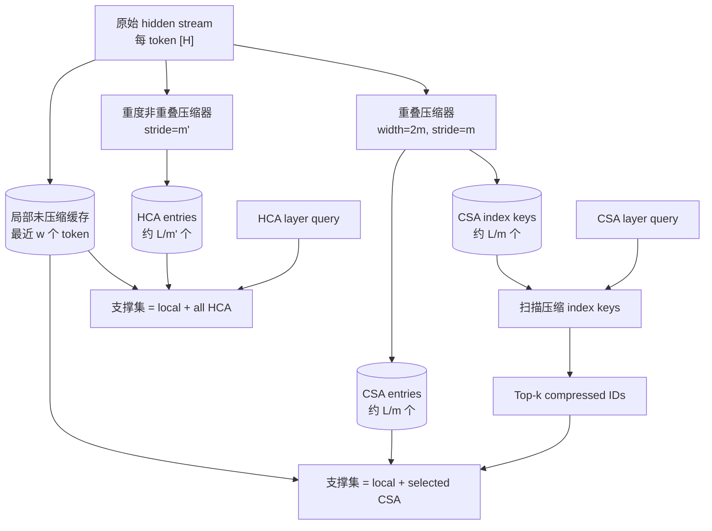
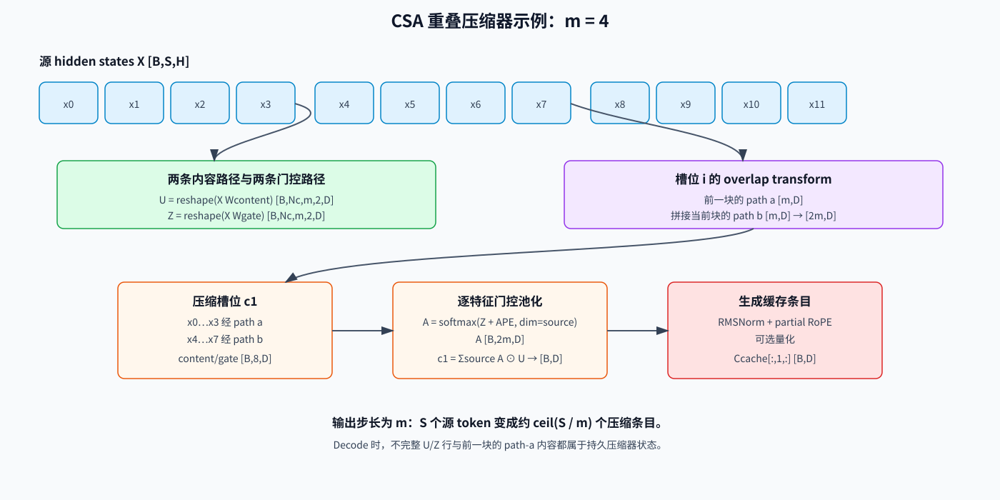
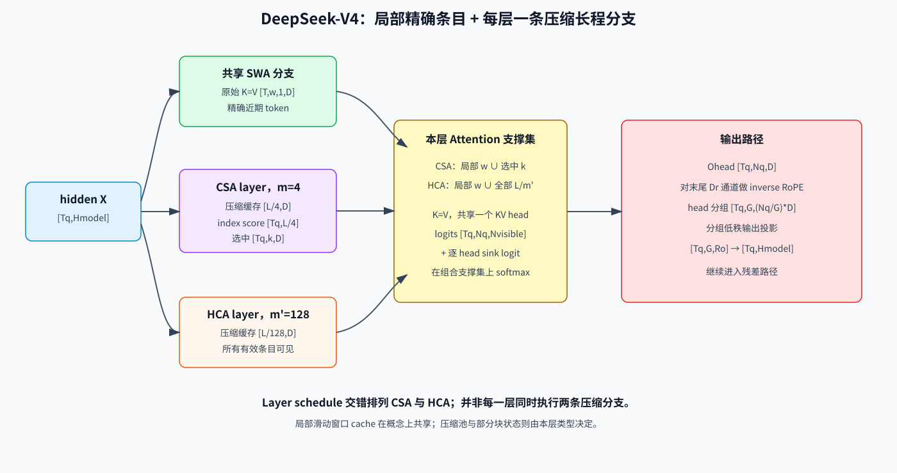

# 压缩稀疏注意力（CSA）与重度压缩注意力（HCA）

> English version: [Compressed Sparse Attention and HCA](../../../en/ai-infra-basic/Model_Architecture/08-compressed-sparse-attention.md)

## 阅读地图：三种时间尺度、两种 layer 类型

先澄清最容易产生的误解：SWA、CSA、HCA 不是把同一个 KV cache 换三种读法。



- **CSA layer**：精确局部窗口 + 从中等压缩条目中按 query 检索的 top-k；
- **HCA layer**：精确局部窗口 + 对重度压缩短序列的稠密全局读取；
- 模型把两类 layer 按配置交错排列，并非每一层同时跑 CSA 和 HCA。

### 一个 $`S=10,\qquad m=4`$ 的压缩时间线

把原始 token 分块：

```math
\text{chunk 0}= \mathrm{token} 0..3
```

```math
\text{chunk 1}= \mathrm{token} 4..7
```

```text
chunk 2 = token 8..9 + padding（尾块尚不完整）
```

重叠压缩的 receptive field 宽度是 $`2m=8`$，但 stride 是 $`m=4`$：

```text
entry 0: masked previous block + current chunk 0
entry 1: previous chunk 0       + current chunk 1
entry 2: previous chunk 1       + current chunk 2（需等尾块就绪）
```

在严格的增量因果执行里，token 长度从 1 增长到 10 时：

| `token_len` | `floor(token_len/m)` | `tail_len` | 新完成条目 |
|---:|---:|---:|---|
| 1 | 0 | 1 | 无，只更新尾状态 |
| 3 | 0 | 3 | 无 |
| 4 | 1 | 0 | entry 0 |
| 7 | 1 | 3 | 无 |
| 8 | 2 | 0 | entry 1 |
| 10 | 2 | 2 | 无；entry 2 仍含未完成当前块 |

如果一个离线 prefill 明确用 mask 处理最后的不完整块，可以生成 $`\mathrm{ceil}\left(\frac{S}{m}\right)=3`$ 个逻辑输出；在线 decode 的**可见完成条目数**仍必须按就绪条件推进。教程后文出现 `ceil(S/m)` 时描述的是 padded batch shape，出现 `floor(token_len/m)` 时描述的是在线可见状态，两者不可混用。

### 单个压缩特征的数值例子

为便于手算，只观察一个输出特征 `d`，设某 entry 的四个有效源位置经过内容投影后为：

```math
{\mathrm{Ubar}}_{:,d}=\left[2.0,1.0,-1.0,3.0\right]
```

```math
\mathrm{gate}+\mathrm{APE}=\left[0.0,1.0,0.0,0.0\right]
```

沿**源位置轴** softmax：

```math
{A}_{:,d}=\mathrm{softmax}\left(\left[0,1,0,0\right]\right)
```

```math
\approx  \left[0.175, 0.475, 0.175, 0.175\right]
```

```math
C\left[d\right] = \sum_{r} A\left[r,d\right] \mathrm{Ubar}\left[r,d\right]
```

```math
\approx  0.175\cdot 2 + 0.475\cdot 1 + 0.175\cdot \left(-1\right) + 0.175\cdot 3 = 1.175
```

真实张量对每个 $`d=0..D-1`$ 都有独立的 `[2m]` 权重，所以不同特征可以从不同源 token 提取证据。这不是 average pooling；内容和值得保留的位置都由训练学习。

### 一次 CSA decode 的完整 Tensor 账本

设 $`B=2,\qquad \mathrm{Nq}=64,\qquad D=128,\qquad \mathrm{Dc}=512,\qquad m=4,\qquad w=128,\qquad k=512`$，当前每序列有 $`L=32768`$ 个原始 token，则压缩候选约 $`\mathrm{Nc}=8192`$：

| 阶段 | 输入 | 输出 | 说明 |
|---|---:|---:|---|
| 当前 token 投影 | $`\left[2,1,H\right]`$ | local K/V、压缩器 content/gate | 更新两类状态 |
| 压缩器尾部 | 旧 tail + 当前投影 | tail 或新 `C [2,1,512]` | 每满 4 token 才提交 entry |
| Indexer Q | 当前 query latent | $`\left[2,64,128\right]`$ 等实现配置 | 与 DSA 类似的轻量 heads |
| Index scan | Q + `KI [2,8192,128]` | score $`\left[2,8192\right]`$ | 对压缩条目而非 token 扫描 |
| Top-k | score | ids $`\left[2,512\right]`$ | ids 是压缩逻辑 ID |
| 支撑集合并 | local `≤128` + selected `≤512` | `visible [2,≤640,128]` | 可在融合 kernel 中保持两个 buffer |
| Main logits | `Q [2,64,128]` × visible | `[2,64,≤640]` | 加 mask/sink 后 softmax |
| Head output | probability × visible | $`\left[2,64,128\right]`$ | 共享 K=V 的 MQA 语义 |
| 分组低秩输出 | $`\left[2,64,128\right]`$ | $`\left[2,H\right]`$ | inverse partial RoPE 顺序不可改变 |

这个表同时说明了为何 CSA runtime 需要局部 KV 池、压缩 KV 池、index-key 池和压缩器 tail，而不是一个普通 paged-KV pool。

压缩稀疏注意力（Compressed Sparse Attention，CSA）是 DeepSeek-V4 引入的长上下文注意力设计。它的核心动作可以概括为：

> 先压缩序列，再从压缩后的条目中检索少量候选，交给昂贵的注意力主核。

重度压缩注意力（Heavily Compressed Attention，HCA）提供一条压缩率更高的稠密路径；局部滑动窗口分支则保留最近 token 的细节。在模型的 layer 排列中，这些机制共同覆盖三种时间尺度：

- **SWA**：精确、未压缩的近期上下文；
- **CSA**：中等压缩、按内容选择的上下文；
- **HCA**：重度压缩、始终可见的全局上下文。

本章重点解释这种层次结构对执行与服务系统的影响。这里的 **CSA** 特指 DeepSeek-V4 的 Compressed Sparse Attention，而不是该缩写的其他含义。

## 1. 为什么先压缩再选择？

DeepSeek Sparse Attention（DSA）选择 token 级潜在 KV 条目。其注意力主核是稀疏的，但轻量 indexer 仍需扫描 token 历史。

CSA 把候选空间从 `L` 个 token 条目缩小为约 $`\frac{L}{m}`$ 个压缩条目，其中 `m` 是压缩步长。若主核检索 `k` 个压缩条目，则：

| 组件 | DSA | CSA |
|---|---:|---:|
| 每个 query 的 indexer 候选数 | `L` | 约 $`\frac{L}{m}`$ |
| 每个 query 的主核条目数 | `k` | `k` 个压缩条目 |
| 长程主缓存粒度 | token | 压缩块 |

压缩并非没有代价：每个压缩条目概括多个源位置，因此模型必须学习哪些信息需要保留。局部分支与重度压缩分支用于补偿不同类型的信息损失。

## 2. 符号与形状账本

设：

- `X in R[L, d_model]`：隐藏状态；
- `m`：CSA 压缩步长；
- `m'`：HCA 压缩步长，通常远大于 `m`；
- $`\mathrm{Nc}=\mathrm{ceil}\left(\frac{L}{m}\right)`$：CSA 条目数；
- $`\mathrm{Nh} = \mathrm{ceil}\left(L / m'\right)`$：HCA 条目数；
- `C in R[Nc, d_c]`：CSA 压缩 KV 条目；
- `K_I in R[Nc, d_i]`：压缩 indexer key；
- `k`：每个 query 选择的 CSA 条目数；
- `w`：未压缩滑动窗口长度。

请区分 `K_I` 与 `k`：前者是 key 张量，后者是 top-k 预算。

## 3. 重叠式序列压缩

CSA 并非简单地对每 `m` 个 token 求平均。它构造两条内容投影流与两条可学习门控流：

```math
C_{a} = X W_{a}^{C} Z_{a} = X W_{a}^{Z}
```

```math
C_{b} = X W_{b}^{C} Z_{b} = X W_{b}^{Z}
```

对于压缩槽位 `i`，压缩器消费两个相邻源块：

```text
前一个块：X[(i-1)m : i*m]
当前块：  X[i*m : (i+1)m]
```

`a`、`b` 两条路径经过排列，使该槽位最多接收 `2m` 个源位置。对门控 logit 做 softmax 后得到按特征学习的混合权重。概念上：

```math
C_i=\sum_{j\in\mathcal{V}_i}\mathrm{softmax}(Z_i)_j\,\mathrm{projected\_content}_j,\qquad |\mathcal{V}_i|\le2m
```

实际实现会批量执行并重排这些运算，但接口契约由三点定义：

1. 输出步长是 `m`，缓存长度约为 $`\frac{L}{m}`$；
2. 相邻输出覆盖的源位置有重叠；
3. 增量解码时，不完整块需要持久化压缩器状态。

重叠能缓解块边界问题：一个块边缘附近的证据可以通过相邻路径参与压缩。



### 3.1 压缩器的精确逻辑 Shape

设 `D` 为压缩 KV 宽度，重叠式 CSA 使用 $`\mathrm{coff}=2`$。一种便于实现的布局为：

```math
\mathrm{shape}\left(X\right)=\left[B,S,\mathrm{Hmodel}\right]
```

```math
U_{\mathrm{flat}} = X \, \mathrm{Wcontent}^{\mathsf T}: \left[B,S,\mathrm{coff}\cdot D\right]
```

```math
Z_{\mathrm{flat}} = X \, \mathrm{Wgate}^{\mathsf T}: \left[B,S,\mathrm{coff}\cdot D\right]
```

```text
把 S padding 到 Nc*m，再 reshape：
```

```math
U: \left[B,\mathrm{Nc},m,\mathrm{coff},D\right] = \left[B,\mathrm{Nc},m,2,D\right]
```

```math
Z: \left[B,\mathrm{Nc},m,\mathrm{coff},D\right] = \left[B,\mathrm{Nc},m,2,D\right]
```

对压缩槽位 `i`，overlap transform 构造：

```math
\mathrm{Ubar\_i}=\mathrm{concat}\left({U}_{i,:,\mathrm{path\_a},:},{U}_{i-1,:,\mathrm{path\_b},:}\right)\qquad\text{[B,2m,D]}
```

```math
\mathrm{Zbar\_i}=\mathrm{concat}\left({Z}_{i,:,\mathrm{path\_a},:},{Z}_{i-1,:,\mathrm{path\_b},:}\right)\qquad\text{[B,2m,D]}
```

在序列左边界，缺失的前一块会被 padding 并 mask。压缩窗口内部的可学习绝对位置 embedding 为：

```text
APE: [2m,D]
```

逐特征的源位置权重与压缩条目为：

```math
A_{i}\left[b,r,d\right] = \mathrm{exp}\left(\mathrm{Zbar\_i}\left[b,r,d\right] + \mathrm{APE}\left[r,d\right]\right) / \sum_{u \mathrm{valid}} \mathrm{exp}\left(\mathrm{Zbar\_i}\left[b,u,d\right] + \mathrm{APE}\left[u,d\right]\right)
```

```math
C_{i}\left[b,d\right] = \sum_{r \mathrm{valid}} A_{i}\left[b,r,d\right] \cdot  \mathrm{Ubar\_i}\left[b,r,d\right]
```

```text
A_i: [B,2m,D]
```

```math
\mathrm{shape}\left(C_{i}\right)=\left[B,D\right]
```

Softmax 沿**源位置轴**执行，并对每个特征 `d` 独立计算。这比每 token 只有一个标量权重更有表达力：不同输出通道可以从不同源位置保留信息。

### 3.2 为什么输出长度是 `ceil(S/m)`，不是 `ceil(S/2m)`

每个输出最多看到 `2m` 个源位置，但相邻输出存在重叠。每生成一个输出，压缩器只向前移动 `m` 个新源位置：

```text
C_1 查看 chunk 0 和 1
C_2 查看 chunk 1 和 2
C_3 查看 chunk 2 和 3
```

因此 receptive-field width 为 `2m`，stride 为 `m`。混淆 width 与 stride 会把缓存长度低估一倍。

### 3.3 因果性与条目就绪条件

只有当一个压缩条目所需的全部源位置都已经到达，它才能对 query 可见。因果推理绝不能让 query 读取包含未来 token 的摘要。

对 $`m=4`$，源位置 $`\{0,\ldots,3\}`$ 的完整摘要不能被位置 $`\{0,\ldots,2\}`$ 的 query 使用。Runtime 需要把已完成条目数与原始 token 长度分开维护：

```math
\mathrm{token\_len}=t+1
```

```math
\mathrm{complete\_entries}=\mathrm{floor}\left(\frac{\mathrm{token\_len}}{m}\right)
```

```math
\mathrm{tail\_len}=\mathrm{token\_len}\bmod m
```

Overlap 会增加前一路径状态，但不会放松这个因果边界。

## 4. 压缩后的 Indexer

CSA 在压缩条目上执行检索，而非在原始 token 位置上检索。其 indexer 沿用 DSA 的高层模式：

```math
c_{q} = x_{t} W_{\mathrm{DQ}}
```

```math
q_{I} = c_{q} W_{\mathrm{UQ}}^{I}
```

```math
\mathrm{score}(t,s)=\sum_j w_j^I\,\mathrm{ReLU}\left(\left\langle q^I_{t,j},k^I_s\right\rangle\right)
```

```math
I_{t} = \mathrm{TopK\_s}\left(\mathrm{score}\left(t, s\right), k\right)
```

区别在于 `s` 的取值域：它遍历 `Nc` 个压缩条目。因此，indexer key 需要独立的压缩缓存，并与主压缩 KV 缓存保持同步。

选出的 ID 是**压缩条目 ID**，不能把它解释为 token ID 或普通分页 KV 槽位。

## 5. 稀疏注意力主核

选中的压缩条目进入类似 Multi-Query Attention 的主核。DeepSeek-V4 将压缩表示同时用作 key 和 value，并通过分组输出投影恢复各个 head 的表达能力。

简化的 query 路径为：

```math
Q_{t} = x_{t} W^{Q}
```

```math
\mathrm{selected}={C}_{I_{t}}
```

```math
A_{t} = \mathrm{softmax}\left(Q_{t} \mathrm{selected}^{\mathsf T} + \mathrm{mask}\right)
```

```math
O_{t} = \mathrm{GroupedOutput}\left(A_{t} \mathrm{selected}\right)
```

实际实现还包含归一化、位置处理、head 分组和融合 kernel。需要明确概念边界：

- **indexer** 对候选排序；
- top-k 返回压缩逻辑 ID；
- **主核**在这些条目上重新计算注意力 logit 与 softmax。

### 5.1 局部与压缩条目共享 Attention 支撑集

对一个 query token，定义：

```math
\mathrm{Klocal} = \mathrm{Vlocal}: \left[w_{\mathrm{valid}},1,D\right]
```

```math
\mathrm{Kcomp} = \mathrm{Vcomp}: \left[k_{\mathrm{valid}},1,D\right] \qquad\text{CSA}
```

```text
[Nh_valid,1,D]      # HCA
```

```math
\mathrm{Kvisible} = \mathrm{concat}\left(\mathrm{Klocal}, \mathrm{Kcomp}, \mathrm{dim}=\mathrm{sequence}\right)
```

```math
\mathrm{Vvisible}=\mathrm{Kvisible}\qquad\text{共享 K=V 的 MQA}
```

当 `Q [Nq,D]` 时，逻辑张量为：

```math
\mathrm{shape}\left(\mathrm{logits}\right)=\left[\mathrm{Nq},\mathrm{Nvisible}\right]
```

```math
\mathrm{Nvisible}=w_{\mathrm{valid}}+k_{\mathrm{valid}}\qquad\text{CSA layer}
```

```math
\mathrm{Nvisible}=w_{\mathrm{valid}}+\mathrm{Nh\_valid}\qquad\text{HCA layer}
```

```math
\mathrm{shape}\left(\mathrm{prob}\right)=\left[\mathrm{Nq},\mathrm{Nvisible}\right]
```

```math
\mathrm{shape}\left(\mathrm{Ohead}\right)=\left[\mathrm{Nq},D\right]
```

逐 head attention sink 会为归一化增加一个稳定的额外 logit。融合 kernel 可以把局部与压缩缓存放在不同物理 buffer，但在数学上，它们构成本 layer 的同一个因果支撑集。

### 5.2 分组低秩输出投影

宽 head 输出通常会展平为 $`\left[\mathrm{Tq},\mathrm{Nq}\cdot D\right]`$。DeepSeek-V4 在低秩输出投影前对 head 分组。设输出组数为 `G`，rank 为 `Ro`：

```math
\mathrm{shape}\left(\mathrm{Ohead}\right)=\left[\mathrm{Tq},\mathrm{Nq},D\right]
```

```text
Ogroup:   [Tq,G,(Nq/G)*D]
Woa:      [G,Ro,(Nq/G)*D]
```

```math
\mathrm{shape}\left(\mathrm{Olowrank}\right)=\left[\mathrm{Tq},G,\mathrm{Ro}\right]
```

```math
\mathrm{shape}\left(\mathrm{merge}\right)=\left[\mathrm{Tq},G\cdot \mathrm{Ro}\right]
```

```math
\mathrm{shape}\left(\mathrm{Wob}\right)=\left[\mathrm{Hmodel},G\cdot \mathrm{Ro}\right]
```

```math
\mathrm{shape}\left(\mathrm{Omodel}\right)=\left[\mathrm{Tq},\mathrm{Hmodel}\right]
```

在投影前，架构会对指定的 partial-RoPE 输出通道执行逆旋转。交换 inverse RoPE 与可学习投影的顺序会改变模型函数。

## 6. HCA：稠密的全局安全网

HCA 以更大的步长 `m'` 压缩序列，并对得到的短序列执行稠密注意力：

```text
X[0:L] -> 非重叠重度压缩 -> H[0:Nh]
query -> 对 H 做稠密注意力
```

与 CSA 不同，HCA 不需要检索 indexer，因为它的序列已经足够短，可以全量可见。HCA 适合承载宽泛的全局信号，CSA 则为选中的远距离区域保留更多细节。

## 7. 局部 SWA 分支

压缩必然丢失 token 级细节。滑动窗口注意力（SWA）让最近 `w` 个 token 保持未压缩：

```text
context(t) = [t-w+1, ..., t]
```

该分支负责精确的局部语法、近期工具输出与近场依赖，无须要求压缩器保留每个微小差异。

每个压缩注意力 layer 都将局部路径与该层配置的长程分支配对：CSA 或 HCA。模型会交错排列不同 layer 类型，并不意味着每个 block 都同时执行 CSA 与 HCA。它们是互补且经过训练的路径，不是推理时可随意互换的选项。



## 8. 位置信息与 Attention Sink

序列压缩让位置处理比普通 MHA 更微妙。DeepSeek-V4 使用部分旋转位置编码（partial RoPE）：只有表示中指定的一部分维度携带旋转位置；输出路径按架构要求执行对应的逆旋转。

这是实现契约，而非无关紧要的变换。对所有通道应用 RoPE 或遗漏输出侧处理，都会改变模型函数。

该架构还包含 attention sink，为 query 提供稳定的兜底目标。稀疏与压缩 kernel 必须保留 sink 的 mask 与归一化语义。

## 9. 示例配置，不是通用常量

公开的 DeepSeek-V4 Flash 配置给出了以下示例值：

| 参数 | 示例值 |
|---|---:|
| CSA 压缩步长 `m` | 4 |
| CSA top-k `k` | 512 |
| HCA 压缩步长 `m'` | 128 |
| 局部窗口 `w` | 128 |

DeepSeek-V4 Pro 将 CSA 选择预算提高到 1024。这些值属于 checkpoint 架构字段，不能把它们当成纯服务参数静默调节。

## 10. 复杂度与内存

对历史长度为 `L` 的一个 decode query，不同配置 layer 的工作量可近似为：

```text
CSA layer：O(L / m) indexer + O(k) 主核 + O(w) 局部路径
HCA layer：O(L / m') 稠密主核 + O(w) 局部路径
```

从整个模型看，缓存包含多种表示；每个 layer 只持有其配置类型所需的子集：

```math
\mathrm{CSA} \text{主缓存} \sim  O\left(L / m\right)
```

```math
\mathrm{CSA} \mathrm{indexer}-\mathrm{key} \text{缓存} \sim  O\left(L / m\right)
```

```math
\mathrm{HCA} \text{缓存} \sim  O\left(L / m'\right)
```

```math
\text{局部未压缩} \mathrm{KV} \sim  \text{每个序列} O\left(w\right) \text{个活跃条目}
```

```math
\text{压缩器尾部状态} \sim  O\left(m + m'\right)
```

真正的收益取决于字节数，而不只是条目数。需要记录每个池的 dtype、特征宽度、scale/元数据开销、对齐与页面碎片。

## 11. Prefill 与 Decode 是两套程序

### Prefill

Prefill 可并行压缩多个块，并批量处理 indexer query。风险包括临时张量、top-k 工作区、最后一个不完整块内部的因果正确性，以及进入稀疏主核的不规则 gather。

### Decode

Decode 每次追加一个 token。多数 step 只更新尚未完成的压缩块；当一个块完成时，才发射新的压缩缓存条目。因此 runtime 必须在 step 间携带部分内容与门控状态。

图捕获需要为以下数据提供有界缓冲区：

- 压缩缓存地址；
- indexer top-k 输出；
- 部分压缩器状态；
- 局部窗口元数据；
- 每个 request 的 token 长度与压缩长度。

重新分配或依赖 shape 的 host 工作会抵消图模式收益。

## 12. 异构缓存管理

CSA、HCA 与 SWA 的推进速度不同。把它们当成一个普通 KV 池会带来正确性与碎片问题。

健壮的 request 状态需要记录：

```text
token_length
csa_complete_length 与 csa_tail_state
hca_complete_length 与 hca_tail_state
local_window 映射
csa indexer/main-cache 对齐关系
```

page 与 block 大小应考虑压缩步长。如果物理分配单元无法自然对齐，就要定义显式的跨步携带规则，而不是把不完整数据直接取整丢弃。

前缀缓存必须在相互一致的边界上快照所有表示。只复制已完成的压缩条目而丢失压缩器尾部状态，会改变后续输出。

## 13. SGLang 源码地图

在本教程对应的源码快照中，相关路径为：

- 模型编排：[`deepseek_v4.py`](../../../../python/sglang/srt/models/deepseek_v4.py)；
- 架构字段：[`deepseek_v4.py`](../../../../python/sglang/srt/configs/deepseek_v4.py)；
- 压缩：[`compressor.py`](../../../../python/sglang/srt/layers/attention/dsv4/compressor.py)；
- 压缩检索：[`indexer.py`](../../../../python/sglang/srt/layers/attention/dsv4/indexer.py)；
- 注意力调度：[`deepseek_v4_backend.py`](../../../../python/sglang/srt/layers/attention/deepseek_v4_backend.py)；
- 缓存池：[`deepseek_v4_memory_pool.py`](../../../../python/sglang/srt/mem_cache/deepseek_v4_memory_pool.py)；
- 部分块状态：[`deepseek_v4_compress_state.py`](../../../../python/sglang/srt/mem_cache/deepseek_v4_compress_state.py)。

建议按上述顺序阅读：配置决定形状，模型决定数据流，backend/cache 文件决定服务契约。

## 14. Ascend NPU 优化视角

当前源码快照中的 DeepSeek-V4 专用路径主要围绕 CUDA/HIP/Triton 构建。存在通用 PyTorch 类，并不等于端到端 Ascend 路径已经生产可用。部署前必须核对固定版本的 SGLang、`torch_npu`、CANN 与 kernel 支持。

将该架构适配到 Ascend 时，应分别 profile：

1. 投影与重叠式压缩；
2. 压缩 indexer 与 top-k；
3. 压缩缓存从逻辑地址到物理地址的转换；
4. 稀疏 gather 与注意力主核；
5. HCA 稠密注意力；
6. 局部 SWA 与最终分支组合。

合适的融合候选包括：投影+归一化、压缩器门控+softmax+reduce、index score+mask，以及 gather+attention。减少 kernel launch 之前，必须先保留尾部状态与因果语义。

## 15. DSA、CSA 与 HCA 对比

| 属性 | DSA | CSA | HCA |
|---|---|---|---|
| 长程存储单元 | token 级潜在条目 | 中度压缩块 | 重度压缩块 |
| 检索方式 | top-k | top-k | 无；对短序列稠密计算 |
| 候选数 | `L` | $`\frac{L}{m}`$ | `L / m'` |
| 主 query 工作量 | `k` | `k` | `L / m'` |
| 主要角色 | 选中的精细信息 | 选中的中分辨率历史 | 粗粒度全局覆盖 |

## 16. 常见误解

1. **“CSA 只是 KV 量化。”** CSA 学习序列压缩；量化改变的是数值表示。
2. **“一个压缩条目严格对应一个不重叠块。”** CSA 的源位置覆盖存在重叠。
3. **“top-k 返回 token 索引。”** 它返回压缩条目索引。
4. **“HCA 是另一条稀疏分支。”** HCA 对重度压缩后的短序列执行稠密注意力。
5. **“前缀复用只保存已完成压缩缓存即可。”** 部分压缩器状态也是 request 状态的一部分。
6. **“示例压缩率可以在运行时自由修改。”** 它们与 checkpoint 权重和架构耦合。

## 17. 正确性与性能检查清单

1. 压缩器的边界与 padding 行为和 checkpoint 实现一致。
2. CSA 主条目与 indexer key 在同一逻辑 step 发射。
3. 压缩 top-k ID 通过正确的 request 专属缓存表完成映射。
4. 部分块在 decode、前缀缓存、迁移与推测解码回滚时都不会丢失。
5. SWA 边界满足因果性与 request 隔离。
6. partial RoPE、逆旋转与 sink 语义和参考实现一致。
7. 内存核算包含所有缓存池、scale、元数据与碎片。
8. profile 分开统计压缩、检索、稀疏主核、HCA、SWA 与图开销。

## 18. Layer 排列与 Attention Mask Shape

DeepSeek-V4 是 **layer schedule** 层面的混合架构。每一层只配置一个压缩率：

```text
compress_ratio = 0    -> 只有局部/滑动路径
compress_ratio = 4    -> CSA 压缩器 + indexer + 局部路径
compress_ratio = 128  -> HCA 压缩器 + 稠密压缩路径 + 局部路径
```

对一个包含 `S` 个 query token 的教学版 prefill：

```text
局部因果 mask: [S,S]
CSA 选中槽位:  逻辑上 [S,k]
HCA 条目:      逻辑上 [S,ceil(S/m')]
```

只有同时满足 request 边界与条目就绪条件的位置才有效。Backend 可能把 query 专属 CSA 槽位展平成 $`\left[S,S\cdot k\right]`$ 的 workspace 列，但这是执行布局，并不表示持久缓存中真的有 `S*k` 个条目。

## 19. 完整 Tensor 账本

设一次 packed forward 含 `Tq` 个 query，主压缩宽度为 `D`，index 宽度为 `DI`，query head 数为 `Nq`，输出组数为 `G`。

| 阶段 | 张量 | 逻辑 shape | 说明 |
|---|---|---:|---|
| 输入 | hidden states | $`\left[\mathrm{Tq},\mathrm{Hmodel}\right]`$ | 共享 layer 输入 |
| 原始局部投影 | 新 $`K=V`$ | $`\left[\mathrm{Tq},1,D\right]`$ | 追加到 SWA pool |
| 主压缩器内容 | `U` | $`\left[\mathrm{Tq},\mathrm{coff}\cdot D\right]`$ | CSA 的 $`\mathrm{coff}=2`$，HCA 为 `1` |
| 主压缩器 gate | `Z` | $`\left[\mathrm{Tq},\mathrm{coff}\cdot D\right]`$ | 与内容使用相同拆分 |
| 压缩器 workspace | `Ubar/Zbar` | $`\left[\mathrm{Nc},\mathrm{coff}\cdot m,D\right]`$ | 概念 shape，通常被融合 |
| 新主压缩条目 | `Cnew` | $`\left[\mathrm{Nnew},D\right]`$ | 只在边界发射 |
| CSA index 压缩输出 | `KInew` | $`\left[\mathrm{Nnew},\mathrm{DI}\right]`$ | 仅 CSA |
| Index query | `QI` | $`\left[\mathrm{Tq},\mathrm{HI},\mathrm{DI}\right]`$ | 仅 CSA |
| Index score | `I` | $`\left[\mathrm{Tq},\mathrm{Nc\_visible}\right]`$ | 仅 CSA，可流式计算 |
| 选中 ID | `ids` | $`\left[\mathrm{Tq},k\right]`$ | 仅 CSA |
| 局部 ID | `local_ids` | $`\left[\mathrm{Tq},w\right]`$ 有界 | 无效槽位被 mask |
| 可见 K/V | 概念并集 | $`\left[\mathrm{Tq},\mathrm{Nvisible},1,D\right]`$ | 物理 pool 仍分离 |
| 主 logits | `A` | $`\left[\mathrm{Tq},\mathrm{Nq},\mathrm{Nvisible}\right]`$ | 优化路径中分块/online |
| Head 输出 | `Ohead` | $`\left[\mathrm{Tq},\mathrm{Nq},D\right]`$ | 随后做 inverse partial RoPE |
| 分组投影 | `Olowrank` | $`\left[\mathrm{Tq},G,\mathrm{Ro}\right]`$ | 最终投影之前 |
| Layer 输出 | `Omodel` | $`\left[\mathrm{Tq},\mathrm{Hmodel}\right]`$ | 回到残差路径 |

## 20. 把增量压缩器看成状态机

对每个 request、每个压缩 layer，decode 会在 `m` 个原始位置之间循环：

```text
state = {
    complete_count,
    tail_position,
    partial_content,
    partial_gate,
    overlap_carry,       # 仅 CSA
}
```

每个 token 执行：

```text
1. 把 x_t 投影成局部 K=V，并追加到 SWA ring；
2. 把 x_t 投影到压缩器 content/gate 槽位；
3. 写入部分状态的当前 slot；
4. 若 chunk 未完成，不发射压缩条目；
5. 若 chunk 闭合，执行 pool + norm + RoPE，追加一个条目；
6. 对 CSA，同步追加 indexer 条目并更新 overlap carry；
7. 增加 complete_count，重置新的 tail。
```

这解释了为什么只保存 `token_length` 无法恢复迁移或 prefix-cached request。已完成条目数相同、tail 激活不同的两个 request，会生成不同的下一个压缩条目。

## 21. 压缩器参考伪代码

```python
def overlap_compress(U, Z, ape, valid):
    # U/Z:   [B,Nc,m,2,D]
    # ape:   [2*m,D]
    # valid: [B,Nc,2*m]
    B, Nc, m, _, D = U.shape

    prev_u = shift_right(U[:, :, :, 0, :], fill=0)     # [B,Nc,m,D]
    curr_u = U[:, :, :, 1, :]                          # [B,Nc,m,D]
    prev_z = shift_right(Z[:, :, :, 0, :], fill=-inf)
    curr_z = Z[:, :, :, 1, :]

    ubar = cat([prev_u, curr_u], dim=2)                 # [B,Nc,2m,D]
    zbar = cat([prev_z, curr_z], dim=2)                 # [B,Nc,2m,D]
    logits = where(valid[..., None], zbar + ape, -inf)
    weight = softmax(logits, dim=2)                     # 源位置轴
    compressed = (weight * ubar).sum(dim=2)             # [B,Nc,D]
    return compressed
```

测试应覆盖 $`S \lt m`$、$`S=m`$、$`S=m+1`$、多个完整块、混合 request 长度，以及边界落在压缩块内部的 split prefill。

## 22. 内存计算实例

取 $`L=1048576`$、$`D=512`$，并用 FP8 非 RoPE 存储做一个粗略下界比较：

```math
\text{未压缩条目}: 1,048,576 \cdot  512 \mathrm{bytes} \approx  512 \mathrm{MiB}/\mathrm{layer}
```

```math
\text{CSA m}=4: 262,144 \cdot  512 \mathrm{bytes} \approx  128 \mathrm{MiB}/\mathrm{CSA} \mathrm{layer}
```

```math
\text{HCA m'}=128: 8,192 \cdot  512 \mathrm{bytes} \approx  4 \mathrm{MiB}/\mathrm{HCA} \mathrm{layer}
```

实际内存还要加入局部 SWA pool、BF16 RoPE 通道、CSA indexer cache、scale、对齐、压缩器状态与分配器碎片。这个例子说明“4 倍压缩”和“128 倍压缩”只描述序列条目项，而不是总 serving 内存。

对一个 $`k=512`$ 的 CSA decode query，主压缩读取约为 $`512\cdot D`$ 个元素，与 `L` 无关；indexer 仍需扫描最多 `L/4` 个压缩 index key。HCA 则读取全部 `L/128` 个条目，但没有 top-k。

## 23. 调试与练习

| 症状 | 可能需要检查的边界 |
|---|---|
| 每四个 token 出现一次错误 | CSA 发射边界、tail reset、overlap carry |
| Split prefill 与一次性 prefill 不一致 | 部分压缩器状态丢失或顺序错误 |
| 局部事实消失 | SWA 映射/窗口 mask 或组合支撑集归一化 |
| 长程输出读取未来内容 | 压缩条目就绪 mask |
| CSA 正确、HCA 错误 | 稠密压缩长度/page 元数据或非重叠路径 |
| HCA 正确、CSA 错误 | index 压缩同步、top-k、压缩 ID 转换 |
| BF16 正确、FP8/FP4 错误 | scale 布局、RoPE slice dtype、ranking recall |

练习：

1. 对 $`S=19`$、$`m=4`$，逐 token 计算 `Nc`、已完成条目数与 tail length。
2. 画出 overlap 模式下哪些源 chunk 会贡献给 `C_1`、`C_2` 与 `C_3`。
3. 当 $`w=128`$、$`k=512`$、$`\mathrm{Nq}=64`$ 时，写出 $`\mathrm{Tq}=16`$ 的主 logit 逻辑 shape。
4. 解释为什么 HCA layer 不需要 top-k 元数据，但仍需要 compressor-tail state。
5. 设计一个 prefix-cache key，证明 local、compressed、indexer 与 tail state 指向同一 token 边界。

## 24. 参考资料

- [DeepSeek-V4: Towards Highly Efficient Million-Token Context Intelligence](https://arxiv.org/abs/2606.19348)
- [本仓库的 DSA 教程](./07-deepseek-sparse-attention.md)
- [高效注意力技术地图](./06-efficient-attention-landscape.md)
