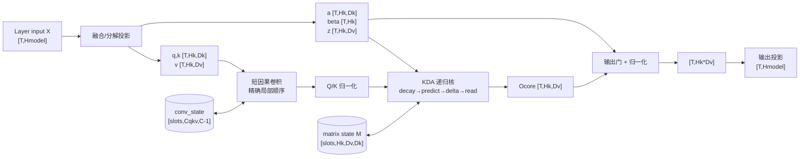
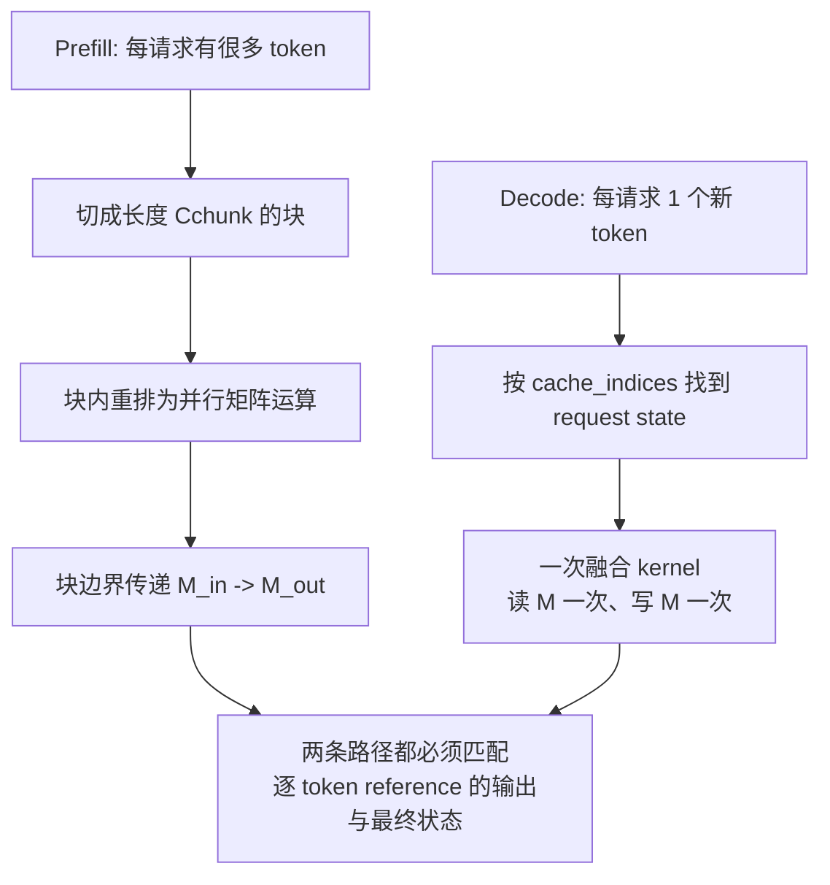
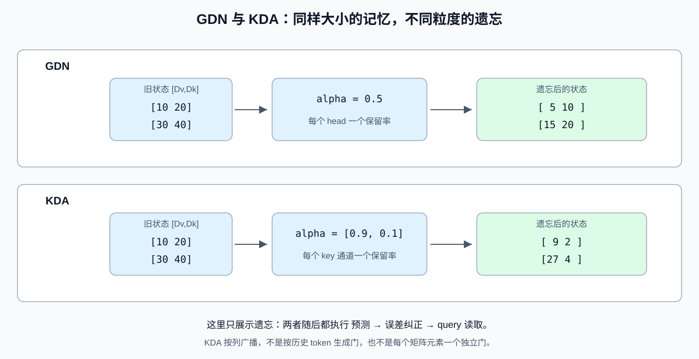
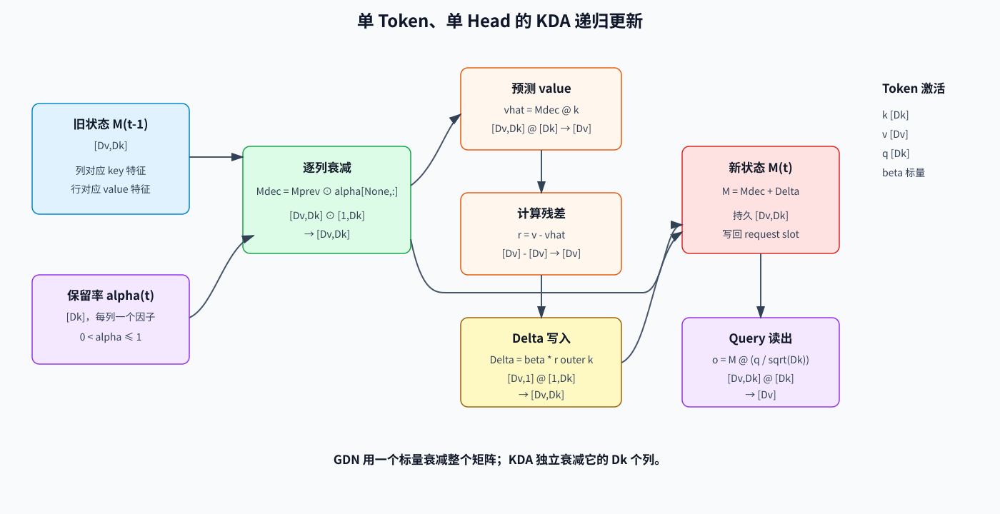
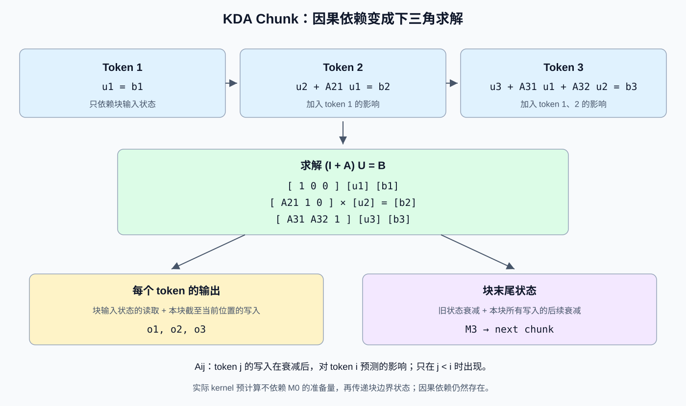
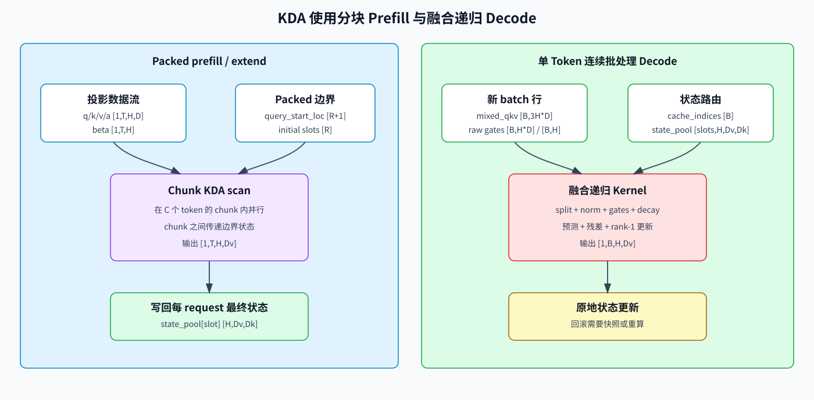

# Kimi Delta Attention（KDA）：线性注意力的细粒度门控

> English version: [Kimi Delta Attention](../../../en/ai-infra-basic/Model_Architecture/09-kimi-delta-attention.md)

建议先读 [GDN 完整教程](../Gated_Delta_Network/01-gated-deltanet.md)，再沿下表阅读。本章使用本仓库固定源码快照，具体调用链见第 13 节。

| 想解决的问题 | 阅读位置 |
|---|---|
| GDN 到 KDA 究竟改了什么 | [第 3 节：门控、时间尺度与退化关系](#3-gdn-与-kda-的区别) |
| 为什么减去旧预测，数学怎么成立 | [第 5 节：递归与在线学习](#5-kda-递归公式) |
| 一层里每个张量从哪来 | [第 6 节：投影、卷积、三种门](#6-投影短卷积与输出门) |
| Prefill 怎样保持因果又利用矩阵计算 | [第 8 节：完整 chunk 推导](#8-prefill从逐-token-递归推导-chunk-并行) |
| SGLang 到底在哪执行公式 | [第 13 节：模型 → backend → kernel](#13-sglang-源码从模型投影走到状态写回) |
| 自己动手核对数字 | [第 19 节：CPU 自检](#19-运行-cpu-参考程序核对递归与-chunk) 与 [第 20 节：对照演算](#20-同一组输入gdn-与-kda-完整对照演算) |

## 阅读地图：把状态矩阵看成“可改写的键值记忆”

Softmax Attention 把每个历史 `(k_s,v_s)` 原样保留，查询时再逐个比较；KDA 则把历史写入一个矩阵 `M`。对一个 head：

```math
\mathrm{shape}\left(M\right)=\left[\mathrm{Dv},\mathrm{Dk}\right]
```

```text
写入：v outer k -> [Dv,1] @ [1,Dk] = [Dv,Dk]
读取：M @ q     -> [Dv,Dk] @ [Dk]   = [Dv]
```

外积 `v k^T` 可以直观理解为：“当查询方向接近 `k` 时，读出 `v`”。但不同 token 的 key 方向会重叠，朴素相加会不断积累冲突。Delta rule 先读出旧预测 $`v_{\mathrm{hat}}=\mathrm{Mk}`$，只把误差 `v-v_hat` 写回；KDA 又在写入前让不同 key 通道按各自的 `alpha[c]` 遗忘。



### 四个操作如何改变同一个状态

对每个 request、layer、head，状态更新严格按以下顺序：

1. 遗忘

```math
M_{\mathrm{decay}}=M_{\mathrm{prev}}\mathrm{Diag}(\alpha)
```

2. 预测

```math
\widehat v=M_{\mathrm{decay}}k
```

3. 纠错

```math
M_{\mathrm{new}}=M_{\mathrm{decay}}+\beta(v-\widehat v)k^{\mathsf T}
```

4. 读取

```math
o=M_{\mathrm{new}}\frac{q}{\sqrt{D_k}}
```

若交换顺序，函数会改变。例如用 $`M_{\mathrm{prev}}\,k`$ 而不是 $`M_{\mathrm{decay}}\,k`$ 计算预测，等于用“遗忘前的记忆”决定纠错量；这不是等价优化。

### 贯穿全文的 Shape 例子

```math
B=8, \mathrm{decode} \text{时} T=B=8
```

```math
\mathrm{Hmodel}=4096,\qquad \mathrm{Hk}=16,\qquad \mathrm{Dk}=128,\qquad \mathrm{Dv}=128
```

```math
\text{短卷积宽度 C}=4
```

| 阶段 | Tensor | Shape | 跨 step 保留？ |
|---|---|---:|---|
| 输入 | `X` | $`\left[8,4096\right]`$ | 否 |
| Q/K | `q,k` | $`\left[8,16,128\right]`$ | 否 |
| V/输出门 | `v,z` | $`\left[8,16,128\right]`$ | 否 |
| 遗忘门 | `alpha` | $`\left[8,16,128\right]`$ | 否 |
| 写入门 | `beta` | $`\left[8,16\right]`$ | 否 |
| 卷积尾部 | `conv_state` | $`\left[\mathrm{slots},16\cdot \left(128+128+128\right),3\right]`$ | **是** |
| 递归矩阵 | `M` | $`\left[\mathrm{slots},16,128,128\right]`$ | **是** |
| 主核输出 | `Ocore` | $`\left[8,16,128\right]`$ | 否 |
| 层输出 | `O` | $`\left[8,4096\right]`$ | 否 |

这里 `slots` 不是 batch size，而是状态池容量。`cache_indices [8]` 把本轮第 `b` 行映射到某个 request slot。连续批处理中 batch 行会变化，slot 身份必须稳定。

### Prefill 与 Decode 为什么不能用同一种朴素循环



Prefill 的目标是打破“每 token 一个小 kernel”的低利用率，但不能打破因果递归；decode 的目标是避免对完整 `M` 反复读写。只比较输出不够，还必须比较最终 `M` 与 `conv_state`，因为它们决定下一 token。

Kimi Delta Attention（KDA）是 Kimi Linear 中的递归线性注意力组件。它在 Gated DeltaNet（GDN）基础上加入了**按 key 通道划分的遗忘门**。

这一处变化对系统实现很重要：

- 稠密与稀疏 softmax attention 把历史保存为序列缓存；
- GDN 与 KDA 把历史折叠到固定大小的递归状态中；
- KDA 可以让不同 key 空间特征以不同速度遗忘。

本章将推导递归公式，对照 SGLang 源码，并解释为什么 prefill 与 decode 需要不同 kernel。

## 1. 从遍历 Token 的注意力到递归状态

普通因果注意力保存过去的 key 和 value：

```math
o_t=\mathrm{softmax}\left(q_tK_{\le t}^{\mathsf T}\right)V_{\le t}
```

其缓存随序列长度增长。线性注意力则用矩阵概括历史。采用便于实现的矩阵方向：

```math
M_t\in\mathbb{R}^{d_v\times d_k},\qquad o_t=M_tq_t
```

状态大小取决于 head 维度，而不取决于已经处理的 token 数量。

## 2. 为什么使用 Delta Rule？

朴素的累加状态会不断写入外积：

```math
M_{t}={M}_{t-1}+v_{t}\,{k_{t}}^{\mathsf T}
```

这种写法难以正确覆盖旧信息，因为新 key 可能和状态中已经存储的相近方向发生冲突。Delta rule 先询问当前状态对 `k_t` 的预测，再只写入残差：

```math
\mathrm{v\_hat\_t} = M_{t-1} k_{t}
```

```math
r_{t}=v_{t}-\mathrm{v\_hat\_t}
```

```math
M_{t}={M}_{t-1}+\beta_{t}\cdot r_{t}\,{k_{t}}^{\mathsf T}
```

`beta_t` 控制写入强度。

## 3. GDN 与 KDA 的区别

先读 [GDN 完整教程](../Gated_Delta_Network/01-gated-deltanet.md#gdn-update)，再看这一处变化：**保留 delta rule，把每 head 一个遗忘系数变成每 key 通道一个遗忘系数。** 对当前 token 的一个 head，两者都有：

```math
M_t=\widetilde M_t+\beta_t\left(v_t-\widetilde M_tk_t\right)k_t^{\mathsf T}
```

区别只在得到 $`\widetilde M_t`$ 的方式：

| 项目 | GDN | KDA |
|---|---|---|
| 遗忘系数 | 标量 $`\alpha_t`$ | 向量 $`\boldsymbol\alpha_t\in\mathbb R^{d_k}`$ |
| 衰减后的状态 | $`\widetilde M_t=\alpha_tM_{t-1}`$ | $`\widetilde M_t=M_{t-1}\mathrm{Diag}(\boldsymbol\alpha_t)`$ |
| 状态列的保留率 | 同一个 head 内相同 | 每个 key 通道可不同 |
| 写入门 | 每 token/head 一个标量 $`\beta_t`$ | 同样是标量 $`\beta_t`$ |
| 同等 head 配置下的状态容量 | $`H d_vd_k`$ | $`H d_vd_k`$ |

本表的 $`\alpha_t`$ 是保留率；后文代码中的 `a` 是激活前的原始信号。实现中通常用 `alpha = exp(g)` 表示保留率。

### 3.1 逐通道到底指什么？

对于状态 $`M\in\mathbb R^{d_v\times d_k}`$，第 $`c`$ 列对应一个 key 特征方向。KDA 的衰减是：

```math
\widetilde M_{r,c}=M_{r,c}\alpha_c
```

它沿 key 轴广播，同一列的所有 value 行乘同一个系数。它**不是给每个历史 token 一个门**，也不是给每个矩阵元素独立生成一个门。



图中只展示遗忘，后面仍要执行两者共有的 delta 更新。例如旧状态为 $`\left[\left[10,20\right],\left[30,40\right]\right]`$，GDN 保留率为 $`0.5`$，KDA 保留率为 $`[0.9,0.1]`$。GDN 两列都减半，KDA 第一列保留 90%、第二列保留 10%。

### 3.2 为什么这种变化有意义？

如果一个 head 需要同时保留较稳定的特征并快速刷新另一些特征，GDN 的**遗忘步骤**只能为它们选择同一个倍率；KDA 能分别选择。这里的特征方向由训练学习，没有预设“第一列记人名、第二列记地点”的含义。

GDN 原本也能通过 $`(v-\widetilde Mk)k^{\mathsf T}`$ 定向修正当前 key 涉及的记忆。不能说 GDN 完全不会选择性更新；KDA 增强的是**遗忘的粒度**。增加 head 也能增加独立门，但会改变 head 分解与投影组织，不等价于在一个 head 内加入通道门。

如果 KDA 所有通道恰好取同一个保留率：

```math
\boldsymbol\alpha_t=[\alpha_t,\ldots,\alpha_t],\qquad
\mathrm{Diag}(\boldsymbol\alpha_t)=\alpha_tI
```

则递归公式退化为 GDN。这是递归规则的包含关系，不表示不同模型的 checkpoint、卷积或输出门可以直接互换。

### 3.3 记忆生命周期如何改变？

先忽略 delta 写入，只追踪一个旧状态分量经过多步遗忘后的系数：

```math
M_{t,c}=M_{0,c}\prod_{s=1}^{t}\alpha_{s,c}
```

若保留率暂时恒定且满足 $`0\lt\alpha_c\lt1`$，其衰减半衰期为：

```math
n_{1/2,c}=\frac{\log(1/2)}{\log\alpha_c}
```

$`\alpha_c=0.99`$ 时约 69 步，$`\alpha_c=0.5`$ 时为 1 步。KDA 可在同一 head 内形成不同的遗忘时间尺度；GDN 的不同 head 之间也可以形成不同时间尺度。真实递归还包含 key 驱动的纠错和新写入，因此这个半衰期只解释**纯衰减路径**，不保证某条语义事实能保存这么多 token。

这与 [Kimi Linear 报告 §2–3](https://arxiv.org/html/2510.26692v1#S3) 中标量门到对角门的扩展一致。下面继续把门控放回完整递归，并在第 20 节用同一组输入演算两者。

## 4. 形状账本

对一个 token 和一个 head，设：

- $`q_t,k_t\in\mathbb R^{d_k}`$；
- $`v_t\in\mathbb R^{d_v}`$；
- $`a_t\in\mathbb R^{d_k}`$：原始遗忘门激活；
- $`\boldsymbol\alpha_t\in(0,1]^{d_k}`$：逐通道保留率；
- $`\beta_t\in(0,1)`$：标量 delta 写入强度；
- $`M_t\in\mathbb R^{d_v\times d_k}`$：递归状态；
- $`o_t\in\mathbb R^{d_v}`$：归一化与输出门之前的输出。

对一批 token，实现通常把张量排布为 $`\left[T,H,D\right]`$；递归状态由每个 request、layer 与 KV head 独立持有。

## 5. KDA 递归公式

采用 SGLang 便于存储的状态方向，计算步骤为：

```math
g_{t}=-\mathrm{exp}\left(A_{\mathrm{log}}\right)\cdot \mathrm{softplus}\left(a_{t}+\mathrm{dt\_bias}\right)
```

```math
\alpha_{t}=\mathrm{exp}\left(g_{t}\right)
```

```math
M_{\mathrm{decay}}=M_{t-1}\mathrm{Diag}(\alpha_t)
```

```math
\widehat{v}_t=M_{\mathrm{decay}}k_t
```

```math
r_{t}=v_{t}-\mathrm{v\_hat\_t}
```

```math
M_{t}=M_{\mathrm{decay}}+\beta_{t}\cdot r_{t}\,{k_{t}}^{\mathsf T}
```

```math
o_{t}=M_{t}\left(\frac{q_{t}}{\sqrt{d_{k}}}\right)
```

由于 $`g_{t} \le 0`$，`alpha_t` 位于 `(0, 1]`。`M` 的每一列都会获得不同的保留因子。

KDA 技术报告使用转置后的方向 $`S_t\in\mathbb R^{d_k\times d_v}`$：

```math
S_{t} = \left(I - \beta_{t} k_{t} k_{t}^{\mathsf T}\right) \mathrm{Diag}\left(\alpha_{t}\right) S_{t-1} + \beta_{t} k_{t} v_{t}^{\mathsf T}
```

```math
o_{t} = S_{t}^{\mathsf T} q_{t}
```

两种形式转置后等价。比较代码与公式之前，必须先确认状态矩阵的方向。



### 5.1 从论文形式推导实现形式

从技术报告的 `S[d_k,d_v]` 公式开始：

```math
S_{t} = \left(I - \beta k k^{\mathsf T}\right) \mathrm{Diag}\left(\alpha\right) S_{\mathrm{prev}} + \beta k v^{\mathsf T}
```

对每个因子转置，并反转乘法顺序：

```math
M_{t} = S_{t}^{\mathsf T} = M_{\mathrm{prev}} \mathrm{Diag}\left(\alpha\right) \left(I - \beta k k^{\mathsf T}\right) + \beta v k^{\mathsf T}
```

定义逐列衰减后的状态：

```math
M_{\mathrm{decay}} = M_{\mathrm{prev}} \mathrm{Diag}\left(\alpha\right)
```

展开可得：

```math
M_{t} = M_{\mathrm{decay}} - \beta \left(M_{\mathrm{decay}} k\right) k^{\mathsf T} + \beta v k^{\mathsf T} = M_{\mathrm{decay}} + \beta \left(v - M_{\mathrm{decay}} k\right) k^{\mathsf T}
```

这正是便于存储的“衰减 → 预测 → 残差 → 外积更新”顺序。改变矩阵方向没有引入近似。

### 5.2 逐元素解释

对 value 行 `r` 与 key 列 `c`：

```math
{M_{\mathrm{decay}}}_{r,c}={M_{\mathrm{prev}}}_{r,c}\cdot {\alpha}_{c}
```

```math
{M_{t}}_{r,c}={M_{\mathrm{decay}}}_{r,c}+\beta\cdot {\mathrm{residual}}_{r}\cdot {k}_{c}
```

因此 KDA 有两个独立控制轴：

- `alpha[c]` 决定历史 key 特征 `c` 保留多少；
- $`{\mathrm{residual}}_{r}\cdot {k}_{c}`$ 决定当前 token 如何改变矩阵单元 `(r,c)`。

GDN 的标量 `alpha` 无法为不同列选择不同生命周期。

### 5.3 从一次在线学习看懂纠错方向

把遗忘后的矩阵 $`\widetilde M`$ 临时视为一个可更新的线性映射，对当前 key/value 定义重建误差：

```math
\mathcal L(M)=\frac12\lVert Mk-v\rVert_2^2,\qquad
\nabla_M\mathcal L=(Mk-v)k^{\mathsf T}
```

从 $`\widetilde M`$ 出发做一步学习率为 $`\beta`$ 的梯度下降：

```math
M_{\mathrm{new}}=\widetilde M-\beta\nabla_M\mathcal L(\widetilde M)
=\widetilde M+\beta(v-\widetilde Mk)k^{\mathsf T}
```

这解释了为什么要“减去旧预测”：目标是修正映射 $`k\mapsto v`$，不是无条件叠加更多 value。这里的在线更新是**激活状态的 forward 计算**，并不是推理时 optimizer 训练了模型权重。模型权重仍在离线训练时通过语言建模 loss 学习。

若 $`\lVert k\rVert_2=1`$，更新后再读取当前 key：

```math
M_{\mathrm{new}}k=(1-\beta)\widetilde Mk+\beta v
```

例如 $`\beta=0.5`$ 会把当前预测向 v 移动一半，$`\beta=1`$ 在精确归一化与实数运算下可完全匹配。读取另一方向 $`q`$ 的变化则是：

```math
(M_{\mathrm{new}}-\widetilde M)q=\beta(v-\widetilde Mk)(k^{\mathsf T}q)
```

当 q 与 k 正交，这次写入不改变该方向的读出；方向重叠时会有影响。这同时解释了定向更新与记忆干扰。实际 kernel 的 L2 norm 有 epsilon，浮点结果也存在误差，上述单位范数结论是解释原理的理想形式。

KDA 的对角衰减后接这个 rank-one 修正。把变换写成 $`D(I-\beta kk^{\mathsf T})`$，展开为 $`D-\beta(Dk)k^{\mathsf T}`$，可见它是对角项加秩一项的特定结构（DPLR）。kernel 不必构造一个完整的 $`d_k\times d_k`$ 转移矩阵，就能用逐元素乘法、reduction 与外积执行它。对角衰减与 key 修正一般不可交换，调整顺序会改变函数。

## 6. 投影、短卷积与输出门

KDA 不只有递归公式。典型 layer 会执行：

```text
hidden states
  -> Q/K/V 投影
  -> 对投影流做短因果卷积
  -> Q/K 归一化
  -> 遗忘门 alpha 与写入门 beta
  -> 递归 KDA 主核
  -> 归一化
  -> 可学习输出门
  -> 输出投影
```

短卷积在递归压缩前提供精确的局部顺序信息。因此，服务状态同时包含 KDA 矩阵与卷积尾部。

### 6.1 SGLang 中的投影 Shape

设 `Hk` 为 KDA head 数，`Dk` 为 q/k head 宽度，`Dv` 为 value 宽度，`C` 为短卷积 kernel size。从 packed hidden states 开始：

```math
\mathrm{shape}\left(X\right)=\left[T,\mathrm{Hmodel}\right]
```

逻辑投影输出为：

```text
q_flat:       [T,Hk*Dk]  -> q [T,Hk,Dk]
k_flat:       [T,Hk*Dk]  -> k [T,Hk,Dk]
v_flat:       [T,Hk*Dv]  -> v [T,Hk,Dv]
beta_raw:     [T,Hk]     -> beta [T,Hk]
forget_raw:   [T,Hk*Dk]  -> a [T,Hk,Dk]
output_gate:  [T,Hk*Dv]  -> z [T,Hk,Dv]
```

源码中的 forget gate 与 output gate 使用分解投影。以 forget 路径为例：

```math
f_{a} = X \, \mathrm{Wfa}^{\mathsf T}: \left[T,\mathrm{Dk}\right]
```

```math
a_{\mathrm{flat}} = f_{a} \, \mathrm{Wfb}^{\mathsf T}: \left[T,\mathrm{Hk}\cdot \mathrm{Dk}\right]
```

```math
a = \mathrm{reshape}\left(a_{\mathrm{flat}}\right): \left[T,\mathrm{Hk},\mathrm{Dk}\right]
```

这样可以减少投影成本，同时仍为每个 token、head 与 key 通道产生一个遗忘激活。融合投影可以一次生成 q/k/v、`beta` 与低秩 gate 中间量，但逻辑张量不变。

### 6.2 短卷积 Shape

卷积前拼接投影后的 q/k/v：

```text
mixed_qkv: [T,Hk*(2*Dk + Dv)]
```

当 kernel 宽度为 `C` 时，每个 request slot 保留：

```text
conv_state: [Hk*(2*Dk + Dv), C-1]
```

Prefill 对每条 packed 序列执行因果卷积。Decode 使用旧的 `C-1` 列与新投影行，返回一个宽度不变的过滤后行，并移动卷积状态。

### 6.3 从主核到输出的 Shape

卷积并 reshape 后：

```text
q/k:       [1,T,Hk,Dk]
```

```math
\mathrm{shape}\left(v\right)=\left[1,T,\mathrm{Hk},\mathrm{Dv}\right]
```

```math
\mathrm{shape}\left(a\right)=\left[1,T,\mathrm{Hk},\mathrm{Dk}\right]
```

```math
\mathrm{shape}\left(\beta\right)=\left[1,T,\mathrm{Hk}\right]
```

```text
state pool:[slots,Hk,Dv,Dk]
core out:  [1,T,Hk,Dv]
```

输出门与归一化保持 $`\left[T,\mathrm{Hk},\mathrm{Dv}\right]`$，随后展平并投影：

```math
\mathrm{shape}\left(\mathrm{gated}\right)=\left[T,\mathrm{Hk},\mathrm{Dv}\right]
```

```math
\mathrm{shape}\left(\mathrm{flat}\right)=\left[T,\mathrm{Hk}\cdot \mathrm{Dv}\right]
```

```math
\mathrm{shape}\left(\mathrm{Wout}\right)=\left[\mathrm{Hmodel},\mathrm{Hk}\cdot \mathrm{Dv}\right]
```

```math
\mathrm{shape}\left(\mathrm{out}\right)=\left[T,\mathrm{Hmodel}\right]
```

### 6.4 参数、激活、状态不要混成一类

| 对象 | 单 rank 逻辑形状 | 性质 |
|---|---|---|
| `A_log` | $`[H_{\mathrm{local}}]`$，源码有额外广播维 | 每 head 的可训练基础速率 |
| `dt_bias` | $`[H_{\mathrm{local}}d_k]`$ | 每 key 通道可训练偏置 |
| 原始 `a` 与激活后的 `g/alpha` | $`[T,H_{\mathrm{local}},d_k]`$ | 随 token 变化的控制信号 |
| `beta_raw/beta` | $`[T,H_{\mathrm{local}}]`$ | 随 token 变化的标量写入信号 |
| 输出门 `z` | $`[T,H_{\mathrm{local}},d_v]`$ | 调制读出，不改变递归状态 |
| 状态矩阵与卷积尾部 | 请求槽位索引的固定形状 | 运行时缓存，不是 optimizer 参数 |

`A_log` 仍是每 head 一个参数，不妨碍最终门逐通道：原始激活 `a` 与 `dt_bias` 已有通道轴。输出门有通道轴也不意味着它就是 KDA 的遗忘门，关键要看它是否作用于**旧状态**。

本地 `KimiDeltaAttention` 的融合投影、norm 和状态配置采用相等的 key/value head 宽度；本章的通用递归允许 $`d_k\ne d_v`$，但不能因此推断这个具体模型类支持任意非方形配置。第 19 节 CPU 程序用非方形状态专门检查转置与广播，避免方形例子把错误掩盖。

短卷积同样是逐投影通道的局部顺序特征提取。对某个通道 $`c`$，以滞后量编号权重：

```math
\widehat x_{t,c}=\mathrm{SiLU}\left(\sum_{j=0}^{C-1}w_{c,j}x_{t-j,c}\right)
```

序列开头缺失历史置零，继续请求则读取旧窗口；不同 packed 请求之间不能借用彼此的尾部。它发生在矩阵写入之前，因而决定被存进长期记忆的内容。详见 [GDN 短卷积机制和消融证据](../Gated_Delta_Network/01-gated-deltanet.md#gdn-conv)。

## 7. 内存与计算复杂度

对每一层、每个 request，持久状态约为：

```text
KDA 状态：H_kv * d_v * d_k 个元素
卷积状态：projected_channels * (kernel_size - 1) 个元素
```

它与序列长度无关。每 token 的递归工作量为 $`O\left(H_{\mathrm{kv}}\cdot d_{v}\cdot d_{k}\right)`$，而不是扫描所有历史 token。

这并不代表 KDA 会自动变快。状态矩阵可能很大，性能取决于能否让它在片上停留足够久、把逐元素门控与矩阵/向量运算融合，以及避免大量微小 kernel launch。

## 8. Prefill：从逐 token 递归推导 Chunk 并行

Decode 每次处理一个 token，递归很合适；prefill 一次处理几千个 token，若每步都单独启动 kernel，大量小运算无法充分利用矩阵计算单元。Chunk 算法的目标是**把同一条递归改写成块内矩阵运算**，同时保留块之间的状态依赖。它不是 CP，也不是把一条序列随意拆到多个设备上独立计算。

本节只看单 head，令 chunk 长度为 $`C_b`$，与短卷积窗口 $`C`$ 区分；$`M_0`$ 是该块的输入状态。以下把读出缩放吸收到 $`\bar q_i=q_i/\sqrt{d_k}`$，q/k 的归一化已在进入公式前完成。

### 8.1 把每次写入单独命名

定义：

```math
D_i=\mathrm{Diag}(\boldsymbol\alpha_i),\qquad
u_i=\beta_i(v_i-M_{i-1}D_ik_i),\qquad
M_i=M_{i-1}D_i+u_ik_i^{\mathsf T}
```

$`u_i`$ 是本 token 的实际写入向量。先展开前三步，不急着看大公式：

```math
M_1=M_0D_1+u_1k_1^{\mathsf T}
```

```math
M_2=M_0D_1D_2+u_1k_1^{\mathsf T}D_2+u_2k_2^{\mathsf T}
```

```math
M_3=M_0D_1D_2D_3+u_1k_1^{\mathsf T}D_2D_3
+u_2k_2^{\mathsf T}D_3+u_3k_3^{\mathsf T}
```

每个旧写入都会被后续 token 的遗忘门继续衰减。这里只展开加法；$`u_i`$ 本身仍依赖之前的状态，尚不能当作独立已知量。

### 8.2 为什么出现一个下三角系统？

定义连续位置的衰减乘积：

```math
D_{a:b}=D_aD_{a+1}\cdots D_b,\qquad D_{a:b}=I\quad(a\gt b)
```

空乘积是单位矩阵，例如当前 token 的新写入还没有经历后续遗忘。将前面的展开代入写入向量：

```math
u_i=\beta_i\left(v_i-M_0D_{1:i}k_i\right)
-\sum_{j\lt i}\beta_i\left(k_j^{\mathsf T}D_{j+1:i}k_i\right)u_j
```

括号中的点积是一个标量：token $`j`$ 写入的 key 方向，在后续衰减后，与 token $`i`$ 的读取方向有多大重叠。它正是 token 间的记忆干扰。令：

```math
b_i=\beta_i\left(v_i-M_0D_{1:i}k_i\right),\qquad
A_{ij}=\begin{cases}
\beta_i k_j^{\mathsf T}D_{j+1:i}k_i,&j\lt i,\\
0,&j\ge i.
\end{cases}
```

则前三个 token 满足：

```math
u_1=b_1,\qquad
u_2+A_{21}u_1=b_2,\qquad
u_3+A_{31}u_1+A_{32}u_2=b_3
```

把 $`u_i^{\mathsf T}`$ 堆成行矩阵 $`U\in\mathbb R^{C_b\times d_v}`$，把 $`b_i^{\mathsf T}`$ 堆成 $`B`$：

```math
(I+A)U=B
```

$`A`$ 严格下三角，$`I+A`$ 对角线全为 1，所以可用前代求解。kernel 利用分块求解和矩阵乘法组织计算；这不意味着所有依赖都消失，也不要求显式构造一个稠密逆矩阵。



### 8.3 状态边界和所有输出怎样计算？

有了 $`U`$，整块最终状态就是：

```math
M_{C_b}=M_0D_{1:C_b}+\sum_{j=1}^{C_b}u_jk_j^{\mathsf T}D_{j+1:C_b}
```

当前块内第 $`i`$ 个输出为：

```math
o_i=M_0D_{1:i}\bar q_i
+\sum_{j\le i}u_j\left(k_j^{\mathsf T}D_{j+1:i}\bar q_i\right)
```

第一项从块输入状态读取，第二项包含当前块截至当前位置的写入。包含 $`j=i`$，因为当前输出读取的是**本 token 已写入后的状态**。两个部分分别组织成矩阵乘法与因果下三角乘法。

实际实现不会先顺序计算所有 $`u_i`$ 才开始块内准备。写成：

```math
B=B_\beta V-B_\beta\widetilde K M_0^{\mathsf T},\qquad
B_\beta=\mathrm{Diag}(\beta_1,\ldots,\beta_{C_b}),\qquad
\widetilde K_{i,:}=(D_{1:i}k_i)^{\mathsf T}
```

再定义：

```math
U_v=(I+A)^{-1}B_\beta V,\qquad
W=(I+A)^{-1}B_\beta\widetilde K,\qquad
U=U_v-WM_0^{\mathsf T}
```

这样，与块输入状态无关的 $`U_v,W`$ 可以先为各块准备，之后状态扫描时再得到真正写入量。这解释了源码为什么先计算 `w/u`，再在 `chunk_gated_delta_rule_fwd_h` 中计算 `v_new = u - w @ state.T`。**源码名 `u` 对应这里的 $`U_v`$，源码名 `v_new` 对应这里的 $`U`$；不要仅按变量名认公式。**

### 8.4 KDA 比 GDN 的 Chunk 多处理什么？

若所有 $`D_i=\alpha_i I`$，干扰项退化为：

```math
A_{ij}=\beta_i\left(\prod_{s=j+1}^{i}\alpha_s\right)k_j^{\mathsf T}k_i
```

GDN 可以先计算 key 的 Gram 矩阵，再乘标量衰减。KDA 则需要：

```math
k_j^{\mathsf T}D_{j+1:i}k_i
=\sum_{c=1}^{d_k}k_{j,c}k_{i,c}
\exp\left(\sum_{s=j+1}^{i}g_{s,c}\right)
```

衰减在通道求和的**里面**，通常不能提到外面。源码因此保存逐通道的 chunk-local log-gate 累积和 $`G_{i,c}=\sum_{s=1}^{i}g_{s,c}`$，用 $`\exp(G_{i,c}-G_{j,c})`$ 表示区间衰减；无需物化每个 $`D`$ 稠密矩阵，也无需保存三维 token-pair/channel 权重。

对固定 head 维度和固定 $`C_b`$，块内中间量按块分配，整个序列工作量随长度线性增长，而不是建立全序列的平方 attention 矩阵。实数代数上它与递归等价；浮点重排会产生误差，必须同时验证每步输出和最终状态。推导依据为 [KDA 报告 §3.1 与附录 B](https://arxiv.org/html/2510.26692v1#S3.SS1)；上面采用的是便于逐步理解的残差写入形式，第 13 节再逐项对应源码。

## 9. Decode：一次融合更新到底融合了什么？

正常 decode 每个 request 在当前 batch 中贡献一个新 token。输入不是整段历史，而是新 token 的投影和这个请求已有的两类状态：

```text
new hidden -> Q/K/V projection -> conv update -> filtered Q/K/V
                                     ↕
                              conv_state[slot]

filtered Q/K/V + raw a/b -> fused recurrence -> head output
                                     ↕
                                M_pool[slot]
```

融合不改变公式顺序：先 L2 归一化 q/k，计算门；再衰减状态、预测 value、纠错写入、读取输出，最后保存状态。输出门与输出投影仍在模型层处理，不要把 packed recurrence 当作整个 KDA layer。

### 9.1 状态 Tile 与广播轴

本仓库 `fused_recurrent_kda_packed_decode_kernel` 中，一个 program 处理一个 request、一个 value head 和若干 value 行。状态 tile 为 $`[B_V,B_K]`$；不同 value tile 覆盖同一个 head 的不同状态行。

下面摘录核心五行；q 已包含读取缩放，`b_v` 初始是本 token 的 value，`beta_val` 已过 sigmoid：

```python
b_h *= exp(b_g)[None, :]
b_v -= tl.sum(b_h * b_k[None, :], 1)
b_v *= beta_val
b_h += b_v[:, None] * b_k[None, :]
b_o = tl.sum(b_h * b_q[None, :], 1)
```

| 代码 | 对应数学 | 形状变化 |
|---|---|---|
| 第 1 行 | 逐 key 通道遗忘 | $`[B_V,B_K]\odot[1,B_K]`$ |
| 第 2 行 | 从 v 减去衰减状态的预测 | 沿 key 轴求和，得到 $`[B_V]`$ |
| 第 3 行 | 用 beta 控制纠错强度 | 标量广播到 value 行 |
| 第 4 行 | 外积写回 | $`[B_V,1]\,[1,B_K]`$ |
| 第 5 行 | query 读取更新后的状态 | 再沿 key 轴求和 |

`b_v` 在第 2–3 行后已变成写入残差，不再是原始 value。源文件一处注释把衰减轴称为 “K-row”，但这里的存储和索引是 $`[V,K]`$，`[None,:]` 实际沿**列**广播；应以地址和运算为准。

tile 在计算期间可复用已经加载的状态，避免为了预测、写入、读取分别往返 HBM。寄存器溢出、cache 行为与 tile 划分仍可能带来额外流量，“一次读写”是融合的数据流目标，不是对所有硬件实际事务数的保证。

### 9.2 Batch 行不是状态槽位

假设本轮 batch 顺序是 request C、A、B，而 `cache_indices = [7,2,9]`，则第 0 行更新 `M_pool[7]`，不能更新 `M_pool[0]`。kernel 从 `ssm_state_indices` 读取映射后再寻址；packed 路径遇到负槽位会返回零输出而跳过状态访问。

[后端](../../../../python/sglang/srt/layers/attention/linear/kda_backend.py) 先更新卷积，再选择 packed 或显式 split 路径；[Triton 包装](../../../../python/sglang/srt/layers/attention/linear/kernels/kda_triton.py) 只在非 CPU、非 NPU 时声明 packed 支持，并检查每请求恰好一个 token。多 token verify 不能直接套这个单步契约。



## 10. Kimi Linear 是混合架构

Kimi Linear 并未把每个注意力层都替换为 KDA。公开架构采用 KDA 层与 Multi-Head Latent Attention（MLA）层 `3:1` 的排列模式。

两条路径承担不同角色：

- KDA 提供固定大小的长历史状态与线性时间扫描；
- 间隔出现的 MLA 层保留对缓存序列条目的精确内容寻址路径。

因此，端到端内存仍会在 MLA 层随上下文长度增长，但比每层都使用 softmax attention 慢得多。

## 11. 服务状态语义

分页 KV cache 的直觉不足以描述递归层。一个 KDA request 拥有可变状态：

```text
每层矩阵状态 M
每层卷积尾部
序列位置与可选缓存 dtype 元数据
```

这会改变多种服务功能：

- **前缀缓存**必须在精确 token 边界快照或共享状态；
- **推测解码**在 draft token 被拒绝时必须回滚或重算状态；
- **request 迁移**不仅传输 KV page，还要传输递归与卷积状态；
- **beam search**在分叉时复制状态，并避免意外别名；
- **CUDA/NPU 图重放**要求稳定的状态缓冲区地址与有界 batch shape。

原地更新有利于性能，但也让回滚语义成为无法回避的显式问题。

## 12. 张量并行

KDA head 可以在张量并行 rank 间划分。每个 rank 持有本地 Q/K/V 投影与递归状态，输出投影再遵守模型的行/列并行契约。

关键规则是：

1. 状态 head 数与 gate head 数采用相同分片；
2. request 状态不能在 rank 间意外共享；
3. checkpoint head 布局与运行时 sharding 一致；
4. 输出归约恰好执行一次。

由于递归更新在 head 内局部完成，其主核通常不需要逐 token all-reduce。

## 13. SGLang 源码：从模型投影走到状态写回

本节对应**本仓库源码快照**，由提交 [`c6de33f`](https://github.com/cl-vv-h/SGLang_Tutor/tree/c6de33fcaa2027826f89f375d1e805ab3305f8cb/python/sglang) 引入；不是对上游最新实现的概括。按下面顺序打开文件即可把每层职责分开：

| 顺序 | 文件与函数 | 要回答的问题 |
|---|---|---|
| 1 | [`KimiLinearConfig.is_kda_layer`](../../../../python/sglang/srt/configs/kimi_linear.py) | 当前层选择 KDA 还是 MLA？配置层号采用什么基准？ |
| 2 | [`KimiDeltaAttention`](../../../../python/sglang/srt/models/kimi_linear.py) | 投影怎样生成 Q/K/V、遗忘门、beta 与输出门？ |
| 3 | [`RadixLinearAttention.forward`](../../../../python/sglang/srt/layers/radix_linear_attention.py) | 模型怎样把张量交给当前 attention backend？ |
| 4 | [`KDAAttnBackend.forward_decode/forward_extend`](../../../../python/sglang/srt/layers/attention/linear/kda_backend.py) | 怎样取状态、做卷积、按模式分发？ |
| 5 | [`TritonKDAKernel`](../../../../python/sglang/srt/layers/attention/linear/kernels/kda_triton.py) | 怎样选择 packed、通用 decode 或 chunk？ |
| 6 | [`chunk_kda_fwd`](../../../../python/sglang/srt/layers/attention/fla/kda.py) | chunk 门控、块内准备、状态扫描、输出怎样连接？ |
| 7 | [`chunk_kda_fwd_intra`](../../../../python/sglang/srt/layers/attention/fla/chunk_intra.py) | 下三角求解与 w/u 重算在哪里？ |
| 8 | [`chunk_gated_delta_rule_fwd_h`](../../../../python/sglang/srt/layers/attention/fla/chunk_delta_h.py) | 怎样结合块输入状态并原地写回最终状态？ |
| 9 | [`fused_recurrent_kda_packed_decode_kernel`](../../../../python/sglang/srt/layers/attention/fla/fused_recurrent.py) | 单 token 的五步递归怎样融合？ |
| 10 | [`KimiLinearStateShape.create`](../../../../python/sglang/srt/configs/mamba_utils.py) | TP 后每卡究竟分配什么形状、什么 dtype？ |

### 13.1 模型层：两个分解门控与一条 QKV 路径

`forward_qkvbfg` 的逻辑是：

```python
qkv = self.qkv_proj(hidden_states)[0]
beta_raw = self.b_proj(hidden_states)[0]
forget_raw = self.f_b_proj(self.f_a_proj(hidden_states)[0])[0]
output_gate = self.g_b_proj(self.g_a_proj(hidden_states)[0])[0]
```

这里用教学变量名标明 raw/activated；源码返回值中的 `beta` 在这一步实际仍是 logit。非量化路径的 `forward_qkvbfg_fused` 把部分投影合并：先一次生成 QKV、beta 与两个低秩中间量，再用 batched projection 生成两个门。融合改变计算组织，不增加一种新门。

**`g_proj_states` 是输出门，不是递归里的 log-retention `g`。** 本实现 `o_norm` 使用 sigmoid 门；GDN 的 Qwen3-Next 示例使用的 SiLU 输出门不能原样套过来。门控后的张量展平，再由 row-parallel `o_proj` 投回 hidden 宽度。

模型的 `forward` 对两种模式还做了重要区分：

| 模式 | 传给 backend 的遗忘激活 | 传给 backend 的 beta |
|---|---|---|
| Prefill/extend | 原始 gate，整理为 $`[1,T,H,d_k]`$ | 已执行一次 sigmoid |
| Decode | 原始 gate | 原始 logit，sigmoid 在递归 kernel 内执行 |

所以不能在公共调用点“统一再 sigmoid 一次”。packed wrapper 的某处参数说明把 `b` 写成 post-sigmoid，但实际模型调用和 kernel 中的 `tl.sigmoid(b_val)` 表明 decode 传的是原始 logit；应沿真实调用链核对。

### 13.2 Prefill：四阶段如何对应第 8 节公式？

`forward_extend` 根据请求边界分别处理 Q/K/V 的 causal conv，然后 reshape，调用 `TritonKDAKernel.extend → chunk_kda`。本快照的 `chunk_kda_fwd` 使用块长 64：

```text
raw gate + A_log + dt_bias
  -> kda_gate_chunk_cumsum          # G: channel-wise cumulative log-retention
q, k, v, beta, G
  -> chunk_kda_fwd_intra            # lower-triangular interactions + solve
  -> w, u, kg, Aqk
  -> chunk_gated_delta_rule_fwd_h   # actual writes and chunk boundary states
  -> h, v_new                      # also updates indexed final state in place
  -> chunk_gla_fwd_o_gk             # combine input-state and within-chunk readouts
  -> token outputs
```

- `w/u` 是与块输入状态无关的准备量，对应第 8.3 节的 $`W,U_v`$。
- `v_new` 是结合实际输入状态后的写入量，对应 $`U`$。
- `kg` 吸收了到块末尾的 key 通道衰减，用于状态更新；`Aqk` 对应块内因果读取权重并包含缩放。
- `h` 保存块输入状态，帮助一次计算块内输出；不是为每个历史 token 永久保留一份矩阵。
- `initial_state_indices` 指向请求槽位。最终状态在 `chunk_delta_h.py` 的 epilogue 原地存回该槽位，不需要 `chunk_kda` 再返回完整状态池。

块内函数依据网格大小选择是否融合 diagonal/inter-solve/recompute。代码中“块内准备”对应的 kernel 数不是固定的；不要把教学阶段数当作 profiler 中一定出现的 launch 数。

### 13.3 Decode：packed 和显式 split 两条路径

`forward_decode` 先执行 `causal_conv1d_update`，随后：

```text
supports_packed_decode?
  yes -> conv output directly into fused_recurrent_kda_packed_decode
  no  -> split/reshape Q/K/V -> fused_sigmoid_gating_delta_rule_update(is_kda=True)
```

两条路径都需要逐 key 通道遗忘。通用 kernel 的片上布局可能采用 $`[B_K,B_V]`$，packed kernel 采用 $`[B_V,B_K]`$，但二者寻址的持久池仍是 $`[\mathrm{slots},H,d_v,d_k]`$。核对 `stride`、地址和 reduction 轴，比仅看局部变量 shape 更可靠。

### 13.4 与 GLM-5.3-Flash 的 KDA 有什么关系？

本章首先解释 KDA 算法及本地 `KimiDeltaAttention` 实现；[GLM-5.3-Flash 端到端教程](../../sglang-ascend-npu/source-code-walkthrough/examples/03-glm-5.3-flash-end-to-end.md) 使用另一个固定版本的 `Glm5NextKDA`。两者共享逐通道 delta recurrence，但投影命名、门控参数化、模型连接和硬件路径要分别核对。

特别是 `chunk_kda` 的 `lower_bound` 分支使用 safe log-gate：

```math
g_c=\ell\,\mathrm{sigmoid}\left(\exp(A_{\log})(a_c+b_c)\right),\qquad \ell\lt0
```

这里 $`b_c`$ 表示该通道的 `dt_bias`。因此 $`g_c\in(\ell,0)`$。本地 Kimi 模型不设置这个字段，默认使用第 5 节的负 softplus 门；不能仅因函数签名存在 `lower_bound`，就认定 packed decode 也支持这个分支。本快照的 packed kernel 固定计算 softplus 门。算法解释、具体 checkpoint 参数化和 backend 能力是三个需要分别核对的问题。

## 14. Ascend NPU 优化视角

当前 SGLang 快照已有 NPU 专用的因果卷积调用，KDA 主核则通过可用的线性注意力 kernel 路径调度。后端支持在持续演进，不应仅凭类名推断支持程度；需要验证确切的 SGLang、`torch_npu`、CANN 与 `sgl_kernel_npu` 组合。

在 Ascend 上 profile 时，应拆分：

1. Q/K/V 与 gate 投影；
2. 因果卷积更新；
3. 归一化与 gate 激活；
4. KDA prefill 或递归主核；
5. 输出归一化、门控与投影；
6. 连续批处理下的状态 gather/scatter。

高价值融合目标包括：gate 激活+衰减、衰减+delta 更新+读出，以及卷积更新+状态写回。需要跟踪每个生成 token 的状态读写字节数；只看 kernel 时长可能掩盖带宽受限设计。

## 15. KDA 与稀疏、压缩注意力对比

| 属性 | DSA | CSA | KDA |
|---|---|---|---|
| 历史表示 | token 级潜在缓存 | 压缩序列缓存 | 固定递归矩阵 |
| 访问方式 | 内容选择 top-k | 压缩 top-k | 状态读取/更新 |
| 持久大小随长度变化 | 线性 | 降低后的线性 | 常量 |
| 精确检索某个历史条目 | 选中的潜在条目 | 选中的压缩条目 | 没有显式条目 |
| 核心系统问题 | 不规则 gather | 压缩+异构缓存 | 可变状态路由 |

这些机制解决不同瓶颈，也可能在混合模型家族中共存。

## 16. 常见误解

1. **“KDA 就是 KV cache 更小的 softmax attention。”** 它是递归线性注意力更新，KDA 层没有可按 token 寻址的 KV 历史。
2. **“GDN 与 KDA 使用相同的门。”** GDN 使用 head 级标量衰减，KDA 使用逐 key 通道向量。
3. **“常量内存意味着整个 prompt 的计算量也是常量。”** 每 token 工作量为常量，因此总 prefill 工作量仍随 prompt 长度线性增长。
4. **“只保存状态矩阵就能恢复 request。”** 还需要短卷积尾部与位置元数据。
5. **“推测 token 被拒绝时只需减少序列长度。”** 原地递归状态必须回滚或重算。
6. **“Kimi Linear 的所有层都是 KDA。”** 该架构交错使用 KDA 与 MLA。

## 17. 正确性与性能检查清单

1. `alpha` 按 key 通道生成，并作用于正确的状态轴。
2. 代码与推导始终使用一致的 `M[d_v, d_k]` 或 `S[d_k, d_v]` 方向。
3. 分块 prefill 与递归参考实现的输出和最终状态一致。
4. request 准入、退出与压缩后，decode 状态路由仍然正确。
5. 前缀复用与推测回滚包含卷积状态。
6. 累加精度经过超长序列验证。
7. TP 分片与 checkpoint 的 head、gate 布局一致。
8. profile 报告状态带宽、融合边界与图重放覆盖率。

## 18. 完整 Tensor 账本

| 阶段 | 张量 | 逻辑 shape | 是否持久化 |
|---|---|---:|---|
| Layer 输入 | `X` | $`\left[T,\mathrm{Hmodel}\right]`$ | 否 |
| Q/K 投影 | `q/k` | $`\left[T,\mathrm{Hk},\mathrm{Dk}\right]`$ | 否 |
| V 投影 | `v` | $`\left[T,\mathrm{Hk},\mathrm{Dv}\right]`$ | 否 |
| 写入门激活 | `beta_raw` | $`\left[T,\mathrm{Hk}\right]`$ | 否 |
| 遗忘激活 | `a` | $`\left[T,\mathrm{Hk},\mathrm{Dk}\right]`$ | 否 |
| 输出门激活 | `z` | $`\left[T,\mathrm{Hk},\mathrm{Dv}\right]`$ | 否 |
| Packed conv 输入 | `mixed_qkv` | $`[T,\mathrm{Hk}(2\mathrm{Dk}+\mathrm{Dv})]`$ | 否 |
| 卷积缓存 | `conv_state` | $`[\mathrm{slots},\mathrm{Hk}(2\mathrm{Dk}+\mathrm{Dv}),C-1]`$ | 是 |
| 保留率 log | `g` | $`\left[1,T,\mathrm{Hk},\mathrm{Dk}\right]`$ | 否，可被融合 |
| 保留率 | $`\alpha=\mathrm{exp}\left(g\right)`$ | $`\left[1,T,\mathrm{Hk},\mathrm{Dk}\right]`$ | 否，可被融合 |
| Delta gate | `beta` | $`\left[1,T,\mathrm{Hk}\right]`$ | 否，可被融合 |
| 递归缓存 | `M` | $`\left[\mathrm{slots},\mathrm{Hk},\mathrm{Dv},\mathrm{Dk}\right]`$ | 是 |
| 主核输出 | `Ocore` | $`\left[1,T,\mathrm{Hk},\mathrm{Dv}\right]`$ | 否 |
| 门控/归一化输出 | `Onorm` | $`\left[T,\mathrm{Hk},\mathrm{Dv}\right]`$ | 否 |
| Layer 输出 | `O` | $`\left[T,\mathrm{Hmodel}\right]`$ | 否 |

Decode 时 $`T=B`$，`cache_indices [B]` 把第 `b` 行映射到持久 slot。Packed prefill 时，`query_start_loc [R+1]` 标识 `R` 个 request 各自的 token 区间。

## 19. 运行 CPU 参考程序：核对递归与 Chunk

[delta_attention_reference.py](./delta_attention_reference.py) 只依赖 Python 标准库，无需 GPU、NPU、PyTorch 或 NumPy。在仓库根目录运行：

```bash
python3 learning/zh/ai-infra-basic/Model_Architecture/delta_attention_reference.py
python3 learning/zh/ai-infra-basic/Model_Architecture/delta_attention_reference.py --self-test
```

默认打印第 20 节的 GDN/KDA 数字；`--self-test` 执行 12 项检查。其中 `recurrent` 每步调用状态更新，而 `chunk` **不调用递归函数**，独立构造下三角耦合、前代求解、输出和块末状态，避免只是在两处运行同一个循环。

检查覆盖：相同通道 gate 退化为 GDN、多个独立 head、非零初始状态、非方形状态、不同块长和尾块、零/极小保留率、beta 为零、没有遗忘、当前 token 写后再读，以及 prefill 后接一次 decode。随机例子使用固定 seed，同时比较全部输出与最终状态。

代码用 Python 浮点数做代数参考，不模拟低精度存储、卷积、请求调度或真实 kernel 的并行执行；这些自检不能替代 GPU/NPU 的模型精度测试与 profile。测试覆盖多个 head 是分别调用同一单 head 参考函数，不是声称实现了真实 TP。

## 20. 同一组输入：GDN 与 KDA 完整对照演算

为了隔离遗忘粒度，取相同的旧状态、单位范数 q/k、value 和写入门，只改变遗忘系数：

```math
M_0=\begin{pmatrix}1&0.5\\-0.5&1\end{pmatrix},\quad
k=\begin{pmatrix}0.6\\0.8\end{pmatrix},\quad
v=\begin{pmatrix}1\\-0.5\end{pmatrix},\quad
q=\begin{pmatrix}0.8\\0.6\end{pmatrix},\quad\beta=0.5
```

GDN 用标量 $`0.8`$，KDA 用向量 $`[0.8,0.25]`$。这是教学输入，不是说实际模型只会学到这些系数。

| 步骤 | GDN | KDA |
|---|---|---|
| 遗忘 | $`\widetilde M=\left[\left[0.8,0.4\right],\left[-0.4,0.8\right]\right]`$ | $`\widetilde M=\left[\left[0.8,0.125\right],\left[-0.4,0.25\right]\right]`$ |
| 预测 $`\widetilde Mk`$ | $`[0.8,0.4]`$ | $`[0.58,-0.04]`$ |
| 残差 $`v-\widetilde Mk`$ | $`[0.2,-0.9]`$ | $`[0.42,-0.46]`$ |
| 写入 $`\beta r k^{\mathsf T}`$ | $`\left[\left[0.06,0.08\right],\left[-0.27,-0.36\right]\right]`$ | $`\left[\left[0.126,0.168\right],\left[-0.138,-0.184\right]\right]`$ |
| 新状态 | $`\left[\left[0.86,0.48\right],\left[-0.67,0.44\right]\right]`$ | $`\left[\left[0.926,0.293\right],\left[-0.538,0.066\right]\right]`$ |
| 读取 $`M q/\sqrt2`$ | $`[0.6901,-0.1923]`$ | $`[0.6481,-0.2763]`$ |

差别不止“旧状态第二列小一点”：衰减改变了旧预测，预测改变了残差，残差又改变了**所有被当前 key 涉及的列**。所以不能先用 GDN 计算完整一步，再把输出乘一个通道 gate 来模拟 KDA。

若将 KDA 保留率改为 $`[0.8,0.8]`$，其预测、残差、新状态与输出都会与上面 GDN 一列一致。若令 $`\beta=0`$，只剩遗忘与读取；若令所有保留率为 1，则两者都退化为无显式遗忘的 DeltaNet。这些极限值用于检验代数，实际 sigmoid/exp 参数化可能只能逼近端点。

[CPU 演算程序](./delta_attention_reference.py) 会打印这张表的关键数字，并检查多 token、多个 head、不同块长以及非方形状态的递归/chunk 等价性。

## 21. 内存与带宽实例

当 $`\mathrm{Hk}=32`$、$`\mathrm{Dk}=\mathrm{Dv}=128`$：

```math
\text{每 request/layer 状态元素数}= 32 \cdot  128 \cdot  128 = 524,288
```

```math
\text{BF16 状态容量}= 1 \mathrm{MiB}/\mathrm{request}/\mathrm{layer}
```

上面只是 BF16 容量算例；本地 `mamba2_state_dtype()` 默认 recurrent state 为 FP32，对应每请求每层 2 MiB。实际按配置 dtype 计算，卷积和临时状态另外计入。

当 $`B=64`$ 时，一层拥有 64 MiB 活跃状态容量。朴素 decode 若为衰减、预测、更新与输出分别读写完整矩阵，会把流量放大多次。融合递归 kernel 的目标是读入一个状态 tile，完成全部计算，再只写回一次。

状态大小不随序列长度变化，但不代表状态本身很小。可以和 KV layer 比较交叉长度：

```math
L_{\mathrm{cross}}\cdot \mathrm{Nkv}\cdot \left(\mathrm{Dk}+\mathrm{Dv}\right)=\mathrm{Hk}\cdot \mathrm{Dv}\cdot \mathrm{Dk}
```

当 $`\mathrm{Nkv}=\mathrm{Hk}`$ 且 $`\mathrm{Dk}=\mathrm{Dv}=128`$ 时，按元素数计算的 $`L_{\mathrm{cross}}=64`$ token。长上下文优势来自不再继续线性增长；实际字节数取决于 KV/state dtype 与混合层数量。

## 22. 递归参考伪代码

下面是 tensor 运算伪代码：q/k 已做 L2 normalization，`A_log` 已广播为每 head 的一个列向量；`Dk` 从 key 最后一维取得。可直接运行的标准库版本见第 19 节。

```python
def kda_step(M, q, k, v, a, beta_raw, A_log, dt_bias):
    # M:       [Hk,Dv,Dk]
    # q/k:     [Hk,Dk]
    # v:       [Hk,Dv]
    # a:       [Hk,Dk]
    # beta_raw:[Hk]
    g = -exp(A_log) * softplus(a + dt_bias)       # [Hk,Dk]
    alpha = exp(g)                                # [Hk,Dk]
    beta = sigmoid(beta_raw)                      # [Hk]

    Mdec = M * alpha[:, None, :]                  # [Hk,Dv,Dk]
    pred = einsum("hvk,hk->hv", Mdec, k)         # [Hk,Dv]
    residual = v - pred                           # [Hk,Dv]
    delta = beta[:, None, None] * einsum(
        "hv,hk->hvk", residual, k
    )                                             # [Hk,Dv,Dk]
    Mnew = Mdec + delta
    out = einsum("hvk,hk->hv", Mnew, q/sqrt(Dk)) # [Hk,Dv]
    return out, Mnew
```

参考实现应使用 FP32 累加。对低精度 kernel 做长随机序列对比时，要在多个检查点同时比较 output 与 state。

## 23. 调试与练习

| 症状 | 首先检查的边界 |
|---|---|
| Token 1 正确，之后逐渐漂移 | 状态方向、gate 作用轴、累加精度 |
| Prefill 输出正确，第一个 decode 错误 | 最终 prefill state 或 convolution tail 未提交 |
| 单 request 正确，连续批处理错误 | `cache_indices`、slot 复用、压缩映射 |
| 只在推测拒绝后失败 | 原地 state/conv 回滚 |
| 复用 GDN kernel 后 KDA 质量崩溃 | 错把逐 key gate 广播成标量 gate |
| 性能不受 context 长度影响但仍很慢 | 状态带宽、launch 数、融合缺失 |
| TP 输出缩放错误 | 重复归约或本地 head 所有权不一致 |

练习：

1. 从报告的 `S[d_k,d_v]` 形式开始，逐步转置得到 `M[d_v,d_k]`。
2. 对 $`\mathrm{Hk}=16`$、$`\mathrm{Dk}=128`$、$`\mathrm{Dv}=128`$，计算 BF16 与 FP32 状态字节数。
3. 展开两个 KDA step，指出 token 1 在何处影响 token 2 的输出。
4. 解释为什么保存 `M` 但不保存卷积尾部，无法复现下一个 token。
5. 为 draft length 4 设计推测状态 checkpoint，并避免复制无关 request 的整个状态池。

## 24. 参考资料

- [Kimi Linear: An Expressive, Efficient Attention Architecture](https://arxiv.org/abs/2510.26692)
- [MoonshotAI/Kimi-Linear 官方仓库](https://github.com/MoonshotAI/Kimi-Linear)
- [本仓库的 Gated DeltaNet 教程](../Gated_Delta_Network/01-gated-deltanet.md)
- [本仓库的 MLA 教程](./04-multi-head-latent-attention.md)
