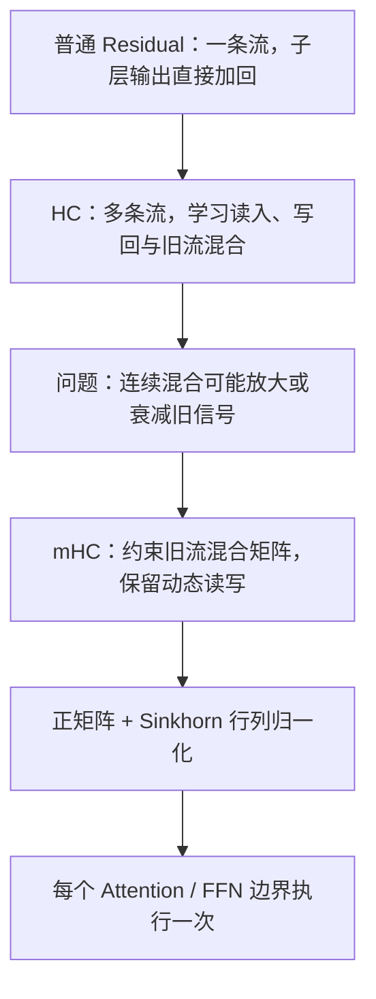
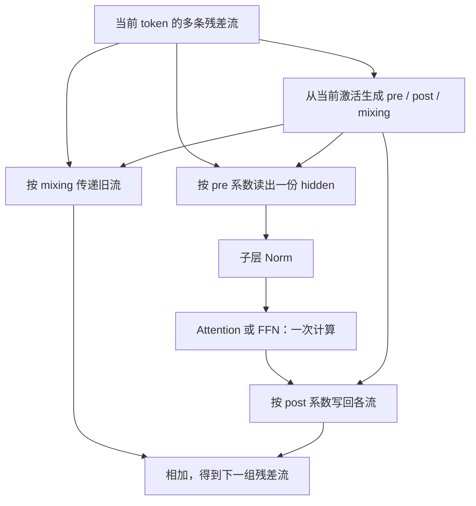
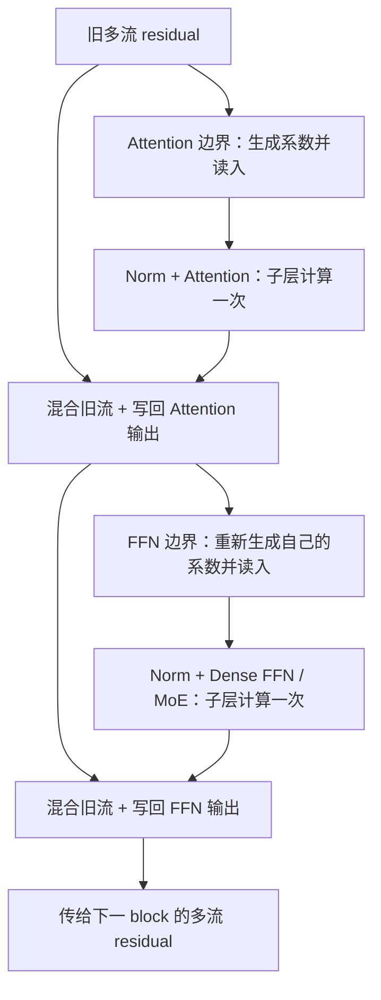

# mHC 原理：从普通残差连接到受约束的多路信息流

**简体中文** | [English](../../../en/ai-infra-basic/Model_Architecture/10-manifold-constrained-hyper-connections.md)

mHC 的全称是 **Manifold-Constrained Hyper-Connections**，可译为“流形约束超连接”。它改造的是 **Attention / FFN 周围的残差连接**，不是另一种 Attention、MoE 路由或跨卡通信算法。

本讲放在 `Model_Architecture/`，因为它回答的是“模型各子层怎样连接”。只需先理解 [Decoder-only Transformer 的残差结构](./01-decoder-only-transformer.md)，不要求先读完 MLA、DSA 或 KDA。读完后，可回到 [GLM-5.3-Flash 端到端样例第 5 节](../../sglang-ascend-npu/source-code-walkthrough/examples/03-glm-5.3-flash-end-to-end.md)，观察具体配置和执行边界。

## 阅读地图：先分清三个问题

| 机制 | 它决定什么？ | 不负责什么？ |
|---|---|---|
| Attention / KDA | 当前 token 怎样与历史交互或读写状态 | 不决定多条残差流怎样混合 |
| FFN / MoE | 子层怎样变换 hidden 通道、选择专家 | 不等于 residual stream 的选择 |
| HC / mHC | 子层从哪些残差流读入，输出写向哪些流，旧流怎样传递 | 不替代 Attention 或 FFN 内部计算 |

本讲沿“单流加法 → 多流读写 → 无约束混合的问题 → 双随机约束 → Sinkhorn → 完整前向”展开。公式之外，每步都给出 shape；小数例子是人为构造的教学数据，不是模型 checkpoint 的权重。



## 1. 普通 Residual 已经解决了什么？

先看一个 Pre-Norm 子层，而不是把完整 Decoder block 当作一次操作：

```math
x_{l+1}=x_l+F_l(\mathrm{Norm}(x_l)),\qquad x_l\in\mathbb{R}^{D}.
```

旧表示沿直接分支传递，新信息沿子层分支加入。Attention 和 FFN 通常各有一次这种残差更新。因此一个有 Attention 和 FFN 的 block，有两个残差边界。

递推展开后：

```math
x_L=x_0+\sum_{l=0}^{L-1}F_l(\mathrm{Norm}(x_l)).
```

这里保留了一个不经过可学习混合矩阵连乘的直接项。对于一个子层，Jacobian 含有恒等项：

```math
\frac{\partial x_{l+1}}{\partial x_l}=I+J_{F_l}J_{\mathrm{Norm}}.
```

这解释了直接通道的意义，但**不保证普通残差网络的所有梯度永远稳定**：另外的分支仍会影响完整 Jacobian。

固定的单流加法也有局限：所有子层不断向同一条流写入，旧信息的保留和不同深度特征的融合方式比较固定。HC 尝试把这种连接关系本身变成可学习的结构；这是一条架构设计思路，不是说普通 Residual 已经不能使用。

## 2. HC：把一条残差流变成多条，但子层仍只算一次

### 2.1 展开的是哪根轴？

本讲使用以下局部符号；它们不要与其他章节的 head 数或压缩步长混用：

| 符号 | 含义 |
|---|---|
| $`N`$ | 当前 forward 的 token 行数；packed batch 可以含多个请求 |
| $`D`$ | 子层 hidden width，不是 Attention 的单 head 宽度 |
| $`m`$ | residual streams 数，不是 token 数、TP degree 或序列压缩率 |
| $`R`$ | 多路残差激活，不是模型参数或历史 KV |
| $`p^{\mathrm{pre}},p^{\mathrm{post}}`$ | 对当前 token 计算出的读入、写回系数 |
| $`C`$ | 对当前 token 计算出的旧流混合矩阵 |

普通残差 batch 与多流残差 batch 的区别是：

```math
X\in\mathbb{R}^{N\times D},\qquad R\in\mathbb{R}^{N\times m\times D}.
```

例如当前有五个 token、四条流、hidden width 为 4096：

```math
N=5,\quad m=4,\quad D=4096,\qquad \mathrm{shape}(R)=[5,4,4096].
```

不是把五个 token 变成二十个 token，也不是增加四个 Attention heads。每个 token 有四份并行残差表示。初始可以从 embedding 复制而来；后续不同的写入系数和混合会让它们分化，不预设某条流一定专门表示“语法”或“语义”。

### 2.2 读入、计算、写回

先固定单个 token，令 $`R\in\mathbb{R}^{m\times D}`$，每一行是一条流。统一约定：**矩阵行 $`i`$ 表示来源流，列 $`j`$ 表示目标流**。

读入：

```math
u=R^{\mathsf T}p^{\mathrm{pre}}\in\mathbb{R}^{D},\qquad p^{\mathrm{pre}}\in\mathbb{R}^{m}.
```

子层计算：

```math
y=F(\mathrm{Norm}(u))\in\mathbb{R}^{D}.
```

旧流混合与新信息写回：

```math
R'=C^{\mathsf T}R+p^{\mathrm{post}}y^{\mathsf T},\qquad C\in\mathbb{R}^{m\times m},\quad p^{\mathrm{post}}\in\mathbb{R}^{m}.
```

逐元素看更直接：

```math
R'_{j,d}=\sum_{i=0}^{m-1}C_{i,j}R_{i,d}+p^{\mathrm{post}}_j y_d.
```

第一项决定哪些旧流进入新流，第二项决定子层输出往这条流写多少。**Attention/FFN 的输入、输出仍是 $`D`$ 维，子层只执行一次。** 新增成本来自系数计算、宽残差的读写和混合。



原 HC 中有静态、动态连接及特定初始化方法；这里用三组映射抽象其公共数据流，不把所有 HC 变体说成同一套参数化。相关来源是 [Hyper-Connections 原论文](https://arxiv.org/html/2409.19606v3)。

## 3. 为什么不能完全不约束旧流混合？

只为分析直达分支，暂时把新子层输出设为零：

```math
R_{l+1}=C_l^{\mathsf T}R_l.
```

多层后，旧信号要经过多个矩阵。一个简单反例是各层都取同样的对角混合：

```math
C_l=1.2I,\qquad R_L=1.2^L R_0.
```

```math
1.2^{20}\approx38.34,\qquad 0.8^{20}\approx0.01153.
```

看似每层只是小幅改变，连乘就可能放大或衰减很多。真实 HC 不等于这个对角矩阵；这个反例只是说明任意可学习混合不自动具有稳定的直接通道。

只做一次按行 softmax 也不够。采用本讲的来源/目标约定，考虑：

```math
C=\begin{bmatrix}0.9&0.1\\0.9&0.1\end{bmatrix},\qquad
R=\begin{bmatrix}1\\1\end{bmatrix},\qquad C^{\mathsf T}R=\begin{bmatrix}1.8\\0.2\end{bmatrix}.
```

每行和都是一，但第一条目标流从两条来源各收到九成，单流数值从一变成一点八。总和虽未变化，能量与分配仍可能改变。若只约束另一根轴，又可能允许某个来源被重复分发。

这就是为什么不能把“系数非负”“做过 softmax”直接当成所需的全部约束。

## 4. mHC 到底约束了什么？

### 4.1 双随机矩阵不是随机采样

mHC 的核心之一是把旧流混合限制为双随机矩阵。这里“随机”来自 stochastic matrix 术语，**不是每次 forward 随机抽一张矩阵**。

```math
C_{i,j}\geq0,\qquad \sum_j C_{i,j}=1,\qquad \sum_i C_{i,j}=1.
```

在本讲约定下：

- 每个来源流的行和为一：它向各目标分发的总系数为一。
- 每个目标流的列和为一：它接收到的是旧流的凸组合，而不是任意放大。

一个合法例子是：

```math
C=\begin{bmatrix}0.75&0.25\\0.25&0.75\end{bmatrix}.
```

非负是**系数**的约束，旧 hidden 和子层输出本身仍可以有负数。

### 4.2 为什么叫 Manifold-Constrained？

不是允许混合矩阵在所有实数矩阵中任意变化，而是把它限制在满足上述条件的集合。该集合叫 **Birkhoff polytope（Birkhoff 多面体）**；论文沿用“流形约束”的术语，但包含边界的整个多面体不宜简单当作处处光滑的流形。

从几何直觉看，双随机矩阵可表示为置换矩阵的凸组合：既允许保持流，也允许交换或混合流，但限制直接混合的尺度。这里不要求矩阵正交，也不要求它只能取恒等矩阵。

这一设计及参数化来源见 [mHC 原论文第 4 节](https://arxiv.org/html/2512.24880v2#S4)。下面的性质与反例是针对这些矩阵条件的独立推导。

## 5. 约束为什么有用，又不保证什么？

先只分析旧流分支 $`\overline R=C^{\mathsf T}R`$，不把新子层写入混进结论。

### 5.1 保留旧流的总和与均值

```math
\sum_j\overline R_{j,d}=\sum_i R_{i,d}\left(\sum_j C_{i,j}\right)=\sum_i R_{i,d}.
```

因此旧流的逐通道均值不变。若所有旧流本来相同，列和约束也保证单独混合不会改变它们。

### 5.2 不把旧流的单通道数值混出原来的范围

因为某一目标流接收非负、和为一的系数：

```math
\min_i R_{i,d}\leq\overline R_{j,d}\leq\max_i R_{i,d}.
```

它是凸组合，不会仅靠旧流混合就产生比所有输入都大的单通道值。

### 5.3 旧流线性映射不放大二范数

矩阵的一范数是最大绝对列和，无穷范数是最大绝对行和。非负且双随机时，两者都等于一：

```math
\lVert C\rVert_2\leq\sqrt{\lVert C\rVert_1\lVert C\rVert_\infty}=1,\qquad
\lVert C^{\mathsf T}R\rVert_F\leq\lVert R\rVert_F.
```

双随机矩阵的乘积仍满足非负、行列和为一，因此多层旧流直接映射也能保留相应约束。这里不是说 Frobenius 范数一定保持相等；混合可以使其变小。

### 5.4 不是“严格恒等”，更不是“全网永不爆炸”

例如均匀平均矩阵会丢失流之间的差异：

```math
C=\frac12\begin{bmatrix}1&1\\1&1\end{bmatrix},\qquad
R=\begin{bmatrix}1\\-1\end{bmatrix},\qquad C^{\mathsf T}R=\begin{bmatrix}0\\0\end{bmatrix}.
```

所以约束不保证所有方向的信息都无损传递，也不等于 $`C=I`$。它维持的是受控的旧流通道，不是每一条流逐元素恒等。同样，$`m=1`$ 时约束只强制 $`C=[1]`$；要恢复完整的普通残差函数，读入、写回等设置也要匹配。

完整更新还包括子层写入；输入相关系数也有导数。其微分包含：

```math
\mathrm{d}R'=C^{\mathsf T}\mathrm{d}R+(\mathrm{d}C)^{\mathsf T}R
+(\mathrm{d}p^{\mathrm{post}})y^{\mathsf T}+p^{\mathrm{post}}(\mathrm{d}y)^{\mathsf T}.
```

上面的旧流范数结论不能直接覆盖这些额外项。**mHC 有稳定旧流混合的结构依据，但不是完整网络所有 activation/gradient 的无条件稳定性定理。**

## 6. Sinkhorn：怎样把自由系数变成近似双随机矩阵？

### 6.1 正值化，再交替调整行和、列和

设网络预测的原始矩阵为 $`A\in\mathbb{R}^{m\times m}`$，它可以包含负数。先正值化，再交替归一化：

```math
M^{(0)}=\exp(A).
```

```math
\mathcal R(M)_{i,j}=\frac{M_{i,j}}{\sum_vM_{i,v}},\qquad
\mathcal C(M)_{i,j}=\frac{M_{i,j}}{\sum_uM_{u,j}}.
```

```math
M^{(t+1)}=\mathcal C(\mathcal R(M^{(t)})).
```

调好行和之后，列和未必正确；再调列和，行和又可能稍偏离，所以要迭代。以上是无 epsilon 的理想数学版；正矩阵满足相应收敛条件，有限次运行则只达到一定精度。

“投影”在这里指这种受约束的缩放过程，不是在声称计算了任意度量下的欧氏最近矩阵。实现会采用稳定化，避免直接对很大的 logit 做指数。

### 6.2 手算一轮，观察为什么还需要下一轮

为了看清算术，直接给出已经正值化的起点：

```math
M^{(0)}=\begin{bmatrix}1&2\\3&4\end{bmatrix}.
```

按行归一化：

```math
\mathcal R(M^{(0)})=\begin{bmatrix}1/3&2/3\\3/7&4/7\end{bmatrix}.
```

它的列和还不是一。再按列归一化得到：

```math
M^{(1)}=\begin{bmatrix}7/16&7/13\\9/16&6/13\end{bmatrix}.
```

```math
\mathrm{row\ sums}(M^{(1)})\approx[0.97596,1.02404],\qquad
\mathrm{column\ sums}(M^{(1)})=[1,1].
```

继续迭代后，这个小例子趋向：

```math
C\approx\begin{bmatrix}0.44949&0.55051\\0.55051&0.44949\end{bmatrix}.
```

实际程序要检查行和/列和误差、是否有 NaN/Inf，不能只检查“已经循环过固定次数”。加 epsilon 的实现即使迭代很多次，也不能一概宣称输出严格满足理想约束。

## 7. 系数是谁算出来的？参数与运行时激活要分开

### 7.1 一个 token 预测多少系数？

读入需要一组系数，写回需要一组，旧流混合需要一个方阵：

```math
k_{\mathrm{coef}}=m+m+m^2=m^2+2m.
```

取四条流时，一共是 24 个系数，不是 24 条 residual streams。

```math
m=4,\qquad k_{\mathrm{coef}}=4+4+16=24.
```

将当前 token 的所有流展平，做归一化与线性投影。以 PyTorch 的 output/input 权重顺序记：

```math
x=\mathrm{vec}(R)\in\mathbb{R}^{mD},\qquad
W_{\mathrm{hc}}\in\mathbb{R}^{(m^2+2m)\times mD}.
```

```math
z=\frac{W_{\mathrm{hc}}x}{\sqrt{\mathrm{mean}(x^2)+\epsilon_{\mathrm{norm}}}},\qquad
z=(z_{\mathrm{pre}},z_{\mathrm{post}},Z_{\mathrm{res}}).
```

这是把归一化标量放到 GEMM 后的等价写法，假定相应 gain 已按实现约定处理或吸收到投影权重中；偏置在缩放和 Norm 之后加入，不能随意移动它。

三组可学习尺度和静态偏置参与组合：

```math
p^{\mathrm{pre}}=\sigma(s_0z_{\mathrm{pre}}+b_{\mathrm{pre}}),\qquad
p^{\mathrm{post}}=2\sigma(s_1z_{\mathrm{post}}+b_{\mathrm{post}}).
```

```math
A=s_2Z_{\mathrm{res}}+B_{\mathrm{res}},\qquad C=\mathrm{Sinkhorn}(A).
```

这里给出常见 mHC 参数化；具体模型可能加入稳定项。**pre 是逐项 sigmoid，不是对 streams 做 softmax，因此其和不要求等于一。post 也不必和为一。** 双随机约束施加在旧流混合上，不能擅自套给所有系数。

### 7.2 哪些被 optimizer 更新？

| 对象 | 类型 | 是否训练参数？ |
|---|---|---|
| 系数投影权重、静态 bias、三组 scale | 各边界持有的权重 | 是 |
| 子层 Norm、Attention/FFN 权重 | 子层参数 | 是 |
| 当前 token 的 residual、pre/post 系数、混合矩阵 | 从输入和权重算出的激活 | 否，但训练时可对它们求导 |
| 历史 KV 或 KDA recurrent state | Token mixer 的运行时状态 | 不是上述 mHC 系数参数 |

同一边界的投影权重被各 token 共享，但**各 token 的动态系数可以不同**；不同层及 Attention/FFN 两个边界也不必共享投影。

## 8. 完整数值例子：从两条流走到两条新流

用 $`m=2,D=2,N=1`$ 手算，忽略 Norm 的 epsilon，Norm gain 取一。假设系数网络已经给出：

```math
R=\begin{bmatrix}1&0\\0&1\end{bmatrix},\quad
p^{\mathrm{pre}}=\begin{bmatrix}0.5\\0.5\end{bmatrix},\quad
p^{\mathrm{post}}=\begin{bmatrix}1\\0.5\end{bmatrix},\quad
C=\begin{bmatrix}0.75&0.25\\0.25&0.75\end{bmatrix}.
```

这些数值用于展示读写，不代表真实 checkpoint 的系数。子层也用一个简单线性函数替代真实 Attention/FFN：

```math
F(a)=\begin{bmatrix}2&0\\0&-1\end{bmatrix}a.
```

**第一步，读入：**

```math
u=R^{\mathsf T}p^{\mathrm{pre}}=\begin{bmatrix}0.5\\0.5\end{bmatrix}.
```

**第二步，做子层 Norm 与计算：**

```math
\mathrm{RMS}(u)=\sqrt{(0.5^2+0.5^2)/2}=0.5,\qquad
\mathrm{Norm}(u)=\begin{bmatrix}1\\1\end{bmatrix},\qquad y=\begin{bmatrix}2\\-1\end{bmatrix}.
```

**第三步，只混合旧流：**

```math
C^{\mathsf T}R=\begin{bmatrix}0.75&0.25\\0.25&0.75\end{bmatrix}.
```

旧流的逐通道总和仍是 $`[1,1]`$。

**第四步，把子层输出分别写回：**

```math
p^{\mathrm{post}}y^{\mathsf T}=\begin{bmatrix}2&-1\\1&-0.5\end{bmatrix}.
```

```math
R'=\begin{bmatrix}2.75&-0.75\\1.25&0.25\end{bmatrix}.
```

新流总和是 $`[4,-0.5]`$，已经不等于旧流总和。没有违反约束，因为守恒结论只针对旧流混合；我们还加入了新信息。

用非对称的置换矩阵也应验证一次实现：对称矩阵看不出 $`C^{\mathsf T}R`$ 与 $`CR`$ 写反的问题。附带 CPU demo 专门检查这个方向。

## 9. 把手算放大成完整 batch：每个 tensor 的 shape

继续使用 $`N=5,m=4,D=4096`$：

| 阶段 | 逻辑 shape | 说明 |
|---|---|---|
| residual | $`[5,4,4096]`$ | 每 token 四条流 |
| flattened residual | $`[5,16384]`$ | 视图改变，不是多出 token |
| 系数投影权重 | $`[24,16384]`$ | PyTorch output/input 顺序 |
| 投影输出、静态 bias、scales | $`[5,24]`$、$`[24]`$、$`[3]`$ | bias/scale 对 token 广播 |
| pre / post | 各为 $`[5,4]`$ | 一个 token 一组系数 |
| mixing | $`[5,4,4]`$ | 一个 token 一张旧流混合矩阵 |
| readout、Norm、子层输出 | 各为 $`[5,4096]`$ | 子层并没有改成 16384 维 |
| old mix / output writeback / 新 residual | 各为 $`[5,4,4096]`$ | 对齐之后相加 |

系数预测和旧流混合本身是**逐 token**的操作，不会把请求 A 的 residual 与请求 B 的 residual 混在一起。跨 token 的交互如果存在，发生在子层的 Attention 等机制中。

下面是维度对应的教学伪代码，省略 dtype 管理和融合：

```python
pre, post, mixing = coefficient_network(residual)
layer_input = (pre[..., None] * residual).sum(dim=1)
layer_output = sublayer(norm(layer_input))
old_path = mixing.transpose(-1, -2) @ residual
new_path = post[..., None] * layer_output[:, None, :]
next_residual = old_path + new_path
```

不要只保留 `layer_output`，把旧 residual 提前覆盖掉；写回仍然需要它。也不要从 flatten 视图的最后一维直接猜模型 `hidden_size`。

## 10. 一个 Decoder block 怎样串起两次 mHC？



每个边界有自己的系数生成器。Attention 边界的动态 mixing 不能在 FFN 边界不加说明地直接复用。将一个有两个子层的 Decoder block 算成一次系数更新，也会漏掉结构。

模型入口常把 embedding 扩成多流；模型出口要收缩回 LM head 需要的 hidden width。具体用 sum、mean 或可学习读出，属于模型约定，不是“mHC”这个名字自动决定的。

例如固定 GLM-5.3-Flash 实现的 stream mean 是：

```math
h_{n,d}=\frac1m\sum_{i=0}^{m-1}R^{\mathrm{final}}_{n,i,d},\qquad \mathrm{shape}(h)=[N,D].
```

原 HC 论文也有 sum 的描述；不能在训练好的模型里随意把 sum 和 mean 互换。收缩之后还要按模型约定做 final Norm / LM head。

## 11. 训练、Prefill 与 Decode：哪些东西会留下？

| 场景 | mHC 做什么？ | 别混淆的事情 |
|---|---|---|
| 训练 | 计算动态系数、读写多流；对投影、门控、Sinkhorn、子层反传 | 不等于只需训练最后的读出权重 |
| Prefill | 对本轮新增 token 的 residual 执行这些步骤 | 当前行数取决于 packed/chunk 大小，不只是请求数 |
| Decode | 对当前新 token 行执行相同的残差编排 | 历史信息仍由 KV / recurrent state 等机制提供 |
| PP / 行布局转换 | 传递多流 residual 及需要继续使用的系数 sidecar | 不能只传子层输入向量就认为保留了全部 residual |

mHC streams 通常是当前 forward 的 activation，不是给每个历史 token 永久增加四份 KV，也不是像 KDA 一样跨生成步维护的固定 recurrent matrix。训练会保存或重算相应 activation；其生命周期又不同于推理。

动态图系数在推理时仍会计算，只是不再由 optimizer 更新模型权重。普通 checkpoint 也不能只打开一个开关就自动获得训练好的 mHC：连接结构和新增参数改变了模型函数，通常需要相应训练或适配。

## 12. 成本账：子层一次计算，不等于没有额外开销

### 12.1 残差 activation

按 BF16、每个元素两字节计算一个 buffer，不代表全模型峰值：

```math
M_{\mathrm{single}}=ND\times2=40960\ \mathrm{bytes}=40\ \mathrm{KiB}.
```

```math
M_{\mathrm{multi}}=NmD\times2=163840\ \mathrm{bytes}=160\ \mathrm{KiB}.
```

此例一份多流 buffer 多出 120 KiB。多个临时 buffer、训练保存、重计算和并行传输还要另算，不能把这一项当作整个模型显存增加四倍。

### 12.2 系数网络与矩阵混合

单个边界的控制投影、bias、三个 scale 的逻辑参数量为：

```math
(m^2+2m)mD+(m^2+2m)+3=393243.
```

它不包含子层 Norm 或 Attention/FFN 本身的参数。一般复杂度可分项写成：

```math
\mathrm{projection}:\ O(NmD(m^2+2m)),\qquad
\mathrm{mixing}:\ O(Nm^2D),\qquad
\text{Sinkhorn}:\ O(NI_{\mathrm{SK}}m^2).
```

因此 stream 数也不能无限增加。固定小 stream 数时，宽 activation 的 HBM 读写和多个小算子的 launch 可能很重要；只看 GEMM FLOPs 会漏掉开销。

融合可以共享 residual 的读取，合并部分 Norm、系数处理、Sinkhorn 与写回，但必须保留相同数值语义和所需旧流。本文不把某篇论文或某台设备的开销百分比推广成所有 serving 场景的保证，也没有做整模型加速测试。

## 13. 与固定上游实现对齐：通用原理不等于所有模型常量

本节核验日期为 2026-10-28，固定 SGLang commit `92580581da6fc8542a997a00c1a8b71b03497680`，与 GLM-5.3-Flash 样例保持一致。新实现链接到上游，不假装仓内旧 runtime 快照已有同名文件。

| 本讲机制 | 固定源码中的入口 / 差异 |
|---|---|
| 展开/收缩 streams | [mhc.py](https://github.com/sgl-project/sglang/blob/92580581da6fc8542a997a00c1a8b71b03497680/python/sglang/kernels/ops/layernorm/mhc.py)：`hc_broadcast` / `hc_expand` / `hc_contract` |
| 系数、Sinkhorn 与读入 | 同文件 `_mhc_pre_torch`；pre 额外加稳定项，post 使用两倍 sigmoid |
| 残差更新方向 | 同文件 `_mhc_post_torch`；对应本讲来源行、目标列的约定 |
| 与阶段/通信边界衔接 | [layer_boundary/residual/mhc.py](https://github.com/sgl-project/sglang/blob/92580581da6fc8542a997a00c1a8b71b03497680/python/sglang/srt/layers/layer_boundary/residual/mhc.py)：`MHCState` |
| 具体模型的边界配置 | [models/glm5_next.py](https://github.com/sgl-project/sglang/blob/92580581da6fc8542a997a00c1a8b71b03497680/python/sglang/srt/models/glm5_next.py)；Attention / FFN 各自配置 |

固定 torch reference 先对 residual logits 做 row softmax 加 epsilon，再归一化列，随后交替做行列归一化。它是稳定化的具体程序，不应与第 6 节无 epsilon 的理想版逐位比较。

原论文常把旧流变换写成左乘。本讲为了匹配样例，使用来源行、目标列的 $`C^{\mathsf T}R`$；若要对齐另一种记法，应取 $`H^{\mathrm{res}}=C^{\mathsf T}`$。双随机性质在转置下不变，但实现方向仍须核对，不能因性质相同就漏掉转置。

## 14. 常见误解

1. **“mHC 就是 Multi-Head Attention。”** 不是，stream 轴与 head 轴不同。
2. **“四条 residual 就要执行四次 FFN。”** 不是，读出一个子层输入后只计算一次。
3. **“矩阵里的随机说明需要随机采样。”** 不是，这是行列和约束的术语。
4. **“pre 和 post 也必须 softmax 到和为一。”** 不对，不应把旧流 mixing 的约束套给其他系数。
5. **“Sinkhorn 一轮就同时保证行列和。”** 通常不对，手算例子已展示偏差。
6. **“双随机意味着严格恒等、没有信息损失。”** 不对，平均可抹掉流之间的差异。
7. **“旧流不放大，所以所有 activation/gradient 永不放大。”** 不对，新写入与动态系数导数仍在。
8. **“mHC residual 就是四份长期 KV cache。”** 不对，当前 activation 与历史状态不同。

## 15. CPU 自检、练习与后续阅读

[mhc_principles_demo.py](./mhc_principles_demo.py) 仅用 Python 标准库，不下载权重、不依赖 PyTorch。它验证本讲的完整手算、行列归一化、均值守恒、旧流非扩张、非对称转置、批内 token 隔离，以及新写入仍能增大输出等边界。

```bash
python3 learning/zh/ai-infra-basic/Model_Architecture/mhc_principles_demo.py
```

这是数学与索引的教学测试，不是官方 GPU/NPU kernel 精度或整模型效果验证。

检查自己是否能回答：

1. 输入视图 $`[N,mD]`$ 为什么不能直接当作 hidden width 扩成了 $`m`$ 倍？
2. 为什么一项只按行 softmax 的旧流混合还可能放大单条目标流？
3. 为什么第 8 节旧流总和不变，而最终 residual 总和变了？
4. 如果 mixing 依赖当前 residual，其完整梯度为什么不只包含 mixing 矩阵？
5. 实现用了有限次 Sinkhorn 和 epsilon，应检查哪些误差，而不是宣称精确双随机？

后续接 [GLM-5.3-Flash 样例](../../sglang-ascend-npu/source-code-walkthrough/examples/03-glm-5.3-flash-end-to-end.md) 查看模型内的具体执行；用 [架构谱系](./05-architecture-families.md) 区分 Token Mixer、Channel Mixer、Residual 编排与 Runtime State。

## 16. 一手资料与版本边界

- [Hyper-Connections，固定论文版本 v3](https://arxiv.org/html/2409.19606v3)：多路残差的背景、静态/动态连接与原始参数化。
- [mHC: Manifold-Constrained Hyper-Connections，固定论文版本 v2](https://arxiv.org/html/2512.24880v2)：约束设计与 Sinkhorn 参数化。
- [固定 SGLang mHC 实现](https://github.com/sgl-project/sglang/blob/92580581da6fc8542a997a00c1a8b71b03497680/python/sglang/kernels/ops/layernorm/mhc.py)：本讲实现差异和方向约定的依据。

本讲将通用矩阵性质、教学反例、论文设计和具体模型实现分开陈述；没有据此声称所有平台后端、并行组合或训练配置都已实测通过。
