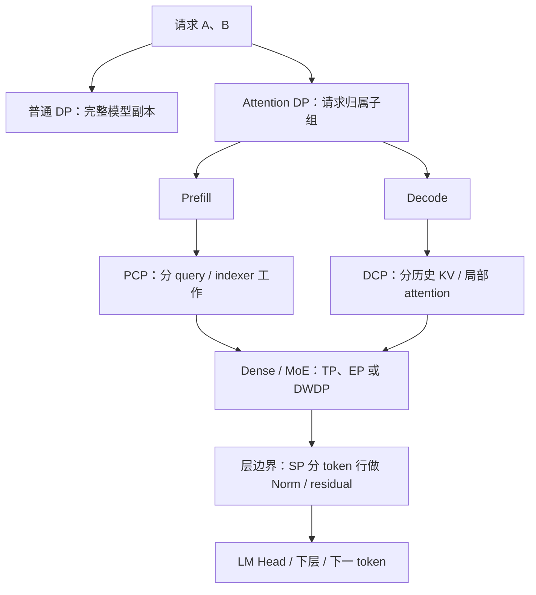

# 00. 并行策略地图：先看切分对象，再看执行阶段

**简体中文** | [English](../../../en/ai-infra-basic/Parallel_Strategy/00-parallelism-map-and-version-boundaries.md)

把一台餐厅想成一次模型服务：DP 多开完整分店，TP 让多人协作完成一道菜，PP 把工序分给不同工作台，EP 把菜送到不同专科厨师。SP、PCP、DCP 都可能切 token 维，但**切的是哪个阶段、哪类中间量、历史由谁保存**，决定了它们完全不同的执行协议。

## 1. 用同一组问题认识所有策略

| 策略 | 切分对象 | 保留/复制什么 | 主要目标 | 详细章节 |
|---|---|---|---|---|
| 普通 DP | 独立请求 | 每副本完整模型，可含 TP/PP | 多请求吞吐 | [基础总讲义](./tutorial.md) |
| TP | 单层权重、特征/head | 部分激活或 KV 仍可能复制 | 权重容量与单层计算 | [基础总讲义](./tutorial.md) |
| PP | 层与 stage | 每 stage 的本地层 | 分摊模型容量，流水执行 | [基础总讲义](./tutorial.md) |
| Attention DP / DPA | 请求归属 | FFN/MoE 可在更大组内共享 | 减少请求历史重复、合批 | [01](./01-dp-attention-principles.md) |
| SP | Norm/residual 等区域的 token 行 | 权重按原 TP 布局 | 减少激活与逐行重复工作 | [02](./02-sp-versus-context-parallelism.md) |
| PCP | prefill query token 与相关工作 | 必要 K/V 可通信后复制 | 分摊长 prompt 计算 | [03](./03-prefill-context-parallelism.md) |
| DCP | decode 历史 KV 位置与读取 | query 需覆盖参与分片 | 减少每卡 KV 容量/读取 | [04](./04-decode-context-parallelism.md) |
| EP | expert 权重归属 | router/非 expert 层另定 | 分摊专家容量 | [基础总讲义](./tutorial.md)、[通信课](../Communication/04-moe-deepep-and-zbal.md) |
| DWDP | expert 权重的常驻与预取 | 本地请求，工作层远端权重缓存 | 用搬权重替代部分 token 通信 | [05](./05-dwdp-weight-parallelism.md) |
| Encoder DP / Elastic EP | 编码工作 / 动态资源与副本 | 按模块与运行时协议决定 | 模块吞吐 / 弹性与负载 | [07](./07-encoder-dp-and-elastic-ep.md) |

“切 token”还不够描述一个策略：DPA 切**不同请求**，PCP 切**一个请求的新 query 行**，DCP 切**一个请求的历史 KV**，SP 切**逐行算子的激活**。

这是作用位置图，**不是承诺这些功能可以同时开启**。兼容性和实际 rank 分组见 [06：组合并行](./06-parallel-topology-and-pd-composition.md)。

## 2. 三种“相同”不要混淆

1. **数学结果相同**：分片后的计算能重构原结果，例如 DCP 的 LSE 加权合并。
2. **张量 shape 相同**：两张卡都持有 $`[T,H]`$，可能是同一结果副本，也可能是尚需相加的 partial。
3. **参数名相同**：`dp_size` 在不同 SGLang 版本里可能先经过兼容转换；必须先读参数解析。

例如 attention head 并行度为 $`H_{\mathrm{TP}}`$，PCP degree 为 $`C`$。query 可以具有逻辑 shape $`[T/C,N_h/H_{\mathrm{TP}},d]`$，但这没有说明 KV 是否常驻分片，也没有说明 FFN 是否采用相同布局。

## 3. 本教程使用两个明确的源码基线

**核对日期：2026-10-15。** 本地源码以仓库 `09804e1` 为阅读基线；上游新增功能固定到 [sgl-project/sglang@f2b73d4](https://github.com/sgl-project/sglang/tree/f2b73d4f9b4e64415b8d775b0f811c7801f1728b)。本次只重构教程，不替换本地 SGLang 运行时代码。

| 功能 | 本仓库源码阅读入口 | 固定上游的对应入口 |
|---|---|---|
| DP Attention | `dp_size` 配合 `enable_dp_attention` | 独立 `attn_dp_size`；旧写法有兼容转换 |
| Prefill CP | `enable_prefill_context_parallel` / DSA 专用开关、`prefill_cp_mode` | `enable_prefill_cp`、`cp_strategy`，共享 strategy 接口 |
| DCP | 当前本地快照没有完整对应入口 | `dcp_size`、`layers/dcp/` |
| LayerNorm SP | 不能把旧 `sp_inference_demo.py` 当成这个实现 | `layers/layernorm_sp.py`、专门校验 hook |
| DWDP | 本地快照未包含此模块 | `layers/moe/dwdp/` |
| Encoder DP / Elastic EP | 已有部分参数与模块 | 后续实现继续变化，按具体源码跟踪 |

以上是**字段/接口说明**，不是一份可以混搭启动的命令。上游参数和平台约束见 [parallel fields](https://github.com/sgl-project/sglang/blob/f2b73d4f9b4e64415b8d775b0f811c7801f1728b/python/sglang/srt/arg_groups/fields/parallel.py) 与 [parallel hook](https://github.com/sgl-project/sglang/blob/f2b73d4f9b4e64415b8d775b0f811c7801f1728b/python/sglang/srt/arg_groups/parallel_hook.py)。GPU 上的成功路径也不能直接作为 NPU 支持证明。

## 4. 推荐的学习方式

先读基础 DP/TP/PP/EP，再按 **DPA → SP → PCP → DCP → DWDP → 组合与阶段交接** 阅读。每章都回答“为什么需要、怎样数学等价、源码谁负责、有什么代价”，并附图和检查题。

[parallelism_math_demo.py](./parallelism_math_demo.py) 使用 Python 标准库演示逐行 Norm、PCP 请求边界、DCP 精确归并、EP 与权重预取的等价结果及 rank 分组。它验证教学数学，不测网络性能，不执行真实 CUDA/NPU kernel。

扩展的 CFG/Ulysses/Ring 在 [08：Diffusion 并行](./08-diffusion-parallelism.md)，与自回归 SRT 的参数体系分开阅读。ZeRO/FSDP 属于训练侧扩展，本轮不把它们误列为 SGLang 推理的既有执行模式。
