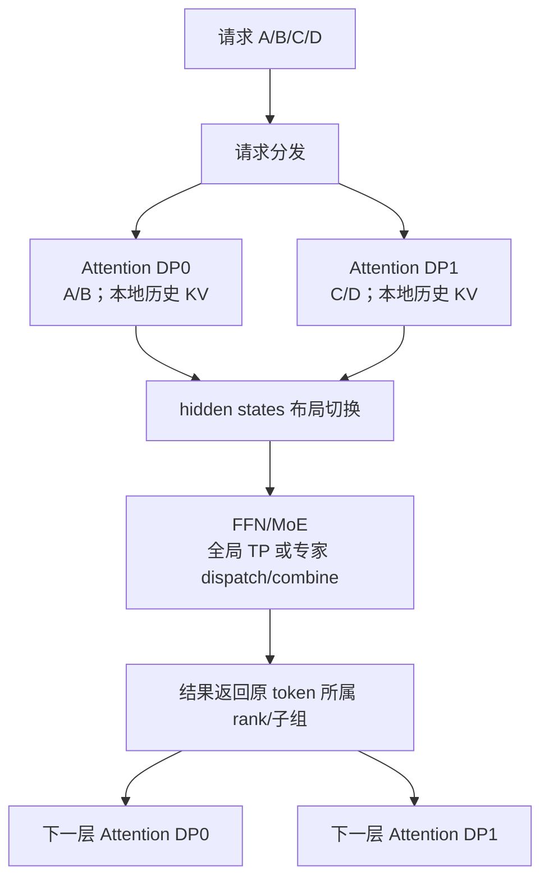
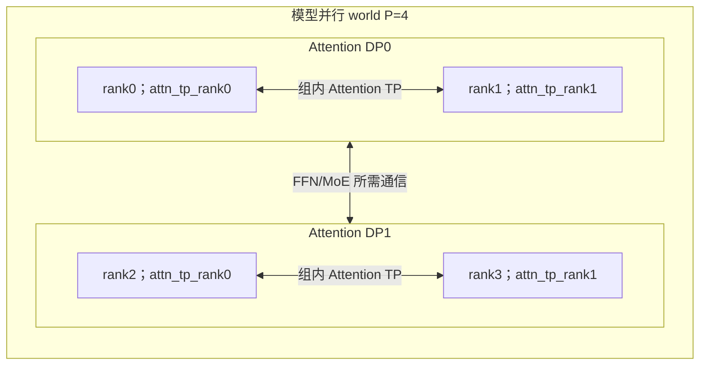
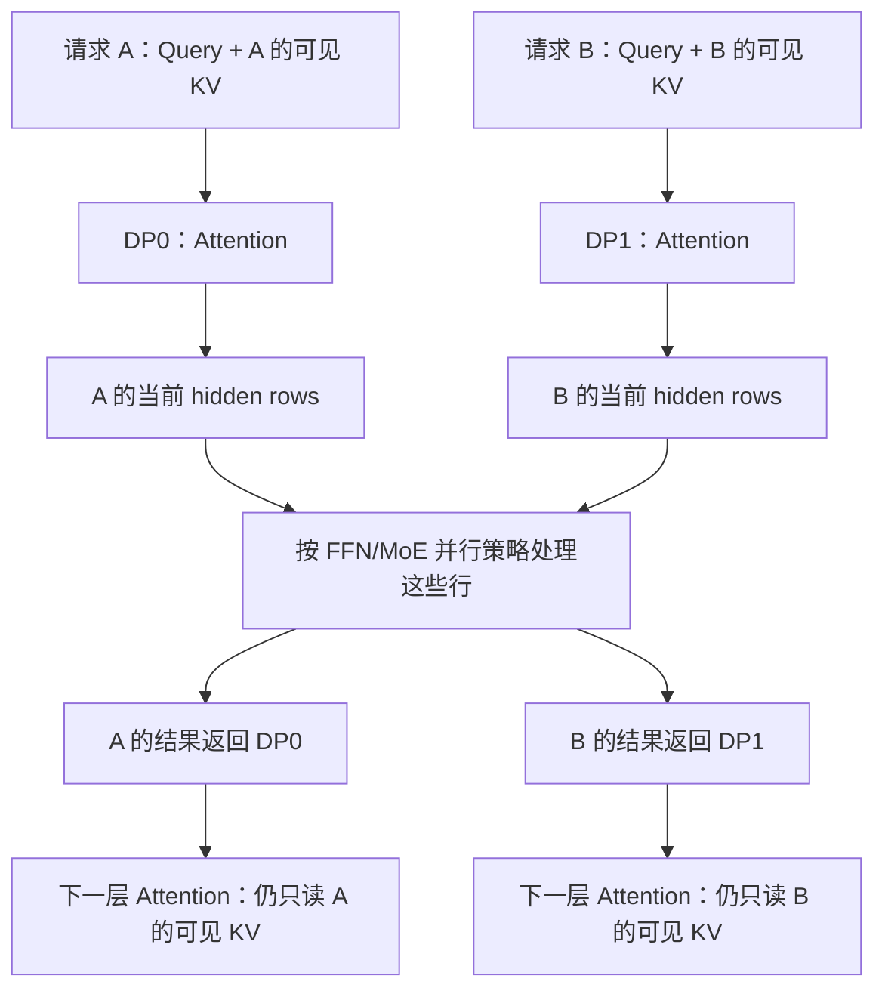
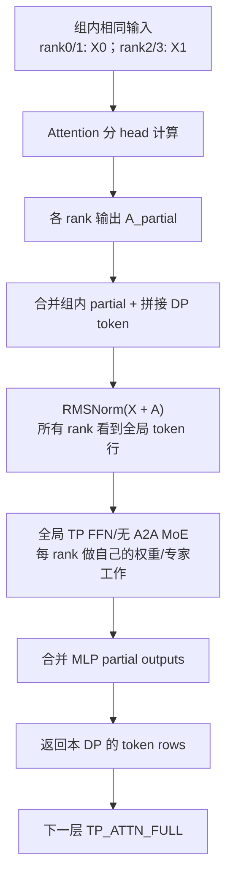
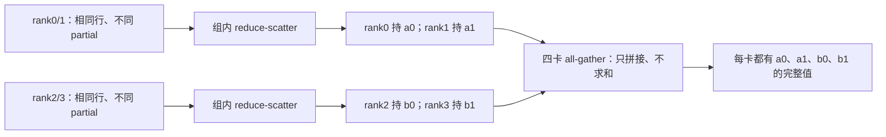
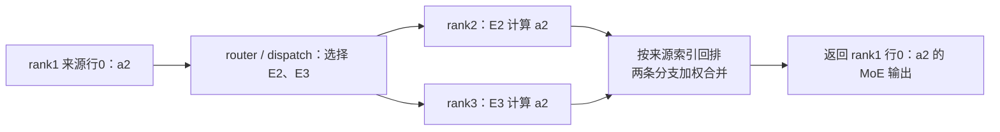
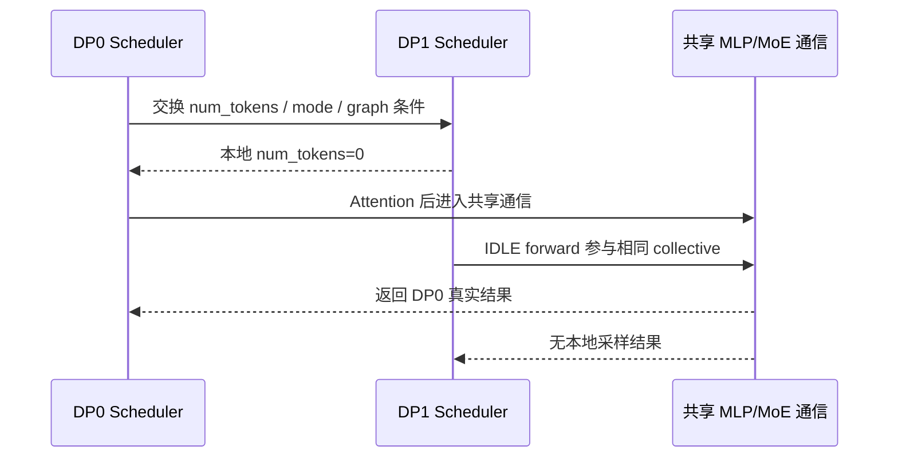

# DP Attention：请求并行、Attention 子组与 FFN/MoE 的布局切换

**简体中文** | [English](../../../en/ai-infra-basic/Parallel_Strategy/01-dp-attention-principles.md)

本章先解释 DP Attention 的数学与系统原理，再到 [SGLang DP Attention 源码走读](../../sglang-source-reading/05-layer-communication/03-dp-attention-code-walkthrough.md)逐函数验证。建议先了解 [DP/TP/EP](./tutorial.md)、[GQA](../Model_Architecture/02-gqa-attention-shapes.md)与 [MLA](../Model_Architecture/04-multi-head-latent-attention.md)。

本文按本仓库源码快照 `587eb0b3a56cd2f014daf3b0fc8ba333da88df36` 解释。教学中的配置和数字用于推导，不代表目标模型在任意 backend 上都支持该组合。

新版上游已将 `attn_dp_size` 与普通 DP 分开；旧开关的兼容转换及 SP/PCP/DCP 接口差异见 [版本边界](./00-parallelism-map-and-version-boundaries.md)。下文继续按上述本地快照解释。

## 1. 先看它解决的矛盾

Attention 和 FFN/MoE 对并行的需求并不相同：

- Attention 的一个请求依赖自己的历史 KV；不同请求之间没有数学上的 Attention 依赖。Decode 经常受 KV 读取带宽和小 batch 下的通信影响。
- Dense FFN 的权重可能需要跨多卡切分；更大的 token batch 也有利于 GEMM。
- MoE 的专家总参数可能远大于 Attention 参数，需要跨卡存放，再把 token 发给对应专家。

如果全模型始终使用同一个大 TP group，Attention 也必须在这个大组内执行，即使它用较小 TP 已经足够。如果复制整个模型来增加 Attention 并行度，又会复制大量 FFN/专家权重。

DP Attention 允许**同一个模型并行 world 内，不同子模块使用不同的切分方式**：请求分给多个 Attention DP 子组，组内可以继续 Attention TP；FFN/MoE 按自己的 TP/EP 拓扑处理这些请求的 token。



图中的跨组传输对象通常是当前 token 的 **hidden states 或专家路由数据**。Attention 的历史 KV 留在负责该请求的子组内；额外启用 CP、KV transfer 或其他特性时，再按相应机制处理历史分片与传输。

## 2. 普通 DP 与 DP Attention 的进程数不同

固定 $`\mathrm{pp\_size}=1`$，比较同样写成 $`\mathrm{tp\_size}=4,\qquad \mathrm{dp\_size}=2`$ 的两种配置：

| 项目 | 普通 DP，关闭 DP Attention | 开启 DP Attention |
|---|---|---|
| 计算设备数 | $`4\cdot 2=8`$ | `4` |
| 模型并行 world | 两个独立的 4-rank world | 一个 4-rank world |
| Attention TP | 每副本为 4 | 每 Attention DP 子组为 2 |
| 请求分发 | 分到完整模型副本 | 分到 Attention DP 子组 |
| FFN/专家 | 每副本各持一套完整分布式模型权重 | 按同一 world 的 TP/EP 策略持有 |
| 推理跨副本通信 | 通常没有 | 存在布局转换或专家通信 |

因此开启此模式后，`tp_size` 同时承担“当前模型 world 的 rank 数”这一含义；某个 Attention 矩阵实际切成几份，要看 `attn_tp_size`。

## 3. 一组 rank 如何分解成 DP、CP、TP

设：

```text
P = tp_size                   当前模型并行 world 的 rank 数
D = attention_dp_size         enable_dp_attention ? dp_size : 1
C = attn_cp_size              Attention context parallel 数
```

```math
T=\mathrm{attention\_tp\_size}=\frac{P}{D\cdot C}
```

必须满足整除关系。在源码中，rank 的排列顺序是 `(DP, CP, TP)`，TP 变化最快：

```math
p=(dC+c)T+a
```

```math
a=p\bmod T,\qquad c=\lfloor p/T\rfloor\bmod C,\qquad d=\lfloor p/(TC)\rfloor
```

本章主例子取 $`P=4,\qquad D=2,\qquad C=1,\qquad T=2`$：

| 模型 world rank `p` | Attention DP `d` | Attention TP `a` | Attention TP group | 负责请求 |
|---:|---:|---:|---|---|
| 0 | 0 | 0 | $`\left[0,1\right]`$ | A/B |
| 1 | 0 | 1 | $`\left[0,1\right]`$ | A/B |
| 2 | 1 | 0 | $`\left[2,3\right]`$ | C/D |
| 3 | 1 | 1 | $`\left[2,3\right]`$ | C/D |



若增加 CP，例如 $`P=8,\qquad D=2,\qquad C=2,\qquad T=2`$：Attention TP groups 是 `[0,1]、[2,3]、[4,5]、[6,7]`；Attention CP groups 是 `[0,2]、[1,3]、[4,6]、[5,7]`。DP 分不同请求，CP 分同一请求的上下文，二者解决的维度不同。

## 4. 为什么请求可以分开做 Attention

这一节只想说明一件事：**不同请求的 Attention 不需要互相读取历史，因此可以把不同请求分配给不同的 Attention DP 组。** 这不是把一个请求的历史拆开，也不是说 Attention 中的每个 token 都彼此独立。

### 4.1 先想象两个人同时使用同一个模型

用户 A 在问“北京的天气”，用户 B 在说“帮我写诗”。模型使用同一套权重，但两个人的对话历史不同：

- A 的 Query 只与 A 自己的历史 Key 比较，再对 A 自己的 Value 加权求和。
- B 的 Query 只与 B 自己的历史 Key 比较，再对 B 自己的 Value 加权求和。
- A 不应该因为 B 输入了“写诗”，就把 B 的 token 当成自己的上下文。

可以把模型权重理解为“同一本计算规则”，把 KV cache 理解为“各自的对话笔记”。**规则相同，不代表笔记也要共享。** 两个请求可能因共享前缀而复用相同的物理 cache 页，但每个请求的逻辑可见上下文仍然由自己的元数据决定。

### 4.2 跟着张量走一遍：A 为什么不需要 B？

以 decode 中每个请求本轮有一个 Query 为例。暂时省略 batch/head 轴，只看一个 Query head 及它对应的 KV head。设 A 的 Query 可以看到 3 个 token，B 可以看到 2 个 token；这是教学用的可见长度，**不是上面两句中文的实际分词数**。因果 Attention 可以看到当前位置及更早的位置。

其中 `Dk` 是 Query/Key 的向量宽度，`Dv` 是 Value 的向量宽度：

请求 A：

```math
Q_A\in\mathbb{R}^{1\times D_k},\quad K_A\in\mathbb{R}^{3\times D_k},\quad V_A\in\mathbb{R}^{3\times D_v}
```

```math
S_A=Q_AK_A^{\mathsf T}\in\mathbb{R}^{1\times 3}
```

```math
\widetilde{S}_A=\frac{S_A}{\sqrt{D_k}}\in\mathbb{R}^{1\times 3}
```

```math
P_A=\mathrm{softmax}_{\mathrm{positions}}(\widetilde{S}_A)\in\mathbb{R}^{1\times 3}
```

```math
O_A=P_AV_A\in\mathbb{R}^{1\times D_v}
```

请求 B：

```math
Q_B\in\mathbb{R}^{1\times D_k},\quad K_B\in\mathbb{R}^{2\times D_k},\quad V_B\in\mathbb{R}^{2\times D_v}
```

```math
S_B=Q_BK_B^{\mathsf T}\in\mathbb{R}^{1\times 2}
```

```math
\widetilde{S}_B=\frac{S_B}{\sqrt{D_k}}\in\mathbb{R}^{1\times 2}
```

```math
P_B=\mathrm{softmax}_{\mathrm{positions}}(\widetilde{S}_B)\in\mathbb{R}^{1\times 2}
```

```math
O_B=P_BV_B\in\mathbb{R}^{1\times D_v}
```

例如，A 的三个分数经过 softmax 得到 `[0.2,0.5,0.3]`，那么 A 的输出就是 $`0.2\cdot v_{\mathrm{A1}}+0.5\cdot v_{\mathrm{A2}}+0.3\cdot v_{\mathrm{A3}}`$。B 的 Value 完全没有参与这个加权和，B 的分数也没有参与 A 的 softmax 分母。

因此，只要保持各自的输入、权重和可见 KV 不变，把 A 放在 DP0、B 放在 DP1，在数学上仍然得到相同的输出（实际浮点执行可能有舍入差异）。DP 组内部若还有 TP，各 rank 仍需要协作完成该组的 Attention；“请求独立”不等于“每张卡都能独自完成全部计算”。



图中的 hidden rows 指 Attention 之后、送入 FFN/MoE 的当前 token 表示；中间的输出投影、残差和归一化为突出请求流向而省略了。

### 4.3 “一起计算”不等于“互相看见”

即使把 A、B 的 token 行打包进同一个张量，Attention 也必须保留请求边界。A 的 Query 只能访问 A 的可见 KV，B 的 Query 只能访问 B 的可见 KV。实现可以通过 mask、序列长度、page table 等元数据限制访问；不一定真的构造一个巨大的 mask 矩阵。

如果错误地让 A 的 Query 对 A、B 总共 5 个 Key 做 softmax，就会改变归一化分母，还可能读到 B 的 Value，结果已不是原模型对 A 的计算。这正是为什么 packed attention 需要请求边界。

注意：**独立的是不同请求，不是同一请求里的不同位置。** A 的当前 token 仍依赖 A 的历史。如果要把 A 的长上下文分给多张卡，那是 CP 所处理的维度，不能直接用这里的请求独立性解释。

### 4.4 那为什么 FFN 又能把 A、B 合批？

Attention 会在一个请求的多个可见位置之间加权求和；普通 FFN 则只变换当前 token 的特征，不读取其他 token 行。送入 FFN 时，每个 token 已经是宽度为 `H` 的 hidden 向量，不能把前面单个 head 的 `Dv` 直接当成 `H`。

假设 A、B 各有一行送入 FFN：

```text
X_A [1,H] ─┐
            ├─ 按行拼接 -> X [2,H] -> FFN -> Y [2,H]
X_B [1,H] ─┘                              ├─ 第 0 行 -> A
                                         └─ 第 1 行 -> B
```

用 row-vector 记法，SwiGLU FFN 的完整形状变化为：

```math
X\in\mathbb{R}^{2\times H},\quad W_{\mathrm{gate}},W_{\mathrm{up}}\in\mathbb{R}^{H\times I},\quad W_{\mathrm{down}}\in\mathbb{R}^{I\times H}
```

```math
G=XW_{\mathrm{gate}}\in\mathbb{R}^{2\times I}
```

```math
U=XW_{\mathrm{up}}\in\mathbb{R}^{2\times I}
```

```math
Z=\mathrm{SiLU}(G)\odot U\in\mathbb{R}^{2\times I}
```

```math
Y=ZW_{\mathrm{down}}\in\mathbb{R}^{2\times H}
```

`I` 是 FFN 的中间维度。每个矩阵乘法都对输入的每一行应用相同权重，A 的结果只由 A 那一行决定；把两行合成一个更大的 GEMM，是合批执行，不是让两个请求交换上下文。

因此，**Attention 可以按请求分开，而 FFN 可以按 token 行合批，这两件事并不矛盾。** 实际是否跨 DP 组收集 hidden rows，取决于 FFN/MoE 的并行策略，并非所有路径都先做全局 all-gather。MoE 还需要把 token 发给相应专家，再把结果返回原 token 的位置；后文会区分这些通信路径。

### 4.5 最后再读原来的公式

对请求 $`r`$、head $`h`$、query position $`i`$，用列向量表示 Q/K/V：

```math
o_{r,h,i}=\sum_{j\in\mathcal{V}_r(i)}
\mathrm{softmax}_{j}\left(q_{r,h,i}^{\mathsf T}k_{r,g(h),j}/\sqrt{D_k}\right)v_{r,g(h),j}
```

这只是把 4.2 的过程写成通用形式：

- $`q_{r,h,i}`$：请求 r 在位置 i、head h 上的 Query，shape 为 $`\left[\mathrm{Dk}\right]`$。
- $`g(h)`$：GQA 中该 Query head 对应的 KV head。
- $`\mathcal{V}_r(i)`$：请求 r 在位置 i 可以看到的 token 位置集合，不包含其他请求的位置。
- $`k_{r,g(h),j}`$、$`v_{r,g(h),j}`$：这个请求在可见位置 j 上的 Key/Value，shape 分别为 $`\left[\mathrm{Dk}\right]`$、$`\left[\mathrm{Dv}\right]`$。
- 内积得到每个位置的标量分数，softmax 只沿该请求的可见位置归一化；最终加权求和得到 $`\left[\mathrm{Dv}\right]`$ 输出。

判断能否按请求拆分时，最关键的是：**整个公式只出现请求 r 的 Query、Key、Value，没有另一个请求的 K/V。**

## 5. Attention TP 切权重，DP 切请求

以 row-vector 记法描述 GQA。令 $`H=4096,\qquad \mathrm{Nq}=32,\qquad \mathrm{Nkv}=8,\qquad \mathrm{Dk}=\mathrm{Dv}=128`$，DP0 本轮有 $`n_0=4`$ 个 token，DP1 有 $`n_1=2`$ 个 token；$`T=2`$：

```text
每 Attention DP 子组输入 X_d: [n_d,4096]
每组内 rank 输入相同 X_d，但持有不同 Q/K/V 权重切片
Q_local: [n_d,16,128]        # 32/2 query heads
K_local: [n_d,4,128]         # 8/2 KV heads
```

```math
\mathrm{shape}\left(V_{\mathrm{local}}\right)=\left[n_{d},4,128\right]
```

```math
\mathrm{shape}\left(O_{\mathrm{heads}}\right)=\left[n_{d},16,128\right]
```

```math
\mathrm{shape}\left(O_{\mathrm{flat}}\right)=\left[n_{d},2048\right]
```

```math
\mathrm{shape}\left(\mathrm{W\_O\_local}\right)=\left[2048,4096\right]
```

```math
A_{\mathrm{partial}} = O_{\mathrm{flat}} \, \mathrm{W\_O\_local}: \left[n_{d},4096\right]
```

两个组内 rank 的输出投影给出的是不同输入通道的**部分和**：

```math
A_d=A_{d,0}^{\mathrm{partial}}+A_{d,1}^{\mathrm{partial}}
```

它们 shape 相同，但数值尚未完整。后续通信必须先完成加和，再做残差与 RMSNorm 的正确组合。

对 MLA，内容 latent 与共享位置 key 的 cache shape 不随 query-head 数直接增加；query/up/output 投影仍会按 Attention TP 切分。具体数学见 [MLA](../Model_Architecture/04-multi-head-latent-attention.md)。

## 6. Shape 相同，数据的“所有权”仍可能不同

SGLang `ScatterMode` 用以下词描述 **token 行的分布**，而不是最后一维的权重切片：

| 模式 | rank0 | rank1 | rank2 | rank3 |
|---|---|---|---|---|
| `TP_ATTN_FULL` | A/B | A/B | C/D | C/D |
| `FULL` | A/B/C/D | A/B/C/D | A/B/C/D | A/B/C/D |
| `SCATTERED` | A | B | C | D |

这里把每个字母当作等长 token block 以便示意。真实请求长度可以不同；切分的是 packed token rows，并不保证每 rank 恰好拥有一个完整请求。

还有一条独立信息：数值是 **partial** 还是 **replicated**？

- partial：多个 rank 的张量要相加，才能得到完整输出。
- replicated：多个 rank 已拥有相同完整张量，汇总时只能保留一份。

`TP_ATTN_FULL` 只表示“Attention 子组的 token 行完整”，不能据此判断输出投影是否已 all-reduce。

## 7. 路径 A：合并 token，执行全局 TP FFN/MoE

主例子先取无专用 MoE A2A backend、`moe_dense_tp_size=None`、不启用 CP/TBO/通信融合。此时 MLP 布局为 `FULL`。

为什么要跨 DP 合并行？因为 Attention 的合作范围是各自的两卡子组，而这条 FFN/无 A2A MoE 路径由整个四卡 TP world 协同处理。各 rank 要对所有 DP 的 token 执行自己负责的权重/专家工作，所以先收齐这些 token 行。**这不是把不同请求的 Attention 历史合并，而是为下一段计算准备共同的 batch。**



数学上，MLP 输入是：

```math
U=\mathrm{concat}_{d}\mathrm{RMSNorm}(X_d+A_d)
```

“gather”需要同时完成 partial 加和和 DP 行拼接。不同 padding 模式决定这些工作由哪个 collective 完成。

### 7.1 SUM_LEN：零填充加 all-reduce，模拟拼接

**这一小节回答：能不能用一次全局求和，同时完成“组内 partial 相加”和“不同 DP 的行拼接”？答案是可以，前提是先把各 DP 放进不同的行区间。**

沿用四卡例子：rank0/1 属于 DP0，rank2/3 属于 DP1，Attention TP 为 2。为先看清通信，暂时不加入 residual，也不执行 Norm；真实的残差与归一化顺序在 7.3 恢复。令 hidden width 为 1，各 DP 有两行：

| rank | 行对应的 token | Attention 输出的 partial 数值 |
|---|---|---|
| rank0 | a0、a1 | $`[1,2]`$ |
| rank1 | a0、a1 | $`[9,18]`$ |
| rank2 | b0、b1 | $`[3,4]`$ |
| rank3 | b0、b1 | $`[27,36]`$ |

注意：rank0/1 的第 0 行都对应 a0，可以相加；rank0 与 rank2 的第 0 行分别对应 a0、b0，不能直接相加。目标结果是：

```math
A_{\mathrm{DP0}}=[1,2]+[9,18]=[10,20],\qquad A_{\mathrm{DP1}}=[3,4]+[27,36]=[30,40]
```

```math
A_{\mathrm{global}}=\mathrm{concat}_{\mathrm{rows}}(A_{\mathrm{DP0}},A_{\mathrm{DP1}})=[10,20,30,40]
```

**第一步：每张卡先准备四行全零 buffer。** 前两行留给 DP0，后两行留给 DP1。各卡只把自己的 partial 写入本 DP 的区间：

| rank | 写入后的全局 buffer；列顺序为 a0、a1、b0、b1 |
|---|---|
| rank0 | $`[1,2,0,0]`$ |
| rank1 | $`[9,18,0,0]`$ |
| rank2 | $`[0,0,3,4]`$ |
| rank3 | $`[0,0,27,36]`$ |

**第二步：四卡对这些 buffer 做 all-reduce(sum)。** 同一列里只会出现同一个 token 的贡献：

```math
[1,2,0,0]+[9,18,0,0]+[0,0,3,4]+[0,0,27,36]=[10,20,30,40]
```

通信结束后，**四张卡都拿到相同的四行完整结果**。同一区间内的数值完成了 TP 求和；不同区间的位置保留下来，产生 DP 拼接效果。不是对原来四个两行张量直接 all-reduce；那会错误地把不同 token 加在一起。

推广到 hidden width 为 $`H`$、DP 数为 $`D`$，以 $`a_d`$ 表示每 DP **经过对齐的通信行数**，不是未经 padding 的真实 token 数：

```math
N=\sum_{d=0}^{D-1}a_d,\qquad s_d=\sum_{j=0}^{d-1}a_j
```

```math
\mathrm{shape}(B_r)=[N,H],\qquad B_r[s_d:s_d+a_d,:]=A_r^{\mathrm{partial}}
```

这里 rank r 属于 DP d；buffer 的其他区间为零。具体实现见 [dp_attention.py 的 `_dp_gather_via_all_reduce()`](../../../../python/sglang/srt/layers/dp_attention.py)。

还有一个必须区分的输入条件：

- **partial 输入**：每张卡贡献不同的数值，所以各卡都写自己的贡献。
- **replicated 输入**：组内已经有相同的完整结果，只允许组内 rank0 写一份。若 rank0/1 都把完整的 $`[10,20]`$ 写进去，求和就错误地变成 $`[20,40]`$。

### 7.2 MAX_LEN：组内 reduce-scatter，再全局 all-gather

**这一小节做的数学任务与 7.1 相同，但把工作拆成两次通信：先算完整，再收齐所有行。** 两者不是两种 Attention 算法。

继续使用 7.1 的四张卡、相同 partial 数值。这里先对比两种通信算法的效果，不表示同一 batch 可以手动任选：实际 `DpPaddingMode` 的选择规则见第 10 节。

**第一步：只在每个 Attention TP 两卡组内做 reduce-scatter。** 它不是普通切片，而是“先对同一 token 的 partial 求和，再把完整结果按连续行区间分给组内 rank”：

| 组内通信 | 求和得到的完整行 | reduce-scatter 后由谁保留 |
|---|---|---|
| rank0 与 rank1 | a0、a1 的值为 $`[10,20]`$ | rank0 保留 a0，值为 $`[10]`$；rank1 保留 a1，值为 $`[20]`$ |
| rank2 与 rank3 | b0、b1 的值为 $`[30,40]`$ | rank2 保留 b0，值为 $`[30]`$；rank3 保留 b1，值为 $`[40]`$ |

此刻，每张卡只持有一段行，但每一行的数值已经完整。不是 rank0 保留自己原来的 $`[1]`$、rank1 保留自己的 $`[18]`$。

**第二步：四张卡做全局 all-gather。** 按 rank 顺序收集四份一行张量：

```math
\mathrm{concat}_{\mathrm{rows}}([10],[20],[30],[40])=[10,20,30,40]
```

四张卡又都拿到相同的四行，正好与 7.1 相同。**all-gather 只收集行，不再把这些行相加**，因为组内 partial 已经在第一步合并了。



为什么叫 `MAX_LEN`？不同 DP 的行数可能不同，需要先统一补到最大通信长度，才能让这条普通等长 collective 路径中每个 rank 提供同样大小的片段：

```math
m=\max_d a_d,\qquad N=Dm,\qquad \mathrm{shape}(X_{\mathrm{local}})=[m,H]
```

```math
[m,H]\xrightarrow{\mathrm{attn\ TP\ reduce\ scatter}}[m/T,H]\xrightarrow{\mathrm{world\ all\ gather}}[Dm,H]
```

例如两个 DP 的对齐长度分别为 $`4`$、$`2`$，`SUM_LEN` 的全局 buffer 有 $`6`$ 行；`MAX_LEN` 将两组都补到 $`4`$ 行，全局 buffer 有 $`8`$ 行。其中多出来的是 padding，不是新请求。

replicated 输入也可以走这条路径，但先将组内非 rank0 的副本清零，避免 reduce-scatter 重复累加。若 $`T=1`$，没有组内 partial 需要合并，可以直接做全局 all-gather。对应源码是 [dp_attention.py 的 `_dp_gather_via_all_gather()`](../../../../python/sglang/srt/layers/dp_attention.py)。

### 7.3 为什么残差只加一次，Norm 放在求和后

**7.1/7.2 先只追踪 Attention 输出；真实 Transformer 还要计算“原输入 + Attention 输出”，然后做 RMSNorm，才能送入 FFN。**

对同一个 DP，组内两个 rank 都有一份原输入 $`X`$，但分别计算 Attention partial $`A_0`$、$`A_1`$。应该得到：

```math
R=X+A_0+A_1
```

**残差为什么不能每卡各加一次？** 用一个 token 的一个特征演示，取 $`X=100`$、$`A_0=1`$、$`A_1=9`$：

```math
R_{\mathrm{correct}}=(100+1)+9=110
```

```math
R_{\mathrm{wrong}}=(100+1)+(100+9)=210
```

原输入是相同完整副本，不是 partial，重复相加就会多算一次。源码这条路径只让组内 rank0 把 residual 加到自己的 partial，再执行 7.1 或 7.2 的通信。

**Norm 为什么要等 partial 加完？** RMSNorm 要看一个 token 的完整 hidden 向量。它的分母依赖该向量所有特征的平方均值；各 partial 单独归一化再相加，不等于对完整结果归一化。

下面只为演示，令可训练缩放为 1、忽略 epsilon，并换成二维 hidden：

```math
X=[1,0],\quad A_0=[0,1],\quad A_1=[2,0],\quad R=[3,1]
```

```math
\mathrm{RMSNorm}(R)=\frac{[3,1]}{\sqrt{(3^2+1^2)/2}}=[3/\sqrt5,1/\sqrt5]
```

```math
\mathrm{RMSNorm}(X+A_0)+\mathrm{RMSNorm}(A_1)=[1,1]+[\sqrt2,0]=[1+\sqrt2,1]
```

两个结果显然不同。真实计算顺序因此是：**同一 token 的 Attention partial 求和，残差只加一次，再对完整 hidden 做 Norm。**

还要区分“组内求和”与“跨 DP 拼接”：Norm 对不同 token 行独立，完整行之间的拼接可以放在 Norm 前或后；**不能提前的是 partial 尚未合并时的 Norm**。当 $`T=1`$，本地 Attention 输出已经完整，源码就可以先在本 DP 的较小张量上做 residual + Norm，再 gather。

在路径 A 的实际实现中，MLP 输入与 residual 的持有范围也不一样：MLP hidden 是所有 DP 的归一化行，residual 可以只保留本 DP 的未归一化完整行，留给后续残差连接。这不是少了一次拼接，而是两者用途不同。源码入口为 [communicator.py 的 `_gather_hidden_states_and_residual()`](../../../../python/sglang/srt/layers/communicator.py)。

## 8. 路径 B：token 保持分片，MoE 自己 dispatch/combine

**与路径 A 的关键区别：路径 B 不先让每张卡都拿到全部 token，而是让每个 token 的来源 rank 把它发给需要的专家，算完后再收回自己的结果。**

本节选择一个具体、可逐行追踪的教学配置：四卡、Attention DP 为 2、Attention TP 为 2，无 CP/TBO/通信融合；稀疏层启用专用 MoE A2A backend。MoE 配置为四个 routed experts、EP 为 4、MoE DP 为 1，因此每卡一个专家、MoE TP 为 1：

```math
P=4,\quad D=2,\quad T=2,\quad E_{\mathrm{MoE}}=4,\quad D_{\mathrm{MoE}}=1,\quad T_{\mathrm{MoE}}=\frac{4}{1\times4}=1
```

忽略 shared experts、量化与容量限制，只跟踪 routed experts；为方便演示，router 的 top-k 取 2。实际模型的专家数和 top-k 不必等于本例。

### 8.1 第一次分行：确定每个 token 的来源 rank

假设 DP0 本轮处理请求 R0 的三个 token 和 R1 的一个 token；DP1 处理 R2 的一个 token 和 R3 的三个 token。每组当前各有四行，无需额外 padding：

| Attention DP 组 | packed 行顺序 | Attention 后哪些 rank 持有这些行的 partial？ |
|---|---|---|
| DP0 | a0、a1、a2、b0 | rank0、rank1 |
| DP1 | c0、d0、d1、d2 | rank2、rank3 |

a0/a1/a2 属于 R0，b0 属于 R1，c0 属于 R2，d0/d1/d2 属于 R3。这些名字是 token 标识，不是特征数值。

Attention 后，先在各自两卡组内做 reduce-scatter：合并 Attention partial，并沿第 0 维连续均分。相同的行区间也用于对应 residual；完成 residual + Norm 后，进入 router 的每行数值已经完整。

| 来源 rank | 原组内行区间 | 自己负责的 token 行 | 送入 router 的 shape |
|---|---|---|---|
| rank0 | DP0 前两行 | a0、a1 | $`[2,H]`$ |
| rank1 | DP0 后两行 | a2、b0 | $`[2,H]`$ |
| rank2 | DP1 前两行 | c0、d0 | $`[2,H]`$ |
| rank3 | DP1 后两行 | d1、d2 | $`[2,H]`$ |

这就是 `SCATTERED`。请求 R0 的行跨了 rank0/1；rank1 的两行属于不同请求。**这次分行由连续行号决定，还没有按专家分类。**

源码的关键三行如下，`tensor_split()` 默认沿第 0 维操作：

```python
input_hidden_states = hidden_states
hidden_states = hidden_states.tensor_split(context.attn_tp_size)[context.attn_tp_rank]
attn_tp_reduce_scatter_tensor(hidden_states, input_hidden_states)
```

`tensor_split()` 选中的是输出区间；紧随其后的 reduce-scatter 会把**求和后的完整结果**写入该区间，而不是直接拿一个未求和的 partial 去跑专家。

### 8.2 第二次分发：router 按 token 选择专家

假设 E0/E1/E2/E3 分别放在 rank0/1/2/3。每个来源 rank 在自己的两行上执行 router，产生两个专家 ID 和对应权重。以下是假定的一次路由结果，不是请求到专家的固定绑定：

| token | 来源 rank / 本地行号 | 选中的专家及有效 combine 权重 |
|---|---|---|
| a0 | rank0 / 0 | E1：$`0.7`$，E3：$`0.3`$ |
| a1 | rank0 / 1 | E0：$`0.6`$，E3：$`0.4`$ |
| a2 | rank1 / 0 | E2：$`0.8`$，E3：$`0.2`$ |
| b0 | rank1 / 1 | E0：$`0.4`$，E1：$`0.6`$ |
| c0 | rank2 / 0 | E1：$`0.9`$，E2：$`0.1`$ |
| d0 | rank2 / 1 | E0：$`0.3`$，E2：$`0.7`$ |
| d1 | rank3 / 0 | E2：$`0.5`$，E3：$`0.5`$ |
| d2 | rank3 / 1 | E0：$`0.2`$，E1：$`0.8`$ |

每个 rank 的 router logits shape 为 $`[2,4]`$，top-k IDs 和 weights 都为 $`[2,2]`$。token 的来源和专家的位置是两回事，例如 a2 来源于 rank1，却要到 rank2、rank3 的专家计算。

### 8.3 Dispatch：不是把整个来源行块原封不动发给一个 rank

dispatcher 会把来源行块**按路由拆开、按目的专家重新分组**，并保留回排所需的来源信息。以 rank1 为例：

- a2 的 hidden 发给 rank2 的 E2 和 rank3 的 E3。
- b0 的 hidden 发给 rank0 的 E0 和本 rank 的 E1。
- a2 与 b0 虽然来自同一个连续行块，目的地却不同。发送到本 rank 的专家可以走本地路径，不一定产生跨卡网络传输。

目标专家逻辑上收到的行如下；接收顺序仅为示意，真实 backend 可以使用不同的分桶、重排和 padding：

| 专家计算 rank | 本地专家 | 接收的 token 行 |
|---|---|---|
| rank0 | E0 | a1、b0、d0、d2 |
| rank1 | E1 | a0、b0、c0、d2 |
| rank2 | E2 | a2、c0、d0、d1 |
| rank3 | E3 | a0、a1、a2、d1 |

这里每专家恰好四行只是选例结果，不是负载均衡保证。比如 rank0 作为**来源 rank**只负责 a0/a1，但作为**专家 owner**要计算 a1/b0/d0/d2。

本例全局有八个 token、每 token 两条专家路线：

```math
R_{\mathrm{routes}}=8\times2=16
```

这是 16 次逻辑 token-expert 计算，不是 16 个新 token，也不一定是 16 次独立网络发送。实际实现可以合并传输，并在同一目的地复用 hidden；物理 buffer 还可能包含 padding、量化 scales 等信息。

### 8.4 专家计算：改变特征，不改变 token 的来源

每个专家对收到的行执行自己的 FFN。本例每专家输入、输出均为 $`[4,H]`$，中间宽度为 $`I_e`$ 时，SwiGLU 的中间张量为 $`[4,I_e]`$。不同专家的权重不同，但计算不会因为接收行来自不同请求就混合上下文。

对 token a2，E2 和 E3 分别得到两个专家输出向量：

```math
z_{\mathrm{a2},2}=E_2(u_{\mathrm{a2}})\in\mathbb{R}^{H},\qquad z_{\mathrm{a2},3}=E_3(u_{\mathrm{a2}})\in\mathbb{R}^{H}
```

这里 $`u_{\mathrm{a2}}`$ 是送入 MoE 的归一化 hidden，不是 token ID。**两份专家输出是 MoE 的两条加权分支，不是之前 Attention TP 的两个 head partial。**

### 8.5 Combine：返回来源 rank，再按原 token 行加权合并

a2 的来源标识是 `(rank1, local_row=0)`。dispatcher 的索引/handle 必须能够把 E2、E3 的结果都映射回这个位置，而不是按接收顺序随意拼回去：

```math
y_{\mathrm{a2}}=0.8\,z_{\mathrm{a2},2}+0.2\,z_{\mathrm{a2},3}\in\mathbb{R}^{H}
```

类似地，b0 的两个专家结果回到 `(rank1, local_row=1)`：

```math
y_{\mathrm{b0}}=0.4\,E_0(u_{\mathrm{b0}})+0.6\,E_1(u_{\mathrm{b0}})
```

因此 combine 后各来源 rank 拿回：

| 来源 rank | 按原行顺序返回的 MoE 输出 | shape |
|---|---|---|
| rank0 | a0、a1 的输出 | $`[2,H]`$ |
| rank1 | a2、b0 的输出 | $`[2,H]`$ |
| rank2 | c0、d0 的输出 | $`[2,H]`$ |
| rank3 | d1、d2 的输出 | $`[2,H]`$ |

权重可以在专家计算路径或 combine 路径中施加，取决于 backend；数学上每条分支必须恰好乘一次。这里的加权公式不要求实现一定“先发送未加权结果，再在来源卡乘权重”。



### 8.6 下一层 Attention 怎样再次拿到本 DP 的完整行？

combine 先恢复的是**来源 rank 的行块**，不是全局 `FULL`。下一次需要 `TP_ATTN_FULL` 时，在对应 Attention TP 组内 all-gather：

| 收集范围 | 来源行块 | 组内每张卡恢复的行顺序 |
|---|---|---|
| rank0/1 | a0、a1 与 a2、b0 | a0、a1、a2、b0 |
| rank2/3 | c0、d0 与 d1、d2 | c0、d0、d1、d2 |

残差与 hidden 需要保持相同行映射；残差加法和收集可能在层边界处理，也可能推迟到下一层入口或融合路径，不能把这张教学流程图当成所有配置的唯一调用顺序。本节普通路径可对照 [communicator.py 的 `_scatter_hidden_states_and_residual()`、`_scattered_to_tp_attn_full()`](../../../../python/sglang/srt/layers/communicator.py)，以及 [MoE dispatcher 源码目录](../../../../python/sglang/srt/layers/moe/token_dispatcher)。

整个过程没有把 R0 的历史 KV 发给 R1。移动的是当前 token 的 hidden rows 和专家输出，KV cache 的请求归属仍按第 11 节管理。

总结两次“分发”的区别：**reduce-scatter 按连续行号确定来源 rank；expert dispatch 按 router 结果确定计算目的地；combine 按来源索引返回；Attention all-gather 恢复组内行布局。** 具体 backend 可以用 all-to-all、RDMA 或融合算子承载这些步骤，不应把一种实现的物理打包顺序推广到所有 backend。

## 9. 为什么空闲 rank 还要参加一轮 forward

假设 DP0 有 8 个 decode token，DP1 没有请求。如果 DP1 的 rank2/3 直接跳过 forward，DP0 在全局 gather、MoE dispatch 或全局输出归约处会等待缺席的 rank。

所以调度层会先同步各 DP 的 token 数和执行条件；只要其他 DP 有工作，空闲组可能创建 `ForwardMode.IDLE` batch。它代表“本组没有真实 token，但参与本轮所需的通信”。



这使 Attention 请求所有权独立，但执行轮次仍存在跨组协调。吞吐和尾延迟会受最慢 DP、prefill/decode 不均衡、专家负载与通信影响。

## 10. Padding 的三个长度必须区分

1. **真实长度** $`n_d`$：本轮有效 token 数。Decode 通常为请求数，prefill 为新增 token 数，speculative verify 则可能每请求含多个 token。
2. **通信对齐长度** $`a_d`$：为了 reduce-scatter 等要求进行对齐。
3. **图捕获长度** $`b`$：选中的 capture bucket，可能比真实长度更大。

本快照 `ForwardBatch.prepare_mlp_sync_batch()` 先按 `attn_tp_size` 对齐，再按 `attn_cp_size*2` 对齐。主例子 $`T=2,\qquad C=1`$ 下，真实 $`\left[3,1\right]`$ 会先变为 $`\left[4,2\right]`$。不能把真实 token 数直接当 collective buffer 长度。

`DpPaddingMode` 对对齐后的长度选择：

```text
若本轮含 extend 且 D>1：SUM_LEN
否则若 2*sum(a_d) >= D*max(a_d)：MAX_LEN
否则：SUM_LEN
```

| 对齐后长度 | $`2\cdot \mathrm{sum}`$ | `D*max` | eager 模式 |
|---|---:|---:|---|
| $`\left[4,2,6,0\right]`$ | 24 | 24 | MAX_LEN；同成本优先该模式 |
| $`\left[12,2,0,0\right]`$ | 28 | 48 | SUM_LEN |

这个条件是源码启发式，包含不同 collective 的成本权衡；它不是实际网络流量的精确计数。图路径默认通常使用 `MAX_LEN`，并有源码中的 ROCm 特例。图能否运行需要跨 DP 一致，不能由各 rank 独自决定。

## 11. KV Cache：谁拥有一个请求的历史

不开 CP 时，一个请求的 KV 位于其 Attention DP 子组内，组内按 Attention TP 的 KV-head 分片规则组织。普通 GQA 理想情况下：

```text
单 rank 请求历史 K/V: [L_request,Nkv/T,D]
```

当 KV heads 太少时，实现可能复制 KV heads，不能对所有 GQA 配置机械使用 $`N_{\mathrm{kv}}/T`$。

对 MLA，一个 latent entry 在组内可能随 TP 被复制；降低 Attention TP 能减少这类复制的份数，但会增加每 rank 的 query heads 和 Attention 权重份额。DP Attention 同时改变请求负载和参数复制，显存收益要按实际 cache pool 与权重布局计算。

跨 DP 共享 prefix 也不是自动发生的：prefix-cache 查找和物理 page 属于相应 runtime 实例。路由到另一个 DP 组不保证能命中原组的 prefix。

## 12. 一张性能账本

设单层全模型的 Attention 权重为 $`W_A`$、FFN/专家权重为 $`W_F`$，只是数量级估算：

```math
\mathrm{Attention} \text{每} \mathrm{rank} \text{权重份额} \approx  W_{A}/T \qquad\text{replicated 子投影另计}
```

```math
\mathrm{FFN} \text{每} \mathrm{rank} \text{权重份额} \approx  W_{F}/P \qquad\text{全局 TP 路径}
```

```text
专家每 rank 份额取决于 EP/专家 TP
FULL 模式全局 hidden buffer:
SUM_LEN: sum(a_d)*H*element_bytes
MAX_LEN: D*max(a_d)*H*element_bytes
```

例：$`H=\left[4096,\mathrm{BF16}\right]`$，每行 hidden 为 `8 KiB`。$`a=\left[12,2,0,0\right]`$ 时 SUM_LEN 一个全局 buffer 为 `112 KiB`，MAX_LEN 为 `384 KiB`。还有 Norm 输出、MLP 中间激活、collective workspace 等，因此它们不是峰值显存或链路流量的总数。

DP Attention 的收益来自更合适的 Attention TP、KV 分布和 FFN/专家利用率；成本来自跨组通信、padding、调度等待和 Attention 参数复制。应比较同一模型、总设备数、输入输出长度和请求负载下的 TTFT、ITL、吞吐及每阶段耗时。

## 13. CPU 上亲手观察 partial 和 replicated

配套 [dp_attention_layout_demo.py](./dp_attention_layout_demo.py)只使用 Python 标准库，模拟 SUM_LEN/MAX_LEN 的数据移动与加和，不加载模型、不启动分布式通信：

```bash
python3 learning/zh/ai-infra-basic/Parallel_Strategy/dp_attention_layout_demo.py
```

它会展示 rank 拓扑、两种 gather 的等价结果、replica 去重、真实长度到 padding 长度的变化，以及 all-reduce 后切片与 reduce-scatter 返回的等价性。这个 demo 用于验证数值/所有权原理，性能和设备 backend 要到真实环境验证。

## 14. 继续学习与练习

1. 对 $`P=8,\qquad D=4,\qquad C=1`$ 写出全部 rank 坐标与 Attention TP groups。
2. 对 $`P=8,\qquad D=2,\qquad C=2`$ 写出 Attention TP 与 CP groups，说明它们传递的是哪些请求的数据。
3. 把 demo 中 replicated 的去重去掉，观察为何输出被乘以 $`T`$。
4. 对真实 token counts $`\left[7,1,0,2\right]`$，依本快照先做 $`T=2,\qquad C=1`$ 的对齐，再判断 eager padding mode。
5. 解释为什么 `dp_scatter()` 可以只是一次本地 copy，而 `dp_reduce_scatter_tensor()` 必须执行 collective。

接下来读 [完整源码走读](../../sglang-source-reading/05-layer-communication/03-dp-attention-code-walkthrough.md)。它把本章每个原理映射到启动、Scheduler、ForwardBatch、LayerCommunicator、MoE、Graph 和 LogitsProcessor 的具体函数。

## 15. 依据

- [固定快照的 dp_attention.py](https://github.com/cl-vv-h/SGLang_Tutor/blob/587eb0b3a56cd2f014daf3b0fc8ba333da88df36/python/sglang/srt/layers/dp_attention.py)：rank 计算、padding mode、partial/replicated gather、scatter。
- [固定快照的 communicator.py](https://github.com/cl-vv-h/SGLang_Tutor/blob/587eb0b3a56cd2f014daf3b0fc8ba333da88df36/python/sglang/srt/layers/communicator.py)：布局状态、residual/Norm 和通信顺序。
- [固定快照的 scheduler_components/dp_attn.py](https://github.com/cl-vv-h/SGLang_Tutor/blob/587eb0b3a56cd2f014daf3b0fc8ba333da88df36/python/sglang/srt/managers/scheduler_components/dp_attn.py)：跨 DP 元数据与 IDLE batch。
