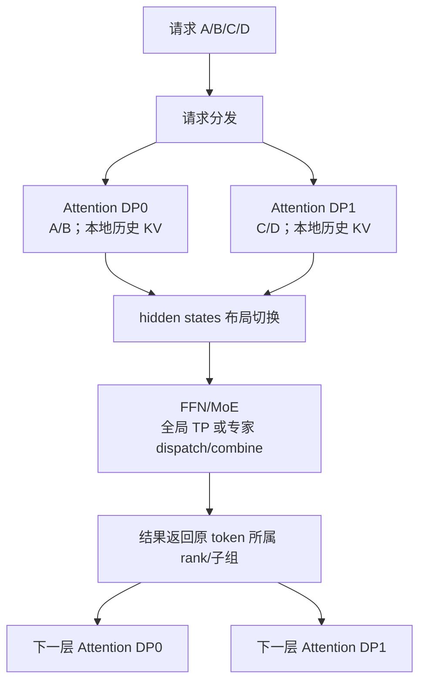
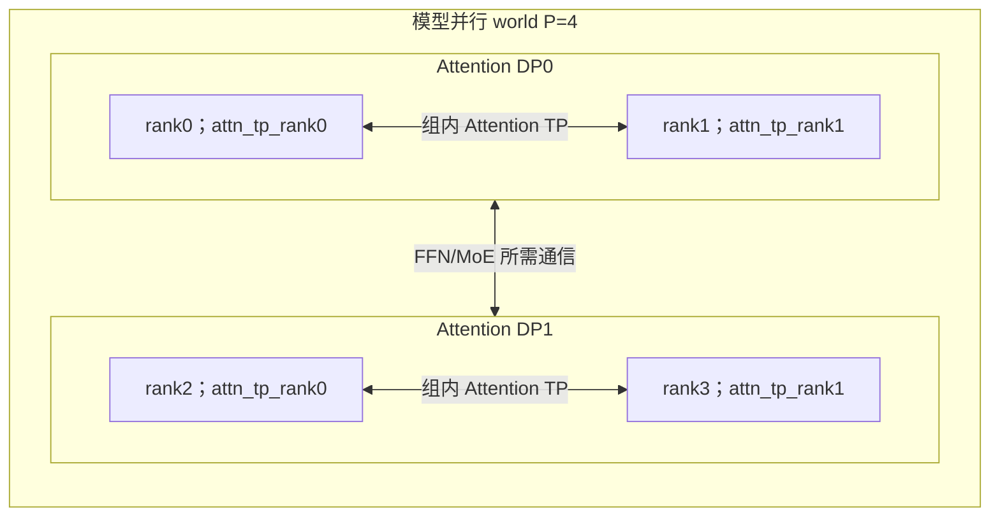
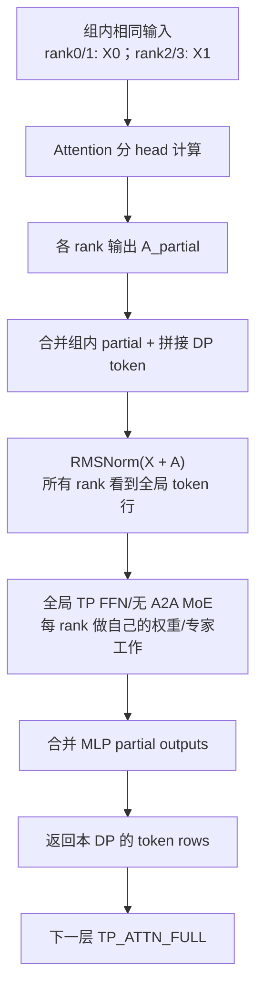
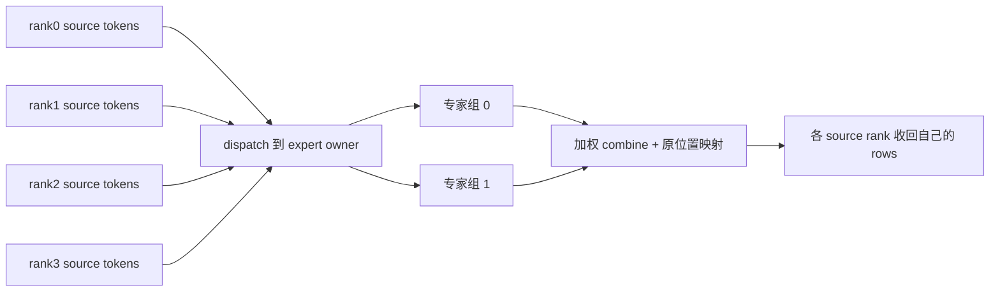
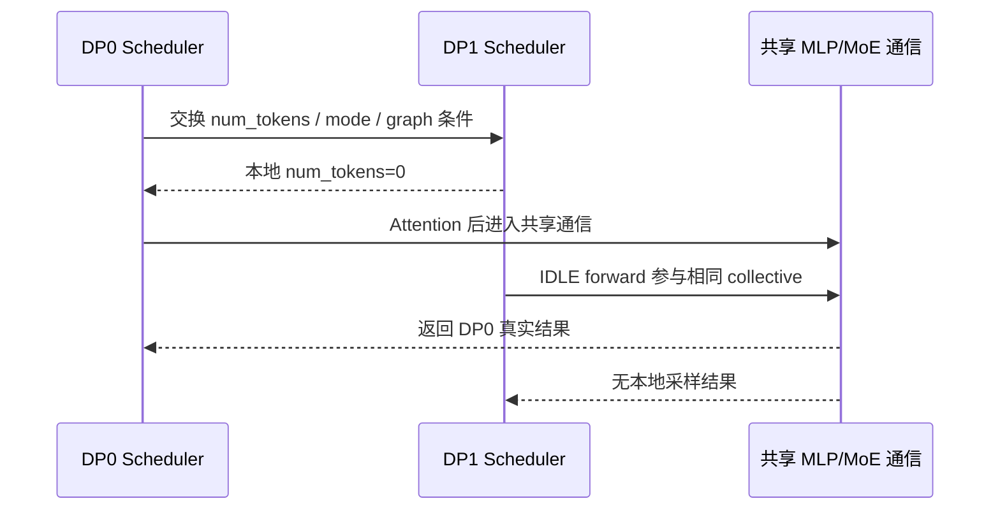

# DP Attention：请求并行、Attention 子组与 FFN/MoE 的布局切换

**简体中文** | [English](../../../en/ai-infra-basic/Parallel_Strategy/01-dp-attention-principles.md)

本章先解释 DP Attention 的数学与系统原理，再到 [SGLang DP Attention 源码走读](../../sglang-source-reading/05-layer-communication/03-dp-attention-code-walkthrough.md)逐函数验证。建议先了解 [DP/TP/EP](./tutorial.md)、[GQA](../Model_Architecture/02-gqa-attention-shapes.md)与 [MLA](../Model_Architecture/04-multi-head-latent-attention.md)。

本文按本仓库源码快照 `587eb0b3a56cd2f014daf3b0fc8ba333da88df36` 解释。教学中的配置和数字用于推导，不代表目标模型在任意 backend 上都支持该组合。

## 1. 先看它解决的矛盾

Attention 和 FFN/MoE 对并行的需求并不相同：

- Attention 的一个请求依赖自己的历史 KV；不同请求之间没有数学上的 Attention 依赖。Decode 经常受 KV 读取带宽和小 batch 下的通信影响。
- Dense FFN 的权重可能需要跨多卡切分；更大的 token batch 也有利于 GEMM。
- MoE 的专家总参数可能远大于 Attention 参数，需要跨卡存放，再把 token 发给对应专家。

如果全模型始终使用同一个大 TP group，Attention 也必须在这个大组内执行，即使它用较小 TP 已经足够。如果复制整个模型来增加 Attention 并行度，又会复制大量 FFN/专家权重。

DP Attention 允许**同一个模型并行 world 内，不同子模块使用不同的切分方式**：请求分给多个 Attention DP 子组，组内可以继续 Attention TP；FFN/MoE 按自己的 TP/EP 拓扑处理这些请求的 token。



图中的跨组传输对象通常是当前 token 的 **hidden states 或专家路由数据**。Attention 的历史 KV 留在负责该请求的子组内；额外启用 CP、KV transfer 或其他特性时，再按相应机制处理历史分片与传输。

## 2. 普通 DP 与 DP Attention 的进程数不同

固定 `pp_size=1`，比较同样写成 `tp_size=4, dp_size=2` 的两种配置：

| 项目 | 普通 DP，关闭 DP Attention | 开启 DP Attention |
|---|---|---|
| 计算设备数 | `4 × 2 = 8` | `4` |
| 模型并行 world | 两个独立的 4-rank world | 一个 4-rank world |
| Attention TP | 每副本为 4 | 每 Attention DP 子组为 2 |
| 请求分发 | 分到完整模型副本 | 分到 Attention DP 子组 |
| FFN/专家 | 每副本各持一套完整分布式模型权重 | 按同一 world 的 TP/EP 策略持有 |
| 推理跨副本通信 | 通常没有 | 存在布局转换或专家通信 |

因此开启此模式后，`tp_size` 同时承担“当前模型 world 的 rank 数”这一含义；某个 Attention 矩阵实际切成几份，要看 `attn_tp_size`。

## 3. 一组 rank 如何分解成 DP、CP、TP

设：

```text
P = tp_size                   当前模型并行 world 的 rank 数
D = attention_dp_size         enable_dp_attention ? dp_size : 1
C = attn_cp_size              Attention context parallel 数
T = attention_tp_size = P / (D*C)
```

必须满足整除关系。在源码中，rank 的排列顺序是 `(DP, CP, TP)`，TP 变化最快：

\[
p=(dC+c)T+a
\]

\[
a=p\bmod T,\qquad c=\lfloor p/T\rfloor\bmod C,\qquad d=\lfloor p/(TC)\rfloor
\]

本章主例子取 `P=4,D=2,C=1,T=2`：

| 模型 world rank `p` | Attention DP `d` | Attention TP `a` | Attention TP group | 负责请求 |
|---:|---:|---:|---|---|
| 0 | 0 | 0 | `[0,1]` | A/B |
| 1 | 0 | 1 | `[0,1]` | A/B |
| 2 | 1 | 0 | `[2,3]` | C/D |
| 3 | 1 | 1 | `[2,3]` | C/D |



若增加 CP，例如 `P=8,D=2,C=2,T=2`：Attention TP groups 是 `[0,1]、[2,3]、[4,5]、[6,7]`；Attention CP groups 是 `[0,2]、[1,3]、[4,6]、[5,7]`。DP 分不同请求，CP 分同一请求的上下文，二者解决的维度不同。

## 4. 为什么请求可以分开做 Attention

对请求 `r`、head `h`、query position `i`：

\[
o_{r,h,i}=\sum_{j\in\mathcal V_r(i)}
\operatorname{softmax}_{j}\left(q_{r,h,i}^{\mathsf T}k_{r,g(h),j}/\sqrt{D_k}\right)v_{r,g(h),j}
\]

`g(h)` 是 GQA 的 query-head 到 KV-head 映射，`V_r(i)` 是该请求的因果可见历史。式子里没有另一个请求 `r'` 的 K/V。

多个请求可以把 token 行打包进同一个张量，但必须保持 request boundary、长度和 page table。正确的 packed attention 只在各自请求内部归一化；把所有请求的 K/V 拼起来且不加边界约束，会改变模型函数。

FFN 则逐 token 执行：

\[
f(x)=W_{\mathrm{down}}\bigl(\operatorname{SiLU}(W_{\mathrm{gate}}x)\odot W_{\mathrm{up}}x\bigr)
\]

它对不同 token 行独立。因此把 DP0/DP1 的 hidden rows 拼到同一 FFN 输入中，只要输出按原顺序返回，就保持数学等价。MoE 也按 token 产生路由和加权专家输出，但通信要保持 token 到原位置的映射。

## 5. Attention TP 切权重，DP 切请求

以 row-vector 记法描述 GQA。令 `H=4096,Nq=32,Nkv=8,Dk=Dv=128`，DP0 本轮有 `n0=4` 个 token，DP1 有 `n1=2` 个 token；`T=2`：

```text
每 Attention DP 子组输入 X_d: [n_d,4096]
每组内 rank 输入相同 X_d，但持有不同 Q/K/V 权重切片

Q_local: [n_d,16,128]        # 32/2 query heads
K_local: [n_d,4,128]         # 8/2 KV heads
V_local: [n_d,4,128]
O_heads: [n_d,16,128]
O_flat:  [n_d,2048]
W_O_local: [2048,4096]
A_partial = O_flat @ W_O_local: [n_d,4096]
```

两个组内 rank 的输出投影给出的是不同输入通道的**部分和**：

\[
A_d=A_{d,0}^{\mathrm{partial}}+A_{d,1}^{\mathrm{partial}}
\]

它们 shape 相同，但数值尚未完整。后续通信必须先完成加和，再做残差与 RMSNorm 的正确组合。

对 MLA，内容 latent 与共享位置 key 的 cache shape 不随 query-head 数直接增加；query/up/output 投影仍会按 Attention TP 切分。具体数学见 [MLA](../Model_Architecture/04-multi-head-latent-attention.md)。

## 6. Shape 相同，数据的“所有权”仍可能不同

SGLang `ScatterMode` 用以下词描述 **token 行的分布**，而不是最后一维的权重切片：

| 模式 | rank0 | rank1 | rank2 | rank3 |
|---|---|---|---|---|
| `TP_ATTN_FULL` | A/B | A/B | C/D | C/D |
| `FULL` | A/B/C/D | A/B/C/D | A/B/C/D | A/B/C/D |
| `SCATTERED` | A | B | C | D |

这里把每个字母当作等长 token block 以便示意。真实请求长度可以不同；切分的是 packed token rows，并不保证每 rank 恰好拥有一个完整请求。

还有一条独立信息：数值是 **partial** 还是 **replicated**？

- partial：多个 rank 的张量要相加，才能得到完整输出。
- replicated：多个 rank 已拥有相同完整张量，汇总时只能保留一份。

`TP_ATTN_FULL` 只表示“Attention 子组的 token 行完整”，不能据此判断输出投影是否已 all-reduce。

## 7. 路径 A：合并 token，执行全局 TP FFN/MoE

主例子先取无专用 MoE A2A backend、`moe_dense_tp_size=None`、不启用 CP/TBO/通信融合。此时 MLP 布局为 `FULL`。



数学上，MLP 输入是：

\[
U=\operatorname{concat}_{d}\operatorname{RMSNorm}(X_d+A_d)
\]

“gather”需要同时完成 partial 加和和 DP 行拼接。不同 padding 模式决定这些工作由哪个 collective 完成。

### 7.1 SUM_LEN：零填充加 all-reduce，模拟拼接

先按各 DP 的有效通信长度 `n_d` 分配互不重叠的全局行区间：

\[
N=\sum_dn_d,\qquad s_d=\sum_{j<d}n_j
\]

每 rank 建 `[N,H]` 的零 buffer，只在本 DP 的区间 `[s_d:s_d+n_d]` 放数据，然后对全 world 求和。

```text
DP0 -> rows [0:n0]
DP1 -> rows [n0:n0+n1]
其余行置零
all_reduce(sum) -> 两段都出现在每个 rank 上
```

partial 数据允许每个 Attention TP rank 填自己的贡献；replicated 数据只让组内 rank0 填一份，否则组内重复副本会被相加。

一个最小例子，`H=1`、每 DP 两行：

```text
rank0 partial: [1,2]；rank1 partial: [9,18]       -> DP0 [10,20]
rank2 partial: [3,4]；rank3 partial: [27,36]      -> DP1 [30,40]

各自放入不重叠区间后，全 world all-reduce:
[10,20,30,40]
```

若 rank0/1 都已经持有 `[10,20]`，却同时写入再求和，就会错误地得到 `[20,40,...]`。

### 7.2 MAX_LEN：组内 reduce-scatter，再全局 all-gather

把每 DP 补到相同长度：

\[
m=\max_dn_d,\qquad N=Dm
\]

当 `T>1`，先在 Attention TP group 内执行 reduce-scatter：完成 partial 加和，同时让每 rank 只保留 `m/T` 行。随后在全 world all-gather：

```text
组内 reduce-scatter:
rank0 -> DP0 的前 m/2 行
rank1 -> DP0 的后 m/2 行
rank2 -> DP1 的前 m/2 行
rank3 -> DP1 的后 m/2 行

全 world all-gather:
每 rank 得到 [DP0 m行, DP1 m行]，shape [D*m,H]
```

replicated 输入先将组内非 rank0 副本清零，才能使用同一 reduce-scatter 逻辑。

### 7.3 为什么残差只加一次，Norm 放在求和后

如果 `A0/A1` 是同一个 DP 的 Attention partial，完整残差为：

\[
R=X+A_0+A_1
\]

如果每 rank 都先加 `X` 再 reduce，结果会变成 `2X+A0+A1`。源码因此只在组内 rank0 加 replicated residual。

此外：

\[
\operatorname{RMSNorm}(A_0+A_1+X)
\ne\operatorname{RMSNorm}(A_0+X)+\operatorname{RMSNorm}(A_1)
\]

当 `T=1` 时本地 Attention 输出已经完整，Norm 可以先在较小本地数据上执行，再 gather；`T>1` 时须先合并数值贡献。

## 8. 路径 B：token 保持分片，MoE 自己 dispatch/combine

专用 MoE A2A backend 启用时，`LayerScatterModes` 通常选择 `SCATTERED`。当 `T>1`，Attention 后在子组内 reduce-scatter，得到完整数值但只含部分 token 行的张量：

```text
Attention 输出 [n_d,H] partial
  -> attn-TP reduce-scatter
  -> 每 rank [n_d/T,H] 完整 token rows
  -> 本地 router/top-k
  -> expert dispatch
  -> 目标 rank 的专家 FFN
  -> combine 回 token 来源 rank
```



若 world 有 `P=4`、`ep_size=4`、`moe_dp_size=1`，则：

\[
\mathrm{moe\_tp\_size}=P/(\mathrm{moe\_dp\_size}\cdot\mathrm{ep\_size})=1
\]

每 rank 持不同专家，source token 的归属与 expert 的归属独立。没有本地请求的 rank 仍可能拥有其他 rank 要用的专家。

这一分支的 dispatch/combine 会移动数据，但通常无需让每个 rank 在 MoE 前持有所有 token。backend 的具体实现可以使用 all-to-all、RDMA 或融合通信算子；应以选中的 dispatcher 为准。

下一层 Attention 需要组内完整 token 行时，`prepare_attn()` 会按布局做 Attention TP all-gather。若仍保持 `SCATTERED`，通信也可能推迟到下一层入口。

## 9. 为什么空闲 rank 还要参加一轮 forward

假设 DP0 有 8 个 decode token，DP1 没有请求。如果 DP1 的 rank2/3 直接跳过 forward，DP0 在全局 gather、MoE dispatch 或全局输出归约处会等待缺席的 rank。

所以调度层会先同步各 DP 的 token 数和执行条件；只要其他 DP 有工作，空闲组可能创建 `ForwardMode.IDLE` batch。它代表“本组没有真实 token，但参与本轮所需的通信”。



这使 Attention 请求所有权独立，但执行轮次仍存在跨组协调。吞吐和尾延迟会受最慢 DP、prefill/decode 不均衡、专家负载与通信影响。

## 10. Padding 的三个长度必须区分

1. **真实长度** `n_d`：本轮有效 token 数。Decode 通常为请求数，prefill 为新增 token 数，speculative verify 则可能每请求含多个 token。
2. **通信对齐长度** `a_d`：为了 reduce-scatter 等要求进行对齐。
3. **图捕获长度** `b`：选中的 capture bucket，可能比真实长度更大。

本快照 `ForwardBatch.prepare_mlp_sync_batch()` 先按 `attn_tp_size` 对齐，再按 `attn_cp_size*2` 对齐。主例子 `T=2,C=1` 下，真实 `[3,1]` 会先变为 `[4,2]`。不能把真实 token 数直接当 collective buffer 长度。

`DpPaddingMode` 对对齐后的长度选择：

```text
若本轮含 extend 且 D>1：SUM_LEN
否则若 2*sum(a_d) >= D*max(a_d)：MAX_LEN
否则：SUM_LEN
```

| 对齐后长度 | `2*sum` | `D*max` | eager 模式 |
|---|---:|---:|---|
| `[4,2,6,0]` | 24 | 24 | MAX_LEN；同成本优先该模式 |
| `[12,2,0,0]` | 28 | 48 | SUM_LEN |

这个条件是源码启发式，包含不同 collective 的成本权衡；它不是实际网络流量的精确计数。图路径默认通常使用 `MAX_LEN`，并有源码中的 ROCm 特例。图能否运行需要跨 DP 一致，不能由各 rank 独自决定。

## 11. KV Cache：谁拥有一个请求的历史

不开 CP 时，一个请求的 KV 位于其 Attention DP 子组内，组内按 Attention TP 的 KV-head 分片规则组织。普通 GQA 理想情况下：

```text
单 rank 请求历史 K/V: [L_request,Nkv/T,D]
```

当 KV heads 太少时，实现可能复制 KV heads，不能对所有 GQA 配置机械使用 `Nkv/T`。

对 MLA，一个 latent entry 在组内可能随 TP 被复制；降低 Attention TP 能减少这类复制的份数，但会增加每 rank 的 query heads 和 Attention 权重份额。DP Attention 同时改变请求负载和参数复制，显存收益要按实际 cache pool 与权重布局计算。

跨 DP 共享 prefix 也不是自动发生的：prefix-cache 查找和物理 page 属于相应 runtime 实例。路由到另一个 DP 组不保证能命中原组的 prefix。

## 12. 一张性能账本

设单层全模型的 Attention 权重为 `W_A`、FFN/专家权重为 `W_F`，只是数量级估算：

```text
Attention 每 rank 权重份额 ≈ W_A/T       # replicated 子投影另计
FFN 每 rank 权重份额 ≈ W_F/P            # 全局 TP 路径
专家每 rank 份额取决于 EP/专家 TP

FULL 模式全局 hidden buffer:
SUM_LEN: sum(a_d)*H*element_bytes
MAX_LEN: D*max(a_d)*H*element_bytes
```

例：`H=4096,BF16`，每行 hidden 为 `8 KiB`。`a=[12,2,0,0]` 时 SUM_LEN 一个全局 buffer 为 `112 KiB`，MAX_LEN 为 `384 KiB`。还有 Norm 输出、MLP 中间激活、collective workspace 等，因此它们不是峰值显存或链路流量的总数。

DP Attention 的收益来自更合适的 Attention TP、KV 分布和 FFN/专家利用率；成本来自跨组通信、padding、调度等待和 Attention 参数复制。应比较同一模型、总设备数、输入输出长度和请求负载下的 TTFT、ITL、吞吐及每阶段耗时。

## 13. CPU 上亲手观察 partial 和 replicated

配套 [dp_attention_layout_demo.py](./dp_attention_layout_demo.py)只使用 Python 标准库，模拟 SUM_LEN/MAX_LEN 的数据移动与加和，不加载模型、不启动分布式通信：

```bash
python3 learning/zh/ai-infra-basic/Parallel_Strategy/dp_attention_layout_demo.py
```

它会展示 rank 拓扑、两种 gather 的等价结果、replica 去重、真实长度到 padding 长度的变化，以及 all-reduce 后切片与 reduce-scatter 返回的等价性。这个 demo 用于验证数值/所有权原理，性能和设备 backend 要到真实环境验证。

## 14. 继续学习与练习

1. 对 `P=8,D=4,C=1` 写出全部 rank 坐标与 Attention TP groups。
2. 对 `P=8,D=2,C=2` 写出 Attention TP 与 CP groups，说明它们传递的是哪些请求的数据。
3. 把 demo 中 replicated 的去重去掉，观察为何输出被乘以 `T`。
4. 对真实 token counts `[7,1,0,2]`，依本快照先做 `T=2,C=1` 的对齐，再判断 eager padding mode。
5. 解释为什么 `dp_scatter()` 可以只是一次本地 copy，而 `dp_reduce_scatter_tensor()` 必须执行 collective。

接下来读 [完整源码走读](../../sglang-source-reading/05-layer-communication/03-dp-attention-code-walkthrough.md)。它把本章每个原理映射到启动、Scheduler、ForwardBatch、LayerCommunicator、MoE、Graph 和 LogitsProcessor 的具体函数。

## 15. 依据

- [固定快照的 dp_attention.py](https://github.com/cl-vv-h/SGLang_Tutor/blob/587eb0b3a56cd2f014daf3b0fc8ba333da88df36/python/sglang/srt/layers/dp_attention.py)：rank 计算、padding mode、partial/replicated gather、scatter。
- [固定快照的 communicator.py](https://github.com/cl-vv-h/SGLang_Tutor/blob/587eb0b3a56cd2f014daf3b0fc8ba333da88df36/python/sglang/srt/layers/communicator.py)：布局状态、residual/Norm 和通信顺序。
- [固定快照的 scheduler_components/dp_attn.py](https://github.com/cl-vv-h/SGLang_Tutor/blob/587eb0b3a56cd2f014daf3b0fc8ba333da88df36/python/sglang/srt/managers/scheduler_components/dp_attn.py)：跨 DP 元数据与 IDLE batch。
