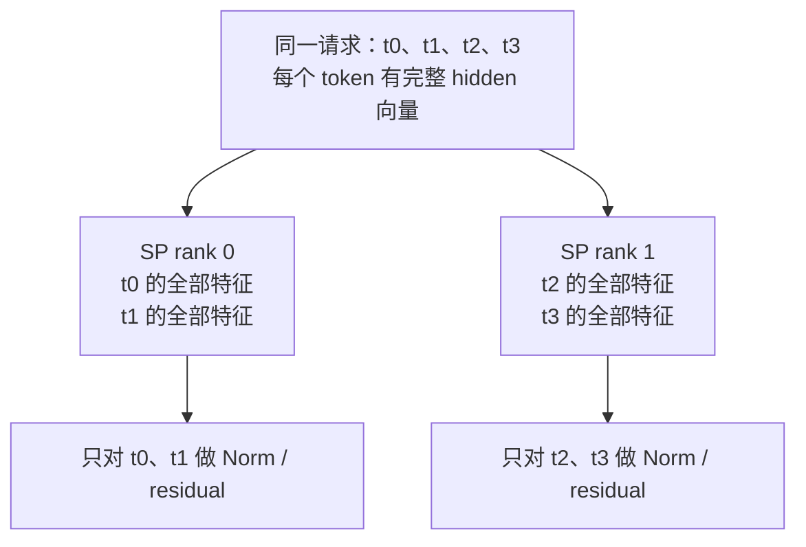
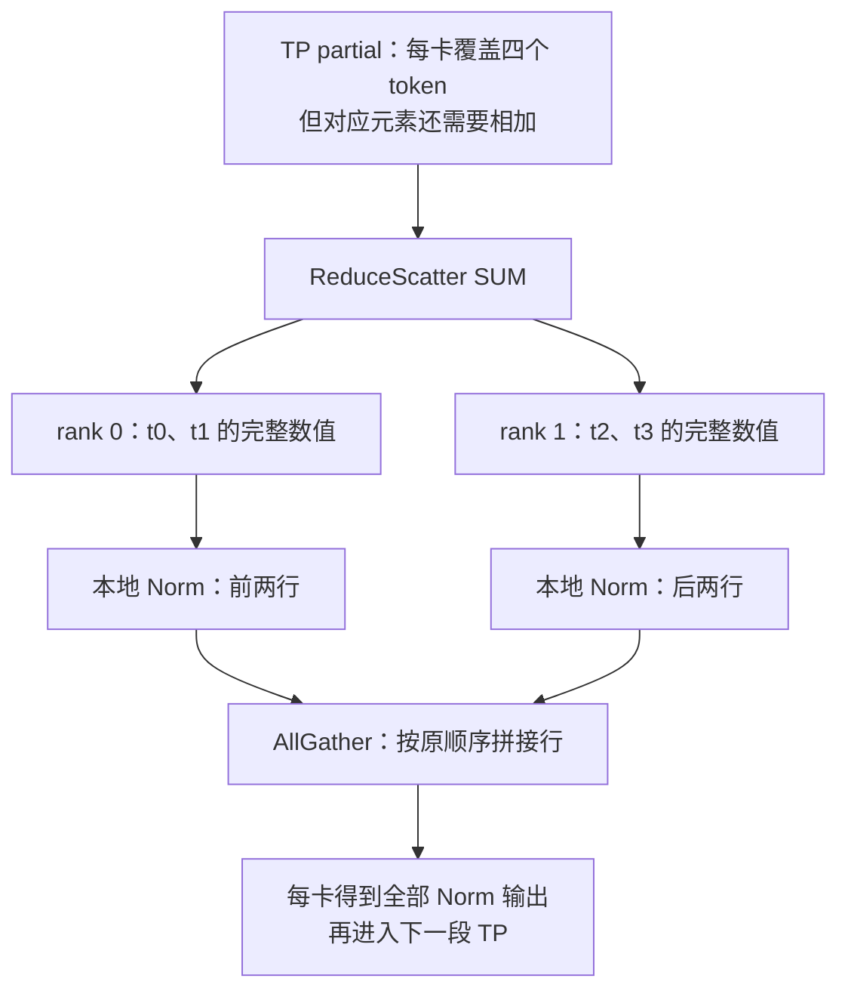
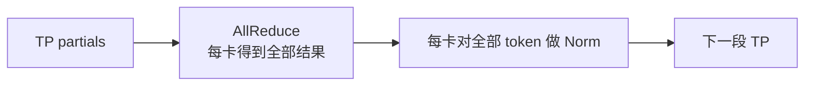
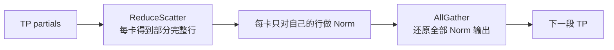
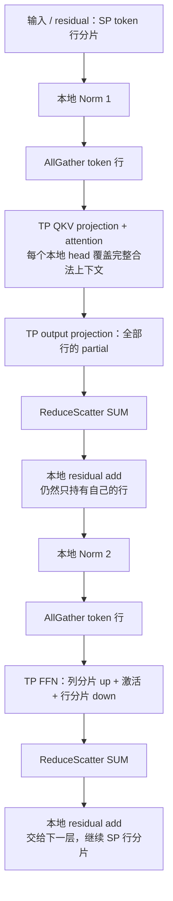
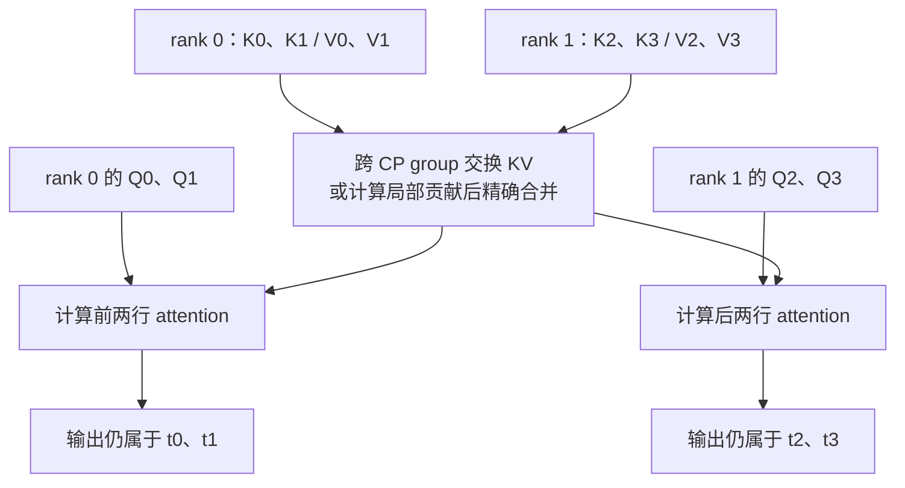

# 02. 从零理解 SP：切哪些数据、怎样计算，以及它与 CP 的区别

**简体中文** | [English](../../../en/ai-infra-basic/Parallel_Strategy/02-sp-versus-context-parallelism.md)

这章先回答一个具体问题：**已经用 TP 把矩阵分给多张卡，为什么还要 SP？**

因为 TP 主要拆大矩阵，但有些位置会让每张卡重新拿到同一份完整激活，重复做 Norm 和 residual。SP 把这些位置的 token 行分给不同卡；进入下一段 TP 计算前，再恢复它需要的输入布局。

本章的“激活”指 hidden states 等中间数据；Norm 是归一化；residual 是保留输入并在后面加回的旁路。这里的“激活张量”与 FFN 里的“激活函数”不是同一个概念。

先记住三个不同的动作：

- **TP：**不同卡负责一个 token 的不同特征、head 或矩阵贡献。
- **SP：**在适合的算子区域，不同卡负责不同 token 的完整 hidden 向量。
- **CP：**在 attention 计算里也保留上下文分工，因此必须解决“本卡 query 怎么看见别卡的历史”。

这里的 SP 特指 **Megatron 风格的 Sequence Parallelism**，对应本文固定上游 SGLang 的 `--enable-layernorm-sp`。一些项目也把 Ulysses、Ring 等叫 sequence parallelism，所以单看“SP”三个字并不能确定算法。本文聚焦前向推理；训练补充放在末尾。 第一遍建议顺序读第 1–8 节，配合第 12 节实验看数字；第 9–11 节再讨论组合、成本和源码。

## 1. 先看数据：一个 token 到底是一行还是一列

假设只有一个请求、四个 token，每个 token 用四个数表示。把 hidden states 写成矩阵：

```math
X=
\begin{bmatrix}
3&4&0&0\\
0&0&0&2\\
1&1&1&1\\
2&0&0&0
\end{bmatrix}
\in\mathbb R^{4\times4}.
```

- 一行是一个 token 的 hidden 向量。
- 一列是所有 token 的某个特征。
- 一般记 token 行数为 $`T`$，hidden 宽度为 $`H`$，设备数为 $`P`$。此例三者分别为 4、4、2。
- **rank** 可以先理解成“一张参与计算的卡的编号”：这里是 rank 0 和 rank 1。

真实 serving 可能把多个请求的新 token 展平成一个矩阵。那时 $`T`$ 是本次 forward 的总行数，仍必须保留请求边界；本章先用单请求消除这一层复杂性。

在 SP 区域，两卡保存：

```math
X^{\mathrm{SP}}_0=X[0:2,:]
=\begin{bmatrix}3&4&0&0\\0&0&0&2\end{bmatrix},
\qquad
X^{\mathrm{SP}}_1=X[2:4,:]
=\begin{bmatrix}1&1&1&1\\2&0&0&0\end{bmatrix}.
```

两卡各有两个 token，但每个 token 的四个特征都齐全。**SP 切的是行，不是把一行的前两个数给一张卡、后两个数给另一张卡。**



两卡仍协作处理同一个请求。它与“rank 0 处理请求 A、rank 1 处理请求 B”的普通 DP 不同。

## 2. 为什么有 TP 还需要 SP

### 2.1 TP 并不保证每个位置都只保留半份激活

FFN 是逐 token 的前馈网络。最简单的形式是“矩阵升维 → 激活函数 → 矩阵降维”。下面只看这个两层 FFN，暂时忽略 bias，激活函数 $`\phi`$ 对每个元素独立计算：

```math
Y=\phi(XA)B,\qquad
A=[A_0\;A_1],\qquad
B=\begin{bmatrix}B_0\\B_1\end{bmatrix}.
```

其中 $`A\in\mathbb R^{H\times F}`$、$`B\in\mathbb R^{F\times H}`$ 是训练得到的权重，$`F`$ 是中间扩展宽度。第一层把每个 token 从 hidden 宽度升到扩展宽度；第二层再降回 hidden 宽度。

第一层按输出列切，第二层按对应输入行切：

```math
U_0=\phi(XA_0),\qquad U_1=\phi(XA_1).
```

```math
Y_0=U_0B_0,\qquad Y_1=U_1B_1.
```

```math
Y=Y_0+Y_1.
```

这里 $`Y_0`$、$`Y_1`$ 都包含所有 token 的输出位置，但只包含每个位置的**部分数值贡献**，因此称为 **partial**。它们不是不同 token 的完整答案。

普通 TP 常用 AllReduce 求和：两卡相加后，**每张卡都拿到同一份完整的 $`Y`$**，称为 **replica**。

### 2.2 重复发生在这里

如果后面接 residual 和 Norm，而两卡都有完整 $`Y`$：

| 阶段 | rank 0 做什么 | rank 1 做什么 |
|---|---|---|
| FFN 大矩阵 | 计算自己的权重分片 | 计算另一份权重分片 |
| AllReduce 后 | 持有全部四个 token 的完整输出 | 持有同样的完整输出 |
| residual / Norm | 处理 t0、t1、t2、t3 | 再处理同样的 t0、t1、t2、t3 |

大矩阵已经分工，Norm 这段仍重复。SP 要把最后一行改成：

| 阶段 | rank 0 | rank 1 |
|---|---|---|
| residual / Norm | 只处理 t0、t1 | 只处理 t2、t3 |

**SP 的主要价值是减少这类激活的重复保存；同时减少这些逐行算子的重复执行。** 它不是再次把已经 TP 分片的权重缩小一遍，也不意味着整个模型突然快一倍。

## 3. 先给出 SP 与 CP 的直观区别

把四个 token 想成一本书的四页。

- Norm 像“各自整理一页上已有的数字”：整理第 3 页不需要第 1 页。
- Attention 像“写第 3 页的摘要，并引用前面的内容”：只拿第 3 页，可能缺少完成任务需要的信息。

**SP 在逐行区域可以直接各算各的；本章这种 SP 进入 TP attention 前会 gather 行。CP 则把 attention 也作为分工对象，必须补齐远端信息或合并远端贡献。**

| 先问这个问题 | 本章 SP | CP 的 attention 分工 |
|---|---|---|
| 每卡是否可能只拿部分 token？ | 是 | 是 |
| 仅凭局部 token 能完成本章 Norm 吗？ | 能，因为该行 hidden 特征完整 | 也能，Norm 不是难点 |
| 仅凭局部 token 能完成完整 attention 吗？ | 不能；这条 SP 路径会恢复 TP 所需的完整行 | 不能；CP 专门实现跨上下文 attention |
| 长期 KV 是否因此按历史切开？ | 不由 SP 保证 | 取决于 CP 路径；PCP 不自动保证，DCP 正是为此类目标设计 |

先建立这个区别，下面再看它为什么在数学上成立。

## 4. SP 的数学依据：Norm 到底在什么维度上求平均

### 4.1 RMSNorm：每行自己计算一个缩放值

对一个 token 的向量 $`x=[x_0,\ldots,x_{H-1}]`$：

```math
r(x)=\sqrt{\frac1H\sum_{j=0}^{H-1}x_j^2+\epsilon},\qquad
\mathrm{RMSNorm}(x)_j=\gamma_j\frac{x_j}{r(x)}.
```

其中 $`\epsilon`$ 是防止除零的小常数；$`\gamma_j`$ 是可训练缩放参数。关键不是公式长什么样，而是：**求和只遍历同一 token 的 hidden 特征，不遍历其他 token。**

为方便手算，令 $`\gamma_j=1`$、$`\epsilon=0`$。第一行：

```math
x_0=[3,4,0,0],\qquad
r(x_0)=\sqrt{\frac{9+16+0+0}{4}}=2.5.
```

```math
\mathrm{RMSNorm}(x_0)=[1.2,1.6,0,0].
```

算这个结果时，完全没用到 t1、t2、t3。因此 t0 放在哪张卡，都可以在本地算出相同结果。四行全部计算得到：

```math
\mathrm{RMSNorm}(X)=
\begin{bmatrix}
1.2&1.6&0&0\\
0&0&0&2\\
1&1&1&1\\
2&0&0&0
\end{bmatrix}.
```

rank 0 算前两行、rank 1 算后两行，拼接后就是同一个矩阵。真实实现仍要保留非零 $`\epsilon`$，此处关闭只是为了手算。

### 4.2 LayerNorm 也不需要别的 token

LayerNorm 会先减均值，仍然只在一行内部计算：

```math
\mu_t=\frac1H\sum_jX_{t,j},\qquad
\sigma_t^2=\frac1H\sum_j(X_{t,j}-\mu_t)^2.
```

```math
\mathrm{LayerNorm}(X)_{t,j}
=\gamma_j\frac{X_{t,j}-\mu_t}{\sqrt{\sigma_t^2+\epsilon}}+\beta_j.
```

参与 SP 的各卡保留同样的 Norm 参数 $`\gamma`$、$`\beta`$，只是将它们应用到不同 token；不是把 Norm 参数按 token 再切一遍。

因此，如果 $`I_r`$ 是 rank $`r`$ 拥有的 token 行索引：

```math
\mathrm{Norm}(X[I_r,:])=\mathrm{Norm}(X)[I_r,:].
```

这条等式的含义是“先选行再 Norm”与“先对全矩阵 Norm 再选行”结果相同。它是 SP 可以在这里切行的根本原因。

### 4.3 为什么切 hidden 特征就不一样

若把第一行切成 $`[3,4]`$ 和 $`[0,0]`$，任意一张卡都无法仅凭局部数据得到全行的平方和。即使已知全局 hidden 宽度，也需要跨卡汇总统计量；对局部两维直接求 RMS，会得到另一种归一化。

因此“张量元素减半”不是充分条件，**每一行是否拥有完整 hidden 宽度**才决定本地 Norm 是否成立。

Residual 也逐行独立：

```math
(Y+R)[I_r,:]=Y[I_r,:]+R[I_r,:].
```

前提是 $`Y`$ 已经是完整数值结果，而且 residual 的行索引与它一致。下面解释为什么必须先完成求和。

## 5. 先把三种通信讲明白，再看 SP 怎样改变它们的位置

这里的 All 指“同一通信组的所有参与 rank”，不一定是整台机器或整个集群。为了看清通信语义，暂时令上一段 TP 的两个 partial 为：

```math
Y_0=
\begin{bmatrix}
1&1&1&1\\1&1&1&1\\1&1&1&1\\1&1&1&1
\end{bmatrix}.
```

```math
Y_1=
\begin{bmatrix}
2&3&-1&-1\\-1&-1&-1&1\\0&0&0&0\\1&-1&-1&-1
\end{bmatrix}.
```

```math
Y_0+Y_1=X.
```

这是为解释 collective 选择的一组合法 partial，不是声称它们来自第 2 节某组指定权重。

### 5.1 AllReduce：先相加，再让每卡都有完整结果

对同一位置求和，随后两卡都拿到 $`X`$：

| 输出位置 | rank 0 | rank 1 |
|---|---|---|
| AllReduce 之后 | t0、t1、t2、t3 的完整向量 | 相同的 t0、t1、t2、t3 |

### 5.2 ReduceScatter：仍然相加，但每卡只拿一部分结果行

Reduce 表示“把各 rank 的对应元素相加”；Scatter 表示“把求和结果分配出去”：

```math
S_0=(Y_0+Y_1)[0:2,:],\qquad
S_1=(Y_0+Y_1)[2:4,:].
```

rank 0 得到 t0、t1 的**完整答案**；rank 1 得到 t2、t3 的**完整答案**。不要把它理解成“每卡只保留自己的 partial 的前半/后半”，求和这一步没有被省略。

现在两卡各自做 $`\mathrm{Norm}(S_r)`$，不需要跨卡读取 hidden 统计量。

### 5.3 AllGather：把不同的完整结果行拼回来

Norm 完成后，两卡交换自己负责的行：

```math
Z=\mathrm{concat}_{\mathrm{rows}}
\bigl(\mathrm{Norm}(S_0),\mathrm{Norm}(S_1)\bigr).
```

两卡都能得到完整 $`Z`$，交给下一段需要全 token 输入的 TP 计算。**这里是拼接行，不是相加两卡的 Norm 输出。**



## 6. 为什么可以把 AllReduce 拆开，夹入 Norm

对相同通信组、sum 语义和一致的行顺序，AllReduce 的结果可以通过以下两步重建：

```math
\mathrm{AllReduce}(Y_0,\ldots,Y_{P-1})
=
\mathrm{AllGather}\bigl(\mathrm{ReduceScatter}(Y_0,\ldots,Y_{P-1})\bigr).
```

这是结果语义的分解，不是声称所有后端的 AllReduce 都必须使用这两段 kernel。

原来的边界是：



SP 改成：



因为 Norm 对每行独立，所以：

```math
S_c=\left(\sum_rY_r\right)[I_c,:].
```

```math
\mathrm{Norm}\left(\sum_rY_r\right)
=\mathrm{AllGather}\left(\{\mathrm{Norm}(S_c)\}_{c=0}^{P-1}\right).
```

先把数值贡献求和，再切行算 Norm，再拼接，保持数学结果。SP 改的是**完整数值何时复制到所有卡**：把复制推迟到下一段 TP 真正需要它时。

### 6.1 不能把 Norm 移到求和之前

Norm 是非线性的，一般不满足：

```math
\mathrm{Norm}(Y_0+Y_1)
=\mathrm{Norm}(Y_0)+\mathrm{Norm}(Y_1).
```

例如用二维 RMSNorm，忽略 epsilon 和缩放参数：

```math
a=[1,0],\qquad b=[0,1].
```

```math
\mathrm{RMSNorm}(a+b)=[1,1].
```

```math
\mathrm{RMSNorm}(a)+\mathrm{RMSNorm}(b)=[\sqrt2,\sqrt2].
```

所以实际步骤必须是 **ReduceScatter SUM → 本地 residual/Norm → 按需 AllGather**，不能是“各自对 partial 做 Norm，最后求和”。

Residual 也不能在每个 partial 上各加一份再规约，否则被重复加入。可以在求和后的本地行上加一次，或采用严格等价的生产实现约定。

## 7. 一个 Transformer block 中，布局怎样来回变化

先看普通 Pre-Norm block 的数学逻辑：

```math
H_1=R+\mathrm{Attention}(\mathrm{Norm}_1(R)).
```

```math
H_2=H_1+\mathrm{FFN}(\mathrm{Norm}_2(H_1)).
```

在本章 TP+SP 路径中：



图中每个 attention head 的合法上下文仍由模型 causal mask、请求边界等决定。“完整”不是让它看见未来 token。

### 7.1 用 FFN 的 shape 再走一遍

设本节 $`T=4,H=4,F=8,P=2`$，其中 $`F`$ 是 FFN 扩展宽度。暂用单个 up projection 讲布局，SwiGLU 的 gate/up 对应分片遵循同类原则。

| 步骤 | 每个 rank 的 shape | 数值含义 |
|---|---|---|
| SP residual 输入 | $`[2,4]`$ | 各自 token 的完整 hidden |
| 本地 Norm | $`[2,4]`$ | 相同行索引、完整 hidden |
| AllGather | $`[4,4]`$ | 全部 token 的 Norm 输出 |
| column-parallel up | $`[4,4]`$ | 全部 token，只含本 rank 的 FFN 特征 |
| 激活函数 | $`[4,4]`$ | 同一个 FFN 特征分片 |
| row-parallel down | $`[4,4]`$ | 全部 token、输出 hidden 的 partial |
| ReduceScatter SUM | $`[2,4]`$ | 各自 token 的完整 FFN 输出 |
| 加本地 residual | $`[2,4]`$ | 交给下一段的完整行 |

表中很多 shape 都一样，但语义不同。特别是两个 $`[4,4]`$：up 后是**不同特征**，down 后是**同一输出的不同贡献**。

### 7.2 为什么不让每卡只拿自己的 token，直接跑 TP 的下一层

因为权重仍然是 TP 分片。假设 rank 0 只有 $`A_0`$，rank 1 只有 $`A_1`$：

- t0 在 rank 0，可以得到 $`x_0A_0`$。
- 但 t0 同样需要 $`x_0A_1`$，而这份权重在 rank 1。
- 如果 rank 1 从未看到 t0，这一部分根本没有被计算。

本章 SP 用 AllGather 把 token 行交给所有 TP 权重分片。若把完整权重也复制到每张卡，就可以各算自己的 token，但那已经改变了权重分布与整个并行方案；attention 仍需跨 token 信息。

### 7.3 为什么 gather 过后还能省显存

gather 是临时恢复下一段计算需要的输入，并不要求所有区域一直保存全部行。省下的是 Norm/residual 等可分片区域中的重复激活，不是承诺整个 forward 从未产生完整序列张量。

入口可能只有一次本地切行，出口也可能需要额外 gather。跨多层时，层与层之间可继续保持行分片，不需要在每层结束时为了接口而无条件还原所有张量。

## 8. 用同样四个 token，看 CP 为什么需要另一套计算

仍然是 t0、t1、t2、t3。为便于手算，将单 head 的 value 简化为标量：

```math
[v_0,v_1,v_2,v_3]=[2,4,8,10].
```

这里 Q 是 query（要查询什么），K 是 key（用于计算匹配分数），V 是 value（要加权汇总的信息）；softmax 把匹配分数转成总和为 1 的权重。

取 CP degree 为 2：rank 0 负责前两行，rank 1 负责后两行。此节先不叠加 TP，即每个 CP rank 都拥有本层完整权重。

### 8.1 Norm 可以独立，attention 不可以

对第 $`i`$ 个 query，causal attention 为：

```math
o_i=\sum_{j=0}^{i}
\frac{\exp(s_{ij})}{\sum_{u=0}^{i}\exp(s_{iu})}v_j,\qquad
s_{ij}=\frac{q_i k_j^{\mathsf T}}{\sqrt d}.
```

这里 $`d`$ 是 head 宽度。与 Norm 的区别是：求和跨了**其他 token 的位置**。

先让 t3 对所有历史位置的 score 都为零，则四个权重均为四分之一：

```math
o_3=(2+4+8+10)/4=6.
```

但 rank 1 的局部 KV 只有 t2、t3。如果让它只对自己这两项做 softmax：

```math
o_3^{\mathrm{wrong}}=(8+10)/2=9.
```

不但少了 value 项，softmax 的分母也变了。**把两个局部 attention 的输出按 token 行拼回去，不会修复这个错误。**

### 8.2 CP 怎样让本地 query 获得完整答案



常见办法：

1. **Gather KV：**把所需 KV 收齐，让 local Q 看见完整合法历史。
2. **Ring：**query 不动，KV 分块经过，每次更新 attention 的累积结果。
3. **交换局部答案与 LSE：**同一 query 访问不同 KV 分片，各卡计算局部贡献，再根据 softmax 概率质量合并。

后两种不是简单相加各块归一化输出。若 t3 的前两项 score 为 0、后两项为 $`\log3`$，两块局部输出仍是 3 和 9，但概率质量分别为 2 和 6：

```math
o_3=\frac{2\cdot3+6\cdot9}{2+6}=7.5.
```

平均局部输出得到 6，仍然错误。LSE 如何恢复正确权重见 [04：DCP](./04-decode-context-parallelism.md)。

### 8.3 与本章 SP 的核心对照

| attention 相关问题 | 仅 TP+SP、本章路径 | CP attention 分工 |
|---|---|---|
| Norm 时各卡 token 行 | 不同 | 可以不同 |
| 进入 QKV / attention 时 | 恢复 TP 所需的完整 token 行，计算本地 heads | query 继续按上下文分工 |
| 谁解决跨 token 依赖 | 沿用原 TP attention；SP 没有新建 KV 分片协议 | CP 的 KV 交换/远端贡献合并 |
| 权重 | 沿用 TP 权重分片 | 本节 CP-only 示例复制权重；也可再叠加 TP |
| 原请求因果关系 | 保持原 mask | 通过原位置与跨片协议保持 |
| 是否是两个不同请求 | 否 | 否 |

这不是说所有 CP 都必须保留 KV 分片、所有 CP 都采用同一种通信。SGLang 中要继续按阶段分：

- **PCP：**主要分 prefill query/indexer 工作；某些路径 gather 必要 KV，所以 query 工作分片不自动带来持久 KV 容量下降。见 [03](./03-prefill-context-parallelism.md)。
- **DCP：**分 decode 历史 KV 与读取，精确合并局部 attention；不是本章 Norm 激活分片。见 [04](./04-decode-context-parallelism.md)。

## 9. SP 与 CP 能否组合，应该怎样数卡

在支持组合的系统里，可以先用 CP 划分上下文，再在每个 CP 分片内用 TP+SP。

教学例：CP 为 2、TP 为 2，物理 rank 共四个。沿用四个 token：

| rank | CP 归属 | TP 归属 | SP Norm 区域负责的 token |
|---|---|---|---|
| 0 | CP0：t0、t1 | TP0 | t0 |
| 1 | CP0：t0、t1 | TP1 | t1 |
| 2 | CP1：t2、t3 | TP0 | t2 |
| 3 | CP1：t2、t3 | TP1 | t3 |

- TP/SP groups 是 0/1 与 2/3；组内 gather 恢复**本 CP 分片**的行。
- 示意 CP groups 是 0/2 与 1/3；同一 TP head 布局的参与者交换上下文信息。
- SP 复用了 TP ranks，没有因为打开 SP 再新增一倍卡数。

这个独立网格中：

```math
N_{\mathrm{devices}}=C_{\mathrm{CP}}P_{\mathrm{TP}},\qquad
\mathrm{Norm\ local\ rows}=T/(C_{\mathrm{CP}}P_{\mathrm{TP}}).
```

它解释概念上如何组合，不表示本文固定 SGLang 版本支持该组合。实际 group 编号、参数校验与模型支持，见 [06：组合拓扑](./06-parallel-topology-and-pd-composition.md)；不要拿这个教学网格直接覆盖运行时。

## 10. SP 到底省什么，又付出什么

### 10.1 先算一份激活，避免把局部收益当成整模型收益

设一个可行分片区域的激活大小为：

```math
M_{\mathrm{replica}}=THs,\qquad
M_{\mathrm{SP,local}}\approx THs/P.
```

其中 $`s`$ 为每元素字节数；此处假设行数整除。取 $`T=8192,H=4096,s=2,P=4`$，**单个这种 buffer** 从每卡 64 MiB 变为约 16 MiB。

不能据此说总显存缩小四倍：权重原本按 TP 分布，attention 中间量、KV、通信临时区也不都遵循这条公式。特别是普通 fallback 可能先 materialize 完整 partial，再 ReduceScatter；fused 路径才可能改善部分临时峰值。

训练会保留激活用于反向，因此节省可更明显；推理更关注临时峰值和重复工作，具体收益必须测量。

### 10.2 为什么经常说“通信量没有额外增加”

只比较一个内部边界，令完整激活的字节数为 $`M=THs`$。在理想 ring 算法、相同 group、无 padding 条件下，每 rank **发出的 payload** 近似为：

```math
V_{\mathrm{AllReduce}}\approx2\frac{P-1}{P}M,\qquad
V_{\mathrm{ReduceScatter}}\approx\frac{P-1}{P}M,\qquad
V_{\mathrm{AllGather}}\approx\frac{P-1}{P}M.
```

因此一对 RS+AG 与一次 AR 可以有相同字节量。这没有把接收字节再算一次，也没有包括额外入口/出口、padding 和不同后端协议。

但相同字节量不代表相同耗时。分开的 launch、同步等待、算子融合、带宽和计算重叠，会改变实际速度。SP 的第一目标也不是减少原来 attention 的全部计算量。

### 10.3 token 太少或不能整除时

若 $`T`$ 不能被 $`P`$ 整除，固定实现会对齐到：

```math
T_{\mathrm{pad}}=P\left\lceil T/P\right\rceil.
```

例如 5 行、2 卡，先补到 6 行；每卡处理 3 行，出口再裁回 5 行。padding 行不能被误当成真实 token 写入 KV 或参与 attention。源码的 column helper 会恢复真实 token 数。

当一次 forward 只有很少新 token 时，padding、gather 与调度成本可能超过节省。因此不能从“SP 对长 prefill 有用”推断“decode 单 token 也适用”。本文固定上游的 LayerNorm SP 本身就只在 EXTEND/prefill 开启。

## 11. 数学怎样落到 SGLang 源码

本仓库保留的旧运行时快照并没有下面这套完整 SP 实现。此节统一固定到 [sglang@f2b73d4](https://github.com/sgl-project/sglang/tree/f2b73d4f9b4e64415b8d775b0f811c7801f1728b)，与“当前 main 随时变化”区分开；版本总表见 [00](./00-parallelism-map-and-version-boundaries.md)。

### 11.1 先读数据布局，再读 fused kernel

[layernorm_sp.py](https://github.com/sgl-project/sglang/blob/f2b73d4f9b4e64415b8d775b0f811c7801f1728b/python/sglang/srt/layers/layernorm_sp.py) 的职责可以直接对应前面的步骤：

| 函数/状态 | 对应原理 | 具体行为 |
|---|---|---|
| `runs_sp()` | 判断这次是否采用 SP | 启用且 forward mode 恰为 EXTEND 才返回真 |
| `sp_entry_scatter()` | 进入行分片区域 | 记录真实行数、padding、本地 slice；因为输入本来已复制，不需要再发一轮网络 scatter |
| `get_forward().sp_active` | 告知参与的 Linear 当前布局 | 避免 Linear 把局部 token 行当成普通完整输入 |
| `column_parallel_g_matmul()` | AG → column GEMM | gather token 行，执行本 rank 权重分片，输出按真实 token 数裁剪 |
| `row_parallel_gbar_matmul()` | row GEMM → RS SUM | 得到本 rank 数值贡献后，沿 token 行 ReduceScatter |
| `sp_exit_gather()` | 离开行分片区域 | 按行 gather 并裁掉 padding |
| `maybe_exit_gather()` | LM Head 前恢复接口 | 需要时也 gather 辅助 hidden，并退出 SP 状态 |

入口的“scatter”和内部的 ReduceScatter 不是同一件事：前者可以从已有副本直接切行；后者必须先合并 TP partial。

### 11.2 Linear 为什么会自动走不同通信

在同一 commit 的 [linear.py](https://github.com/sgl-project/sglang/blob/f2b73d4f9b4e64415b8d775b0f811c7801f1728b/python/sglang/srt/layers/linear.py)：

- `ColumnParallelLinear.forward()` 检查 SP 状态与 TP degree，交给 column helper。QKV、gate/up 这类参与者由此获得本 rank 权重所需的 token 行。
- `RowParallelLinear.forward()` 满足相应条件时交给 row helper，改用 ReduceScatter，而不是让层边界再按普通 TP 做一次 AllReduce。
- 不能在 row helper 已经求和后又重复规约；bias 也必须遵守“完整结果只加一次”的约定。

正文采用 $`XW`$ 记号，权重按“输入维、输出维”书写；PyTorch Linear 通常将权重存为“输出维、输入维”，计算时转置。因此源码按权重第 0 维切输出，与正文按矩阵列切输出是同一件事。

只表达布局逻辑的教学伪代码如下；它不包含生产版本的量化、bias、mask 和 fused residual 协议：

```python
# Teaching pseudocode: collectives run across the TP group.
normalized_local = rms_norm(residual_local)
normalized_full = all_gather_rows(normalized_local)
up_local_features = activation(normalized_full @ up_weight_shard)
down_partial = up_local_features @ down_weight_shard
ffn_local_rows = reduce_scatter_sum_rows(down_partial)
output_local = residual_local + ffn_local_rows
```

### 11.3 Fused 不会改变上面的数学顺序

源码可在满足条件时调用 `fused_all_gather_matmul` 或 `fused_matmul_reduce_scatter`，通过 tile/流水减少部分中间等待；不符合条件时用普通 gather+matmul 或 matmul+RS。

该 commit 的 fused 路径检查算子可用性、无 bias、未量化 Linear、BF16/FP16 等条件，并涉及 CUDA symmetric memory。它不是“所有 GPU/NPU、所有量化配置都已支持”的声明。理解时先看布局和求和，再看融合是否能减少临时区与等待。

### 11.4 支持范围要和数学分开读

[layernorm_sp_hook.py](https://github.com/sgl-project/sglang/blob/f2b73d4f9b4e64415b8d775b0f811c7801f1728b/python/sglang/srt/arg_groups/layernorm_sp_hook.py) 在此版本仅允许已验证的 `Qwen3ForCausalLM`，要求多卡 TP，并拒绝 Attention DP、PP 与 speculative 等配置。

因此“第 9 节可以画出 TP+CP+SP 网格”不代表此 hook 一定放行。对于 Ascend，需要核对目标版本的接口、collective 和 kernel 支持；本章没有把 CUDA fused 路径当作 NPU 实测。

## 12. 运行一个会把每一步打印出来的实验

新增 [sp_step_by_step_demo.py](./sp_step_by_step_demo.py)，只用 Python 标准库：

```bash
python3 learning/zh/ai-infra-basic/Parallel_Strategy/sp_step_by_step_demo.py
```

建议边看打印结果边对照第 4–8 节：

1. 打印四个 token 的矩阵与两个 partial，比较 AR 与 RS 输出。
2. 分别 Norm 两张卡的完整行，再 gather，得到与完整 RMSNorm 相同的数值。
3. 展示“先 Norm partial 再相加”的反例。
4. 对真实小矩阵计算完整 FFN、普通 TP、TP+SP，逐元素比较，含 padding 情况。
5. 用同一组 token 的 attention 例子观察：缺少远端 KV 得到 9；完整答案为 6；不等 softmax 质量时应得到 7.5。

旧 [sp_inference_demo.py](./sp_inference_demo.py) 演示的是 CP 分布式 softmax，不是本章 SP。原有 [parallelism_math_demo.py](./parallelism_math_demo.py) 仍可用作整个并行课程的数学总览。

读完后尝试自己回答：

- ReduceScatter 后的局部行，为什么是完整结果而不是 partial？
- 为什么 RMSNorm 不需要远端 token，却可能需要完整 hidden 特征？
- 为什么 SP 还要 AllGather？gather 后为什么不等于“从未省过显存”？
- 为什么 CP 中让 Q2、Q3 只看 K2、K3 会改变模型？
- 为什么不能把 SP 带来的单 buffer 节省直接当作 KV Cache 节省？

## 13. 可选补充：训练里的 SP 还需要做什么

SP 最初的重要用途之一是减少训练保存的激活，见 [原论文](https://arxiv.org/abs/2205.05198)。本文前面的前向等价关系不包含完整训练实现。

训练还需配套 collective 的反向操作；被不同 token 分片共享的 Norm 参数，其梯度贡献需要正确汇总。Dropout 虽然逐元素计算，若要与未分片执行逐元素对照，还需保持全局 token/feature 对应的随机数语义。不能仅把张量切开就宣称训练流程完整。

广义 CP 与传统 SP 的范围区别，可对照 [Megatron Core 官方 CP 说明](https://docs.nvidia.com/megatron-core/developer-guide/latest/user-guide/features/context_parallel.html)。本文的矩阵、Norm、collective 与 attention 数值例子用于独立推导，不将训练性能结论外推为 SGLang 推理性能。
