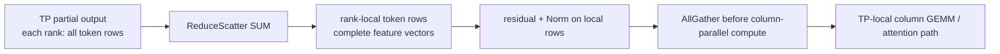

# 02. SP 与 CP：同样切 token，为什么不是一回事

**简体中文** | [English](../../../en/ai-infra-basic/Parallel_Strategy/02-sp-versus-context-parallelism.md)

## 1. SP 要解决 TP 的哪一份重复

普通 TP 中，RowParallelLinear 的局部结果相加后，每个 rank 可能都持有完整 token 行。接着所有 rank 重复执行 residual、RMSNorm/LayerNorm。SP 把这些**逐行独立**的区域按 token 行切开，减少激活占用与重复计算。

本章 SP 特指 Megatron 风格、SGLang 上游 `--enable-layernorm-sp` 对应的实现。其他项目可能把更广义的序列切分也叫 SP，需要先确认术语。

## 2. 数学依据：Norm 不需要其他 token

输入为 $`X\in\mathbb{R}^{T\times H}`$。对第 $`t`$ 行：

```math
\mathrm{RMSNorm}(X)_{t,j}
=\gamma_j\frac{X_{t,j}}
{\sqrt{\frac{1}{H}\sum_{k=0}^{H-1}X_{t,k}^{2}+\epsilon}}.
```

分母沿 **hidden 维**求，不跨 token 求。令 $`I_r`$ 是 rank $`r`$ 拥有的 token 行集合，则：

```math
\mathrm{RMSNorm}(X[I_r,:])=\mathrm{RMSNorm}(X)[I_r,:].
```

例：四个 token、两卡，每卡两行；每行仍有完整 hidden 宽度。它不同于把同一个 token 的 hidden 维切开，后者计算平方和时还需要跨卡求和。

Residual 同样逐行独立，但必须先把该行的 TP partial 合并正确，再加 residual 和做 Norm。非线性不满足“先分别做再求和”。

## 3. 把 AllReduce 拆开放，中间插入逐行计算

对于对齐的 sum 与相同分片顺序：

```math
\mathrm{AllReduce}=\mathrm{AllGather}\circ\mathrm{ReduceScatter}.
```



若 token 数可整除，局部激活从 $`[T,H]`$ 变成 $`[T/P,H]`$。不整除时先 padding 到 $`T'=P\lceil T/P\rceil`$，最后裁回 $`T`$。对齐本身也有成本。

这里可以复用原 AllReduce 的通信阶段；“通信字节量可以相当”不等于“任何实现耗时都相同”。额外边界、launch、padding 和 fusion 机会决定实际收益。

## 4. 上游具体实现怎么读

固定版本的 [layernorm_sp.py](https://github.com/sgl-project/sglang/blob/f2b73d4f9b4e64415b8d775b0f811c7801f1728b/python/sglang/srt/layers/layernorm_sp.py) 集中实现：

| 函数 | 输入/输出语义 | 作用 |
|---|---|---|
| `runs_sp()` | forward mode | 该版本只在启用且 EXTEND/prefill 时生效 |
| `sp_entry_scatter()` | 复制输入 → 本 rank 行片 | 输入已复制，因此入口可本地 slice，并记录原 token 数 |
| `sp_exit_gather()` | 行片 → 完整行，裁掉 padding | 恢复外部接口的 token 布局 |
| `column_parallel_g_matmul()` | 行片 → gather 后的 TP GEMM | 可选择 fused all-gather+matmul |
| `row_parallel_gbar_matmul()` | TP GEMM partial → 行片 | 可选择 fused matmul+reduce-scatter |

源码的 [layernorm_sp_hook.py](https://github.com/sgl-project/sglang/blob/f2b73d4f9b4e64415b8d775b0f811c7801f1728b/python/sglang/srt/arg_groups/layernorm_sp_hook.py) 校验模型 allowlist、TP degree，并在该版本拒绝 Attention DP、PP、特定 speculative 配置。不能把数学上可分片直接当成所有模型的生产支持。

## 5. 为什么这不是 PCP 或 DCP

| 问题 | SP | PCP | DCP |
|---|---|---|---|
| 谁需要跨 token 信息 | 本章 Norm/residual 不需要 | attention 的 query 要读因果历史 | 同一个 query 要读各历史分片 |
| 核心切分对象 | 边界激活行 | prefill query 工作 | 历史 KV 所有权与 attention 贡献 |
| 必需数学步骤 | partial 求和、逐行算、按需 gather | query 分配、KV 可见性、因果 mask | 全局 softmax 的精确重构 |
| 是否保证长期 KV 变小 | 否 | 不自动保证 | 目标之一 |

旧 [sp_inference_demo.py](./sp_inference_demo.py) 把 KV 按上下文切分，并用分布式 softmax 合并 attention；它是 **CP 数学示例**，不是本章 LayerNorm SP 的实现。保留文件名以兼容旧链接，入口和注释明确区分。

## 6. 观察与练习

运行 [数学 demo](./parallelism_math_demo.py) 的 SP 部分：先对所有行做 RMSNorm，再分片计算并拼接，结果应一致。换成跨 token 的 attention，为什么不能只本地计算后拼接？

排障时看 Norm 输入是否包含完整 hidden 维、residual 是否已求和、gather 是否恢复相同 token 顺序，而不只看张量元素总数。继续读 [03：PCP](./03-prefill-context-parallelism.md)。
