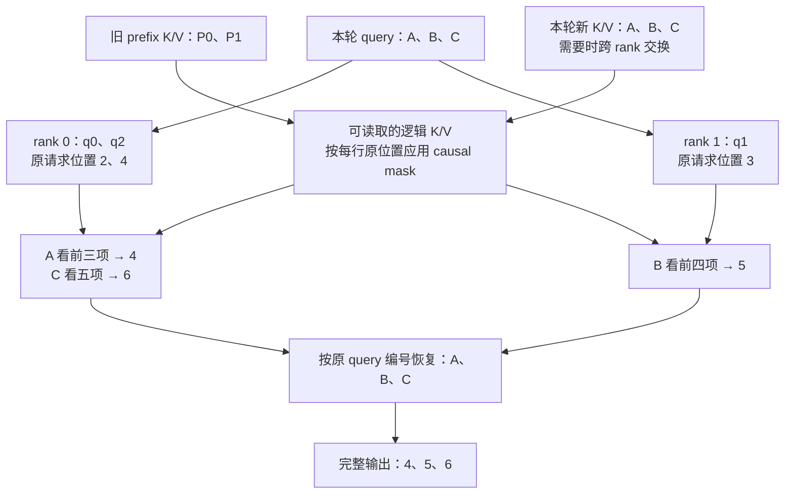
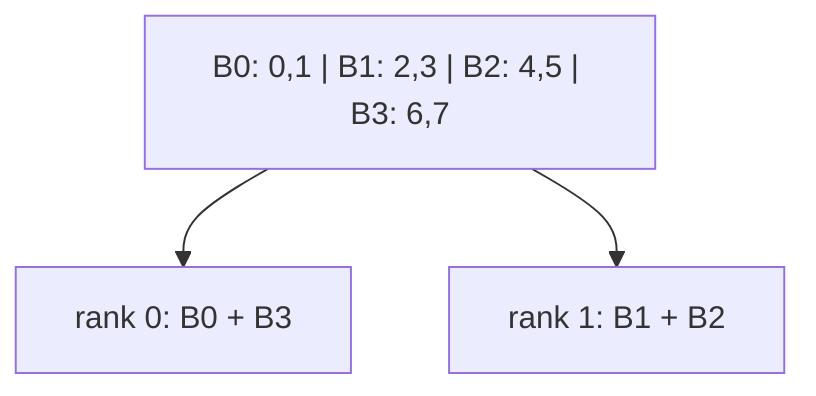
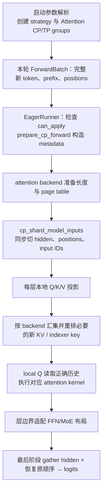

# 03. PCP：把长 prompt 的 query 工作分给多张卡

**简体中文** | [English](../../../en/ai-infra-basic/Parallel_Strategy/03-prefill-context-parallelism.md)

## 1. 作用：让一份长输入由多人一起读

Prefill 要计算许多新 token 的 query，还可能执行 DSA indexer 等工作。PCP（Prefill Context Parallelism）把这些 query 行分给 attention CP 组；每个 rank 只负责一部分行，但每行仍须看见正确的因果历史。

它主要分摊**一个请求的计算**，而 DPA 把**不同请求**交给不同组。它也不同于 chunked prefill：chunking 把时间上的大任务切小，PCP 把同一轮的空间工作分给多卡；是否兼容要看具体路径。

## 2. 从一个能手算的例子理解：PCP 到底在切什么

这一节先不讨论 zigzag、通信后端或 kernel。只解决一个问题：**同一次 attention 里，为什么可以把不同 query 行分给不同卡，而每行需要读取的历史不能随便减少？**

先用普通 dense causal attention（带因果约束的稠密注意力）说明；DSA 的稀疏位置选择留到具体模型实现中再看。

### 2.1 先认清三个对象：Q 提问，K 匹配，V 提供信息

对每个 token，模型会产生三类向量：

| 对象 | 可以怎样理解 | 在 attention 中做什么 |
|---|---|---|
| query，记为 $`q_i`$ | 当前 token 想查什么 | 与每个可见 key 计算匹配分数 |
| key，记为 $`k_j`$ | 历史位置的检索标识 | 与 query 配对，决定这个位置的权重 |
| value，记为 $`v_j`$ | 该位置提供的信息 | 按权重加到最终输出里 |

“匹配分数”不等于最后的输出。attention 先把分数归一化成权重，再用这些权重汇总 value。

**Q 的每一行对应“一个要计算输出的 token”；K/V 的每一行对应“一个可能被读取的历史位置”。** 两者的行数可以不同。

### 2.2 为什么 Q 有 T 行，K/V 却有 L+T 行

假设同一个请求的开头两个 token **P0、P1** 已经算过，它们的 K/V 保留在缓存里。现在要继续 prefill 三个新输入 token **A、B、C**。

这里“新”表示这次 forward 新处理的输入行，不是把 A、B、C 当作尚未生成、互相等待的三个 decode token。以下所有行号、位置编号都从 0 开始。

- $`L=2`$：本轮之前已经缓存的 prefix 长度。
- $`T=3`$：本轮新处理的 token 数。
- 本轮只需计算 A、B、C 的新 query；P0、P1 的旧 query 不需要重算。
- 但新 query 可以读取旧 prefix，因此可用的 K/V 包含 P0、P1、A、B、C，共五行。

| token | 在原请求中的位置 | 本轮新 token 编号 $`i`$ | 本轮 Q 行 | 对应 K/V 行 |
|---|---|---|---|---|
| P0 | 0 | — | 不重算 | $`k_0,v_0`$，从 cache 读取 |
| P1 | 1 | — | 不重算 | $`k_1,v_1`$，从 cache 读取 |
| A | 2 | 0 | $`q_0`$ | $`k_2,v_2`$ |
| B | 3 | 1 | $`q_1`$ | $`k_3,v_3`$ |
| C | 4 | 2 | $`q_2`$ | $`k_4,v_4`$ |

**注意两套编号：$`i=0`$ 表示本轮第一个新 token A，但它在原请求中的位置是 2。** 一般记这个原位置为：

```math
p_i=L+i.
```

表中的位置是请求内部的逻辑顺序，不是 paged KV Cache 的物理地址。

先忽略 batch 和多个 heads，只看一个请求、一个 head。若 q/k 向量宽度为 $`d`$，value 向量宽度为 $`d_v`$：

```math
Q\in\mathbb R^{T\times d}.
```

```math
K\in\mathbb R^{(L+T)\times d},\qquad
V\in\mathbb R^{(L+T)\times d_v}.
```

“shape”就是行数和每行宽度。此例中，Q 有 3 行，K/V 各有 5 行；q 和 k 宽度相同才能做点积，value 的宽度可以不同。输出 O 有 3 行，每行宽度为 $`d_v`$。

如果是完全没有缓存的第一次 prefill，取 $`L=0`$ 即可；不是每次 prefill 都有旧 prefix。

### 2.3 有五行 K/V，不表示每个 query 都能看见五行

因果约束要求：一个 token 只能读取自己和自己之前的位置。

| 本轮 query | 原请求位置 | 能读取的 token | 不能读取的 token |
|---|---|---|---|
| $`q_0`$，对应 A | 2 | P0、P1、A | B、C |
| $`q_1`$，对应 B | 3 | P0、P1、A、B | C |
| $`q_2`$，对应 C | 4 | P0、P1、A、B、C | 无 |

也可以把它画成一张“允许访问表”：

| query 行 / K/V 列 | P0 | P1 | A | B | C |
|---|---|---|---|---|---|
| A 的 query | ✓ | ✓ | ✓ | ✗ | ✗ |
| B 的 query | ✓ | ✓ | ✓ | ✓ | ✗ |
| C 的 query | ✓ | ✓ | ✓ | ✓ | ✓ |

现在就能解释原公式的求和上界：**本轮 query 编号为 $`i`$，对应原位置为 $`L+i`$，所以历史位置 $`j`$ 从 0 取到 $`L+i`$，并且包含自己。**

它不是“只看本轮前面的新 token”，也不是“把全部五行 K/V 无条件加入 softmax”。

### 2.4 先把 attention 算成平均数，手算三个输出

为了只关注历史范围，先把每个 value 简化成一个数，并让所有 query-key 匹配分数都为 0：

```math
[v_0,v_1,v_2,v_3,v_4]=[2,4,6,8,10].
```

相同分数经过 softmax 后，**在合法历史内**得到相同权重；被 mask 的未来位置权重为 0。因此：

```math
O_0=(2+4+6)/3=4.
```

```math
O_1=(2+4+6+8)/4=5.
```

```math
O_2=(2+4+6+8+10)/5=6.
```

完整输出按 A、B、C 排列：

```math
O=[4,5,6]^{\mathsf T}.
```

这个例子里的 attention 恰好是平均数，是因为我们特意令匹配分数相同。**真实 attention 通常是不同权重的加权和，下一小节会拆开这个公式。**

注意：算 $`O_1`$ 用的是 B 的 query 和相应 K/V，**不需要先得到 $`O_0`$**；算 $`O_2`$ 也不需要先得到 $`O_1`$。这就是同一层中 query 行可以并行计算的原因。历史依赖由可见范围保留，不要求这些输出逐行串行完成。

### 2.5 把原来的长公式拆成四个小步骤

对本轮编号为 $`i`$ 的新 token，只访问 $`0\leq j\leq L+i`$ 的历史。

**第一步：算匹配分数。**

```math
s_{ij}=\frac{q_i k_j^{\mathsf T}}{\sqrt d}.
```

$`q_i k_j^{\mathsf T}`$ 是 query 与 key 的点积，结果是一个数；除以 $`\sqrt d`$ 是 attention 的缩放。此处还没有用 value。

**第二步：把所有合法位置的分数变成正数，再求总和。**

```math
Z_i=\sum_{u=0}^{L+i}\exp(s_{iu}).
```

$`u`$ 只是“遍历所有合法历史”的另一个计数符号，与 $`j`$ 遍历的是同一组位置；不是第二份数据，也不是另一个请求。

**第三步：用总和归一化，得到每个位置的权重。**

```math
a_{ij}=\frac{\exp(s_{ij})}{Z_i},\qquad
\sum_{j=0}^{L+i}a_{ij}=1.
```

**第四步：按权重汇总 value。**

```math
O_i=\sum_{j=0}^{L+i}a_{ij}v_j.
```

把四步合并，才得到原来的长公式：

```math
O_i=\sum_{j=0}^{L+i}
\frac{\exp(q_i k_j^{\mathsf T}/\sqrt d)}
{\sum_{u=0}^{L+i}\exp(q_i k_u^{\mathsf T}/\sqrt d)}v_j.
```

如果 value 是一整个向量，权重仍是一个数，只是同时乘到该 value 的每个分量上；输出也相应是一个向量，而不是上述例子的标量。

再看一个**不是简单平均**的小例子：保持前三个 value 为 2、4、6，只把 A 的三个合法分数改为：

```math
[s_{00},s_{01},s_{02}]=[0,0,\log2].
```

它们取指数后为 1、1、2，总和为 4，权重为：

```math
[a_{00},a_{01},a_{02}]=[1/4,1/4,1/2].
```

所以 A 的输出变成：

```math
O_0=\frac14\cdot2+\frac14\cdot4+\frac12\cdot6=4.5.
```

这次 A 更重视自己的 value，但仍然读取了 P0、P1；归一化范围也仍然是 A 的三个合法位置。

### 2.6 换成矩阵看：“行”是工作，“列”是需要读取的信息

数学上可以先构造分数矩阵：

```math
S=QK^{\mathsf T}/\sqrt d,\qquad
S\in\mathbb R^{3\times5}.
```

三行分别是 A、B、C 的 query，五列分别是 P0、P1、A、B、C 的 key。因果 mask 为：

```math
M=
\begin{bmatrix}
0&0&0&-\infty&-\infty\\
0&0&0&0&-\infty\\
0&0&0&0&0
\end{bmatrix}.
```

加上 mask 后，沿每一行做 softmax，再乘 V：

```math
A_{\mathrm{weights}}=\mathrm{softmax}_{\mathrm{row}}(S+M),\qquad
O=A_{\mathrm{weights}}V.
```

$`-\infty`$ 位置在 softmax 后权重为 0。在第 2.4 节的等分数例子里，权重矩阵具体为：

```math
A_{\mathrm{weights}}=
\begin{bmatrix}
1/3&1/3&1/3&0&0\\
1/4&1/4&1/4&1/4&0\\
1/5&1/5&1/5&1/5&1/5
\end{bmatrix}.
```

**PCP 可以分配这张表的不同 query 行，但每一行需要的合法历史列不能凭空少掉。** 行与行不共享 softmax 分母；同一行的所有合法列，却共同决定它的分母。

这些矩阵用于解释数学。FlashAttention 等 kernel 可以分块计算，不必在显存中真的保存完整 S；这不改变哪一行该看哪些历史的要求。

### 2.7 现在才引入两张卡：只是分配不同的提问

先手工分配三行，不加入 zigzag 等策略细节：

| rank | 负责的新 token | 原 query 行编号 | 本地输出 |
|---|---|---|---|
| 0 | A、C | 0、2 | $`[O_0,O_2]=[4,6]`$ |
| 1 | B | 1 | $`[O_1]=[5]`$ |

rank 0 算 A 时看 P0、P1、A；算 C 时看全部五个位置。rank 1 算 B 时看前四个位置。各自得到的结果与未分片时完全相同。



不能把 rank 输出直接按 rank 编号拼接就结束：那会得到 A、C、B 的 $`[4,6,5]`$。恢复原 token 顺序，才能得到 A、B、C 的 $`[4,5,6]`$；某些下游布局也可以携带映射继续计算，但不能丢掉对应关系。

原来抽象的集合 $`I_r`$，在这里就是“rank $`r`$ 负责哪些**原 query 行**”：

```math
I_0=\{0,2\},\qquad I_1=\{1\}.
```

本节按每个原 query 行恰好分给一个 rank 来划分：不能漏行，集合之间也不重叠。此例两组编号合起来正好覆盖全部三行。

$`Q[I_r,:]`$ 表示取出这些 query 行，并保留每行全部特征；冒号表示“这一维全部保留”。将原请求位置一同传入，才有：

```math
O[I_r,:]=\mathrm{Attention}
\left(Q[I_r,:],K,V;\{p_i:i\in I_r\}\right).
```

这条等式没有引入新算法：它只是说，**同样的 query，读取同样的合法 K/V，算出来就是同样的输出；换一张卡计算，不应改变它的输入含义。**

### 2.8 两种很容易写错的地方

**错误一：分了 query，也让它只看本 rank 生成的新 K/V。**

rank 0 负责 A、C，但 C 也必须读取 rank 1 负责的 B。如果 rank 0 已有 prefix，却只保留自己的新 K/V，就会漏掉 B：

```math
O_2^{\mathrm{wrong}}=(2+4+6+10)/4=5.5\neq6.
```

漏掉一列，不仅少了一项 value，softmax 的分母也变化了。因此需要交换必要 KV，或采用其他数学等价的跨片协议。

**错误二：把本地行号当成原 query 行号。**

| token | 原 query 行 $`i`$ | 原请求位置 $`p_i`$ | 所属 rank 的本地行号 |
|---|---|---|---|
| A | 0 | 2 | rank 0 的 0 |
| B | 1 | 3 | rank 1 的 0 |
| C | 2 | 4 | rank 0 的 1 |

C 在 rank 0 的本地行号是 1，但它原本的 query 行编号为 2、原请求位置编号为 4。如果错误地用 $`L+1=3`$ 构造 mask，就会只看 P0、P1、A、B，连 C 自己都被漏掉，得到 5 而不是 6。

**query 的搬移可以改变本地存放顺序，不能改变它的原始因果位置。** 多请求还必须保留请求边界，不能让一个请求读取另一个请求的 KV。

### 2.9 与实现的连接，以及可以运行的检查

本节把每张卡看成“可以读到逻辑上的完整 K/V，再应用原位置 mask”，是为了说明数学。真实 backend 可以只交换必需片段，或者通过分块通信与局部结果归并来避免同时持有全部 KV。

所以：

- PCP 分的是本轮 query 工作，不是把一个请求拆成互不联系的几个小请求。
- 历史依赖仍然存在；被分开的只是这些 query 行在卡上的计算归属。
- **PCP 计算分片不自动等于历史 KV 的持久存储分片。**
- 本例的手工分配用于数学入门，生产 zigzag/interleave 的准入、padding 和 metadata 见后续章节。

运行 [pcp_query_rows_demo.py](./pcp_query_rows_demo.py)，可以直接看到合法位置表、softmax 权重、两卡结果与恢复顺序，以及上面两种错误的数值：

```bash
python3 learning/zh/ai-infra-basic/Parallel_Strategy/pcp_query_rows_demo.py
```

第一次阅读可先记住第 2.4 与 2.7 节的数字，再回头看长公式：**一个 query 对应一个输出；PCP 分配这些输出的计算，但不会减少每个输出原本需要的信息。**

## 3. 为什么简单均分 token 还会负载不均

没有 prefix 时，第 $`i`$ 个 query 看 $`i+1`$ 个位置；有 prefix 时增加 $`L`$。dense causal score 的总数量是：

```math
\sum_{i=0}^{T-1}(L+i+1)=TL+\frac{T(T+1)}2.
```

例：8 tokens、2 ranks。连续切成前四和后四行，工作量分别为 $`1+2+3+4=10`$ 与 $`5+6+7+8=26`$。token 数一样，attention 工作并不一样。

### 3.1 Zigzag：前后配对

等长情况下，把请求的新 token 切成 $`2C`$ 块，rank $`r`$ 取块 $`r`$ 与 $`2C-1-r`$。同样的例子：

| rank | 块 | 原 token 位置 | score 数量 |
|---|---|---|---|
| 0 | 最早 + 最晚 | 0、1、6、7 | $`1+2+7+8=18`$ |
| 1 | 中间两块 | 2、3、4、5 | $`3+4+5+6=18`$ |



真实 ragged 长度要分配余数、padding；本教程 demo 按“前面的块先拿余数”处理。不能假设所有请求都能整除，也不能只用本地行序号构造 causal mask。 上游 `ZigzagCPStrategy.can_apply()` 还要求每个请求本轮新 token 数至少为两倍 CP degree；不足时不采用该策略。demo 为解释数学边界，也枚举更短长度和空块，不表示这些输入会通过生产路径的准入检查。

### 3.2 Interleave：交错取行

在固定上游版本，interleave 对 batch 中**扁平化的新 token 索引**取模，索引不在每个请求处重新归零：

```math
\mathrm{owner}(f)=f\bmod C.
```

两个请求长度为 5 和 3、CP 为 2 时：

| rank | 扁平索引 | 请求内位置 |
|---|---|---|
| 0 | 0、2、4、6 | A0、A2、A4、B1 |
| 1 | 1、3、5、7 | A1、A3、B0、B2 |

请求 B 的第一行属于 rank 1，但只能看 B 的合法历史，不能看请求 A。metadata 必须同时保留请求边界、原始 position、prefix 长度和输出恢复映射。

## 4. SGLang 实现：一次 prefill 怎样真正跑起来

完整逐函数走读在 [PCP 源码篇](../../sglang-source-reading/05-layer-communication/04-prefill-context-parallel-code-walkthrough.md)。这一节先把调用链串起来，不只列文件名。

### 4.1 先区分源码版本与执行路径

本仓库运行时仍保留旧 CP utilities；新版上游固定到 [f2b73d4](https://github.com/sgl-project/sglang/tree/f2b73d4f9b4e64415b8d775b0f811c7801f1728b)。新版有统一 strategy，但 **zigzag + FlashAttention、interleave + DSA、本地旧 NPU CP 并不是同一条调用链**。

| 本文追踪的路径 | 谁分 token | 谁执行 attention |
|---|---|---|
| 上游 zigzag + dense FA | runner + `ZigzagCPStrategy` | strategy 调用 FA backend callback |
| 上游 interleave + DSA | runner + `InterleaveCPStrategy` | DSA backend 组织 indexer 与 sparse attention |
| 本地旧 NPU DSA CP | 模型内旧 `cp_utils` 分片 | NPU indexer + Ascend backend |

参数名称差异见 [00](./00-parallelism-map-and-version-boundaries.md)，不要拿上游 CUDA recipe 直接推断本地 NPU 的支持范围。

### 4.2 上游 eager 路径：先规划，再分片，再执行



主要入口是上游 `EagerRunner._execute_extend()`、`_execute_extend_cp()` 与 `cp/utils.py`。注意：

- `prepare_cp_forward()` 在 backend 本轮 metadata 规划前运行。
- `strategy` 决定布局规则；`ForwardBatch.attn_cp_metadata` 存本批的具体拆分、长度和恢复映射。
- 每个 batch 都要检查 `can_apply()`，不是开关为真就必定分片。
- 部分 group-sharing 模型自己在 `forward()` 管理布局，不能假设所有模型都走同一个 runner 分支。

### 4.3 Zigzag 的真实数据流：分片 → KV 重排 → 两组 attention

沿用一个更适合看实现的例子：prefix 为 2，新 token 为 8，CP 为 2。四个新 token 块 B0/B1/B2/B3 各两行。

| rank | 本地 query 新编号 | 保留的原请求 positions | early / late 的 KV 长度 |
|---|---|---|---|
| 0 | 0、1、6、7 | 2、3、8、9 | 4 / 10 |
| 1 | 2、3、4、5 | 4、5、6、7 | 6 / 8 |

第一步，`shard_hidden_states()` 和 `shard_position_ids()` 按相同 block 索引切分，保留 positions 原值。

第二步，本地 K/V 投影后，FA backend 调用 `strategy.materialize_full_kv()`。它打包 K/V、执行 CP AllGather，再重排：

```text
rank 0: B0 B3     rank 1: B1 B2
gather: B0 B3 B1 B2
inverse block indices [0, 2, 3, 1]
restored: B0 B1 B2 B3
```

恢复顺序后才按 `out_cache_loc` 对应的 slots 写入 KV pool。旧 prefix 的 cache 继续复用；这里交换的是本轮新 KV。

第三步，FA backend 构造 `_fa_cp_attn` callback，交给 `ZigzagCPStrategy.run_attention()`，分别执行 early 与 late query。以 rank 0 为例：

```python
# Example arguments passed through the FA backend callback:
early_queries = [0, 1]
early_kv_length = 4
late_queries = [6, 7]
late_kv_length = 10
# Each block keeps its own causal alignment and prefix extent.
```

这样 early 两行只能看原位置 2、3 之前的合法历史，late 两行则对齐原位置 8、9。两个结果拼接，是拼接**不同 query 的完整输出**，不需要把它们作为同一个 query 的 partial 再做 LSE 归并。

这条 FA 路径采用 KV AllGather：先汇集必要 KV，再执行局部 Q。它没有逐轮环传 KV 块的 Ring 调度。TRTLLM backend 还会使用 combined metadata/page table，将前后块组织成另一种调用方式。

### 4.4 Interleave DSA：继续追 metadata、indexer key 与 MLA KV

interleave 把 flattened 新 token 按 rank 交错切分，但实现不止这一行索引：

1. DSA backend 的 `init_forward_metadata()` 切分各 query 的合法历史长度，并用 `shard_per_request()` 维护请求边界、query 数与 page table。
2. indexer 的 query 留在本地，indexer key 经 `materialize_full_indexer_k_cache()` gather/reorder；本地 query 才能从正确历史里选 top-k。
3. 主 attention 读取的是 MLA latent KV，另有 `materialize_full_mla_kv()` 等路径准备；它与 indexer key 不是同一份 cache。
4. **interleave 的 `run_attention()` 在这个版本返回 `None`；真正的 sparse attention 由 DSA backend 调用。**

例如两个请求的新长度为 5、3，prefix 为 2、1：rank 0 的每请求 query 数为 3、1，rank 1 为 2、2；合法历史长度也必须按各自 query 交错选择。只切 Q 而保留原 metadata，会读错请求或因果范围。

Attention 后可能按 dense TP 或 EP 布局继续计算；最终模型边界的 `gather_hidden_states()` 才负责恢复 logits 所需的逻辑顺序。**新 KV gather、层内 hidden gather、最终 hidden gather 是不同动作。**

### 4.5 本地 NPU：原来 GLM-5.2 的简述对应什么

本地旧版的调用链从 `DeepseekV2ForCausalLM.forward()` 的 metadata 准备开始，随后 `cp_split_and_rebuild_data/position()` 切模型输入。NPU MLA adapter 准备/gather latent KV，`Indexer.forward_npu()` 再准备 indexer key 与前后两组 top-k；`AscendAttnBackend.do_cp_balance_attn()` 执行对应的两次 `npu_sparse_flash_attention`，最后模型 gather/reorder hidden。

它有旧版前后块长度、prefix 累加和 tuple metadata 约定，不能直接套用上游 interleave 的代码。具体源码、每步输入输出及 prefix 在何处相加，见 [源码篇第 12 节](../../sglang-source-reading/05-layer-communication/04-prefill-context-parallel-code-walkthrough.md)。

建议按 **源码篇 2–3 节（启动与 runner）→ 4–8 节（zigzag、KV、kernel、padding）→ 9–11 节（DSA 与层边界）→ 12 节（旧 NPU）** 阅读。配套 CPU trace 会打印实际示例字段与排列，但不会冒充真实多卡运行。

## 5. 缓存容量、混合模型与 NPU 的边界

query 分片、KV 按 token 分片、KV 按层存放是三个不同决定。上游还有 DSA cache LayerSplit 和 at-rest KV sharding，二者有独立开关与 PD/backend 约束，不由 PCP 自动启用。

Hybrid 模型的 softmax attention、indexer、线性 attention 与 MoE 可能使用不同布局；线性层还涉及前缀 recurrent state，不能直接照搬本章无状态 query 行分配。

Ascend 本地示例可继续读 [GLM-5.2 §10.4](../../sglang-ascend-npu/source-code-walkthrough/examples/02-glm-5.2-end-to-end.md)。同样叫 PCP，不代表 CUDA、NPU 或各模型支持完全相同的策略组合。

## 6. 成本与验证

PCP 减少每卡 query 工作，但会增加必要的 KV 通信、布局恢复及 padding。短 prompt、小 batch 或带宽不足时可能不划算。Zigzag 的均衡例子是 dense attention 近似；稀疏 indexer、GEMM 和不同 kernel 会改变实际负载。

运行 [数学 demo](./parallelism_math_demo.py)：比较 contiguous 与 zigzag 工作量；对不整除长度与多请求 interleave，分别执行局部 query，再恢复，与直接 causal attention 对照。

检查题：本地 query 行号为什么不能直接当成原始 position？为什么 PCP 有助 TTFT，却未必减少 decode 的 KV 存储？继续读 [04：DCP](./04-decode-context-parallelism.md)。
