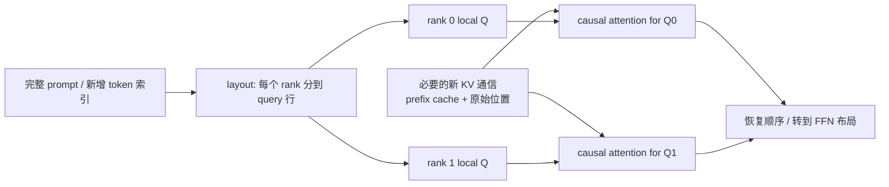
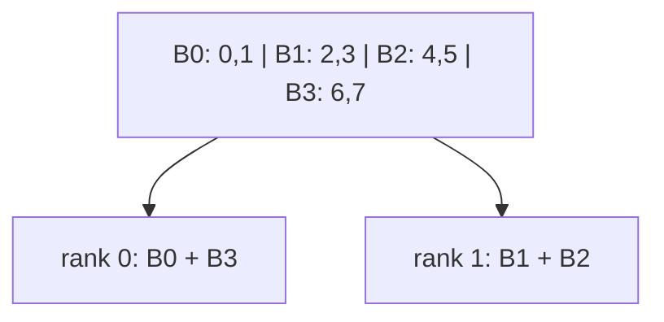

# 03. PCP：把长 prompt 的 query 工作分给多张卡

**简体中文** | [English](../../../en/ai-infra-basic/Parallel_Strategy/03-prefill-context-parallelism.md)

## 1. 作用：让一份长输入由多人一起读

Prefill 要计算许多新 token 的 query，还可能执行 DSA indexer 等工作。PCP（Prefill Context Parallelism）把这些 query 行分给 attention CP 组；每个 rank 只负责一部分行，但每行仍须看见正确的因果历史。

它主要分摊**一个请求的计算**，而 DPA 把**不同请求**交给不同组。它也不同于 chunked prefill：chunking 把时间上的大任务切小，PCP 把同一轮的空间工作分给多卡；是否兼容要看具体路径。

## 2. 数学：可以切 query 行，不能随便删掉历史列

先看单请求单 head。新 token 数 $`T`$，缓存 prefix 长 $`L`$，head dim $`d`$。形状为：

```math
Q\in\mathbb{R}^{T\times d},\qquad
K\in\mathbb{R}^{(L+T)\times d},\qquad
V\in\mathbb{R}^{(L+T)\times d_v}.
```

对新 token 的原始位置 $`i`$：

```math
O_i=\sum_{j=0}^{L+i}
\frac{\exp(q_i k_j^{\mathsf T}/\sqrt d)}
{\sum_{u=0}^{L+i}\exp(q_i k_u^{\mathsf T}/\sqrt d)}v_j.
```

不同 query 行可以独立分配。若 $`I_r`$ 互不重叠且覆盖所有新行：

```math
O[I_r,:]=\mathrm{Attention}(Q[I_r,:],K,V;\text{original causal positions}).
```

最后按原 token 索引恢复输出就与未分片结果一致。错误做法是让本地 query 只看本 rank 的新 K/V：它会丢掉其他 rank 持有的历史，改变模型。



本章以 gather 必要 KV 的路径说明；不同 backend 可以用其他协议。**PCP 计算分片并不自动等于历史 KV 持久存储分片。**

## 3. 为什么简单均分 token 还会负载不均

没有 prefix 时，第 $`i`$ 个 query 看 $`i+1`$ 个位置；有 prefix 时增加 $`L`$。dense causal score 的总数量是：

```math
\sum_{i=0}^{T-1}(L+i+1)=TL+\frac{T(T+1)}2.
```

例：8 tokens、2 ranks。连续切成前四和后四行，工作量分别为 $`1+2+3+4=10`$ 与 $`5+6+7+8=26`$。token 数一样，attention 工作并不一样。

### 3.1 Zigzag：前后配对

等长情况下，把请求的新 token 切成 $`2C`$ 块，rank $`r`$ 取块 $`r`$ 与 $`2C-1-r`$。同样的例子：

| rank | 块 | 原 token 位置 | score 数量 |
|---|---|---|---|
| 0 | 最早 + 最晚 | 0、1、6、7 | $`1+2+7+8=18`$ |
| 1 | 中间两块 | 2、3、4、5 | $`3+4+5+6=18`$ |



真实 ragged 长度要分配余数、padding；本教程 demo 按“前面的块先拿余数”处理。不能假设所有请求都能整除，也不能只用本地行序号构造 causal mask。 上游 `ZigzagCPStrategy.can_apply()` 还要求每个请求本轮新 token 数至少为两倍 CP degree；不足时不采用该策略。demo 为解释数学边界，也枚举更短长度和空块，不表示这些输入会通过生产路径的准入检查。

### 3.2 Interleave：交错取行

在固定上游版本，interleave 对 batch 中**扁平化的新 token 索引**取模，索引不在每个请求处重新归零：

```math
\mathrm{owner}(f)=f\bmod C.
```

两个请求长度为 5 和 3、CP 为 2 时：

| rank | 扁平索引 | 请求内位置 |
|---|---|---|
| 0 | 0、2、4、6 | A0、A2、A4、B1 |
| 1 | 1、3、5、7 | A1、A3、B0、B2 |

请求 B 的第一行属于 rank 1，但只能看 B 的合法历史，不能看请求 A。metadata 必须同时保留请求边界、原始 position、prefix 长度和输出恢复映射。

## 4. SGLang 实现：从 layout 到 backend

基线说明见 [00](./00-parallelism-map-and-version-boundaries.md)。上游 [prefill CP 文档](https://github.com/sgl-project/sglang/blob/f2b73d4f9b4e64415b8d775b0f811c7801f1728b/docs/docs/advanced_features/prefill_cp.mdx) 与以下源码对应：

| 文件/对象 | 责任 |
|---|---|
| [parallel_hook.py](https://github.com/sgl-project/sglang/blob/f2b73d4f9b4e64415b8d775b0f811c7801f1728b/python/sglang/srt/arg_groups/parallel_hook.py) | 解析 `enable_prefill_cp`、`cp_strategy`、degree 与兼容性 |
| [ContextParallelStrategy](https://github.com/sgl-project/sglang/blob/f2b73d4f9b4e64415b8d775b0f811c7801f1728b/python/sglang/srt/layers/cp/base.py) | 将 layout 策略与模型/attention 解耦 |
| [zigzag.py](https://github.com/sgl-project/sglang/blob/f2b73d4f9b4e64415b8d775b0f811c7801f1728b/python/sglang/srt/layers/cp/zigzag.py) / [interleave.py](https://github.com/sgl-project/sglang/blob/f2b73d4f9b4e64415b8d775b0f811c7801f1728b/python/sglang/srt/layers/cp/interleave.py) | split、metadata、恢复与模型/backend 连接 |
| `ForwardBatch.attn_cp_metadata` | 保存本轮 query/KV 长度、布局等信息 |
| attention backend | 消费局部 query 与必要 KV，执行正确的 causal attention |
| layer boundary | 将 CP-local 行转成下游 TP/EP 所需布局 |

本地快照的旧入口见 [server_args.py](../../../../python/sglang/srt/server_args.py)、[communicator_dsa_cp.py](../../../../python/sglang/srt/layers/communicator_dsa_cp.py)。其中 `in-seq-split`、`round-robin-split` 是旧命名；不要只做字符串替换就认为完成版本迁移。

## 5. 缓存容量、混合模型与 NPU 的边界

query 分片、KV 按 token 分片、KV 按层存放是三个不同决定。上游还有 DSA cache LayerSplit 和 at-rest KV sharding，二者有独立开关与 PD/backend 约束，不由 PCP 自动启用。

Hybrid 模型的 softmax attention、indexer、线性 attention 与 MoE 可能使用不同布局；线性层还涉及前缀 recurrent state，不能直接照搬本章无状态 query 行分配。

Ascend 本地示例可继续读 [GLM-5.2 §10.4](../../sglang-ascend-npu/source-code-walkthrough/examples/02-glm-5.2-end-to-end.md)。同样叫 PCP，不代表 CUDA、NPU 或各模型支持完全相同的策略组合。

## 6. 成本与验证

PCP 减少每卡 query 工作，但会增加必要的 KV 通信、布局恢复及 padding。短 prompt、小 batch 或带宽不足时可能不划算。Zigzag 的均衡例子是 dense attention 近似；稀疏 indexer、GEMM 和不同 kernel 会改变实际负载。

运行 [数学 demo](./parallelism_math_demo.py)：比较 contiguous 与 zigzag 工作量；对不整除长度与多请求 interleave，分别执行局部 query，再恢复，与直接 causal attention 对照。

检查题：本地 query 行号为什么不能直接当成原始 position？为什么 PCP 有助 TTFT，却未必减少 decode 的 KV 存储？继续读 [04：DCP](./04-decode-context-parallelism.md)。
