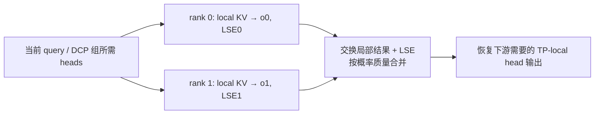
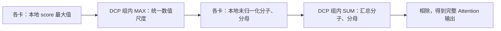
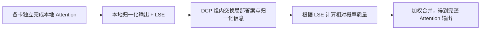

# 04. DCP：分历史 KV，用正确的 softmax 合并局部答案

**简体中文** | [English](../../../en/ai-infra-basic/Parallel_Strategy/04-decode-context-parallelism.md)

## 1. 作用：一个新 query，也能让多卡分担历史读取

Decode 的新 query 行很少，但历史很长。DCP（Decode Context Parallelism）让不同 rank 持有不同历史 KV，并计算同一 query 对各自历史的贡献。尤其在 absorbed MLA 中，TP 能切 query heads，却不一定减少各卡重复的 latent KV；DCP 补上历史维度的切分。



它不是复制多份请求，也不是简单平均局部 attention。下面从单 query 推导这个区别。

## 2. 推导一：直接合并未归一化分子分母

### 2.1 每张卡只负责分子、分母的一部分

先固定**同一个请求、同一个 query、同一个 head**。历史索引按互不重叠的 $`J_r`$ 分组，rank $`r`$ 只持有其中一组 KV，score 为 $`s_j=qk_j^{\mathsf T}/\sqrt d`$。完整 attention 是一个“加权和除以权重总和”：

```math
o=\frac{\sum_j\exp(s_j)v_j}{\sum_j\exp(s_j)}.
```

分子是 value 的未归一化加权和，分母决定如何把它变成加权平均。每张卡只能计算其中一部分，所以两者都要汇总，不能只把各卡已经归一化的输出直接相加。

### 2.2 按这个写法直接实现，通信发生在哪里？

第一步，各卡计算本地 score 最大值，再在 DCP 组内通过 `AllReduce(MAX)` 得到共同的最大值：

```math
m_r=\max_{j\in J_r}s_j,\qquad m=\max_r m_r.
```

第二步，各卡使用**同一个**最大值计算本地分子、分母：

```math
z_r=\sum_{j\in J_r}\exp(s_j-m),\qquad
u_r=\sum_{j\in J_r}\exp(s_j-m)v_j.
```

减去共同最大值是为了数值稳定，不改变最终答案，因为它给所有指数权重乘上了相同的缩放因子。对一个 query/head，分母 $`z_r`$ 是标量，分子 $`u_r`$ 是一个宽度为 $`d_v`$ 的 value 向量。

第三步，通过组内 SUM 规约汇总两个量，最后相除：

```math
Z=\sum_r z_r,\qquad U=\sum_r u_r,\qquad o=\frac{U}{Z}.
```

易于理解的实现是：先 `AllReduce(MAX)`，再本地计算，最后 `AllReduce(SUM)`。分子和分母可以打包做 SUM，不一定分别调用两次 collective。这是本推导的直接实现方式，不是在规定所有 DCP backend 都必须使用相同的 collective 次数或输出布局。



### 2.3 这里的“全局”不等于整个集群

这里汇总的是**同一份 Attention 的历史分片**，通信范围是对应的 DCP 组，不是所有 TP、DP、EP rank 无差别参加。

也不需要把所有原始 KV 汇总到一张卡：历史 KV 仍留在各自的 owner 上，交换的是最大值、分子和分母等摘要。例子先固定了一个 query/head；实际 batch 会为多个 query/head 分别维护这些量，不是让所有请求共享一个 softmax 分母。

旧 [sp_inference_demo.py](./sp_inference_demo.py) 就用类似的全局 max、sum、输出分子规约验证 CP 原理。实际 DCP 还需要缓存地址、query/head 布局和专用 kernel。

## 3. 推导二：kernel 已返回局部归一化结果怎么办

### 3.1 本地平均已经算好了，但每部分应该占多少权重？

第二种写法允许各卡先独立完成本地 Attention。高效 kernel 常返回两个东西：

- 局部输出 $`o_r`$：只在本卡历史范围内算出的加权平均，是一个 value 向量。
- 局部 LSE $`\ell_r`$：本卡 softmax 分母的对数，是一个标量；它保留了“这部分历史有多大权重”的信息。

```math
\ell_r=\log\sum_{j\in J_r}\exp(s_j),\qquad
o_r=\frac{\sum_{j\in J_r}\exp(s_j)v_j}{\exp(\ell_r)}.
```

实际 kernel 不必先算可能溢出的原始指数和，再取对数；它可以使用本地最大值稳定地计算：

```math
\ell_r=m_r+\log\sum_{j\in J_r}\exp(s_j-m_r).
```

因此各卡**不必在完成本地 Attention 之前，就先取得全局 score 最大值**。但各卡仍不知道其他历史分片在完整 softmax 中占多少权重，只靠本地输出不能得出完整答案。

### 3.2 交换局部答案与 LSE，再按概率质量合并

数学上的完整 LSE 与正确输出为：

```math
\ell=\log\sum_r\exp(\ell_r),\qquad
o=\sum_r\exp(\ell_r-\ell)o_r.
```

每个局部结果的权重，是它在完整 softmax 中占据的**概率质量**，不是由各卡 token 数直接决定，也不是默认每卡权重相等。

合并时也要保持数值稳定。对已交换到合并位置的 LSE，取共同的参考值，再计算相对权重：

```math
a=\max_r\ell_r,\qquad w_r=\exp(\ell_r-a),\qquad o=\frac{\sum_r w_r o_r}{\sum_r w_r}.
```

这里的参考值是**局部 LSE 的最大值**，不要求它等于推导一的全局 score 最大值；共同缩放会在分子分母中抵消。相对权重也尚未归一化，最后除以权重总和才得到正确的加权平均。



**推导二仍然需要跨卡通信。** 变化只是各卡可以先算出完整的本地摘要，随后再交换、合并；不是每张卡独立算完自己的局部 Attention，就能不通信地得到全历史结果。实际可以交换打包的 output/LSE，也可以组合 gather 与 reduce-scatter；具体见第 5 节，不能仅凭合并公式断言 collective 次数一定更少。

### 3.3 两个 rank 的手算例子

把 value 宽度临时取为一维。两个 rank 各有一个历史 token：

| 对象 | rank 0 | rank 1 |
|---|---|---|
| score | $`0`$ | $`\log 3`$ |
| value | $`2`$ | $`10`$ |
| 局部归一化输出 | $`o_0=2`$ | $`o_1=10`$ |
| 局部 LSE | $`\ell_0=0`$ | $`\ell_1=\log 3`$ |
| 未归一化概率质量 | $`e^{\ell_0}=1`$ | $`e^{\ell_1}=3`$ |

局部 softmax 都只有一项，其局部概率都等于一，所以只看两个输出，根本看不出第二个 token 在全历史中应该占更大权重。LSE 补回了这个信息，正确答案是：

```math
o=\frac{1\cdot2+3\cdot10}{1+3}=8.
```

直接求和得到 $`12`$，平均得到 $`6`$，都错。使用稳定写法时，两卡的相对权重分别为 $`1/3`$ 和 $`1`$，最终归一化后的权重仍是 $`1/4`$ 和 $`3/4`$，答案不变。

实际合并必须核对 LSE 是自然对数还是以 2 为底：上面的指数公式采用自然对数；以 2 为底的 LSE 要配合相应的底数。还要处理全被 mask 或没有有效历史的局部分片：其概率质量为零，不能让空片的 NaN 污染结果；所有分片均无有效位置时，也必须走后端约定的特殊处理，不能直接相除。

### 3.4 两种推导的真正区别

| 比较项 | 推导一的直接实现 | 推导二 |
|---|---|---|
| 本地计算前是否先统一 score 尺度 | 先取得全局 score 最大值，再算本地分子分母 | 本地 Attention 可以独立使用本地尺度 |
| 合并时使用什么摘要 | 共同尺度下的未归一化分子、分母 | 局部归一化输出、LSE |
| 是否需要 DCP 组内通信 | 需要 | 仍然需要 |
| 是否必须汇总原始 KV | 不需要 | 不需要 |
| 最终计算的目标 | 完整历史上的 Attention | 同一个 Attention；只改变组织方式 |

一句话记忆：**推导一是“先统一尺度，再汇总分子分母”；推导二是“先算局部答案，再按概率质量合并”。** 两者在数学上等价，实际浮点误差与性能取决于 kernel、归约顺序及通信实现。

## 4. 缓存地址：逻辑位置与本卡物理行分开

先采用逐 token interleave 的教学模型，DCP degree 为 $`C`$，共享虚拟 slot 为 $`v`$：

```math
\mathrm{owner}(v)=v\bmod C,\qquad
\mathrm{local}(v)=\lfloor v/C\rfloor.
```

| 虚拟 slots | rank 0 的物理行 | rank 1 的物理行 |
|---|---|---|
| 0、1、2、3、4、5 | 0、1、2 对应 0、2、4 | 0、1、2 对应 1、3、5 |

每张卡都看到一致的请求→虚拟 slot 映射，但只写入自己拥有的 slot。物理每页容量为 $`P`$ 时，虚拟页可容纳 $`PC`$ 个 slots；这不是每卡真的多出 $`C`$ 倍显存。

上游 [layout.py](https://github.com/sgl-project/sglang/blob/f2b73d4f9b4e64415b8d775b0f811c7801f1728b/python/sglang/srt/layers/dcp/layout.py) 的 `maybe_dcp_kernel_indices()` 对应逐 slot 筛选；`localize_dcp_indices()` 还支持 block interleave 参数。因此上面只是最小模型，真实 backend 的页粒度、padding 和 sparse 索引必须按实际约定转换。

## 5. SGLang 的实际通信路径

固定上游 [DCP 文档](https://github.com/sgl-project/sglang/blob/f2b73d4f9b4e64415b8d775b0f811c7801f1728b/docs/docs/advanced_features/dcp.mdx) 的 absorbed MLA 主路径可按下列顺序读：

1. 参数解析 DCP group 与 degree，嵌套在所属 Attention TP/DPA 范围内。
2. 按 owner 规则写本地 KV，建立本地 metadata/page table。
3. 让各 rank 获得计算自己历史贡献所需的 query heads。
4. attention kernel 输出局部 normalized output 与 LSE。
5. 交换并合并，恢复普通 TP-local head 布局。

| 实现 | 关键区别 |
|---|---|
| `ag_rs` | query gather，LSE gather，输出 reduce-scatter |
| `a2a` | 打包 output+LSE 做 all-to-all，然后本地合并 |
| `fi_a2a` | 使用 FlashInfer 的特定 MNNVL all-to-all 路径，受硬件域限制 |
| replicated Q projection | 启动时复制支持的 query 投影权重，换取少一次逐层 query gather；增加权重与计算 |

实际代码见 [comm.py](https://github.com/sgl-project/sglang/blob/f2b73d4f9b4e64415b8d775b0f811c7801f1728b/python/sglang/srt/layers/dcp/comm.py)、[metadata.py](https://github.com/sgl-project/sglang/blob/f2b73d4f9b4e64415b8d775b0f811c7801f1728b/python/sglang/srt/layers/dcp/metadata.py)、[planner.py](https://github.com/sgl-project/sglang/blob/f2b73d4f9b4e64415b8d775b0f811c7801f1728b/python/sglang/srt/layers/dcp/planner.py)。不要把本章 all-to-all 说成“将所有原始 KV 重新复制到所有卡”：交换的核心对象是局部答案与归一化信息。

## 6. 内存收益与代价

普通 GQA 单请求的 KV payload 近似为 $`M=2L_{\mathrm{layers}}TH_{\mathrm{KV}}ds`$ 字节。理想均匀 DCP 后，每卡存其中约 $`M/C`$；MLA 必须改用真实 latent cache 宽度计算。

其中层数为 $`L_{\mathrm{layers}}`$，历史长度为 $`T`$，KV head 数为 $`H_{\mathrm{KV}}`$，每 head 宽度为 $`d`$，元素字节数为 $`s`$。下面仅将成本分项列账；不同实现可能重叠计算与访存，不是精确延迟预测。

```math
t_{\mathrm{decode}}\approx
t_{\mathrm{query}}+
\frac{\mathrm{local\ KV\ bytes}}{B_{\mathrm{HBM}}}
+t_{\mathrm{attention}}+t_{\mathrm{merge}}.
```

随着历史变长，分摊 KV 读取可能收益更大；短历史时，新增 collective 和 query 布局成本可能主导。page metadata、复制 query 权重、draft KV、临时输出也会占内存。

DCP 不自动缩小 GDN/KDA 的 request-indexed recurrent state，也不能从一个已验证的 MLA kernel 推断所有 MHA/DSA/NPU kernel 都支持。此本地源码快照尚无完整 DCP 实现；本文的具体 DCP API 全部链接到固定上游，而不是本地伪入口。

## 7. 练习与正确性检查

[数学 demo](./parallelism_math_demo.py) 验证单 token、长历史、大 score、空分片的 LSE 合并；输出应与直接全历史 attention 一致。同时检查 owner/local 索引可逆、每个 slot 恰好有一个 owner。

故障时先查：LSE 对数底、全局 causal position、virtual/physical page 映射、partial head 顺序、请求取消与 slot 复用。继续读 [05：DWDP](./05-dwdp-weight-parallelism.md)。
