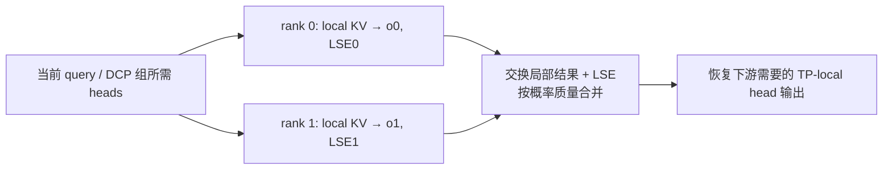
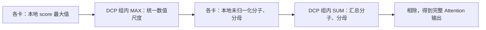
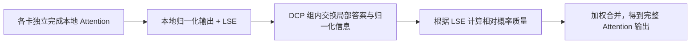
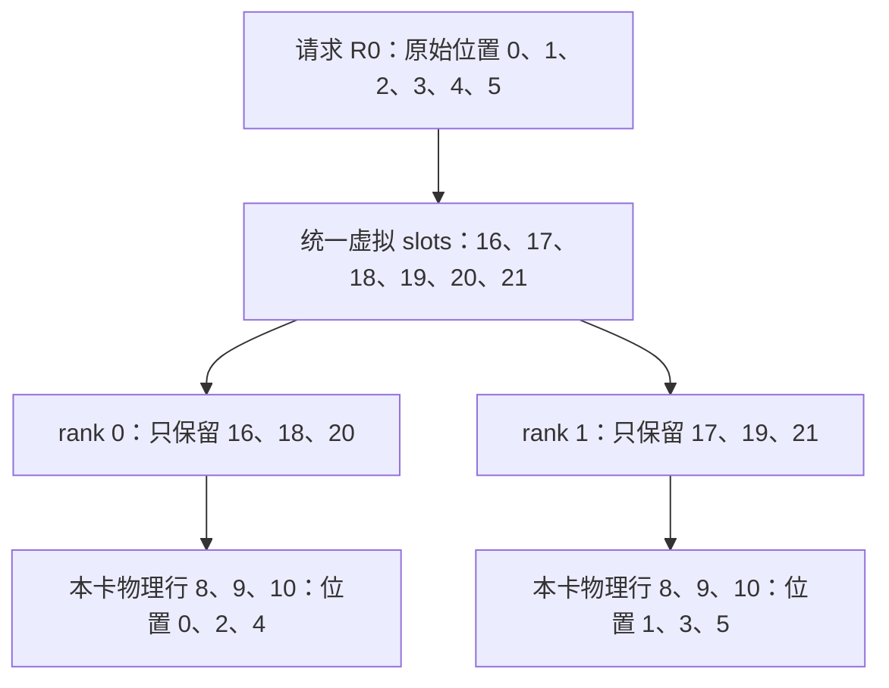
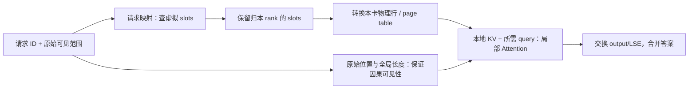

# 04. DCP：分历史 KV，用正确的 softmax 合并局部答案

**简体中文** | [English](../../../en/ai-infra-basic/Parallel_Strategy/04-decode-context-parallelism.md)

## 1. 作用：一个新 query，也能让多卡分担历史读取

Decode 的新 query 行很少，但历史很长。DCP（Decode Context Parallelism）让不同 rank 持有不同历史 KV，并计算同一 query 对各自历史的贡献。尤其在 absorbed MLA 中，TP 能切 query heads，却不一定减少各卡重复的 latent KV；DCP 补上历史维度的切分。



它不是复制多份请求，也不是简单平均局部 attention。下面从单 query 推导这个区别。

## 2. 推导一：直接合并未归一化分子分母

### 2.1 每张卡只负责分子、分母的一部分

先固定**同一个请求、同一个 query、同一个 head**。历史索引按互不重叠的 $`J_r`$ 分组，rank $`r`$ 只持有其中一组 KV，score 为 $`s_j=qk_j^{\mathsf T}/\sqrt d`$。完整 attention 是一个“加权和除以权重总和”：

```math
o=\frac{\sum_j\exp(s_j)v_j}{\sum_j\exp(s_j)}.
```

分子是 value 的未归一化加权和，分母决定如何把它变成加权平均。每张卡只能计算其中一部分，所以两者都要汇总，不能只把各卡已经归一化的输出直接相加。

### 2.2 按这个写法直接实现，通信发生在哪里？

第一步，各卡计算本地 score 最大值，再在 DCP 组内通过 `AllReduce(MAX)` 得到共同的最大值：

```math
m_r=\max_{j\in J_r}s_j,\qquad m=\max_r m_r.
```

第二步，各卡使用**同一个**最大值计算本地分子、分母：

```math
z_r=\sum_{j\in J_r}\exp(s_j-m),\qquad
u_r=\sum_{j\in J_r}\exp(s_j-m)v_j.
```

减去共同最大值是为了数值稳定，不改变最终答案，因为它给所有指数权重乘上了相同的缩放因子。对一个 query/head，分母 $`z_r`$ 是标量，分子 $`u_r`$ 是一个宽度为 $`d_v`$ 的 value 向量。

第三步，通过组内 SUM 规约汇总两个量，最后相除：

```math
Z=\sum_r z_r,\qquad U=\sum_r u_r,\qquad o=\frac{U}{Z}.
```

易于理解的实现是：先 `AllReduce(MAX)`，再本地计算，最后 `AllReduce(SUM)`。分子和分母可以打包做 SUM，不一定分别调用两次 collective。这是本推导的直接实现方式，不是在规定所有 DCP backend 都必须使用相同的 collective 次数或输出布局。



### 2.3 这里的“全局”不等于整个集群

这里汇总的是**同一份 Attention 的历史分片**，通信范围是对应的 DCP 组，不是所有 TP、DP、EP rank 无差别参加。

也不需要把所有原始 KV 汇总到一张卡：历史 KV 仍留在各自的 owner 上，交换的是最大值、分子和分母等摘要。例子先固定了一个 query/head；实际 batch 会为多个 query/head 分别维护这些量，不是让所有请求共享一个 softmax 分母。

旧 [sp_inference_demo.py](./sp_inference_demo.py) 就用类似的全局 max、sum、输出分子规约验证 CP 原理。实际 DCP 还需要缓存地址、query/head 布局和专用 kernel。

## 3. 推导二：kernel 已返回局部归一化结果怎么办

### 3.1 本地平均已经算好了，但每部分应该占多少权重？

第二种写法允许各卡先独立完成本地 Attention。高效 kernel 常返回两个东西：

- 局部输出 $`o_r`$：只在本卡历史范围内算出的加权平均，是一个 value 向量。
- 局部 LSE $`\ell_r`$：本卡 softmax 分母的对数，是一个标量；它保留了“这部分历史有多大权重”的信息。

```math
\ell_r=\log\sum_{j\in J_r}\exp(s_j),\qquad
o_r=\frac{\sum_{j\in J_r}\exp(s_j)v_j}{\exp(\ell_r)}.
```

实际 kernel 不必先算可能溢出的原始指数和，再取对数；它可以使用本地最大值稳定地计算：

```math
\ell_r=m_r+\log\sum_{j\in J_r}\exp(s_j-m_r).
```

因此各卡**不必在完成本地 Attention 之前，就先取得全局 score 最大值**。但各卡仍不知道其他历史分片在完整 softmax 中占多少权重，只靠本地输出不能得出完整答案。

### 3.2 交换局部答案与 LSE，再按概率质量合并

数学上的完整 LSE 与正确输出为：

```math
\ell=\log\sum_r\exp(\ell_r),\qquad
o=\sum_r\exp(\ell_r-\ell)o_r.
```

每个局部结果的权重，是它在完整 softmax 中占据的**概率质量**，不是由各卡 token 数直接决定，也不是默认每卡权重相等。

合并时也要保持数值稳定。对已交换到合并位置的 LSE，取共同的参考值，再计算相对权重：

```math
a=\max_r\ell_r,\qquad w_r=\exp(\ell_r-a),\qquad o=\frac{\sum_r w_r o_r}{\sum_r w_r}.
```

这里的参考值是**局部 LSE 的最大值**，不要求它等于推导一的全局 score 最大值；共同缩放会在分子分母中抵消。相对权重也尚未归一化，最后除以权重总和才得到正确的加权平均。



**推导二仍然需要跨卡通信。** 变化只是各卡可以先算出完整的本地摘要，随后再交换、合并；不是每张卡独立算完自己的局部 Attention，就能不通信地得到全历史结果。实际可以交换打包的 output/LSE，也可以组合 gather 与 reduce-scatter；具体见第 5 节，不能仅凭合并公式断言 collective 次数一定更少。

### 3.3 两个 rank 的手算例子

把 value 宽度临时取为一维。两个 rank 各有一个历史 token：

| 对象 | rank 0 | rank 1 |
|---|---|---|
| score | $`0`$ | $`\log 3`$ |
| value | $`2`$ | $`10`$ |
| 局部归一化输出 | $`o_0=2`$ | $`o_1=10`$ |
| 局部 LSE | $`\ell_0=0`$ | $`\ell_1=\log 3`$ |
| 未归一化概率质量 | $`e^{\ell_0}=1`$ | $`e^{\ell_1}=3`$ |

局部 softmax 都只有一项，其局部概率都等于一，所以只看两个输出，根本看不出第二个 token 在全历史中应该占更大权重。LSE 补回了这个信息，正确答案是：

```math
o=\frac{1\cdot2+3\cdot10}{1+3}=8.
```

直接求和得到 $`12`$，平均得到 $`6`$，都错。使用稳定写法时，两卡的相对权重分别为 $`1/3`$ 和 $`1`$，最终归一化后的权重仍是 $`1/4`$ 和 $`3/4`$，答案不变。

实际合并必须核对 LSE 是自然对数还是以 2 为底：上面的指数公式采用自然对数；以 2 为底的 LSE 要配合相应的底数。还要处理全被 mask 或没有有效历史的局部分片：其概率质量为零，不能让空片的 NaN 污染结果；所有分片均无有效位置时，也必须走后端约定的特殊处理，不能直接相除。

### 3.4 两种推导的真正区别

| 比较项 | 推导一的直接实现 | 推导二 |
|---|---|---|
| 本地计算前是否先统一 score 尺度 | 先取得全局 score 最大值，再算本地分子分母 | 本地 Attention 可以独立使用本地尺度 |
| 合并时使用什么摘要 | 共同尺度下的未归一化分子、分母 | 局部归一化输出、LSE |
| 是否需要 DCP 组内通信 | 需要 | 仍然需要 |
| 是否必须汇总原始 KV | 不需要 | 不需要 |
| 最终计算的目标 | 完整历史上的 Attention | 同一个 Attention；只改变组织方式 |

一句话记忆：**推导一是“先统一尺度，再汇总分子分母”；推导二是“先算局部答案，再按概率质量合并”。** 两者在数学上等价，实际浮点误差与性能取决于 kernel、归约顺序及通信实现。

## 4. 缓存地址：逻辑位置与本卡物理行分开

### 4.1 先问：这个 token 的 KV，到底放在哪张卡的哪个格子？

第 2、3 节解决的是“各卡算出的答案怎样合并”。在计算之前，还要解决另一个问题：**当前 token 的 KV 应该写在哪里，历史 KV 又应该从哪里读？**

先固定一个 DCP 组，两张卡共同服务同一请求。采用**逐 token 交错**的布局：请求的偶数位置放 rank 0，奇数位置放 rank 1。它不是“前半段归卡 0、后半段归卡 1”。

这里一个“格子”表示某层一个 token 的 KV entry：可以包含多维 K/V，也可以是 MLA latent，不是只有一个数。所谓本卡“物理行”，是本卡 cache pool 的条目编号，不是设备指针的字节地址；kernel 还会根据真实 tensor layout/stride 定位数据。

### 4.2 先分清四种编号，别急着代入公式

下文的 token 位置、slot、行号和页号均从零开始，所有 rank 编号均指 DCP 组内 rank。

| 名字 | 回答的问题 | 本节例子 |
|---|---|---|
| 请求内 token 位置 $`p`$ | 这是该请求的第几个 token？ | 请求 R0 的位置 $`0`$、$`1`$、$`2`$ |
| 虚拟 slot $`v`$ | 运行时给这个 token 的 KV 分配了哪个统一编号？ | 可以是 $`16`$、$`17`$、$`18`$，不一定从零分配 |
| owner rank | 统一编号对应哪张卡？ | rank 0 或 rank 1 |
| 本卡物理行 $`\lambda`$ | 到了那张卡，在它自己的 pool 中读写哪一行？ | 可以是本卡行号 $`8`$、$`9`$ |

请求内位置描述**序列语义**，虚拟 slot 描述**缓存分配**。两者不能混用：R0 和 R1 都可以有位置零，但没有共享 prefix 等特殊安排时，它们应分配不同的 KV 存储。

“虚拟”不是说又保存了一份完整 KV。它是一套组内一致的编号：同一个虚拟 slot，通过规则可以翻译成“哪张卡 + 哪一行”。本节假设无 prefix 共享，且从页边界开始分配。

### 4.3 一个虚拟编号，怎样翻译成 rank 和行？

令 DCP degree 为 $`C`$。先只看逐 token 交错的映射：

```math
\mathrm{owner}(v)=v\bmod C,\qquad
\mathrm{local}(v)=\lfloor v/C\rfloor.
```

余数决定轮到哪张卡，商决定在这张卡上排到哪一行。取 $`C=2`$，假设请求前六个 token 分配到虚拟 slots $`16`$ 到 $`21`$：

| 请求内位置 | 虚拟 slot | owner：除以二的余数 | 本卡物理行：除以二向下取整 |
|---|---|---|---|
| $`0`$ | $`16`$ | rank 0 | $`8`$ |
| $`1`$ | $`17`$ | rank 1 | $`8`$ |
| $`2`$ | $`18`$ | rank 0 | $`9`$ |
| $`3`$ | $`19`$ | rank 1 | $`9`$ |
| $`4`$ | $`20`$ | rank 0 | $`10`$ |
| $`5`$ | $`21`$ | rank 1 | $`10`$ |

虚拟 slots $`16`$ 和 $`17`$ 都映射到“行号八”，为什么不会覆盖？因为完整地址要带上 rank：$`(0,8)`$ 和 $`(1,8)`$ 是**不同卡的不同存储**。



可以反过来验证没有丢失信息：

```math
v=C\lambda+r,\qquad r=\mathrm{owner}(v),\quad \lambda=\mathrm{local}(v).
```

### 4.4 为什么一个“虚拟页”能容纳两卡合计的 token？

KV cache 通常按 page 分配，而不是每次为一个 token 单独向设备申请内存。令每卡物理页容量为 $`P=4`$，DCP degree 为 $`C=2`$：

```math
P_{\mathrm{virtual}}=PC=8.
```

一个容量为八的虚拟页，对应 rank 0 的一个四行物理页，以及 rank 1 的一个四行物理页。不是某张卡的物理页突然能装八行。

以虚拟页 ID $`b=2`$ 为例，它的虚拟 slots 是 $`16`$ 到 $`23`$：

| 虚拟页内 offset | 虚拟 slot | owner | 本卡物理页 ID | 本卡页内 offset | 本卡物理行 |
|---|---|---|---|---|---|
| $`0`$ | $`16`$ | rank 0 | $`2`$ | $`0`$ | $`8`$ |
| $`1`$ | $`17`$ | rank 1 | $`2`$ | $`0`$ | $`8`$ |
| $`2`$ | $`18`$ | rank 0 | $`2`$ | $`1`$ | $`9`$ |
| $`3`$ | $`19`$ | rank 1 | $`2`$ | $`1`$ | $`9`$ |
| $`4`$ | $`20`$ | rank 0 | $`2`$ | $`2`$ | $`10`$ |
| $`5`$ | $`21`$ | rank 1 | $`2`$ | $`2`$ | $`10`$ |
| $`6`$ | $`22`$ | rank 0 | $`2`$ | $`3`$ | $`11`$ |
| $`7`$ | $`23`$ | rank 1 | $`2`$ | $`3`$ | $`11`$ |

对任意虚拟 slot，可以先得到虚拟页及其页内 offset，再得到本卡行：

```math
b=\left\lfloor\frac{v}{PC}\right\rfloor,\qquad o_v=v\bmod(PC),\qquad
\lambda=bP+\left\lfloor\frac{o_v}{C}\right\rfloor.
```

因此对应的本卡物理页 ID 与页内 offset 为：

```math
\mathrm{page}_{\mathrm{local}}=\left\lfloor\lambda/P\right\rfloor=b,\qquad
\mathrm{offset}_{\mathrm{local}}=\lambda\bmod P.
```

两张卡上的物理页 ID 可以数值相同，但属于各自的显存。若每卡 pool 有 $`M`$ 个物理行，组内这套虚拟编号理想上覆盖 $`CM`$ 个独立条目；它描述的是**多卡合计容量**，不是给每卡凭空增加显存。实际还要扣除保留页、padding 等开销。

### 4.5 请求历史连续，不代表分配的页号连续

现在让 R0 增长到十个 token。假设 allocator 给它的两个虚拟页 ID 是 $`2`$ 和 $`7`$，中间的页可能已经分给其他请求。

这里把请求的逻辑页到虚拟页 ID 的映射记作 $`B_{R0}`$：

```math
B_{R0}[0]=2,\qquad B_{R0}[1]=7.
```

对请求内位置，完整寻址过程为：

```math
b_{\mathrm{req}}=\left\lfloor\frac{p}{PC}\right\rfloor,\qquad
v=B_{R0}[b_{\mathrm{req}}]\,PC+(p\bmod PC).
```

先求请求内的逻辑页编号，再查分配到的虚拟页 ID，最后使用第 4.3 节规则得到 owner 和物理行：

| 请求位置 | 虚拟页 ID | 虚拟 slot | owner | 本卡物理行 |
|---|---|---|---|---|
| $`0,1`$ | $`2`$ | $`16,17`$ | rank 0、rank 1 各一个 | 两卡各为 $`8`$ |
| $`2,3`$ | $`2`$ | $`18,19`$ | rank 0、rank 1 各一个 | 两卡各为 $`9`$ |
| $`4,5`$ | $`2`$ | $`20,21`$ | rank 0、rank 1 各一个 | 两卡各为 $`10`$ |
| $`6,7`$ | $`2`$ | $`22,23`$ | rank 0、rank 1 各一个 | 两卡各为 $`11`$ |
| $`8,9`$ | $`7`$ | $`56,57`$ | rank 0、rank 1 各一个 | 两卡各为 $`28`$ |

所以不能写“位置八的 KV 一定紧接物理行十一，放到行十二”。本例实际跳到了本卡行二十八。

两请求即使位置相同，也不因此碰撞：如果 R1 的第一个虚拟页 ID 是 $`4`$，它的位置零对应虚拟 slot $`32`$、rank 0 物理行 $`16`$，与 R0 的位置零不是同一个地址。

这张页表是解释分配关系的教学表示，不保证所有 backend 都有一个同名数组。SGLang 也会通过 `req_to_token` 等结构直接记录请求位置对应的 token slot，并为 kernel 构造所需 page table / 索引列表。**核心是保留请求位置到分配地址的映射，而不是假设序列对应一段连续显存。**

### 4.6 写一次 Decode：位置六的新 KV 怎么落到缓存里？

回到 R0 已缓存六个 token 的时刻，准备 forward 原始位置 $`p=6`$ 的当前 token。它使用虚拟页二的页内 offset 六：

```math
v=2\times8+6=22,\qquad \mathrm{owner}(22)=0,\qquad \mathrm{local}(22)=11.
```

写入可分成四步：

1. allocator / 请求映射确定本 token 的虚拟 slot；各 rank 对这个编号的解释一致。
2. 对某层待写入的 KV，检查这个 slot 是否归本 rank 所有。
3. rank 0 将其写入本卡物理行十一；rank 1 不把这份历史条目再持久复制进自己的 DCP KV pool。
4. 更新相应 metadata；各卡仍要拿到计算本地历史贡献所需的 query，取得 query 的方式属于第 5 节的通信/投影策略。

下面只表达通用地址语义，是教学伪代码，不是某个上游函数的逐行摘录：

```python
for new_kv, virtual_slot in pending_writes:
    if virtual_slot % dcp_size == my_dcp_rank:
        physical_row = virtual_slot // dcp_size
        local_cache[physical_row] = new_kv
```

写入了位置六后，rank 0 保存本请求位置 $`[0,2,4,6]`$，rank 1 保存 $`[1,3,5]`$。这指**持久化 cache 的所有权**，不代表 query 只在 owner 上计算，也不规定投影阶段的临时 KV 是否曾在其他 rank 产生。

### 4.7 读一次 Decode：只读本卡历史，但保留原始因果位置

对位置六的 query，完整可见历史是该请求的位置零到六，包含刚写入的当前位置。两卡各自读到：

| rank | 原始请求位置 | 对应虚拟 slots | 本卡读取的物理行 | 本地有效历史条数 |
|---|---|---|---|---|
| rank 0 | $`[0,2,4,6]`$ | $`[16,18,20,22]`$ | $`[8,9,10,11]`$ | $`4`$ |
| rank 1 | $`[1,3,5]`$ | $`[17,19,21]`$ | $`[8,9,10]`$ | $`3`$ |

“rank 0 的本地历史序号三”对应原始位置六，但 cache pool 行是十一。**本地序号、原始位置、pool 物理行也是三个不同概念。** kernel 可以用 page table 翻译它们，不要求实际 gather 成一段连续 tensor。

每卡拿到所需 query，读取自己的有效 KV，计算局部 output/LSE，再按第 3 节合并。地址转换本身不要求把所有历史 KV 重新 all-gather。



原始位置不能被物理行号替代。例如位置八的 KV 在本卡行二十八，**二十八不是它的序列位置**。有因果 mask 或位置编码时，必须使用正确的原始位置/全局长度及 backend 的 DCP 映射元数据；不能把本卡读到的序号当作原始时间轴。

此外，物理页已分配不等于每个格子都有有效历史。本例十个 token 使用两卡各两页，每卡预留八行而只有五行有效；页内剩余空间不能因为有内存就参与 softmax。

### 4.8 对回源码：筛选归属和压缩地址是两步

本节继续固定上游 commit `f2b73d4f9b4e64415b8d775b0f811c7801f1728b`，不把它当作仓内已有实现。可按以下问题阅读：

| 要核对的问题 | 固定源码入口 | 关键约定 |
|---|---|---|
| 哪些索引归本 rank，如何压缩？ | [layout.py](https://github.com/sgl-project/sglang/blob/f2b73d4f9b4e64415b8d775b0f811c7801f1728b/python/sglang/srt/layers/dcp/layout.py)：`localize_dcp_indices()` | 非本卡或无效索引置为 $`-1`$；调用者仍须说明输入属于哪个索引域 |
| 为什么某处可以直接按 rank 步进切片？ | 同文件 `maybe_dcp_kernel_indices()` | 有页对齐起点的前提，不可对任意非对齐子列表照搬切片 |
| 筛完 owner，编号是否已经变小？ | 同文件 `filter_dcp_local_kv_indices()` | 这里只筛选，保留的仍是 widened IDs，后续还需地址翻译 |
| Decode metadata 怎样变成本地有效长度和索引？ | [planner.py](https://github.com/sgl-project/sglang/blob/f2b73d4f9b4e64415b8d775b0f811c7801f1728b/python/sglang/srt/layers/dcp/planner.py)：`plan_dcp_decode_metadata()` | 更新本地长度、边界、有效索引；返回的有效范围再交给 `translate_dcp_read_ids` |

不能只看一个整数 tensor 就猜它是原始 token 位置还是物理行。对请求内位置做压缩会得到本地历史序号；对虚拟 slot 做压缩才得到 pool 行，二者还隔着请求的分配映射。翻译前也要确认编号是否已被压缩，不能把物理行再次除以 DCP degree。

更一般的布局可以每连续 $`I`$ 个条目再轮换 rank，而不是每个 token 轮换一次。对正确索引域中的非负编号 $`x`$：

```math
b_I=\left\lfloor x/I\right\rfloor,\qquad
\mathrm{owner}_I(x)=b_I\bmod C,\qquad
\mathrm{local}_I(x)=\left\lfloor b_I/C\right\rfloor I+(x\bmod I).
```

例如 $`C=2,I=2`$ 时，前八个原始位置按 $`[0,1,4,5]`$ / $`[2,3,6,7]`$ 分配。取 $`I=1`$ 才退化成本节前面的逐 token 规则。`localize_dcp_indices()` 的 `interleave_size` 支持这类分块布局；真实页粒度、稀疏 top-k、padding 与 tensor packing 要一起核对，不能只替换 owner 公式就认定所有后端可用。

### 4.9 阅读后的三个检查题与 CPU 自检

1. 为什么虚拟 slots 十六、十七都对应本卡行八，却不会相互覆盖？
2. 为什么请求位置八不保证落到本卡行十二？需要先查哪张映射？
3. 为什么把地址压缩成了本地行号，仍不能丢掉请求边界和原始因果位置？

[dcp_cache_address_demo.py](./dcp_cache_address_demo.py) 不下载权重，不依赖 PyTorch。它打印本节的跨页地址表，演示 owner-only 写入和本地历史读取，并检查不同请求、页边界、无效索引和分块交错的地址不变量：

```bash
python3 learning/zh/ai-infra-basic/Parallel_Strategy/dcp_cache_address_demo.py
```

这是地址/索引教学测试，不是对完整 DCP 后端、设备性能或任意 prefix/speculation 组合的实机验证。

## 5. SGLang 的实际通信路径

固定上游 [DCP 文档](https://github.com/sgl-project/sglang/blob/f2b73d4f9b4e64415b8d775b0f811c7801f1728b/docs/docs/advanced_features/dcp.mdx) 的 absorbed MLA 主路径可按下列顺序读：

1. 参数解析 DCP group 与 degree，嵌套在所属 Attention TP/DPA 范围内。
2. 按 owner 规则写本地 KV，建立本地 metadata/page table。
3. 让各 rank 获得计算自己历史贡献所需的 query heads。
4. attention kernel 输出局部 normalized output 与 LSE。
5. 交换并合并，恢复普通 TP-local head 布局。

| 实现 | 关键区别 |
|---|---|
| `ag_rs` | query gather，LSE gather，输出 reduce-scatter |
| `a2a` | 打包 output+LSE 做 all-to-all，然后本地合并 |
| `fi_a2a` | 使用 FlashInfer 的特定 MNNVL all-to-all 路径，受硬件域限制 |
| replicated Q projection | 启动时复制支持的 query 投影权重，换取少一次逐层 query gather；增加权重与计算 |

实际代码见 [comm.py](https://github.com/sgl-project/sglang/blob/f2b73d4f9b4e64415b8d775b0f811c7801f1728b/python/sglang/srt/layers/dcp/comm.py)、[metadata.py](https://github.com/sgl-project/sglang/blob/f2b73d4f9b4e64415b8d775b0f811c7801f1728b/python/sglang/srt/layers/dcp/metadata.py)、[planner.py](https://github.com/sgl-project/sglang/blob/f2b73d4f9b4e64415b8d775b0f811c7801f1728b/python/sglang/srt/layers/dcp/planner.py)。不要把本章 all-to-all 说成“将所有原始 KV 重新复制到所有卡”：交换的核心对象是局部答案与归一化信息。

## 6. 内存收益与代价

普通 GQA 单请求的 KV payload 近似为 $`M=2L_{\mathrm{layers}}TH_{\mathrm{KV}}ds`$ 字节。理想均匀 DCP 后，每卡存其中约 $`M/C`$；MLA 必须改用真实 latent cache 宽度计算。

其中层数为 $`L_{\mathrm{layers}}`$，历史长度为 $`T`$，KV head 数为 $`H_{\mathrm{KV}}`$，每 head 宽度为 $`d`$，元素字节数为 $`s`$。下面仅将成本分项列账；不同实现可能重叠计算与访存，不是精确延迟预测。

```math
t_{\mathrm{decode}}\approx
t_{\mathrm{query}}+
\frac{\mathrm{local\ KV\ bytes}}{B_{\mathrm{HBM}}}
+t_{\mathrm{attention}}+t_{\mathrm{merge}}.
```

随着历史变长，分摊 KV 读取可能收益更大；短历史时，新增 collective 和 query 布局成本可能主导。page metadata、复制 query 权重、draft KV、临时输出也会占内存。

DCP 不自动缩小 GDN/KDA 的 request-indexed recurrent state，也不能从一个已验证的 MLA kernel 推断所有 MHA/DSA/NPU kernel 都支持。此本地源码快照尚无完整 DCP 实现；本文的具体 DCP API 全部链接到固定上游，而不是本地伪入口。

## 7. 练习与正确性检查

[数学 demo](./parallelism_math_demo.py) 验证单 token、长历史、大 score、空分片的 LSE 合并；输出应与直接全历史 attention 一致。同时检查 owner/local 索引可逆、每个 slot 恰好有一个 owner。

故障时先查：LSE 对数底、全局 causal position、virtual/physical page 映射、partial head 顺序、请求取消与 slot 复用。继续读 [05：DWDP](./05-dwdp-weight-parallelism.md)。
